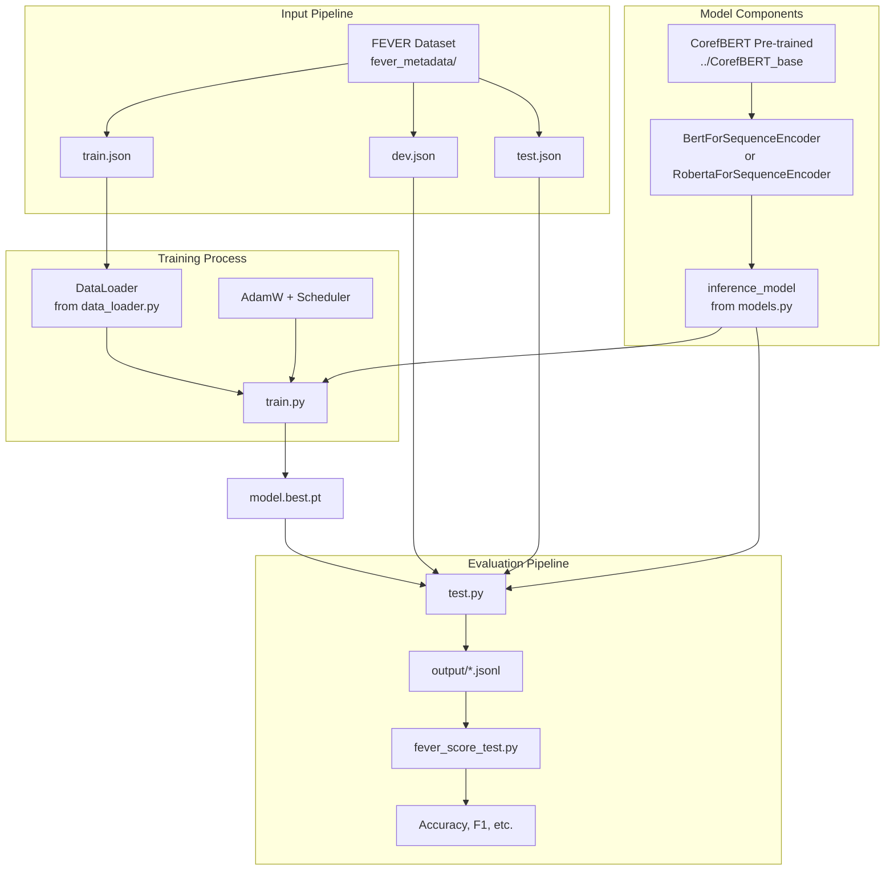
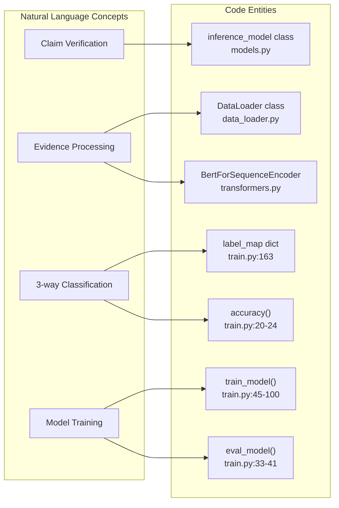
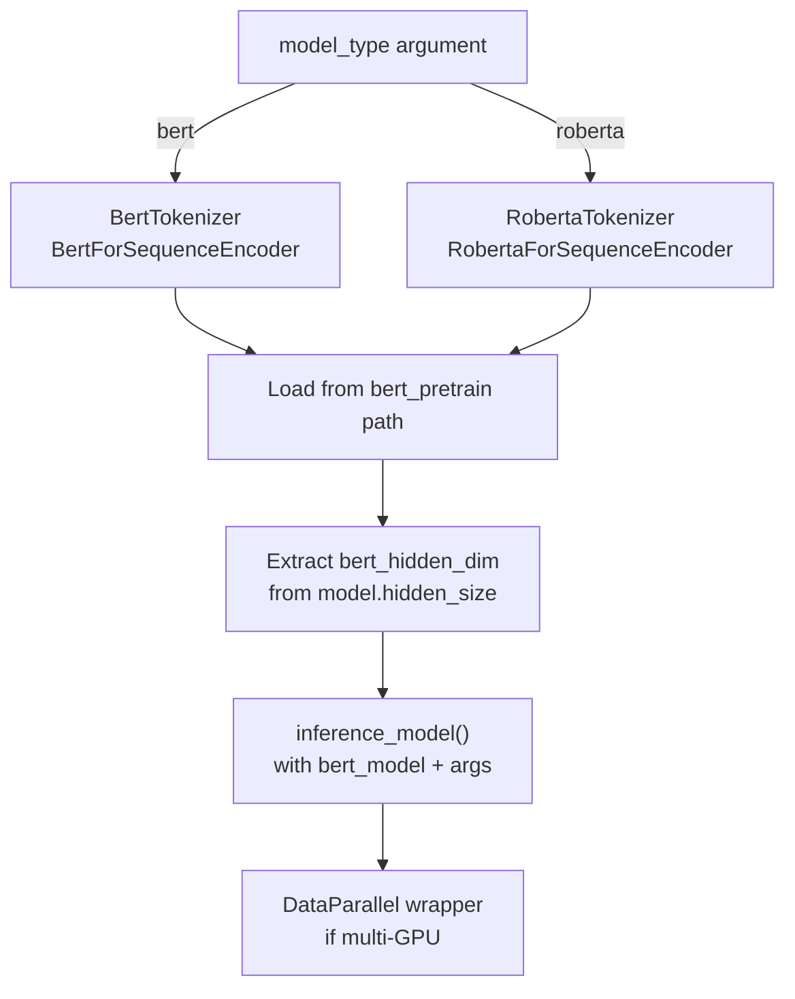
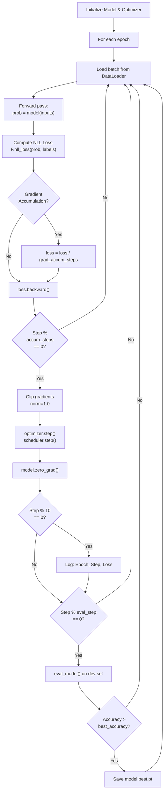
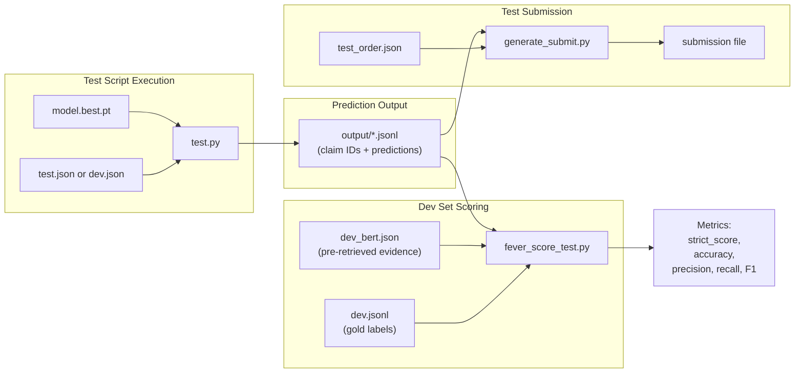
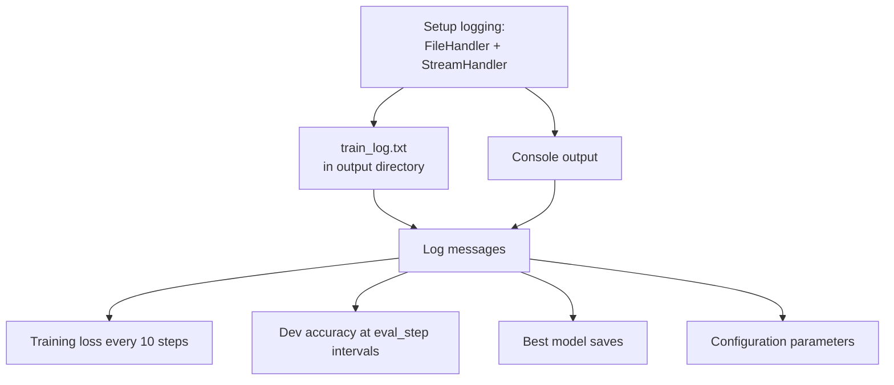

<!-- source: DeepWiki mcp.deepwiki.com · repo thunlp/CorefBERT · page 3.4 FEVER Fact Verification · fetched 2026-11-02 -->

# FEVER Fact Verification

<details>
<summary>Relevant source files</summary>

The following files were used as context for generating this wiki page:

- [FEVER/train.py](FEVER/train.py)
- [README.md](README.md)
- [model.jpg](model.jpg)

</details>


## Purpose and Scope

This page documents the FEVER (Fact Extraction and Verification) task fine-tuning system within CorefBERT. FEVER is a fact verification task that requires models to classify claims as SUPPORTED, REFUTED, or NOT ENOUGH INFO based on evidence from Wikipedia articles. The system adapts code from the KGAT (KernelGAT) project and integrates it with CorefBERT's pre-trained models.

For detailed implementation of the training script, see [FEVER Training Implementation](#3.4.1). For information about the evaluation metrics and scoring system, see [FEVER Scorer](#5).

**Sources:** [README.md:122-141](), [FEVER/train.py:1-191]()

## Task Overview

FEVER is a fact verification benchmark that evaluates a model's ability to verify factual claims against evidence from Wikipedia. The task involves:

1. **Claim Classification**: Classify claims into three categories
2. **Evidence Retrieval**: Identify relevant evidence sentences
3. **Joint Evaluation**: Score both classification accuracy and evidence quality

The CorefBERT implementation focuses on the classification component, leveraging pre-retrieved evidence from the KGAT preprocessing pipeline.

### Label Taxonomy

| Label | Numeric ID | Description |
|-------|-----------|-------------|
| SUPPORTS | 0 | Claim is supported by evidence |
| REFUTES | 1 | Claim is refuted by evidence |
| NOT ENOUGH INFO | 2 | Insufficient evidence to verify |

**Sources:** [FEVER/train.py:163]()

## System Architecture

The FEVER system integrates three major components: CorefBERT's pre-trained encoder, KGAT's graph-based reasoning architecture, and a custom evaluation pipeline.



**Diagram: FEVER System Architecture and Data Flow**

**Sources:** [README.md:122-141](), [FEVER/train.py:10-12,164-169]()

## Code Entity Mapping

The following diagram maps natural language concepts to specific code entities in the FEVER implementation:



**Diagram: Natural Language to Code Entity Mapping**

**Sources:** [FEVER/train.py:10-12,20-41,45-100,163]()

## Data Preparation

### Dataset Sources

The FEVER dataset must be downloaded separately and preprocessed using KGAT tools:

1. **Original Dataset**: Available from the [FEVER Codalab competition](https://competitions.codalab.org/competitions/18814)
2. **Preprocessed Data**: Available from Google Drive or Tsinghua Cloud (see repository README)
3. **Expected Format**: JSON files with claim-evidence pairs and labels

### Data Directory Structure

```
fever_metadata/
├── train.json          # Training set
├── dev.json            # Development set  
├── dev_bert.json       # Pre-retrieved evidence for dev
├── test.json           # Test set
└── test_order.json     # Test set ordering information
```

The preprocessed data includes pre-retrieved evidence sentences, allowing the model to focus on the verification task rather than evidence retrieval.

**Sources:** [README.md:124]()

## Model Integration

### Transformer Encoder Selection

The system supports both BERT and RoBERTa encoders from the custom transformers library:



**Diagram: Model Type Selection and Initialization Flow**

**Sources:** [FEVER/train.py:164-172,183-188]()

### Inference Model Architecture

The `inference_model` class (defined in `models.py`) wraps the transformer encoder and adds task-specific components:

| Component | Purpose |
|-----------|---------|
| Encoder | Encodes claim and evidence pairs using CorefBERT |
| Graph Layer | Applies graph attention mechanisms (from KGAT) |
| Pooling | Aggregates evidence representations |
| Classification Head | Produces 3-way classification logits |

Key architectural parameters:

- `--pool`: Aggregation method (att, max, mean, concat, sum, top)
- `--layer`: Number of graph layers (default: 1)
- `--evi_num`: Number of evidence sentences to process (default: 5)
- `--kernel`: Kernel size for graph convolution (default: 21)

**Sources:** [FEVER/train.py:11,121-126,183]()

## Training Configuration

### Command-Line Interface

The training process is initiated via `train.py` with extensive configuration options:

```bash
CUDA_VISIBLE_DEVICES=0,1,2,3 python3 train.py \
    --model_type bert \
    --bert_pretrain ../CorefBERT_base \
    --learning_rate 2e-5 \
    --num_train_epochs 3 \
    --train_path fever_metadata/train.json \
    --valid_path fever_metadata/dev.json \
    --train_batch_size 32 \
    --valid_batch_size 32 \
    --outdir FEVER_CorefBERT_base
```

**Sources:** [README.md:127-129]()

### Hyperparameter Overview

| Parameter | Default | Purpose |
|-----------|---------|---------|
| `--model_type` | *required* | Encoder type: "bert" or "roberta" |
| `--bert_pretrain` | *required* | Path to pre-trained CorefBERT model |
| `--learning_rate` | 2e-5 | Initial learning rate for AdamW |
| `--num_train_epochs` | 3.0 | Total training epochs |
| `--train_batch_size` | 32 | Training batch size |
| `--valid_batch_size` | 32 | Validation batch size |
| `--max_len` | 130 | Maximum sequence length |
| `--warmup_proportion` | 0.1 | Warmup steps as proportion of total |
| `--gradient_accumulation_steps` | 1 | Steps to accumulate gradients |
| `--eval_step` | 1000 | Evaluation frequency (in steps) |
| `--weight_decay` | 0 | L2 regularization weight |
| `--dropout` | 0.6 | Dropout probability |

**Sources:** [FEVER/train.py:110-149]()

## Training Loop Implementation

### Core Training Process



**Diagram: Training Loop Control Flow**

**Sources:** [FEVER/train.py:45-100]()

### Optimization Strategy

The training uses the AdamW optimizer with linear warmup scheduling:

1. **Optimizer Configuration**: AdamW with weight decay only on non-bias/non-LayerNorm parameters
2. **Learning Rate Schedule**: Linear warmup followed by linear decay
3. **Gradient Clipping**: Maximum norm of 1.0 to prevent exploding gradients
4. **Gradient Accumulation**: Supports accumulation for effective larger batch sizes

**Sources:** [FEVER/train.py:52-58,81-84]()

### Evaluation During Training

The `eval_model()` function evaluates the model on the validation set:

```python
def eval_model(model, validset_reader):
    model.eval()
    correct_pred = 0.0
    for index, data in enumerate(validset_reader):
        inputs, lab_tensor = data
        prob = model(inputs)
        correct_pred += correct_prediction(prob, lab_tensor)
    dev_accuracy = correct_pred / validset_reader.total_num
    return dev_accuracy
```

The function:
1. Sets model to evaluation mode
2. Iterates through validation batches
3. Computes predictions via `model(inputs)`
4. Counts correct predictions
5. Returns overall accuracy

Models are saved when validation accuracy improves, creating checkpoints at `{outdir}/model.best.pt`.

**Sources:** [FEVER/train.py:33-41,89-100]()

## Testing and Evaluation

### Development Set Evaluation

```bash
# Run inference on dev set
CUDA_VISIBLE_DEVICES=0,1,2,3 python3 test.py \
    --model_type bert \
    --outdir output/ \
    --test_path fever_metadata/dev.json \
    --bert_pretrain ../CorefBERT_base \
    --batch_size 32 \
    --checkpoint FEVER_CorefBERT_base/model.best.pt \
    --name dev.jsonl

# Compute FEVER scores
python3 fever_score_test.py \
    --predicted_labels output/dev.jsonl \
    --predicted_evidence fever_metadata/dev_bert.json \
    --actual fever_metadata/dev.jsonl
```

**Sources:** [README.md:133-136]()

### Test Set Evaluation

```bash
# Run inference on test set
CUDA_VISIBLE_DEVICES=0,1,2,3 python3 test.py \
    --model_type bert \
    --test_path fever_metadata/test.json \
    --bert_pretrain ../CorefBERT_base \
    --batch_size 32 \
    --checkpoint FEVER_CorefBERT_base/model.best.pt \
    --name test.jsonl

# Generate submission file
python3 generate_submit.py \
    --predict output/test.jsonl \
    --original fever_metadata/test.json \
    --order fever_metadata/test_order.json
```

**Sources:** [README.md:138-141]()

### Evaluation Pipeline



**Diagram: Testing and Evaluation Pipeline**

**Sources:** [README.md:133-141]()

## Multi-GPU Support

The system automatically uses `torch.nn.DataParallel` when multiple GPUs are available:

```python
ori_model = inference_model(bert_model, args)
if torch.cuda.device_count() > 1:
    model = nn.DataParallel(ori_model)
else:
    model = ori_model
model = model.cuda()
```

This enables data-parallel training across multiple GPUs without code changes. The original model (`ori_model`) is preserved for checkpoint saving to avoid DataParallel wrapper serialization.

**Sources:** [FEVER/train.py:183-188]()

## Integration with KGAT Codebase

The FEVER implementation is based on the KGAT (KernelGAT) codebase, which provides:

1. **Graph Attention Networks**: For reasoning over evidence graphs
2. **Data Processing**: Pre-retrieval and formatting of evidence sentences
3. **Model Architecture**: `inference_model` class with graph-based reasoning

Key KGAT-derived components:

| Component | Location | Purpose |
|-----------|----------|---------|
| `inference_model` | `models.py` | Main model class with graph attention |
| `DataLoader` | `data_loader.py` | Custom data loading for claim-evidence pairs |
| Evidence preprocessing | Pre-provided data | Pre-retrieved evidence sentences |

**Sources:** [README.md:124](), [FEVER/train.py:11-12]()

## Logging and Monitoring

The training script provides comprehensive logging:



**Diagram: Logging Infrastructure**

Log messages include:
- Training progress: epoch, step, running loss
- Validation results: development accuracy
- Model checkpoints: saved epochs and accuracy
- Hyperparameters: full argument configuration

**Sources:** [FEVER/train.py:156-159]()

## Key Design Decisions

### Label Encoding

The system uses a fixed label mapping that converts string labels to integer IDs:

```python
label_map = {'SUPPORTS': 0, 'REFUTES': 1, 'NOT ENOUGH INFO': 2}
```

This mapping is passed to the `DataLoader` for consistent encoding during training and evaluation.

### Loss Function

The model uses negative log-likelihood loss (`F.nll_loss`), which expects log-probabilities from the model. The `inference_model` must output log-softmax values compatible with this loss.

### Model Saving Strategy

Only the best-performing model on the development set is saved, determined by validation accuracy. The checkpoint includes:
- Epoch number
- Model state dict (from `ori_model` to avoid DataParallel wrapper)
- Best accuracy achieved

**Sources:** [FEVER/train.py:72,97-100,163,175-179]()

---

