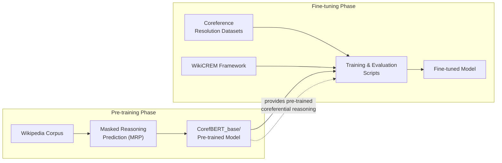
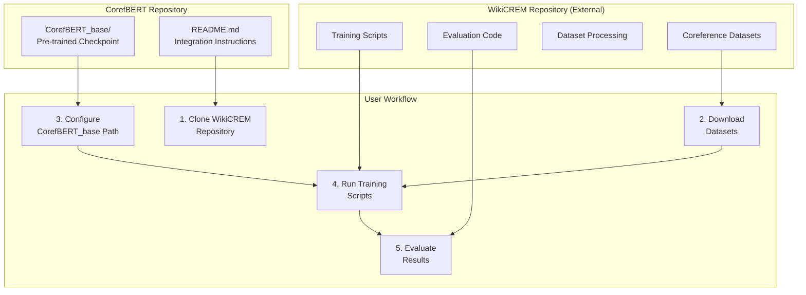
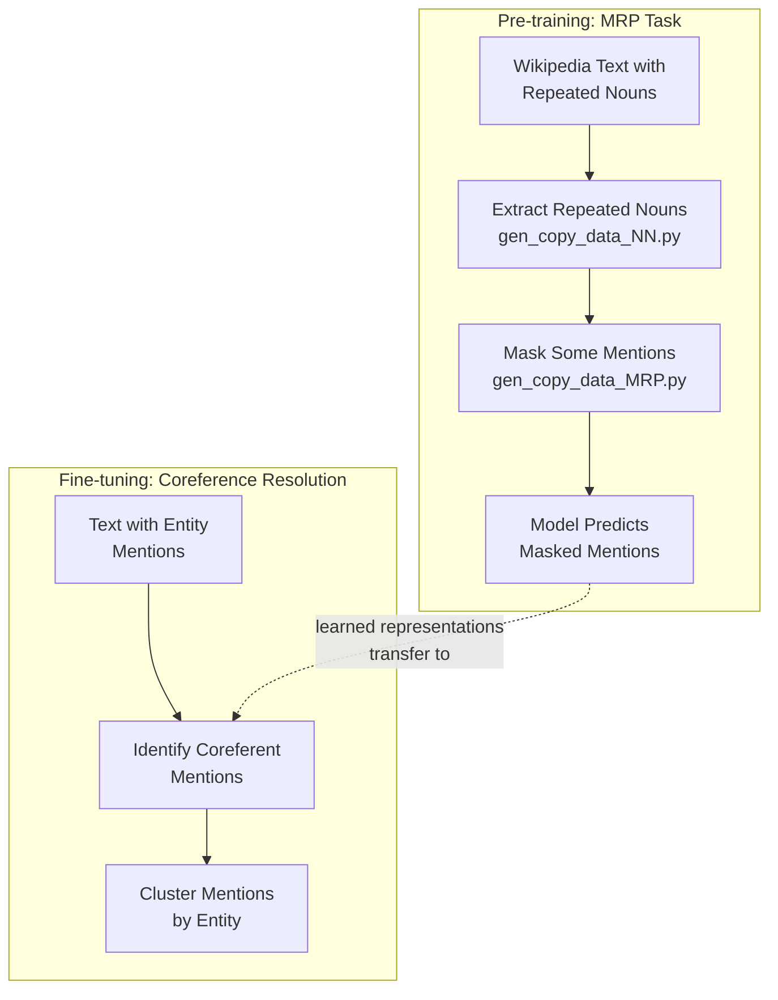
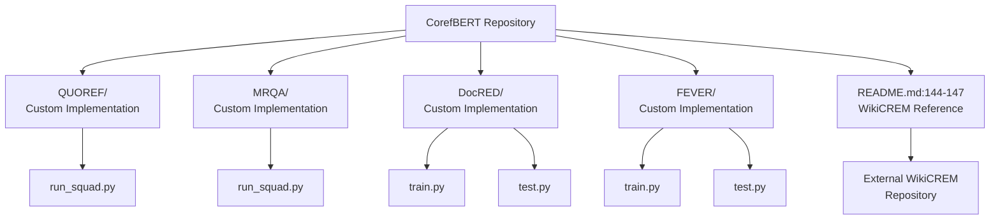

<!-- source: DeepWiki mcp.deepwiki.com · repo thunlp/CorefBERT · page 3.5 Coreference Resolution · fetched 2026-11-02 -->

# Coreference Resolution

<details>
<summary>Relevant source files</summary>

The following files were used as context for generating this wiki page:

- [README.md](README.md)
- [model.jpg](model.jpg)

</details>


## Purpose and Scope

This page documents how to use CorefBERT for coreference resolution tasks, including integration with the WikiCREM framework and available datasets. Coreference resolution is one of the downstream fine-tuning tasks that directly evaluates CorefBERT's core capability for coreferential reasoning.

For information about other fine-tuning tasks, see [QUOREF Question Answering](#3.1), [MRQA Tasks](#3.2), [DocRED Relation Extraction](#3.3), and [FEVER Fact Verification](#3.4). For details about CorefBERT's pre-training methodology that enables coreferential reasoning, see [Pre-training System](#2).

**Sources:** [README.md:144-147]()

---

## Overview

Coreference resolution is the task of identifying all expressions in text that refer to the same entity. This is a natural application for CorefBERT because the model's pre-training objective (Masked Reasoning Prediction) explicitly teaches the model to understand coreferential relationships between mentions.

Unlike the other fine-tuning tasks documented in this repository, coreference resolution leverages external code rather than custom implementation:

| Component | Source | Location |
|-----------|--------|----------|
| Training & Evaluation Code | WikiCREM | External GitHub repository |
| Datasets | WikiCREM | External GitHub repository |
| Base Model | CorefBERT | `CorefBERT_base/` directory |

**Sources:** [README.md:144-147]()

---

## Coreference Resolution in CorefBERT Pipeline



**Diagram: CorefBERT Coreference Resolution Pipeline**

This diagram illustrates how CorefBERT's pre-training on coreferential patterns (MRP objective) provides a foundation that can be fine-tuned using the WikiCREM framework for coreference resolution tasks.

**Sources:** [README.md:20-50](), [README.md:144-147]()

---

## WikiCREM Integration

CorefBERT uses the [WikiCREM](https://github.com/vid-koci/bert-commonsense) (Wiki Common Reference Evaluation Model) codebase for coreference resolution. WikiCREM is an external framework that provides:

1. **Training Scripts**: Code for fine-tuning BERT-based models on coreference resolution
2. **Evaluation Metrics**: Standard coreference resolution evaluation tools
3. **Dataset Processing**: Data loaders and preprocessing for coreference datasets

### Integration Architecture



**Diagram: WikiCREM Integration Architecture**

**Sources:** [README.md:144-147]()

---

## Integration Approach

The CorefBERT repository delegates coreference resolution implementation to WikiCREM rather than providing custom code. This design decision reflects:

1. **Reusability**: WikiCREM already provides comprehensive coreference resolution infrastructure
2. **Compatibility**: WikiCREM is designed to work with BERT-based models, making integration straightforward
3. **Focus**: Allows CorefBERT repository to focus on pre-training and other task-specific implementations

### Setting Up WikiCREM with CorefBERT

To use CorefBERT for coreference resolution:

1. **Clone the WikiCREM repository**:
   ```bash
   git clone https://github.com/vid-koci/bert-commonsense
   cd bert-commonsense
   ```

2. **Download coreference resolution datasets** from the WikiCREM repository

3. **Configure WikiCREM to use CorefBERT**:
   - Point the `--model_name_or_path` parameter to your `CorefBERT_base/` directory
   - The WikiCREM scripts will load the CorefBERT pre-trained weights

4. **Run WikiCREM training scripts** following their documentation, substituting CorefBERT as the base model

**Sources:** [README.md:144-147]()

---

## Available Datasets

WikiCREM provides access to multiple coreference resolution datasets. These datasets test various aspects of coreferential reasoning:

| Dataset Type | Description |
|--------------|-------------|
| Standard Coreference | Traditional entity coreference annotations |
| Common Sense Reasoning | Coreference requiring world knowledge |
| Domain-Specific | Task-focused coreference datasets |

The exact datasets and their formats are documented in the WikiCREM repository.

**Sources:** [README.md:146-147]()

---

## Relationship to CorefBERT Pre-training

Coreference resolution is particularly well-suited to evaluate CorefBERT's pre-training objective:

### Pre-training Objective: Masked Reasoning Prediction (MRP)

During pre-training, CorefBERT learns to predict masked mentions of repeated nouns based on their context. This directly teaches the model coreferential reasoning patterns.



**Diagram: Pre-training to Fine-tuning Transfer for Coreference Resolution**

The pre-training objective creates a model that has already learned to reason about when different mentions refer to the same entity, which directly supports the coreference resolution task.

**Sources:** [README.md:3-5](), [README.md:36-39](), [README.md:144-147]()

---

## Comparison with Other Fine-tuning Tasks

While all CorefBERT fine-tuning tasks benefit from coreferential reasoning, coreference resolution is the most direct application:

| Task | Coreferential Reasoning Role | Implementation |
|------|------------------------------|----------------|
| **Coreference Resolution** | Primary task objective | External (WikiCREM) |
| QUOREF | Required for multi-hop QA | Custom (`QUOREF/run_squad.py`) |
| MRQA | Helpful for answer extraction | Custom (`MRQA/run_squad.py`) |
| DocRED | Needed for entity relation extraction | Custom (`DocRED/train.py`) |
| FEVER | Useful for evidence linking | Custom (`FEVER/train.py`) |

**Sources:** [README.md:52-141](), [README.md:144-147]()

---

## Code Organization Comparison

Unlike other fine-tuning tasks in the repository, coreference resolution does not have a dedicated directory:



**Diagram: Coreference Resolution vs Other Tasks - Code Organization**

This architectural difference reflects the strategic decision to leverage existing, well-maintained coreference resolution infrastructure rather than duplicating functionality.

**Sources:** [README.md:52-147]()

---

## Model Compatibility

CorefBERT's pre-trained models are compatible with WikiCREM because:

1. **Base Architecture**: CorefBERT extends `bert-base-cased`, which WikiCREM supports
2. **Transformer Format**: Pre-trained checkpoints follow standard Hugging Face format
3. **Tokenization**: Uses the same tokenizer as base BERT models

The pre-trained models can be downloaded from:
- [Google Drive](https://drive.google.com/drive/folders/1JGDxWqvhWCQ58PqD7dAzye3NW5U2pZOp?usp=sharing)
- [Tsinghua Cloud](https://cloud.tsinghua.edu.cn/d/a2eed603edd949b0a663)

**Sources:** [README.md:10](), [README.md:144-147]()

---

## Expected Performance Benefits

CorefBERT's pre-training should provide advantages on coreference resolution tasks compared to standard BERT models:

1. **Direct Transfer**: MRP objective directly teaches coreferential patterns
2. **Entity Understanding**: Enhanced ability to track entities across mentions
3. **Context Awareness**: Better representation of mention context for disambiguation

The exact performance improvements depend on the specific coreference resolution dataset and evaluation metrics used.

**Sources:** [README.md:3-5](), [README.md:144-147]()

---

## Summary

Coreference resolution represents the most direct application of CorefBERT's pre-training objective. The integration with WikiCREM allows users to leverage CorefBERT's enhanced coreferential reasoning capabilities through an established framework without requiring custom implementation code within the CorefBERT repository.

**Key Points:**
- Uses external WikiCREM codebase for implementation
- Datasets available through WikiCREM repository
- Most direct evaluation of CorefBERT's core pre-training objective
- Requires manual integration following WikiCREM documentation

**Sources:** [README.md:144-147]()

---

