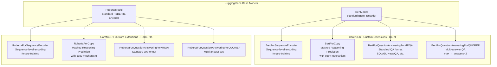
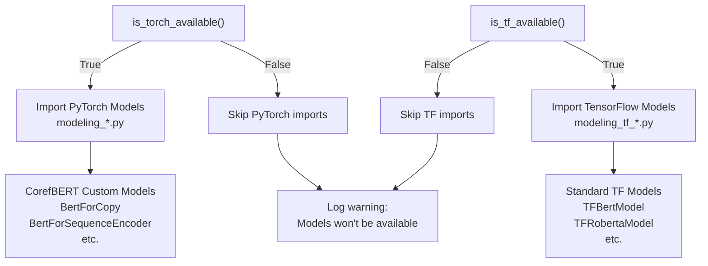
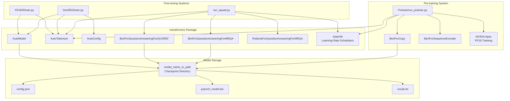
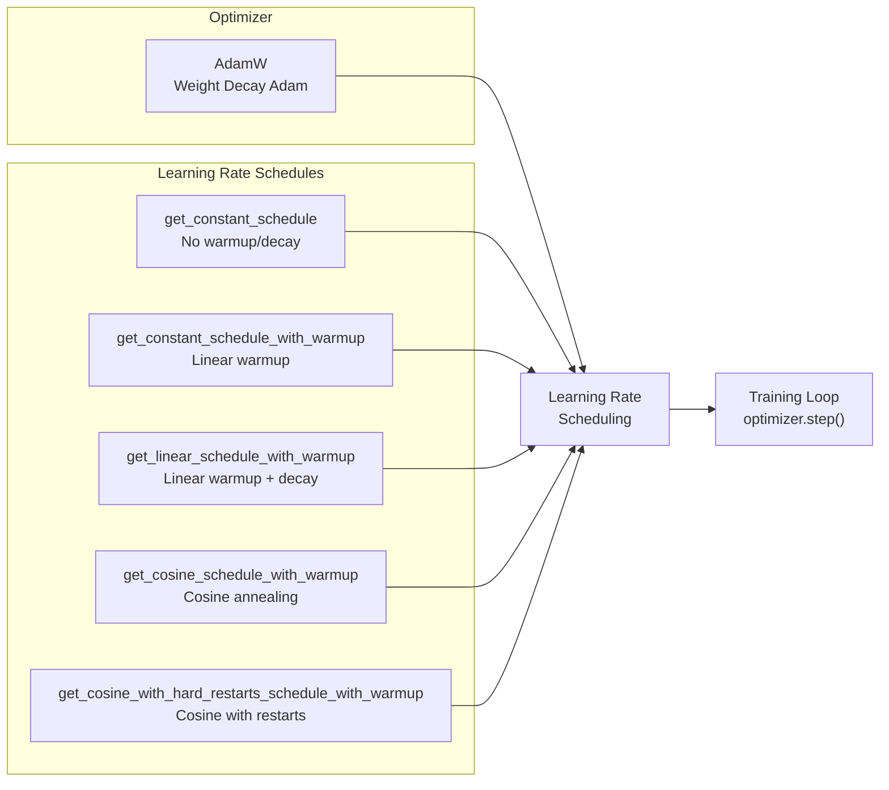
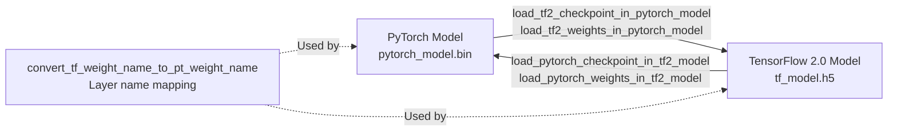

<!-- source: DeepWiki mcp.deepwiki.com · repo thunlp/CorefBERT · page 4 Transformers Library · fetched 2026-11-02 -->

# Transformers Library

<details>
<summary>Relevant source files</summary>

The following files were used as context for generating this wiki page:

- [transformers/__init__.py](transformers/__init__.py)

</details>


## Purpose and Scope

The `transformers/` package is a custom fork and extension of the Hugging Face transformers library (version 2.1.1) that provides the neural network model architectures for CorefBERT. This library maintains compatibility with standard transformers components while adding CorefBERT-specific model classes for coreferential reasoning and task-specific fine-tuning.

This page documents the package structure, custom model extensions, and integration patterns. For information about specific model usage during pre-training, see [Pre-training Execution](#2.2). For task-specific fine-tuning implementations, see [Fine-tuning Systems](#3). For details about custom model architectures, see [Model Extensions](#4.2).

**Sources:** [transformers/__init__.py:1-185]()

## Package Overview

The transformers package serves as the neural architecture layer for CorefBERT, providing:

- **Base Components**: Standard tokenizers, configurations, and model classes from Hugging Face
- **Custom Extensions**: CorefBERT-specific model architectures for sequence encoding and specialized tasks
- **Framework Support**: Both PyTorch and TensorFlow 2.0+ implementations (with primary focus on PyTorch)
- **Auto Classes**: Automatic model/tokenizer/config selection based on model type

The package follows Hugging Face's modular design pattern, organizing components into tokenization, configuration, and modeling modules.

**Sources:** [transformers/__init__.py:1-185]()

## Package Structure

```mermaid
graph TB
    INIT["transformers/__init__.py<br/>Package Entry Point"]
    
    subgraph "Utility Components"
        FILEUTILS["file_utils.py<br/>TRANSFORMERS_CACHE<br/>cached_path<br/>WEIGHTS_NAME"]
        DATA["data.py<br/>InputExample<br/>DataProcessor<br/>glue_*"]
    end
    
    subgraph "Tokenization Layer"
        TOKUTILS["tokenization_utils.py<br/>PreTrainedTokenizer"]
        TOKAUTO["tokenization_auto.py<br/>AutoTokenizer"]
        TOKBERT["tokenization_bert.py<br/>BertTokenizer<br/>BasicTokenizer<br/>WordpieceTokenizer"]
        TOKROBERTA["tokenization_roberta.py<br/>RobertaTokenizer"]
        TOKOTHERS["Other Tokenizers<br/>GPT2, XLNet, etc."]
    end
    
    subgraph "Configuration Layer"
        CONFIGUTILS["configuration_utils.py<br/>PretrainedConfig"]
        CONFIGAUTO["configuration_auto.py<br/>AutoConfig"]
        CONFIGBERT["configuration_bert.py<br/>BertConfig<br/>BERT_PRETRAINED_CONFIG_ARCHIVE_MAP"]
        CONFIGROBERTA["configuration_roberta.py<br/>RobertaConfig"]
    end
    
    subgraph "PyTorch Modeling Layer"
        MODELUTILS["modeling_utils.py<br/>PreTrainedModel<br/>prune_layer<br/>Conv1D"]
        MODELAUTO["modeling_auto.py<br/>AutoModel<br/>AutoModelForSequenceClassification<br/>AutoModelForQuestionAnswering"]
        MODELBERT["modeling_bert.py<br/>Base + Custom Classes"]
        MODELROBERTA["modeling_roberta.py<br/>Base + Custom Classes"]
    end
    
    subgraph "TensorFlow Modeling Layer"
        TFUTILS["modeling_tf_utils.py<br/>TFPreTrainedModel"]
        TFAUTO["modeling_tf_auto.py<br/>TFAutoModel"]
        TFBERT["modeling_tf_bert.py"]
    end
    
    subgraph "Optimization"
        OPT["optimization.py<br/>AdamW<br/>get_*_schedule"]
    end
    
    INIT --> FILEUTILS
    INIT --> DATA
    INIT --> TOKUTILS
    INIT --> TOKAUTO
    INIT --> TOKBERT
    INIT --> TOKROBERTA
    INIT --> TOKOTHERS
    INIT --> CONFIGUTILS
    INIT --> CONFIGAUTO
    INIT --> CONFIGBERT
    INIT --> CONFIGROBERTA
    INIT --> MODELUTILS
    INIT --> MODELAUTO
    INIT --> MODELBERT
    INIT --> MODELROBERTA
    INIT --> TFUTILS
    INIT --> TFAUTO
    INIT --> TFBERT
    INIT --> OPT
```



The package is organized into four main layers:

1. **Utility Layer**: File handling, caching, and data processing utilities
2. **Tokenization Layer**: Text-to-token conversion for various model architectures
3. **Configuration Layer**: Model hyperparameter and architecture definitions
4. **Modeling Layer**: Neural network implementations (PyTorch and TensorFlow)

**Sources:** [transformers/__init__.py:19-180]()

## Base Components from Hugging Face

The transformers package imports and exposes standard Hugging Face components that serve as the foundation for CorefBERT extensions.

### Tokenization Components

| Component | Purpose | Source Lines |
|-----------|---------|--------------|
| `PreTrainedTokenizer` | Base class for all tokenizers | [transformers/__init__.py:34]() |
| `AutoTokenizer` | Automatic tokenizer selection | [transformers/__init__.py:35]() |
| `BertTokenizer` | BERT-specific tokenization | [transformers/__init__.py:36]() |
| `BasicTokenizer` | Character-level tokenization | [transformers/__init__.py:36]() |
| `WordpieceTokenizer` | Subword tokenization | [transformers/__init__.py:36]() |
| `RobertaTokenizer` | RoBERTa-specific tokenization | [transformers/__init__.py:43]() |

### Configuration Components

| Component | Purpose | Source Lines |
|-----------|---------|--------------|
| `PretrainedConfig` | Base configuration class | [transformers/__init__.py:48]() |
| `AutoConfig` | Automatic config selection | [transformers/__init__.py:49]() |
| `BertConfig` | BERT model configuration | [transformers/__init__.py:50]() |
| `RobertaConfig` | RoBERTa model configuration | [transformers/__init__.py:58]() |
| `*_PRETRAINED_CONFIG_ARCHIVE_MAP` | Pretrained config mappings | [transformers/__init__.py:50-60]() |

### Base Model Components

| Component | Purpose | Source Lines |
|-----------|---------|--------------|
| `PreTrainedModel` | Base PyTorch model class | [transformers/__init__.py:64]() |
| `AutoModel` | Automatic model selection | [transformers/__init__.py:65-66]() |
| `BertPreTrainedModel` | BERT base class | [transformers/__init__.py:68]() |
| `BertModel` | Standard BERT encoder | [transformers/__init__.py:68]() |

**Sources:** [transformers/__init__.py:34-110]()

## Custom CorefBERT Extensions

The transformers package adds custom model classes specifically designed for CorefBERT's coreferential reasoning and downstream tasks.



### BERT Custom Classes

The package exports four custom BERT-based classes:

**`BertForSequenceEncoder`** - Encodes entire sequences for sequence-level tasks. Used during pre-training for learning contextual representations.

**`BertForCopy`** - Implements the Masked Reasoning Prediction (MRP) objective with a copy mechanism. This is the core pre-training model for CorefBERT.

**`BertForQuestionAnsweringForMRQA`** - Extends BERT for standard question answering tasks following the MRQA format. Used for SQuAD, NewsQA, TriviaQA, SearchQA, HotpotQA, and NaturalQuestions.

**`BertForQuestionAnsweringForQUOREF`** - Specialized for QUOREF dataset which requires predicting multiple answer spans per question (`max_n_answers=2`).

**Sources:** [transformers/__init__.py:68-74]()

### RoBERTa Custom Classes

The package provides parallel RoBERTa implementations of the same custom architectures:

**`RobertaForSequenceEncoder`** - RoBERTa variant for sequence encoding.

**`RobertaForCopy`** - RoBERTa implementation of MRP pre-training with copy mechanism.

**`RobertaForQuestionAnsweringForMRQA`** - RoBERTa variant for standard QA tasks.

**`RobertaForQuestionAnsweringForQUOREF`** - RoBERTa variant for multi-answer QA.

**Sources:** [transformers/__init__.py:95-101]()

## Framework Compatibility

The transformers package supports both PyTorch and TensorFlow 2.0+ frameworks through conditional imports:



### PyTorch Support

PyTorch is the primary framework for CorefBERT. All custom extensions are implemented in PyTorch:

- **Model Classes**: All CorefBERT-specific models (`BertForCopy`, `BertForSequenceEncoder`, etc.)
- **Optimization**: `AdamW` optimizer and learning rate schedulers (`get_linear_schedule_with_warmup`, `get_cosine_schedule_with_warmup`)
- **Utilities**: `PreTrainedModel`, `prune_layer`, `Conv1D`

**Sources:** [transformers/__init__.py:63-115]()

### TensorFlow Support

TensorFlow 2.0+ implementations are provided for standard models but **not for CorefBERT custom extensions**:

- **Standard Models**: `TFBertModel`, `TFRobertaModel`, `TFGPTModel`, etc.
- **Auto Classes**: `TFAutoModel`, `TFAutoModelForSequenceClassification`
- **Custom Extensions**: Not implemented in TensorFlow

The TensorFlow implementations are imported separately and prefixed with `TF`:

**Sources:** [transformers/__init__.py:119-171]()

### Framework Detection

The package includes runtime framework detection with fallback behavior:

```python
if not is_tf_available() and not is_torch_available():
    logger.warning("Neither PyTorch nor TensorFlow >= 2.0 have been found."
                   "Models won't be available and only tokenizers, configuration"
                   "and file/data utilities can be used.")
```

**Sources:** [transformers/__init__.py:181-184]()

## Integration with CorefBERT Systems

The transformers package integrates with CorefBERT's pre-training and fine-tuning systems through standardized interfaces:



### Pre-training Integration

Pre-training scripts import and instantiate custom CorefBERT models:

- **Model Classes**: `BertForCopy` for MRP objective, `BertForSequenceEncoder` for encoding
- **Tokenizers**: `BertTokenizer` or `RobertaTokenizer` for text processing
- **Optimization**: `AdamW` optimizer with linear warmup scheduling
- **FP16 Support**: Integration with NVIDIA Apex for mixed precision training

**Sources:** [transformers/__init__.py:64-115]()

### Fine-tuning Integration

Fine-tuning scripts use both standard and custom models depending on the task:

| Task | Model Class | Script |
|------|-------------|--------|
| QUOREF | `BertForQuestionAnsweringForQUOREF` | `run_squad.py` |
| MRQA (SQuAD, etc.) | `BertForQuestionAnsweringForMRQA` | `run_squad.py` |
| DocRED | `AutoModel` + custom classifier | `DocRED/train.py` |
| FEVER | `AutoModel` + KGAT architecture | `FEVER/train.py` |

**Sources:** [transformers/__init__.py:65-101]()

### Model Loading Pattern

All systems use the transformers package's standardized loading pattern:

1. **Load Configuration**: `config = AutoConfig.from_pretrained(model_name_or_path)`
2. **Load Tokenizer**: `tokenizer = AutoTokenizer.from_pretrained(model_name_or_path)`
3. **Load Model**: `model = ModelClass.from_pretrained(model_name_or_path, config=config)`
4. **Save Checkpoint**: `model.save_pretrained(output_dir)`

This pattern ensures compatibility with both pre-trained and fine-tuned models.

**Sources:** [transformers/__init__.py:35-101]()

## Optimization Components

The transformers package includes PyTorch optimization utilities used across pre-training and fine-tuning:



### AdamW Optimizer

`AdamW` is a variant of Adam that decouples weight decay from gradient-based updates, improving regularization:

```
AdamW(params, lr=5e-5, betas=(0.9, 0.999), eps=1e-8, weight_decay=0.01)
```

**Sources:** [transformers/__init__.py:114-115]()

### Learning Rate Schedulers

The package provides five learning rate scheduling strategies:

| Scheduler | Pattern | Use Case |
|-----------|---------|----------|
| `get_constant_schedule` | Constant learning rate | Baseline experiments |
| `get_constant_schedule_with_warmup` | Linear warmup, then constant | Short training |
| `get_linear_schedule_with_warmup` | Linear warmup, then linear decay | **Most common for fine-tuning** |
| `get_cosine_schedule_with_warmup` | Linear warmup, then cosine decay | Smooth convergence |
| `get_cosine_with_hard_restarts_schedule_with_warmup` | Cosine with periodic restarts | Long training with restarts |

CorefBERT typically uses `get_linear_schedule_with_warmup` for both pre-training and fine-tuning.

**Sources:** [transformers/__init__.py:114-115]()

## Version and Dependencies

The transformers package is versioned at `2.1.1`, indicating it's based on an earlier version of Hugging Face transformers (circa 2019-2020):

```python
__version__ = "2.1.1"
```

### Key Dependencies

The package handles optional dependencies gracefully:

- **TensorFlow**: Optional, detected via `is_tf_available()`
- **PyTorch**: Required for CorefBERT functionality
- **scikit-learn**: Optional, for GLUE metrics
- **absl-py**: Logging compatibility layer for TensorFlow

### Compatibility Note

The package includes a workaround for TensorFlow's `absl.logging` behavior that can interfere with Python's standard logging:

**Sources:** [transformers/__init__.py:1-13]()

## Cross-Framework Utilities

The package includes utilities for converting models between PyTorch and TensorFlow:



These utilities enable:

1. **Weight Name Conversion**: Mapping between PyTorch and TensorFlow layer naming conventions
2. **Checkpoint Loading**: Loading checkpoints across frameworks
3. **Weight Transfer**: Transferring trained weights between frameworks
4. **Model Conversion**: Complete model conversion preserving architecture

**Note**: CorefBERT custom extensions (`BertForCopy`, etc.) are only implemented in PyTorch, so these utilities apply only to standard models.

**Sources:** [transformers/__init__.py:172-179]()

## Usage Examples

### Pre-training with Custom Models

```python
from transformers import BertTokenizer, BertForCopy, AdamW, get_linear_schedule_with_warmup

# Load tokenizer and model
tokenizer = BertTokenizer.from_pretrained('bert-base-cased')
model = BertForCopy.from_pretrained('bert-base-cased')

# Setup optimizer and scheduler
optimizer = AdamW(model.parameters(), lr=5e-5, weight_decay=0.01)
scheduler = get_linear_schedule_with_warmup(
    optimizer, 
    num_warmup_steps=10000,
    num_training_steps=100000
)

# Training loop uses model for MRP objective
```

### Fine-tuning for Question Answering

```python
from transformers import BertTokenizer, BertForQuestionAnsweringForQUOREF

# Load pre-trained CorefBERT
tokenizer = BertTokenizer.from_pretrained('thunlp/CorefBERT_base')
model = BertForQuestionAnsweringForQUOREF.from_pretrained('thunlp/CorefBERT_base')

# Fine-tune on QUOREF dataset (supports multiple answers)
```

### Using Auto Classes

```python
from transformers import AutoTokenizer, AutoModel, AutoConfig

# Automatically detect model type from checkpoint
config = AutoConfig.from_pretrained('thunlp/CorefBERT_base')
tokenizer = AutoTokenizer.from_pretrained('thunlp/CorefBERT_base')
model = AutoModel.from_pretrained('thunlp/CorefBERT_base')
```

**Sources:** [transformers/__init__.py:34-101]()

## Summary

The transformers package is CorefBERT's neural architecture layer, providing:

- **Foundation**: Standard Hugging Face transformers components
- **Extensions**: Four custom model classes per base architecture (BERT/RoBERTa)
- **Purpose-Built Models**: Specialized architectures for MRP pre-training and multi-answer QA
- **Framework Support**: Primary PyTorch support with TensorFlow for standard models
- **Integration**: Standardized interfaces for pre-training and fine-tuning systems

The custom extensions (`BertForCopy`, `BertForSequenceEncoder`, task-specific QA models) differentiate CorefBERT from standard BERT while maintaining full compatibility with the transformers ecosystem.

**Sources:** [transformers/__init__.py:1-185]()

---

