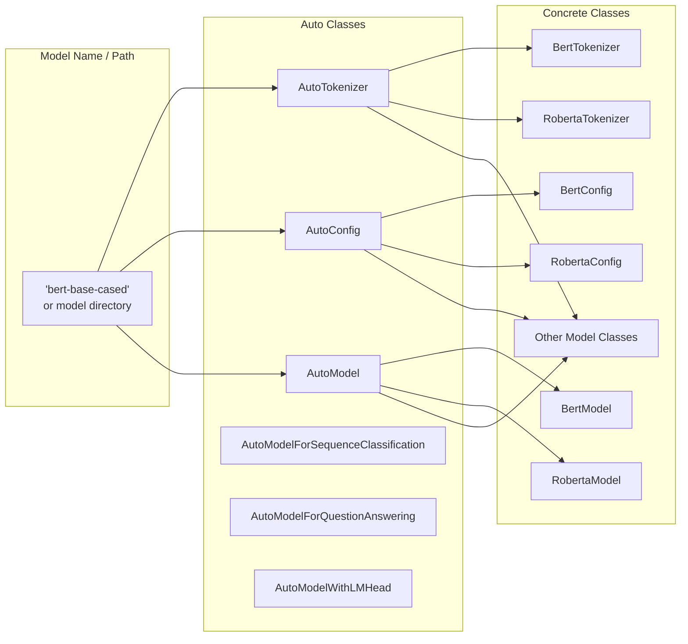
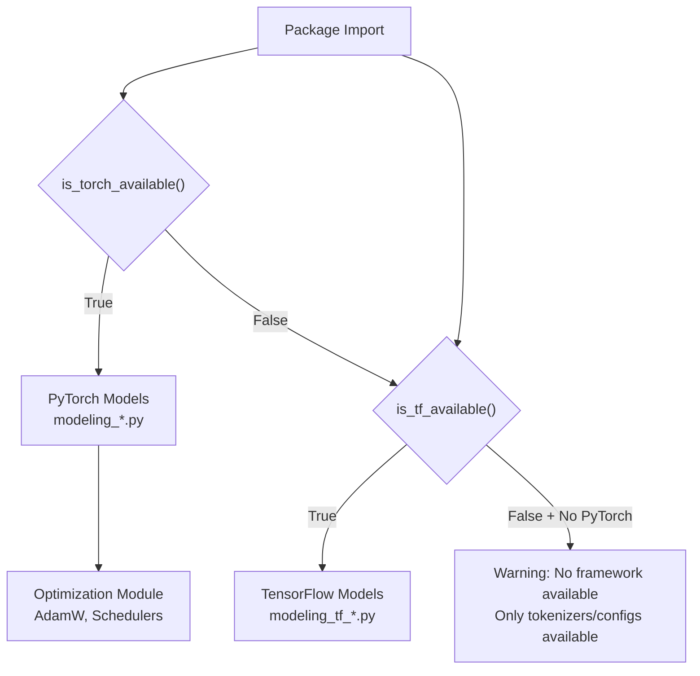
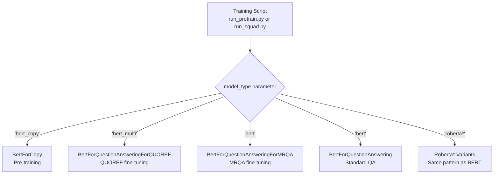

<!-- source: DeepWiki mcp.deepwiki.com · repo thunlp/CorefBERT · page 4.1 Package Architecture · fetched 2026-11-02 -->

# Package Architecture

<details>
<summary>Relevant source files</summary>

The following files were used as context for generating this wiki page:

- [transformers/__init__.py](transformers/__init__.py)

</details>


## Purpose and Scope

This document explains the architecture of the custom `transformers/` package included in the CorefBERT repository. This package is a modified version of the Hugging Face Transformers library (version 2.1.1) with custom model extensions for coreferential reasoning tasks.

For detailed documentation of the custom model classes themselves, see [Model Extensions](#4.2). For information about how this package is used in pre-training, see [Pre-training Execution](#2.2). For fine-tuning usage patterns, see [Fine-tuning Systems](#3).

**Sources:** [transformers/__init__.py:1-185]()

## Package Overview

The `transformers/` package provides:
- A base framework for tokenizers, configurations, and models
- Auto classes for automatic model/tokenizer selection
- Support for both PyTorch and TensorFlow 2.0
- Custom model extensions for CorefBERT tasks
- Data utilities and optimization functions

The package maintains backward compatibility with Hugging Face Transformers while adding specialized classes for masked reasoning prediction (MRP) pre-training and task-specific fine-tuning variants.

**Sources:** [transformers/__init__.py:1-185]()

## Module Organization

The package is organized into several functional modules that work together to provide a complete transformer modeling framework:

```mermaid
graph TB
    INIT["__init__.py<br/>Package Entry Point"]
    
    subgraph "Core Utilities"
        FILE["file_utils<br/>Caching & File Ops"]
        DATA["data<br/>Data Processing"]
    end
    
    subgraph "Tokenization Layer"
        TOK_UTILS["tokenization_utils<br/>PreTrainedTokenizer"]
        TOK_AUTO["tokenization_auto<br/>AutoTokenizer"]
        TOK_BERT["tokenization_bert<br/>BertTokenizer"]
        TOK_ROBERTA["tokenization_roberta<br/>RobertaTokenizer"]
        TOK_OTHER["Other Tokenizers<br/>GPT2, XLNet, etc."]
    end
    
    subgraph "Configuration Layer"
        CONF_UTILS["configuration_utils<br/>PretrainedConfig"]
        CONF_AUTO["configuration_auto<br/>AutoConfig"]
        CONF_BERT["configuration_bert<br/>BertConfig"]
        CONF_ROBERTA["configuration_roberta<br/>RobertaConfig"]
        CONF_OTHER["Other Configs"]
    end
    
    subgraph "Modeling Layer - PyTorch"
        MOD_UTILS["modeling_utils<br/>PreTrainedModel"]
        MOD_AUTO["modeling_auto<br/>AutoModel*"]
        MOD_BERT["modeling_bert<br/>BertModel & Extensions"]
        MOD_ROBERTA["modeling_roberta<br/>RobertaModel & Extensions"]
        MOD_OTHER["Other Models"]
    end
    
    subgraph "Modeling Layer - TensorFlow"
        TF_UTILS["modeling_tf_utils<br/>TFPreTrainedModel"]
        TF_AUTO["modeling_tf_auto<br/>TFAutoModel*"]
        TF_MODELS["TF Model Classes"]
    end
    
    subgraph "Optimization"
        OPT["optimization<br/>AdamW & Schedulers"]
    end
    
    INIT --> FILE
    INIT --> DATA
    INIT --> TOK_UTILS
    INIT --> CONF_UTILS
    INIT --> MOD_UTILS
    INIT --> TF_UTILS
    INIT --> OPT
    
    TOK_UTILS --> TOK_AUTO
    TOK_UTILS --> TOK_BERT
    TOK_UTILS --> TOK_ROBERTA
    
    CONF_UTILS --> CONF_AUTO
    CONF_UTILS --> CONF_BERT
    CONF_UTILS --> CONF_ROBERTA
    
    MOD_UTILS --> MOD_AUTO
    MOD_UTILS --> MOD_BERT
    MOD_UTILS --> MOD_ROBERTA
    
    TF_UTILS --> TF_AUTO
    TF_UTILS --> TF_MODELS
```



**Module Organization Diagram** - Shows the hierarchical structure of the transformers package

**Sources:** [transformers/__init__.py:19-180]()

### Core Utilities Module

The `file_utils` module provides essential infrastructure:

| Constant | Purpose |
|----------|---------|
| `TRANSFORMERS_CACHE` | Cache directory for downloaded models |
| `WEIGHTS_NAME` | Standard name for model weights files |
| `CONFIG_NAME` | Standard name for configuration files |
| `TF_WEIGHTS_NAME` | TensorFlow weight file naming |
| `TF2_WEIGHTS_NAME` | TensorFlow 2.0 weight file naming |

Key functions include `cached_path()` for downloading/caching models and framework detection functions `is_torch_available()` and `is_tf_available()`.

**Sources:** [transformers/__init__.py:20-23]()

### Data Module

The `data` module provides data processing utilities:

- `InputExample` and `InputFeatures` classes for standardized input representation
- `DataProcessor` base class for task-specific data processors
- GLUE benchmark utilities (`glue_processors`, `glue_convert_examples_to_features`)
- Metrics computation via `glue_compute_metrics()` (requires scikit-learn)

**Sources:** [transformers/__init__.py:25-31]()

## Auto Classes Architecture

Auto classes provide a unified interface for automatic model, tokenizer, and configuration selection based on model names or paths. This enables users to switch between model architectures without changing code.



**Auto Classes Resolution** - Shows how auto classes map model names to concrete implementations

The auto classes inspect model configurations or naming conventions to automatically instantiate the correct class. For example:
- `AutoTokenizer.from_pretrained("bert-base-cased")` returns a `BertTokenizer`
- `AutoModel.from_pretrained("roberta-base")` returns a `RobertaModel`

**Sources:** [transformers/__init__.py:35-66]()

## Framework Compatibility

The package supports both PyTorch and TensorFlow 2.0, with runtime detection determining which framework's models are imported.



**Framework Detection Flow** - Shows conditional imports based on available frameworks

### PyTorch Models

When PyTorch is available, the package imports:
- Base class `PreTrainedModel` from `modeling_utils`
- Model-specific classes from `modeling_bert`, `modeling_roberta`, etc.
- Custom CorefBERT extensions (see table below)
- Optimization utilities (`AdamW`, learning rate schedulers)

**Sources:** [transformers/__init__.py:63-116]()

### TensorFlow Models

When TensorFlow 2.0+ is available, the package imports:
- Base class `TFPreTrainedModel` from `modeling_tf_utils`
- TensorFlow model implementations with `TF` prefix
- Auto classes for TensorFlow (`TFAutoModel`, etc.)

**Sources:** [transformers/__init__.py:119-170]()

## Custom Model Extensions

CorefBERT extends the base transformer models with custom classes for specific tasks. These extensions are integrated into the standard model imports:

### BERT Extensions

| Class Name | Module | Purpose | Line Reference |
|------------|--------|---------|----------------|
| `BertForSequenceEncoder` | `modeling_bert` | Encode sequences for MRP pre-training | [transformers/__init__.py:74]() |
| `BertForCopy` | `modeling_bert` | Copy mechanism for MRP tasks | [transformers/__init__.py:74]() |
| `BertForQuestionAnsweringForMRQA` | `modeling_bert` | MRQA dataset-specific QA head | [transformers/__init__.py:73]() |
| `BertForQuestionAnsweringForQUOREF` | `modeling_bert` | QUOREF-specific QA with multi-answer support | [transformers/__init__.py:73]() |

**Sources:** [transformers/__init__.py:68-74]()

### RoBERTa Extensions

| Class Name | Module | Purpose | Line Reference |
|------------|--------|---------|----------------|
| `RobertaForSequenceEncoder` | `modeling_roberta` | RoBERTa version of sequence encoder | [transformers/__init__.py:100]() |
| `RobertaForCopy` | `modeling_roberta` | RoBERTa copy mechanism | [transformers/__init__.py:100]() |
| `RobertaForQuestionAnsweringForMRQA` | `modeling_roberta` | RoBERTa MRQA adapter | [transformers/__init__.py:99]() |
| `RobertaForQuestionAnsweringForQUOREF` | `modeling_roberta` | RoBERTa QUOREF adapter | [transformers/__init__.py:99]() |

**Sources:** [transformers/__init__.py:95-101]()

These custom classes are imported alongside standard Hugging Face model classes, enabling seamless integration with pre-training and fine-tuning scripts.

## Model Type Resolution in Training Scripts

Training scripts reference these custom models using `model_type` parameters. The package's auto classes and explicit imports enable this resolution:



**Model Type Resolution** - Shows how training scripts select model classes

This architecture allows:
- Pre-training scripts to use `BertForCopy` for masked reasoning prediction
- QUOREF scripts to use `BertForQuestionAnsweringForQUOREF` for multi-answer handling
- MRQA scripts to use `BertForQuestionAnsweringForMRQA` for dataset-specific optimizations
- Generic use cases to fall back to standard Hugging Face models

**Sources:** [transformers/__init__.py:68-101]()

## Optimization Module

The package includes PyTorch-specific optimization utilities:

| Function/Class | Purpose |
|----------------|---------|
| `AdamW` | AdamW optimizer with weight decay fix |
| `get_constant_schedule()` | Constant learning rate |
| `get_constant_schedule_with_warmup()` | Constant LR with warmup |
| `get_linear_schedule_with_warmup()` | Linear decay with warmup |
| `get_cosine_schedule_with_warmup()` | Cosine annealing with warmup |
| `get_cosine_with_hard_restarts_schedule_with_warmup()` | Cosine with restarts |

These are used throughout pre-training and fine-tuning scripts for learning rate scheduling.

**Sources:** [transformers/__init__.py:114-115]()

## TensorFlow-PyTorch Interoperability

The package includes bidirectional conversion utilities between PyTorch and TensorFlow 2.0 models:

| Function | Purpose |
|----------|---------|
| `convert_tf_weight_name_to_pt_weight_name()` | Name mapping between frameworks |
| `load_pytorch_checkpoint_in_tf2_model()` | Load PyTorch weights into TF |
| `load_tf2_checkpoint_in_pytorch_model()` | Load TF weights into PyTorch |
| `load_pytorch_model_in_tf2_model()` | Full model conversion PT→TF |
| `load_tf2_model_in_pytorch_model()` | Full model conversion TF→PT |

These enable model sharing and conversion between frameworks, though CorefBERT primarily uses PyTorch.

**Sources:** [transformers/__init__.py:172-179]()

## Package Version and Initialization

The package sets version `2.1.1` and includes a workaround for TensorFlow's absl.logging which can interfere with Python's standard logging:

```python
__version__ = "2.1.1"

# TensorFlow absl.logging workaround
try:
    import absl.logging
    absl.logging.set_verbosity('info')
    absl.logging.set_stderrthreshold('info')
    absl.logging._warn_preinit_stderr = False
except:
    pass
```

This initialization ensures consistent logging behavior regardless of whether TensorFlow is installed.

**Sources:** [transformers/__init__.py:1-17]()

## Integration with CorefBERT Systems

The transformers package serves as the foundation for all CorefBERT training operations:

| System | Usage Pattern | Key Classes |
|--------|---------------|-------------|
| Pre-training ([2.2](#2.2)) | Uses `BertForCopy` for MRP task | `BertForCopy`, `BertConfig`, `BertTokenizer` |
| QUOREF ([3.1](#3.1)) | Uses `BertForQuestionAnsweringForQUOREF` with `max_n_answers=2` | `BertForQuestionAnsweringForQUOREF` |
| MRQA ([3.2](#3.2)) | Uses `BertForQuestionAnsweringForMRQA` | `BertForQuestionAnsweringForMRQA` |
| DocRED ([3.3](#3.3)) | Uses custom modifications of `BertModel` | `BertModel`, `BertConfig` |
| FEVER ([3.4](#3.4)) | Uses base `BertModel` with KGAT architecture | `BertModel`, `BertTokenizer` |

The package's modular design allows each system to import only the components it needs while maintaining compatibility with the broader Hugging Face ecosystem.

**Sources:** [transformers/__init__.py:1-185]()

---

