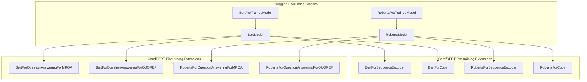
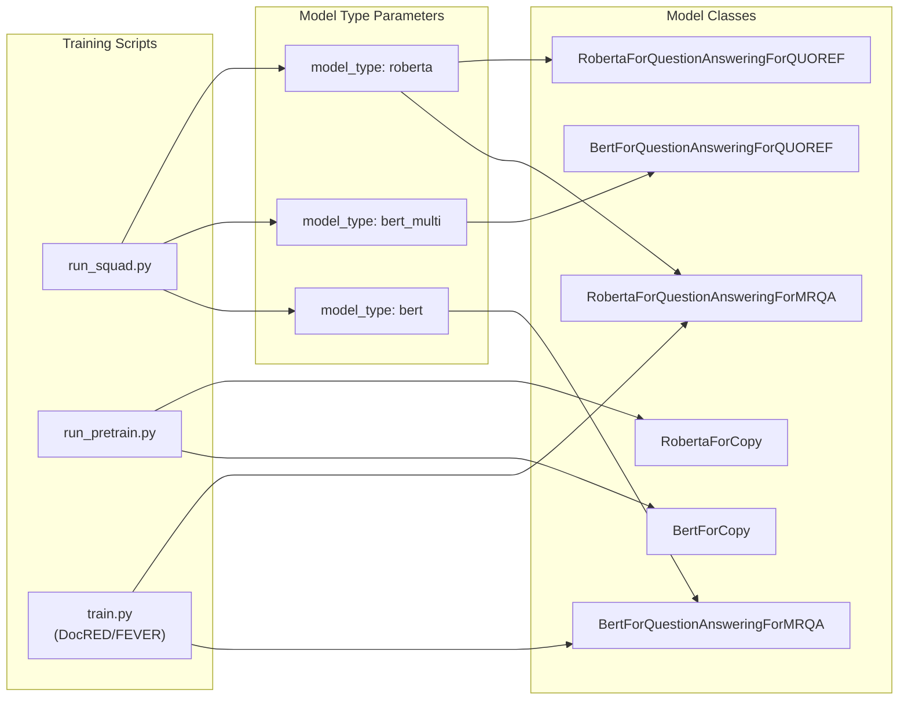
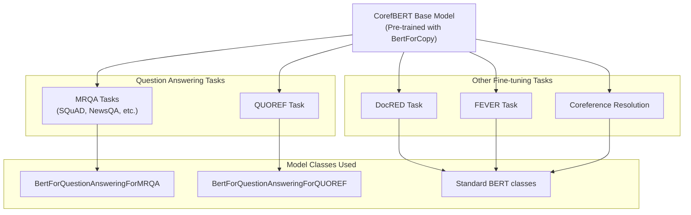

<!-- source: DeepWiki mcp.deepwiki.com · repo thunlp/CorefBERT · page 4.2 Model Extensions · fetched 2026-11-02 -->

# Model Extensions

<details>
<summary>Relevant source files</summary>

The following files were used as context for generating this wiki page:

- [README.md](README.md)
- [model.jpg](model.jpg)
- [transformers/__init__.py](transformers/__init__.py)

</details>


## Purpose and Scope

This document describes the custom model classes implemented in the CorefBERT transformers library that extend Hugging Face's base transformers. These extensions add specialized capabilities for coreferential reasoning, pre-training with Masked Reasoning Prediction (MRP), and task-specific question answering variants. 

For information about the overall transformers package structure and auto classes, see [Package Architecture](#4.1). For usage of these models in specific downstream tasks, see [Fine-tuning Systems](#3).

## Overview of Custom Model Classes

CorefBERT extends the transformers library with eight custom model classes, providing parallel implementations for both BERT and RoBERTa architectures. These classes are registered in the package's public API via [transformers/\_\_init\_\_.py:68-101]().

| Model Class | Base Architecture | Primary Purpose | Used In |
|-------------|------------------|-----------------|---------|
| `BertForSequenceEncoder` | BERT | Sequence encoding for pre-training | Pre-training pipeline |
| `BertForCopy` | BERT | Masked Reasoning Prediction (MRP) task | Pre-training pipeline |
| `BertForQuestionAnsweringForMRQA` | BERT | Standard question answering | MRQA tasks |
| `BertForQuestionAnsweringForQUOREF` | BERT | Multi-answer question answering | QUOREF task |
| `RobertaForSequenceEncoder` | RoBERTa | Sequence encoding for pre-training | Pre-training pipeline |
| `RobertaForCopy` | RoBERTa | Masked Reasoning Prediction (MRP) task | Pre-training pipeline |
| `RobertaForQuestionAnsweringForMRQA` | RoBERTa | Standard question answering | MRQA tasks |
| `RobertaForQuestionAnsweringForQUOREF` | RoBERTa | Multi-answer question answering | QUOREF task |

**Sources:** [transformers/\_\_init\_\_.py:68-101]()

## Model Class Hierarchy



**Diagram:** CorefBERT Custom Model Class Hierarchy

This diagram illustrates how CorefBERT's custom classes extend the base Hugging Face model implementations. All custom classes inherit from their respective base model classes (`BertModel` or `RobertaModel`), which in turn inherit from `PreTrainedModel` classes that provide weight loading, saving, and configuration management.

**Sources:** [transformers/\_\_init\_\_.py:68-74](), [transformers/\_\_init\_\_.py:95-101]()

## Pre-training Model Extensions

### BertForSequenceEncoder and RobertaForSequenceEncoder

The `BertForSequenceEncoder` and `RobertaForSequenceEncoder` classes provide sequence encoding functionality specifically designed for the pre-training phase. These models encode input sequences into contextualized representations that serve as the foundation for the Masked Reasoning Prediction task.

**Key Characteristics:**
- Extends base BERT/RoBERTa models with specialized encoding logic
- Produces sequence representations suitable for coreferential reasoning tasks
- Used as an intermediate component in the pre-training pipeline

**Imports:** [transformers/\_\_init\_\_.py:74](), [transformers/\_\_init\_\_.py:100]()

### BertForCopy and RobertaForCopy

The `BertForCopy` and `RobertaForCopy` classes implement the core Masked Reasoning Prediction (MRP) objective used during CorefBERT pre-training. These models predict masked tokens with special emphasis on coreferential patterns identified during data preprocessing.

**Key Characteristics:**
- Implements MRP loss function for coreferential reasoning
- Handles up to `max_copy_per_seq` masked positions per sequence (default: 15)
- Works with preprocessed Wikipedia data containing identified noun coreferences
- Trained using 8 GPUs with distributed training setup

**Pre-training Command Reference:** [README.md:48-50]()

**Imports:** [transformers/\_\_init\_\_.py:74](), [transformers/\_\_init\_\_.py:100]()

## Fine-tuning Model Extensions

### BertForQuestionAnsweringForMRQA and RobertaForQuestionAnsweringForMRQA

The `BertForQuestionAnsweringForMRQA` and `RobertaForQuestionAnsweringForMRQA` classes provide standard span-based question answering functionality for MRQA (Machine Reading for Question Answering) tasks including SQuAD, NewsQA, and other datasets.

**Key Characteristics:**
- Predicts start and end positions for answer spans
- Configured with `max_seq_length=512` and `doc_stride=128` for handling long contexts
- Used with `model_type=bert` or `model_type=roberta` parameter
- Single answer prediction per question

**Usage Pattern:**
```
model_type: bert (or roberta)
max_seq_length: 512
doc_stride: 128
per_gpu_train_batch_size: 8
```

**Training Command Reference:** [README.md:89-92]()

**Imports:** [transformers/\_\_init\_\_.py:73](), [transformers/\_\_init\_\_.py:99]()

### BertForQuestionAnsweringForQUOREF and RobertaForQuestionAnsweringForQUOREF

The `BertForQuestionAnsweringForQUOREF` and `RobertaForQuestionAnsweringForQUOREF` classes extend question answering capabilities to handle multiple correct answers per question, a requirement of the QUOREF dataset which focuses on coreferential reasoning in questions.

**Key Characteristics:**
- Supports multiple answer prediction via `max_n_answers` parameter (typically 2)
- Specialized architecture for coreferential reasoning in question contexts
- Used with `model_type=bert_multi` parameter
- Includes additional components for scoring and ranking multiple candidate answers

**Configuration Parameters:**
```
model_type: bert_multi
max_n_answers: 2
max_seq_length: 512
doc_stride: 128
```

**Training Command Reference:** [README.md:65-67]()

**Imports:** [transformers/\_\_init\_\_.py:73](), [transformers/\_\_init\_\_.py:99]()

## Model Type Selection and Instantiation



**Diagram:** Model Type Parameter to Class Mapping

The `model_type` parameter in training scripts determines which custom model class is instantiated. This parameter-based selection allows the same training script to work with different model architectures and task-specific variants.

**Sources:** [README.md:66](), [README.md:91]()

## Task-Specific Model Usage



**Diagram:** Task-Specific Model Class Selection

Different downstream tasks leverage different custom model classes based on their requirements. Question answering tasks use specialized QA model variants, while other tasks (DocRED, FEVER, coreference resolution) use standard BERT model classes from the base transformers library.

**Sources:** [README.md:52-147]()

## Model Loading and Configuration

Custom model classes are loaded through the standard transformers interface using the `model_name_or_path` and `model_type` parameters:

| Parameter | Purpose | Example Values |
|-----------|---------|----------------|
| `model_name_or_path` | Path to pre-trained model weights | `../CorefBERT_base`, `bert-base-cased` |
| `model_type` | Specifies which model class to instantiate | `bert`, `bert_multi`, `roberta` |
| `max_seq_length` | Maximum input sequence length | `512` |
| `doc_stride` | Stride for splitting long documents | `128` |
| `max_n_answers` | Maximum answers for QUOREF (if applicable) | `2` |

**Loading Pattern:**
1. Script receives `model_type` parameter (e.g., `bert_multi`)
2. Transformers library maps type to appropriate class (e.g., `BertForQuestionAnsweringForQUOREF`)
3. Model weights loaded from `model_name_or_path`
4. Task-specific heads initialized or loaded from checkpoint

**Sources:** [README.md:65-67](), [README.md:89-92]()

## Extension Points and Customization

The custom model classes in CorefBERT demonstrate several extension patterns that can be adapted for other specialized tasks:

1. **Sequence Encoding Extensions**: Custom pooling or encoding strategies (e.g., `BertForSequenceEncoder`)
2. **Task-Specific Heads**: Specialized output layers for particular objectives (e.g., MRP in `BertForCopy`)
3. **Multi-Answer Prediction**: Extended architectures supporting multiple outputs (e.g., `BertForQuestionAnsweringForQUOREF`)
4. **Parallel Architecture Support**: Consistent extensions across BERT and RoBERTa base models

These patterns enable researchers to build on CorefBERT's architecture for new coreferential reasoning tasks or adapt the approach to other domains requiring specialized language understanding.

**Sources:** [transformers/\_\_init\_\_.py:68-101]()

---

