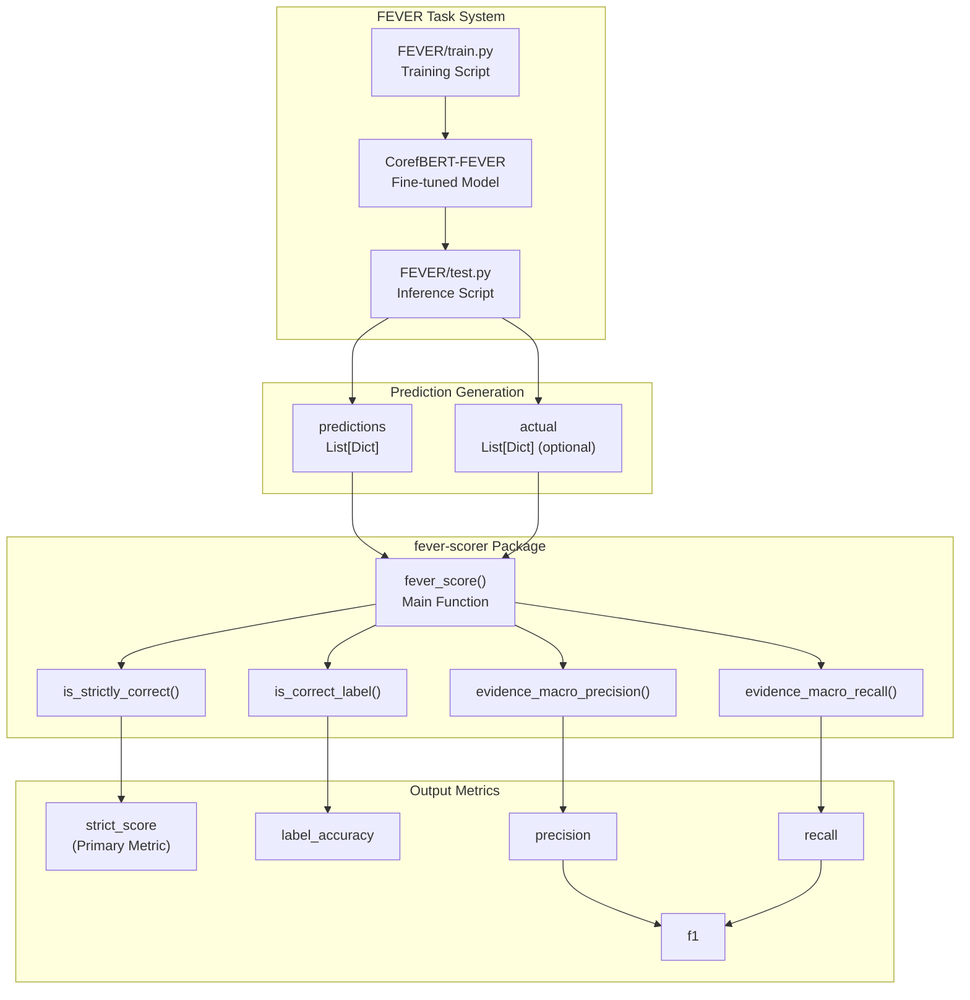
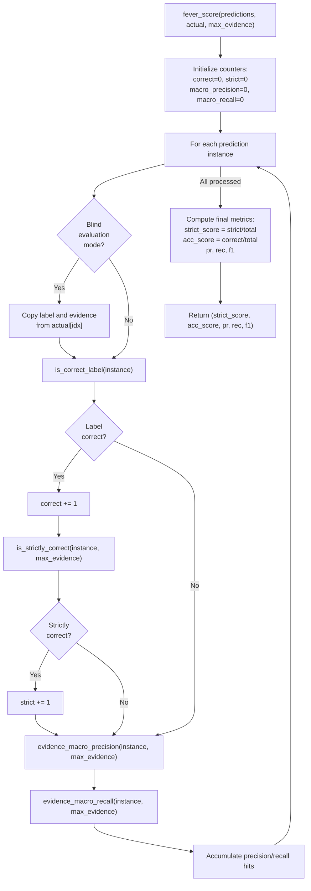
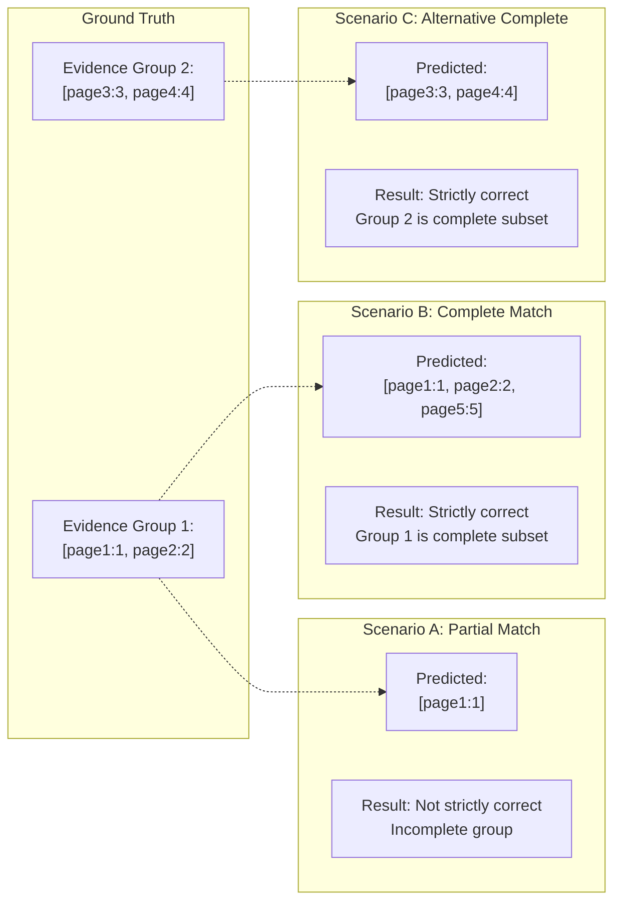

<!-- source: DeepWiki mcp.deepwiki.com · repo thunlp/CorefBERT · page 5 FEVER Scorer · fetched 2026-11-02 -->

# FEVER Scorer

<details>
<summary>Relevant source files</summary>

The following files were used as context for generating this wiki page:

- [FEVER/fever-scorer/README.md](FEVER/fever-scorer/README.md)
- [FEVER/fever-scorer/src/fever/scorer.py](FEVER/fever-scorer/src/fever/scorer.py)

</details>


## Purpose and Scope

The FEVER Scorer is a standalone evaluation package that computes performance metrics for the Fact Extraction and VERification (FEVER) shared task. This page provides an overview of the scorer's architecture, metrics, and integration within the CorefBERT FEVER task system.

The scorer evaluates both claim classification accuracy and evidence retrieval quality, producing five distinct metrics. It is implemented as a separate Python package located in `FEVER/fever-scorer/` and is used by the FEVER fine-tuning system to assess model predictions.

For detailed information about:
- Using the scorer API and input/output formats, see [Scorer API and Usage](#5.1)
- Internal scoring logic and algorithms, see [Scorer Implementation](#5.2)
- Package structure and installation, see [Scorer Package Distribution](#5.3)
- Test suite and validation, see [Testing Framework](#5.4)
- FEVER task training and fine-tuning, see [FEVER Fact Verification](#3.4)

**Sources:** [FEVER/fever-scorer/README.md:1-99](), [FEVER/fever-scorer/src/fever/scorer.py:1-153]()

## Overview

The FEVER Scorer evaluates fact verification systems by comparing predicted labels and evidence against ground truth annotations. Unlike simple classification metrics, it implements a strict scoring regime that requires both correct label prediction and valid evidence retrieval for claims that are SUPPORTED or REFUTED.

### Evaluation Metrics

The scorer produces five output metrics:

| Metric | Description | Primary Metric |
|--------|-------------|----------------|
| **Strict Score** | Label accuracy where evidence requirements are met | ✓ Yes |
| **Label Accuracy** | Proportion of correctly predicted labels (SUPPORTS/REFUTES/NOT ENOUGH INFO) | |
| **Macro Precision** | Average precision of evidence retrieval for SUPPORTS/REFUTES claims | |
| **Macro Recall** | Average recall requiring complete evidence group retrieval | |
| **F1 Score** | Harmonic mean of macro precision and recall | |

The **strict score** serves as the primary evaluation metric for the FEVER shared task. A prediction is strictly correct only if:
1. The predicted label matches the actual label
2. For SUPPORTS/REFUTES labels: at least one complete evidence group is found in the predicted evidence
3. For NOT ENOUGH INFO labels: only the label needs to be correct

**Sources:** [FEVER/fever-scorer/README.md:7-16](), [FEVER/fever-scorer/src/fever/scorer.py:26-48]()

## Architecture Overview

The following diagram shows how the FEVER Scorer integrates with the CorefBERT FEVER task system:



**Sources:** [FEVER/fever-scorer/src/fever/scorer.py:106-153](), [FEVER/fever-scorer/README.md:23-98]()

## Data Structures

### Input Format

The scorer accepts predictions as a list of dictionaries. Each prediction instance must contain:

| Field | Type | Required | Description |
|-------|------|----------|-------------|
| `predicted_label` | string | Yes | One of: "SUPPORTS", "REFUTES", "NOT ENOUGH INFO" |
| `predicted_evidence` | List[List[str, int]] | Yes | List of (page_name, line_number) pairs |
| `label` | string | Optional* | Ground truth label (required if not in blind mode) |
| `evidence` | List[List[List]] | Optional* | Ground truth evidence groups |

\* For blind evaluation mode, `label` and `evidence` can be provided separately via the `actual` parameter.

The evidence format follows this structure:
```python
# Predicted evidence (simplified format)
predicted_evidence = [
    ["page1", 1],  # (page_name: str, line_number: int)
    ["page2", 2]
]

# Actual evidence (full annotation format)
evidence = [
    [  # Evidence group 1
        [None, None, "page1", 1],  # [annotation_job_id, internal_id, page_name, line_number]
        [None, None, "page2", 2]
    ],
    [  # Evidence group 2 (alternative valid evidence)
        [None, None, "page3", 3]
    ]
]
```

**Sources:** [FEVER/fever-scorer/README.md:26-98](), [FEVER/fever-scorer/src/fever/scorer.py:3-20]()

## Scoring Workflow

The following diagram illustrates the scoring process flow within the `fever_score()` function:



**Sources:** [FEVER/fever-scorer/src/fever/scorer.py:106-153]()

## Evidence Evaluation Rules

The scorer implements specific rules for evidence evaluation that distinguish it from standard classification metrics:

### Complete Evidence Groups

The scorer requires that **at least one complete evidence group** be present in predictions for SUPPORTS/REFUTES claims. Partial evidence groups receive no credit.



**Sources:** [FEVER/fever-scorer/src/fever/scorer.py:26-48](), [FEVER/fever-scorer/README.md:14-15]()

### Max Evidence Constraint

The scorer only evaluates the **first 5 predicted evidence sentences** by default (configurable via `max_evidence` parameter). This prevents systems from gaming the metrics by providing excessive evidence.

When too much evidence is provided, the excess is removed without penalty - the system simply evaluates only the first `max_evidence` items.

**Sources:** [FEVER/fever-scorer/README.md:16](), [FEVER/fever-scorer/src/fever/scorer.py:33-34, 58-59, 77-78]()

### NOT ENOUGH INFO Handling

For claims labeled as NOT ENOUGH INFO:
- Evidence retrieval is **not scored**
- Only label correctness matters for strict scoring
- Precision and recall metrics return `(0.0, 0.0)` for these instances

**Sources:** [FEVER/fever-scorer/src/fever/scorer.py:44-46, 55-68, 72-86]()

## Core Functions

The scorer implementation is organized around five key functions in [FEVER/fever-scorer/src/fever/scorer.py]():

| Function | Lines | Purpose |
|----------|-------|---------|
| `fever_score()` | 106-153 | Main entry point; orchestrates scoring and aggregates metrics |
| `is_correct_label()` | 22-23 | Checks if predicted label matches actual label (case-insensitive) |
| `is_strictly_correct()` | 26-48 | Validates both label and evidence requirements for strict scoring |
| `evidence_macro_precision()` | 51-68 | Computes precision of predicted evidence against all actual evidence |
| `evidence_macro_recall()` | 70-86 | Computes recall requiring complete evidence group retrieval |

Additional validation function:
- `check_predicted_evidence_format()` [3-20](): Validates predicted evidence structure and types

**Sources:** [FEVER/fever-scorer/src/fever/scorer.py:1-153]()

## Usage Modes

The scorer supports two evaluation modes:

### Standard Mode

Predictions contain all necessary fields (`label`, `evidence`, `predicted_label`, `predicted_evidence`):

```python
from fever.scorer import fever_score

predictions = [{
    "label": "REFUTES",
    "predicted_label": "REFUTES",
    "predicted_evidence": [["page1", 1], ["page2", 2]],
    "evidence": [[[None, None, "page1", 1], [None, None, "page2", 2]]]
}]

strict_score, label_accuracy, precision, recall, f1 = fever_score(predictions)
```

### Blind Evaluation Mode

Predictions contain only system outputs; ground truth provided separately:

```python
predictions = [{
    "predicted_label": "REFUTES",
    "predicted_evidence": [["page1", 1], ["page2", 2]]
}]

actual = [{
    "label": "REFUTES",
    "evidence": [[[None, None, "page1", 1], [None, None, "page2", 2]]]
}]

strict_score, label_accuracy, precision, recall, f1 = fever_score(predictions, actual)
```

**Sources:** [FEVER/fever-scorer/README.md:23-98](), [FEVER/fever-scorer/src/fever/scorer.py:119-125]()

## Integration with CorefBERT

Within the CorefBERT repository, the fever-scorer is used by the FEVER fine-tuning system to evaluate model performance during development and testing. The test script generates predictions in the required format and passes them to `fever_score()` for evaluation.

The scorer's strict evaluation regime aligns with the FEVER shared task requirements and ensures that models are assessed on their ability to both correctly classify claims and retrieve valid supporting/refuting evidence.

**Sources:** [FEVER/fever-scorer/README.md:1-99]()

---

