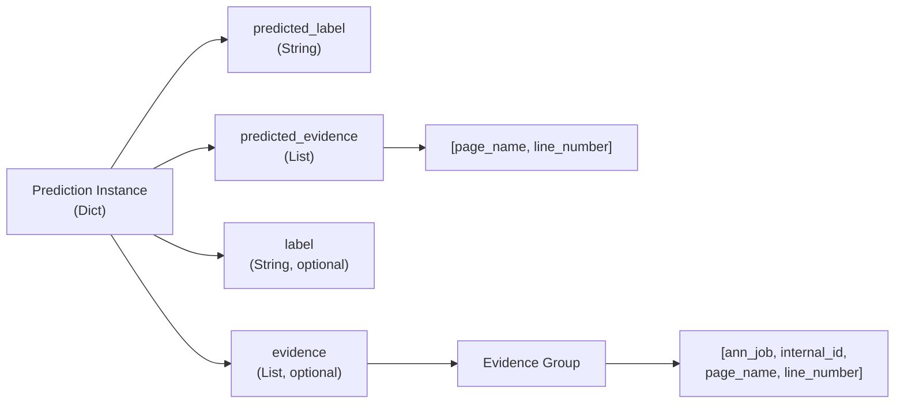
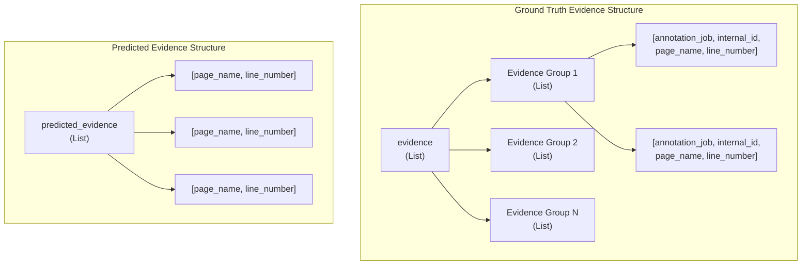
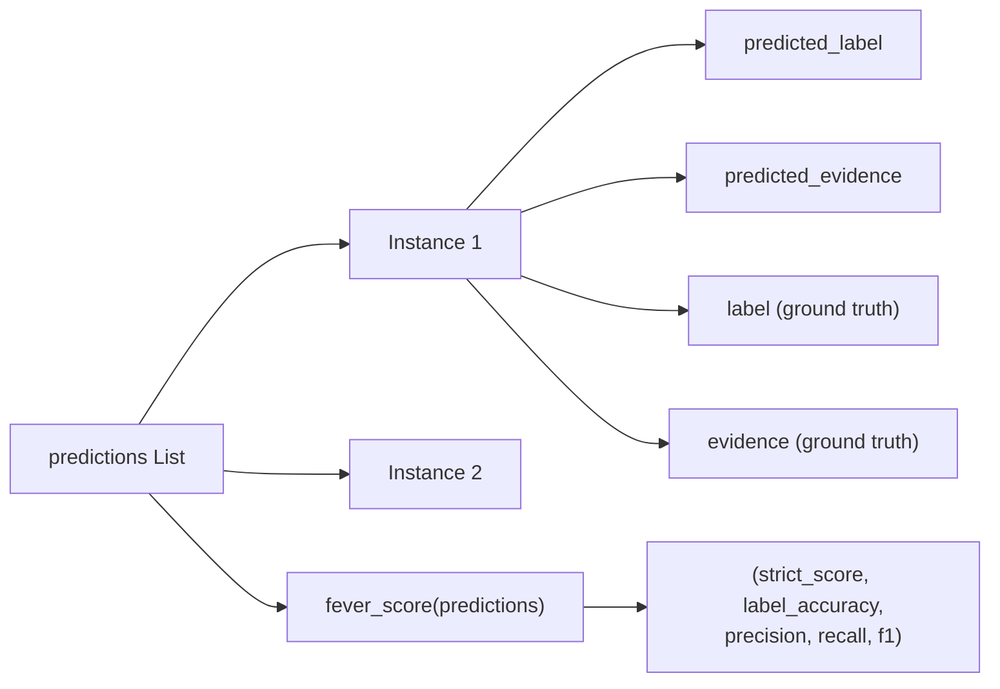
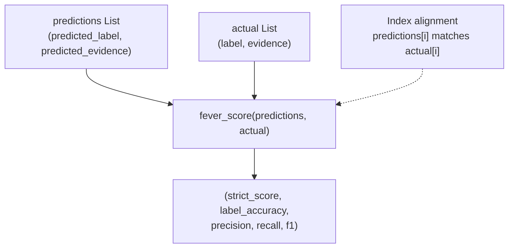
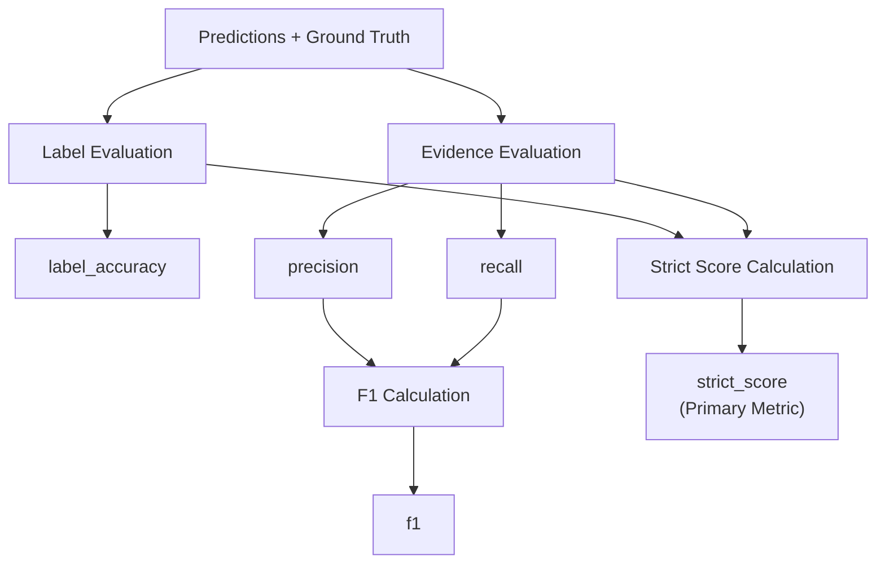
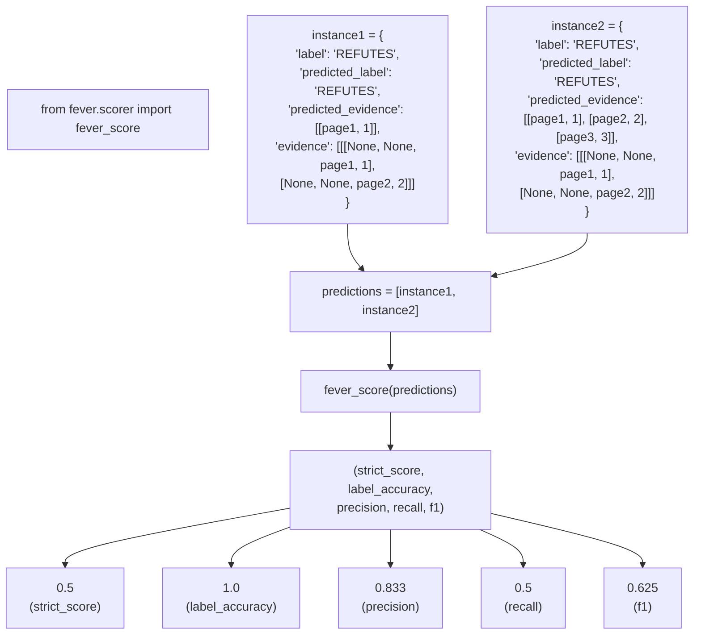
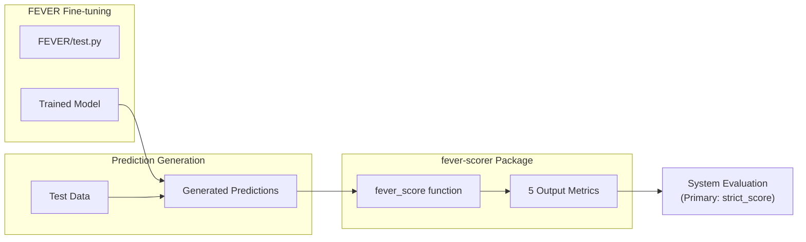

<!-- source: DeepWiki mcp.deepwiki.com · repo thunlp/CorefBERT · page 5.1 Scorer API and Usage · fetched 2026-11-02 -->

# Scorer API and Usage

<details>
<summary>Relevant source files</summary>

The following files were used as context for generating this wiki page:

- [FEVER/fever-scorer/README.md](FEVER/fever-scorer/README.md)

</details>


## Purpose and Scope

This document describes the API for the `fever_score` function, the primary evaluation tool for the FEVER (Fact Extraction and VERification) task. It covers input data formats, output metrics, and usage patterns for scoring fact verification predictions.

For technical details about the scoring logic and metric calculations, see [Scorer Implementation](#5.2). For package installation and distribution information, see [Scorer Package Distribution](#5.3). For context on how the scorer integrates with FEVER fine-tuning, see [FEVER Fact Verification](#3.4).

## Overview

The FEVER scorer is implemented as a single function `fever_score` that evaluates the quality of fact verification predictions across two dimensions: label prediction accuracy and evidence retrieval quality. The scorer produces five distinct metrics that together characterize system performance.

**Sources**: [FEVER/fever-scorer/README.md:1-14]()

### Primary Entry Point

```
fever.scorer.fever_score(predictions, actual=None, max_evidence=5)
```

The function is imported from the `fever.scorer` module and supports two operational modes:
1. **Embedded mode**: Ground truth included within prediction instances
2. **Separate mode**: Ground truth provided as separate `actual` parameter

**Sources**: [FEVER/fever-scorer/README.md:24-98]()

## Function Signature and Parameters

| Parameter | Type | Required | Default | Description |
|-----------|------|----------|---------|-------------|
| `predictions` | List[Dict] | Yes | - | List of prediction instances with predicted labels and evidence |
| `actual` | List[Dict] | No | None | Separate ground truth instances (for blind test scenarios) |
| `max_evidence` | Int | No | 5 | Maximum number of evidence sentences considered for scoring |

**Sources**: [FEVER/fever-scorer/README.md:16]()

## Input Format

### Prediction Instance Structure

Each prediction instance in the `predictions` list must contain the following fields:



**Sources**: [FEVER/fever-scorer/README.md:26-50]()

### Field Specifications

| Field | Type | Required | Description |
|-------|------|----------|-------------|
| `predicted_label` | String | Always | System's predicted label: "SUPPORTS", "REFUTES", or "NOT ENOUGH INFO" |
| `predicted_evidence` | List[List] | Always | List of evidence sentences as `[page_name, line_number]` pairs |
| `label` | String | Embedded mode | Ground truth label (same values as predicted_label) |
| `evidence` | List[List[List]] | Embedded mode | Ground truth evidence groups (see below) |

**Sources**: [FEVER/fever-scorer/README.md:26-50]()

### Evidence Format Structure



Ground truth evidence is organized hierarchically:
- **Outer list**: Contains multiple evidence groups (alternative sets of evidence)
- **Evidence group**: A complete set of sentences that together support/refute the claim
- **Evidence item**: A 4-tuple where first two elements (annotation job ID, internal ID) are ignored during scoring

Predicted evidence is a flat list of `[page_name, line_number]` pairs without the annotation metadata.

**Sources**: [FEVER/fever-scorer/README.md:29-35, 43-48]()

## Usage Patterns

### Pattern 1: Embedded Ground Truth

In this pattern, each prediction instance contains both predictions and ground truth:



**Example from codebase**: [FEVER/fever-scorer/README.md:23-60]()

This pattern is used when ground truth is available and can be packaged with predictions, typical for development and validation scenarios.

**Sources**: [FEVER/fever-scorer/README.md:22-60]()

### Pattern 2: Separate Ground Truth

In this pattern, predictions and ground truth are provided as separate lists:



**Example from codebase**: [FEVER/fever-scorer/README.md:64-98]()

This pattern is used for blind test evaluation where predictions are submitted separately from the ground truth dataset.

**Sources**: [FEVER/fever-scorer/README.md:64-98]()

## Output Metrics

The `fever_score` function returns a tuple of five floating-point metrics:

```python
strict_score, label_accuracy, precision, recall, f1 = fever_score(predictions)
```

### Metric Definitions

| Metric | Position | Range | Description |
|--------|----------|-------|-------------|
| `strict_score` | 0 | [0.0, 1.0] | Primary metric: Fraction of instances with both correct label AND correct evidence |
| `label_accuracy` | 1 | [0.0, 1.0] | Fraction of instances with correct label prediction (ignoring evidence) |
| `precision` | 2 | [0.0, 1.0] | Macro-precision of evidence retrieval for SUPPORTS/REFUTES claims |
| `recall` | 3 | [0.0, 1.0] | Macro-recall of evidence retrieval for SUPPORTS/REFUTES claims |
| `f1` | 4 | [0.0, 1.0] | F1 score computed from precision and recall |

**Sources**: [FEVER/fever-scorer/README.md:7-12]()



**Sources**: [FEVER/fever-scorer/README.md:7-12]()

### Strict Score (Primary Metric)

The strict score is the **primary scoring metric** for the FEVER shared task. An instance receives a score of 1.0 only if:
1. The predicted label matches the ground truth label, AND
2. At least one complete evidence group is correctly identified

The strict score is computed as the fraction of instances meeting both criteria.

**Sources**: [FEVER/fever-scorer/README.md:8]()

### Evidence Evaluation Criteria

Evidence is considered correct if and only if there exists at least one complete ground truth evidence group that is a subset of the predicted evidence. This means:

- **Complete group requirement**: All sentences in at least one evidence group must be present in predictions
- **Subset relationship**: Predicted evidence may contain additional sentences without penalty (up to `max_evidence` limit)
- **No partial credit**: Retrieving only some sentences from a group does not count as correct

**Sources**: [FEVER/fever-scorer/README.md:14]()

## Evidence Truncation

The scorer only considers the first `max_evidence` sentences (default: 5) from the predicted evidence list for scoring. This parameter is configurable:

```python
strict_score, label_accuracy, precision, recall, f1 = fever_score(
    predictions, 
    actual=None, 
    max_evidence=5  # configurable
)
```

**Truncation behavior**:
- Sentences beyond the limit are removed without penalty
- No warning or error is raised when truncation occurs
- Systems should prioritize their most confident evidence in the first positions

**Sources**: [FEVER/fever-scorer/README.md:16]()

## API Usage Example

### Code-to-Metric Flow



**Example calculation**:
- Instance 1: Label correct, but evidence incomplete (missing page2:2) → strict_score = 0, precision = 1.0, recall = 0.0
- Instance 2: Label correct, evidence complete → strict_score = 1, precision = 2/3, recall = 1.0
- Overall: strict_score = 0.5, label_accuracy = 1.0, precision = 0.833, recall = 0.5, f1 = 0.625

**Sources**: [FEVER/fever-scorer/README.md:23-60]()

## Integration with FEVER Task



The scorer is used during FEVER task evaluation to assess model performance. The test script generates predictions which are then scored using `fever_score` to produce the five metrics, with `strict_score` serving as the primary benchmark metric.

**Sources**: [FEVER/fever-scorer/README.md:1-20]()

---

