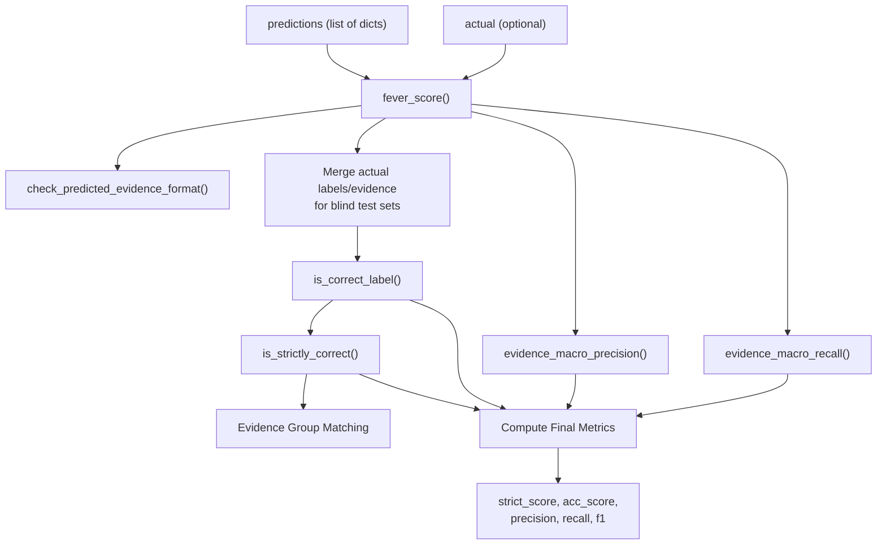
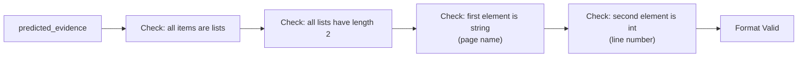
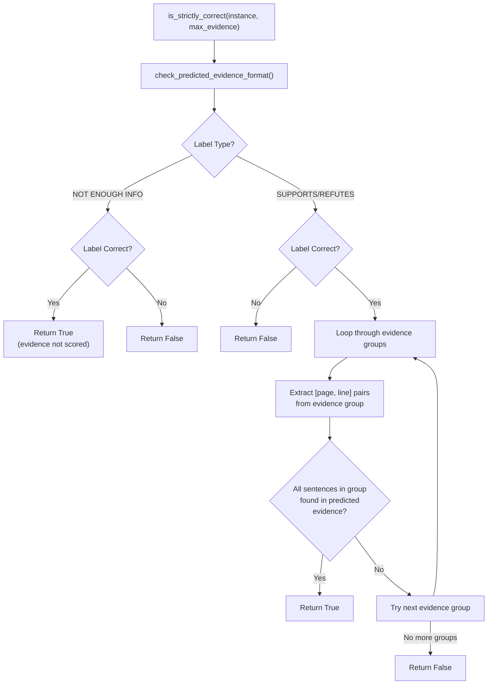
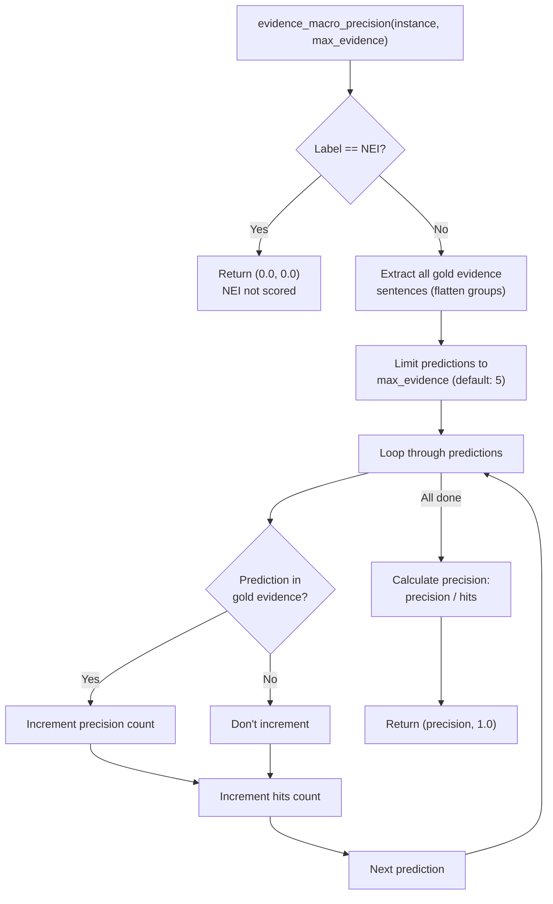
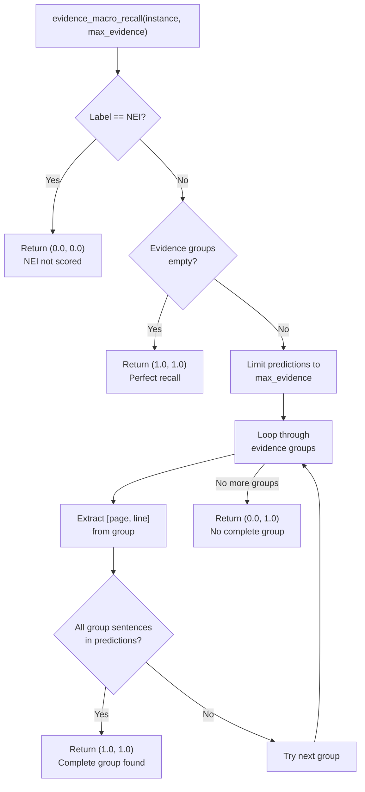
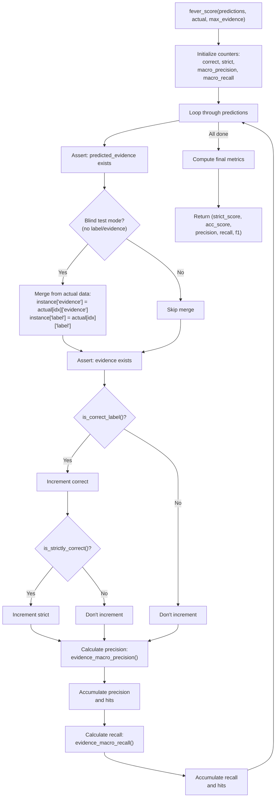
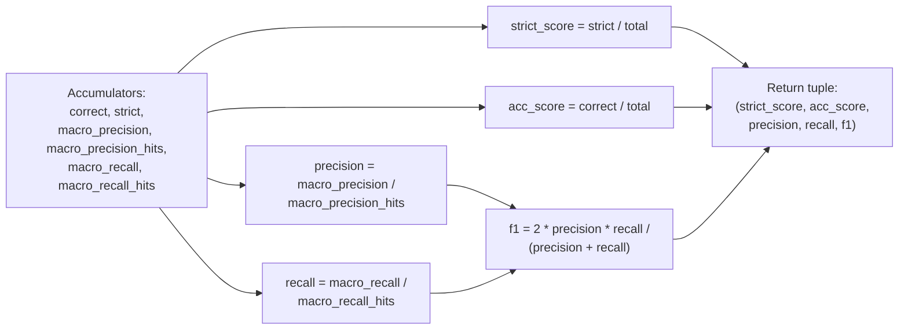

<!-- source: DeepWiki mcp.deepwiki.com · repo thunlp/CorefBERT · page 5.2 Scorer Implementation · fetched 2026-11-02 -->

# Scorer Implementation

<details>
<summary>Relevant source files</summary>

The following files were used as context for generating this wiki page:

- [FEVER/fever-scorer/build/lib/fever/scorer.py](FEVER/fever-scorer/build/lib/fever/scorer.py)
- [FEVER/fever-scorer/src/fever/scorer.py](FEVER/fever-scorer/src/fever/scorer.py)

</details>


This page provides technical documentation of the fever-scorer implementation, including the core scoring algorithms, evidence evaluation logic, and metric calculations. For information about using the scorer API, see [Scorer API and Usage](#5.1). For package structure and installation, see [Scorer Package Distribution](#5.3).

## Overview

The scorer implementation is located in `FEVER/fever-scorer/src/fever/scorer.py` and consists of several core functions that evaluate FEVER task predictions. The scorer evaluates two dimensions: **label correctness** (claim classification) and **evidence retrieval quality** (which sentences support the claim).

The implementation handles three label classes with different evaluation strategies:
- **SUPPORTS** and **REFUTES**: Both label and evidence are evaluated
- **NOT ENOUGH INFO** (NEI): Only label is evaluated, evidence retrieval is not scored

**Sources:** [FEVER/fever-scorer/src/fever/scorer.py:1-153]()

## Scoring Architecture

The following diagram illustrates the high-level flow of the scoring system:



**Sources:** [FEVER/fever-scorer/src/fever/scorer.py:106-153]()

## Data Format Validation

The `check_predicted_evidence_format` function validates that predicted evidence follows the required format before scoring begins.



### Validation Requirements

| Requirement | Data Type | Description |
|------------|-----------|-------------|
| Structure | `list` of `list` | Each prediction is a list containing [page, line] |
| Length | 2 elements | Each prediction must have exactly 2 elements |
| Page | `string` | First element must be a string (Wikipedia page title) |
| Line | `int` | Second element must be an integer (sentence line number) |

The implementation uses the `six.string_types` library for Python 2/3 compatibility when checking string types.

**Sources:** [FEVER/fever-scorer/src/fever/scorer.py:3-19]()

## Label Correctness Evaluation

The `is_correct_label` function performs case-insensitive comparison between predicted and gold labels.

### Label Classes

The FEVER dataset uses three label classes:
- **SUPPORTS**: The evidence supports the claim
- **REFUTES**: The evidence refutes the claim  
- **NOT ENOUGH INFO**: Insufficient evidence to verify the claim

Both labels are converted to uppercase before comparison to ensure case-insensitive matching.

**Sources:** [FEVER/fever-scorer/src/fever/scorer.py:22-23]()

## Strict Correctness Evaluation

The `is_strictly_correct` function determines whether an instance is "strictly correct" - meaning both the label and evidence retrieval are correct. This is the primary evaluation metric for the FEVER task.



### Evidence Group Matching Logic

The FEVER dataset uses **evidence groups** where each group represents a complete annotation. An instance is strictly correct if:

1. The predicted label matches the gold label, AND
2. For non-NEI claims: At least one complete evidence group is retrieved

The key insight is that an evidence group must be **completely matched** - finding only some sentences from a group is not sufficient.

**Sources:** [FEVER/fever-scorer/src/fever/scorer.py:26-48]()

### Evidence Extraction Process

Evidence groups in the gold data have the format:
```
[[annotation_id, evidence_id, page, line], ...]
```

The scorer extracts only the `[page, line]` pairs (indices 2 and 3) for comparison with predictions:

```python
actual_sentences = [[e[2], e[3]] for e in evience_group]
```

This extraction is performed at [FEVER/fever-scorer/src/fever/scorer.py:39]().

## Evidence Precision Calculation

The `evidence_macro_precision` function calculates how many of the predicted evidence sentences are actually correct.

### Calculation Process



### Special Cases

| Condition | Precision Value | Hits Value | Rationale |
|-----------|----------------|------------|-----------|
| No predictions made (`hits == 0`) | 1.0 | 1.0 | Perfect precision by default |
| Label is NEI | 0.0 | 0.0 | Evidence not evaluated for NEI |
| Normal case | `correct / total` | 1.0 | Standard precision calculation |

The function returns a tuple `(precision_value, weight)` where weight is always 1.0 for macro averaging.

**Sources:** [FEVER/fever-scorer/src/fever/scorer.py:51-68]()

## Evidence Recall Calculation

The `evidence_macro_recall` function determines whether at least one complete evidence group was retrieved.

### Recall Logic

Unlike precision which counts individual sentences, recall uses an **all-or-nothing** approach:
- If any complete evidence group is found in predictions: recall = 1.0
- If no complete evidence group is found: recall = 0.0



### Complete Group Requirement

The recall function emphasizes that **incomplete groups are worthless**. This is stated explicitly in the code comment at [FEVER/fever-scorer/src/fever/scorer.py:83]():

```python
# We only want to score complete groups of evidence. Incomplete groups are worthless.
```

This design choice reflects the FEVER task requirement that evidence must form a complete logical chain.

**Sources:** [FEVER/fever-scorer/src/fever/scorer.py:70-86]()

## Main Scoring Function

The `fever_score` function orchestrates the complete evaluation process and computes all metrics.

### Function Signature

```python
def fever_score(predictions, actual=None, max_evidence=5)
```

| Parameter | Type | Default | Description |
|-----------|------|---------|-------------|
| `predictions` | `list[dict]` | Required | List of prediction instances with `predicted_label` and `predicted_evidence` |
| `actual` | `list[dict]` | `None` | Gold labels and evidence for blind test sets |
| `max_evidence` | `int` | `5` | Maximum number of evidence sentences to consider |

### Evaluation Flow



### Blind Test Mode

When `actual` is provided, the function operates in **blind test mode** where:
1. Predictions contain only `predicted_label` and `predicted_evidence`
2. Gold `label` and `evidence` are copied from the `actual` parameter
3. Both lists must have matching lengths

This mode is used for evaluation on test sets where gold labels are not included in the prediction file.

**Sources:** [FEVER/fever-scorer/src/fever/scorer.py:106-153]()

## Metric Computation

The final metrics are computed from accumulated counters across all instances:

### Metric Definitions



### Metric Formulas

| Metric | Formula | Default Value | Description |
|--------|---------|---------------|-------------|
| `strict_score` | `strict / total` | - | Percentage of instances with both correct label and evidence |
| `acc_score` | `correct / total` | - | Percentage of instances with correct label only |
| `precision` | `macro_precision / macro_precision_hits` | 1.0 | If no hits, defaults to 1.0 (perfect precision) |
| `recall` | `macro_recall / macro_recall_hits` | 0.0 | If no hits, defaults to 0.0 (no recall) |
| `f1` | `2 * precision * recall / (precision + recall)` | - | Harmonic mean of precision and recall |

### Default Value Handling

The implementation includes special handling for edge cases:

```python
pr = (macro_precision / macro_precision_hits) if macro_precision_hits > 0 else 1.0
rec = (macro_recall / macro_recall_hits) if macro_recall_hits > 0 else 0.0
```

These defaults ensure:
- **Precision defaults to 1.0**: If no evidence is evaluated (all NEI claims), precision is perfect
- **Recall defaults to 0.0**: If no evidence is evaluated, recall is zero

**Sources:** [FEVER/fever-scorer/src/fever/scorer.py:143-152]()

## Micro Precision (Not Used)

The implementation includes an `evidence_micro_precision` function that is not used in the official scoring. The function is documented at [FEVER/fever-scorer/src/fever/scorer.py:89-103]() with a comment explaining:

```python
# Micro is not used. This code is just included to demostrate our model of macro/micro
```

### Macro vs Micro Averaging

The key difference:
- **Macro averaging** (used): Average per-instance metrics, then aggregate
- **Micro averaging** (not used): Count total correct/total predictions across all instances

The FEVER task uses macro averaging to weight each claim equally, regardless of the number of evidence sentences.

**Sources:** [FEVER/fever-scorer/src/fever/scorer.py:89-103]()

## Summary

The scorer implementation provides a comprehensive evaluation framework for the FEVER fact verification task:

1. **Format Validation**: Ensures predictions follow required structure
2. **Label Evaluation**: Case-insensitive label matching
3. **Strict Scoring**: Combined label and evidence evaluation  
4. **Evidence Groups**: Complete group matching requirement
5. **Macro Metrics**: Per-instance averaging for precision, recall, and F1
6. **Special Handling**: Different scoring logic for NEI vs other labels
7. **Blind Test Support**: Merging gold data for test set evaluation

The implementation prioritizes **complete evidence groups** over partial matches, reflecting the requirement that fact verification evidence must form logical chains.

**Sources:** [FEVER/fever-scorer/src/fever/scorer.py:1-153]()

---

