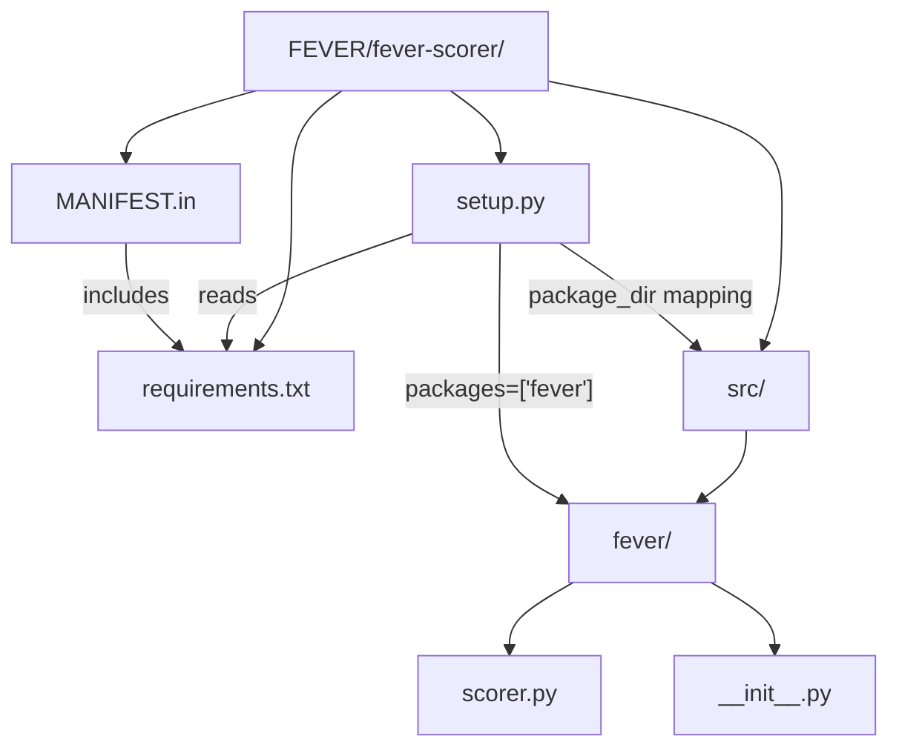
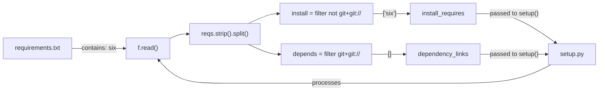
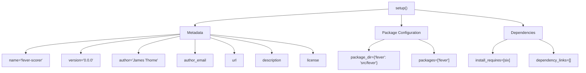
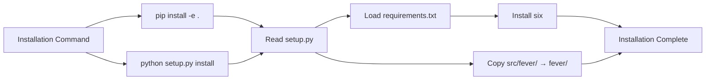

<!-- source: DeepWiki mcp.deepwiki.com · repo thunlp/CorefBERT · page 5.3 Scorer Package Distribution · fetched 2026-11-02 -->

# Scorer Package Distribution

Relevant source files

The following files were used as context for generating this wiki page:

- [FEVER/fever-scorer/MANIFEST.in](FEVER/fever-scorer/MANIFEST.in)
- [FEVER/fever-scorer/requirements.txt](FEVER/fever-scorer/requirements.txt)
- [FEVER/fever-scorer/setup.py](FEVER/fever-scorer/setup.py)

## Purpose and Scope

This document describes the `fever-scorer` package distribution system, including its structure, dependencies, and installation configuration. This covers the Python packaging infrastructure that enables the FEVER scorer to be distributed and installed as a standalone package. For information about using the scorer API, see [Scorer API and Usage](#5.1). For implementation details of the scoring logic, see [Scorer Implementation](#5.2).

## Package Overview

The `fever-scorer` package is distributed as a standard Python setuptools package located in the `FEVER/fever-scorer/` directory. The package wraps the FEVER scoring functionality into an installable module that can be used across different projects and environments.

**Key Package Metadata:**

| Property | Value |
|----------|-------|
| Package Name | `fever-scorer` |
| Version | `0.0.0` |
| Module Name | `fever` |
| Author | James Thorne |
| Source Directory | `src/fever` |

**Sources:** [FEVER/fever-scorer/setup.py:14-26]()

## Package Structure

The fever-scorer package follows a standard Python package layout with source code separated from distribution configuration files.

The package uses a `src/fever` directory structure that is mapped to the `fever` package name through the `package_dir` configuration in setup.py: `{'fever': 'src/fever'}` [FEVER/fever-scorer/setup.py:22]().

**Sources:** [FEVER/fever-scorer/setup.py:1-26](), [FEVER/fever-scorer/MANIFEST.in:1-2]()

## Dependencies

The fever-scorer package has minimal external dependencies, requiring only the `six` library for Python 2/3 compatibility utilities.

### Dependency List

| Dependency | Purpose | Specification |
|------------|---------|---------------|
| `six` | Python 2/3 compatibility utilities | Direct install requirement |

The dependency specification is read from `requirements.txt` [FEVER/fever-scorer/setup.py:5-6]() and processed to separate standard pip packages from git-based dependencies [FEVER/fever-scorer/setup.py:10-11]().

The setup.py includes logic to handle git-based dependencies by converting `git+git://` URLs to `git+http://` format [FEVER/fever-scorer/setup.py:11](), although no git dependencies are currently specified.

**Sources:** [FEVER/fever-scorer/requirements.txt:1](), [FEVER/fever-scorer/setup.py:5-11]()

## Setup Configuration

The `setup.py` file configures the package for distribution through setuptools. It defines metadata, package discovery, and dependency management.

### Setup Function Parameters

**Key configuration elements:**

- **Package Directory Mapping**: The `package_dir` parameter maps the `fever` package name to the `src/fever` source directory [FEVER/fever-scorer/setup.py:22]()
- **Package Discovery**: The `packages` parameter explicitly lists `['fever']` as the package to include [FEVER/fever-scorer/setup.py:23]()
- **Install Requirements**: Dependencies are read from `requirements.txt` and processed into `install_requires` [FEVER/fever-scorer/setup.py:24]()
- **Dependency Links**: Git-based dependencies would be specified in `dependency_links` [FEVER/fever-scorer/setup.py:25]()

**Sources:** [FEVER/fever-scorer/setup.py:13-26]()

## Distribution Manifest

The `MANIFEST.in` file specifies additional files to include in the source distribution beyond the Python source code.

| Directive | File | Purpose |
|-----------|------|---------|
| `include` | `requirements.txt` | Ensures requirements file is packaged with distribution |

This ensures that the `requirements.txt` file is included when the package is built into a source distribution (sdist), allowing the setup.py to read dependencies during installation [FEVER/fever-scorer/MANIFEST.in:1]().

**Sources:** [FEVER/fever-scorer/MANIFEST.in:1-2]()

## Installation Process

The fever-scorer package can be installed using standard Python packaging tools:

### Installation Methods

1. **Development Mode**: Install in editable mode for development
   - Command: `pip install -e .` from the `FEVER/fever-scorer/` directory
   - Creates link to source directory instead of copying files

2. **Standard Installation**: Install package into site-packages
   - Command: `python setup.py install` or `pip install .`
   - Copies package files to Python environment

During installation:
1. Setup.py reads `requirements.txt` [FEVER/fever-scorer/setup.py:5-6]()
2. Dependencies are parsed and separated [FEVER/fever-scorer/setup.py:10-11]()
3. The `six` package is installed as a requirement
4. The `fever` package is installed from `src/fever/` directory [FEVER/fever-scorer/setup.py:22-23]()

**Sources:** [FEVER/fever-scorer/setup.py:1-26]()

## Version Information

The package is currently marked as version `0.0.0` [FEVER/fever-scorer/setup.py:15](), indicating it is a development version. The version string follows semantic versioning conventions (MAJOR.MINOR.PATCH) but the `0.0.0` designation suggests it is not yet considered a stable release.

**Note**: Despite the `0.0.0` version designation in this repository, the fever-scorer package has been published with different version numbers (e.g., `1.0.0`) in other distributions, as referenced in related documentation.

**Sources:** [FEVER/fever-scorer/setup.py:15]()

---

