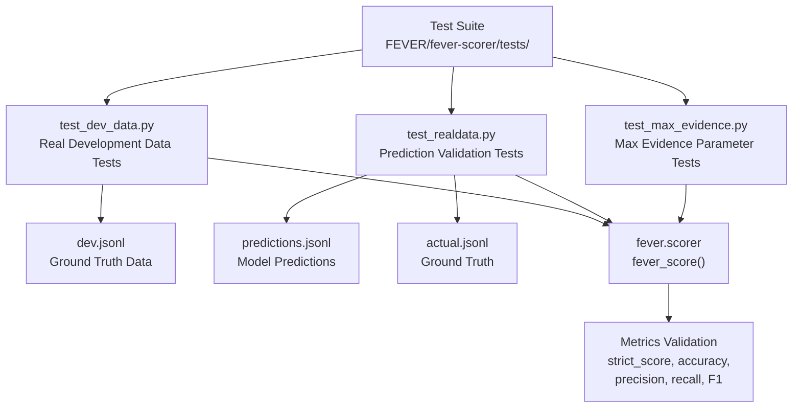
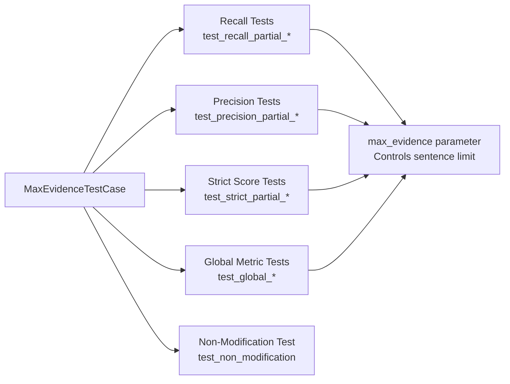
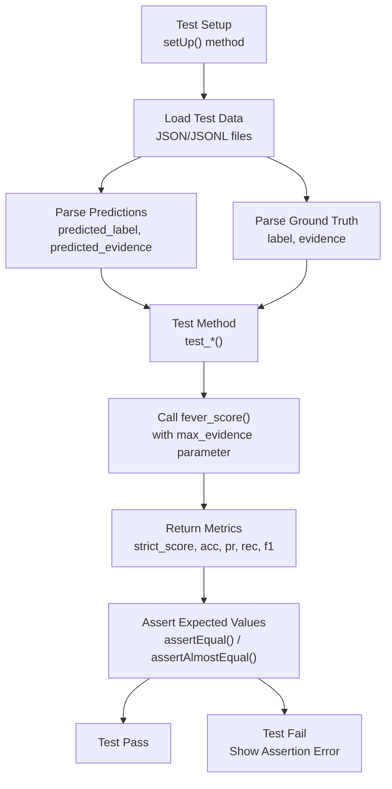

<!-- source: DeepWiki mcp.deepwiki.com · repo thunlp/CorefBERT · page 5.4 Testing Framework · fetched 2026-11-02 -->

# Testing Framework

<details>
<summary>Relevant source files</summary>

The following files were used as context for generating this wiki page:

- [FEVER/fever-scorer/tests/test_dev_data.py](FEVER/fever-scorer/tests/test_dev_data.py)
- [FEVER/fever-scorer/tests/test_max_evidence.py](FEVER/fever-scorer/tests/test_max_evidence.py)
- [FEVER/fever-scorer/tests/test_realdata.py](FEVER/fever-scorer/tests/test_realdata.py)

</details>


## Purpose and Scope

This document describes the testing framework for the fever-scorer package, which validates the correctness of the FEVER scoring implementation. The test suite ensures that the scorer correctly evaluates predictions against ground truth data, handles edge cases, and properly respects configuration parameters like `max_evidence`.

For information about the scorer API and usage patterns, see [Scorer API and Usage](#5.1). For details on the scoring implementation logic, see [Scorer Implementation](#5.2). For package installation and distribution, see [Scorer Package Distribution](#5.3).

**Sources**: All test files in [FEVER/fever-scorer/tests/]()

## Test Suite Architecture

The fever-scorer test suite consists of three primary test modules that validate different aspects of the scoring system:



**Sources**: [FEVER/fever-scorer/tests/test_dev_data.py](), [FEVER/fever-scorer/tests/test_realdata.py](), [FEVER/fever-scorer/tests/test_max_evidence.py]()

## Test Module Descriptions

### TestRealData (test_dev_data.py)

This module validates scoring against the FEVER development dataset where predictions match ground truth exactly. It tests the ideal case where model predictions are identical to the gold labels.

| Test Method | Validates | Expected Value |
|------------|-----------|----------------|
| `test_scores()` | Strict score (label + evidence) | 1.0 |
| `test_acc()` | Label accuracy | 1.0 |
| `test_f1()` | Evidence F1 score | 1.0 |
| `test_pr()` | Evidence precision | 1.0 |
| `test_rec()` | Evidence recall | 1.0 |

The test setup ([test_dev_data.py:7-22]()) loads data from `dev.jsonl` and constructs both prediction and actual dictionaries, then validates that perfect predictions yield perfect scores.

**Sources**: [FEVER/fever-scorer/tests/test_dev_data.py:1-44]()

### TestRealData (test_realdata.py)

This module tests realistic model predictions against ground truth data, validating that the scorer produces expected metrics for imperfect predictions.

| Test Method | Validates | Expected Value |
|------------|-----------|----------------|
| `test_scores()` | Strict score | ~0.326 |
| `test_acc()` | Label accuracy | ~0.521 |
| `test_pr()` | Evidence precision | ~0.104 |
| `test_rec()` | Evidence recall | ~0.442 |
| `test_f1()` | Evidence F1 score | ~0.169 |

The test setup ([test_realdata.py:8-17]()) loads separate files for predictions (`predictions.jsonl`) and ground truth (`actual.jsonl`), simulating a real evaluation scenario.

**Sources**: [FEVER/fever-scorer/tests/test_realdata.py:1-38]()

### MaxEvidenceTestCase (test_max_evidence.py)

This comprehensive test suite validates the `max_evidence` parameter functionality, which limits the number of evidence sentences considered during scoring. This is critical for fair evaluation when comparing systems with different evidence retrieval strategies.



**Sources**: [FEVER/fever-scorer/tests/test_max_evidence.py:1-78]()

## Test Categories and Coverage

### Evidence Recall Tests

Tests validating that recall metrics correctly reflect evidence retrieval quality based on the `max_evidence` limit:

- **Zero score case** ([test_max_evidence.py:8-12]()): When `max_evidence=1` but two evidence sentences are needed, recall should be 0
- **Full score case** ([test_max_evidence.py:14-18]()): When `max_evidence=2` and both required sentences are predicted, recall should be 1

### Evidence Precision Tests

Tests validating that precision metrics correctly account for incorrect evidence:

- **Partial match with limit** ([test_max_evidence.py:21-25]()): With `max_evidence=1`, only the first predicted sentence is evaluated, yielding precision of 1.0 if correct
- **Partial match without limit** ([test_max_evidence.py:27-31]()): With `max_evidence=2`, one correct and one incorrect sentence yields precision of 0.5

### Strict Score Tests

Tests validating the strict score metric, which requires both correct label prediction and complete evidence retrieval:

- **Strict score achievable** ([test_max_evidence.py:34-38]()): With sufficient `max_evidence`, correct predictions yield strict score of 1
- **Strict score unachievable** ([test_max_evidence.py:40-44]()): With insufficient `max_evidence`, even correct predictions yield strict score of 0

### Global Metric Tests

Tests validating aggregate metrics across instances:

| Test | Parameter | Expected Result | Line Reference |
|------|-----------|----------------|----------------|
| Global Precision (2 sents) | `max_evidence=2` | 0.5 | [test_max_evidence.py:47-51]() |
| Global Precision (1 sent) | `max_evidence=1` | 1.0 | [test_max_evidence.py:53-57]() |
| Global Recall (2 sents) | `max_evidence=2` | 1.0 | [test_max_evidence.py:60-64]() |
| Global Recall (1 sent) | `max_evidence=1` | 0.0 | [test_max_evidence.py:66-70]() |

### Data Integrity Tests

The non-modification test ([test_max_evidence.py:72-76]()) ensures that the `fever_score()` function does not mutate input data during evaluation, which is critical for reproducibility and when scoring the same data with different parameters.

**Sources**: [FEVER/fever-scorer/tests/test_max_evidence.py:1-78]()

## Test Data Format and Fixtures

### Development Data Format

The `dev.jsonl` file ([test_dev_data.py:10]()) contains instances with complete ground truth information:

```python
{
    "label": "SUPPORTS|REFUTES|NOT ENOUGH INFO",
    "all_evidence": [[annotation_id, evidence_id, page_title, line_number], ...],
    "evidence": [[[None, None, page_title, line_number], ...], ...]
}
```

### Prediction and Actual Data Format

**Predictions format** ([test_realdata.py:11-13]()):
```python
{
    "predicted_label": str,
    "predicted_evidence": [[page_title, line_number], ...]
}
```

**Actual/ground truth format** ([test_realdata.py:15-17]()):
```python
{
    "label": str,
    "evidence": [[[None, None, page_title, line_number], ...], ...]
}
```

**Sources**: [FEVER/fever-scorer/tests/test_dev_data.py:10-22](), [FEVER/fever-scorer/tests/test_realdata.py:8-17]()

## Test Execution Flow



**Sources**: [FEVER/fever-scorer/tests/test_dev_data.py:7-43](), [FEVER/fever-scorer/tests/test_realdata.py:8-38](), [FEVER/fever-scorer/tests/test_max_evidence.py:8-76]()

## Running the Tests

The test suite uses Python's `unittest` framework. All test modules import from `fever.scorer`:

```python
from fever.scorer import fever_score, evidence_macro_recall, evidence_macro_precision
```

**Test execution requires**:
- Test fixture files (`dev.jsonl`, `predictions.jsonl`, `actual.jsonl`) in the working directory
- The `fever` package installed and importable
- The test files located in the tests directory

**Test class structure**:
- `TestRealData` (in both test_dev_data.py and test_realdata.py): Tests using `unittest.TestCase`
- `MaxEvidenceTestCase`: Tests using `unittest.TestCase`
- Setup method: `setUp()` loads fixtures and prepares test data
- Test methods: Individual methods prefixed with `test_` for each validation

**Sources**: [FEVER/fever-scorer/tests/test_dev_data.py:1-5](), [FEVER/fever-scorer/tests/test_realdata.py:1-4](), [FEVER/fever-scorer/tests/test_max_evidence.py:1-3]()

## Test Coverage Summary

The test suite provides comprehensive validation across multiple dimensions:

| Coverage Area | Test Files | Key Validations |
|---------------|------------|-----------------|
| Perfect predictions | test_dev_data.py | All metrics should be 1.0 |
| Realistic predictions | test_realdata.py | Metrics match expected values |
| max_evidence parameter | test_max_evidence.py | Limits respected in all metrics |
| Evidence recall | test_max_evidence.py | Correct calculation with sentence limits |
| Evidence precision | test_max_evidence.py | Correct calculation with sentence limits |
| Strict scoring | test_max_evidence.py | Label + evidence correctness |
| Data integrity | test_max_evidence.py | No input modification |

This testing framework ensures that the fever-scorer package produces reliable, reproducible metrics for FEVER task evaluation across different usage scenarios and parameter configurations.

**Sources**: [FEVER/fever-scorer/tests/test_dev_data.py](), [FEVER/fever-scorer/tests/test_realdata.py](), [FEVER/fever-scorer/tests/test_max_evidence.py]()

---

