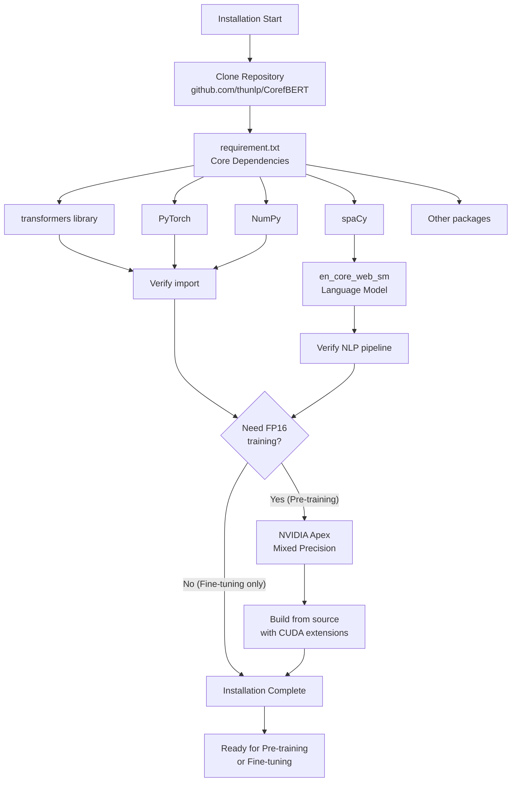
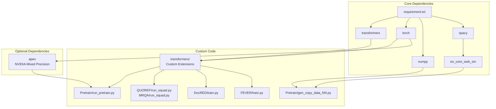
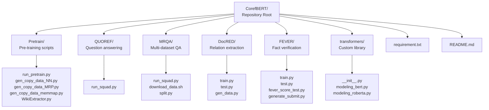

<!-- source: DeepWiki mcp.deepwiki.com · repo thunlp/CorefBERT · page 6 Installation and Setup · fetched 2026-11-02 -->

# Installation and Setup

<details>
<summary>Relevant source files</summary>

The following files were used as context for generating this wiki page:

- [README.md](README.md)
- [model.jpg](model.jpg)

</details>


This document provides step-by-step instructions for installing CorefBERT and its dependencies. It covers the installation of core dependencies, optional GPU acceleration libraries, and environment configuration required for both pre-training and fine-tuning operations.

For information about running pre-training after installation, see [Pre-training Execution](#2.2). For fine-tuning specific tasks, see [Fine-tuning Systems](#3).

## Prerequisites

CorefBERT requires Python 3 and CUDA-capable GPUs for training. The system is designed to run on multi-GPU setups with support for distributed training.

### System Requirements

| Component | Requirement | Used By |
|-----------|-------------|---------|
| Python | 3.x | All components |
| CUDA | Compatible with PyTorch | GPU training |
| GPUs | 8 GPUs (pre-training), 4 GPUs (fine-tuning) | Distributed training |
| Storage | ~500GB+ | Wikipedia corpus processing |
| RAM | 64GB+ recommended | Data preprocessing |

**Sources:** [README.md:12-50]()

## Dependency Installation Flow



**Sources:** [README.md:12-17]()

## Core Dependencies

### Step 1: Install Python Packages

Install all required Python dependencies from the requirements file:

```bash
pip3 install -r requirement.txt
```

The `requirement.txt` file includes:
- `transformers`: Hugging Face transformers library for BERT/RoBERTa models
- `torch`: PyTorch deep learning framework
- `numpy`: Numerical computing library
- `spacy`: Natural language processing library for noun extraction
- Additional utilities for data processing and training

**Sources:** [README.md:15]()

### Step 2: Install spaCy Language Model

Download the English language model required for noun extraction during pre-training data preparation:

```bash
python3 -m spacy download en_core_web_sm
```

The `en_core_web_sm` model is specifically used by `gen_copy_data_NN.py` to extract nouns from Wikipedia text during the data processing pipeline.

**Sources:** [README.md:16]()

## Optional: NVIDIA Apex for Mixed Precision Training

### Apex Installation

NVIDIA Apex is required for FP16 (mixed precision) training during pre-training. This is optional for fine-tuning but mandatory for replicating the pre-training process.

```bash
# Clone Apex repository
git clone https://github.com/NVIDIA/apex
cd apex

# Install with CUDA and C++ extensions
pip install -v --no-cache-dir --global-option="--cpp_ext" --global-option="--cuda_ext" ./
```

Apex provides:
- FP16 mixed precision training (`--fp16` flag in `run_pretrain.py`)
- Distributed training optimizations
- Memory usage reduction during large-scale pre-training

**Sources:** [README.md:13](), [README.md:50]()

## Dependency Architecture



**Sources:** [README.md:12-17](), [README.md:22-50]()

## Environment Configuration

### CUDA Device Setup

CorefBERT uses the `CUDA_VISIBLE_DEVICES` environment variable to control GPU allocation:

| Training Phase | GPU Configuration | Example |
|----------------|-------------------|---------|
| Pre-training | 8 GPUs | `CUDA_VISIBLE_DEVICES=0,1,2,3,4,5,6,7` |
| Fine-tuning | 4 GPUs | `CUDA_VISIBLE_DEVICES=0,1,2,3` |

Example for pre-training:
```bash
CUDA_VISIBLE_DEVICES=0,1,2,3,4,5,6,7 python3 -m torch.distributed.launch \
    --nproc_per_node 8 run_pretrain.py [args...]
```

Example for fine-tuning:
```bash
CUDA_VISIBLE_DEVICES=0,1,2,3 python3 run_squad.py [args...]
```

**Sources:** [README.md:50](), [README.md:66](), [README.md:91](), [README.md:114](), [README.md:128]()

### PyTorch Distributed Launch

Pre-training uses PyTorch's distributed launch utility for multi-GPU training:

```bash
python3 -m torch.distributed.launch --nproc_per_node 8 run_pretrain.py
```

Parameters:
- `--nproc_per_node`: Number of processes per node (must match number of GPUs)
- Automatically sets up distributed communication backend
- Each process gets a unique `local_rank` for device assignment

**Sources:** [README.md:50]()

## Installation Verification

### Verify Core Dependencies

Test that core dependencies are properly installed:

```python
# Test transformers import
from transformers import BertModel, BertTokenizer

# Test custom transformers extensions
import sys
sys.path.append('transformers/')
from modeling_bert import BertForCopy

# Test spaCy with language model
import spacy
nlp = spacy.load("en_core_web_sm")

# Test PyTorch CUDA
import torch
print(f"PyTorch version: {torch.__version__}")
print(f"CUDA available: {torch.cuda.is_available()}")
print(f"GPU count: {torch.cuda.device_count()}")
```

### Verify Apex Installation (Optional)

Test FP16 capabilities if Apex is installed:

```python
try:
    from apex import amp
    print("Apex is properly installed")
except ImportError:
    print("Apex not available - FP16 training will not work")
```

**Sources:** [README.md:8](), [README.md:13]()

## Directory Structure After Installation



**Sources:** [README.md:1-180]()

## Next Steps

After installation is complete:

1. **For Pre-training**: Follow the [Data Processing Pipeline](#2.1) to prepare Wikipedia data, then proceed to [Pre-training Execution](#2.2)
2. **For Fine-tuning**: Download pre-trained models (see [Model Downloads](#7)) and proceed to task-specific fine-tuning:
   - [QUOREF Question Answering](#3.1)
   - [MRQA Tasks](#3.2)
   - [DocRED Relation Extraction](#3.3)
   - [FEVER Fact Verification](#3.4)
   - [Coreference Resolution](#3.5)

**Sources:** [README.md:10](), [README.md:20-147]()

## Common Installation Issues

### Issue: Apex Installation Fails

**Problem:** Building Apex from source requires CUDA toolkit and C++ compiler to be properly configured.

**Solution:** 
- Ensure `nvcc` is in PATH: `which nvcc`
- Verify GCC version compatibility with CUDA version
- Install development headers: `apt-get install python3-dev`

### Issue: spaCy Model Not Found

**Problem:** Running `gen_copy_data_NN.py` fails with "Can't find model 'en_core_web_sm'".

**Solution:**
```bash
python3 -m spacy download en_core_web_sm
# Or specify full model name
python3 -m spacy download en_core_web_sm-3.0.0
```

### Issue: Import Error for Custom Transformers

**Problem:** Custom model classes in `transformers/` directory cannot be imported.

**Solution:** Add the transformers directory to Python path:
```python
import sys
sys.path.insert(0, 'transformers/')
```

Or install as editable package:
```bash
pip3 install -e transformers/
```

**Sources:** [README.md:13-16]()

---

