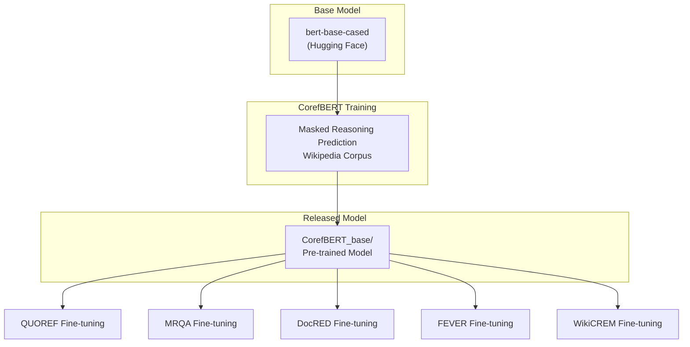
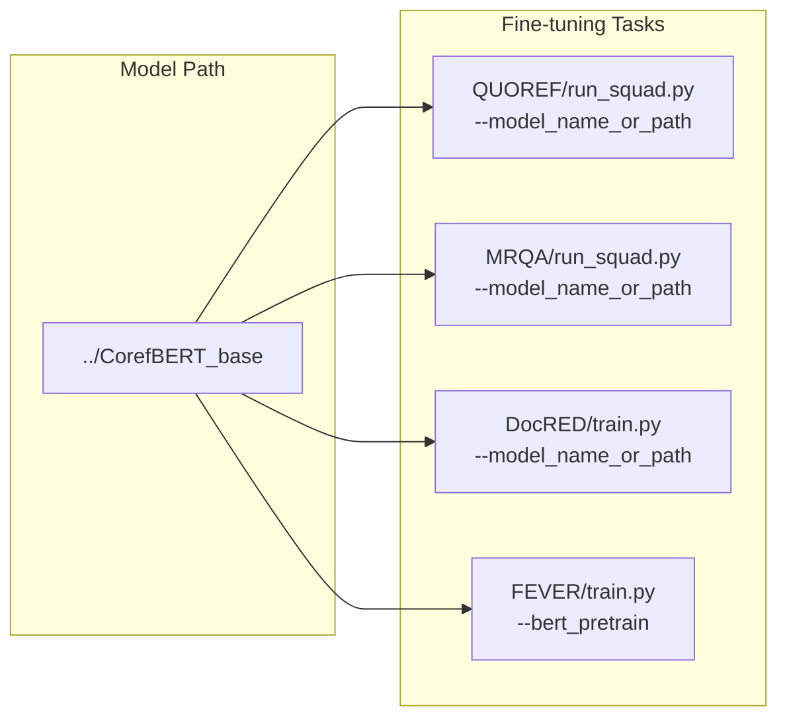
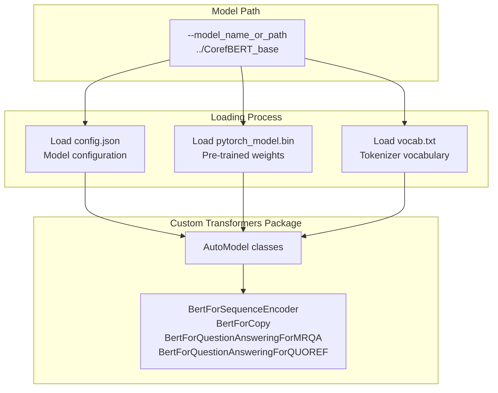
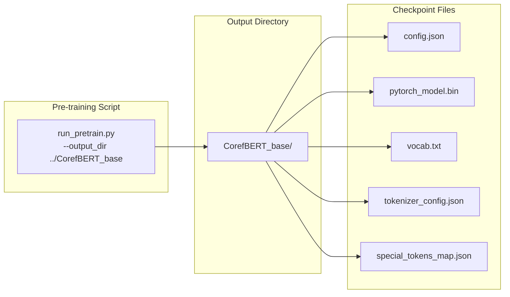
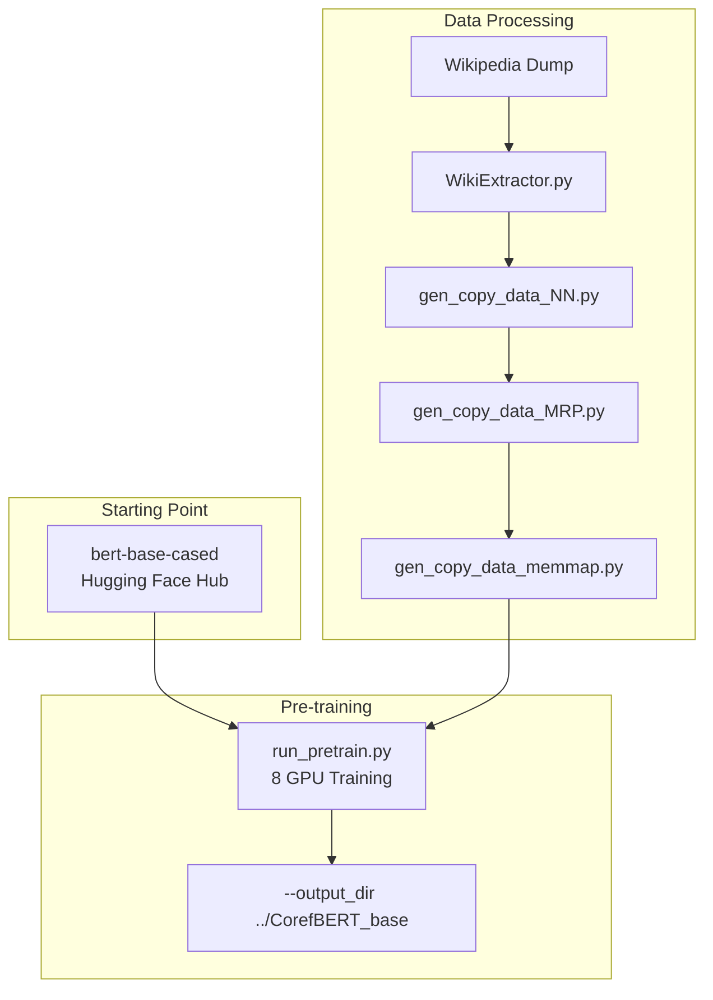

<!-- source: DeepWiki mcp.deepwiki.com · repo thunlp/CorefBERT · page 7 Model Downloads · fetched 2026-11-02 -->

# Model Downloads

<details>
<summary>Relevant source files</summary>

The following files were used as context for generating this wiki page:

- [README.md](README.md)
- [model.jpg](model.jpg)

</details>


This document describes the pre-trained CorefBERT models available for download, their storage locations, directory structure, and how they are referenced throughout the codebase for fine-tuning on downstream tasks.

For information about training your own models, see [Pre-training System](#2). For details on how these models are used in fine-tuning, see [Fine-tuning Systems](#3).

## Download Locations

CorefBERT provides pre-trained models through two mirror locations for accessibility:

| Mirror | URL | Purpose |
|--------|-----|---------|
| Google Drive | [https://drive.google.com/drive/folders/1JGDxWqvhWCQ58PqD7dAzye3NW5U2pZOp?usp=sharing](https://drive.google.com/drive/folders/1JGDxWqvhWCQ58PqD7dAzye3NW5U2pZOp?usp=sharing) | International access |
| Tsinghua Cloud | [https://cloud.tsinghua.edu.cn/d/a2eed603edd949b0a663](https://cloud.tsinghua.edu.cn/d/a2eed603edd949b0a663) | China regional access |

These locations provide identical model files. Users should select the mirror with better network connectivity for their location.

**Sources:** [README.md:10]()

## Available Models

The pre-trained model is built on top of the base BERT architecture with additional training using Masked Reasoning Prediction (MRP):



**Model Specifications:**

| Property | Value |
|----------|-------|
| Base Architecture | BERT (bert-base-cased) |
| Training Objective | Masked Reasoning Prediction (MRP) |
| Pre-training Corpus | Wikipedia |
| Model Size | Base (same as bert-base-cased) |
| Vocabulary | BERT WordPiece tokenizer |
| Maximum Sequence Length | 512 tokens |

**Sources:** [README.md:10](), [README.md:47-50]()

## Model Directory Structure

Downloaded models should be placed in the repository root or a parent directory. The standard directory structure is:

```
CorefBERT/
├── CorefBERT_base/          # Pre-trained model directory
│   ├── config.json          # Model configuration
│   ├── pytorch_model.bin    # Model weights
│   ├── vocab.txt            # Vocabulary file
│   └── ...                  # Other model files
├── QUOREF/                  # Task-specific code
├── MRQA/
├── DocRED/
├── FEVER/
└── Pretrain/
```

The model is referenced throughout the codebase using the relative path `../CorefBERT_base`, indicating it should be placed one level above the task-specific directories.

**Sources:** [README.md:66](), [README.md:91](), [README.md:114](), [README.md:128]()

## Model Reference Pattern

The pre-trained model is consistently referenced across all fine-tuning tasks using the `--model_name_or_path` argument:



### QUOREF Task

Command line reference:
```bash
--model_name_or_path ../CorefBERT_base
```

**Sources:** [README.md:66](), [README.md:71]()

### MRQA Tasks

Command line reference:
```bash
--model_name_or_path ../CorefBERT_base
```

**Sources:** [README.md:91](), [README.md:96]()

### DocRED Task

Command line reference:
```bash
--model_name_or_path ../CorefBERT_base
```

**Sources:** [README.md:114](), [README.md:119]()

### FEVER Task

Command line reference (note the different argument name):
```bash
--bert_pretrain ../CorefBERT_base
```

**Sources:** [README.md:128](), [README.md:134](), [README.md:139]()

## Model Loading Mechanism

The model loading follows the Hugging Face Transformers pattern with custom extensions:



The custom transformers package (see [Transformers Library](#4)) extends the base BERT models while maintaining compatibility with the standard model loading interface. This allows seamless loading of CorefBERT models using the same `--model_name_or_path` argument pattern.

**Sources:** [README.md:66](), [README.md:91](), [README.md:114](), [README.md:128]()

## Model Compatibility

CorefBERT models maintain compatibility with the Hugging Face Transformers ecosystem:

| Component | Compatibility |
|-----------|---------------|
| Base Architecture | `bert-base-cased` compatible |
| Tokenizer | Standard BERT WordPiece tokenizer |
| Configuration Format | Hugging Face `config.json` format |
| Weight Format | PyTorch `state_dict` format |
| Custom Extensions | Backward compatible with base BERT |

Models can be loaded using either:
- Standard Hugging Face API with custom model classes
- Direct PyTorch checkpoint loading
- Task-specific wrapper classes (e.g., `BertForSequenceEncoder`)

**Sources:** [README.md:8](), [README.md:47-50]()

## Pre-training Output Structure

When training your own CorefBERT model (see [Pre-training Execution](#2.2)), the output directory structure matches the download format:



The `--save_steps` parameter controls checkpoint frequency. Each checkpoint can serve as a pre-trained model for fine-tuning.

**Sources:** [README.md:47-50]()

## Model Usage Examples

### Loading for QUOREF (Multi-Answer QA)

```bash
--model_type bert_multi \
--model_name_or_path ../CorefBERT_base
```

Uses the `BertForQuestionAnsweringForQUOREF` model class for multi-answer extraction.

**Sources:** [README.md:66]()

### Loading for MRQA (Standard QA)

```bash
--model_type bert \
--model_name_or_path ../CorefBERT_base
```

Uses the `BertForQuestionAnsweringForMRQA` model class for standard question answering.

**Sources:** [README.md:91]()

### Loading for DocRED (Relation Extraction)

```bash
--model_type bert \
--model_name_or_path ../CorefBERT_base
```

Uses the base BERT architecture with task-specific heads for relation classification.

**Sources:** [README.md:114]()

### Loading for FEVER (Fact Verification)

```bash
--model_type bert \
--bert_pretrain ../CorefBERT_base
```

Note: FEVER uses `--bert_pretrain` instead of `--model_name_or_path` due to its KGAT-based codebase integration.

**Sources:** [README.md:128]()

## Model File Sizes and Requirements

The pre-trained model requires sufficient storage and memory:

| Resource | Requirement |
|----------|-------------|
| Disk Space | ~500MB (similar to bert-base-cased) |
| GPU Memory (Inference) | ~1-2GB per GPU |
| GPU Memory (Training) | 4-8GB per GPU depending on batch size |
| Recommended GPUs | 4-8 GPUs for fine-tuning |

For distributed training configuration, see [Distributed Training](#8).

**Sources:** [README.md:66](), [README.md:91](), [README.md:114](), [README.md:128]()

## Alternative: Training from Scratch

Instead of downloading pre-trained models, users can train CorefBERT from scratch:



This process is documented in detail in [Pre-training System](#2).

**Sources:** [README.md:20-50]()

## Model Versioning and Updates

The repository provides a single version of the pre-trained model. Users requiring different model variants should:

1. Download the base CorefBERT model
2. Fine-tune on specific tasks to create task-specific checkpoints
3. Save fine-tuned models in separate directories (e.g., `QUOREF_CorefBERT_base/`, `SQuAD_CorefBERT_base/`)

Task-specific model directories follow this naming pattern:

| Task | Output Directory Pattern |
|------|-------------------------|
| QUOREF | `QUOREF_CorefBERT_base/` |
| SQuAD | `SQuAD_CorefBERT_base/` |
| DocRED | `DocRED_CorefBERT_base/` |
| FEVER | `FEVER_CorefBERT_base/` |

**Sources:** [README.md:66](), [README.md:91](), [README.md:114](), [README.md:128]()

## FEVER Preprocessed Data

In addition to the pre-trained model, FEVER fine-tuning requires preprocessed data files:

**Download Locations:**
- [Google Drive](https://drive.google.com/drive/folders/12-0VIoev0PzU4K-IUeWUaVNAlf0ESWZ3?usp=sharing)
- [Tsinghua Cloud](https://cloud.tsinghua.edu.cn/d/9ad5c476906041ae9bf7)

These contain KGAT-preprocessed versions of the FEVER dataset. For details, see [FEVER Fact Verification](#3.4).

**Sources:** [README.md:124]()

---

