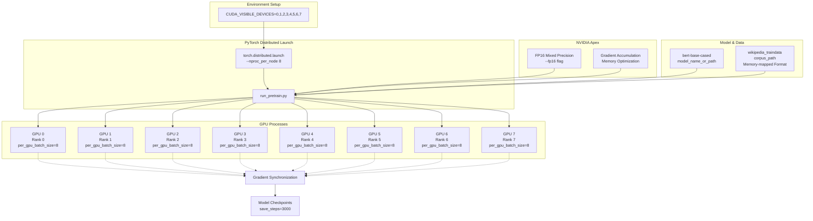
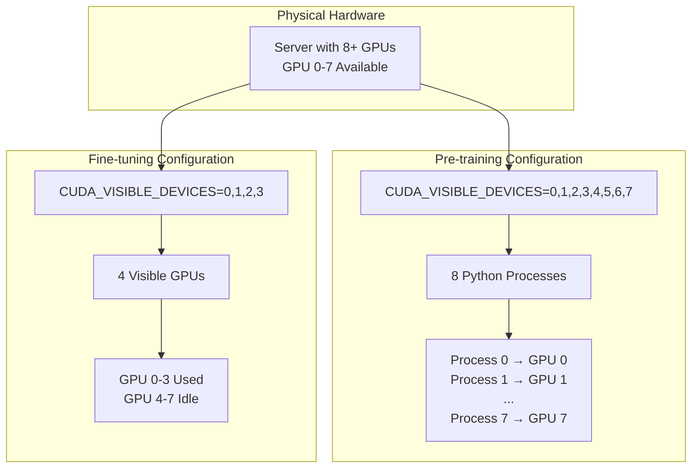
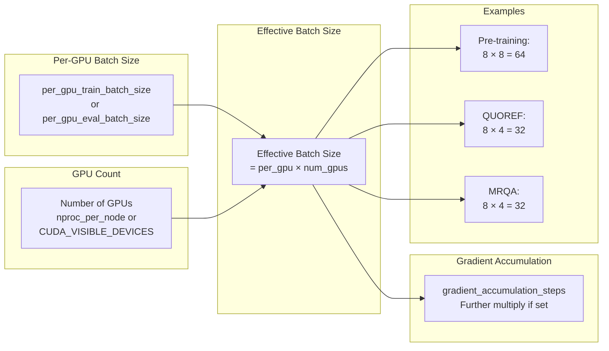
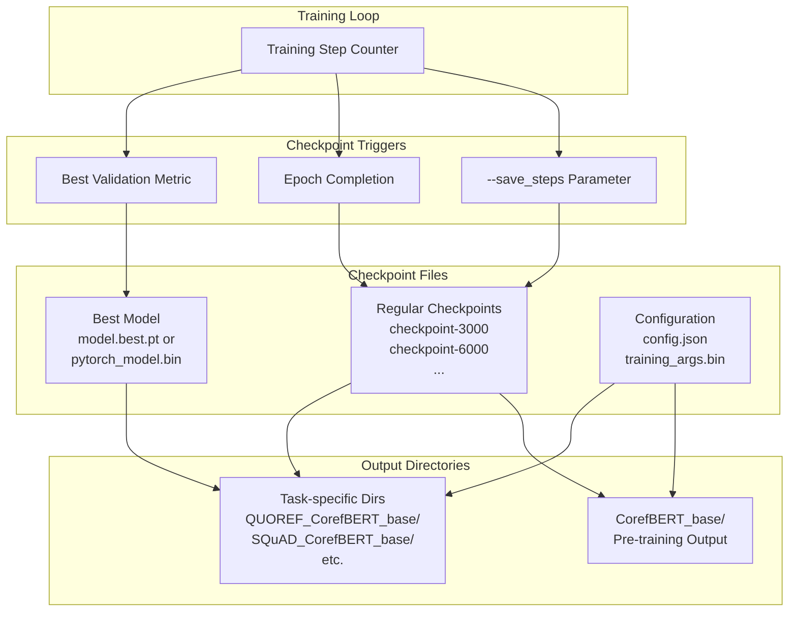
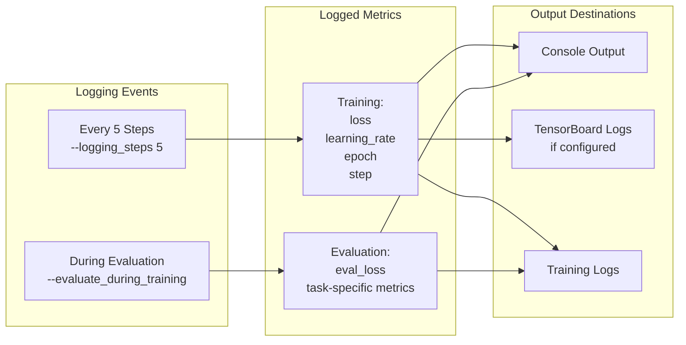
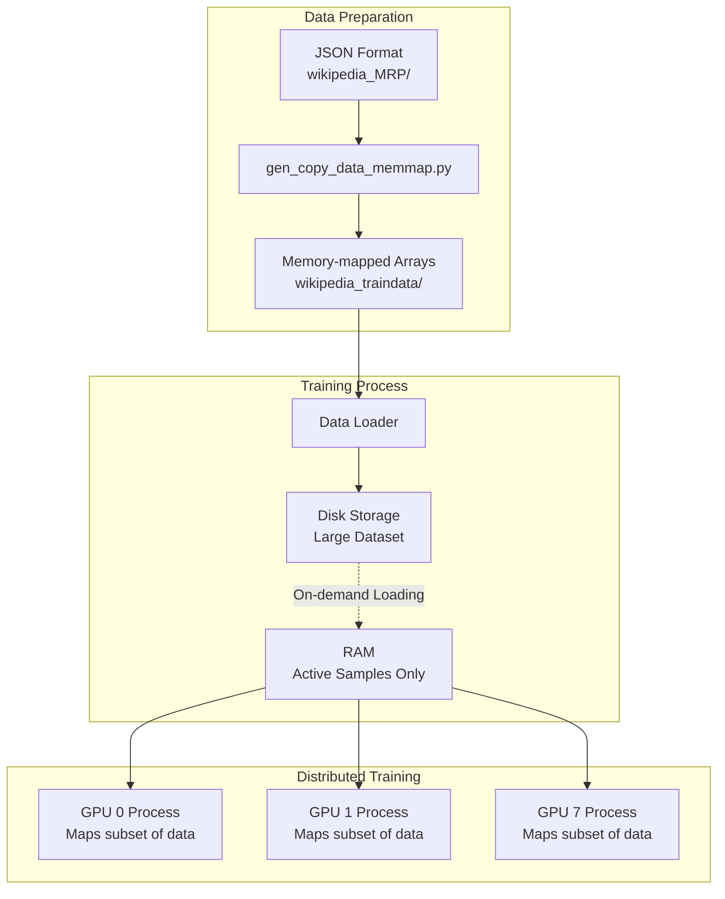
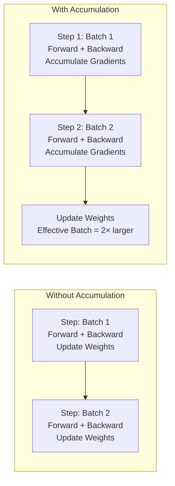

<!-- source: DeepWiki mcp.deepwiki.com · repo thunlp/CorefBERT · page 8 Distributed Training · fetched 2026-11-02 -->

# Distributed Training

<details>
<summary>Relevant source files</summary>

The following files were used as context for generating this wiki page:

- [README.md](README.md)
- [model.jpg](model.jpg)

</details>


## Purpose and Scope

This document explains the distributed training infrastructure used in CorefBERT for both pre-training and fine-tuning phases. It covers GPU configuration, PyTorch's distributed launch mechanism, mixed precision training with NVIDIA Apex, and optimization strategies for managing computational resources across different training phases.

For information about the pre-training execution workflow, see [Pre-training Execution](#2.2). For task-specific fine-tuning configurations, see [Fine-tuning Systems](#3).

## Overview

CorefBERT employs a two-tier distributed training strategy:

| Training Phase | GPUs | Distribution Method | Mixed Precision | Key Scripts |
|---------------|------|---------------------|-----------------|-------------|
| Pre-training | 8 | `torch.distributed.launch` | FP16 (Apex) | `run_pretrain.py` |
| Fine-tuning | 4 | Simple multi-GPU | Optional | `run_squad.py`, `train.py` |

The pre-training phase requires intensive distributed training with 8 GPUs and FP16 mixed precision to handle large-scale Wikipedia corpus processing. Fine-tuning tasks use simpler 4-GPU configurations without requiring the distributed launch wrapper, as they operate on smaller task-specific datasets.

**Sources:** [README.md:49-140]()

## Pre-training Distributed Architecture

### PyTorch Distributed Launch Configuration

The pre-training process uses PyTorch's distributed data parallel training through `torch.distributed.launch`:



The complete pre-training command from [README.md:48-50]():

```bash
CUDA_VISIBLE_DEVICES=0,1,2,3,4,5,6,7 python3 -m torch.distributed.launch \
    --nproc_per_node 8 \
    run_pretrain.py \
    --do_train \
    --model_type bert \
    --model_name_or_path bert-base-cased \
    --corpus_path wikipedia_traindata \
    --per_gpu_train_batch_size 8 \
    --learning_rate 5e-5 \
    --num_train_epochs 1 \
    --max_seq_length 512 \
    --save_steps 3000 \
    --logging_steps 5 \
    --warmup_steps 3000 \
    --output_dir ../CorefBERT_base \
    --fp16
```

**Key Parameters:**
- `--nproc_per_node 8`: Spawns 8 parallel processes, one per GPU
- `--per_gpu_train_batch_size 8`: Each GPU processes batches of size 8 (effective batch size = 8 × 8 = 64)
- `--fp16`: Enables mixed precision training via Apex
- `--save_steps 3000`: Saves checkpoint every 3000 steps
- `--logging_steps 5`: Logs training metrics every 5 steps

**Sources:** [README.md:47-50]()

### FP16 Mixed Precision Training

```mermaid
graph LR
    subgraph "NVIDIA Apex Integration"
        INSTALL["apex Installation<br/>requirement.txt"]
        FLAG["--fp16 flag"]
    end
    
    subgraph "Forward Pass"
        FP32_MODEL["FP32 Master Weights"]
        FP16_COPY["FP16 Working Copy"]
        FP16_FWD["FP16 Forward Pass<br/>Reduced Memory<br/>Faster Compute"]
    end
    
    subgraph "Backward Pass"
        FP16_GRAD["FP16 Gradients"]
        LOSS_SCALE["Loss Scaling<br/>Prevent Underflow"]
        FP32_GRAD["FP32 Gradient Accumulation"]
    end
    
    subgraph "Optimizer Step"
        FP32_UPDATE["FP32 Weight Update"]
        SYNC["All-Reduce Sync<br/>Across 8 GPUs"]
    end
    
    INSTALL --> FLAG
    FLAG --> FP32_MODEL
    FP32_MODEL --> FP16_COPY
    FP16_COPY --> FP16_FWD
    FP16_FWD --> FP16_GRAD
    FP16_GRAD --> LOSS_SCALE
    LOSS_SCALE --> FP32_GRAD
    FP32_GRAD --> SYNC
    SYNC --> FP32_UPDATE
    FP32_UPDATE --> FP32_MODEL
```



Mixed precision training reduces memory consumption by ~50% and accelerates computation on modern GPUs with Tensor Cores. The `--fp16` flag in `run_pretrain.py` activates Apex's automatic mixed precision, which:

1. Maintains master weights in FP32 for numerical stability
2. Performs forward/backward passes in FP16 for speed
3. Applies loss scaling to prevent gradient underflow
4. Synchronizes gradients across GPUs in FP32

**Sources:** [README.md:13-16, 49]()

## Fine-tuning Distributed Setup

Fine-tuning tasks use simpler multi-GPU configurations without `torch.distributed.launch`. The training scripts handle multi-GPU parallelization internally.

### GPU Configuration Patterns

```mermaid
graph TB
    subgraph "QUOREF Fine-tuning"
        QUOREF_ENV["CUDA_VISIBLE_DEVICES=0,1,2,3"]
        QUOREF_SCRIPT["run_squad.py"]
        QUOREF_BATCH["per_gpu_train_batch_size=8<br/>per_gpu_eval_batch_size=16"]
        QUOREF_ENV --> QUOREF_SCRIPT
        QUOREF_BATCH --> QUOREF_SCRIPT
    end
    
    subgraph "MRQA Fine-tuning"
        MRQA_ENV["CUDA_VISIBLE_DEVICES=0,1,2,3"]
        MRQA_SCRIPT["run_squad.py"]
        MRQA_BATCH["per_gpu_train_batch_size=8<br/>per_gpu_eval_batch_size=16"]
        MRQA_ENV --> MRQA_SCRIPT
        MRQA_BATCH --> MRQA_SCRIPT
    end
    
    subgraph "DocRED Fine-tuning"
        DOCRED_ENV["CUDA_VISIBLE_DEVICES=0,1,2,3"]
        DOCRED_SCRIPT["train.py"]
        DOCRED_BATCH["batch_size=32<br/>Total across GPUs"]
        DOCRED_ENV --> DOCRED_SCRIPT
        DOCRED_BATCH --> DOCRED_SCRIPT
    end
    
    subgraph "FEVER Fine-tuning"
        FEVER_ENV["CUDA_VISIBLE_DEVICES=0,1,2,3"]
        FEVER_SCRIPT["train.py"]
        FEVER_BATCH["train_batch_size=32<br/>valid_batch_size=32"]
        FEVER_ENV --> FEVER_SCRIPT
        FEVER_BATCH --> FEVER_SCRIPT
    end
    
    subgraph "Common Base"
        BASE_MODEL["CorefBERT_base<br/>Pre-trained Model"]
        GPU_COUNT["4 GPUs Standard"]
    end
    
    BASE_MODEL --> QUOREF_SCRIPT
    BASE_MODEL --> MRQA_SCRIPT
    BASE_MODEL --> DOCRED_SCRIPT
    BASE_MODEL --> FEVER_SCRIPT
    
    GPU_COUNT --> QUOREF_ENV
    GPU_COUNT --> MRQA_ENV
    GPU_COUNT --> DOCRED_ENV
    GPU_COUNT --> FEVER_ENV
```



**Sources:** [README.md:65-140]()

### Fine-tuning Command Examples

#### QUOREF

```bash
CUDA_VISIBLE_DEVICES=0,1,2,3 python run_squad.py \
    --do_train \
    --evaluate_during_training \
    --model_type bert_multi \
    --model_name_or_path ../CorefBERT_base \
    --train_file quoref_data/quoref-train-v0.1.json \
    --predict_file quoref_data/quoref-dev-v0.1.json \
    --per_gpu_train_batch_size 8 \
    --per_gpu_eval_batch_size 16 \
    --learning_rate 2e-5 \
    --num_train_epochs 6 \
    --max_seq_length 512 \
    --doc_stride 128 \
    --save_steps 884 \
    --max_n_answers 2 \
    --output_dir QUOREF_CorefBERT_base
```

**Effective Batch Size:** 8 × 4 = 32

**Sources:** [README.md:64-67]()

#### MRQA (SQuAD Example)

```bash
CUDA_VISIBLE_DEVICES=0,1,2,3 python3 run_squad.py \
    --do_train \
    --do_eval \
    --evaluate_during_training \
    --model_type bert \
    --model_name_or_path ../CorefBERT_base \
    --train_file squad/train.jsonl \
    --predict_file squad/dev.jsonl \
    --doc_stride 128 \
    --per_gpu_train_batch_size 8 \
    --per_gpu_eval_batch_size 16 \
    --learning_rate 3e-5 \
    --num_train_epochs 2 \
    --max_seq_length 512 \
    --save_steps 1500 \
    --output_dir SQuAD_CorefBERT_base
```

**Effective Batch Size:** 8 × 4 = 32

**Sources:** [README.md:89-92]()

#### DocRED

```bash
CUDA_VISIBLE_DEVICES=0,1,2,3 python3 train.py \
    --model_type bert \
    --model_name_or_path ../CorefBERT_base \
    --train_prefix train \
    --test_prefix dev \
    --evaluate_during_training_epoch 5 \
    --prepro_data_dir prepro_data \
    --max_seq_length 512 \
    --batch_size 32 \
    --learning_rate 4e-5 \
    --num_train_epochs 200 \
    --save_name DocRED_CorefBERT_base
```

**Note:** DocRED's `--batch_size 32` is the total batch size across all GPUs (8 per GPU).

**Sources:** [README.md:112-115]()

#### FEVER

```bash
CUDA_VISIBLE_DEVICES=0,1,2,3 python3 train.py \
    --model_type bert \
    --bert_pretrain ../CorefBERT_base \
    --learning_rate 2e-5 \
    --num_train_epochs 3 \
    --train_path fever_metadata/train.json \
    --valid_path fever_metadata/dev.json \
    --train_batch_size 32 \
    --valid_batch_size 32 \
    --outdir FEVER_CorefBERT_base
```

**Sources:** [README.md:126-129]()

## GPU Configuration and Resource Allocation

### CUDA_VISIBLE_DEVICES Usage



The `CUDA_VISIBLE_DEVICES` environment variable controls which physical GPUs are visible to the training process:

| Configuration | GPUs Visible | Use Case |
|--------------|--------------|----------|
| `0,1,2,3,4,5,6,7` | 8 GPUs | Pre-training with distributed launch |
| `0,1,2,3` | 4 GPUs | All fine-tuning tasks |
| `0,1` | 2 GPUs | Custom reduced-scale training |
| `0` | 1 GPU | Debugging or small-scale experiments |

**Sources:** [README.md:49, 66, 91, 114, 128]()

### Batch Size Configuration Strategy



**Batch Size Calculation:**

| Task | Per-GPU Batch | GPUs | Effective Batch | Total Samples/Step |
|------|---------------|------|-----------------|-------------------|
| Pre-training | 8 | 8 | 64 | 64 |
| QUOREF | 8 | 4 | 32 | 32 |
| MRQA | 8 | 4 | 32 | 32 |
| DocRED | 8 (32/4) | 4 | 32 | 32 |
| FEVER | 8 (32/4) | 4 | 32 | 32 |

**Memory Considerations:**
- Pre-training: FP16 with `max_seq_length=512` allows `per_gpu_train_batch_size=8`
- Fine-tuning: Without FP16, same memory footprint supports similar batch sizes
- Evaluation: `per_gpu_eval_batch_size=16` (doubled) because no gradient storage needed

**Sources:** [README.md:49, 66, 91, 114, 128]()

## Checkpoint and Logging Configuration

### Checkpoint Saving Strategy



**Checkpoint Configuration by Task:**

| Task | `--save_steps` | Strategy | Output Directory |
|------|----------------|----------|------------------|
| Pre-training | 3000 | Regular intervals | `../CorefBERT_base` |
| QUOREF | 884 | Regular + best on validation | `QUOREF_CorefBERT_base` |
| MRQA | 1500 | Regular + best on validation | `SQuAD_CorefBERT_base` |
| DocRED | Per epoch | Every 5 epochs during training | `DocRED_CorefBERT_base` |
| FEVER | Per epoch | Best validation model | `FEVER_CorefBERT_base` |

**Sources:** [README.md:49, 66, 91, 114, 128]()

### Logging Configuration

The `--logging_steps 5` parameter in pre-training controls training metrics logging frequency:



**Sources:** [README.md:49, 66, 91]()

## Memory Optimization Techniques

### Memory-Mapped Data Format

Pre-training uses memory-mapped numpy arrays to handle the large Wikipedia corpus efficiently:



Memory-mapped files allow:
1. **Lazy Loading:** Only load samples into RAM as needed during training
2. **Shared Access:** Multiple GPU processes can access the same data without duplication
3. **No RAM Bottleneck:** Train on datasets larger than available RAM

Command: [README.md:42-44]()
```bash
python3 gen_copy_data_memmap.py \
    --train_token_corpus wikipedia_MRP/ \
    --output_dir wikipedia_traindata/ \
    --max_seq_length 512 \
    --max_copy_per_seq 15
```

**Sources:** [README.md:41-44, 49]()

### Gradient Accumulation

While not explicitly configured in the provided commands, gradient accumulation is a common technique for simulating larger batch sizes:



This technique is useful when:
- GPU memory limits prevent larger `per_gpu_train_batch_size`
- You want to maintain effective batch size while reducing memory usage
- Simulating larger batch sizes without additional GPUs

**Sources:** General distributed training practice (not explicitly shown in README)

## Training Parameter Summary

### Pre-training Parameters

| Parameter | Value | Purpose |
|-----------|-------|---------|
| `nproc_per_node` | 8 | Number of parallel processes |
| `per_gpu_train_batch_size` | 8 | Batch size per GPU |
| `learning_rate` | 5e-5 | Learning rate |
| `num_train_epochs` | 1 | Training epochs |
| `max_seq_length` | 512 | Maximum sequence length |
| `save_steps` | 3000 | Checkpoint save interval |
| `logging_steps` | 5 | Logging interval |
| `warmup_steps` | 3000 | Learning rate warmup steps |
| `fp16` | enabled | Mixed precision training |

**Sources:** [README.md:48-50]()

### Fine-tuning Parameters

| Task | Learning Rate | Epochs | Batch Size | Save Steps |
|------|--------------|--------|------------|------------|
| QUOREF | 2e-5 | 6 | 8 per GPU | 884 |
| MRQA | 3e-5 | 2 | 8 per GPU | 1500 |
| DocRED | 4e-5 | 200 | 32 total | Per epoch |
| FEVER | 2e-5 | 3 | 32 total | Per epoch |

**Sources:** [README.md:66, 91, 114, 128]()

## Best Practices

### Resource Allocation

1. **Pre-training:** Use maximum available GPUs (8) with FP16 to handle large corpus
2. **Fine-tuning:** 4 GPUs sufficient for smaller task-specific datasets
3. **Evaluation:** Increase `per_gpu_eval_batch_size` (16 vs 8) since no gradients needed
4. **Debugging:** Use single GPU (`CUDA_VISIBLE_DEVICES=0`) for initial testing

### Performance Optimization

1. **Mixed Precision:** Always use `--fp16` for pre-training (requires Apex)
2. **Sequence Length:** Use maximum `max_seq_length=512` for full context
3. **Batch Size:** Maximize `per_gpu_train_batch_size` within GPU memory limits
4. **Checkpointing:** Balance `save_steps` between storage space and recovery granularity
5. **Logging:** Use sparse `logging_steps` (5) to minimize I/O overhead

### Checkpoint Management

1. **Pre-training:** Save at regular intervals (`save_steps=3000`) for recovery
2. **Fine-tuning:** Use `--evaluate_during_training` to save best model on validation set
3. **Selection:** Manually review training logs to select best checkpoint based on task metrics
4. **Storage:** Each checkpoint includes model weights, config, and optimizer state

**Sources:** [README.md:13-16, 48-140]()

---

