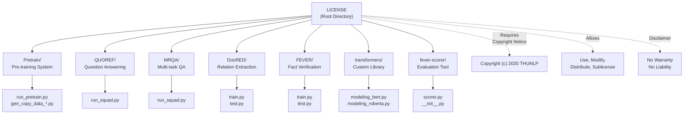
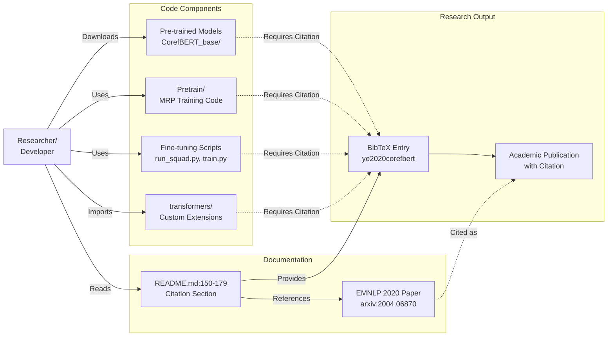
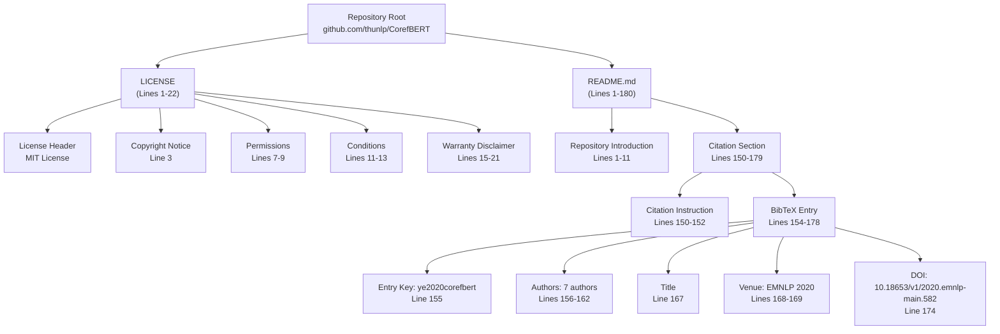

<!-- source: DeepWiki mcp.deepwiki.com · repo thunlp/CorefBERT · page 9 License and Citation · fetched 2026-11-02 -->

# License and Citation

<details>
<summary>Relevant source files</summary>

The following files were used as context for generating this wiki page:

- [LICENSE](LICENSE)
- [README.md](README.md)
- [model.jpg](model.jpg)

</details>


## Purpose and Scope

This page documents the licensing terms for the CorefBERT codebase and provides instructions for properly citing the work in academic publications. It covers the MIT License terms, copyright information, and the BibTeX citation format for the associated research paper.

For information about installation and setup procedures, see [Installation and Setup](#6). For details about downloading pre-trained models, see [Model Downloads](#7).

---

## License Information

### License Type and Location

The CorefBERT repository is distributed under the **MIT License**, a permissive open-source license that allows broad usage rights. The full license text is contained in [LICENSE:1-22]().

**Sources:** [LICENSE:1-22]()

### Copyright Holder

```
Copyright (c) 2020 THUNLP
```

The copyright is held by THUNLP (Tsinghua University Natural Language Processing Lab), established in 2020.

**Sources:** [LICENSE:3]()

### Permissions and Rights

The MIT License grants the following permissions without restriction:

| Permission | Description |
|------------|-------------|
| **Use** | Use the software for any purpose |
| **Copy** | Create copies of the software |
| **Modify** | Modify and create derivative works |
| **Merge** | Merge the software with other codebases |
| **Publish** | Publish the software or derivatives |
| **Distribute** | Distribute copies to others |
| **Sublicense** | Grant sublicenses to third parties |
| **Sell** | Sell copies of the software |

**Sources:** [LICENSE:7-9]()

### License Requirements

The only requirements imposed by the MIT License are:

1. **Copyright Notice Inclusion**: The copyright notice must be included in all copies or substantial portions of the software
2. **License Text Inclusion**: The license text must be included in all copies or substantial portions of the software

**Sources:** [LICENSE:11-13]()

### Warranty Disclaimer

The software is provided "AS IS" without warranty of any kind. The license explicitly disclaims:

- **Express or implied warranties**
- **Warranties of merchantability**
- **Warranties of fitness for a particular purpose**
- **Warranties of non-infringement**

The copyright holders are not liable for any claims, damages, or other liability arising from the use of the software.

**Sources:** [LICENSE:15-21]()

---

## Citation Information

### When to Cite

Users should cite the CorefBERT paper when:

1. Using the CorefBERT pre-trained models in research
2. Adapting the pre-training methodology for coreferential reasoning
3. Using the codebase for fine-tuning experiments
4. Building upon or comparing against CorefBERT results
5. Utilizing the custom transformers extensions in derivative works

The citation requirement is stated in [README.md:150-152](): "If you use the code, please cite this paper:"

**Sources:** [README.md:150-152]()

### Paper Details

The CorefBERT paper was published at the 2020 Conference on Empirical Methods in Natural Language Processing (EMNLP 2020).

| Attribute | Value |
|-----------|-------|
| **Title** | Coreferential Reasoning Learning for Language Representation |
| **Authors** | Deming Ye, Yankai Lin, Jiaju Du, Zhenghao Liu, Peng Li, Maosong Sun, Zhiyuan Liu |
| **Conference** | EMNLP 2020 |
| **Venue** | Online, November 16-20, 2020 |
| **Pages** | 7170-7186 |
| **Publisher** | Association for Computational Linguistics |
| **Year** | 2020 |
| **DOI** | 10.18653/v1/2020.emnlp-main.582 |
| **URL** | https://doi.org/10.18653/v1/2020.emnlp-main.582 |
| **arXiv** | https://arxiv.org/abs/2004.06870 |

**Sources:** [README.md:3](), [README.md:155-174]()

### BibTeX Entry

The BibTeX citation entry is provided in [README.md:154-178](). Copy the following entry to cite CorefBERT:

```bibtex
@inproceedings{ye2020corefbert,
  author    = {Deming Ye and
               Yankai Lin and
               Jiaju Du and
               Zhenghao Liu and
               Peng Li and
               Maosong Sun and
               Zhiyuan Liu},
  editor    = {Bonnie Webber and
               Trevor Cohn and
               Yulan He and
               Yang Liu},
  title     = {Coreferential Reasoning Learning for Language Representation},
  booktitle = {Proceedings of the 2020 Conference on Empirical Methods in Natural
               Language Processing, {EMNLP} 2020, Online, November 16-20, 2020},
  pages     = {7170--7186},
  publisher = {Association for Computational Linguistics},
  year      = {2020},
  url       = {https://doi.org/10.18653/v1/2020.emnlp-main.582},
  doi       = {10.18653/v1/2020.emnlp-main.582},
  timestamp = {Wed, 23 Mar 2022 10:11:55 +0100},
  biburl    = {https://dblp.org/rec/conf/emnlp/YeLDLLSL20.bib},
  bibsource = {dblp computer science bibliography, https://dblp.org}
}
```

**Sources:** [README.md:154-178]()

---

## License and Citation Architecture

### License Application Across Repository

The following diagram shows how the MIT License applies to different components of the CorefBERT repository:



**Description:** The MIT License at the repository root applies to all subdirectories and their contained source files. Users must include both the copyright notice and license text when redistributing any part of the codebase, whether modified or unmodified.

**Sources:** [LICENSE:1-22](), [README.md:1-180]()

### Citation Workflow

The following diagram illustrates the relationship between code usage, documentation, and citation requirements:



**Description:** When researchers or developers use any component of the CorefBERT system (models, pre-training code, fine-tuning scripts, or custom transformers), they should cite the EMNLP 2020 paper using the BibTeX entry provided in [README.md:154-178](). The citation information links the code artifacts to the academic publication that describes the methodology.

**Sources:** [README.md:3](), [README.md:150-179]()

### License and Citation File Locations

The following diagram maps documentation files to their roles in the licensing and citation process:



**Description:** The repository contains two primary files for licensing and citation information. [LICENSE:1-22]() contains the full MIT License text with copyright notice, while [README.md:150-179]() contains the citation instructions and complete BibTeX entry. Both files are located in the repository root for easy discovery.

**Sources:** [LICENSE:1-22](), [README.md:150-179]()

---

## Usage Compliance

### Redistributing CorefBERT Code

When redistributing the CorefBERT codebase or substantial portions of it:

1. **Include** the [LICENSE:1-22]() file in your distribution
2. **Preserve** the copyright notice: `Copyright (c) 2020 THUNLP`
3. **Maintain** the license text in all copies
4. **Optionally** add your own copyright notices for modifications

**Sources:** [LICENSE:11-13]()

### Using CorefBERT in Research

When using CorefBERT in academic research:

1. **Cite** the EMNLP 2020 paper using the BibTeX entry from [README.md:154-178]()
2. **Reference** the GitHub repository: `https://github.com/thunlp/CorefBERT`
3. **Specify** which pre-trained model variant was used (e.g., CorefBERT_base)
4. **Acknowledge** THUNLP as the source of the implementation

**Sources:** [README.md:1](), [README.md:150-152]()

### Integration with Other Systems

The MIT License permits integration of CorefBERT with codebases under different licenses, provided:

1. The CorefBERT copyright notice and license text are retained
2. The combined work's license is compatible with the MIT License
3. Clear attribution is maintained for the CorefBERT components

**Sources:** [LICENSE:7-9]()

---

## Additional Acknowledgments

The [README.md:8]() notes that "The code is based on huggaface's [transformers](https://github.com/huggingface/transformers). Thanks to them!" This indicates that CorefBERT builds upon the Hugging Face transformers library. When using CorefBERT, users should also comply with the licensing terms of the upstream transformers library.

Additionally, specific task implementations acknowledge other codebases:
- DocRED: Uses modified code from the [official DocRED repository](https://github.com/thunlp/DocRED) [README.md:103]()
- FEVER: Uses code from [KGAT](https://github.com/thunlp/KernelGAT) [README.md:124]()
- Coreference Resolution: Uses code from [WikiCREM](https://github.com/vid-koci/bert-commonsense) [README.md:146]()

**Sources:** [README.md:8](), [README.md:103](), [README.md:124](), [README.md:146]()