# Page: CorefBERT Overview

# CorefBERT Overview

<details>
<summary>Relevant source files</summary>

The following files were used as context for generating this wiki page:

- [README.md](README.md)
- [model.jpg](model.jpg)

</details>


## Purpose and Scope

This document provides a high-level overview of the CorefBERT system, a language representation model designed to enhance coreferential reasoning capabilities in NLP tasks. CorefBERT extends BERT by introducing a novel pre-training objective called Masked Reasoning Prediction (MRP) that explicitly models coreferential patterns in text.

This page covers:
- Overall system architecture and main components
- The coreferential reasoning concept and MRP pre-training objective
- High-level pre-training to fine-tuning pipeline
- Repository structure and code organization

For detailed information on specific subsystems:
- Pre-training data processing and execution: See [Pre-training System](#2)
- Task-specific fine-tuning instructions: See [Fine-tuning Systems](#3)
- Custom model implementations: See [Transformers Library](#4)
- Installation and environment setup: See [Installation and Setup](#6)

**Sources:** [README.md:1-10]()

## System Architecture

CorefBERT consists of three major subsystems that work together to enable coreferential reasoning in language models:

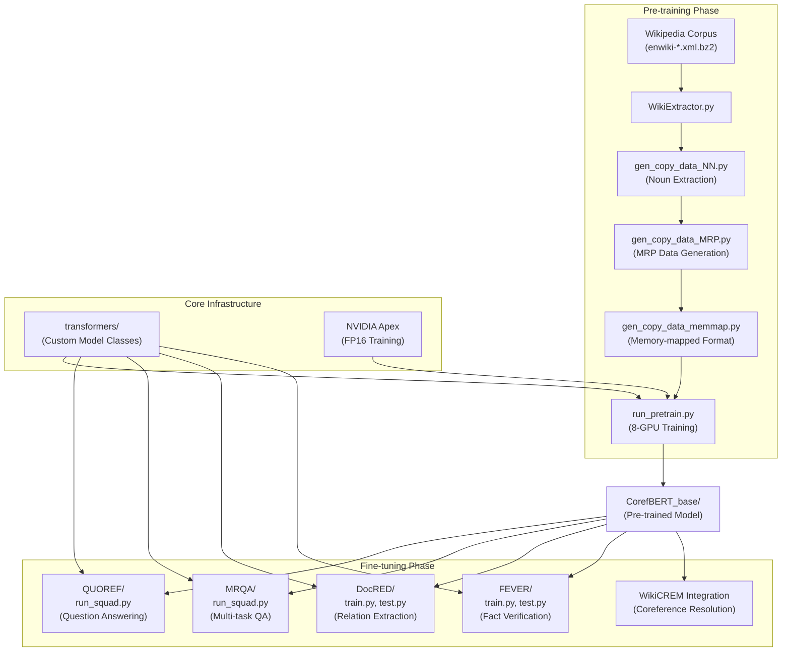

**Diagram: CorefBERT System Architecture - End-to-End Pipeline**

The system follows a two-phase approach:

1. **Pre-training Phase**: Processes raw Wikipedia data through multiple stages to create training data emphasizing coreferential patterns, then trains the base model using distributed GPU training
2. **Fine-tuning Phase**: Adapts the pre-trained model to specific downstream tasks using task-specific training scripts

**Sources:** [README.md:20-50](), [README.md:52-147]()

## Main Components

### Pre-training System

Located in `Pretrain/`, this subsystem handles the complete lifecycle from raw Wikipedia dumps to the trained CorefBERT model. The pipeline consists of:

| Stage | Script | Purpose |
|-------|--------|---------|
| 1. Text Extraction | `WikiExtractor.py` | Extracts clean text from Wikipedia XML dumps |
| 2. Noun Identification | `gen_copy_data_NN.py` | Identifies and extracts nouns from text |
| 3. MRP Data Generation | `gen_copy_data_MRP.py` | Creates masked reasoning prediction training examples |
| 4. Format Conversion | `gen_copy_data_memmap.py` | Converts to memory-mapped numpy format for efficiency |
| 5. Model Training | `run_pretrain.py` | Executes distributed training with FP16 mixed precision |

The pre-training system uses 8 GPUs with `torch.distributed.launch` and NVIDIA Apex for efficient large-scale training.

For detailed documentation, see [Pre-training System](#2).

**Sources:** [README.md:20-50]()

### Fine-tuning Systems

CorefBERT supports five downstream task categories, each with dedicated training infrastructure:

| Task | Directory | Primary Scripts | Task Type |
|------|-----------|----------------|-----------|
| QUOREF | `QUOREF/` | `run_squad.py` (with `--model_type bert_multi`) | Question Answering with multiple answers |
| MRQA | `MRQA/` | `run_squad.py` | Multi-dataset Question Answering |
| DocRED | `DocRED/` | `train.py`, `test.py` | Document-level Relation Extraction |
| FEVER | `FEVER/` | `train.py`, `test.py` | Fact Verification with evidence retrieval |
| Coreference Resolution | External (WikiCREM) | Integration with external codebase | Entity coreference |

Each task uses 4 GPUs for fine-tuning with task-specific hyperparameters and batch sizes.

For task-specific guides, see [Fine-tuning Systems](#3).

**Sources:** [README.md:52-147]()

### Transformers Library

The `transformers/` directory contains custom extensions to the Hugging Face transformers library. These extensions include:

- **BertForSequenceEncoder** and **RobertaForSequenceEncoder**: Base encoder variants
- **BertForCopy**: Specialized model for copy mechanism in pre-training
- **BertForQuestionAnsweringForMRQA**: MRQA-specific question answering
- **BertForQuestionAnsweringForQUOREF**: QUOREF-specific multi-answer QA

The custom transformers package maintains API compatibility with Hugging Face while adding CorefBERT-specific functionality.

For detailed API documentation, see [Transformers Library](#4).

**Sources:** [README.md:8]()

## Coreferential Reasoning and Masked Reasoning Prediction

CorefBERT introduces **coreferential reasoning** as an explicit pre-training objective. The system learns to understand and predict relationships between coreferent entities (nouns that refer to the same real-world entity) within documents.

### Masked Reasoning Prediction (MRP)

The MRP task extends BERT's Masked Language Modeling by focusing on coreferential patterns:


**Diagram: Masked Reasoning Prediction Process**

The MRP objective is implemented in the data processing pipeline:

1. `gen_copy_data_NN.py` extracts nouns using spaCy's NER
2. `gen_copy_data_MRP.py` identifies repeated nouns (potential coreferents), masks them, and creates training examples
3. The model learns to predict masked tokens by reasoning about coreferential relationships

Key parameters:
- `--max_seq_length 512`: Maximum sequence length for training
- `--max_copy_per_seq 15`: Maximum number of coreferent mentions per sequence
- `--short_seq_prob 0.1`: Probability of using shorter sequences

**Sources:** [README.md:3-5](), [README.md:31-43]()

## Pre-training to Fine-tuning Workflow

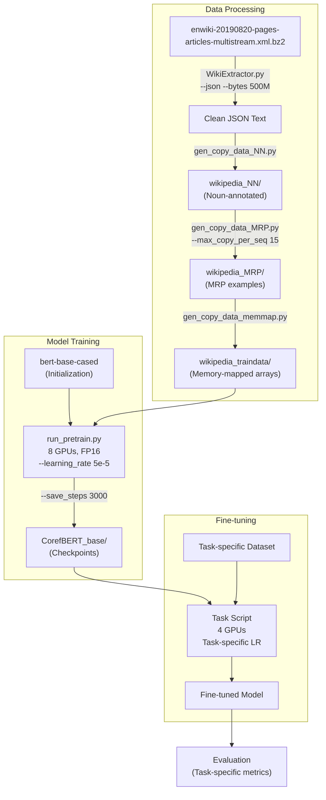

**Diagram: Complete CorefBERT Training Workflow**

The workflow consists of three main stages:

1. **Data Processing**: Multi-stage pipeline converting raw Wikipedia to MRP training data
2. **Pre-training**: Distributed training on 8 GPUs using the processed data, initializing from `bert-base-cased`
3. **Fine-tuning**: Task-specific adaptation on 4 GPUs with smaller learning rates

**Sources:** [README.md:20-50](), [README.md:52-147]()

## Model Variants and Availability

CorefBERT provides pre-trained models based on BERT architecture:

| Model | Base Architecture | Training Data | Download |
|-------|------------------|---------------|----------|
| CorefBERT_base | bert-base-cased | Wikipedia (MRP) | [Google Drive](https://drive.google.com/drive/folders/1JGDxWqvhWCQ58PqD7dAzye3NW5U2pZOp?usp=sharing) / [Tsinghua Cloud](https://cloud.tsinghua.edu.cn/d/a2eed603edd949b0a663) |

The pre-trained model includes:
- Model weights compatible with Hugging Face transformers API
- Configuration files (`config.json`)
- Vocabulary files (`vocab.txt`)
- Tokenizer files

For download instructions and usage, see [Model Downloads](#7).

**Sources:** [README.md:10]()

## Repository Structure

```mermaid
graph TB
    ROOT["CorefBERT/<br/>(Repository Root)"]
    
    ROOT --> README["README.md<br/>(Documentation)"]
    ROOT --> REQ["requirement.txt<br/>(Dependencies)"]
    
    ROOT --> PRETRAIN["Pretrain/<br/>(Pre-training Pipeline)"]
    ROOT --> QUOREF["QUOREF/<br/>(Question Answering)"]
    ROOT --> MRQA["MRQA/<br/>(Multi-task QA)"]
    ROOT --> DOCRED["DocRED/<br/>(Relation Extraction)"]
    ROOT --> FEVER["FEVER/<br/>(Fact Verification)"]
    ROOT --> TRANS["transformers/<br/>(Custom Models)"]
    
    PRETRAIN --> WIKIEXT["WikiExtractor.py"]
    PRETRAIN --> GENNN["gen_copy_data_NN.py"]
    PRETRAIN --> GENMRP["gen_copy_data_MRP.py"]
    PRETRAIN --> GENMEM["gen_copy_data_memmap.py"]
    PRETRAIN --> RUNPRE["run_pretrain.py"]
    
    QUOREF --> RUNSQUAD1["run_squad.py"]
    MRQA --> RUNSQUAD2["run_squad.py"]
    MRQA --> SPLIT["split.py"]
    
    DOCRED --> GENDATA["gen_data.py"]
    DOCRED --> TRAIN1["train.py"]
    DOCRED --> TEST1["test.py"]
    
    FEVER --> TRAIN2["train.py"]
    FEVER --> TEST2["test.py"]
    FEVER --> SCORER["fever_score_test.py"]
    FEVER --> SUBMIT["generate_submit.py"]
    
    TRANS --> INIT["__init__.py"]
    TRANS --> MODELS["Model Classes<br/>(BertFor*, RobertaFor*)"]
```

**Diagram: Repository Directory Structure and Key Files**

The repository is organized into task-specific directories, each containing:
- Training scripts (`train.py` or `run_squad.py`)
- Testing/evaluation scripts (`test.py`, evaluation utilities)
- Data preprocessing scripts (`gen_data.py`, `split.py`)
- Task-specific utilities

**Sources:** [README.md:1-180]()

## Technical Requirements

CorefBERT requires the following infrastructure and dependencies:

### Hardware Requirements

| Phase | GPUs | Memory | Configuration |
|-------|------|--------|---------------|
| Pre-training | 8 | High (FP16 recommended) | `CUDA_VISIBLE_DEVICES=0,1,2,3,4,5,6,7` |
| Fine-tuning | 4 | Medium | `CUDA_VISIBLE_DEVICES=0,1,2,3` |
| Inference | 1+ | Low-Medium | Flexible |

### Software Dependencies

Key dependencies include:
- **PyTorch**: Deep learning framework with distributed training support
- **transformers**: Hugging Face library (extended with custom models)
- **apex**: NVIDIA library for mixed precision training
- **spacy**: NLP library for noun extraction (`en_core_web_sm` model required)

Installation command from repository:
```bash
pip3 install -r requirement.txt
python3 -m spacy download en_core_web_sm
```

For complete setup instructions, see [Installation and Setup](#6).

**Sources:** [README.md:12-17](), [README.md:49](), [README.md:66]()

## Integration with Hugging Face Ecosystem

CorefBERT maintains compatibility with the Hugging Face transformers ecosystem while adding custom functionality:

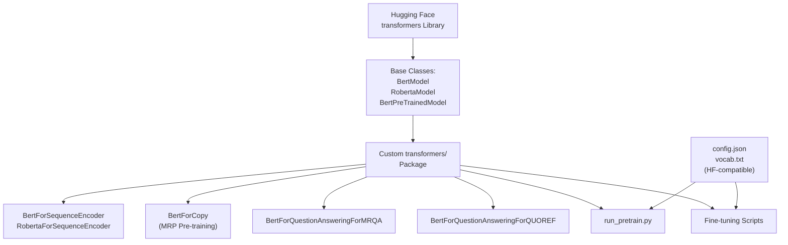

**Diagram: Hugging Face Integration Architecture**

The custom `transformers/` package:
- Inherits from Hugging Face base classes
- Uses standard configuration and tokenizer formats
- Supports loading with `--model_name_or_path` parameter
- Enables drop-in replacement for standard BERT models

API usage pattern:
```python
--model_type bert --model_name_or_path ../CorefBERT_base
```

This design allows CorefBERT to leverage the Hugging Face ecosystem while introducing specialized model architectures for coreferential reasoning.

**Sources:** [README.md:8](), [README.md:49](), [README.md:66](), [README.md:91]()

## Citation and Research Context

CorefBERT is based on the research paper "Coreferential Reasoning Learning for Language Representation" published at EMNLP 2020. The system demonstrates that explicitly modeling coreferential patterns during pre-training improves performance on tasks requiring entity tracking and reasoning.

For citation information and licensing details, see [License and Citation](#9).

**Sources:** [README.md:3](), [README.md:150-179]()

---

# Page: Pre-training System

# Pre-training System

<details>
<summary>Relevant source files</summary>

The following files were used as context for generating this wiki page:

- [README.md](README.md)
- [model.jpg](model.jpg)

</details>


## Purpose and Scope

The Pre-training System encompasses the complete pipeline for training CorefBERT models from raw Wikipedia data. This includes data extraction, preprocessing stages to emphasize coreferential patterns through Masked Reasoning Prediction (MRP), and distributed GPU training of the base model. The system transforms Wikipedia XML dumps into a pre-trained BERT model capable of coreferential reasoning.

For detailed information about specific stages, see [Data Processing Pipeline](#2.1) and [Pre-training Execution](#2.2). For fine-tuning the pre-trained model on downstream tasks, see [Fine-tuning Systems](#3).

**Sources:** [README.md:20-50]()

## System Architecture

The pre-training system follows a five-stage pipeline that progressively refines Wikipedia text to create training data optimized for learning coreferential patterns:

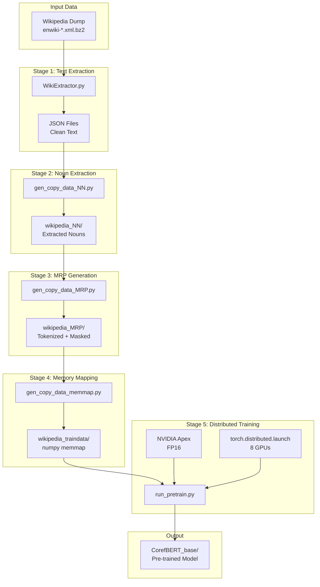

**Sources:** [README.md:20-50]()

## Data Processing Pipeline Overview

The data processing pipeline transforms raw Wikipedia XML into training-ready numpy memmap arrays. Each stage serves a specific purpose in preparing data for Masked Reasoning Prediction:

### Stage 1: Text Extraction with WikiExtractor

`WikiExtractor.py` processes the Wikipedia database dump (`enwiki-20190820-pages-articles-multistream.xml.bz2`) to extract clean text in JSON format. The extraction is parallelized using multiple processes and outputs data in manageable chunks (500MB files).

Command parameters:
- `--json`: Output format
- `--output`: Output directory
- `--bytes 500M`: Maximum file size per chunk
- `--processes 8`: Number of parallel processes

### Stage 2: Noun Extraction

`gen_copy_data_NN.py` analyzes the extracted Wikipedia text to identify and extract noun phrases. This stage uses natural language processing to detect entities that can participate in coreference relationships.

Input: `wikipedia/` (JSON files from Stage 1)  
Output: `wikipedia_NN/` (Wikipedia with annotated nouns)

### Stage 3: Masked Reasoning Prediction Data Generation

`gen_copy_data_MRP.py` implements the core preprocessing logic for CorefBERT's training objective. This script:

1. Identifies repeated nouns across sentences that form coreference chains
2. Tokenizes text using BERT's WordPiece tokenizer
3. Applies masking strategy for Masked Reasoning Prediction
4. Generates training examples with maximum sequence length constraints

Key parameters:
- `--bert_model bert-base-cased`: Base BERT model for tokenizer
- `--max_seq_length 512`: Maximum sequence length
- `--short_seq_prob 0.1`: Probability of generating short sequences
- `--max_copy_per_seq 15`: Maximum coreferential mentions per sequence

### Stage 4: Memory-Mapped Format Conversion

`gen_copy_data_memmap.py` converts JSON training data into numpy memmap format for efficient data loading during training. Memory-mapped arrays allow the training script to access data without loading the entire dataset into RAM.

Input: `wikipedia_MRP/` (tokenized JSON)  
Output: `wikipedia_traindata/` (numpy memmap arrays)

**Sources:** [README.md:24-44]()

## Training Infrastructure

### Distributed Training Configuration

The pre-training phase employs distributed data-parallel training across 8 GPUs using PyTorch's `torch.distributed.launch`:

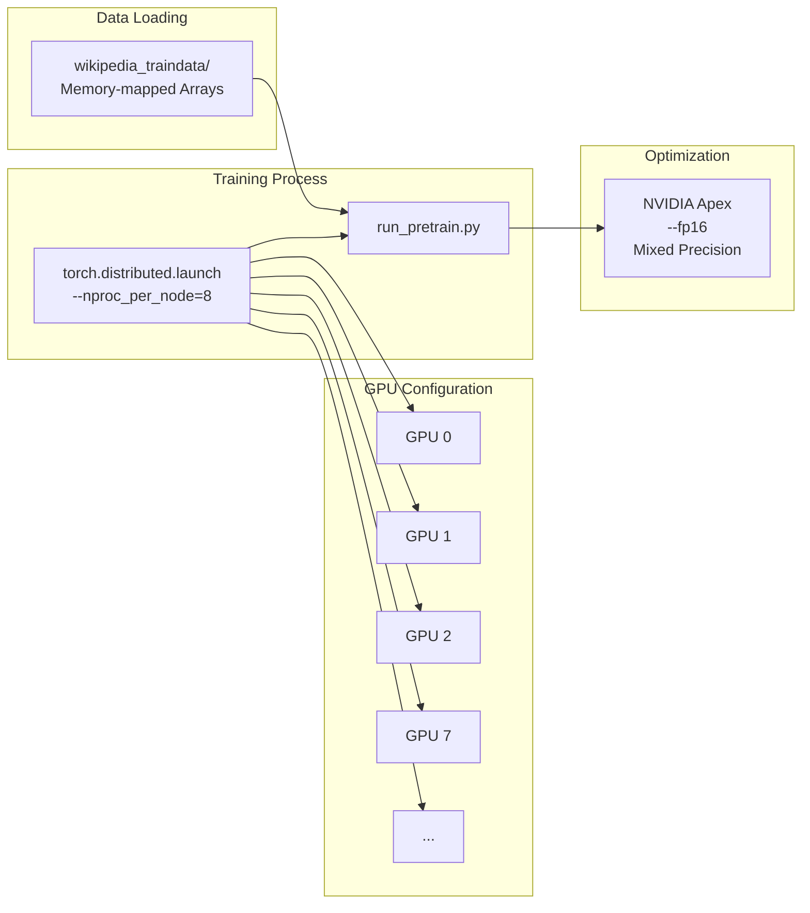

### Training Parameters

The training configuration uses the following key parameters:

| Parameter | Value | Purpose |
|-----------|-------|---------|
| `--model_type` | `bert` | Base model architecture |
| `--model_name_or_path` | `bert-base-cased` | Starting checkpoint |
| `--per_gpu_train_batch_size` | `8` | Batch size per GPU |
| `--learning_rate` | `5e-5` | Optimizer learning rate |
| `--num_train_epochs` | `1` | Number of training epochs |
| `--max_seq_length` | `512` | Maximum sequence length |
| `--save_steps` | `3000` | Checkpoint save interval |
| `--logging_steps` | `5` | Logging interval |
| `--warmup_steps` | `3000` | Learning rate warmup steps |
| `--fp16` | flag | Enable mixed precision training |

**Sources:** [README.md:47-50]()

## Key Scripts and Components

### Pre-training Script Mapping

The following table maps the natural language description of each processing stage to the concrete Python script that implements it:

| Stage | Script Name | Input | Output | Key Function |
|-------|-------------|-------|--------|--------------|
| Text Extraction | `WikiExtractor.py` | `enwiki-*.xml.bz2` | JSON files | Extract and clean Wikipedia articles |
| Noun Extraction | `gen_copy_data_NN.py` | `wikipedia/` | `wikipedia_NN/` | Identify noun phrases for coreference |
| MRP Generation | `gen_copy_data_MRP.py` | `wikipedia_NN/` | `wikipedia_MRP/` | Generate masked reasoning examples |
| Memory Mapping | `gen_copy_data_memmap.py` | `wikipedia_MRP/` | `wikipedia_traindata/` | Convert to efficient binary format |
| Training | `run_pretrain.py` | `wikipedia_traindata/` | `CorefBERT_base/` | Train model with MRP objective |

### Script Parameter Details

#### gen_copy_data_NN.py Parameters
```
--train_corpus: Input directory containing Wikipedia JSON
--output_dir: Output directory for noun-annotated data
```

#### gen_copy_data_MRP.py Parameters
```
--train_NN_corpus: Input directory with noun-annotated Wikipedia
--output_dir: Output directory for MRP-formatted data
--bert_model: BERT model name for tokenizer (bert-base-cased)
--max_seq_length: Maximum sequence length (512)
--short_seq_prob: Probability of short sequences (0.1)
--max_copy_per_seq: Maximum coreference mentions per sequence (15)
```

#### gen_copy_data_memmap.py Parameters
```
--train_token_corpus: Input directory with tokenized MRP data
--output_dir: Output directory for memory-mapped arrays
--max_seq_length: Maximum sequence length (512)
--max_copy_per_seq: Maximum coreference mentions (15)
```

#### run_pretrain.py Parameters
```
--do_train: Enable training mode
--model_type: Model architecture (bert)
--model_name_or_path: Starting checkpoint (bert-base-cased)
--corpus_path: Path to memory-mapped training data
--per_gpu_train_batch_size: Batch size per GPU (8)
--learning_rate: Learning rate (5e-5)
--num_train_epochs: Number of epochs (1)
--max_seq_length: Maximum sequence length (512)
--save_steps: Checkpoint interval (3000)
--logging_steps: Logging interval (5)
--warmup_steps: Warmup steps (3000)
--output_dir: Output directory for checkpoints
--fp16: Enable mixed precision training
```

**Sources:** [README.md:28-50]()

## Training Data Flow

The following diagram shows how data flows through the system during the training phase, connecting the memory-mapped data format to the training script's data loading and model components:

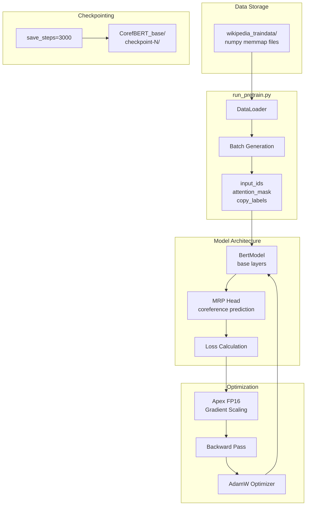

**Sources:** [README.md:47-50]()

## Output Artifacts

### Model Checkpoints

The training process generates checkpoints at regular intervals (every 3000 steps by default) in the specified `--output_dir`:

```
CorefBERT_base/
├── checkpoint-3000/
│   ├── config.json
│   ├── pytorch_model.bin
│   ├── training_args.bin
│   └── optimizer.pt
├── checkpoint-6000/
├── checkpoint-9000/
└── ...
```

Each checkpoint contains:
- `config.json`: Model configuration
- `pytorch_model.bin`: Model weights
- `training_args.bin`: Training configuration
- `optimizer.pt`: Optimizer state (for resuming training)

### Final Pre-trained Model

The final CorefBERT model in `CorefBERT_base/` can be loaded using the transformers library and serves as the starting point for all downstream fine-tuning tasks. The pre-trained model is compatible with standard BERT interfaces but has learned enhanced representations for coreferential reasoning through the Masked Reasoning Prediction objective.

**Sources:** [README.md:47-50]()

## System Requirements

### Hardware Requirements

- **GPUs:** 8 NVIDIA GPUs with CUDA support (as configured by `CUDA_VISIBLE_DEVICES=0,1,2,3,4,5,6,7`)
- **Memory:** Sufficient RAM to handle data preprocessing (memory-mapped format reduces training-time memory requirements)
- **Storage:** Large disk space for Wikipedia dump (~100GB compressed) and processed data

### Software Dependencies

- Python 3.x
- PyTorch with distributed training support
- NVIDIA Apex for mixed precision training
- Hugging Face transformers library
- spaCy with `en_core_web_sm` model for noun extraction

**Sources:** [README.md:12-17](), [README.md:47-50]()

## Integration with Custom Transformers

The pre-training system uses the custom transformers package located in the `transformers/` directory, which extends Hugging Face's implementation with CorefBERT-specific model architectures. The `run_pretrain.py` script specifically uses:

- `BertForCopy`: Custom BERT variant with Masked Reasoning Prediction head
- `BertForSequenceEncoder`: Sequence encoding functionality for pre-training

For detailed information about the custom model architectures, see [Transformers Library](#4) and [Model Extensions](#4.2).

**Sources:** [README.md:8](), [README.md:47-50]()

---

# Page: Data Processing Pipeline

# Data Processing Pipeline

<details>
<summary>Relevant source files</summary>

The following files were used as context for generating this wiki page:

- [README.md](README.md)
- [model.jpg](model.jpg)

</details>


## Purpose and Scope

This document describes the data processing pipeline that prepares Wikipedia text for CorefBERT pre-training. The pipeline transforms raw Wikipedia dumps into memory-mapped training data optimized for the Masked Reasoning Prediction (MRP) pre-training task.

This page covers data preparation only. For information about the actual pre-training execution process, see [Pre-training Execution](#2.2). For details about the custom model architectures used during pre-training, see [Model Extensions](#4.2).

**Sources:** [README.md:20-50]()

## Pipeline Overview

The data processing pipeline consists of four sequential stages, each producing intermediate data consumed by the next stage:


| Stage | Script | Input | Output | Purpose |
|-------|--------|-------|--------|---------|
| 1 | `WikiExtractor.py` | Wikipedia XML dump | Clean JSON text | Extract and clean Wikipedia articles |
| 2 | `gen_copy_data_NN.py` | Clean JSON text | Noun-annotated text | Identify and extract nouns for coreference |
| 3 | `gen_copy_data_MRP.py` | Noun-annotated text | Tokenized MRP data | Generate masked reasoning examples |
| 4 | `gen_copy_data_memmap.py` | Tokenized MRP data | Memory-mapped arrays | Convert to efficient training format |

**Sources:** [README.md:24-50]()

## Stage 1: Wikipedia Text Extraction

### WikiExtractor Processing

The pipeline begins with raw Wikipedia database dumps downloaded from [dumps.wikimedia.org](https://dumps.wikimedia.org/enwiki). The `WikiExtractor.py` script extracts clean text from compressed XML format.

**Command:**
```bash
python3 WikiExtractor.py wikipedia/enwiki-20190820-pages-articles-multistream.xml.bz2 \
    --json \
    --output wikipedia/ \
    --bytes 500M \
    --processes 8
```

### Key Parameters

| Parameter | Value | Purpose |
|-----------|-------|---------|
| Input file | `enwiki-*.xml.bz2` | Compressed Wikipedia dump |
| `--json` | flag | Output in JSON format (one article per line) |
| `--output` | `wikipedia/` | Output directory for extracted text |
| `--bytes` | `500M` | Maximum size per output file (500 megabytes) |
| `--processes` | `8` | Number of parallel extraction processes |

### Output Format

WikiExtractor produces JSON files containing clean Wikipedia article text with markup removed. Each line represents one article with fields for title, URL, and cleaned text content.

**Sources:** [README.md:24-29]()

## Stage 2: Noun Extraction

### Purpose and Implementation

The `gen_copy_data_NN.py` script processes the clean Wikipedia text to identify and extract noun phrases. This step is crucial for CorefBERT's coreferential reasoning objective, as nouns are the primary entities involved in coreference chains.

**Command:**
```bash
python3 gen_copy_data_NN.py \
    --train_corpus wikipedia/ \
    --output_dir wikipedia_NN/
```

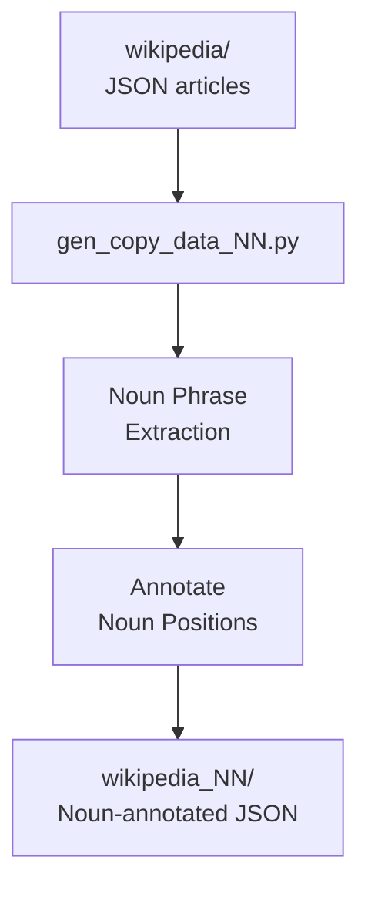

### Script Arguments

| Argument | Description | Example |
|----------|-------------|---------|
| `--train_corpus` | Directory containing WikiExtractor output | `wikipedia/` |
| `--output_dir` | Directory for noun-extracted output | `wikipedia_NN/` |

### Processing Details

The script likely uses NLP libraries (such as spaCy, as indicated by the requirement `python3 -m spacy download en_core_web_sm` in [README.md:16]()) to perform linguistic analysis and identify noun phrases. These nouns become candidates for the masked reasoning prediction task.

**Sources:** [README.md:31-34](), [README.md:16]()

## Stage 3: Masked Reasoning Prediction (MRP) Data Generation

### Overview

The `gen_copy_data_MRP.py` script is the core of CorefBERT's data preparation. It identifies repeated nouns (coreferential mentions), tokenizes text using BERT's WordPiece tokenizer, and applies masking to create the MRP pre-training task.

**Command:**
```bash
python3 gen_copy_data_MRP.py \
    --train_NN_corpus wikipedia_NN/ \
    --output_dir wikipedia_MRP/ \
    --bert_model bert-base-cased \
    --max_seq_length 512 \
    --short_seq_prob 0.1 \
    --max_copy_per_seq 15
```

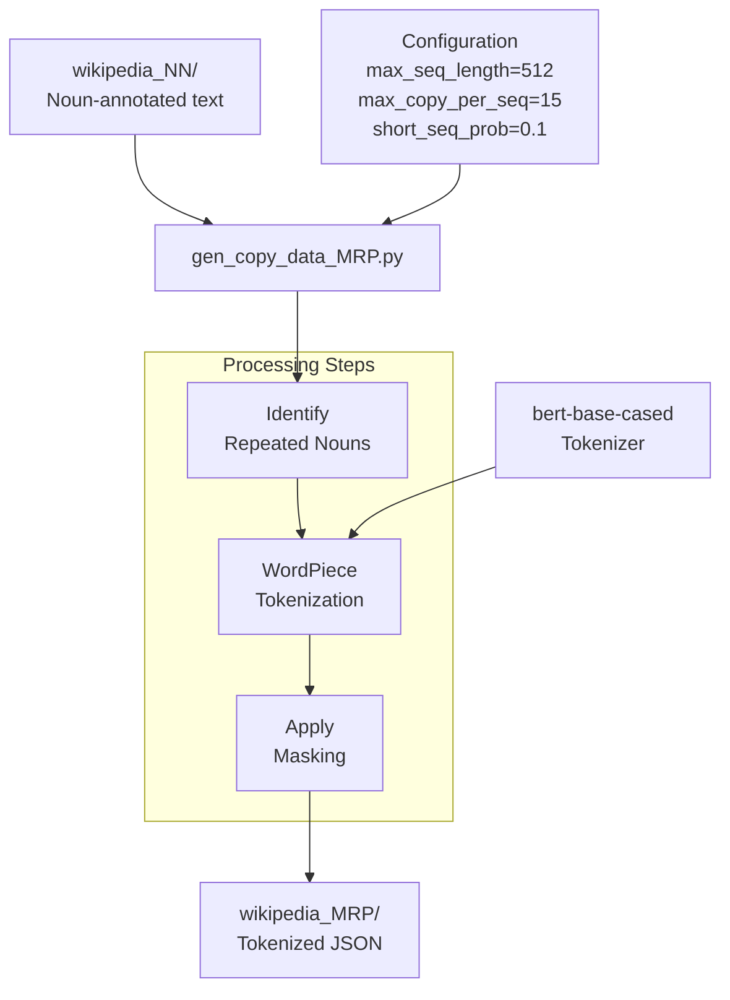

### Configuration Parameters

| Parameter | Value | Description |
|-----------|-------|-------------|
| `--train_NN_corpus` | `wikipedia_NN/` | Input directory with noun-annotated text |
| `--output_dir` | `wikipedia_MRP/` | Output directory for MRP data |
| `--bert_model` | `bert-base-cased` | BERT model for tokenization vocabulary |
| `--max_seq_length` | `512` | Maximum sequence length in tokens |
| `--short_seq_prob` | `0.1` | Probability of generating sequences shorter than max length |
| `--max_copy_per_seq` | `15` | Maximum number of coreferential masks per sequence |

### MRP Task Generation

The script performs three key operations:

1. **Coreference Identification**: Analyzes noun-annotated text to find repeated noun mentions that refer to the same entity
2. **WordPiece Tokenization**: Converts text to subword tokens using the BERT tokenizer from `bert-base-cased`
3. **Masking Strategy**: Applies masks to coreferential mentions according to the `max_copy_per_seq` constraint

The `max_copy_per_seq=15` parameter limits each sequence to at most 15 masked coreferential mentions, balancing between learning signal and computational feasibility.

**Sources:** [README.md:36-39]()

## Stage 4: Memory-Mapped Data Conversion

### Efficient Data Format

The `gen_copy_data_memmap.py` script converts JSON-formatted MRP data into NumPy memory-mapped arrays. This format enables efficient random access during distributed training without loading the entire dataset into memory.

**Command:**
```bash
python3 gen_copy_data_memmap.py \
    --train_token_corpus wikipedia_MRP/ \
    --output_dir wikipedia_traindata/ \
    --max_seq_length 512 \
    --max_copy_per_seq 15
```

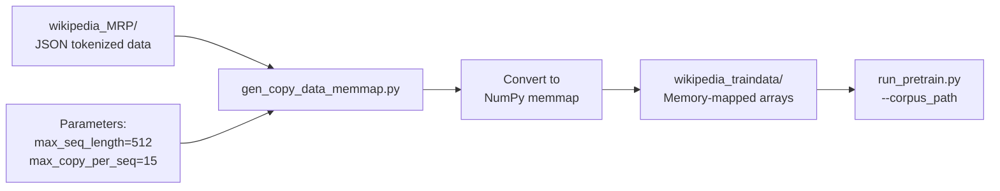

### Script Configuration

| Parameter | Value | Purpose |
|-----------|-------|---------|
| `--train_token_corpus` | `wikipedia_MRP/` | Input directory with tokenized JSON |
| `--output_dir` | `wikipedia_traindata/` | Output directory for memmap files |
| `--max_seq_length` | `512` | Must match Stage 3 value |
| `--max_copy_per_seq` | `15` | Must match Stage 3 value |

### Memory-Mapped Format Benefits

Memory-mapped arrays provide several advantages for distributed pre-training:

- **Memory Efficiency**: Data remains on disk; only accessed portions are loaded into RAM
- **Fast Random Access**: Direct byte-level access without parsing overhead
- **Multi-Process Safety**: Multiple GPU processes can read simultaneously without conflicts
- **Large Dataset Support**: Handles datasets larger than available system memory

The output directory `wikipedia_traindata/` is directly consumed by `run_pretrain.py` via the `--corpus_path` argument.

**Sources:** [README.md:41-44]()

## Complete Data Flow

The following diagram shows the end-to-end data transformation with all file paths and script names:

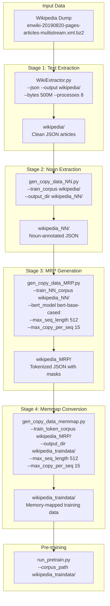

**Sources:** [README.md:24-50]()

## Output Directory Structure

After completing all pipeline stages, the expected directory structure is:

```
project_root/
├── wikipedia/
│   ├── AA/
│   │   └── wiki_00.json
│   │   └── wiki_01.json
│   └── AB/
│       └── wiki_00.json
├── wikipedia_NN/
│   ├── AA/
│   │   └── wiki_00.json  # Noun-annotated
│   └── AB/
│       └── wiki_00.json
├── wikipedia_MRP/
│   ├── AA/
│   │   └── wiki_00.json  # Tokenized with masks
│   └── AB/
│       └── wiki_00.json
└── wikipedia_traindata/
    ├── input_ids.npy       # Memory-mapped token IDs
    ├── input_mask.npy      # Attention masks
    ├── segment_ids.npy     # Segment IDs
    └── copy_*.npy          # Coreference-related arrays
```

Each stage produces a new directory while preserving the original data, allowing for inspection and debugging at any pipeline stage.

**Sources:** [README.md:24-50]()

## Parameter Consistency Requirements

Critical parameters must remain consistent across Stages 3 and 4, and must match the pre-training configuration:

| Parameter | Stage 3 (MRP) | Stage 4 (Memmap) | Pre-training | Required Match |
|-----------|---------------|------------------|--------------|----------------|
| `max_seq_length` | `512` | `512` | `--max_seq_length 512` | ✓ |
| `max_copy_per_seq` | `15` | `15` | (implicit in data) | ✓ |
| `bert_model` | `bert-base-cased` | - | `--model_name_or_path bert-base-cased` | ✓ |

Mismatched parameters will cause training failures or incorrect data loading. The tokenizer vocabulary from `bert_model` in Stage 3 must match the model architecture used in pre-training.

**Sources:** [README.md:36-50]()

## Computational Requirements

### Processing Time Estimates

The processing time for each stage depends on the Wikipedia dump size:

- **Stage 1 (WikiExtractor)**: ~2-4 hours for full English Wikipedia with 8 processes
- **Stage 2 (Noun Extraction)**: ~8-12 hours depending on NLP library performance
- **Stage 3 (MRP Generation)**: ~12-24 hours including tokenization and coreference analysis
- **Stage 4 (Memmap Conversion)**: ~2-4 hours for format conversion

### Storage Requirements

Approximate disk space needed for each stage (based on full English Wikipedia):

| Stage | Directory | Approximate Size |
|-------|-----------|------------------|
| Raw dump | `enwiki-*.xml.bz2` | ~17-20 GB (compressed) |
| Stage 1 | `wikipedia/` | ~70-80 GB (uncompressed JSON) |
| Stage 2 | `wikipedia_NN/` | ~80-90 GB (with annotations) |
| Stage 3 | `wikipedia_MRP/` | ~100-120 GB (tokenized) |
| Stage 4 | `wikipedia_traindata/` | ~150-200 GB (memory-mapped arrays) |

Total disk space requirement: **~500-600 GB** for full pipeline

**Sources:** [README.md:24-50]()

---

# Page: Pre-training Execution

# Pre-training Execution

<details>
<summary>Relevant source files</summary>

The following files were used as context for generating this wiki page:

- [README.md](README.md)
- [model.jpg](model.jpg)

</details>


## Purpose and Scope

This document describes how to execute the CorefBERT pre-training process using processed Wikipedia data. Pre-training execution encompasses distributed GPU training configuration, command-line parameter specification, mixed-precision training setup, and checkpoint management.

For information about preparing the training data (Wikipedia extraction, noun identification, and MRP data generation), see [Data Processing Pipeline](#2.1). For information about the resulting pre-trained models and their usage in downstream tasks, see [Fine-tuning Systems](#3).

**Sources:** [README.md:20-50]()

---

## Prerequisites

Before executing pre-training, the following must be completed:

1. **Data preparation pipeline** (see [#2.1](#2.1)): Wikipedia data must be processed through all stages:
   - Text extraction via WikiExtractor
   - Noun extraction via `gen_copy_data_NN.py`
   - MRP data generation via `gen_copy_data_MRP.py`
   - Memory-mapped format conversion via `gen_copy_data_memmap.py`

2. **Dependencies installed**: The environment must have apex (NVIDIA's mixed-precision training library) and transformers library installed

3. **Base model available**: The `bert-base-cased` model from Hugging Face must be accessible

4. **Hardware availability**: 8 GPUs are required for the standard configuration

**Sources:** [README.md:12-44]()

---

## Training Command Structure

The pre-training process is executed through `run_pretrain.py` using PyTorch's distributed launch utility:

```bash
CUDA_VISIBLE_DEVICES=0,1,2,3,4,5,6,7 python3 -m torch.distributed.launch \
    --nproc_per_node 8 \
    run_pretrain.py \
    --do_train \
    --model_type bert \
    --model_name_or_path bert-base-cased \
    --corpus_path wikipedia_traindata \
    --per_gpu_train_batch_size 8 \
    --learning_rate 5e-5 \
    --num_train_epochs 1 \
    --max_seq_length 512 \
    --save_steps 3000 \
    --logging_steps 5 \
    --warmup_steps 3000 \
    --output_dir ../CorefBERT_base \
    --fp16
```

This command launches 8 parallel training processes, one per GPU, coordinated through PyTorch's distributed training infrastructure.

**Sources:** [README.md:47-50]()

---

## Distributed Training Configuration

### GPU Assignment and Process Launching

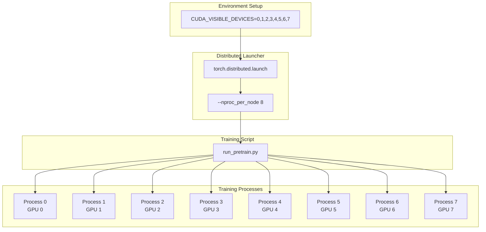

**Distributed Training Setup**

| Component | Value | Purpose |
|-----------|-------|---------|
| `CUDA_VISIBLE_DEVICES` | `0,1,2,3,4,5,6,7` | Makes 8 GPUs visible to the process |
| `torch.distributed.launch` | PyTorch module | Launches multiple training processes |
| `--nproc_per_node` | `8` | Creates 8 parallel processes (one per GPU) |

Each process receives a unique `local_rank` (0-7) identifying its GPU assignment. Processes synchronize gradients during backpropagation to maintain consistent model updates across all GPUs.

**Sources:** [README.md:49-50]()

---

## Training Parameters

### Model and Data Configuration

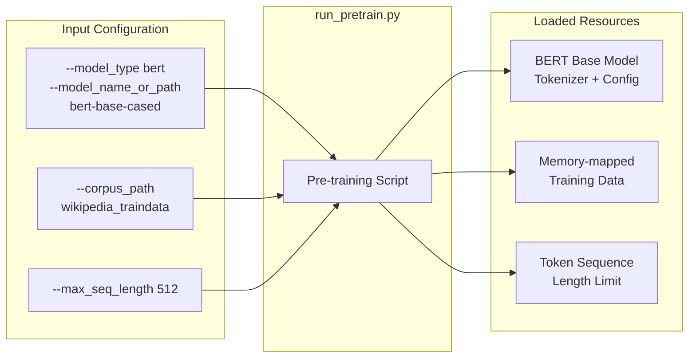

| Parameter | Value | Description |
|-----------|-------|-------------|
| `--do_train` | Flag | Enables training mode |
| `--model_type` | `bert` | Specifies BERT architecture |
| `--model_name_or_path` | `bert-base-cased` | Base model checkpoint to initialize from |
| `--corpus_path` | `wikipedia_traindata` | Directory containing memory-mapped training data |
| `--max_seq_length` | `512` | Maximum sequence length in tokens |

**Sources:** [README.md:49-50]()

### Training Hyperparameters

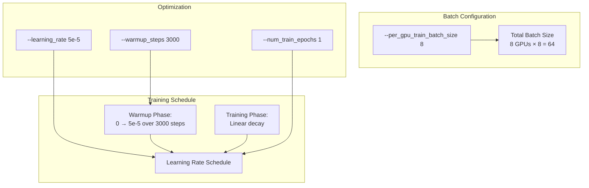

| Parameter | Value | Description |
|-----------|-------|-------------|
| `--per_gpu_train_batch_size` | `8` | Batch size per GPU (effective batch: 64) |
| `--learning_rate` | `5e-5` | Peak learning rate after warmup |
| `--num_train_epochs` | `1` | Number of passes through the dataset |
| `--warmup_steps` | `3000` | Steps for linear learning rate warmup |

The effective batch size is 64 (8 GPUs × 8 samples per GPU), which enables stable training with the 5e-5 learning rate.

**Sources:** [README.md:49-50]()

### Logging and Checkpointing

| Parameter | Value | Description |
|-----------|-------|-------------|
| `--logging_steps` | `5` | Print training loss every 5 steps |
| `--save_steps` | `3000` | Save model checkpoint every 3000 steps |
| `--output_dir` | `../CorefBERT_base` | Directory for checkpoints and final model |

Checkpoints are saved at regular intervals (every 3000 steps), allowing training to resume from intermediate points if interrupted. Each checkpoint includes model weights, optimizer state, and training progress information.

**Sources:** [README.md:49-50]()

---

## Mixed Precision Training

### FP16 Configuration

The `--fp16` flag enables mixed-precision training via NVIDIA Apex, which:

1. **Reduces memory usage**: FP16 tensors consume half the memory of FP32
2. **Accelerates computation**: Modern GPUs have specialized FP16 hardware
3. **Maintains accuracy**: Critical operations remain in FP32 via automatic casting

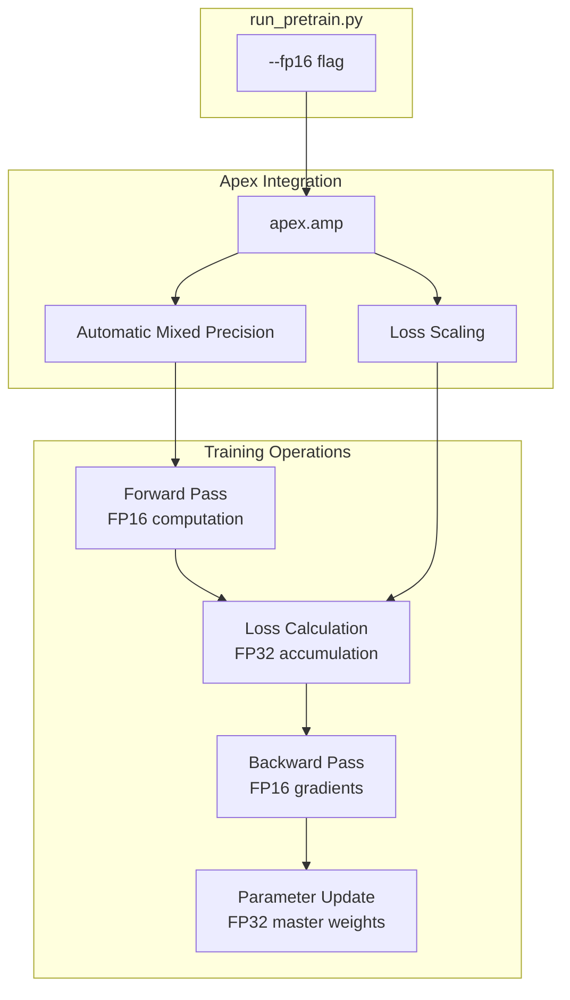

The Apex library automatically:
- Converts model operations to FP16 where safe
- Maintains FP32 master copies of model parameters
- Applies loss scaling to prevent gradient underflow
- Handles FP16/FP32 conversions transparently

**Sources:** [README.md:13-16, 49-50]()

---

## Output Structure and Checkpointing

### Directory Layout

The `--output_dir` parameter specifies where training artifacts are saved:

```
CorefBERT_base/
├── checkpoint-3000/
│   ├── config.json
│   ├── pytorch_model.bin
│   ├── optimizer.pt
│   ├── scheduler.pt
│   └── training_args.bin
├── checkpoint-6000/
│   └── ...
├── checkpoint-9000/
│   └── ...
└── (final checkpoint after training completes)
```

### Checkpoint Contents

Each checkpoint directory contains:

| File | Description |
|------|-------------|
| `config.json` | Model configuration (architecture, vocab size, etc.) |
| `pytorch_model.bin` | Model weights in PyTorch format |
| `optimizer.pt` | Optimizer state (Adam momentum, variance) |
| `scheduler.pt` | Learning rate scheduler state |
| `training_args.bin` | Training arguments and hyperparameters |

These files enable:
- **Training resumption**: Continue from any checkpoint if interrupted
- **Model deployment**: Use `pytorch_model.bin` and `config.json` for inference
- **Fine-tuning initialization**: Load pre-trained weights for downstream tasks

**Sources:** [README.md:49-50]()

---

## Pre-training Process Flow

### End-to-End Execution Diagram

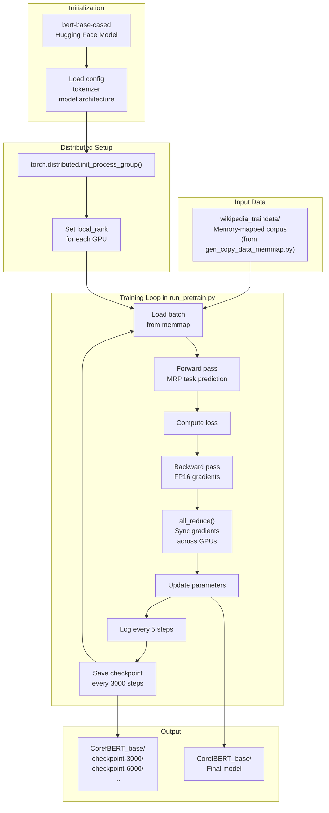

### Training Iteration Details

Each training step performs:

1. **Data Loading**: Read a batch from memory-mapped files (8 samples per GPU)
2. **Forward Pass**: Process sequences through BERT encoder, compute MRP task predictions
3. **Loss Calculation**: Calculate masked token prediction loss and mention reasoning loss
4. **Backward Pass**: Compute gradients in FP16 (with Apex handling)
5. **Gradient Synchronization**: Use `all_reduce` to average gradients across 8 GPUs
6. **Parameter Update**: Apply optimizer step to update model weights
7. **Logging**: Print loss every 5 steps to monitor training progress
8. **Checkpointing**: Save full model state every 3000 steps

The process repeats until completing one epoch over the Wikipedia corpus.

**Sources:** [README.md:47-50]()

---

## Hardware and Performance Considerations

### Resource Requirements

| Resource | Requirement | Notes |
|----------|-------------|-------|
| GPUs | 8× with ≥16GB VRAM | FP16 reduces memory vs. FP32 |
| CPU RAM | ≥128GB | For memory-mapped data access |
| Disk Space | ~100GB | Processed Wikipedia + checkpoints |
| Training Time | ~1-2 weeks | Depends on GPU type (V100, A100, etc.) |

### Configuration Trade-offs

**Batch Size**: The `per_gpu_train_batch_size=8` setting balances:
- **Memory usage**: Larger batches require more GPU memory
- **Training stability**: Larger effective batch (64) enables higher learning rates
- **Convergence speed**: Larger batches mean fewer update steps per epoch

**Checkpoint Frequency**: `save_steps=3000` balances:
- **Disk usage**: More frequent saves consume more disk space
- **Recovery cost**: Less frequent saves mean more recomputation after failures
- **I/O overhead**: Saving too often impacts training throughput

**Sources:** [README.md:49-50]()

---

## Integration with Transformers Library

The pre-training script (`run_pretrain.py`) integrates with the custom transformers package (see [Transformers Library](#4)) to access:

- **`BertForCopy`**: Custom BERT variant for MRP pre-training task
- **`BertConfig`**: Model architecture configuration
- **`BertTokenizer`**: Tokenization using bert-base-cased vocabulary
- **`AdamW` optimizer**: Weight decay optimization
- **Learning rate schedulers**: Linear warmup and decay

The resulting model in `CorefBERT_base/` follows the standard transformers format, making it compatible with all transformers-based fine-tuning scripts.

**Sources:** [README.md:8, 49-50]()

---

# Page: Fine-tuning Systems

# Fine-tuning Systems

<details>
<summary>Relevant source files</summary>

The following files were used as context for generating this wiki page:

- [README.md](README.md)
- [model.jpg](model.jpg)

</details>


## Purpose and Scope

This page documents the fine-tuning systems that adapt the pre-trained CorefBERT model for downstream NLP tasks. It covers the overall architecture patterns, training workflows, and common components shared across tasks. For specific task implementations, see:
- [QUOREF Question Answering](#3.1)
- [MRQA Tasks](#3.2)
- [DocRED Relation Extraction](#3.3)
- [FEVER Fact Verification](#3.4)
- [Coreference Resolution](#3.5)

For information about the pre-training process that creates the base model, see [Pre-training System](#2).

**Sources:** [README.md:1-180]()

## Overview

The CorefBERT fine-tuning systems demonstrate transfer learning where a pre-trained model (`CorefBERT_base/`) is adapted to task-specific objectives. All fine-tuning tasks share a common pattern: they load weights from the pre-trained CorefBERT model and train task-specific heads on labeled data while allowing the entire model to be updated.

The repository includes five main fine-tuning task categories:
1. **Question Answering** - QUOREF and MRQA datasets requiring span extraction
2. **Relation Extraction** - DocRED for document-level relation classification
3. **Fact Verification** - FEVER for claim validation against evidence
4. **Coreference Resolution** - Standard coreference datasets via WikiCREM

**Sources:** [README.md:52-147]()

## Fine-tuning Architecture

### System Organization

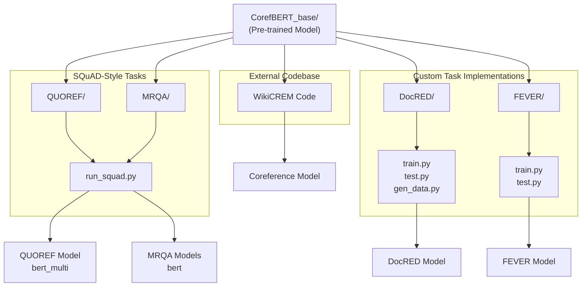

**Sources:** [README.md:52-147]()

### Task-to-Code Entity Mapping

The following diagram maps natural language task names to their concrete code entities in the repository:

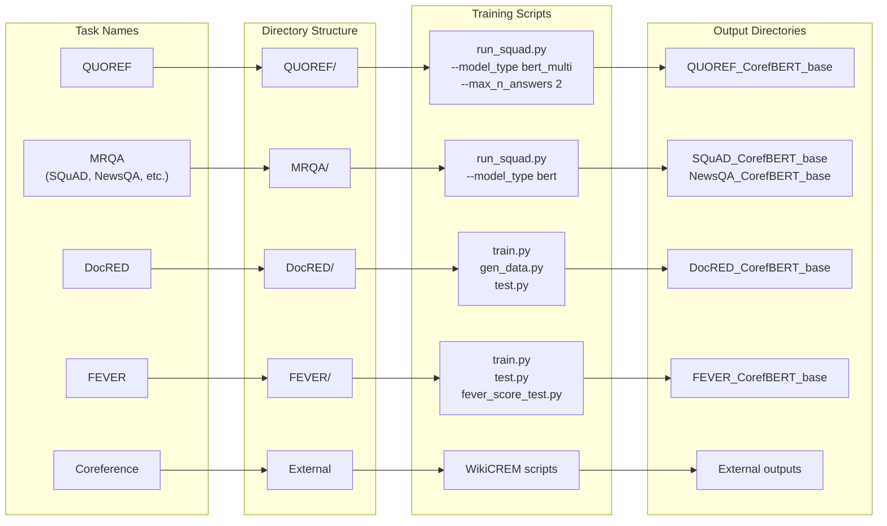

**Sources:** [README.md:52-147]()

## Common Fine-tuning Patterns

### GPU Configuration and Distributed Training

All fine-tuning tasks use multi-GPU training with 4 GPUs by default. The pattern is consistent across tasks:

```bash
CUDA_VISIBLE_DEVICES=0,1,2,3 python3 [script_name] [arguments]
```

This contrasts with pre-training which uses 8 GPUs with `torch.distributed.launch`. Fine-tuning tasks use simpler data-parallel training without explicit distributed launchers.

**Sources:** [README.md:66, 91, 114, 128]()

### Model Loading Pattern

All tasks load the pre-trained model using the `--model_name_or_path` parameter pointing to `CorefBERT_base/`:

| Task | Parameter |
|------|-----------|
| QUOREF | `--model_name_or_path ../CorefBERT_base` |
| MRQA | `--model_name_or_path ../CorefBERT_base` |
| DocRED | `--model_name_or_path ../CorefBERT_base` |
| FEVER | `--bert_pretrain ../CorefBERT_base` |

Note that FEVER uses a different parameter name (`--bert_pretrain`) due to its KGAT-based implementation.

**Sources:** [README.md:66, 91, 114, 128]()

### Training Configuration Parameters

```mermaid
graph TB
    subgraph "Common Parameters"
        ModelType["--model_type<br/>bert or bert_multi"]
        ModelPath["--model_name_or_path<br/>../CorefBERT_base"]
        SeqLen["--max_seq_length<br/>512 (standard)"]
        BatchSize["Batch Sizes<br/>8-32 per GPU"]
        LR["Learning Rates<br/>2e-5 to 5e-5"]
    end
    
    subgraph "SQuAD-Style Specific"
        DocStride["--doc_stride<br/>128"]
        SaveSteps["--save_steps<br/>Checkpoint intervals"]
        EvalDuring["--evaluate_during_training"]
    end
    
    subgraph "Task-Specific"
        MaxAnswers["--max_n_answers<br/>QUOREF: 2"]
        Threshold["--input_threshold<br/>DocRED: 0.5534"]
        Epochs["--num_train_epochs<br/>2-200 depending on task"]
    end
    
    ModelType --> Training["Training Process"]
    ModelPath --> Training
    SeqLen --> Training
    BatchSize --> Training
    LR --> Training
    DocStride --> Training
    SaveSteps --> Training
    EvalDuring --> Training
    MaxAnswers --> Training
    Threshold --> Testing["Test Evaluation"]
    Epochs --> Training
```

**Sources:** [README.md:66, 91, 114, 128]()

### Task Configuration Summary

| Task | Script | Model Type | Batch Size | Learning Rate | Epochs | Special Parameters |
|------|--------|------------|------------|---------------|--------|-------------------|
| QUOREF | `run_squad.py` | `bert_multi` | 8 | 2e-5 | 6 | `--max_n_answers 2` |
| MRQA | `run_squad.py` | `bert` | 8 | 3e-5 | 2 | `--doc_stride 128` |
| DocRED | `train.py` | `bert` | 32 | 4e-5 | 200 | `--evaluate_during_training_epoch 5` |
| FEVER | `train.py` | `bert` | 32 | 2e-5 | 3 | KGAT-based architecture |

**Sources:** [README.md:66, 91, 114, 128]()

## Training and Evaluation Workflow

### General Workflow Pattern

```mermaid
graph TD
    Start["Pre-trained Model<br/>CorefBERT_base/"]
    
    subgraph "Data Preparation"
        Download["Download Dataset"]
        Preprocess["Preprocess<br/>(task-specific)"]
        Split["Train/Dev/Test Split"]
    end
    
    subgraph "Training Phase"
        Train["Training Script<br/>--do_train"]
        ValMonitor["Validation Monitoring<br/>--evaluate_during_training"]
        Checkpoint["Save Checkpoints<br/>--save_steps"]
    end
    
    subgraph "Evaluation Phase"
        Select["Manual Checkpoint Selection"]
        Eval["Evaluation Script<br/>--do_eval or test.py"]
        Metrics["Compute Metrics"]
    end
    
    Start --> Download
    Download --> Preprocess
    Preprocess --> Split
    Split --> Train
    Train --> ValMonitor
    ValMonitor --> Checkpoint
    Checkpoint --> Select
    Select --> Eval
    Eval --> Metrics
```

**Sources:** [README.md:52-147]()

### Evaluation Approaches by Task

Different tasks use different evaluation strategies:

**SQuAD-Style Tasks (QUOREF, MRQA):**
- Training includes `--evaluate_during_training` flag
- Manual checkpoint selection based on dev set performance in training logs
- Separate evaluation pass using `--do_eval` on test set

**DocRED:**
- Periodic evaluation during training with `--evaluate_during_training_epoch`
- Manual threshold selection from training log analysis
- Test evaluation requires threshold parameter: `--input_threshold 0.5534`

**FEVER:**
- Separate test script (`test.py`) for evaluation
- Custom scorer (`fever_score_test.py`) for final metrics
- Two-stage evaluation: model prediction + scorer computation

**Sources:** [README.md:69-72, 94-97, 117-120, 132-141]()

## Data Requirements and Formats

### Input Data Patterns

```mermaid
graph LR
    subgraph "QUOREF/MRQA"
        QD["JSON/JSONL Files"]
        QF["SQuAD Format<br/>question, context, answers"]
    end
    
    subgraph "DocRED"
        DD["JSON Files"]
        DP["Preprocessed Data<br/>gen_data.py"]
        DM["prepro_data/"]
    end
    
    subgraph "FEVER"
        FD["JSON Files"]
        FM["fever_metadata/"]
        FP["Preprocessed with KGAT"]
    end
    
    QD --> QF
    DD --> DP
    DP --> DM
    FD --> FM
    FM --> FP
```

**Sources:** [README.md:57-59, 79-82, 105-109, 124]()

### Task-Specific Data Locations

| Task | Data Directory | Input Files | Preprocessing |
|------|----------------|-------------|---------------|
| QUOREF | `quoref_data/` | `quoref-train-v0.1.json`<br/>`quoref-dev-v0.1.json` | None required |
| MRQA | `squad/`, `newsqa/`, etc. | `train.jsonl`<br/>`dev.jsonl`<br/>`test.jsonl` | `split.py` for dev/test split |
| DocRED | `docred_data/` | `train_annotated.json`<br/>`dev.json`<br/>`test.json` | `gen_data.py` → `prepro_data/` |
| FEVER | `fever_metadata/` | `train.json`<br/>`dev.json`<br/>`test.json` | External KGAT preprocessing |

**Sources:** [README.md:57, 79-86, 105-109, 124]()

## Output Structure

### Model Checkpoints and Artifacts

All fine-tuning tasks save outputs to task-specific directories with a common naming pattern:

```
[TASK]_CorefBERT_base/
├── checkpoint-[step]/      # Intermediate checkpoints
├── model.best.pt           # Best model (FEVER only)
└── [predictions files]     # Task-specific outputs
```

Example output directories referenced in the codebase:
- `QUOREF_CorefBERT_base/`
- `SQuAD_CorefBERT_base/`
- `NewsQA_CorefBERT_base/`
- `DocRED_CorefBERT_base/`
- `FEVER_CorefBERT_base/`

**Sources:** [README.md:66, 91, 114, 128]()

### Checkpoint Selection Strategy

```mermaid
graph TD
    Training["Training Process<br/>--save_steps N"]
    Checkpoints["Multiple Checkpoints<br/>checkpoint-1500<br/>checkpoint-3000<br/>..."]
    DevLog["Training Log<br/>Dev Set Performance"]
    Manual["Manual Selection<br/>Best Dev Checkpoint"]
    TestEval["Test Evaluation<br/>Selected Checkpoint"]
    FinalMetrics["Final Metrics"]
    
    Training --> Checkpoints
    Training --> DevLog
    DevLog --> Manual
    Checkpoints --> Manual
    Manual --> TestEval
    TestEval --> FinalMetrics
```

The repository requires manual checkpoint selection based on development set performance logged during training. This approach is explicitly mentioned for MRQA [README.md:94]() and used across all tasks.

**Sources:** [README.md:69-72, 94-97, 117-120, 134-136]()

## Script Reuse and Shared Components

### SQuAD Script Dual Usage

The `run_squad.py` script in both `QUOREF/` and `MRQA/` directories serves two different task types through the `--model_type` parameter:

**QUOREF Configuration:**
```bash
--model_type bert_multi --max_n_answers 2
```
Uses a specialized multi-answer model architecture for questions requiring multiple coreferential answers.

**MRQA Configuration:**
```bash
--model_type bert
```
Uses standard BERT architecture for single-answer extraction across multiple reading comprehension datasets.

This pattern demonstrates code reuse where the same training script adapts its behavior through configuration rather than separate implementations.

**Sources:** [README.md:66, 91]()

### Common Hyperparameters

The following hyperparameters are standardized across tasks:

- `max_seq_length`: 512 tokens (standard BERT limit)
- `doc_stride`: 128 tokens (for sliding window approaches in QUOREF/MRQA)
- `per_gpu_train_batch_size`: 8 or 32 depending on task complexity
- `per_gpu_eval_batch_size`: 16 or 32 for faster inference

**Sources:** [README.md:66, 91, 114, 128]()

## Integration with Custom Transformers

All fine-tuning tasks depend on the custom `transformers/` package that extends Hugging Face transformers. See [Transformers Library](#4) for details on the custom model implementations.

Key model types referenced:
- `bert_multi` - Custom QUOREF model in [transformers/](#4.2)
- `bert` - Extended BERT models for various tasks

**Sources:** [README.md:8, 66, 91]()

## Summary

The CorefBERT fine-tuning systems follow consistent patterns:

1. **Model Source**: All tasks load from `CorefBERT_base/` pre-trained model
2. **Multi-GPU Training**: Standard 4-GPU configuration without distributed launcher
3. **Sequence Length**: 512 tokens across all tasks
4. **Evaluation**: Manual checkpoint selection based on development set performance
5. **Output Naming**: `[TASK]_CorefBERT_base/` directory convention

The systems are organized into three implementation categories:
- **SQuAD-style** (QUOREF, MRQA): Shared `run_squad.py` with different configurations
- **Custom implementations** (DocRED, FEVER): Task-specific training scripts
- **External codebases** (Coreference): Integration with WikiCREM

For detailed information about each task's implementation, data format, and evaluation metrics, refer to the task-specific pages ([3.1](#3.1) through [3.5](#3.5)).

**Sources:** [README.md:52-147]()

---

# Page: QUOREF Question Answering

# QUOREF Question Answering

<details>
<summary>Relevant source files</summary>

The following files were used as context for generating this wiki page:

- [README.md](README.md)
- [model.jpg](model.jpg)

</details>


This page documents the fine-tuning of CorefBERT for the QUOREF (Questions Requiring Coreferential Reasoning) task. QUOREF is a question answering dataset that specifically requires models to perform coreferential reasoning to answer questions correctly. This task demonstrates CorefBERT's effectiveness on questions that require understanding entity mentions across document contexts.

For information about other question answering tasks, see [MRQA Tasks](#3.2). For general fine-tuning architecture, see [Fine-tuning Systems](#3).

**Sources:** [README.md:52-72]()

## Dataset Overview

QUOREF is a reading comprehension dataset where questions explicitly require resolving coreferences to produce correct answers. The dataset is provided by AllenAI and consists of:

- **Training set**: `quoref-train-v0.1.json`
- **Development set**: `quoref-dev-v0.1.json`

The dataset must be downloaded from the [QUOREF leaderboard](https://leaderboard.allenai.org/quoref/submissions/get-started) and placed in the `quoref_data/` directory within the QUOREF folder.

**Sources:** [README.md:56-59]()

## System Architecture

The QUOREF fine-tuning system extends the standard question answering architecture with two specialized components:

1. **Coreferential reasoning component**: Enhanced entity tracking across the document
2. **Multiple answer handling**: Support for questions that may have multiple valid answer spans

```mermaid
graph TB
    subgraph "Input Data"
        TRAINDATA["quoref-train-v0.1.json"]
        DEVDATA["quoref-dev-v0.1.json"]
    end
    
    subgraph "CorefBERT Base"
        COREFMODEL["CorefBERT_base/<br/>Pre-trained Model"]
    end
    
    subgraph "Fine-tuning Script"
        RUNSQUAD["run_squad.py"]
        BERTMULTI["model_type: bert_multi"]
        MAXANSWERS["max_n_answers: 2"]
    end
    
    subgraph "Training Process"
        TRAIN["Training Loop<br/>per_gpu_train_batch_size: 8<br/>learning_rate: 2e-5<br/>num_train_epochs: 6"]
        EVAL["evaluate_during_training"]
        CHECKPOINTS["save_steps: 884"]
    end
    
    subgraph "Output"
        MODEL["QUOREF_CorefBERT_base/<br/>Fine-tuned Model"]
        PREDICTIONS["Predictions with<br/>Multiple Answer Support"]
    end
    
    TRAINDATA --> RUNSQUAD
    DEVDATA --> RUNSQUAD
    COREFMODEL --> RUNSQUAD
    
    RUNSQUAD --> BERTMULTI
    RUNSQUAD --> MAXANSWERS
    
    BERTMULTI --> TRAIN
    MAXANSWERS --> TRAIN
    
    TRAIN --> EVAL
    TRAIN --> CHECKPOINTS
    
    CHECKPOINTS --> MODEL
    MODEL --> PREDICTIONS
```

**Diagram: QUOREF Fine-tuning Pipeline**

The system uses the `run_squad.py` script with the `bert_multi` model type, which differs from standard BERT models used in MRQA tasks. This specialized model type enables handling multiple answer spans per question.

**Sources:** [README.md:52-72]()

## Model Type: bert_multi

The QUOREF task uses `model_type bert_multi` instead of the standard `bert` model type used in MRQA tasks. This model type provides:

| Feature | Standard BERT | bert_multi |
|---------|---------------|------------|
| Answer Extraction | Single span | Multiple spans (configurable) |
| Coreferential Reasoning | Basic | Enhanced entity tracking |
| max_n_answers Parameter | Not used | Required (set to 2) |
| Use Case | Single-answer QA | Questions with multiple valid answers |

The `bert_multi` model type is specifically designed for QUOREF's requirement to handle questions where multiple answer spans may be equally valid or where the answer requires aggregating information from multiple coreferential mentions.

**Sources:** [README.md:62-67]()

## Training Configuration

### Command Line Execution

Training is performed using distributed GPU training across 4 GPUs:

```bash
CUDA_VISIBLE_DEVICES=0,1,2,3 python run_squad.py \
    --do_train \
    --evaluate_during_training \
    --model_type bert_multi \
    --model_name_or_path ../CorefBERT_base \
    --train_file quoref_data/quoref-train-v0.1.json \
    --predict_file quoref_data/quoref-dev-v0.1.json \
    --per_gpu_train_batch_size 8 \
    --per_gpu_eval_batch_size 16 \
    --learning_rate 2e-5 \
    --num_train_epochs 6 \
    --max_seq_length 512 \
    --doc_stride 128 \
    --save_steps 884 \
    --max_n_answers 2 \
    --output_dir QUOREF_CorefBERT_base
```

**Sources:** [README.md:64-67]()

### Key Parameters

| Parameter | Value | Purpose |
|-----------|-------|---------|
| `model_type` | `bert_multi` | Enables multiple answer extraction |
| `model_name_or_path` | `../CorefBERT_base` | Path to pre-trained CorefBERT model |
| `per_gpu_train_batch_size` | 8 | Batch size per GPU during training |
| `per_gpu_eval_batch_size` | 16 | Batch size per GPU during evaluation |
| `learning_rate` | 2e-5 | Training learning rate |
| `num_train_epochs` | 6 | Total number of training epochs |
| `max_seq_length` | 512 | Maximum sequence length for input |
| `doc_stride` | 128 | Stride for splitting long documents |
| `save_steps` | 884 | Save checkpoint every N steps |
| `max_n_answers` | 2 | Maximum number of answer spans to extract |
| `output_dir` | `QUOREF_CorefBERT_base` | Directory for model checkpoints |

The `max_n_answers` parameter is critical for QUOREF as it allows the model to extract up to 2 answer spans, accommodating questions that require multiple references or have multiple valid formulations.

**Sources:** [README.md:64-67]()

## Data Processing Flow

```mermaid
graph LR
    subgraph "Input Processing"
        JSON["quoref-train-v0.1.json<br/>quoref-dev-v0.1.json"]
        TOKENIZER["BERT Tokenizer<br/>bert-base-cased"]
    end
    
    subgraph "Preprocessing"
        SPLIT["Document Splitting<br/>max_seq_length: 512<br/>doc_stride: 128"]
        FEATURES["Feature Extraction<br/>Question-Context Pairs"]
    end
    
    subgraph "Training Pipeline"
        BATCH["Batching<br/>batch_size: 8 per GPU"]
        FORWARD["Forward Pass<br/>bert_multi model"]
        LOSS["Multi-Answer Loss<br/>max_n_answers: 2"]
        BACKWARD["Backward Pass<br/>learning_rate: 2e-5"]
    end
    
    subgraph "Evaluation"
        EVALDATA["Dev Set"]
        PREDICT["Prediction<br/>Multiple Spans"]
        METRICS["F1 & Exact Match"]
    end
    
    JSON --> TOKENIZER
    TOKENIZER --> SPLIT
    SPLIT --> FEATURES
    FEATURES --> BATCH
    BATCH --> FORWARD
    FORWARD --> LOSS
    LOSS --> BACKWARD
    
    EVALDATA --> PREDICT
    PREDICT --> METRICS
```

**Diagram: QUOREF Data Processing and Training Flow**

The system processes documents by:
1. Tokenizing with BERT's cased tokenizer
2. Splitting long documents into overlapping segments using `doc_stride=128`
3. Creating question-context pairs
4. Training with multi-answer loss function that supports `max_n_answers=2`

**Sources:** [README.md:64-67]()

## Evaluation Process

### Running Evaluation

Evaluation uses the same `run_squad.py` script with `--do_eval` flag:

```bash
CUDA_VISIBLE_DEVICES=0,1,2,3 python run_squad.py \
    --do_eval \
    --model_type bert_multi \
    --model_name_or_path ../CorefBERT_base \
    --train_file quoref_data/quoref-train-v0.1.json \
    --predict_file quoref_data/quoref-dev-v0.1.json \
    --per_gpu_train_batch_size 8 \
    --per_gpu_eval_batch_size 16 \
    --learning_rate 2e-5 \
    --num_train_epochs 6 \
    --max_seq_length 512 \
    --doc_stride 128 \
    --save_steps 884 \
    --max_n_answers 2 \
    --output_dir QUOREF_CorefBERT_base
```

**Sources:** [README.md:69-72]()

### Evaluation Workflow

```mermaid
graph TB
    subgraph "Model Loading"
        CHECKPOINT["QUOREF_CorefBERT_base/<br/>Best Checkpoint"]
        LOAD["Load Fine-tuned Model"]
    end
    
    subgraph "Prediction"
        DEVSET["quoref-dev-v0.1.json"]
        INFERENCE["run_squad.py --do_eval"]
        SPANS["Extract Answer Spans<br/>max_n_answers: 2"]
    end
    
    subgraph "Metrics"
        EM["Exact Match"]
        F1["F1 Score"]
        MULTI["Multi-Answer Metrics"]
    end
    
    CHECKPOINT --> LOAD
    LOAD --> INFERENCE
    DEVSET --> INFERENCE
    INFERENCE --> SPANS
    SPANS --> EM
    SPANS --> F1
    SPANS --> MULTI
```

**Diagram: QUOREF Evaluation Workflow**

The evaluation phase:
1. Loads the best checkpoint from training
2. Runs inference on the development set
3. Extracts up to 2 answer spans per question
4. Computes standard QA metrics (Exact Match, F1)
5. Evaluates multi-answer predictions

**Sources:** [README.md:69-72]()

## Integration with Fine-tuning Framework

The QUOREF system integrates with CorefBERT's broader fine-tuning framework:

```mermaid
graph TB
    subgraph "Pre-trained Model"
        PRETRAIN["CorefBERT_base/<br/>Masked Reasoning Pre-training"]
    end
    
    subgraph "QUOREF Fine-tuning"
        SCRIPT["QUOREF/run_squad.py"]
        CONFIG["Configuration:<br/>- bert_multi model type<br/>- max_n_answers: 2<br/>- Task-specific training"]
    end
    
    subgraph "Related Systems"
        MRQA["MRQA Tasks<br/>(Standard SQuAD format)"]
        TRANS["transformers Library<br/>Custom Model Classes"]
    end
    
    subgraph "Output"
        QUOREFMODEL["Task-specific Model<br/>Coreferential QA"]
    end
    
    PRETRAIN --> SCRIPT
    SCRIPT --> CONFIG
    CONFIG --> QUOREFMODEL
    
    TRANS --> SCRIPT
    MRQA -.Similar Script.-> SCRIPT
```

**Diagram: QUOREF Integration with CorefBERT Framework**

Key integration points:
- Uses shared `run_squad.py` script with MRQA tasks but different model type
- Leverages custom transformers library for `bert_multi` model implementation
- Builds on CorefBERT's coreferential reasoning pre-training
- Outputs task-specific checkpoints compatible with evaluation pipeline

**Sources:** [README.md:52-98]()

## Directory Structure

The QUOREF system expects the following directory structure:

```
QUOREF/
├── run_squad.py              # Training and evaluation script
├── quoref_data/             # Dataset directory
│   ├── quoref-train-v0.1.json
│   └── quoref-dev-v0.1.json
└── QUOREF_CorefBERT_base/   # Output directory (created during training)
    ├── checkpoint-*/         # Periodic checkpoints
    ├── config.json          # Model configuration
    ├── pytorch_model.bin    # Model weights
    └── training_args.bin    # Training arguments
```

**Sources:** [README.md:54-72]()

## Training vs Evaluation Comparison

| Aspect | Training | Evaluation |
|--------|----------|------------|
| Primary Flag | `--do_train` | `--do_eval` |
| Secondary Flag | `--evaluate_during_training` | None |
| Purpose | Fine-tune CorefBERT on QUOREF | Assess model performance |
| Input | Training + Dev sets | Dev set only |
| Output | Model checkpoints | Predictions + metrics |
| Batch Size | 8 per GPU | 16 per GPU (larger for efficiency) |
| Epochs | 6 | N/A |
| Checkpoint Usage | Saves periodically | Loads best checkpoint |

**Sources:** [README.md:64-72]()

## Connection to Custom Transformers

The `bert_multi` model type used by QUOREF is implemented in the custom transformers library (see [Model Extensions](#4.2)). This model type extends standard BERT with:

- Multi-span answer extraction logic
- Enhanced attention mechanisms for coreferential reasoning
- Support for `max_n_answers` parameter
- Specialized loss functions for multi-answer scenarios

The implementation can be found in the transformers package, which extends Hugging Face's base classes with CorefBERT-specific functionality.

**Sources:** [README.md:8, 62-67]()

## Relation to Baseline

The README references the [official QUOREF baseline code](https://github.com/allenai/quoref-leaderboard-example) as a comparison point. CorefBERT's implementation enhances this baseline by:

1. Adding specialized coreferential reasoning components
2. Implementing multi-answer support through `max_n_answers`
3. Leveraging pre-trained coreferential knowledge from CorefBERT

These enhancements specifically target QUOREF's design goal of requiring models to perform coreferential reasoning to answer questions correctly.

**Sources:** [README.md:59-62]()

---

# Page: MRQA Tasks

# MRQA Tasks

<details>
<summary>Relevant source files</summary>

The following files were used as context for generating this wiki page:

- [README.md](README.md)
- [model.jpg](model.jpg)

</details>


## Purpose and Scope

This document covers the fine-tuning of CorefBERT on MRQA (Machine Reading for Question Answering) shared task datasets. MRQA provides a collection of question answering datasets in a unified format, allowing evaluation of model generalization across different QA domains.

For fine-tuning on the QUOREF dataset (which requires handling multiple answers and coreferential reasoning), see [QUOREF Question Answering](#3.1). For other fine-tuning tasks, see [Fine-tuning Systems](#3).

**Sources:** [README.md:74-97]()

---

## Overview

The MRQA system fine-tunes CorefBERT on multiple extractive question answering datasets from the [MRQA 2019 Shared Task](https://github.com/mrqa/MRQA-Shared-Task-2019). Unlike QUOREF which uses a specialized `bert_multi` model type for multiple answers, MRQA fine-tuning uses the standard `bert` model type.

### Supported Datasets

MRQA includes several question answering datasets:
- **SQuAD** - Stanford Question Answering Dataset
- **NewsQA** - News domain questions
- **TriviaQA** - Trivia questions from web
- **SearchQA** - Search query based QA
- **HotpotQA** - Multi-hop reasoning questions
- **NaturalQuestions** - Google search queries

All datasets follow a unified JSONL format for consistency across experiments.

**Sources:** [README.md:74-97]()

---

## System Architecture

```mermaid
graph TB
    subgraph "Data Preparation"
        DOWNLOAD["download_data.sh<br/>Download MRQA datasets"]
        SPLIT["split.py<br/>Split dev into val/test"]
        DATASETS["Dataset Files<br/>train.jsonl, dev.jsonl, test.jsonl"]
        
        DOWNLOAD --> SPLIT
        SPLIT --> DATASETS
    end
    
    subgraph "Model Setup"
        COREFBERT["CorefBERT Base Model<br/>../CorefBERT_base"]
        RUNSQUAD["run_squad.py<br/>Training & Evaluation Script"]
        MODELTYPE["model_type: bert<br/>Standard BERT architecture"]
        
        COREFBERT --> RUNSQUAD
        MODELTYPE --> RUNSQUAD
    end
    
    subgraph "Training Process"
        TRAIN["Training Phase<br/>--do_train --do_eval"]
        CHECKPOINTS["Checkpoints<br/>Saved at --save_steps intervals"]
        LOG["Training Log<br/>Dev set performance"]
        
        DATASETS --> TRAIN
        RUNSQUAD --> TRAIN
        TRAIN --> CHECKPOINTS
        TRAIN --> LOG
    end
    
    subgraph "Evaluation Process"
        MANUAL["Manual Selection<br/>Best checkpoint from log"]
        EVAL["Test Evaluation<br/>--do_eval on test.jsonl"]
        RESULTS["Results<br/>Exact Match & F1"]
        
        LOG --> MANUAL
        MANUAL --> EVAL
        CHECKPOINTS --> EVAL
        EVAL --> RESULTS
    end
    
    RUNSQUAD --> EVAL
```

**Diagram:** MRQA Fine-tuning Pipeline

This diagram shows the complete MRQA workflow from data preparation through evaluation. The process uses `run_squad.py` as the main training script with standard BERT architecture, unlike QUOREF which requires a specialized multi-answer variant.

**Sources:** [README.md:74-97]()

---

## Data Preparation

### Downloading MRQA Datasets

The MRQA datasets are downloaded and organized using the provided shell script:

```bash
sh download_data.sh
```

This script downloads all MRQA datasets from the official repository and organizes them into dataset-specific folders. Each dataset includes training and development files in JSONL format.

**File:** [MRQA/download_data.sh]()

### Development Set Splitting

The development sets are split into validation and test portions to enable proper model selection:

```bash
python3 split.py
```

The `split.py` script randomly divides each development set into two equal halves:
- First half becomes the new validation set (`dev.jsonl`)
- Second half becomes the test set (`test.jsonl`)

This split allows for checkpoint selection on the validation set while preserving a held-out test set for final evaluation.

**File:** [MRQA/split.py]()

**Sources:** [README.md:79-87]()

---

## Training Process

### Training Configuration

Training is executed using `run_squad.py` with the following command structure (example for SQuAD):

```bash
CUDA_VISIBLE_DEVICES=0,1,2,3 python3 run_squad.py \
    --do_train \
    --do_eval \
    --evaluate_during_training \
    --model_type bert \
    --model_name_or_path ../CorefBERT_base \
    --train_file squad/train.jsonl \
    --predict_file squad/dev.jsonl \
    --doc_stride 128 \
    --per_gpu_train_batch_size 8 \
    --per_gpu_eval_batch_size 16 \
    --learning_rate 3e-5 \
    --num_train_epochs 2 \
    --max_seq_length 512 \
    --save_steps 1500 \
    --output_dir SQuAD_CorefBERT_base
```

**File:** [MRQA/run_squad.py]()

### Key Parameters

| Parameter | Value | Purpose |
|-----------|-------|---------|
| `--model_type` | `bert` | Use standard BERT architecture (not `bert_multi`) |
| `--model_name_or_path` | `../CorefBERT_base` | Path to pre-trained CorefBERT model |
| `--doc_stride` | `128` | Stride for sliding window over long documents |
| `--per_gpu_train_batch_size` | `8` | Training batch size per GPU |
| `--per_gpu_eval_batch_size` | `16` | Evaluation batch size per GPU |
| `--learning_rate` | `3e-5` | Learning rate for fine-tuning |
| `--num_train_epochs` | `2` | Number of training epochs |
| `--max_seq_length` | `512` | Maximum sequence length in tokens |
| `--save_steps` | `1500` | Checkpoint saving frequency |
| `--evaluate_during_training` | flag | Evaluate on dev set during training |

### GPU Configuration

MRQA training uses 4 GPUs via `CUDA_VISIBLE_DEVICES=0,1,2,3`, which is sufficient for fine-tuning on task-specific datasets. This is less intensive than the 8-GPU setup required for pre-training (see [Pre-training Execution](#2.2)).

**Sources:** [README.md:89-92]()

---

## Evaluation Process

### Manual Checkpoint Selection

```mermaid
graph LR
    TRAINING["Training Process<br/>Multiple checkpoints saved"]
    LOG["Training Log<br/>Dev set metrics"]
    REVIEW["Manual Review<br/>Identify best checkpoint"]
    SELECTED["Selected Checkpoint<br/>Best dev performance"]
    
    TRAINING --> LOG
    LOG --> REVIEW
    REVIEW --> SELECTED
```

**Diagram:** Checkpoint Selection Workflow

The evaluation process requires manual intervention:

1. **Training produces checkpoints** at intervals specified by `--save_steps`
2. **Review training log** to find checkpoint with best development set performance
3. **Manually note** the best checkpoint directory (e.g., `checkpoint-3000`)
4. **Use selected checkpoint** for final test set evaluation

This manual selection approach ensures the model generalizes well to unseen data without overfitting to the test set.

### Test Set Evaluation

After selecting the best checkpoint, evaluate on the test set:

```bash
CUDA_VISIBLE_DEVICES=0,1,2,3 python3 run_squad.py \
    --do_eval \
    --model_type bert \
    --model_name_or_path ../CorefBERT_base \
    --train_file squad/train.jsonl \
    --predict_file squad/test.jsonl \
    --doc_stride 128 \
    --per_gpu_train_batch_size 8 \
    --per_gpu_eval_batch_size 16 \
    --learning_rate 3e-5 \
    --num_train_epochs 2 \
    --max_seq_length 512 \
    --save_steps 1500 \
    --output_dir SQuAD_CorefBERT_base
```

Key differences from training command:
- Only `--do_eval` flag (no `--do_train`)
- `--predict_file` points to `test.jsonl` instead of `dev.jsonl`
- Output directory should contain the selected checkpoint

**Sources:** [README.md:94-97]()

---

## Training Script Details

```mermaid
graph TB
    subgraph "run_squad.py Components"
        ARGS["Argument Parser<br/>Training configuration"]
        TOKENIZER["Tokenizer<br/>bert-base-cased"]
        MODEL["BertForQuestionAnsweringForMRQA<br/>QA model head"]
        DATALOADER["DataLoader<br/>JSONL to examples"]
        
        ARGS --> TOKENIZER
        ARGS --> MODEL
        ARGS --> DATALOADER
    end
    
    subgraph "Training Loop"
        BATCH["Batch Processing<br/>Forward pass"]
        LOSS["Loss Calculation<br/>Start/end position"]
        BACKWARD["Backward Pass<br/>Gradient update"]
        CHECKPOINT["Checkpoint Save<br/>Every save_steps"]
        
        DATALOADER --> BATCH
        BATCH --> LOSS
        LOSS --> BACKWARD
        BACKWARD --> CHECKPOINT
        CHECKPOINT --> BATCH
    end
    
    subgraph "Evaluation"
        PREDICT["Prediction Generation<br/>Answer spans"]
        METRICS["Metrics Calculation<br/>Exact Match, F1"]
        
        MODEL --> PREDICT
        PREDICT --> METRICS
    end
    
    MODEL --> BATCH
    CHECKPOINT --> MODEL
```

**Diagram:** run_squad.py Internal Architecture

The `run_squad.py` script handles:
- **Model initialization** using `model_type=bert` with `BertForQuestionAnsweringForMRQA`
- **Data loading** from JSONL format
- **Training loop** with periodic checkpointing
- **Evaluation** during and after training

**File:** [MRQA/run_squad.py]()

**Sources:** [README.md:89-97]()

---

## Differences from QUOREF

| Aspect | MRQA | QUOREF |
|--------|------|--------|
| **Model Type** | `bert` | `bert_multi` |
| **Multiple Answers** | Single answer per question | Up to 2 answers (`--max_n_answers 2`) |
| **Model Class** | `BertForQuestionAnsweringForMRQA` | `BertForQuestionAnsweringForQUOREF` |
| **Training Epochs** | 2 epochs | 6 epochs |
| **Learning Rate** | `3e-5` | `2e-5` |
| **Save Steps** | `1500` | `884` |
| **Coreferential Components** | Standard QA head | Additional coreferential reasoning components |
| **Script Location** | `MRQA/run_squad.py` | `QUOREF/run_squad.py` |

The key distinction is that MRQA uses standard extractive QA approaches, while QUOREF requires specialized handling for coreferential reasoning and multiple answer extraction. Both share the same script name (`run_squad.py`) but with different implementations in their respective directories.

**Sources:** [README.md:64-72](), [README.md:89-97]()

---

## Dataset-Specific Training

To train on different MRQA datasets, modify the `--train_file` and `--predict_file` parameters:

### SQuAD Example
```bash
--train_file squad/train.jsonl \
--predict_file squad/dev.jsonl \
--output_dir SQuAD_CorefBERT_base
```

### NewsQA Example
```bash
--train_file newsqa/train.jsonl \
--predict_file newsqa/dev.jsonl \
--output_dir NewsQA_CorefBERT_base
```

### TriviaQA Example
```bash
--train_file triviaqa/train.jsonl \
--predict_file triviaqa/dev.jsonl \
--output_dir TriviaQA_CorefBERT_base
```

All other parameters typically remain consistent across datasets, though learning rate and number of epochs may require dataset-specific tuning for optimal performance.

**Sources:** [README.md:89-97]()

---

## File Organization

```
MRQA/
├── download_data.sh          # Dataset download script
├── split.py                  # Dev set splitting utility
├── run_squad.py              # Main training & evaluation script
├── squad/
│   ├── train.jsonl          # SQuAD training data
│   ├── dev.jsonl            # SQuAD validation data
│   └── test.jsonl           # SQuAD test data
├── newsqa/
│   ├── train.jsonl
│   ├── dev.jsonl
│   └── test.jsonl
└── [other datasets]/
    └── ...
```

Each dataset maintains a consistent structure with `train.jsonl`, `dev.jsonl`, and `test.jsonl` files, enabling unified training and evaluation across all MRQA tasks.

**Sources:** [README.md:74-97]()

---

# Page: DocRED Relation Extraction

# DocRED Relation Extraction

<details>
<summary>Relevant source files</summary>

The following files were used as context for generating this wiki page:

- [README.md](README.md)
- [model.jpg](model.jpg)

</details>


## Purpose and Scope

This document covers the fine-tuning of CorefBERT for document-level relation extraction on the DocRED dataset. DocRED (Document-level Relation Extraction Dataset) requires models to identify relations between entities across multiple sentences within a document, making it particularly suitable for evaluating coreferential reasoning capabilities.

For other fine-tuning tasks, see [QUOREF Question Answering](#3.1), [MRQA Tasks](#3.2), and [FEVER Fact Verification](#3.4). For general fine-tuning architecture patterns, see [Fine-tuning Systems](#3).

**Sources:** [README.md:99-120]()

---

## Overview

The DocRED fine-tuning system adapts the [official DocRED implementation](https://github.com/thunlp/DocRED) to support BERT-based models. A distinctive feature of this task is the **threshold selection process**: after training, the optimal prediction probability threshold must be manually determined from training logs to filter predicted relational facts during evaluation.

The system consists of three main components:
- **Data preprocessing** (`gen_data.py`): Converts raw DocRED data into BERT-compatible format
- **Training** (`train.py`): Fine-tunes CorefBERT on relation extraction
- **Testing** (`test.py`): Evaluates the model with a specified threshold

All code resides in the `DocRED/` directory.

**Sources:** [README.md:101-120]()

---

## DocRED Pipeline Architecture

```mermaid
graph TB
    subgraph "Data Sources"
        DATASET["DocRED Dataset<br/>docred_data/"]
        COREF["CorefBERT Model<br/>CorefBERT_base/"]
    end
    
    subgraph "Preprocessing Stage"
        GENDATA["gen_data.py<br/>--model_type bert<br/>--model_name_or_path bert-base-cased"]
        PREPRO["Preprocessed Data<br/>prepro_data/"]
    end
    
    subgraph "Training Stage"
        TRAIN["train.py<br/>--train_prefix train<br/>--test_prefix dev"]
        TRAINLOG["Training Log<br/>Dev Set Results"]
        CHECKPOINT["Model Checkpoint<br/>save_name"]
    end
    
    subgraph "Threshold Selection"
        MANUAL["Manual Analysis<br/>of Training Log"]
        THRESHOLD["Optimal Threshold<br/>e.g., 0.5534"]
    end
    
    subgraph "Evaluation Stage"
        TEST["test.py<br/>--test_prefix test<br/>--input_threshold"]
        RESULTS["Test Results<br/>Relational Facts"]
    end
    
    DATASET --> GENDATA
    GENDATA --> PREPRO
    
    PREPRO --> TRAIN
    COREF --> TRAIN
    TRAIN --> TRAINLOG
    TRAIN --> CHECKPOINT
    
    TRAINLOG --> MANUAL
    MANUAL --> THRESHOLD
    
    PREPRO --> TEST
    COREF --> TEST
    CHECKPOINT --> TEST
    THRESHOLD --> TEST
    TEST --> RESULTS
```

**Diagram:** DocRED fine-tuning pipeline showing the progression from raw data through preprocessing, training, threshold selection, and evaluation.

**Sources:** [README.md:99-120]()

---

## Data Preparation

### Dataset Acquisition

The DocRED dataset must be downloaded from the [official repository](https://github.com/thunlp/DocRED/tree/master/data) and placed in the `docred_data/` directory.

### Preprocessing

The `gen_data.py` script converts raw DocRED data into preprocessed format suitable for BERT-based models:

```bash
python3 gen_data.py \
    --model_type bert \
    --model_name_or_path bert-base-cased \
    --data_dir docred_data \
    --output_dir prepro_data \
    --max_seq_length 512
```

#### Preprocessing Parameters

| Parameter | Value | Description |
|-----------|-------|-------------|
| `--model_type` | `bert` | Specifies BERT architecture |
| `--model_name_or_path` | `bert-base-cased` | Base tokenizer configuration |
| `--data_dir` | `docred_data` | Input directory with raw DocRED files |
| `--output_dir` | `prepro_data` | Output directory for preprocessed data |
| `--max_seq_length` | `512` | Maximum sequence length for BERT input |

The preprocessing step tokenizes documents, handles entity mentions, and formats data for the relation extraction task.

**Sources:** [README.md:107-110]()

---

## Training Process

### Training Configuration

Training uses the preprocessed data and a CorefBERT checkpoint:

```bash
CUDA_VISIBLE_DEVICES=0,1,2,3 python3 train.py \
    --model_type bert \
    --model_name_or_path ../CorefBERT_base \
    --train_prefix train \
    --test_prefix dev \
    --evaluate_during_training_epoch 5 \
    --prepro_data_dir prepro_data \
    --max_seq_length 512 \
    --batch_size 32 \
    --learning_rate 4e-5 \
    --num_train_epochs 200 \
    --save_name DocRED_CorefBERT_base
```

### Training Parameters

| Parameter | Value | Description |
|-----------|-------|-------------|
| `--model_type` | `bert` | Model architecture type |
| `--model_name_or_path` | `../CorefBERT_base` | Pre-trained CorefBERT checkpoint |
| `--train_prefix` | `train` | Training data prefix in `prepro_data_dir` |
| `--test_prefix` | `dev` | Development data prefix for evaluation |
| `--evaluate_during_training_epoch` | `5` | Evaluate on dev set every 5 epochs |
| `--prepro_data_dir` | `prepro_data` | Directory with preprocessed data |
| `--max_seq_length` | `512` | Maximum input sequence length |
| `--batch_size` | `32` | Training batch size across all GPUs |
| `--learning_rate` | `4e-5` | Learning rate for optimizer |
| `--num_train_epochs` | `200` | Total training epochs |
| `--save_name` | `DocRED_CorefBERT_base` | Output directory for checkpoints |

### Multi-GPU Training

The training script uses 4 GPUs (`CUDA_VISIBLE_DEVICES=0,1,2,3`) with a batch size of 32, effectively distributing 8 samples per GPU.

**Sources:** [README.md:112-115]()

---

## Threshold Selection Process

A critical and distinctive aspect of DocRED evaluation is **threshold selection**. The model outputs prediction probabilities for potential relations, and a threshold determines which predictions are retained as final relational facts.

```mermaid
graph LR
    subgraph "During Training"
        TRAINLOOP["Training Loop<br/>200 epochs"]
        DEVEVAL["Dev Set Evaluation<br/>Every 5 epochs"]
        TRAINLOG["Training Log<br/>Dev Results with<br/>Various Thresholds"]
    end
    
    subgraph "Manual Selection"
        ANALYZE["Analyze Training Log"]
        IDENTIFY["Identify Best<br/>Threshold Value"]
        THRESHOLD["Selected Threshold<br/>Example: 0.5534"]
    end
    
    subgraph "Test Evaluation"
        TESTSCRIPT["test.py<br/>--input_threshold"]
        FILTER["Filter Predictions<br/>prob >= threshold"]
        TESTRESULTS["Final Test Results"]
    end
    
    TRAINLOOP --> DEVEVAL
    DEVEVAL --> TRAINLOG
    TRAINLOG --> ANALYZE
    ANALYZE --> IDENTIFY
    IDENTIFY --> THRESHOLD
    THRESHOLD --> TESTSCRIPT
    TESTSCRIPT --> FILTER
    FILTER --> TESTRESULTS
```

**Diagram:** Threshold selection workflow showing how the optimal threshold is determined from training logs and applied during test evaluation.

### Process Steps

1. **Training with Periodic Evaluation**: During training, the model is evaluated on the development set every 5 epochs (`--evaluate_during_training_epoch 5`). The training log records performance metrics at different prediction thresholds.

2. **Log Analysis**: After training completes, manually inspect the training log to identify which threshold yields the best F1 score on the development set.

3. **Threshold Application**: The selected threshold (e.g., `0.5534` in the example) is passed to the test script via `--input_threshold`.

### Example Threshold

The README demonstrates threshold selection with value `0.5534`, though the actual optimal threshold varies based on training dynamics and should be determined from your specific training run.

**Sources:** [README.md:117-120]()

---

## Evaluation

### Test Set Evaluation

Once the optimal threshold is determined, evaluate on the test set:

```bash
CUDA_VISIBLE_DEVICES=0,1,2,3 python3 test.py \
    --model_type bert \
    --model_name_or_path ../CorefBERT_base \
    --test_prefix test \
    --prepro_data_dir prepro_data \
    --max_seq_length 512 \
    --batch_size 32 \
    --save_name DocRED_CorefBERT_base \
    --input_threshold 0.5534
```

### Evaluation Parameters

| Parameter | Value | Description |
|-----------|-------|-------------|
| `--model_type` | `bert` | Model architecture type |
| `--model_name_or_path` | `../CorefBERT_base` | Pre-trained CorefBERT checkpoint |
| `--test_prefix` | `test` | Test data prefix in `prepro_data_dir` |
| `--prepro_data_dir` | `prepro_data` | Directory with preprocessed data |
| `--max_seq_length` | `512` | Maximum input sequence length |
| `--batch_size` | `32` | Evaluation batch size |
| `--save_name` | `DocRED_CorefBERT_base` | Directory containing trained checkpoint |
| `--input_threshold` | `0.5534` | Prediction probability threshold |

The test script loads the trained model checkpoint from the `--save_name` directory and generates predictions filtered by the specified threshold.

**Sources:** [README.md:117-120]()

---

## Data Flow Architecture

```mermaid
graph TB
    subgraph "Input Files"
        TRAIN_RAW["docred_data/train_annotated.json"]
        DEV_RAW["docred_data/dev.json"]
        TEST_RAW["docred_data/test.json"]
    end
    
    subgraph "gen_data.py Processing"
        TOKENIZE["Tokenization<br/>bert-base-cased"]
        ENTITY["Entity Mention<br/>Processing"]
        FORMAT["Format for<br/>Relation Extraction"]
    end
    
    subgraph "Preprocessed Output"
        TRAIN_PREP["prepro_data/train_*"]
        DEV_PREP["prepro_data/dev_*"]
        TEST_PREP["prepro_data/test_*"]
    end
    
    subgraph "train.py Processing"
        MODEL["CorefBERT Model<br/>bert-base-cased"]
        RECLASSIFIER["Relation<br/>Classification Head"]
        OPTIMIZER["AdamW Optimizer<br/>lr=4e-5"]
    end
    
    subgraph "Output"
        CKPT["Checkpoints<br/>DocRED_CorefBERT_base/"]
        PRED["Predictions<br/>with Threshold Filter"]
    end
    
    TRAIN_RAW --> TOKENIZE
    DEV_RAW --> TOKENIZE
    TEST_RAW --> TOKENIZE
    
    TOKENIZE --> ENTITY
    ENTITY --> FORMAT
    
    FORMAT --> TRAIN_PREP
    FORMAT --> DEV_PREP
    FORMAT --> TEST_PREP
    
    TRAIN_PREP --> MODEL
    MODEL --> RECLASSIFIER
    RECLASSIFIER --> OPTIMIZER
    OPTIMIZER --> CKPT
    
    CKPT --> PRED
    DEV_PREP --> PRED
    TEST_PREP --> PRED
```

**Diagram:** Data flow from raw DocRED files through preprocessing, training, and evaluation stages, showing key processing components.

**Sources:** [README.md:99-120]()

---

## Key Configuration Summary

### File Locations

| Component | Location |
|-----------|----------|
| Code directory | `DocRED/` |
| Raw data | `docred_data/` |
| Preprocessed data | `prepro_data/` |
| Model checkpoint | `../CorefBERT_base` |
| Training output | `DocRED_CorefBERT_base/` |

### Script Overview

| Script | Purpose | Key Parameters |
|--------|---------|----------------|
| `gen_data.py` | Preprocess raw DocRED data | `--model_type`, `--data_dir`, `--output_dir`, `--max_seq_length` |
| `train.py` | Fine-tune CorefBERT | `--model_name_or_path`, `--prepro_data_dir`, `--batch_size`, `--learning_rate`, `--num_train_epochs` |
| `test.py` | Evaluate with threshold | `--test_prefix`, `--save_name`, `--input_threshold` |

### Training Specifications

- **GPU Configuration**: 4 GPUs (`CUDA_VISIBLE_DEVICES=0,1,2,3`)
- **Batch Size**: 32 total (8 per GPU)
- **Learning Rate**: 4e-5
- **Training Epochs**: 200
- **Development Evaluation**: Every 5 epochs
- **Sequence Length**: 512 tokens

**Sources:** [README.md:99-120]()

---

## Implementation Notes

### Relation to Official DocRED

The implementation modifies the [official DocRED code](https://github.com/thunlp/DocRED) to support BERT-based models. The original DocRED implementation uses BiLSTM architectures; this adaptation integrates BERT encoders for improved representation learning, particularly benefiting from CorefBERT's coreferential reasoning capabilities.

### Comparison with Other Tasks

Unlike QUOREF (see [#3.1](#3.1)) which uses `run_squad.py` with `--model_type bert_multi`, or MRQA tasks (see [#3.2](#3.2)) which use standard BERT fine-tuning, DocRED requires:
1. **Custom preprocessing** via `gen_data.py` for document-level inputs
2. **Task-specific training script** (`train.py`) rather than shared scripts
3. **Manual threshold selection** based on development set performance

This reflects DocRED's unique characteristics as a document-level relation extraction task requiring entity pair classification across long contexts.

**Sources:** [README.md:99-120]()

---

# Page: FEVER Fact Verification

# FEVER Fact Verification

<details>
<summary>Relevant source files</summary>

The following files were used as context for generating this wiki page:

- [FEVER/train.py](FEVER/train.py)
- [README.md](README.md)
- [model.jpg](model.jpg)

</details>


## Purpose and Scope

This page documents the FEVER (Fact Extraction and Verification) task fine-tuning system within CorefBERT. FEVER is a fact verification task that requires models to classify claims as SUPPORTED, REFUTED, or NOT ENOUGH INFO based on evidence from Wikipedia articles. The system adapts code from the KGAT (KernelGAT) project and integrates it with CorefBERT's pre-trained models.

For detailed implementation of the training script, see [FEVER Training Implementation](#3.4.1). For information about the evaluation metrics and scoring system, see [FEVER Scorer](#5).

**Sources:** [README.md:122-141](), [FEVER/train.py:1-191]()

## Task Overview

FEVER is a fact verification benchmark that evaluates a model's ability to verify factual claims against evidence from Wikipedia. The task involves:

1. **Claim Classification**: Classify claims into three categories
2. **Evidence Retrieval**: Identify relevant evidence sentences
3. **Joint Evaluation**: Score both classification accuracy and evidence quality

The CorefBERT implementation focuses on the classification component, leveraging pre-retrieved evidence from the KGAT preprocessing pipeline.

### Label Taxonomy

| Label | Numeric ID | Description |
|-------|-----------|-------------|
| SUPPORTS | 0 | Claim is supported by evidence |
| REFUTES | 1 | Claim is refuted by evidence |
| NOT ENOUGH INFO | 2 | Insufficient evidence to verify |

**Sources:** [FEVER/train.py:163]()

## System Architecture

The FEVER system integrates three major components: CorefBERT's pre-trained encoder, KGAT's graph-based reasoning architecture, and a custom evaluation pipeline.

```mermaid
graph TB
    subgraph "Input Pipeline"
        RAW["FEVER Dataset<br/>fever_metadata/"]
        TRAIN["train.json"]
        DEV["dev.json"]
        TEST["test.json"]
        
        RAW --> TRAIN
        RAW --> DEV
        RAW --> TEST
    end
    
    subgraph "Model Components"
        COREF["CorefBERT Pre-trained<br/>../CorefBERT_base"]
        ENCODER["BertForSequenceEncoder<br/>or RobertaForSequenceEncoder"]
        INFERENCE["inference_model<br/>from models.py"]
        
        COREF --> ENCODER
        ENCODER --> INFERENCE
    end
    
    subgraph "Training Process"
        DATALOADER["DataLoader<br/>from data_loader.py"]
        TRAINSCRIPT["train.py"]
        OPTIMIZER["AdamW + Scheduler"]
        
        TRAIN --> DATALOADER
        DATALOADER --> TRAINSCRIPT
        INFERENCE --> TRAINSCRIPT
        OPTIMIZER --> TRAINSCRIPT
    end
    
    subgraph "Evaluation Pipeline"
        TESTSCRIPT["test.py"]
        PREDICTIONS["output/*.jsonl"]
        FEVER_SCORE["fever_score_test.py"]
        METRICS["Accuracy, F1, etc."]
        
        DEV --> TESTSCRIPT
        TEST --> TESTSCRIPT
        INFERENCE --> TESTSCRIPT
        TESTSCRIPT --> PREDICTIONS
        PREDICTIONS --> FEVER_SCORE
        FEVER_SCORE --> METRICS
    end
    
    TRAINSCRIPT --> CHECKPOINT["model.best.pt"]
    CHECKPOINT --> TESTSCRIPT
```

**Diagram: FEVER System Architecture and Data Flow**

**Sources:** [README.md:122-141](), [FEVER/train.py:10-12,164-169]()

## Code Entity Mapping

The following diagram maps natural language concepts to specific code entities in the FEVER implementation:

```mermaid
graph LR
    subgraph "Natural Language Concepts"
        NL_CLAIM["Claim Verification"]
        NL_EVIDENCE["Evidence Processing"]
        NL_CLASSIFICATION["3-way Classification"]
        NL_TRAINING["Model Training"]
    end
    
    subgraph "Code Entities"
        C_INFERENCE["inference_model class<br/>models.py"]
        C_DATALOADER["DataLoader class<br/>data_loader.py"]
        C_LABELMAP["label_map dict<br/>train.py:163"]
        C_TRAIN_MODEL["train_model()<br/>train.py:45-100"]
        C_EVAL_MODEL["eval_model()<br/>train.py:33-41"]
        C_ACCURACY["accuracy()<br/>train.py:20-24"]
        C_BERT_ENCODER["BertForSequenceEncoder<br/>transformers.py"]
    end
    
    NL_CLAIM --> C_INFERENCE
    NL_EVIDENCE --> C_DATALOADER
    NL_CLASSIFICATION --> C_LABELMAP
    NL_TRAINING --> C_TRAIN_MODEL
    NL_TRAINING --> C_EVAL_MODEL
    NL_CLASSIFICATION --> C_ACCURACY
    NL_EVIDENCE --> C_BERT_ENCODER
```

**Diagram: Natural Language to Code Entity Mapping**

**Sources:** [FEVER/train.py:10-12,20-41,45-100,163]()

## Data Preparation

### Dataset Sources

The FEVER dataset must be downloaded separately and preprocessed using KGAT tools:

1. **Original Dataset**: Available from the [FEVER Codalab competition](https://competitions.codalab.org/competitions/18814)
2. **Preprocessed Data**: Available from Google Drive or Tsinghua Cloud (see repository README)
3. **Expected Format**: JSON files with claim-evidence pairs and labels

### Data Directory Structure

```
fever_metadata/
├── train.json          # Training set
├── dev.json            # Development set  
├── dev_bert.json       # Pre-retrieved evidence for dev
├── test.json           # Test set
└── test_order.json     # Test set ordering information
```

The preprocessed data includes pre-retrieved evidence sentences, allowing the model to focus on the verification task rather than evidence retrieval.

**Sources:** [README.md:124]()

## Model Integration

### Transformer Encoder Selection

The system supports both BERT and RoBERTa encoders from the custom transformers library:

```mermaid
graph TD
    MODEL_TYPE["model_type argument"]
    
    MODEL_TYPE -->|"bert"| BERT_FLOW["BertTokenizer<br/>BertForSequenceEncoder"]
    MODEL_TYPE -->|"roberta"| ROBERTA_FLOW["RobertaTokenizer<br/>RobertaForSequenceEncoder"]
    
    BERT_FLOW --> LOAD_PRETRAIN["Load from bert_pretrain path"]
    ROBERTA_FLOW --> LOAD_PRETRAIN
    
    LOAD_PRETRAIN --> HIDDEN_DIM["Extract bert_hidden_dim<br/>from model.hidden_size"]
    
    HIDDEN_DIM --> INFERENCE_MODEL["inference_model()<br/>with bert_model + args"]
    
    INFERENCE_MODEL --> MULTI_GPU["DataParallel wrapper<br/>if multi-GPU"]
```

**Diagram: Model Type Selection and Initialization Flow**

**Sources:** [FEVER/train.py:164-172,183-188]()

### Inference Model Architecture

The `inference_model` class (defined in `models.py`) wraps the transformer encoder and adds task-specific components:

| Component | Purpose |
|-----------|---------|
| Encoder | Encodes claim and evidence pairs using CorefBERT |
| Graph Layer | Applies graph attention mechanisms (from KGAT) |
| Pooling | Aggregates evidence representations |
| Classification Head | Produces 3-way classification logits |

Key architectural parameters:

- `--pool`: Aggregation method (att, max, mean, concat, sum, top)
- `--layer`: Number of graph layers (default: 1)
- `--evi_num`: Number of evidence sentences to process (default: 5)
- `--kernel`: Kernel size for graph convolution (default: 21)

**Sources:** [FEVER/train.py:11,121-126,183]()

## Training Configuration

### Command-Line Interface

The training process is initiated via `train.py` with extensive configuration options:

```bash
CUDA_VISIBLE_DEVICES=0,1,2,3 python3 train.py \
    --model_type bert \
    --bert_pretrain ../CorefBERT_base \
    --learning_rate 2e-5 \
    --num_train_epochs 3 \
    --train_path fever_metadata/train.json \
    --valid_path fever_metadata/dev.json \
    --train_batch_size 32 \
    --valid_batch_size 32 \
    --outdir FEVER_CorefBERT_base
```

**Sources:** [README.md:127-129]()

### Hyperparameter Overview

| Parameter | Default | Purpose |
|-----------|---------|---------|
| `--model_type` | *required* | Encoder type: "bert" or "roberta" |
| `--bert_pretrain` | *required* | Path to pre-trained CorefBERT model |
| `--learning_rate` | 2e-5 | Initial learning rate for AdamW |
| `--num_train_epochs` | 3.0 | Total training epochs |
| `--train_batch_size` | 32 | Training batch size |
| `--valid_batch_size` | 32 | Validation batch size |
| `--max_len` | 130 | Maximum sequence length |
| `--warmup_proportion` | 0.1 | Warmup steps as proportion of total |
| `--gradient_accumulation_steps` | 1 | Steps to accumulate gradients |
| `--eval_step` | 1000 | Evaluation frequency (in steps) |
| `--weight_decay` | 0 | L2 regularization weight |
| `--dropout` | 0.6 | Dropout probability |

**Sources:** [FEVER/train.py:110-149]()

## Training Loop Implementation

### Core Training Process

```mermaid
graph TD
    START["Initialize Model & Optimizer"]
    
    START --> EPOCH_LOOP["For each epoch"]
    
    EPOCH_LOOP --> DATA_BATCH["Load batch from DataLoader"]
    
    DATA_BATCH --> FORWARD["Forward pass:<br/>prob = model(inputs)"]
    
    FORWARD --> LOSS["Compute NLL Loss:<br/>F.nll_loss(prob, labels)"]
    
    LOSS --> ACCUMULATE{"Gradient<br/>Accumulation?"}
    
    ACCUMULATE -->|"Yes"| SCALE["loss = loss / grad_accum_steps"]
    ACCUMULATE -->|"No"| BACKWARD
    SCALE --> BACKWARD["loss.backward()"]
    
    BACKWARD --> CHECK_STEP{"Step %<br/>accum_steps<br/>== 0?"}
    
    CHECK_STEP -->|"Yes"| CLIP["Clip gradients<br/>norm=1.0"]
    CHECK_STEP -->|"No"| DATA_BATCH
    
    CLIP --> UPDATE["optimizer.step()<br/>scheduler.step()"]
    
    UPDATE --> ZERO["model.zero_grad()"]
    
    ZERO --> LOG{"Step % 10<br/>== 0?"}
    
    LOG -->|"Yes"| PRINT_LOSS["Log: Epoch, Step, Loss"]
    LOG -->|"No"| EVAL_CHECK
    
    PRINT_LOSS --> EVAL_CHECK{"Step % eval_step<br/>== 0?"}
    
    EVAL_CHECK -->|"Yes"| EVALUATE["eval_model() on dev set"]
    EVAL_CHECK -->|"No"| DATA_BATCH
    
    EVALUATE --> COMPARE{"Accuracy ><br/>best_accuracy?"}
    
    COMPARE -->|"Yes"| SAVE["Save model.best.pt"]
    COMPARE -->|"No"| DATA_BATCH
    
    SAVE --> DATA_BATCH
```

**Diagram: Training Loop Control Flow**

**Sources:** [FEVER/train.py:45-100]()

### Optimization Strategy

The training uses the AdamW optimizer with linear warmup scheduling:

1. **Optimizer Configuration**: AdamW with weight decay only on non-bias/non-LayerNorm parameters
2. **Learning Rate Schedule**: Linear warmup followed by linear decay
3. **Gradient Clipping**: Maximum norm of 1.0 to prevent exploding gradients
4. **Gradient Accumulation**: Supports accumulation for effective larger batch sizes

**Sources:** [FEVER/train.py:52-58,81-84]()

### Evaluation During Training

The `eval_model()` function evaluates the model on the validation set:

```python
def eval_model(model, validset_reader):
    model.eval()
    correct_pred = 0.0
    for index, data in enumerate(validset_reader):
        inputs, lab_tensor = data
        prob = model(inputs)
        correct_pred += correct_prediction(prob, lab_tensor)
    dev_accuracy = correct_pred / validset_reader.total_num
    return dev_accuracy
```

The function:
1. Sets model to evaluation mode
2. Iterates through validation batches
3. Computes predictions via `model(inputs)`
4. Counts correct predictions
5. Returns overall accuracy

Models are saved when validation accuracy improves, creating checkpoints at `{outdir}/model.best.pt`.

**Sources:** [FEVER/train.py:33-41,89-100]()

## Testing and Evaluation

### Development Set Evaluation

```bash
# Run inference on dev set
CUDA_VISIBLE_DEVICES=0,1,2,3 python3 test.py \
    --model_type bert \
    --outdir output/ \
    --test_path fever_metadata/dev.json \
    --bert_pretrain ../CorefBERT_base \
    --batch_size 32 \
    --checkpoint FEVER_CorefBERT_base/model.best.pt \
    --name dev.jsonl

# Compute FEVER scores
python3 fever_score_test.py \
    --predicted_labels output/dev.jsonl \
    --predicted_evidence fever_metadata/dev_bert.json \
    --actual fever_metadata/dev.jsonl
```

**Sources:** [README.md:133-136]()

### Test Set Evaluation

```bash
# Run inference on test set
CUDA_VISIBLE_DEVICES=0,1,2,3 python3 test.py \
    --model_type bert \
    --test_path fever_metadata/test.json \
    --bert_pretrain ../CorefBERT_base \
    --batch_size 32 \
    --checkpoint FEVER_CorefBERT_base/model.best.pt \
    --name test.jsonl

# Generate submission file
python3 generate_submit.py \
    --predict output/test.jsonl \
    --original fever_metadata/test.json \
    --order fever_metadata/test_order.json
```

**Sources:** [README.md:138-141]()

### Evaluation Pipeline

```mermaid
graph LR
    subgraph "Test Script Execution"
        CHECKPOINT["model.best.pt"]
        TEST_DATA["test.json or dev.json"]
        TEST_PY["test.py"]
        
        CHECKPOINT --> TEST_PY
        TEST_DATA --> TEST_PY
    end
    
    subgraph "Prediction Output"
        PREDICTIONS["output/*.jsonl<br/>(claim IDs + predictions)"]
        TEST_PY --> PREDICTIONS
    end
    
    subgraph "Dev Set Scoring"
        FEVER_SCORER["fever_score_test.py"]
        EVIDENCE["dev_bert.json<br/>(pre-retrieved evidence)"]
        GOLD_DEV["dev.jsonl<br/>(gold labels)"]
        
        PREDICTIONS --> FEVER_SCORER
        EVIDENCE --> FEVER_SCORER
        GOLD_DEV --> FEVER_SCORER
    end
    
    subgraph "Test Submission"
        GENERATE["generate_submit.py"]
        ORDER["test_order.json"]
        SUBMISSION["submission file"]
        
        PREDICTIONS --> GENERATE
        ORDER --> GENERATE
        GENERATE --> SUBMISSION
    end
    
    FEVER_SCORER --> METRICS["Metrics:<br/>strict_score,<br/>accuracy,<br/>precision, recall, F1"]
```

**Diagram: Testing and Evaluation Pipeline**

**Sources:** [README.md:133-141]()

## Multi-GPU Support

The system automatically uses `torch.nn.DataParallel` when multiple GPUs are available:

```python
ori_model = inference_model(bert_model, args)
if torch.cuda.device_count() > 1:
    model = nn.DataParallel(ori_model)
else:
    model = ori_model
model = model.cuda()
```

This enables data-parallel training across multiple GPUs without code changes. The original model (`ori_model`) is preserved for checkpoint saving to avoid DataParallel wrapper serialization.

**Sources:** [FEVER/train.py:183-188]()

## Integration with KGAT Codebase

The FEVER implementation is based on the KGAT (KernelGAT) codebase, which provides:

1. **Graph Attention Networks**: For reasoning over evidence graphs
2. **Data Processing**: Pre-retrieval and formatting of evidence sentences
3. **Model Architecture**: `inference_model` class with graph-based reasoning

Key KGAT-derived components:

| Component | Location | Purpose |
|-----------|----------|---------|
| `inference_model` | `models.py` | Main model class with graph attention |
| `DataLoader` | `data_loader.py` | Custom data loading for claim-evidence pairs |
| Evidence preprocessing | Pre-provided data | Pre-retrieved evidence sentences |

**Sources:** [README.md:124](), [FEVER/train.py:11-12]()

## Logging and Monitoring

The training script provides comprehensive logging:

```mermaid
graph TD
    SETUP["Setup logging:<br/>FileHandler + StreamHandler"]
    
    SETUP --> LOG_FILE["train_log.txt<br/>in output directory"]
    
    SETUP --> CONSOLE["Console output"]
    
    LOG_FILE --> LOGS["Log messages"]
    CONSOLE --> LOGS
    
    LOGS --> L1["Training loss every 10 steps"]
    LOGS --> L2["Dev accuracy at eval_step intervals"]
    LOGS --> L3["Best model saves"]
    LOGS --> L4["Configuration parameters"]
```

**Diagram: Logging Infrastructure**

Log messages include:
- Training progress: epoch, step, running loss
- Validation results: development accuracy
- Model checkpoints: saved epochs and accuracy
- Hyperparameters: full argument configuration

**Sources:** [FEVER/train.py:156-159]()

## Key Design Decisions

### Label Encoding

The system uses a fixed label mapping that converts string labels to integer IDs:

```python
label_map = {'SUPPORTS': 0, 'REFUTES': 1, 'NOT ENOUGH INFO': 2}
```

This mapping is passed to the `DataLoader` for consistent encoding during training and evaluation.

### Loss Function

The model uses negative log-likelihood loss (`F.nll_loss`), which expects log-probabilities from the model. The `inference_model` must output log-softmax values compatible with this loss.

### Model Saving Strategy

Only the best-performing model on the development set is saved, determined by validation accuracy. The checkpoint includes:
- Epoch number
- Model state dict (from `ori_model` to avoid DataParallel wrapper)
- Best accuracy achieved

**Sources:** [FEVER/train.py:72,97-100,163,175-179]()

---

# Page: FEVER Training Implementation

# FEVER Training Implementation

<details>
<summary>Relevant source files</summary>

The following files were used as context for generating this wiki page:

- [FEVER/train.py](FEVER/train.py)

</details>


## Purpose and Scope

This document provides a technical deep dive into the FEVER training script implementation (`FEVER/train.py`), which fine-tunes CorefBERT models for fact verification. The script orchestrates model initialization, distributed training execution, periodic evaluation, and checkpoint management for the FEVER task.

For information about FEVER testing and inference, see [FEVER Fact Verification](#3.4). For details on the evaluation metrics and scoring system, see [Scorer API and Usage](#5.1).

**Sources:** [FEVER/train.py:1-191]()

---

## Script Architecture and Execution Flow

The training script follows a standard PyTorch training pipeline with customizations for the FEVER fact verification task. The execution proceeds through four main phases: initialization, data loading, training loop execution, and periodic evaluation with checkpointing.

### High-Level Execution Flow

```mermaid
graph TB
    Start["Script Entry Point<br/>__main__"]
    Parse["Parse Arguments<br/>argparse"]
    Setup["Environment Setup<br/>set_seed()"]
    Init["Model Initialization<br/>lines 164-172"]
    
    LoadTrain["Load Training Data<br/>DataLoader (train_path)"]
    LoadValid["Load Validation Data<br/>DataLoader (valid_path)"]
    
    CreateModel["Create inference_model<br/>ori_model"]
    Parallel["Wrap in DataParallel<br/>if multi-GPU"]
    
    Train["Execute train_model()<br/>lines 45-100"]
    
    Start --> Parse
    Parse --> Setup
    Setup --> Init
    Init --> LoadTrain
    LoadTrain --> LoadValid
    LoadValid --> CreateModel
    CreateModel --> Parallel
    Parallel --> Train
    
    subgraph "Initialization Phase"
        Parse
        Setup
        Init
    end
    
    subgraph "Data Loading Phase"
        LoadTrain
        LoadValid
    end
    
    subgraph "Model Setup Phase"
        CreateModel
        Parallel
    end
```

**Sources:** [FEVER/train.py:108-191]()

---

## Model Initialization

The script supports both BERT and RoBERTa base models through a conditional initialization pattern. The model architecture consists of a pre-trained sequence encoder wrapped by the custom `inference_model` class, which implements the FEVER-specific reasoning graph.

### Model Type Selection and Initialization

```mermaid
graph LR
    ArgParse["args.model_type"]
    
    BERT_Branch["model_type == 'bert'"]
    ROBERTA_Branch["model_type == 'roberta'"]
    
    BertTok["BertTokenizer<br/>from_pretrained()"]
    BertModel["BertForSequenceEncoder<br/>from_pretrained()"]
    
    RobertaTok["RobertaTokenizer<br/>from_pretrained()"]
    RobertaModel["RobertaForSequenceEncoder<br/>from_pretrained()"]
    
    HiddenDim["args.bert_hidden_dim<br/>= bert_model.hidden_size"]
    
    InferenceModel["inference_model()<br/>lines 183"]
    
    ArgParse --> BERT_Branch
    ArgParse --> ROBERTA_Branch
    
    BERT_Branch --> BertTok
    BERT_Branch --> BertModel
    
    ROBERTA_Branch --> RobertaTok
    ROBERTA_Branch --> RobertaModel
    
    BertModel --> HiddenDim
    RobertaModel --> HiddenDim
    
    HiddenDim --> InferenceModel
```

### Initialization Code Flow

| Step | Code Location | Operation |
|------|---------------|-----------|
| 1. Parse model type | [FEVER/train.py:164]() | Check `args.model_type` ('bert' or 'roberta') |
| 2. Load tokenizer | [FEVER/train.py:165,168]() | `BertTokenizer.from_pretrained()` or `RobertaTokenizer.from_pretrained()` |
| 3. Load encoder | [FEVER/train.py:166,169]() | `BertForSequenceEncoder.from_pretrained()` or `RobertaForSequenceEncoder.from_pretrained()` |
| 4. Extract hidden dim | [FEVER/train.py:172]() | `args.bert_hidden_dim = bert_model.hidden_size` |
| 5. Create FEVER model | [FEVER/train.py:183]() | `inference_model(bert_model, args)` |
| 6. Enable multi-GPU | [FEVER/train.py:184-187]() | `nn.DataParallel(ori_model)` if available |

**Sources:** [FEVER/train.py:164-189]()

---

## Data Loading Pipeline

The training script uses a custom `DataLoader` class that handles tokenization, evidence selection, and batch preparation. The data loader is instantiated separately for training and validation sets with different batch sizes.

### DataLoader Initialization Pattern

```mermaid
graph TB
    LabelMap["label_map = <br/>'SUPPORTS': 0<br/>'REFUTES': 1<br/>'NOT ENOUGH INFO': 2"]
    
    TrainLoader["trainset_reader = DataLoader(<br/>train_path, label_map,<br/>tokenizer, args,<br/>batch_size=train_batch_size)"]
    
    ValidLoader["validset_reader = DataLoader(<br/>valid_path, label_map,<br/>tokenizer, args,<br/>batch_size=valid_batch_size,<br/>test=True)"]
    
    LabelMap --> TrainLoader
    LabelMap --> ValidLoader
    
    TrainData["Training Data<br/>args.train_path"]
    ValidData["Validation Data<br/>args.valid_path"]
    
    TrainData --> TrainLoader
    ValidData --> ValidLoader
```

The `DataLoader` class (imported from `data_loader` module) is instantiated with:
- File path to JSON data
- Label mapping dictionary for FEVER classes
- Tokenizer (BERT or RoBERTa)
- Configuration arguments containing `max_len`, `evi_num`, etc.
- `test=True` flag for validation set (disables shuffling)

**Sources:** [FEVER/train.py:12,163,174-179]()

---

## Training Loop Implementation

The `train_model()` function implements the core training loop with gradient accumulation, periodic evaluation, and checkpoint management. The function orchestrates optimizer steps, learning rate scheduling, and model persistence.

### Training Loop Structure

```mermaid
graph TB
    Start["train_model(model, ori_model,<br/>args, trainset_reader,<br/>validset_reader)"]
    
    InitOpt["Initialize Optimizer<br/>AdamW with weight decay<br/>grouped parameters"]
    InitSched["Initialize Scheduler<br/>get_linear_schedule_with_warmup()"]
    
    EpochLoop["for epoch in range(num_train_epochs)"]
    DataLoop["for index, data in trainset_reader"]
    
    Forward["Forward Pass<br/>prob = model(inputs)"]
    Loss["Compute Loss<br/>F.nll_loss(prob, lab_tensor)"]
    Backward["Backward Pass<br/>loss.backward()"]
    
    CheckAccum{"global_step %<br/>gradient_accumulation_steps<br/>== 0?"}
    
    ClipGrad["Clip Gradients<br/>clip_grad_norm_(model.parameters(), 1.0)"]
    OptStep["optimizer.step()"]
    SchedStep["scheduler.step()"]
    ZeroGrad["model.zero_grad()"]
    
    CheckEval{"global_step %<br/>(eval_step * gradient_accumulation_steps)<br/>== 0?"}
    
    Eval["eval_model(model, validset_reader)"]
    CheckBest{"dev_accuracy ><br/>best_accuracy?"}
    Save["Save Checkpoint<br/>torch.save(..., save_path + '.best.pt')"]
    
    Start --> InitOpt
    InitOpt --> InitSched
    InitSched --> EpochLoop
    EpochLoop --> DataLoop
    DataLoop --> Forward
    Forward --> Loss
    Loss --> Backward
    Backward --> CheckAccum
    
    CheckAccum -->|Yes| ClipGrad
    ClipGrad --> OptStep
    OptStep --> SchedStep
    SchedStep --> ZeroGrad
    ZeroGrad --> CheckEval
    
    CheckAccum -->|No| CheckEval
    
    CheckEval -->|Yes| Eval
    Eval --> CheckBest
    CheckBest -->|Yes| Save
    CheckBest -->|No| DataLoop
    Save --> DataLoop
    
    CheckEval -->|No| DataLoop
```

### Training Loop Components

| Component | Function/Operation | Code Location |
|-----------|-------------------|---------------|
| Forward pass | `prob = model(inputs)` | [FEVER/train.py:71]() |
| Loss computation | `F.nll_loss(prob, lab_tensor)` | [FEVER/train.py:72]() |
| Gradient scaling | `loss = loss / args.gradient_accumulation_steps` | [FEVER/train.py:73-74]() |
| Backward pass | `loss.backward()` | [FEVER/train.py:75]() |
| Gradient clipping | `torch.nn.utils.clip_grad_norm_(model.parameters(), 1.0)` | [FEVER/train.py:81]() |
| Optimizer step | `optimizer.step()` | [FEVER/train.py:82]() |
| Scheduler step | `scheduler.step()` | [FEVER/train.py:83]() |
| Zero gradients | `model.zero_grad()` | [FEVER/train.py:84]() |

**Sources:** [FEVER/train.py:45-100]()

---

## Evaluation Mechanics

The evaluation system computes accuracy on the validation set without updating model parameters. The `eval_model()` function iterates through the validation data and accumulates correct predictions.

### Evaluation Function Flow

```mermaid
graph LR
    Entry["eval_model(model, validset_reader)"]
    SetEval["model.eval()"]
    InitCounter["correct_pred = 0.0"]
    
    Loop["for index, data in<br/>validset_reader"]
    Unpack["inputs, lab_tensor = data"]
    Forward["prob = model(inputs)"]
    Count["correct_pred +=<br/>correct_prediction(prob, lab_tensor)"]
    
    CalcAcc["dev_accuracy =<br/>correct_pred / validset_reader.total_num"]
    Return["return dev_accuracy"]
    
    Entry --> SetEval
    SetEval --> InitCounter
    InitCounter --> Loop
    Loop --> Unpack
    Unpack --> Forward
    Forward --> Count
    Count --> Loop
    Loop --> CalcAcc
    CalcAcc --> Return
```

### Accuracy Helper Functions

The script provides two related utility functions for computing accuracy:

**`correct_prediction(output, labels)`** [FEVER/train.py:26-30]():
- Computes `preds = output.max(1)[1].type_as(labels)` to get predicted class
- Counts correct predictions: `preds.eq(labels).double().sum()`
- Returns raw count of correct predictions

**`accuracy(output, labels)`** [FEVER/train.py:20-24]():
- Similar to `correct_prediction()` but normalizes by batch size
- Returns: `correct / len(labels)`
- Note: This function is defined but not used in the training script

**Sources:** [FEVER/train.py:20-41]()

---

## Optimization and Scheduling

The training script uses the AdamW optimizer with linear warmup scheduling and weight decay regularization. The optimizer configuration follows BERT fine-tuning best practices by excluding bias and LayerNorm parameters from weight decay.

### Optimizer Configuration

```mermaid
graph TB
    CalcTotal["Calculate t_total<br/>trainset_reader.total_num /<br/>train_batch_size /<br/>gradient_accumulation_steps *<br/>num_train_epochs"]
    
    GroupParams["Group Parameters:<br/>no_decay = ['bias', 'LayerNorm.weight']"]
    
    WithDecay["Parameters WITH decay<br/>weight_decay = args.weight_decay"]
    WithoutDecay["Parameters WITHOUT decay<br/>weight_decay = 0.0"]
    
    GroupParams --> WithDecay
    GroupParams --> WithoutDecay
    
    CreateOpt["AdamW Optimizer<br/>lr = args.learning_rate<br/>eps = 1e-8<br/>correct_bias = True"]
    
    WithDecay --> CreateOpt
    WithoutDecay --> CreateOpt
    
    CreateSched["Linear Warmup Scheduler<br/>num_warmup_steps =<br/>warmup_proportion * t_total<br/>num_training_steps = t_total"]
    
    CalcTotal --> CreateSched
    CreateOpt --> CreateSched
```

### Optimization Parameters

| Parameter | Source | Default Value | Description |
|-----------|--------|---------------|-------------|
| Learning rate | `args.learning_rate` | 2e-5 | Initial learning rate for AdamW |
| Weight decay | `args.weight_decay` | 0 | L2 regularization coefficient |
| Warmup proportion | `args.warmup_proportion` | 0.1 | Fraction of training for linear warmup |
| Epsilon | Hard-coded | 1e-8 | AdamW epsilon for numerical stability |
| Gradient clip | Hard-coded | 1.0 | Max gradient norm for clipping |

**Sources:** [FEVER/train.py:49-58,81,135-140]()

---

## Gradient Accumulation

The training script implements gradient accumulation to simulate larger batch sizes when GPU memory is limited. Gradients are accumulated across multiple forward-backward passes before performing an optimizer step.

### Gradient Accumulation Logic

```mermaid
graph TB
    Forward["Forward Pass<br/>prob = model(inputs)"]
    Loss["Compute Loss<br/>loss = F.nll_loss(prob, lab_tensor)"]
    
    CheckAccum{"gradient_accumulation_steps > 1?"}
    Scale["Scale Loss<br/>loss = loss / gradient_accumulation_steps"]
    
    Backward["loss.backward()<br/>(accumulate gradients)"]
    Increment["global_step += 1"]
    
    CheckStep{"global_step %<br/>gradient_accumulation_steps<br/>== 0?"}
    
    Clip["Clip Gradients<br/>torch.nn.utils.clip_grad_norm_()"]
    OptStep["optimizer.step()<br/>scheduler.step()<br/>model.zero_grad()"]
    
    Forward --> Loss
    Loss --> CheckAccum
    CheckAccum -->|Yes| Scale
    CheckAccum -->|No| Backward
    Scale --> Backward
    Backward --> Increment
    Increment --> CheckStep
    CheckStep -->|Yes| Clip
    Clip --> OptStep
    CheckStep -->|No| Continue["Continue to next batch"]
```

**Key Implementation Details:**
- Loss is scaled by `1/gradient_accumulation_steps` to maintain gradient magnitude [FEVER/train.py:73-74]()
- Optimizer step only occurs when `global_step % gradient_accumulation_steps == 0` [FEVER/train.py:80-84]()
- Effective batch size = `train_batch_size * gradient_accumulation_steps`
- Total training steps = `t_total` calculation accounts for accumulation [FEVER/train.py:49-50]()

**Sources:** [FEVER/train.py:49-50,73-84,141-144]()

---

## Checkpoint Management

The script implements best-model checkpointing based on validation accuracy. Checkpoints are saved only when the current model achieves better validation performance than previous runs.

### Checkpoint Saving Logic

```mermaid
graph LR
    Eval["Evaluate Model<br/>dev_accuracy = eval_model()"]
    
    Compare{"dev_accuracy ><br/>best_accuracy?"}
    
    Update["best_accuracy = dev_accuracy"]
    
    SaveDict["Create Checkpoint Dict:<br/>epoch<br/>model: ori_model.state_dict()<br/>best_accuracy"]
    
    Save["torch.save(...,<br/>save_path + '.best.pt')"]
    
    Log["logger.info('Saved best epoch...')"]
    
    Eval --> Compare
    Compare -->|Yes| Update
    Update --> SaveDict
    SaveDict --> Save
    Save --> Log
    Compare -->|No| Skip["Skip saving"]
```

### Checkpoint Contents

The checkpoint dictionary contains:
- `epoch`: Current training epoch number
- `model`: State dictionary from `ori_model` (unwrapped from DataParallel)
- `best_accuracy`: Best validation accuracy achieved

**Important Note:** The checkpoint saves `ori_model.state_dict()` rather than `model.state_dict()` to avoid saving DataParallel wrapper keys [FEVER/train.py:98](). This ensures the checkpoint can be loaded without DataParallel dependencies.

**Sources:** [FEVER/train.py:46,94-100]()

---

## Configuration Parameters

The training script accepts extensive command-line arguments for controlling model architecture, training hyperparameters, and data processing. Below is a comprehensive reference of all configuration options.

### Core Training Parameters

| Argument | Type | Default | Description |
|----------|------|---------|-------------|
| `--model_type` | str | Required | Model type: 'bert' or 'roberta' |
| `--bert_pretrain` | str | Required | Path to pre-trained BERT/RoBERTa model |
| `--train_path` | str | Required | Path to training data JSON |
| `--valid_path` | str | Required | Path to validation data JSON |
| `--outdir` | str | Required | Output directory for checkpoints and logs |

### Optimization Parameters

| Argument | Type | Default | Description |
|----------|------|---------|-------------|
| `--learning_rate` | float | 2e-5 | Initial learning rate for AdamW |
| `--weight_decay` | float | 0 | L2 regularization weight |
| `--warmup_proportion` | float | 0.1 | Proportion of training for warmup |
| `--num_train_epochs` | float | 3.0 | Total training epochs |
| `--gradient_accumulation_steps` | int | 1 | Gradient accumulation steps |

### Batch and Sequence Parameters

| Argument | Type | Default | Description |
|----------|------|---------|-------------|
| `--train_batch_size` | int | 32 | Training batch size |
| `--valid_batch_size` | int | 32 | Validation batch size |
| `--max_len` | int | 130 | Maximum sequence length after tokenization |
| `--eval_step` | int | 1000 | Steps between evaluations |

### Model Architecture Parameters

| Argument | Type | Default | Description |
|----------|------|---------|-------------|
| `--num_labels` | int | 3 | Number of output classes (SUPPORTS/REFUTES/NEI) |
| `--evi_num` | int | 5 | Number of evidence sentences to consider |
| `--pool` | str | 'att' | Aggregation method: top, max, mean, concat, att, sum |
| `--layer` | int | 1 | Number of graph layers |
| `--kernel` | int | 21 | Kernel size parameter |
| `--threshold` | float | 0.0 | Threshold parameter |
| `--dropout` | float | 0.6 | Dropout probability |

### System Parameters

| Argument | Type | Default | Description |
|----------|------|---------|-------------|
| `--no-cuda` | flag | False | Disable CUDA training |
| `--seed` | int | 42 | Random seed for reproducibility |
| `--patience` | int | 20 | Patience for early stopping (not used) |
| `--postpretrain` | str | None | Path to post-pretrained weights |
| `--no_clip` | flag | False | Disable gradient clipping (not used) |

**Sources:** [FEVER/train.py:109-150]()

---

## Multi-GPU Support

The training script provides automatic multi-GPU parallelization using PyTorch's `nn.DataParallel`. The implementation wraps the model only when multiple GPUs are detected, ensuring compatibility with single-GPU setups.

### DataParallel Initialization

```mermaid
graph TB
    CreateModel["ori_model = inference_model(<br/>bert_model, args)"]
    
    CheckGPU{"torch.cuda.device_count() > 1?"}
    
    Parallel["model = nn.DataParallel(ori_model)"]
    Single["model = ori_model"]
    
    ToCUDA["model = model.cuda()"]
    
    CreateModel --> CheckGPU
    CheckGPU -->|Yes| Parallel
    CheckGPU -->|No| Single
    Parallel --> ToCUDA
    Single --> ToCUDA
```

### Implementation Details

The script maintains two model references:
- **`ori_model`**: Original unwrapped model (used for checkpointing)
- **`model`**: Potentially wrapped model (used for training)

This pattern ensures:
1. Training can leverage multiple GPUs when available [FEVER/train.py:184-187]()
2. Checkpoints save clean state dictionaries without DataParallel wrapper keys [FEVER/train.py:98]()
3. Single-GPU and multi-GPU setups use the same code path

**Note:** The script does not use `torch.distributed` for distributed data parallel (DDP). It uses the simpler `nn.DataParallel` which replicates the model across GPUs on a single node.

**Sources:** [FEVER/train.py:183-189]()

---

## Logging and Reproducibility

The training script implements comprehensive logging and random seed management for reproducible experiments.

### Logging Configuration

The script creates dual logging outputs:
- File handler: `{outdir}/train_log.txt`
- Stream handler: Console output (stdout)

Both handlers use the format: `[%(asctime)s] %(levelname)s: %(message)s`

**Logged Events:**
- Arguments and configuration [FEVER/train.py:159]()
- Training start notification [FEVER/train.py:161]()
- Periodic loss every 10 accumulation steps [FEVER/train.py:86-87]()
- Evaluation start notifications [FEVER/train.py:90]()
- Validation accuracy results [FEVER/train.py:93]()
- Best model checkpoint saves [FEVER/train.py:100]()

### Reproducibility

The `set_seed()` function ensures reproducible training:

```mermaid
graph LR
    SetSeed["set_seed(args)"]
    
    Random["random.seed(args.seed)"]
    Numpy["np.random.seed(args.seed)"]
    Torch["torch.manual_seed(args.seed)"]
    CUDA["torch.cuda.manual_seed_all(args.seed)"]
    
    SetSeed --> Random
    SetSeed --> Numpy
    SetSeed --> Torch
    SetSeed --> CUDA
```

The function seeds all random number generators used in the training pipeline:
- Python's `random` module
- NumPy's random state
- PyTorch's CPU random state
- PyTorch's CUDA random states (all GPUs)

**Sources:** [FEVER/train.py:102-106,156-161]()

---

## Integration with External Components

The training script integrates with several external modules and packages that implement FEVER-specific functionality.

### Component Dependencies

```mermaid
graph TB
    TrainScript["FEVER/train.py"]
    
    subgraph "Transformers Library"
        BertTok["BertTokenizer"]
        BertSeq["BertForSequenceEncoder"]
        RobertaTok["RobertaTokenizer"]
        RobertaSeq["RobertaForSequenceEncoder"]
        AdamW_["AdamW"]
        Scheduler["get_linear_schedule_with_warmup"]
    end
    
    subgraph "Custom Modules"
        InferModel["inference_model<br/>(from models)"]
        DataLoader_["DataLoader<br/>(from data_loader)"]
    end
    
    TrainScript --> BertTok
    TrainScript --> BertSeq
    TrainScript --> RobertaTok
    TrainScript --> RobertaSeq
    TrainScript --> AdamW_
    TrainScript --> Scheduler
    TrainScript --> InferModel
    TrainScript --> DataLoader_
```

### Import Mapping

| Module/Class | Import Source | Purpose |
|-------------|---------------|---------|
| `BertTokenizer` | `transformers` | BERT tokenization |
| `BertForSequenceEncoder` | `transformers` | BERT sequence encoder (custom extension) |
| `RobertaTokenizer` | `transformers` | RoBERTa tokenization |
| `RobertaForSequenceEncoder` | `transformers` | RoBERTa sequence encoder (custom extension) |
| `AdamW` | `transformers` | Adam optimizer with weight decay |
| `get_linear_schedule_with_warmup` | `transformers` | Linear warmup scheduler |
| `inference_model` | `models` | FEVER-specific reasoning model (likely KGAT-based) |
| `DataLoader` | `data_loader` | FEVER data loading and preprocessing |

**Note:** The `BertForSequenceEncoder` and `RobertaForSequenceEncoder` classes are custom extensions defined in the CorefBERT transformers package (see [Model Extensions](#4.2)), not part of standard Hugging Face transformers.

**Sources:** [FEVER/train.py:10-15]()

---

# Page: Coreference Resolution

# Coreference Resolution

<details>
<summary>Relevant source files</summary>

The following files were used as context for generating this wiki page:

- [README.md](README.md)
- [model.jpg](model.jpg)

</details>


## Purpose and Scope

This page documents how to use CorefBERT for coreference resolution tasks, including integration with the WikiCREM framework and available datasets. Coreference resolution is one of the downstream fine-tuning tasks that directly evaluates CorefBERT's core capability for coreferential reasoning.

For information about other fine-tuning tasks, see [QUOREF Question Answering](#3.1), [MRQA Tasks](#3.2), [DocRED Relation Extraction](#3.3), and [FEVER Fact Verification](#3.4). For details about CorefBERT's pre-training methodology that enables coreferential reasoning, see [Pre-training System](#2).

**Sources:** [README.md:144-147]()

---

## Overview

Coreference resolution is the task of identifying all expressions in text that refer to the same entity. This is a natural application for CorefBERT because the model's pre-training objective (Masked Reasoning Prediction) explicitly teaches the model to understand coreferential relationships between mentions.

Unlike the other fine-tuning tasks documented in this repository, coreference resolution leverages external code rather than custom implementation:

| Component | Source | Location |
|-----------|--------|----------|
| Training & Evaluation Code | WikiCREM | External GitHub repository |
| Datasets | WikiCREM | External GitHub repository |
| Base Model | CorefBERT | `CorefBERT_base/` directory |

**Sources:** [README.md:144-147]()

---

## Coreference Resolution in CorefBERT Pipeline

```mermaid
graph LR
    subgraph "Pre-training Phase"
        WIKI["Wikipedia Corpus"]
        MRP["Masked Reasoning<br/>Prediction (MRP)"]
        COREF_MODEL["CorefBERT_base/<br/>Pre-trained Model"]
        
        WIKI --> MRP
        MRP --> COREF_MODEL
    end
    
    subgraph "Fine-tuning Phase"
        WIKICREM["WikiCREM Framework"]
        DATASETS["Coreference<br/>Resolution Datasets"]
        TRAINING["Training & Evaluation<br/>Scripts"]
        FINETUNED["Fine-tuned Model"]
        
        DATASETS --> TRAINING
        WIKICREM --> TRAINING
        COREF_MODEL --> TRAINING
        TRAINING --> FINETUNED
    end
    
    COREF_MODEL -.->|"provides pre-trained<br/>coreferential reasoning"| TRAINING
```

**Diagram: CorefBERT Coreference Resolution Pipeline**

This diagram illustrates how CorefBERT's pre-training on coreferential patterns (MRP objective) provides a foundation that can be fine-tuned using the WikiCREM framework for coreference resolution tasks.

**Sources:** [README.md:20-50](), [README.md:144-147]()

---

## WikiCREM Integration

CorefBERT uses the [WikiCREM](https://github.com/vid-koci/bert-commonsense) (Wiki Common Reference Evaluation Model) codebase for coreference resolution. WikiCREM is an external framework that provides:

1. **Training Scripts**: Code for fine-tuning BERT-based models on coreference resolution
2. **Evaluation Metrics**: Standard coreference resolution evaluation tools
3. **Dataset Processing**: Data loaders and preprocessing for coreference datasets

### Integration Architecture

```mermaid
graph TB
    subgraph "CorefBERT Repository"
        COREF_BASE["CorefBERT_base/<br/>Pre-trained Checkpoint"]
        README["README.md<br/>Integration Instructions"]
    end
    
    subgraph "WikiCREM Repository (External)"
        WIKICREM_CODE["Training Scripts"]
        WIKICREM_EVAL["Evaluation Code"]
        WIKICREM_DATA["Dataset Processing"]
        WIKICREM_DATASETS["Coreference Datasets"]
    end
    
    subgraph "User Workflow"
        DOWNLOAD_WIKICREM["1. Clone WikiCREM<br/>Repository"]
        DOWNLOAD_DATASETS["2. Download<br/>Datasets"]
        CONFIG_MODEL["3. Configure<br/>CorefBERT_base Path"]
        RUN_TRAINING["4. Run Training<br/>Scripts"]
        EVALUATE["5. Evaluate<br/>Results"]
    end
    
    COREF_BASE --> CONFIG_MODEL
    README --> DOWNLOAD_WIKICREM
    WIKICREM_CODE --> RUN_TRAINING
    WIKICREM_DATASETS --> DOWNLOAD_DATASETS
    DOWNLOAD_DATASETS --> RUN_TRAINING
    CONFIG_MODEL --> RUN_TRAINING
    RUN_TRAINING --> EVALUATE
    WIKICREM_EVAL --> EVALUATE
```

**Diagram: WikiCREM Integration Architecture**

**Sources:** [README.md:144-147]()

---

## Integration Approach

The CorefBERT repository delegates coreference resolution implementation to WikiCREM rather than providing custom code. This design decision reflects:

1. **Reusability**: WikiCREM already provides comprehensive coreference resolution infrastructure
2. **Compatibility**: WikiCREM is designed to work with BERT-based models, making integration straightforward
3. **Focus**: Allows CorefBERT repository to focus on pre-training and other task-specific implementations

### Setting Up WikiCREM with CorefBERT

To use CorefBERT for coreference resolution:

1. **Clone the WikiCREM repository**:
   ```bash
   git clone https://github.com/vid-koci/bert-commonsense
   cd bert-commonsense
   ```

2. **Download coreference resolution datasets** from the WikiCREM repository

3. **Configure WikiCREM to use CorefBERT**:
   - Point the `--model_name_or_path` parameter to your `CorefBERT_base/` directory
   - The WikiCREM scripts will load the CorefBERT pre-trained weights

4. **Run WikiCREM training scripts** following their documentation, substituting CorefBERT as the base model

**Sources:** [README.md:144-147]()

---

## Available Datasets

WikiCREM provides access to multiple coreference resolution datasets. These datasets test various aspects of coreferential reasoning:

| Dataset Type | Description |
|--------------|-------------|
| Standard Coreference | Traditional entity coreference annotations |
| Common Sense Reasoning | Coreference requiring world knowledge |
| Domain-Specific | Task-focused coreference datasets |

The exact datasets and their formats are documented in the WikiCREM repository.

**Sources:** [README.md:146-147]()

---

## Relationship to CorefBERT Pre-training

Coreference resolution is particularly well-suited to evaluate CorefBERT's pre-training objective:

### Pre-training Objective: Masked Reasoning Prediction (MRP)

During pre-training, CorefBERT learns to predict masked mentions of repeated nouns based on their context. This directly teaches the model coreferential reasoning patterns.

```mermaid
graph TD
    subgraph "Pre-training: MRP Task"
        WIKI_TEXT["Wikipedia Text with<br/>Repeated Nouns"]
        NOUN_EXTRACT["Extract Repeated Nouns<br/>gen_copy_data_NN.py"]
        MASK["Mask Some Mentions<br/>gen_copy_data_MRP.py"]
        PREDICT["Model Predicts<br/>Masked Mentions"]
        
        WIKI_TEXT --> NOUN_EXTRACT
        NOUN_EXTRACT --> MASK
        MASK --> PREDICT
    end
    
    subgraph "Fine-tuning: Coreference Resolution"
        COREF_INPUT["Text with Entity<br/>Mentions"]
        IDENTIFY["Identify Coreferent<br/>Mentions"]
        CLUSTER["Cluster Mentions<br/>by Entity"]
        
        COREF_INPUT --> IDENTIFY
        IDENTIFY --> CLUSTER
    end
    
    PREDICT -.->|"learned representations<br/>transfer to"| IDENTIFY
```

**Diagram: Pre-training to Fine-tuning Transfer for Coreference Resolution**

The pre-training objective creates a model that has already learned to reason about when different mentions refer to the same entity, which directly supports the coreference resolution task.

**Sources:** [README.md:3-5](), [README.md:36-39](), [README.md:144-147]()

---

## Comparison with Other Fine-tuning Tasks

While all CorefBERT fine-tuning tasks benefit from coreferential reasoning, coreference resolution is the most direct application:

| Task | Coreferential Reasoning Role | Implementation |
|------|------------------------------|----------------|
| **Coreference Resolution** | Primary task objective | External (WikiCREM) |
| QUOREF | Required for multi-hop QA | Custom (`QUOREF/run_squad.py`) |
| MRQA | Helpful for answer extraction | Custom (`MRQA/run_squad.py`) |
| DocRED | Needed for entity relation extraction | Custom (`DocRED/train.py`) |
| FEVER | Useful for evidence linking | Custom (`FEVER/train.py`) |

**Sources:** [README.md:52-141](), [README.md:144-147]()

---

## Code Organization Comparison

Unlike other fine-tuning tasks in the repository, coreference resolution does not have a dedicated directory:

```mermaid
graph TB
    REPO["CorefBERT Repository"]
    
    REPO --> QUOREF_DIR["QUOREF/<br/>Custom Implementation"]
    REPO --> MRQA_DIR["MRQA/<br/>Custom Implementation"]
    REPO --> DOCRED_DIR["DocRED/<br/>Custom Implementation"]
    REPO --> FEVER_DIR["FEVER/<br/>Custom Implementation"]
    REPO --> README_COREF["README.md:144-147<br/>WikiCREM Reference"]
    
    QUOREF_DIR --> Q_TRAIN["run_squad.py"]
    MRQA_DIR --> M_TRAIN["run_squad.py"]
    DOCRED_DIR --> D_TRAIN["train.py"]
    DOCRED_DIR --> D_TEST["test.py"]
    FEVER_DIR --> F_TRAIN["train.py"]
    FEVER_DIR --> F_TEST["test.py"]
    
    README_COREF --> EXTERNAL["External WikiCREM<br/>Repository"]
```

**Diagram: Coreference Resolution vs Other Tasks - Code Organization**

This architectural difference reflects the strategic decision to leverage existing, well-maintained coreference resolution infrastructure rather than duplicating functionality.

**Sources:** [README.md:52-147]()

---

## Model Compatibility

CorefBERT's pre-trained models are compatible with WikiCREM because:

1. **Base Architecture**: CorefBERT extends `bert-base-cased`, which WikiCREM supports
2. **Transformer Format**: Pre-trained checkpoints follow standard Hugging Face format
3. **Tokenization**: Uses the same tokenizer as base BERT models

The pre-trained models can be downloaded from:
- [Google Drive](https://drive.google.com/drive/folders/1JGDxWqvhWCQ58PqD7dAzye3NW5U2pZOp?usp=sharing)
- [Tsinghua Cloud](https://cloud.tsinghua.edu.cn/d/a2eed603edd949b0a663)

**Sources:** [README.md:10](), [README.md:144-147]()

---

## Expected Performance Benefits

CorefBERT's pre-training should provide advantages on coreference resolution tasks compared to standard BERT models:

1. **Direct Transfer**: MRP objective directly teaches coreferential patterns
2. **Entity Understanding**: Enhanced ability to track entities across mentions
3. **Context Awareness**: Better representation of mention context for disambiguation

The exact performance improvements depend on the specific coreference resolution dataset and evaluation metrics used.

**Sources:** [README.md:3-5](), [README.md:144-147]()

---

## Summary

Coreference resolution represents the most direct application of CorefBERT's pre-training objective. The integration with WikiCREM allows users to leverage CorefBERT's enhanced coreferential reasoning capabilities through an established framework without requiring custom implementation code within the CorefBERT repository.

**Key Points:**
- Uses external WikiCREM codebase for implementation
- Datasets available through WikiCREM repository
- Most direct evaluation of CorefBERT's core pre-training objective
- Requires manual integration following WikiCREM documentation

**Sources:** [README.md:144-147]()

---

# Page: Transformers Library

# Transformers Library

<details>
<summary>Relevant source files</summary>

The following files were used as context for generating this wiki page:

- [transformers/__init__.py](transformers/__init__.py)

</details>


## Purpose and Scope

The `transformers/` package is a custom fork and extension of the Hugging Face transformers library (version 2.1.1) that provides the neural network model architectures for CorefBERT. This library maintains compatibility with standard transformers components while adding CorefBERT-specific model classes for coreferential reasoning and task-specific fine-tuning.

This page documents the package structure, custom model extensions, and integration patterns. For information about specific model usage during pre-training, see [Pre-training Execution](#2.2). For task-specific fine-tuning implementations, see [Fine-tuning Systems](#3). For details about custom model architectures, see [Model Extensions](#4.2).

**Sources:** [transformers/__init__.py:1-185]()

## Package Overview

The transformers package serves as the neural architecture layer for CorefBERT, providing:

- **Base Components**: Standard tokenizers, configurations, and model classes from Hugging Face
- **Custom Extensions**: CorefBERT-specific model architectures for sequence encoding and specialized tasks
- **Framework Support**: Both PyTorch and TensorFlow 2.0+ implementations (with primary focus on PyTorch)
- **Auto Classes**: Automatic model/tokenizer/config selection based on model type

The package follows Hugging Face's modular design pattern, organizing components into tokenization, configuration, and modeling modules.

**Sources:** [transformers/__init__.py:1-185]()

## Package Structure

```mermaid
graph TB
    INIT["transformers/__init__.py<br/>Package Entry Point"]
    
    subgraph "Utility Components"
        FILEUTILS["file_utils.py<br/>TRANSFORMERS_CACHE<br/>cached_path<br/>WEIGHTS_NAME"]
        DATA["data.py<br/>InputExample<br/>DataProcessor<br/>glue_*"]
    end
    
    subgraph "Tokenization Layer"
        TOKUTILS["tokenization_utils.py<br/>PreTrainedTokenizer"]
        TOKAUTO["tokenization_auto.py<br/>AutoTokenizer"]
        TOKBERT["tokenization_bert.py<br/>BertTokenizer<br/>BasicTokenizer<br/>WordpieceTokenizer"]
        TOKROBERTA["tokenization_roberta.py<br/>RobertaTokenizer"]
        TOKOTHERS["Other Tokenizers<br/>GPT2, XLNet, etc."]
    end
    
    subgraph "Configuration Layer"
        CONFIGUTILS["configuration_utils.py<br/>PretrainedConfig"]
        CONFIGAUTO["configuration_auto.py<br/>AutoConfig"]
        CONFIGBERT["configuration_bert.py<br/>BertConfig<br/>BERT_PRETRAINED_CONFIG_ARCHIVE_MAP"]
        CONFIGROBERTA["configuration_roberta.py<br/>RobertaConfig"]
    end
    
    subgraph "PyTorch Modeling Layer"
        MODELUTILS["modeling_utils.py<br/>PreTrainedModel<br/>prune_layer<br/>Conv1D"]
        MODELAUTO["modeling_auto.py<br/>AutoModel<br/>AutoModelForSequenceClassification<br/>AutoModelForQuestionAnswering"]
        MODELBERT["modeling_bert.py<br/>Base + Custom Classes"]
        MODELROBERTA["modeling_roberta.py<br/>Base + Custom Classes"]
    end
    
    subgraph "TensorFlow Modeling Layer"
        TFUTILS["modeling_tf_utils.py<br/>TFPreTrainedModel"]
        TFAUTO["modeling_tf_auto.py<br/>TFAutoModel"]
        TFBERT["modeling_tf_bert.py"]
    end
    
    subgraph "Optimization"
        OPT["optimization.py<br/>AdamW<br/>get_*_schedule"]
    end
    
    INIT --> FILEUTILS
    INIT --> DATA
    INIT --> TOKUTILS
    INIT --> TOKAUTO
    INIT --> TOKBERT
    INIT --> TOKROBERTA
    INIT --> TOKOTHERS
    INIT --> CONFIGUTILS
    INIT --> CONFIGAUTO
    INIT --> CONFIGBERT
    INIT --> CONFIGROBERTA
    INIT --> MODELUTILS
    INIT --> MODELAUTO
    INIT --> MODELBERT
    INIT --> MODELROBERTA
    INIT --> TFUTILS
    INIT --> TFAUTO
    INIT --> TFBERT
    INIT --> OPT
```

The package is organized into four main layers:

1. **Utility Layer**: File handling, caching, and data processing utilities
2. **Tokenization Layer**: Text-to-token conversion for various model architectures
3. **Configuration Layer**: Model hyperparameter and architecture definitions
4. **Modeling Layer**: Neural network implementations (PyTorch and TensorFlow)

**Sources:** [transformers/__init__.py:19-180]()

## Base Components from Hugging Face

The transformers package imports and exposes standard Hugging Face components that serve as the foundation for CorefBERT extensions.

### Tokenization Components

| Component | Purpose | Source Lines |
|-----------|---------|--------------|
| `PreTrainedTokenizer` | Base class for all tokenizers | [transformers/__init__.py:34]() |
| `AutoTokenizer` | Automatic tokenizer selection | [transformers/__init__.py:35]() |
| `BertTokenizer` | BERT-specific tokenization | [transformers/__init__.py:36]() |
| `BasicTokenizer` | Character-level tokenization | [transformers/__init__.py:36]() |
| `WordpieceTokenizer` | Subword tokenization | [transformers/__init__.py:36]() |
| `RobertaTokenizer` | RoBERTa-specific tokenization | [transformers/__init__.py:43]() |

### Configuration Components

| Component | Purpose | Source Lines |
|-----------|---------|--------------|
| `PretrainedConfig` | Base configuration class | [transformers/__init__.py:48]() |
| `AutoConfig` | Automatic config selection | [transformers/__init__.py:49]() |
| `BertConfig` | BERT model configuration | [transformers/__init__.py:50]() |
| `RobertaConfig` | RoBERTa model configuration | [transformers/__init__.py:58]() |
| `*_PRETRAINED_CONFIG_ARCHIVE_MAP` | Pretrained config mappings | [transformers/__init__.py:50-60]() |

### Base Model Components

| Component | Purpose | Source Lines |
|-----------|---------|--------------|
| `PreTrainedModel` | Base PyTorch model class | [transformers/__init__.py:64]() |
| `AutoModel` | Automatic model selection | [transformers/__init__.py:65-66]() |
| `BertPreTrainedModel` | BERT base class | [transformers/__init__.py:68]() |
| `BertModel` | Standard BERT encoder | [transformers/__init__.py:68]() |

**Sources:** [transformers/__init__.py:34-110]()

## Custom CorefBERT Extensions

The transformers package adds custom model classes specifically designed for CorefBERT's coreferential reasoning and downstream tasks.

```mermaid
graph TB
    subgraph "Hugging Face Base Models"
        BERTMODEL["BertModel<br/>Standard BERT Encoder"]
        ROBERTAMODEL["RobertaModel<br/>Standard RoBERTa Encoder"]
    end
    
    subgraph "CorefBERT Custom Extensions - BERT"
        BERTSEQ["BertForSequenceEncoder<br/>Sequence-level encoding<br/>for pre-training"]
        BERTCOPY["BertForCopy<br/>Masked Reasoning Prediction<br/>with copy mechanism"]
        BERTMRQA["BertForQuestionAnsweringForMRQA<br/>Standard QA format<br/>SQuAD, NewsQA, etc."]
        BERTQUOREF["BertForQuestionAnsweringForQUOREF<br/>Multi-answer QA<br/>max_n_answers=2"]
    end
    
    subgraph "CorefBERT Custom Extensions - RoBERTa"
        ROBERTASEQ["RobertaForSequenceEncoder<br/>Sequence-level encoding<br/>for pre-training"]
        ROBERTACOPY["RobertaForCopy<br/>Masked Reasoning Prediction<br/>with copy mechanism"]
        ROBERTAMRQA["RobertaForQuestionAnsweringForMRQA<br/>Standard QA format"]
        ROBERTAQUOREF["RobertaForQuestionAnsweringForQUOREF<br/>Multi-answer QA"]
    end
    
    BERTMODEL --> BERTSEQ
    BERTMODEL --> BERTCOPY
    BERTMODEL --> BERTMRQA
    BERTMODEL --> BERTQUOREF
    
    ROBERTAMODEL --> ROBERTASEQ
    ROBERTAMODEL --> ROBERTACOPY
    ROBERTAMODEL --> ROBERTAMRQA
    ROBERTAMODEL --> ROBERTAQUOREF
```

### BERT Custom Classes

The package exports four custom BERT-based classes:

**`BertForSequenceEncoder`** - Encodes entire sequences for sequence-level tasks. Used during pre-training for learning contextual representations.

**`BertForCopy`** - Implements the Masked Reasoning Prediction (MRP) objective with a copy mechanism. This is the core pre-training model for CorefBERT.

**`BertForQuestionAnsweringForMRQA`** - Extends BERT for standard question answering tasks following the MRQA format. Used for SQuAD, NewsQA, TriviaQA, SearchQA, HotpotQA, and NaturalQuestions.

**`BertForQuestionAnsweringForQUOREF`** - Specialized for QUOREF dataset which requires predicting multiple answer spans per question (`max_n_answers=2`).

**Sources:** [transformers/__init__.py:68-74]()

### RoBERTa Custom Classes

The package provides parallel RoBERTa implementations of the same custom architectures:

**`RobertaForSequenceEncoder`** - RoBERTa variant for sequence encoding.

**`RobertaForCopy`** - RoBERTa implementation of MRP pre-training with copy mechanism.

**`RobertaForQuestionAnsweringForMRQA`** - RoBERTa variant for standard QA tasks.

**`RobertaForQuestionAnsweringForQUOREF`** - RoBERTa variant for multi-answer QA.

**Sources:** [transformers/__init__.py:95-101]()

## Framework Compatibility

The transformers package supports both PyTorch and TensorFlow 2.0+ frameworks through conditional imports:

```mermaid
graph TB
    CHECKTORCH["is_torch_available()"]
    CHECKTF["is_tf_available()"]
    
    CHECKTORCH -->|True| PYTORCHMODELS["Import PyTorch Models<br/>modeling_*.py"]
    CHECKTORCH -->|False| SKIP1["Skip PyTorch imports"]
    
    CHECKTF -->|True| TFMODELS["Import TensorFlow Models<br/>modeling_tf_*.py"]
    CHECKTF -->|False| SKIP2["Skip TF imports"]
    
    PYTORCHMODELS --> COREFMODELS["CorefBERT Custom Models<br/>BertForCopy<br/>BertForSequenceEncoder<br/>etc."]
    
    TFMODELS --> TFSTANDARD["Standard TF Models<br/>TFBertModel<br/>TFRobertaModel<br/>etc."]
    
    SKIP1 --> WARNING["Log warning:<br/>Models won't be available"]
    SKIP2 --> WARNING
```

### PyTorch Support

PyTorch is the primary framework for CorefBERT. All custom extensions are implemented in PyTorch:

- **Model Classes**: All CorefBERT-specific models (`BertForCopy`, `BertForSequenceEncoder`, etc.)
- **Optimization**: `AdamW` optimizer and learning rate schedulers (`get_linear_schedule_with_warmup`, `get_cosine_schedule_with_warmup`)
- **Utilities**: `PreTrainedModel`, `prune_layer`, `Conv1D`

**Sources:** [transformers/__init__.py:63-115]()

### TensorFlow Support

TensorFlow 2.0+ implementations are provided for standard models but **not for CorefBERT custom extensions**:

- **Standard Models**: `TFBertModel`, `TFRobertaModel`, `TFGPTModel`, etc.
- **Auto Classes**: `TFAutoModel`, `TFAutoModelForSequenceClassification`
- **Custom Extensions**: Not implemented in TensorFlow

The TensorFlow implementations are imported separately and prefixed with `TF`:

**Sources:** [transformers/__init__.py:119-171]()

### Framework Detection

The package includes runtime framework detection with fallback behavior:

```python
if not is_tf_available() and not is_torch_available():
    logger.warning("Neither PyTorch nor TensorFlow >= 2.0 have been found."
                   "Models won't be available and only tokenizers, configuration"
                   "and file/data utilities can be used.")
```

**Sources:** [transformers/__init__.py:181-184]()

## Integration with CorefBERT Systems

The transformers package integrates with CorefBERT's pre-training and fine-tuning systems through standardized interfaces:

```mermaid
graph TB
    subgraph "Pre-training System"
        PRETRAINSCRIPT["Pretrain/run_pretrain.py"]
        BERTCOPY["BertForCopy"]
        BERTSEQ["BertForSequenceEncoder"]
        APEX["NVIDIA Apex<br/>FP16 Training"]
    end
    
    subgraph "Fine-tuning Systems"
        SQUADSCRIPT["run_squad.py"]
        DOCREDSCRIPT["DocRED/train.py"]
        FEVERSCRIPT["FEVER/train.py"]
    end
    
    subgraph "transformers Package"
        AUTOMODEL["AutoModel"]
        AUTOTOK["AutoTokenizer"]
        AUTOCONFIG["AutoConfig"]
        BERTMRQA["BertForQuestionAnsweringForMRQA"]
        BERTQUOREF["BertForQuestionAnsweringForQUOREF"]
        ROBERTAMRQA["RobertaForQuestionAnsweringForMRQA"]
        OPTIMIZERS["AdamW<br/>Learning Rate Schedulers"]
    end
    
    subgraph "Model Storage"
        CHECKPOINT["model_name_or_path<br/>Checkpoint Directory"]
        CONFIG["config.json"]
        WEIGHTS["pytorch_model.bin"]
        VOCAB["vocab.txt"]
    end
    
    PRETRAINSCRIPT --> BERTCOPY
    PRETRAINSCRIPT --> BERTSEQ
    PRETRAINSCRIPT --> APEX
    PRETRAINSCRIPT --> AUTOTOK
    PRETRAINSCRIPT --> OPTIMIZERS
    
    SQUADSCRIPT --> BERTMRQA
    SQUADSCRIPT --> BERTQUOREF
    SQUADSCRIPT --> ROBERTAMRQA
    SQUADSCRIPT --> AUTOTOK
    SQUADSCRIPT --> OPTIMIZERS
    
    DOCREDSCRIPT --> AUTOMODEL
    DOCREDSCRIPT --> AUTOTOK
    DOCREDSCRIPT --> AUTOCONFIG
    
    FEVERSCRIPT --> AUTOMODEL
    FEVERSCRIPT --> AUTOTOK
    
    BERTCOPY --> CHECKPOINT
    BERTMRQA --> CHECKPOINT
    BERTQUOREF --> CHECKPOINT
    AUTOMODEL --> CHECKPOINT
    
    CHECKPOINT --> CONFIG
    CHECKPOINT --> WEIGHTS
    CHECKPOINT --> VOCAB
```

### Pre-training Integration

Pre-training scripts import and instantiate custom CorefBERT models:

- **Model Classes**: `BertForCopy` for MRP objective, `BertForSequenceEncoder` for encoding
- **Tokenizers**: `BertTokenizer` or `RobertaTokenizer` for text processing
- **Optimization**: `AdamW` optimizer with linear warmup scheduling
- **FP16 Support**: Integration with NVIDIA Apex for mixed precision training

**Sources:** [transformers/__init__.py:64-115]()

### Fine-tuning Integration

Fine-tuning scripts use both standard and custom models depending on the task:

| Task | Model Class | Script |
|------|-------------|--------|
| QUOREF | `BertForQuestionAnsweringForQUOREF` | `run_squad.py` |
| MRQA (SQuAD, etc.) | `BertForQuestionAnsweringForMRQA` | `run_squad.py` |
| DocRED | `AutoModel` + custom classifier | `DocRED/train.py` |
| FEVER | `AutoModel` + KGAT architecture | `FEVER/train.py` |

**Sources:** [transformers/__init__.py:65-101]()

### Model Loading Pattern

All systems use the transformers package's standardized loading pattern:

1. **Load Configuration**: `config = AutoConfig.from_pretrained(model_name_or_path)`
2. **Load Tokenizer**: `tokenizer = AutoTokenizer.from_pretrained(model_name_or_path)`
3. **Load Model**: `model = ModelClass.from_pretrained(model_name_or_path, config=config)`
4. **Save Checkpoint**: `model.save_pretrained(output_dir)`

This pattern ensures compatibility with both pre-trained and fine-tuned models.

**Sources:** [transformers/__init__.py:35-101]()

## Optimization Components

The transformers package includes PyTorch optimization utilities used across pre-training and fine-tuning:

```mermaid
graph LR
    subgraph "Optimizer"
        ADAMW["AdamW<br/>Weight Decay Adam"]
    end
    
    subgraph "Learning Rate Schedules"
        CONSTANT["get_constant_schedule<br/>No warmup/decay"]
        CONSTANTWARM["get_constant_schedule_with_warmup<br/>Linear warmup"]
        LINEAR["get_linear_schedule_with_warmup<br/>Linear warmup + decay"]
        COSINE["get_cosine_schedule_with_warmup<br/>Cosine annealing"]
        COSINERESTART["get_cosine_with_hard_restarts_schedule_with_warmup<br/>Cosine with restarts"]
    end
    
    ADAMW --> SCHEDULE["Learning Rate<br/>Scheduling"]
    CONSTANT --> SCHEDULE
    CONSTANTWARM --> SCHEDULE
    LINEAR --> SCHEDULE
    COSINE --> SCHEDULE
    COSINERESTART --> SCHEDULE
    
    SCHEDULE --> TRAINING["Training Loop<br/>optimizer.step()"]
```

### AdamW Optimizer

`AdamW` is a variant of Adam that decouples weight decay from gradient-based updates, improving regularization:

```
AdamW(params, lr=5e-5, betas=(0.9, 0.999), eps=1e-8, weight_decay=0.01)
```

**Sources:** [transformers/__init__.py:114-115]()

### Learning Rate Schedulers

The package provides five learning rate scheduling strategies:

| Scheduler | Pattern | Use Case |
|-----------|---------|----------|
| `get_constant_schedule` | Constant learning rate | Baseline experiments |
| `get_constant_schedule_with_warmup` | Linear warmup, then constant | Short training |
| `get_linear_schedule_with_warmup` | Linear warmup, then linear decay | **Most common for fine-tuning** |
| `get_cosine_schedule_with_warmup` | Linear warmup, then cosine decay | Smooth convergence |
| `get_cosine_with_hard_restarts_schedule_with_warmup` | Cosine with periodic restarts | Long training with restarts |

CorefBERT typically uses `get_linear_schedule_with_warmup` for both pre-training and fine-tuning.

**Sources:** [transformers/__init__.py:114-115]()

## Version and Dependencies

The transformers package is versioned at `2.1.1`, indicating it's based on an earlier version of Hugging Face transformers (circa 2019-2020):

```python
__version__ = "2.1.1"
```

### Key Dependencies

The package handles optional dependencies gracefully:

- **TensorFlow**: Optional, detected via `is_tf_available()`
- **PyTorch**: Required for CorefBERT functionality
- **scikit-learn**: Optional, for GLUE metrics
- **absl-py**: Logging compatibility layer for TensorFlow

### Compatibility Note

The package includes a workaround for TensorFlow's `absl.logging` behavior that can interfere with Python's standard logging:

**Sources:** [transformers/__init__.py:1-13]()

## Cross-Framework Utilities

The package includes utilities for converting models between PyTorch and TensorFlow:

```mermaid
graph LR
    PYTORCH["PyTorch Model<br/>pytorch_model.bin"]
    TF2["TensorFlow 2.0 Model<br/>tf_model.h5"]
    
    PYTORCH -->|"load_tf2_checkpoint_in_pytorch_model<br/>load_tf2_weights_in_pytorch_model"| TF2
    TF2 -->|"load_pytorch_checkpoint_in_tf2_model<br/>load_pytorch_weights_in_tf2_model"| PYTORCH
    
    WEIGHTNAME["convert_tf_weight_name_to_pt_weight_name<br/>Layer name mapping"]
    
    WEIGHTNAME -.->|"Used by"| PYTORCH
    WEIGHTNAME -.->|"Used by"| TF2
```

These utilities enable:

1. **Weight Name Conversion**: Mapping between PyTorch and TensorFlow layer naming conventions
2. **Checkpoint Loading**: Loading checkpoints across frameworks
3. **Weight Transfer**: Transferring trained weights between frameworks
4. **Model Conversion**: Complete model conversion preserving architecture

**Note**: CorefBERT custom extensions (`BertForCopy`, etc.) are only implemented in PyTorch, so these utilities apply only to standard models.

**Sources:** [transformers/__init__.py:172-179]()

## Usage Examples

### Pre-training with Custom Models

```python
from transformers import BertTokenizer, BertForCopy, AdamW, get_linear_schedule_with_warmup

# Load tokenizer and model
tokenizer = BertTokenizer.from_pretrained('bert-base-cased')
model = BertForCopy.from_pretrained('bert-base-cased')

# Setup optimizer and scheduler
optimizer = AdamW(model.parameters(), lr=5e-5, weight_decay=0.01)
scheduler = get_linear_schedule_with_warmup(
    optimizer, 
    num_warmup_steps=10000,
    num_training_steps=100000
)

# Training loop uses model for MRP objective
```

### Fine-tuning for Question Answering

```python
from transformers import BertTokenizer, BertForQuestionAnsweringForQUOREF

# Load pre-trained CorefBERT
tokenizer = BertTokenizer.from_pretrained('thunlp/CorefBERT_base')
model = BertForQuestionAnsweringForQUOREF.from_pretrained('thunlp/CorefBERT_base')

# Fine-tune on QUOREF dataset (supports multiple answers)
```

### Using Auto Classes

```python
from transformers import AutoTokenizer, AutoModel, AutoConfig

# Automatically detect model type from checkpoint
config = AutoConfig.from_pretrained('thunlp/CorefBERT_base')
tokenizer = AutoTokenizer.from_pretrained('thunlp/CorefBERT_base')
model = AutoModel.from_pretrained('thunlp/CorefBERT_base')
```

**Sources:** [transformers/__init__.py:34-101]()

## Summary

The transformers package is CorefBERT's neural architecture layer, providing:

- **Foundation**: Standard Hugging Face transformers components
- **Extensions**: Four custom model classes per base architecture (BERT/RoBERTa)
- **Purpose-Built Models**: Specialized architectures for MRP pre-training and multi-answer QA
- **Framework Support**: Primary PyTorch support with TensorFlow for standard models
- **Integration**: Standardized interfaces for pre-training and fine-tuning systems

The custom extensions (`BertForCopy`, `BertForSequenceEncoder`, task-specific QA models) differentiate CorefBERT from standard BERT while maintaining full compatibility with the transformers ecosystem.

**Sources:** [transformers/__init__.py:1-185]()

---

# Page: Package Architecture

# Package Architecture

<details>
<summary>Relevant source files</summary>

The following files were used as context for generating this wiki page:

- [transformers/__init__.py](transformers/__init__.py)

</details>


## Purpose and Scope

This document explains the architecture of the custom `transformers/` package included in the CorefBERT repository. This package is a modified version of the Hugging Face Transformers library (version 2.1.1) with custom model extensions for coreferential reasoning tasks.

For detailed documentation of the custom model classes themselves, see [Model Extensions](#4.2). For information about how this package is used in pre-training, see [Pre-training Execution](#2.2). For fine-tuning usage patterns, see [Fine-tuning Systems](#3).

**Sources:** [transformers/__init__.py:1-185]()

## Package Overview

The `transformers/` package provides:
- A base framework for tokenizers, configurations, and models
- Auto classes for automatic model/tokenizer selection
- Support for both PyTorch and TensorFlow 2.0
- Custom model extensions for CorefBERT tasks
- Data utilities and optimization functions

The package maintains backward compatibility with Hugging Face Transformers while adding specialized classes for masked reasoning prediction (MRP) pre-training and task-specific fine-tuning variants.

**Sources:** [transformers/__init__.py:1-185]()

## Module Organization

The package is organized into several functional modules that work together to provide a complete transformer modeling framework:

```mermaid
graph TB
    INIT["__init__.py<br/>Package Entry Point"]
    
    subgraph "Core Utilities"
        FILE["file_utils<br/>Caching & File Ops"]
        DATA["data<br/>Data Processing"]
    end
    
    subgraph "Tokenization Layer"
        TOK_UTILS["tokenization_utils<br/>PreTrainedTokenizer"]
        TOK_AUTO["tokenization_auto<br/>AutoTokenizer"]
        TOK_BERT["tokenization_bert<br/>BertTokenizer"]
        TOK_ROBERTA["tokenization_roberta<br/>RobertaTokenizer"]
        TOK_OTHER["Other Tokenizers<br/>GPT2, XLNet, etc."]
    end
    
    subgraph "Configuration Layer"
        CONF_UTILS["configuration_utils<br/>PretrainedConfig"]
        CONF_AUTO["configuration_auto<br/>AutoConfig"]
        CONF_BERT["configuration_bert<br/>BertConfig"]
        CONF_ROBERTA["configuration_roberta<br/>RobertaConfig"]
        CONF_OTHER["Other Configs"]
    end
    
    subgraph "Modeling Layer - PyTorch"
        MOD_UTILS["modeling_utils<br/>PreTrainedModel"]
        MOD_AUTO["modeling_auto<br/>AutoModel*"]
        MOD_BERT["modeling_bert<br/>BertModel & Extensions"]
        MOD_ROBERTA["modeling_roberta<br/>RobertaModel & Extensions"]
        MOD_OTHER["Other Models"]
    end
    
    subgraph "Modeling Layer - TensorFlow"
        TF_UTILS["modeling_tf_utils<br/>TFPreTrainedModel"]
        TF_AUTO["modeling_tf_auto<br/>TFAutoModel*"]
        TF_MODELS["TF Model Classes"]
    end
    
    subgraph "Optimization"
        OPT["optimization<br/>AdamW & Schedulers"]
    end
    
    INIT --> FILE
    INIT --> DATA
    INIT --> TOK_UTILS
    INIT --> CONF_UTILS
    INIT --> MOD_UTILS
    INIT --> TF_UTILS
    INIT --> OPT
    
    TOK_UTILS --> TOK_AUTO
    TOK_UTILS --> TOK_BERT
    TOK_UTILS --> TOK_ROBERTA
    
    CONF_UTILS --> CONF_AUTO
    CONF_UTILS --> CONF_BERT
    CONF_UTILS --> CONF_ROBERTA
    
    MOD_UTILS --> MOD_AUTO
    MOD_UTILS --> MOD_BERT
    MOD_UTILS --> MOD_ROBERTA
    
    TF_UTILS --> TF_AUTO
    TF_UTILS --> TF_MODELS
```

**Module Organization Diagram** - Shows the hierarchical structure of the transformers package

**Sources:** [transformers/__init__.py:19-180]()

### Core Utilities Module

The `file_utils` module provides essential infrastructure:

| Constant | Purpose |
|----------|---------|
| `TRANSFORMERS_CACHE` | Cache directory for downloaded models |
| `WEIGHTS_NAME` | Standard name for model weights files |
| `CONFIG_NAME` | Standard name for configuration files |
| `TF_WEIGHTS_NAME` | TensorFlow weight file naming |
| `TF2_WEIGHTS_NAME` | TensorFlow 2.0 weight file naming |

Key functions include `cached_path()` for downloading/caching models and framework detection functions `is_torch_available()` and `is_tf_available()`.

**Sources:** [transformers/__init__.py:20-23]()

### Data Module

The `data` module provides data processing utilities:

- `InputExample` and `InputFeatures` classes for standardized input representation
- `DataProcessor` base class for task-specific data processors
- GLUE benchmark utilities (`glue_processors`, `glue_convert_examples_to_features`)
- Metrics computation via `glue_compute_metrics()` (requires scikit-learn)

**Sources:** [transformers/__init__.py:25-31]()

## Auto Classes Architecture

Auto classes provide a unified interface for automatic model, tokenizer, and configuration selection based on model names or paths. This enables users to switch between model architectures without changing code.

```mermaid
graph LR
    subgraph "Auto Classes"
        AUTO_TOK["AutoTokenizer"]
        AUTO_CONF["AutoConfig"]
        AUTO_MODEL["AutoModel"]
        AUTO_SEQ["AutoModelForSequenceClassification"]
        AUTO_QA["AutoModelForQuestionAnswering"]
        AUTO_LM["AutoModelWithLMHead"]
    end
    
    subgraph "Model Name / Path"
        INPUT["'bert-base-cased'<br/>or model directory"]
    end
    
    subgraph "Concrete Classes"
        BERT_TOK["BertTokenizer"]
        BERT_CONF["BertConfig"]
        BERT_MODEL["BertModel"]
        
        ROBERTA_TOK["RobertaTokenizer"]
        ROBERTA_CONF["RobertaConfig"]
        ROBERTA_MODEL["RobertaModel"]
        
        OTHER["Other Model Classes"]
    end
    
    INPUT --> AUTO_TOK
    INPUT --> AUTO_CONF
    INPUT --> AUTO_MODEL
    
    AUTO_TOK --> BERT_TOK
    AUTO_TOK --> ROBERTA_TOK
    AUTO_TOK --> OTHER
    
    AUTO_CONF --> BERT_CONF
    AUTO_CONF --> ROBERTA_CONF
    AUTO_CONF --> OTHER
    
    AUTO_MODEL --> BERT_MODEL
    AUTO_MODEL --> ROBERTA_MODEL
    AUTO_MODEL --> OTHER
```

**Auto Classes Resolution** - Shows how auto classes map model names to concrete implementations

The auto classes inspect model configurations or naming conventions to automatically instantiate the correct class. For example:
- `AutoTokenizer.from_pretrained("bert-base-cased")` returns a `BertTokenizer`
- `AutoModel.from_pretrained("roberta-base")` returns a `RobertaModel`

**Sources:** [transformers/__init__.py:35-66]()

## Framework Compatibility

The package supports both PyTorch and TensorFlow 2.0, with runtime detection determining which framework's models are imported.

```mermaid
graph TB
    IMPORT["Package Import"]
    
    CHECK_TORCH{"is_torch_available()"}
    CHECK_TF{"is_tf_available()"}
    
    TORCH_MODELS["PyTorch Models<br/>modeling_*.py"]
    TF_MODELS["TensorFlow Models<br/>modeling_tf_*.py"]
    
    WARN["Warning: No framework available<br/>Only tokenizers/configs available"]
    
    IMPORT --> CHECK_TORCH
    IMPORT --> CHECK_TF
    
    CHECK_TORCH -->|"True"| TORCH_MODELS
    CHECK_TORCH -->|"False"| CHECK_TF
    
    CHECK_TF -->|"True"| TF_MODELS
    CHECK_TF -->|"False + No PyTorch"| WARN
    
    TORCH_MODELS --> OPT["Optimization Module<br/>AdamW, Schedulers"]
```

**Framework Detection Flow** - Shows conditional imports based on available frameworks

### PyTorch Models

When PyTorch is available, the package imports:
- Base class `PreTrainedModel` from `modeling_utils`
- Model-specific classes from `modeling_bert`, `modeling_roberta`, etc.
- Custom CorefBERT extensions (see table below)
- Optimization utilities (`AdamW`, learning rate schedulers)

**Sources:** [transformers/__init__.py:63-116]()

### TensorFlow Models

When TensorFlow 2.0+ is available, the package imports:
- Base class `TFPreTrainedModel` from `modeling_tf_utils`
- TensorFlow model implementations with `TF` prefix
- Auto classes for TensorFlow (`TFAutoModel`, etc.)

**Sources:** [transformers/__init__.py:119-170]()

## Custom Model Extensions

CorefBERT extends the base transformer models with custom classes for specific tasks. These extensions are integrated into the standard model imports:

### BERT Extensions

| Class Name | Module | Purpose | Line Reference |
|------------|--------|---------|----------------|
| `BertForSequenceEncoder` | `modeling_bert` | Encode sequences for MRP pre-training | [transformers/__init__.py:74]() |
| `BertForCopy` | `modeling_bert` | Copy mechanism for MRP tasks | [transformers/__init__.py:74]() |
| `BertForQuestionAnsweringForMRQA` | `modeling_bert` | MRQA dataset-specific QA head | [transformers/__init__.py:73]() |
| `BertForQuestionAnsweringForQUOREF` | `modeling_bert` | QUOREF-specific QA with multi-answer support | [transformers/__init__.py:73]() |

**Sources:** [transformers/__init__.py:68-74]()

### RoBERTa Extensions

| Class Name | Module | Purpose | Line Reference |
|------------|--------|---------|----------------|
| `RobertaForSequenceEncoder` | `modeling_roberta` | RoBERTa version of sequence encoder | [transformers/__init__.py:100]() |
| `RobertaForCopy` | `modeling_roberta` | RoBERTa copy mechanism | [transformers/__init__.py:100]() |
| `RobertaForQuestionAnsweringForMRQA` | `modeling_roberta` | RoBERTa MRQA adapter | [transformers/__init__.py:99]() |
| `RobertaForQuestionAnsweringForQUOREF` | `modeling_roberta` | RoBERTa QUOREF adapter | [transformers/__init__.py:99]() |

**Sources:** [transformers/__init__.py:95-101]()

These custom classes are imported alongside standard Hugging Face model classes, enabling seamless integration with pre-training and fine-tuning scripts.

## Model Type Resolution in Training Scripts

Training scripts reference these custom models using `model_type` parameters. The package's auto classes and explicit imports enable this resolution:

```mermaid
graph TD
    SCRIPT["Training Script<br/>run_pretrain.py or run_squad.py"]
    
    MODEL_TYPE{"model_type parameter"}
    
    BERT_COPY["BertForCopy<br/>Pre-training"]
    BERT_MULTI["BertForQuestionAnsweringForQUOREF<br/>QUOREF fine-tuning"]
    BERT_MRQA["BertForQuestionAnsweringForMRQA<br/>MRQA fine-tuning"]
    BERT_STD["BertForQuestionAnswering<br/>Standard QA"]
    
    ROBERTA_VARIANTS["Roberta* Variants<br/>Same pattern as BERT"]
    
    SCRIPT --> MODEL_TYPE
    
    MODEL_TYPE -->|"'bert_copy'"| BERT_COPY
    MODEL_TYPE -->|"'bert_multi'"| BERT_MULTI
    MODEL_TYPE -->|"'bert'"| BERT_MRQA
    MODEL_TYPE -->|"'bert'"| BERT_STD
    MODEL_TYPE -->|"'roberta*'"| ROBERTA_VARIANTS
```

**Model Type Resolution** - Shows how training scripts select model classes

This architecture allows:
- Pre-training scripts to use `BertForCopy` for masked reasoning prediction
- QUOREF scripts to use `BertForQuestionAnsweringForQUOREF` for multi-answer handling
- MRQA scripts to use `BertForQuestionAnsweringForMRQA` for dataset-specific optimizations
- Generic use cases to fall back to standard Hugging Face models

**Sources:** [transformers/__init__.py:68-101]()

## Optimization Module

The package includes PyTorch-specific optimization utilities:

| Function/Class | Purpose |
|----------------|---------|
| `AdamW` | AdamW optimizer with weight decay fix |
| `get_constant_schedule()` | Constant learning rate |
| `get_constant_schedule_with_warmup()` | Constant LR with warmup |
| `get_linear_schedule_with_warmup()` | Linear decay with warmup |
| `get_cosine_schedule_with_warmup()` | Cosine annealing with warmup |
| `get_cosine_with_hard_restarts_schedule_with_warmup()` | Cosine with restarts |

These are used throughout pre-training and fine-tuning scripts for learning rate scheduling.

**Sources:** [transformers/__init__.py:114-115]()

## TensorFlow-PyTorch Interoperability

The package includes bidirectional conversion utilities between PyTorch and TensorFlow 2.0 models:

| Function | Purpose |
|----------|---------|
| `convert_tf_weight_name_to_pt_weight_name()` | Name mapping between frameworks |
| `load_pytorch_checkpoint_in_tf2_model()` | Load PyTorch weights into TF |
| `load_tf2_checkpoint_in_pytorch_model()` | Load TF weights into PyTorch |
| `load_pytorch_model_in_tf2_model()` | Full model conversion PT→TF |
| `load_tf2_model_in_pytorch_model()` | Full model conversion TF→PT |

These enable model sharing and conversion between frameworks, though CorefBERT primarily uses PyTorch.

**Sources:** [transformers/__init__.py:172-179]()

## Package Version and Initialization

The package sets version `2.1.1` and includes a workaround for TensorFlow's absl.logging which can interfere with Python's standard logging:

```python
__version__ = "2.1.1"

# TensorFlow absl.logging workaround
try:
    import absl.logging
    absl.logging.set_verbosity('info')
    absl.logging.set_stderrthreshold('info')
    absl.logging._warn_preinit_stderr = False
except:
    pass
```

This initialization ensures consistent logging behavior regardless of whether TensorFlow is installed.

**Sources:** [transformers/__init__.py:1-17]()

## Integration with CorefBERT Systems

The transformers package serves as the foundation for all CorefBERT training operations:

| System | Usage Pattern | Key Classes |
|--------|---------------|-------------|
| Pre-training ([2.2](#2.2)) | Uses `BertForCopy` for MRP task | `BertForCopy`, `BertConfig`, `BertTokenizer` |
| QUOREF ([3.1](#3.1)) | Uses `BertForQuestionAnsweringForQUOREF` with `max_n_answers=2` | `BertForQuestionAnsweringForQUOREF` |
| MRQA ([3.2](#3.2)) | Uses `BertForQuestionAnsweringForMRQA` | `BertForQuestionAnsweringForMRQA` |
| DocRED ([3.3](#3.3)) | Uses custom modifications of `BertModel` | `BertModel`, `BertConfig` |
| FEVER ([3.4](#3.4)) | Uses base `BertModel` with KGAT architecture | `BertModel`, `BertTokenizer` |

The package's modular design allows each system to import only the components it needs while maintaining compatibility with the broader Hugging Face ecosystem.

**Sources:** [transformers/__init__.py:1-185]()

---

# Page: Model Extensions

# Model Extensions

<details>
<summary>Relevant source files</summary>

The following files were used as context for generating this wiki page:

- [README.md](README.md)
- [model.jpg](model.jpg)
- [transformers/__init__.py](transformers/__init__.py)

</details>


## Purpose and Scope

This document describes the custom model classes implemented in the CorefBERT transformers library that extend Hugging Face's base transformers. These extensions add specialized capabilities for coreferential reasoning, pre-training with Masked Reasoning Prediction (MRP), and task-specific question answering variants. 

For information about the overall transformers package structure and auto classes, see [Package Architecture](#4.1). For usage of these models in specific downstream tasks, see [Fine-tuning Systems](#3).

## Overview of Custom Model Classes

CorefBERT extends the transformers library with eight custom model classes, providing parallel implementations for both BERT and RoBERTa architectures. These classes are registered in the package's public API via [transformers/\_\_init\_\_.py:68-101]().

| Model Class | Base Architecture | Primary Purpose | Used In |
|-------------|------------------|-----------------|---------|
| `BertForSequenceEncoder` | BERT | Sequence encoding for pre-training | Pre-training pipeline |
| `BertForCopy` | BERT | Masked Reasoning Prediction (MRP) task | Pre-training pipeline |
| `BertForQuestionAnsweringForMRQA` | BERT | Standard question answering | MRQA tasks |
| `BertForQuestionAnsweringForQUOREF` | BERT | Multi-answer question answering | QUOREF task |
| `RobertaForSequenceEncoder` | RoBERTa | Sequence encoding for pre-training | Pre-training pipeline |
| `RobertaForCopy` | RoBERTa | Masked Reasoning Prediction (MRP) task | Pre-training pipeline |
| `RobertaForQuestionAnsweringForMRQA` | RoBERTa | Standard question answering | MRQA tasks |
| `RobertaForQuestionAnsweringForQUOREF` | RoBERTa | Multi-answer question answering | QUOREF task |

**Sources:** [transformers/\_\_init\_\_.py:68-101]()

## Model Class Hierarchy

```mermaid
graph TB
    subgraph "Hugging Face Base Classes"
        BertPreTrained["BertPreTrainedModel"]
        RobertaPreTrained["RobertaPreTrainedModel"]
        BertBase["BertModel"]
        RobertaBase["RobertaModel"]
    end
    
    subgraph "CorefBERT Pre-training Extensions"
        BertSeqEnc["BertForSequenceEncoder"]
        BertCopy["BertForCopy"]
        RobertaSeqEnc["RobertaForSequenceEncoder"]
        RobertaCopy["RobertaForCopy"]
    end
    
    subgraph "CorefBERT Fine-tuning Extensions"
        BertMRQA["BertForQuestionAnsweringForMRQA"]
        BertQUOREF["BertForQuestionAnsweringForQUOREF"]
        RobertaMRQA["RobertaForQuestionAnsweringForMRQA"]
        RobertaQUOREF["RobertaForQuestionAnsweringForQUOREF"]
    end
    
    BertPreTrained --> BertBase
    BertBase --> BertSeqEnc
    BertBase --> BertCopy
    BertBase --> BertMRQA
    BertBase --> BertQUOREF
    
    RobertaPreTrained --> RobertaBase
    RobertaBase --> RobertaSeqEnc
    RobertaBase --> RobertaCopy
    RobertaBase --> RobertaMRQA
    RobertaBase --> RobertaQUOREF
```

**Diagram:** CorefBERT Custom Model Class Hierarchy

This diagram illustrates how CorefBERT's custom classes extend the base Hugging Face model implementations. All custom classes inherit from their respective base model classes (`BertModel` or `RobertaModel`), which in turn inherit from `PreTrainedModel` classes that provide weight loading, saving, and configuration management.

**Sources:** [transformers/\_\_init\_\_.py:68-74](), [transformers/\_\_init\_\_.py:95-101]()

## Pre-training Model Extensions

### BertForSequenceEncoder and RobertaForSequenceEncoder

The `BertForSequenceEncoder` and `RobertaForSequenceEncoder` classes provide sequence encoding functionality specifically designed for the pre-training phase. These models encode input sequences into contextualized representations that serve as the foundation for the Masked Reasoning Prediction task.

**Key Characteristics:**
- Extends base BERT/RoBERTa models with specialized encoding logic
- Produces sequence representations suitable for coreferential reasoning tasks
- Used as an intermediate component in the pre-training pipeline

**Imports:** [transformers/\_\_init\_\_.py:74](), [transformers/\_\_init\_\_.py:100]()

### BertForCopy and RobertaForCopy

The `BertForCopy` and `RobertaForCopy` classes implement the core Masked Reasoning Prediction (MRP) objective used during CorefBERT pre-training. These models predict masked tokens with special emphasis on coreferential patterns identified during data preprocessing.

**Key Characteristics:**
- Implements MRP loss function for coreferential reasoning
- Handles up to `max_copy_per_seq` masked positions per sequence (default: 15)
- Works with preprocessed Wikipedia data containing identified noun coreferences
- Trained using 8 GPUs with distributed training setup

**Pre-training Command Reference:** [README.md:48-50]()

**Imports:** [transformers/\_\_init\_\_.py:74](), [transformers/\_\_init\_\_.py:100]()

## Fine-tuning Model Extensions

### BertForQuestionAnsweringForMRQA and RobertaForQuestionAnsweringForMRQA

The `BertForQuestionAnsweringForMRQA` and `RobertaForQuestionAnsweringForMRQA` classes provide standard span-based question answering functionality for MRQA (Machine Reading for Question Answering) tasks including SQuAD, NewsQA, and other datasets.

**Key Characteristics:**
- Predicts start and end positions for answer spans
- Configured with `max_seq_length=512` and `doc_stride=128` for handling long contexts
- Used with `model_type=bert` or `model_type=roberta` parameter
- Single answer prediction per question

**Usage Pattern:**
```
model_type: bert (or roberta)
max_seq_length: 512
doc_stride: 128
per_gpu_train_batch_size: 8
```

**Training Command Reference:** [README.md:89-92]()

**Imports:** [transformers/\_\_init\_\_.py:73](), [transformers/\_\_init\_\_.py:99]()

### BertForQuestionAnsweringForQUOREF and RobertaForQuestionAnsweringForQUOREF

The `BertForQuestionAnsweringForQUOREF` and `RobertaForQuestionAnsweringForQUOREF` classes extend question answering capabilities to handle multiple correct answers per question, a requirement of the QUOREF dataset which focuses on coreferential reasoning in questions.

**Key Characteristics:**
- Supports multiple answer prediction via `max_n_answers` parameter (typically 2)
- Specialized architecture for coreferential reasoning in question contexts
- Used with `model_type=bert_multi` parameter
- Includes additional components for scoring and ranking multiple candidate answers

**Configuration Parameters:**
```
model_type: bert_multi
max_n_answers: 2
max_seq_length: 512
doc_stride: 128
```

**Training Command Reference:** [README.md:65-67]()

**Imports:** [transformers/\_\_init\_\_.py:73](), [transformers/\_\_init\_\_.py:99]()

## Model Type Selection and Instantiation

```mermaid
graph LR
    subgraph "Training Scripts"
        RunSquad["run_squad.py"]
        RunPretrain["run_pretrain.py"]
        TrainScripts["train.py<br/>(DocRED/FEVER)"]
    end
    
    subgraph "Model Type Parameters"
        TypeBert["model_type: bert"]
        TypeBertMulti["model_type: bert_multi"]
        TypeRoberta["model_type: roberta"]
    end
    
    subgraph "Model Classes"
        BertMRQA["BertForQuestionAnsweringForMRQA"]
        BertQUOREF["BertForQuestionAnsweringForQUOREF"]
        BertCopy["BertForCopy"]
        RobertaMRQA["RobertaForQuestionAnsweringForMRQA"]
        RobertaQUOREF["RobertaForQuestionAnsweringForQUOREF"]
        RobertaCopy["RobertaForCopy"]
    end
    
    RunSquad --> TypeBert
    RunSquad --> TypeBertMulti
    RunSquad --> TypeRoberta
    
    TypeBert --> BertMRQA
    TypeBertMulti --> BertQUOREF
    TypeRoberta --> RobertaMRQA
    TypeRoberta --> RobertaQUOREF
    
    RunPretrain --> BertCopy
    RunPretrain --> RobertaCopy
    
    TrainScripts --> BertMRQA
    TrainScripts --> RobertaMRQA
```

**Diagram:** Model Type Parameter to Class Mapping

The `model_type` parameter in training scripts determines which custom model class is instantiated. This parameter-based selection allows the same training script to work with different model architectures and task-specific variants.

**Sources:** [README.md:66](), [README.md:91]()

## Task-Specific Model Usage

```mermaid
graph TB
    CorefBERT["CorefBERT Base Model<br/>(Pre-trained with BertForCopy)"]
    
    subgraph "Question Answering Tasks"
        MRQA_Task["MRQA Tasks<br/>(SQuAD, NewsQA, etc.)"]
        QUOREF_Task["QUOREF Task"]
    end
    
    subgraph "Other Fine-tuning Tasks"
        DocRED_Task["DocRED Task"]
        FEVER_Task["FEVER Task"]
        Coref_Task["Coreference Resolution"]
    end
    
    subgraph "Model Classes Used"
        MRQA_Model["BertForQuestionAnsweringForMRQA"]
        QUOREF_Model["BertForQuestionAnsweringForQUOREF"]
        Standard_Models["Standard BERT classes"]
    end
    
    CorefBERT --> MRQA_Task
    CorefBERT --> QUOREF_Task
    CorefBERT --> DocRED_Task
    CorefBERT --> FEVER_Task
    CorefBERT --> Coref_Task
    
    MRQA_Task --> MRQA_Model
    QUOREF_Task --> QUOREF_Model
    DocRED_Task --> Standard_Models
    FEVER_Task --> Standard_Models
    Coref_Task --> Standard_Models
```

**Diagram:** Task-Specific Model Class Selection

Different downstream tasks leverage different custom model classes based on their requirements. Question answering tasks use specialized QA model variants, while other tasks (DocRED, FEVER, coreference resolution) use standard BERT model classes from the base transformers library.

**Sources:** [README.md:52-147]()

## Model Loading and Configuration

Custom model classes are loaded through the standard transformers interface using the `model_name_or_path` and `model_type` parameters:

| Parameter | Purpose | Example Values |
|-----------|---------|----------------|
| `model_name_or_path` | Path to pre-trained model weights | `../CorefBERT_base`, `bert-base-cased` |
| `model_type` | Specifies which model class to instantiate | `bert`, `bert_multi`, `roberta` |
| `max_seq_length` | Maximum input sequence length | `512` |
| `doc_stride` | Stride for splitting long documents | `128` |
| `max_n_answers` | Maximum answers for QUOREF (if applicable) | `2` |

**Loading Pattern:**
1. Script receives `model_type` parameter (e.g., `bert_multi`)
2. Transformers library maps type to appropriate class (e.g., `BertForQuestionAnsweringForQUOREF`)
3. Model weights loaded from `model_name_or_path`
4. Task-specific heads initialized or loaded from checkpoint

**Sources:** [README.md:65-67](), [README.md:89-92]()

## Extension Points and Customization

The custom model classes in CorefBERT demonstrate several extension patterns that can be adapted for other specialized tasks:

1. **Sequence Encoding Extensions**: Custom pooling or encoding strategies (e.g., `BertForSequenceEncoder`)
2. **Task-Specific Heads**: Specialized output layers for particular objectives (e.g., MRP in `BertForCopy`)
3. **Multi-Answer Prediction**: Extended architectures supporting multiple outputs (e.g., `BertForQuestionAnsweringForQUOREF`)
4. **Parallel Architecture Support**: Consistent extensions across BERT and RoBERTa base models

These patterns enable researchers to build on CorefBERT's architecture for new coreferential reasoning tasks or adapt the approach to other domains requiring specialized language understanding.

**Sources:** [transformers/\_\_init\_\_.py:68-101]()

---

# Page: FEVER Scorer

# FEVER Scorer

<details>
<summary>Relevant source files</summary>

The following files were used as context for generating this wiki page:

- [FEVER/fever-scorer/README.md](FEVER/fever-scorer/README.md)
- [FEVER/fever-scorer/src/fever/scorer.py](FEVER/fever-scorer/src/fever/scorer.py)

</details>


## Purpose and Scope

The FEVER Scorer is a standalone evaluation package that computes performance metrics for the Fact Extraction and VERification (FEVER) shared task. This page provides an overview of the scorer's architecture, metrics, and integration within the CorefBERT FEVER task system.

The scorer evaluates both claim classification accuracy and evidence retrieval quality, producing five distinct metrics. It is implemented as a separate Python package located in `FEVER/fever-scorer/` and is used by the FEVER fine-tuning system to assess model predictions.

For detailed information about:
- Using the scorer API and input/output formats, see [Scorer API and Usage](#5.1)
- Internal scoring logic and algorithms, see [Scorer Implementation](#5.2)
- Package structure and installation, see [Scorer Package Distribution](#5.3)
- Test suite and validation, see [Testing Framework](#5.4)
- FEVER task training and fine-tuning, see [FEVER Fact Verification](#3.4)

**Sources:** [FEVER/fever-scorer/README.md:1-99](), [FEVER/fever-scorer/src/fever/scorer.py:1-153]()

## Overview

The FEVER Scorer evaluates fact verification systems by comparing predicted labels and evidence against ground truth annotations. Unlike simple classification metrics, it implements a strict scoring regime that requires both correct label prediction and valid evidence retrieval for claims that are SUPPORTED or REFUTED.

### Evaluation Metrics

The scorer produces five output metrics:

| Metric | Description | Primary Metric |
|--------|-------------|----------------|
| **Strict Score** | Label accuracy where evidence requirements are met | ✓ Yes |
| **Label Accuracy** | Proportion of correctly predicted labels (SUPPORTS/REFUTES/NOT ENOUGH INFO) | |
| **Macro Precision** | Average precision of evidence retrieval for SUPPORTS/REFUTES claims | |
| **Macro Recall** | Average recall requiring complete evidence group retrieval | |
| **F1 Score** | Harmonic mean of macro precision and recall | |

The **strict score** serves as the primary evaluation metric for the FEVER shared task. A prediction is strictly correct only if:
1. The predicted label matches the actual label
2. For SUPPORTS/REFUTES labels: at least one complete evidence group is found in the predicted evidence
3. For NOT ENOUGH INFO labels: only the label needs to be correct

**Sources:** [FEVER/fever-scorer/README.md:7-16](), [FEVER/fever-scorer/src/fever/scorer.py:26-48]()

## Architecture Overview

The following diagram shows how the FEVER Scorer integrates with the CorefBERT FEVER task system:

```mermaid
graph TB
    subgraph "FEVER Task System"
        TRAIN["FEVER/train.py<br/>Training Script"]
        TEST["FEVER/test.py<br/>Inference Script"]
        MODEL["CorefBERT-FEVER<br/>Fine-tuned Model"]
    end
    
    subgraph "Prediction Generation"
        PREDS["predictions<br/>List[Dict]"]
        ACTUAL["actual<br/>List[Dict] (optional)"]
    end
    
    subgraph "fever-scorer Package"
        SCORER["fever_score()<br/>Main Function"]
        LABEL["is_correct_label()"]
        STRICT["is_strictly_correct()"]
        PREC["evidence_macro_precision()"]
        REC["evidence_macro_recall()"]
    end
    
    subgraph "Output Metrics"
        SS["strict_score<br/>(Primary Metric)"]
        ACC["label_accuracy"]
        PR["precision"]
        RE["recall"]
        F1["f1"]
    end
    
    TEST --> PREDS
    TEST --> ACTUAL
    PREDS --> SCORER
    ACTUAL --> SCORER
    
    SCORER --> LABEL
    SCORER --> STRICT
    SCORER --> PREC
    SCORER --> REC
    
    LABEL --> ACC
    STRICT --> SS
    PREC --> PR
    REC --> RE
    PR --> F1
    RE --> F1
    
    MODEL --> TEST
    TRAIN --> MODEL
```

**Sources:** [FEVER/fever-scorer/src/fever/scorer.py:106-153](), [FEVER/fever-scorer/README.md:23-98]()

## Data Structures

### Input Format

The scorer accepts predictions as a list of dictionaries. Each prediction instance must contain:

| Field | Type | Required | Description |
|-------|------|----------|-------------|
| `predicted_label` | string | Yes | One of: "SUPPORTS", "REFUTES", "NOT ENOUGH INFO" |
| `predicted_evidence` | List[List[str, int]] | Yes | List of (page_name, line_number) pairs |
| `label` | string | Optional* | Ground truth label (required if not in blind mode) |
| `evidence` | List[List[List]] | Optional* | Ground truth evidence groups |

\* For blind evaluation mode, `label` and `evidence` can be provided separately via the `actual` parameter.

The evidence format follows this structure:
```python
# Predicted evidence (simplified format)
predicted_evidence = [
    ["page1", 1],  # (page_name: str, line_number: int)
    ["page2", 2]
]

# Actual evidence (full annotation format)
evidence = [
    [  # Evidence group 1
        [None, None, "page1", 1],  # [annotation_job_id, internal_id, page_name, line_number]
        [None, None, "page2", 2]
    ],
    [  # Evidence group 2 (alternative valid evidence)
        [None, None, "page3", 3]
    ]
]
```

**Sources:** [FEVER/fever-scorer/README.md:26-98](), [FEVER/fever-scorer/src/fever/scorer.py:3-20]()

## Scoring Workflow

The following diagram illustrates the scoring process flow within the `fever_score()` function:

```mermaid
graph TD
    START["fever_score(predictions, actual, max_evidence)"]
    INIT["Initialize counters:<br/>correct=0, strict=0<br/>macro_precision=0, macro_recall=0"]
    LOOP["For each prediction instance"]
    
    BLIND{"Blind<br/>evaluation<br/>mode?"}
    COPY["Copy label and evidence<br/>from actual[idx]"]
    
    LABEL_CHECK["is_correct_label(instance)"]
    LABEL_CORRECT{"Label<br/>correct?"}
    INC_CORRECT["correct += 1"]
    
    STRICT_CHECK["is_strictly_correct(instance, max_evidence)"]
    STRICT_CORRECT{"Strictly<br/>correct?"}
    INC_STRICT["strict += 1"]
    
    PREC_CALC["evidence_macro_precision(instance, max_evidence)"]
    REC_CALC["evidence_macro_recall(instance, max_evidence)"]
    
    AGGREGATE["Accumulate precision/recall hits"]
    
    COMPUTE["Compute final metrics:<br/>strict_score = strict/total<br/>acc_score = correct/total<br/>pr, rec, f1"]
    
    RETURN["Return (strict_score, acc_score, pr, rec, f1)"]
    
    START --> INIT
    INIT --> LOOP
    LOOP --> BLIND
    BLIND -->|Yes| COPY
    BLIND -->|No| LABEL_CHECK
    COPY --> LABEL_CHECK
    
    LABEL_CHECK --> LABEL_CORRECT
    LABEL_CORRECT -->|Yes| INC_CORRECT
    LABEL_CORRECT -->|No| PREC_CALC
    INC_CORRECT --> STRICT_CHECK
    
    STRICT_CHECK --> STRICT_CORRECT
    STRICT_CORRECT -->|Yes| INC_STRICT
    STRICT_CORRECT -->|No| PREC_CALC
    INC_STRICT --> PREC_CALC
    
    PREC_CALC --> REC_CALC
    REC_CALC --> AGGREGATE
    AGGREGATE --> LOOP
    
    LOOP -->|All processed| COMPUTE
    COMPUTE --> RETURN
```

**Sources:** [FEVER/fever-scorer/src/fever/scorer.py:106-153]()

## Evidence Evaluation Rules

The scorer implements specific rules for evidence evaluation that distinguish it from standard classification metrics:

### Complete Evidence Groups

The scorer requires that **at least one complete evidence group** be present in predictions for SUPPORTS/REFUTES claims. Partial evidence groups receive no credit.

```mermaid
graph LR
    subgraph "Ground Truth"
        G1["Evidence Group 1:<br/>[page1:1, page2:2]"]
        G2["Evidence Group 2:<br/>[page3:3, page4:4]"]
    end
    
    subgraph "Scenario A: Partial Match"
        PA["Predicted:<br/>[page1:1]"]
        RA["Result: Not strictly correct<br/>Incomplete group"]
    end
    
    subgraph "Scenario B: Complete Match"
        PB["Predicted:<br/>[page1:1, page2:2, page5:5]"]
        RB["Result: Strictly correct<br/>Group 1 is complete subset"]
    end
    
    subgraph "Scenario C: Alternative Complete"
        PC["Predicted:<br/>[page3:3, page4:4]"]
        RC["Result: Strictly correct<br/>Group 2 is complete subset"]
    end
    
    G1 -.-> PA
    G1 -.-> PB
    G2 -.-> PC
```

**Sources:** [FEVER/fever-scorer/src/fever/scorer.py:26-48](), [FEVER/fever-scorer/README.md:14-15]()

### Max Evidence Constraint

The scorer only evaluates the **first 5 predicted evidence sentences** by default (configurable via `max_evidence` parameter). This prevents systems from gaming the metrics by providing excessive evidence.

When too much evidence is provided, the excess is removed without penalty - the system simply evaluates only the first `max_evidence` items.

**Sources:** [FEVER/fever-scorer/README.md:16](), [FEVER/fever-scorer/src/fever/scorer.py:33-34, 58-59, 77-78]()

### NOT ENOUGH INFO Handling

For claims labeled as NOT ENOUGH INFO:
- Evidence retrieval is **not scored**
- Only label correctness matters for strict scoring
- Precision and recall metrics return `(0.0, 0.0)` for these instances

**Sources:** [FEVER/fever-scorer/src/fever/scorer.py:44-46, 55-68, 72-86]()

## Core Functions

The scorer implementation is organized around five key functions in [FEVER/fever-scorer/src/fever/scorer.py]():

| Function | Lines | Purpose |
|----------|-------|---------|
| `fever_score()` | 106-153 | Main entry point; orchestrates scoring and aggregates metrics |
| `is_correct_label()` | 22-23 | Checks if predicted label matches actual label (case-insensitive) |
| `is_strictly_correct()` | 26-48 | Validates both label and evidence requirements for strict scoring |
| `evidence_macro_precision()` | 51-68 | Computes precision of predicted evidence against all actual evidence |
| `evidence_macro_recall()` | 70-86 | Computes recall requiring complete evidence group retrieval |

Additional validation function:
- `check_predicted_evidence_format()` [3-20](): Validates predicted evidence structure and types

**Sources:** [FEVER/fever-scorer/src/fever/scorer.py:1-153]()

## Usage Modes

The scorer supports two evaluation modes:

### Standard Mode

Predictions contain all necessary fields (`label`, `evidence`, `predicted_label`, `predicted_evidence`):

```python
from fever.scorer import fever_score

predictions = [{
    "label": "REFUTES",
    "predicted_label": "REFUTES",
    "predicted_evidence": [["page1", 1], ["page2", 2]],
    "evidence": [[[None, None, "page1", 1], [None, None, "page2", 2]]]
}]

strict_score, label_accuracy, precision, recall, f1 = fever_score(predictions)
```

### Blind Evaluation Mode

Predictions contain only system outputs; ground truth provided separately:

```python
predictions = [{
    "predicted_label": "REFUTES",
    "predicted_evidence": [["page1", 1], ["page2", 2]]
}]

actual = [{
    "label": "REFUTES",
    "evidence": [[[None, None, "page1", 1], [None, None, "page2", 2]]]
}]

strict_score, label_accuracy, precision, recall, f1 = fever_score(predictions, actual)
```

**Sources:** [FEVER/fever-scorer/README.md:23-98](), [FEVER/fever-scorer/src/fever/scorer.py:119-125]()

## Integration with CorefBERT

Within the CorefBERT repository, the fever-scorer is used by the FEVER fine-tuning system to evaluate model performance during development and testing. The test script generates predictions in the required format and passes them to `fever_score()` for evaluation.

The scorer's strict evaluation regime aligns with the FEVER shared task requirements and ensures that models are assessed on their ability to both correctly classify claims and retrieve valid supporting/refuting evidence.

**Sources:** [FEVER/fever-scorer/README.md:1-99]()

---

# Page: Scorer API and Usage

# Scorer API and Usage

<details>
<summary>Relevant source files</summary>

The following files were used as context for generating this wiki page:

- [FEVER/fever-scorer/README.md](FEVER/fever-scorer/README.md)

</details>


## Purpose and Scope

This document describes the API for the `fever_score` function, the primary evaluation tool for the FEVER (Fact Extraction and VERification) task. It covers input data formats, output metrics, and usage patterns for scoring fact verification predictions.

For technical details about the scoring logic and metric calculations, see [Scorer Implementation](#5.2). For package installation and distribution information, see [Scorer Package Distribution](#5.3). For context on how the scorer integrates with FEVER fine-tuning, see [FEVER Fact Verification](#3.4).

## Overview

The FEVER scorer is implemented as a single function `fever_score` that evaluates the quality of fact verification predictions across two dimensions: label prediction accuracy and evidence retrieval quality. The scorer produces five distinct metrics that together characterize system performance.

**Sources**: [FEVER/fever-scorer/README.md:1-14]()

### Primary Entry Point

```
fever.scorer.fever_score(predictions, actual=None, max_evidence=5)
```

The function is imported from the `fever.scorer` module and supports two operational modes:
1. **Embedded mode**: Ground truth included within prediction instances
2. **Separate mode**: Ground truth provided as separate `actual` parameter

**Sources**: [FEVER/fever-scorer/README.md:24-98]()

## Function Signature and Parameters

| Parameter | Type | Required | Default | Description |
|-----------|------|----------|---------|-------------|
| `predictions` | List[Dict] | Yes | - | List of prediction instances with predicted labels and evidence |
| `actual` | List[Dict] | No | None | Separate ground truth instances (for blind test scenarios) |
| `max_evidence` | Int | No | 5 | Maximum number of evidence sentences considered for scoring |

**Sources**: [FEVER/fever-scorer/README.md:16]()

## Input Format

### Prediction Instance Structure

Each prediction instance in the `predictions` list must contain the following fields:

```mermaid
graph LR
    Instance["Prediction Instance<br/>(Dict)"]
    
    Instance --> PredLabel["predicted_label<br/>(String)"]
    Instance --> PredEvid["predicted_evidence<br/>(List)"]
    Instance --> Label["label<br/>(String, optional)"]
    Instance --> Evidence["evidence<br/>(List, optional)"]
    
    PredEvid --> EvidEntry["[page_name, line_number]"]
    Evidence --> EvidGroup["Evidence Group"]
    EvidGroup --> EvidItem["[ann_job, internal_id,<br/>page_name, line_number]"]
```

**Sources**: [FEVER/fever-scorer/README.md:26-50]()

### Field Specifications

| Field | Type | Required | Description |
|-------|------|----------|-------------|
| `predicted_label` | String | Always | System's predicted label: "SUPPORTS", "REFUTES", or "NOT ENOUGH INFO" |
| `predicted_evidence` | List[List] | Always | List of evidence sentences as `[page_name, line_number]` pairs |
| `label` | String | Embedded mode | Ground truth label (same values as predicted_label) |
| `evidence` | List[List[List]] | Embedded mode | Ground truth evidence groups (see below) |

**Sources**: [FEVER/fever-scorer/README.md:26-50]()

### Evidence Format Structure

```mermaid
graph TB
    subgraph "Ground Truth Evidence Structure"
        Root["evidence<br/>(List)"]
        Root --> Group1["Evidence Group 1<br/>(List)"]
        Root --> Group2["Evidence Group 2<br/>(List)"]
        Root --> GroupN["Evidence Group N<br/>(List)"]
        
        Group1 --> Item1["[annotation_job, internal_id,<br/>page_name, line_number]"]
        Group1 --> Item2["[annotation_job, internal_id,<br/>page_name, line_number]"]
    end
    
    subgraph "Predicted Evidence Structure"
        PredRoot["predicted_evidence<br/>(List)"]
        PredRoot --> PredItem1["[page_name, line_number]"]
        PredRoot --> PredItem2["[page_name, line_number]"]
        PredRoot --> PredItemN["[page_name, line_number]"]
    end
```

Ground truth evidence is organized hierarchically:
- **Outer list**: Contains multiple evidence groups (alternative sets of evidence)
- **Evidence group**: A complete set of sentences that together support/refute the claim
- **Evidence item**: A 4-tuple where first two elements (annotation job ID, internal ID) are ignored during scoring

Predicted evidence is a flat list of `[page_name, line_number]` pairs without the annotation metadata.

**Sources**: [FEVER/fever-scorer/README.md:29-35, 43-48]()

## Usage Patterns

### Pattern 1: Embedded Ground Truth

In this pattern, each prediction instance contains both predictions and ground truth:

```mermaid
graph LR
    Predictions["predictions List"]
    
    Predictions --> Inst1["Instance 1"]
    Predictions --> Inst2["Instance 2"]
    
    Inst1 --> PL1["predicted_label"]
    Inst1 --> PE1["predicted_evidence"]
    Inst1 --> L1["label (ground truth)"]
    Inst1 --> E1["evidence (ground truth)"]
    
    FeverScore["fever_score(predictions)"]
    Predictions --> FeverScore
    FeverScore --> Metrics["(strict_score, label_accuracy,<br/>precision, recall, f1)"]
```

**Example from codebase**: [FEVER/fever-scorer/README.md:23-60]()

This pattern is used when ground truth is available and can be packaged with predictions, typical for development and validation scenarios.

**Sources**: [FEVER/fever-scorer/README.md:22-60]()

### Pattern 2: Separate Ground Truth

In this pattern, predictions and ground truth are provided as separate lists:

```mermaid
graph TB
    Predictions["predictions List<br/>(predicted_label, predicted_evidence)"]
    Actual["actual List<br/>(label, evidence)"]
    
    Predictions --> FeverScore["fever_score(predictions, actual)"]
    Actual --> FeverScore
    
    FeverScore --> Metrics["(strict_score, label_accuracy,<br/>precision, recall, f1)"]
    
    Index1["Index alignment<br/>predictions[i] matches actual[i]"]
    Index1 -.-> FeverScore
```

**Example from codebase**: [FEVER/fever-scorer/README.md:64-98]()

This pattern is used for blind test evaluation where predictions are submitted separately from the ground truth dataset.

**Sources**: [FEVER/fever-scorer/README.md:64-98]()

## Output Metrics

The `fever_score` function returns a tuple of five floating-point metrics:

```python
strict_score, label_accuracy, precision, recall, f1 = fever_score(predictions)
```

### Metric Definitions

| Metric | Position | Range | Description |
|--------|----------|-------|-------------|
| `strict_score` | 0 | [0.0, 1.0] | Primary metric: Fraction of instances with both correct label AND correct evidence |
| `label_accuracy` | 1 | [0.0, 1.0] | Fraction of instances with correct label prediction (ignoring evidence) |
| `precision` | 2 | [0.0, 1.0] | Macro-precision of evidence retrieval for SUPPORTS/REFUTES claims |
| `recall` | 3 | [0.0, 1.0] | Macro-recall of evidence retrieval for SUPPORTS/REFUTES claims |
| `f1` | 4 | [0.0, 1.0] | F1 score computed from precision and recall |

**Sources**: [FEVER/fever-scorer/README.md:7-12]()

```mermaid
graph TD
    Input["Predictions + Ground Truth"]
    
    Input --> LabelEval["Label Evaluation"]
    Input --> EvidEval["Evidence Evaluation"]
    
    LabelEval --> LabelAcc["label_accuracy"]
    
    EvidEval --> Prec["precision"]
    EvidEval --> Rec["recall"]
    
    Prec --> F1Calc["F1 Calculation"]
    Rec --> F1Calc
    F1Calc --> F1["f1"]
    
    LabelEval --> StrictCalc["Strict Score Calculation"]
    EvidEval --> StrictCalc
    StrictCalc --> Strict["strict_score<br/>(Primary Metric)"]
```

**Sources**: [FEVER/fever-scorer/README.md:7-12]()

### Strict Score (Primary Metric)

The strict score is the **primary scoring metric** for the FEVER shared task. An instance receives a score of 1.0 only if:
1. The predicted label matches the ground truth label, AND
2. At least one complete evidence group is correctly identified

The strict score is computed as the fraction of instances meeting both criteria.

**Sources**: [FEVER/fever-scorer/README.md:8]()

### Evidence Evaluation Criteria

Evidence is considered correct if and only if there exists at least one complete ground truth evidence group that is a subset of the predicted evidence. This means:

- **Complete group requirement**: All sentences in at least one evidence group must be present in predictions
- **Subset relationship**: Predicted evidence may contain additional sentences without penalty (up to `max_evidence` limit)
- **No partial credit**: Retrieving only some sentences from a group does not count as correct

**Sources**: [FEVER/fever-scorer/README.md:14]()

## Evidence Truncation

The scorer only considers the first `max_evidence` sentences (default: 5) from the predicted evidence list for scoring. This parameter is configurable:

```python
strict_score, label_accuracy, precision, recall, f1 = fever_score(
    predictions, 
    actual=None, 
    max_evidence=5  # configurable
)
```

**Truncation behavior**:
- Sentences beyond the limit are removed without penalty
- No warning or error is raised when truncation occurs
- Systems should prioritize their most confident evidence in the first positions

**Sources**: [FEVER/fever-scorer/README.md:16]()

## API Usage Example

### Code-to-Metric Flow

```mermaid
graph TB
    Import["from fever.scorer import fever_score"]
    
    Instance1["instance1 = {<br/>'label': 'REFUTES',<br/>'predicted_label': 'REFUTES',<br/>'predicted_evidence': [[page1, 1]],<br/>'evidence': [[[None, None, page1, 1],<br/>[None, None, page2, 2]]]<br/>}"]
    
    Instance2["instance2 = {<br/>'label': 'REFUTES',<br/>'predicted_label': 'REFUTES',<br/>'predicted_evidence': [[page1, 1], [page2, 2], [page3, 3]],<br/>'evidence': [[[None, None, page1, 1],<br/>[None, None, page2, 2]]]<br/>}"]
    
    List["predictions = [instance1, instance2]"]
    
    Instance1 --> List
    Instance2 --> List
    
    Call["fever_score(predictions)"]
    List --> Call
    
    Call --> Tuple["(strict_score, label_accuracy,<br/>precision, recall, f1)"]
    
    Tuple --> V1["0.5<br/>(strict_score)"]
    Tuple --> V2["1.0<br/>(label_accuracy)"]
    Tuple --> V3["0.833<br/>(precision)"]
    Tuple --> V4["0.5<br/>(recall)"]
    Tuple --> V5["0.625<br/>(f1)"]
```

**Example calculation**:
- Instance 1: Label correct, but evidence incomplete (missing page2:2) → strict_score = 0, precision = 1.0, recall = 0.0
- Instance 2: Label correct, evidence complete → strict_score = 1, precision = 2/3, recall = 1.0
- Overall: strict_score = 0.5, label_accuracy = 1.0, precision = 0.833, recall = 0.5, f1 = 0.625

**Sources**: [FEVER/fever-scorer/README.md:23-60]()

## Integration with FEVER Task

```mermaid
graph LR
    subgraph "FEVER Fine-tuning"
        FEVERTest["FEVER/test.py"]
        Model["Trained Model"]
    end
    
    subgraph "Prediction Generation"
        TestData["Test Data"]
        Predictions["Generated Predictions"]
    end
    
    subgraph "fever-scorer Package"
        FeverScore["fever_score function"]
        Metrics["5 Output Metrics"]
    end
    
    Model --> Predictions
    TestData --> Predictions
    
    Predictions --> FeverScore
    FeverScore --> Metrics
    
    Metrics --> Evaluation["System Evaluation<br/>(Primary: strict_score)"]
```

The scorer is used during FEVER task evaluation to assess model performance. The test script generates predictions which are then scored using `fever_score` to produce the five metrics, with `strict_score` serving as the primary benchmark metric.

**Sources**: [FEVER/fever-scorer/README.md:1-20]()

---

# Page: Scorer Implementation

# Scorer Implementation

<details>
<summary>Relevant source files</summary>

The following files were used as context for generating this wiki page:

- [FEVER/fever-scorer/build/lib/fever/scorer.py](FEVER/fever-scorer/build/lib/fever/scorer.py)
- [FEVER/fever-scorer/src/fever/scorer.py](FEVER/fever-scorer/src/fever/scorer.py)

</details>


This page provides technical documentation of the fever-scorer implementation, including the core scoring algorithms, evidence evaluation logic, and metric calculations. For information about using the scorer API, see [Scorer API and Usage](#5.1). For package structure and installation, see [Scorer Package Distribution](#5.3).

## Overview

The scorer implementation is located in `FEVER/fever-scorer/src/fever/scorer.py` and consists of several core functions that evaluate FEVER task predictions. The scorer evaluates two dimensions: **label correctness** (claim classification) and **evidence retrieval quality** (which sentences support the claim).

The implementation handles three label classes with different evaluation strategies:
- **SUPPORTS** and **REFUTES**: Both label and evidence are evaluated
- **NOT ENOUGH INFO** (NEI): Only label is evaluated, evidence retrieval is not scored

**Sources:** [FEVER/fever-scorer/src/fever/scorer.py:1-153]()

## Scoring Architecture

The following diagram illustrates the high-level flow of the scoring system:

```mermaid
graph TD
    INPUT["predictions (list of dicts)"] --> FEVERFN["fever_score()"]
    ACTUAL["actual (optional)"] --> FEVERFN
    
    FEVERFN --> VALIDATE["check_predicted_evidence_format()"]
    FEVERFN --> MERGE["Merge actual labels/evidence<br/>for blind test sets"]
    
    MERGE --> LABELCHECK["is_correct_label()"]
    LABELCHECK --> STRICTCHECK["is_strictly_correct()"]
    
    STRICTCHECK --> EVGROUP["Evidence Group Matching"]
    
    FEVERFN --> PREC["evidence_macro_precision()"]
    FEVERFN --> RECALL["evidence_macro_recall()"]
    
    PREC --> METRICS["Compute Final Metrics"]
    RECALL --> METRICS
    LABELCHECK --> METRICS
    STRICTCHECK --> METRICS
    
    METRICS --> OUTPUT["strict_score, acc_score,<br/>precision, recall, f1"]
```

**Sources:** [FEVER/fever-scorer/src/fever/scorer.py:106-153]()

## Data Format Validation

The `check_predicted_evidence_format` function validates that predicted evidence follows the required format before scoring begins.

```mermaid
graph LR
    PRED["predicted_evidence"] --> CHECK1["Check: all items are lists"]
    CHECK1 --> CHECK2["Check: all lists have length 2"]
    CHECK2 --> CHECK3["Check: first element is string<br/>(page name)"]
    CHECK3 --> CHECK4["Check: second element is int<br/>(line number)"]
    CHECK4 --> VALID["Format Valid"]
```

### Validation Requirements

| Requirement | Data Type | Description |
|------------|-----------|-------------|
| Structure | `list` of `list` | Each prediction is a list containing [page, line] |
| Length | 2 elements | Each prediction must have exactly 2 elements |
| Page | `string` | First element must be a string (Wikipedia page title) |
| Line | `int` | Second element must be an integer (sentence line number) |

The implementation uses the `six.string_types` library for Python 2/3 compatibility when checking string types.

**Sources:** [FEVER/fever-scorer/src/fever/scorer.py:3-19]()

## Label Correctness Evaluation

The `is_correct_label` function performs case-insensitive comparison between predicted and gold labels.

### Label Classes

The FEVER dataset uses three label classes:
- **SUPPORTS**: The evidence supports the claim
- **REFUTES**: The evidence refutes the claim  
- **NOT ENOUGH INFO**: Insufficient evidence to verify the claim

Both labels are converted to uppercase before comparison to ensure case-insensitive matching.

**Sources:** [FEVER/fever-scorer/src/fever/scorer.py:22-23]()

## Strict Correctness Evaluation

The `is_strictly_correct` function determines whether an instance is "strictly correct" - meaning both the label and evidence retrieval are correct. This is the primary evaluation metric for the FEVER task.

```mermaid
graph TD
    START["is_strictly_correct(instance, max_evidence)"] --> FORMAT["check_predicted_evidence_format()"]
    FORMAT --> LABELTYPE{"Label Type?"}
    
    LABELTYPE -->|"NOT ENOUGH INFO"| NEILABEL{"Label Correct?"}
    NEILABEL -->|Yes| NEITRUE["Return True<br/>(evidence not scored)"]
    NEILABEL -->|No| FALSE1["Return False"]
    
    LABELTYPE -->|"SUPPORTS/REFUTES"| OTHERLABEL{"Label Correct?"}
    OTHERLABEL -->|No| FALSE2["Return False"]
    OTHERLABEL -->|Yes| EVIDLOOP["Loop through evidence groups"]
    
    EVIDLOOP --> EXTRACT["Extract [page, line] pairs<br/>from evidence group"]
    EXTRACT --> CHECKALL{"All sentences in group<br/>found in predicted<br/>evidence?"}
    
    CHECKALL -->|Yes| EVIDTRUE["Return True"]
    CHECKALL -->|No| NEXTGROUP["Try next evidence group"]
    NEXTGROUP --> EVIDLOOP
    
    NEXTGROUP -->|"No more groups"| FALSE3["Return False"]
```

### Evidence Group Matching Logic

The FEVER dataset uses **evidence groups** where each group represents a complete annotation. An instance is strictly correct if:

1. The predicted label matches the gold label, AND
2. For non-NEI claims: At least one complete evidence group is retrieved

The key insight is that an evidence group must be **completely matched** - finding only some sentences from a group is not sufficient.

**Sources:** [FEVER/fever-scorer/src/fever/scorer.py:26-48]()

### Evidence Extraction Process

Evidence groups in the gold data have the format:
```
[[annotation_id, evidence_id, page, line], ...]
```

The scorer extracts only the `[page, line]` pairs (indices 2 and 3) for comparison with predictions:

```python
actual_sentences = [[e[2], e[3]] for e in evience_group]
```

This extraction is performed at [FEVER/fever-scorer/src/fever/scorer.py:39]().

## Evidence Precision Calculation

The `evidence_macro_precision` function calculates how many of the predicted evidence sentences are actually correct.

### Calculation Process

```mermaid
graph TD
    START["evidence_macro_precision(instance, max_evidence)"] --> NEICHECK{"Label == NEI?"}
    
    NEICHECK -->|Yes| RETURNZERO["Return (0.0, 0.0)<br/>NEI not scored"]
    
    NEICHECK -->|No| EXTRACT["Extract all gold evidence<br/>sentences (flatten groups)"]
    EXTRACT --> LIMIT["Limit predictions to<br/>max_evidence (default: 5)"]
    
    LIMIT --> LOOP["Loop through predictions"]
    LOOP --> INMATCH{"Prediction in<br/>gold evidence?"}
    
    INMATCH -->|Yes| INCPREC["Increment precision count"]
    INMATCH -->|No| NOINC["Don't increment"]
    
    INCPREC --> INCHITS["Increment hits count"]
    NOINC --> INCHITS
    
    INCHITS --> NEXT["Next prediction"]
    NEXT --> LOOP
    
    LOOP -->|"All done"| CALC["Calculate precision:<br/>precision / hits"]
    CALC --> RETURN["Return (precision, 1.0)"]
```

### Special Cases

| Condition | Precision Value | Hits Value | Rationale |
|-----------|----------------|------------|-----------|
| No predictions made (`hits == 0`) | 1.0 | 1.0 | Perfect precision by default |
| Label is NEI | 0.0 | 0.0 | Evidence not evaluated for NEI |
| Normal case | `correct / total` | 1.0 | Standard precision calculation |

The function returns a tuple `(precision_value, weight)` where weight is always 1.0 for macro averaging.

**Sources:** [FEVER/fever-scorer/src/fever/scorer.py:51-68]()

## Evidence Recall Calculation

The `evidence_macro_recall` function determines whether at least one complete evidence group was retrieved.

### Recall Logic

Unlike precision which counts individual sentences, recall uses an **all-or-nothing** approach:
- If any complete evidence group is found in predictions: recall = 1.0
- If no complete evidence group is found: recall = 0.0

```mermaid
graph TD
    START["evidence_macro_recall(instance, max_evidence)"] --> NEICHECK{"Label == NEI?"}
    
    NEICHECK -->|Yes| RETURNZERO["Return (0.0, 0.0)<br/>NEI not scored"]
    
    NEICHECK -->|No| EMPTYCHECK{"Evidence groups<br/>empty?"}
    EMPTYCHECK -->|Yes| RETURNONE["Return (1.0, 1.0)<br/>Perfect recall"]
    
    EMPTYCHECK -->|No| LIMIT["Limit predictions to<br/>max_evidence"]
    LIMIT --> GROUPLOOP["Loop through<br/>evidence groups"]
    
    GROUPLOOP --> EXTRACTGROUP["Extract [page, line]<br/>from group"]
    EXTRACTGROUP --> ALLCHECK{"All group sentences<br/>in predictions?"}
    
    ALLCHECK -->|Yes| RETURNTRUE["Return (1.0, 1.0)<br/>Complete group found"]
    ALLCHECK -->|No| NEXTGROUP["Try next group"]
    
    NEXTGROUP --> GROUPLOOP
    GROUPLOOP -->|"No more groups"| RETURNFALSE["Return (0.0, 1.0)<br/>No complete group"]
```

### Complete Group Requirement

The recall function emphasizes that **incomplete groups are worthless**. This is stated explicitly in the code comment at [FEVER/fever-scorer/src/fever/scorer.py:83]():

```python
# We only want to score complete groups of evidence. Incomplete groups are worthless.
```

This design choice reflects the FEVER task requirement that evidence must form a complete logical chain.

**Sources:** [FEVER/fever-scorer/src/fever/scorer.py:70-86]()

## Main Scoring Function

The `fever_score` function orchestrates the complete evaluation process and computes all metrics.

### Function Signature

```python
def fever_score(predictions, actual=None, max_evidence=5)
```

| Parameter | Type | Default | Description |
|-----------|------|---------|-------------|
| `predictions` | `list[dict]` | Required | List of prediction instances with `predicted_label` and `predicted_evidence` |
| `actual` | `list[dict]` | `None` | Gold labels and evidence for blind test sets |
| `max_evidence` | `int` | `5` | Maximum number of evidence sentences to consider |

### Evaluation Flow

```mermaid
graph TD
    START["fever_score(predictions, actual, max_evidence)"] --> INIT["Initialize counters:<br/>correct, strict,<br/>macro_precision, macro_recall"]
    
    INIT --> LOOP["Loop through predictions"]
    
    LOOP --> ASSERT1["Assert: predicted_evidence exists"]
    ASSERT1 --> BLINDCHECK{"Blind test mode?<br/>(no label/evidence)"}
    
    BLINDCHECK -->|Yes| MERGE["Merge from actual data:<br/>instance['evidence'] = actual[idx]['evidence']<br/>instance['label'] = actual[idx]['label']"]
    BLINDCHECK -->|No| SKIP["Skip merge"]
    
    MERGE --> ASSERT2["Assert: evidence exists"]
    SKIP --> ASSERT2
    
    ASSERT2 --> LABELCORR{"is_correct_label()?"}
    LABELCORR -->|Yes| INCCORR["Increment correct"]
    LABELCORR -->|No| NOINC1["Don't increment"]
    
    INCCORR --> STRICTCORR{"is_strictly_correct()?"}
    STRICTCORR -->|Yes| INCSTRICT["Increment strict"]
    STRICTCORR -->|No| NOINC2["Don't increment"]
    
    INCSTRICT --> CALCPREC["Calculate precision:<br/>evidence_macro_precision()"]
    NOINC1 --> CALCPREC
    NOINC2 --> CALCPREC
    
    CALCPREC --> ACCUMPREC["Accumulate precision<br/>and hits"]
    ACCUMPREC --> CALCREC["Calculate recall:<br/>evidence_macro_recall()"]
    
    CALCREC --> ACCUMREC["Accumulate recall<br/>and hits"]
    ACCUMREC --> LOOP
    
    LOOP -->|"All done"| FINALIZE["Compute final metrics"]
    FINALIZE --> RETURN["Return (strict_score, acc_score,<br/>precision, recall, f1)"]
```

### Blind Test Mode

When `actual` is provided, the function operates in **blind test mode** where:
1. Predictions contain only `predicted_label` and `predicted_evidence`
2. Gold `label` and `evidence` are copied from the `actual` parameter
3. Both lists must have matching lengths

This mode is used for evaluation on test sets where gold labels are not included in the prediction file.

**Sources:** [FEVER/fever-scorer/src/fever/scorer.py:106-153]()

## Metric Computation

The final metrics are computed from accumulated counters across all instances:

### Metric Definitions

```mermaid
graph LR
    COUNTERS["Accumulators:<br/>correct, strict,<br/>macro_precision, macro_precision_hits,<br/>macro_recall, macro_recall_hits"] --> CALC1["strict_score = strict / total"]
    
    COUNTERS --> CALC2["acc_score = correct / total"]
    
    COUNTERS --> CALC3["precision = macro_precision /<br/>macro_precision_hits"]
    
    COUNTERS --> CALC4["recall = macro_recall /<br/>macro_recall_hits"]
    
    CALC3 --> F1CALC["f1 = 2 * precision * recall /<br/>(precision + recall)"]
    CALC4 --> F1CALC
    
    CALC1 --> OUTPUT["Return tuple:<br/>(strict_score, acc_score,<br/>precision, recall, f1)"]
    CALC2 --> OUTPUT
    F1CALC --> OUTPUT
```

### Metric Formulas

| Metric | Formula | Default Value | Description |
|--------|---------|---------------|-------------|
| `strict_score` | `strict / total` | - | Percentage of instances with both correct label and evidence |
| `acc_score` | `correct / total` | - | Percentage of instances with correct label only |
| `precision` | `macro_precision / macro_precision_hits` | 1.0 | If no hits, defaults to 1.0 (perfect precision) |
| `recall` | `macro_recall / macro_recall_hits` | 0.0 | If no hits, defaults to 0.0 (no recall) |
| `f1` | `2 * precision * recall / (precision + recall)` | - | Harmonic mean of precision and recall |

### Default Value Handling

The implementation includes special handling for edge cases:

```python
pr = (macro_precision / macro_precision_hits) if macro_precision_hits > 0 else 1.0
rec = (macro_recall / macro_recall_hits) if macro_recall_hits > 0 else 0.0
```

These defaults ensure:
- **Precision defaults to 1.0**: If no evidence is evaluated (all NEI claims), precision is perfect
- **Recall defaults to 0.0**: If no evidence is evaluated, recall is zero

**Sources:** [FEVER/fever-scorer/src/fever/scorer.py:143-152]()

## Micro Precision (Not Used)

The implementation includes an `evidence_micro_precision` function that is not used in the official scoring. The function is documented at [FEVER/fever-scorer/src/fever/scorer.py:89-103]() with a comment explaining:

```python
# Micro is not used. This code is just included to demostrate our model of macro/micro
```

### Macro vs Micro Averaging

The key difference:
- **Macro averaging** (used): Average per-instance metrics, then aggregate
- **Micro averaging** (not used): Count total correct/total predictions across all instances

The FEVER task uses macro averaging to weight each claim equally, regardless of the number of evidence sentences.

**Sources:** [FEVER/fever-scorer/src/fever/scorer.py:89-103]()

## Summary

The scorer implementation provides a comprehensive evaluation framework for the FEVER fact verification task:

1. **Format Validation**: Ensures predictions follow required structure
2. **Label Evaluation**: Case-insensitive label matching
3. **Strict Scoring**: Combined label and evidence evaluation  
4. **Evidence Groups**: Complete group matching requirement
5. **Macro Metrics**: Per-instance averaging for precision, recall, and F1
6. **Special Handling**: Different scoring logic for NEI vs other labels
7. **Blind Test Support**: Merging gold data for test set evaluation

The implementation prioritizes **complete evidence groups** over partial matches, reflecting the requirement that fact verification evidence must form logical chains.

**Sources:** [FEVER/fever-scorer/src/fever/scorer.py:1-153]()

---

# Page: Scorer Package Distribution

# Scorer Package Distribution

<details>
<summary>Relevant source files</summary>

The following files were used as context for generating this wiki page:

- [FEVER/fever-scorer/MANIFEST.in](FEVER/fever-scorer/MANIFEST.in)
- [FEVER/fever-scorer/requirements.txt](FEVER/fever-scorer/requirements.txt)
- [FEVER/fever-scorer/setup.py](FEVER/fever-scorer/setup.py)

</details>


## Purpose and Scope

This document describes the `fever-scorer` package distribution system, including its structure, dependencies, and installation configuration. This covers the Python packaging infrastructure that enables the FEVER scorer to be distributed and installed as a standalone package. For information about using the scorer API, see [Scorer API and Usage](#5.1). For implementation details of the scoring logic, see [Scorer Implementation](#5.2).

## Package Overview

The `fever-scorer` package is distributed as a standard Python setuptools package located in the `FEVER/fever-scorer/` directory. The package wraps the FEVER scoring functionality into an installable module that can be used across different projects and environments.

**Key Package Metadata:**

| Property | Value |
|----------|-------|
| Package Name | `fever-scorer` |
| Version | `0.0.0` |
| Module Name | `fever` |
| Author | James Thorne |
| Source Directory | `src/fever` |

**Sources:** [FEVER/fever-scorer/setup.py:14-26]()

## Package Structure

The fever-scorer package follows a standard Python package layout with source code separated from distribution configuration files.

```mermaid
graph TD
    ROOT["FEVER/fever-scorer/"]
    ROOT --> SETUP["setup.py"]
    ROOT --> MANIFEST["MANIFEST.in"]
    ROOT --> REQS["requirements.txt"]
    ROOT --> SRC["src/"]
    
    SRC --> FEVER["fever/"]
    FEVER --> SCORER["scorer.py"]
    FEVER --> INIT["__init__.py"]
    
    SETUP --> |"reads"| REQS
    MANIFEST --> |"includes"| REQS
    
    SETUP --> |"package_dir mapping"| SRC
    SETUP --> |"packages=['fever']"| FEVER
```

The package uses a `src/fever` directory structure that is mapped to the `fever` package name through the `package_dir` configuration in setup.py: `{'fever': 'src/fever'}` [FEVER/fever-scorer/setup.py:22]().

**Sources:** [FEVER/fever-scorer/setup.py:1-26](), [FEVER/fever-scorer/MANIFEST.in:1-2]()

## Dependencies

The fever-scorer package has minimal external dependencies, requiring only the `six` library for Python 2/3 compatibility utilities.

### Dependency List

| Dependency | Purpose | Specification |
|------------|---------|---------------|
| `six` | Python 2/3 compatibility utilities | Direct install requirement |

The dependency specification is read from `requirements.txt` [FEVER/fever-scorer/setup.py:5-6]() and processed to separate standard pip packages from git-based dependencies [FEVER/fever-scorer/setup.py:10-11]().

```mermaid
graph LR
    REQFILE["requirements.txt"]
    SETUP["setup.py"]
    
    REQFILE --> |"contains: six"| READ["f.read()"]
    READ --> PARSE["reqs.strip().split()"]
    
    PARSE --> FILTER1["install = filter not git+git://"]
    PARSE --> FILTER2["depends = filter git+git://"]
    
    FILTER1 --> |"['six']"| INSTALL["install_requires"]
    FILTER2 --> |"[]"| DEPENDS["dependency_links"]
    
    SETUP --> |"processes"| READ
    INSTALL --> |"passed to setup()"| SETUP
    DEPENDS --> |"passed to setup()"| SETUP
```

The setup.py includes logic to handle git-based dependencies by converting `git+git://` URLs to `git+http://` format [FEVER/fever-scorer/setup.py:11](), although no git dependencies are currently specified.

**Sources:** [FEVER/fever-scorer/requirements.txt:1](), [FEVER/fever-scorer/setup.py:5-11]()

## Setup Configuration

The `setup.py` file configures the package for distribution through setuptools. It defines metadata, package discovery, and dependency management.

### Setup Function Parameters

```mermaid
graph TB
    SETUP["setup()"]
    
    META["Metadata"]
    META --> NAME["name='fever-scorer'"]
    META --> VERSION["version='0.0.0'"]
    META --> AUTHOR["author='James Thorne'"]
    META --> EMAIL["author_email"]
    META --> URL["url"]
    META --> DESC["description"]
    META --> LICENSE["license"]
    
    PKGS["Package Configuration"]
    PKGS --> PKGDIR["package_dir={'fever': 'src/fever'}"]
    PKGS --> PKGLIST["packages=['fever']"]
    
    DEPS["Dependencies"]
    DEPS --> INSTALL["install_requires=[six]"]
    DEPS --> DEPLINKS["dependency_links=[]"]
    
    SETUP --> META
    SETUP --> PKGS
    SETUP --> DEPS
```

**Key configuration elements:**

- **Package Directory Mapping**: The `package_dir` parameter maps the `fever` package name to the `src/fever` source directory [FEVER/fever-scorer/setup.py:22]()
- **Package Discovery**: The `packages` parameter explicitly lists `['fever']` as the package to include [FEVER/fever-scorer/setup.py:23]()
- **Install Requirements**: Dependencies are read from `requirements.txt` and processed into `install_requires` [FEVER/fever-scorer/setup.py:24]()
- **Dependency Links**: Git-based dependencies would be specified in `dependency_links` [FEVER/fever-scorer/setup.py:25]()

**Sources:** [FEVER/fever-scorer/setup.py:13-26]()

## Distribution Manifest

The `MANIFEST.in` file specifies additional files to include in the source distribution beyond the Python source code.

| Directive | File | Purpose |
|-----------|------|---------|
| `include` | `requirements.txt` | Ensures requirements file is packaged with distribution |

This ensures that the `requirements.txt` file is included when the package is built into a source distribution (sdist), allowing the setup.py to read dependencies during installation [FEVER/fever-scorer/MANIFEST.in:1]().

**Sources:** [FEVER/fever-scorer/MANIFEST.in:1-2]()

## Installation Process

The fever-scorer package can be installed using standard Python packaging tools:

```mermaid
graph LR
    INSTALL["Installation Command"]
    
    INSTALL --> PIP["pip install -e ."]
    INSTALL --> SETUP["python setup.py install"]
    
    PIP --> READ["Read setup.py"]
    SETUP --> READ
    
    READ --> REQS["Load requirements.txt"]
    REQS --> SIX["Install six"]
    
    READ --> PKG["Copy src/fever/ → fever/"]
    
    SIX --> COMPLETE["Installation Complete"]
    PKG --> COMPLETE
```

### Installation Methods

1. **Development Mode**: Install in editable mode for development
   - Command: `pip install -e .` from the `FEVER/fever-scorer/` directory
   - Creates link to source directory instead of copying files

2. **Standard Installation**: Install package into site-packages
   - Command: `python setup.py install` or `pip install .`
   - Copies package files to Python environment

During installation:
1. Setup.py reads `requirements.txt` [FEVER/fever-scorer/setup.py:5-6]()
2. Dependencies are parsed and separated [FEVER/fever-scorer/setup.py:10-11]()
3. The `six` package is installed as a requirement
4. The `fever` package is installed from `src/fever/` directory [FEVER/fever-scorer/setup.py:22-23]()

**Sources:** [FEVER/fever-scorer/setup.py:1-26]()

## Version Information

The package is currently marked as version `0.0.0` [FEVER/fever-scorer/setup.py:15](), indicating it is a development version. The version string follows semantic versioning conventions (MAJOR.MINOR.PATCH) but the `0.0.0` designation suggests it is not yet considered a stable release.

**Note**: Despite the `0.0.0` version designation in this repository, the fever-scorer package has been published with different version numbers (e.g., `1.0.0`) in other distributions, as referenced in related documentation.

**Sources:** [FEVER/fever-scorer/setup.py:15]()

---

# Page: Testing Framework

# Testing Framework

<details>
<summary>Relevant source files</summary>

The following files were used as context for generating this wiki page:

- [FEVER/fever-scorer/tests/test_dev_data.py](FEVER/fever-scorer/tests/test_dev_data.py)
- [FEVER/fever-scorer/tests/test_max_evidence.py](FEVER/fever-scorer/tests/test_max_evidence.py)
- [FEVER/fever-scorer/tests/test_realdata.py](FEVER/fever-scorer/tests/test_realdata.py)

</details>


## Purpose and Scope

This document describes the testing framework for the fever-scorer package, which validates the correctness of the FEVER scoring implementation. The test suite ensures that the scorer correctly evaluates predictions against ground truth data, handles edge cases, and properly respects configuration parameters like `max_evidence`.

For information about the scorer API and usage patterns, see [Scorer API and Usage](#5.1). For details on the scoring implementation logic, see [Scorer Implementation](#5.2). For package installation and distribution, see [Scorer Package Distribution](#5.3).

**Sources**: All test files in [FEVER/fever-scorer/tests/]()

## Test Suite Architecture

The fever-scorer test suite consists of three primary test modules that validate different aspects of the scoring system:

```mermaid
graph TB
    TestSuite["Test Suite<br/>FEVER/fever-scorer/tests/"]
    
    TestSuite --> DevData["test_dev_data.py<br/>Real Development Data Tests"]
    TestSuite --> RealData["test_realdata.py<br/>Prediction Validation Tests"]
    TestSuite --> MaxEvidence["test_max_evidence.py<br/>Max Evidence Parameter Tests"]
    
    DevData --> DevFixture["dev.jsonl<br/>Ground Truth Data"]
    RealData --> PredFixture["predictions.jsonl<br/>Model Predictions"]
    RealData --> ActualFixture["actual.jsonl<br/>Ground Truth"]
    
    DevData --> ScorerAPI["fever.scorer<br/>fever_score()"]
    RealData --> ScorerAPI
    MaxEvidence --> ScorerAPI
    
    ScorerAPI --> Metrics["Metrics Validation<br/>strict_score, accuracy,<br/>precision, recall, F1"]
```

**Sources**: [FEVER/fever-scorer/tests/test_dev_data.py](), [FEVER/fever-scorer/tests/test_realdata.py](), [FEVER/fever-scorer/tests/test_max_evidence.py]()

## Test Module Descriptions

### TestRealData (test_dev_data.py)

This module validates scoring against the FEVER development dataset where predictions match ground truth exactly. It tests the ideal case where model predictions are identical to the gold labels.

| Test Method | Validates | Expected Value |
|------------|-----------|----------------|
| `test_scores()` | Strict score (label + evidence) | 1.0 |
| `test_acc()` | Label accuracy | 1.0 |
| `test_f1()` | Evidence F1 score | 1.0 |
| `test_pr()` | Evidence precision | 1.0 |
| `test_rec()` | Evidence recall | 1.0 |

The test setup ([test_dev_data.py:7-22]()) loads data from `dev.jsonl` and constructs both prediction and actual dictionaries, then validates that perfect predictions yield perfect scores.

**Sources**: [FEVER/fever-scorer/tests/test_dev_data.py:1-44]()

### TestRealData (test_realdata.py)

This module tests realistic model predictions against ground truth data, validating that the scorer produces expected metrics for imperfect predictions.

| Test Method | Validates | Expected Value |
|------------|-----------|----------------|
| `test_scores()` | Strict score | ~0.326 |
| `test_acc()` | Label accuracy | ~0.521 |
| `test_pr()` | Evidence precision | ~0.104 |
| `test_rec()` | Evidence recall | ~0.442 |
| `test_f1()` | Evidence F1 score | ~0.169 |

The test setup ([test_realdata.py:8-17]()) loads separate files for predictions (`predictions.jsonl`) and ground truth (`actual.jsonl`), simulating a real evaluation scenario.

**Sources**: [FEVER/fever-scorer/tests/test_realdata.py:1-38]()

### MaxEvidenceTestCase (test_max_evidence.py)

This comprehensive test suite validates the `max_evidence` parameter functionality, which limits the number of evidence sentences considered during scoring. This is critical for fair evaluation when comparing systems with different evidence retrieval strategies.

```mermaid
graph LR
    TestCase["MaxEvidenceTestCase"]
    
    TestCase --> RecallTests["Recall Tests<br/>test_recall_partial_*"]
    TestCase --> PrecisionTests["Precision Tests<br/>test_precision_partial_*"]
    TestCase --> StrictTests["Strict Score Tests<br/>test_strict_partial_*"]
    TestCase --> GlobalTests["Global Metric Tests<br/>test_global_*"]
    TestCase --> SafetyTests["Non-Modification Test<br/>test_non_modification"]
    
    RecallTests --> MaxEvidParam["max_evidence parameter<br/>Controls sentence limit"]
    PrecisionTests --> MaxEvidParam
    StrictTests --> MaxEvidParam
    GlobalTests --> MaxEvidParam
```

**Sources**: [FEVER/fever-scorer/tests/test_max_evidence.py:1-78]()

## Test Categories and Coverage

### Evidence Recall Tests

Tests validating that recall metrics correctly reflect evidence retrieval quality based on the `max_evidence` limit:

- **Zero score case** ([test_max_evidence.py:8-12]()): When `max_evidence=1` but two evidence sentences are needed, recall should be 0
- **Full score case** ([test_max_evidence.py:14-18]()): When `max_evidence=2` and both required sentences are predicted, recall should be 1

### Evidence Precision Tests

Tests validating that precision metrics correctly account for incorrect evidence:

- **Partial match with limit** ([test_max_evidence.py:21-25]()): With `max_evidence=1`, only the first predicted sentence is evaluated, yielding precision of 1.0 if correct
- **Partial match without limit** ([test_max_evidence.py:27-31]()): With `max_evidence=2`, one correct and one incorrect sentence yields precision of 0.5

### Strict Score Tests

Tests validating the strict score metric, which requires both correct label prediction and complete evidence retrieval:

- **Strict score achievable** ([test_max_evidence.py:34-38]()): With sufficient `max_evidence`, correct predictions yield strict score of 1
- **Strict score unachievable** ([test_max_evidence.py:40-44]()): With insufficient `max_evidence`, even correct predictions yield strict score of 0

### Global Metric Tests

Tests validating aggregate metrics across instances:

| Test | Parameter | Expected Result | Line Reference |
|------|-----------|----------------|----------------|
| Global Precision (2 sents) | `max_evidence=2` | 0.5 | [test_max_evidence.py:47-51]() |
| Global Precision (1 sent) | `max_evidence=1` | 1.0 | [test_max_evidence.py:53-57]() |
| Global Recall (2 sents) | `max_evidence=2` | 1.0 | [test_max_evidence.py:60-64]() |
| Global Recall (1 sent) | `max_evidence=1` | 0.0 | [test_max_evidence.py:66-70]() |

### Data Integrity Tests

The non-modification test ([test_max_evidence.py:72-76]()) ensures that the `fever_score()` function does not mutate input data during evaluation, which is critical for reproducibility and when scoring the same data with different parameters.

**Sources**: [FEVER/fever-scorer/tests/test_max_evidence.py:1-78]()

## Test Data Format and Fixtures

### Development Data Format

The `dev.jsonl` file ([test_dev_data.py:10]()) contains instances with complete ground truth information:

```python
{
    "label": "SUPPORTS|REFUTES|NOT ENOUGH INFO",
    "all_evidence": [[annotation_id, evidence_id, page_title, line_number], ...],
    "evidence": [[[None, None, page_title, line_number], ...], ...]
}
```

### Prediction and Actual Data Format

**Predictions format** ([test_realdata.py:11-13]()):
```python
{
    "predicted_label": str,
    "predicted_evidence": [[page_title, line_number], ...]
}
```

**Actual/ground truth format** ([test_realdata.py:15-17]()):
```python
{
    "label": str,
    "evidence": [[[None, None, page_title, line_number], ...], ...]
}
```

**Sources**: [FEVER/fever-scorer/tests/test_dev_data.py:10-22](), [FEVER/fever-scorer/tests/test_realdata.py:8-17]()

## Test Execution Flow

```mermaid
graph TB
    Setup["Test Setup<br/>setUp() method"]
    
    Setup --> LoadData["Load Test Data<br/>JSON/JSONL files"]
    LoadData --> ParsePred["Parse Predictions<br/>predicted_label, predicted_evidence"]
    LoadData --> ParseActual["Parse Ground Truth<br/>label, evidence"]
    
    ParsePred --> TestMethod["Test Method<br/>test_*()"]
    ParseActual --> TestMethod
    
    TestMethod --> CallScorer["Call fever_score()<br/>with max_evidence parameter"]
    CallScorer --> ReturnMetrics["Return Metrics<br/>strict_score, acc, pr, rec, f1"]
    
    ReturnMetrics --> Assert["Assert Expected Values<br/>assertEqual() / assertAlmostEqual()"]
    
    Assert --> Pass["Test Pass"]
    Assert --> Fail["Test Fail<br/>Show Assertion Error"]
```

**Sources**: [FEVER/fever-scorer/tests/test_dev_data.py:7-43](), [FEVER/fever-scorer/tests/test_realdata.py:8-38](), [FEVER/fever-scorer/tests/test_max_evidence.py:8-76]()

## Running the Tests

The test suite uses Python's `unittest` framework. All test modules import from `fever.scorer`:

```python
from fever.scorer import fever_score, evidence_macro_recall, evidence_macro_precision
```

**Test execution requires**:
- Test fixture files (`dev.jsonl`, `predictions.jsonl`, `actual.jsonl`) in the working directory
- The `fever` package installed and importable
- The test files located in the tests directory

**Test class structure**:
- `TestRealData` (in both test_dev_data.py and test_realdata.py): Tests using `unittest.TestCase`
- `MaxEvidenceTestCase`: Tests using `unittest.TestCase`
- Setup method: `setUp()` loads fixtures and prepares test data
- Test methods: Individual methods prefixed with `test_` for each validation

**Sources**: [FEVER/fever-scorer/tests/test_dev_data.py:1-5](), [FEVER/fever-scorer/tests/test_realdata.py:1-4](), [FEVER/fever-scorer/tests/test_max_evidence.py:1-3]()

## Test Coverage Summary

The test suite provides comprehensive validation across multiple dimensions:

| Coverage Area | Test Files | Key Validations |
|---------------|------------|-----------------|
| Perfect predictions | test_dev_data.py | All metrics should be 1.0 |
| Realistic predictions | test_realdata.py | Metrics match expected values |
| max_evidence parameter | test_max_evidence.py | Limits respected in all metrics |
| Evidence recall | test_max_evidence.py | Correct calculation with sentence limits |
| Evidence precision | test_max_evidence.py | Correct calculation with sentence limits |
| Strict scoring | test_max_evidence.py | Label + evidence correctness |
| Data integrity | test_max_evidence.py | No input modification |

This testing framework ensures that the fever-scorer package produces reliable, reproducible metrics for FEVER task evaluation across different usage scenarios and parameter configurations.

**Sources**: [FEVER/fever-scorer/tests/test_dev_data.py](), [FEVER/fever-scorer/tests/test_realdata.py](), [FEVER/fever-scorer/tests/test_max_evidence.py]()

---

# Page: Installation and Setup

# Installation and Setup

<details>
<summary>Relevant source files</summary>

The following files were used as context for generating this wiki page:

- [README.md](README.md)
- [model.jpg](model.jpg)

</details>


This document provides step-by-step instructions for installing CorefBERT and its dependencies. It covers the installation of core dependencies, optional GPU acceleration libraries, and environment configuration required for both pre-training and fine-tuning operations.

For information about running pre-training after installation, see [Pre-training Execution](#2.2). For fine-tuning specific tasks, see [Fine-tuning Systems](#3).

## Prerequisites

CorefBERT requires Python 3 and CUDA-capable GPUs for training. The system is designed to run on multi-GPU setups with support for distributed training.

### System Requirements

| Component | Requirement | Used By |
|-----------|-------------|---------|
| Python | 3.x | All components |
| CUDA | Compatible with PyTorch | GPU training |
| GPUs | 8 GPUs (pre-training), 4 GPUs (fine-tuning) | Distributed training |
| Storage | ~500GB+ | Wikipedia corpus processing |
| RAM | 64GB+ recommended | Data preprocessing |

**Sources:** [README.md:12-50]()

## Dependency Installation Flow

```mermaid
graph TB
    START["Installation Start"]
    
    START --> REPO["Clone Repository<br/>github.com/thunlp/CorefBERT"]
    REPO --> REQ["requirement.txt<br/>Core Dependencies"]
    
    REQ --> TRANSFORMERS["transformers library"]
    REQ --> TORCH["PyTorch"]
    REQ --> NUMPY["NumPy"]
    REQ --> SPACY["spaCy"]
    REQ --> OTHER["Other packages"]
    
    TRANSFORMERS --> VERIFY1["Verify import"]
    TORCH --> VERIFY1
    NUMPY --> VERIFY1
    
    SPACY --> SPACYMODEL["en_core_web_sm<br/>Language Model"]
    SPACYMODEL --> VERIFY2["Verify NLP pipeline"]
    
    VERIFY1 --> APEX_CHOICE{"Need FP16<br/>training?"}
    VERIFY2 --> APEX_CHOICE
    
    APEX_CHOICE -->|"Yes (Pre-training)"| APEX["NVIDIA Apex<br/>Mixed Precision"]
    APEX_CHOICE -->|"No (Fine-tuning only)"| COMPLETE["Installation Complete"]
    
    APEX --> APEX_BUILD["Build from source<br/>with CUDA extensions"]
    APEX_BUILD --> COMPLETE
    
    COMPLETE --> READY["Ready for Pre-training<br/>or Fine-tuning"]
```

**Sources:** [README.md:12-17]()

## Core Dependencies

### Step 1: Install Python Packages

Install all required Python dependencies from the requirements file:

```bash
pip3 install -r requirement.txt
```

The `requirement.txt` file includes:
- `transformers`: Hugging Face transformers library for BERT/RoBERTa models
- `torch`: PyTorch deep learning framework
- `numpy`: Numerical computing library
- `spacy`: Natural language processing library for noun extraction
- Additional utilities for data processing and training

**Sources:** [README.md:15]()

### Step 2: Install spaCy Language Model

Download the English language model required for noun extraction during pre-training data preparation:

```bash
python3 -m spacy download en_core_web_sm
```

The `en_core_web_sm` model is specifically used by `gen_copy_data_NN.py` to extract nouns from Wikipedia text during the data processing pipeline.

**Sources:** [README.md:16]()

## Optional: NVIDIA Apex for Mixed Precision Training

### Apex Installation

NVIDIA Apex is required for FP16 (mixed precision) training during pre-training. This is optional for fine-tuning but mandatory for replicating the pre-training process.

```bash
# Clone Apex repository
git clone https://github.com/NVIDIA/apex
cd apex

# Install with CUDA and C++ extensions
pip install -v --no-cache-dir --global-option="--cpp_ext" --global-option="--cuda_ext" ./
```

Apex provides:
- FP16 mixed precision training (`--fp16` flag in `run_pretrain.py`)
- Distributed training optimizations
- Memory usage reduction during large-scale pre-training

**Sources:** [README.md:13](), [README.md:50]()

## Dependency Architecture

```mermaid
graph TB
    subgraph "Core Dependencies"
        REQ["requirement.txt"]
        TRANS["transformers"]
        TORCH["torch"]
        NUMPY["numpy"]
        SPACY["spacy"]
        SPACYMODEL["en_core_web_sm"]
    end
    
    subgraph "Custom Code"
        CUSTOMTRANS["transformers/<br/>Custom Extensions"]
        PRETRAIN["Pretrain/run_pretrain.py"]
        DATAGEN["Pretrain/gen_copy_data_NN.py"]
        SQUAD["QUOREF/run_squad.py<br/>MRQA/run_squad.py"]
        DOCRED["DocRED/train.py"]
        FEVER["FEVER/train.py"]
    end
    
    subgraph "Optional Dependencies"
        APEX["apex<br/>NVIDIA Mixed Precision"]
    end
    
    REQ --> TRANS
    REQ --> TORCH
    REQ --> NUMPY
    REQ --> SPACY
    
    SPACY --> SPACYMODEL
    
    TRANS --> CUSTOMTRANS
    TORCH --> CUSTOMTRANS
    
    CUSTOMTRANS --> PRETRAIN
    CUSTOMTRANS --> SQUAD
    CUSTOMTRANS --> DOCRED
    CUSTOMTRANS --> FEVER
    
    SPACYMODEL --> DATAGEN
    NUMPY --> DATAGEN
    
    APEX --> PRETRAIN
    
    TORCH --> APEX
```

**Sources:** [README.md:12-17](), [README.md:22-50]()

## Environment Configuration

### CUDA Device Setup

CorefBERT uses the `CUDA_VISIBLE_DEVICES` environment variable to control GPU allocation:

| Training Phase | GPU Configuration | Example |
|----------------|-------------------|---------|
| Pre-training | 8 GPUs | `CUDA_VISIBLE_DEVICES=0,1,2,3,4,5,6,7` |
| Fine-tuning | 4 GPUs | `CUDA_VISIBLE_DEVICES=0,1,2,3` |

Example for pre-training:
```bash
CUDA_VISIBLE_DEVICES=0,1,2,3,4,5,6,7 python3 -m torch.distributed.launch \
    --nproc_per_node 8 run_pretrain.py [args...]
```

Example for fine-tuning:
```bash
CUDA_VISIBLE_DEVICES=0,1,2,3 python3 run_squad.py [args...]
```

**Sources:** [README.md:50](), [README.md:66](), [README.md:91](), [README.md:114](), [README.md:128]()

### PyTorch Distributed Launch

Pre-training uses PyTorch's distributed launch utility for multi-GPU training:

```bash
python3 -m torch.distributed.launch --nproc_per_node 8 run_pretrain.py
```

Parameters:
- `--nproc_per_node`: Number of processes per node (must match number of GPUs)
- Automatically sets up distributed communication backend
- Each process gets a unique `local_rank` for device assignment

**Sources:** [README.md:50]()

## Installation Verification

### Verify Core Dependencies

Test that core dependencies are properly installed:

```python
# Test transformers import
from transformers import BertModel, BertTokenizer

# Test custom transformers extensions
import sys
sys.path.append('transformers/')
from modeling_bert import BertForCopy

# Test spaCy with language model
import spacy
nlp = spacy.load("en_core_web_sm")

# Test PyTorch CUDA
import torch
print(f"PyTorch version: {torch.__version__}")
print(f"CUDA available: {torch.cuda.is_available()}")
print(f"GPU count: {torch.cuda.device_count()}")
```

### Verify Apex Installation (Optional)

Test FP16 capabilities if Apex is installed:

```python
try:
    from apex import amp
    print("Apex is properly installed")
except ImportError:
    print("Apex not available - FP16 training will not work")
```

**Sources:** [README.md:8](), [README.md:13]()

## Directory Structure After Installation

```mermaid
graph TB
    ROOT["CorefBERT/<br/>Repository Root"]
    
    ROOT --> PRETRAIN["Pretrain/<br/>Pre-training scripts"]
    ROOT --> QUOREF["QUOREF/<br/>Question answering"]
    ROOT --> MRQA["MRQA/<br/>Multi-dataset QA"]
    ROOT --> DOCRED["DocRED/<br/>Relation extraction"]
    ROOT --> FEVER["FEVER/<br/>Fact verification"]
    ROOT --> TRANS["transformers/<br/>Custom library"]
    
    ROOT --> REQ["requirement.txt"]
    ROOT --> README["README.md"]
    
    PRETRAIN --> PRETRAIN_SCRIPTS["run_pretrain.py<br/>gen_copy_data_NN.py<br/>gen_copy_data_MRP.py<br/>gen_copy_data_memmap.py<br/>WikiExtractor.py"]
    
    QUOREF --> QUOREF_SCRIPTS["run_squad.py"]
    MRQA --> MRQA_SCRIPTS["run_squad.py<br/>download_data.sh<br/>split.py"]
    DOCRED --> DOCRED_SCRIPTS["train.py<br/>test.py<br/>gen_data.py"]
    FEVER --> FEVER_SCRIPTS["train.py<br/>test.py<br/>fever_score_test.py<br/>generate_submit.py"]
    
    TRANS --> TRANS_FILES["__init__.py<br/>modeling_bert.py<br/>modeling_roberta.py"]
```

**Sources:** [README.md:1-180]()

## Next Steps

After installation is complete:

1. **For Pre-training**: Follow the [Data Processing Pipeline](#2.1) to prepare Wikipedia data, then proceed to [Pre-training Execution](#2.2)
2. **For Fine-tuning**: Download pre-trained models (see [Model Downloads](#7)) and proceed to task-specific fine-tuning:
   - [QUOREF Question Answering](#3.1)
   - [MRQA Tasks](#3.2)
   - [DocRED Relation Extraction](#3.3)
   - [FEVER Fact Verification](#3.4)
   - [Coreference Resolution](#3.5)

**Sources:** [README.md:10](), [README.md:20-147]()

## Common Installation Issues

### Issue: Apex Installation Fails

**Problem:** Building Apex from source requires CUDA toolkit and C++ compiler to be properly configured.

**Solution:** 
- Ensure `nvcc` is in PATH: `which nvcc`
- Verify GCC version compatibility with CUDA version
- Install development headers: `apt-get install python3-dev`

### Issue: spaCy Model Not Found

**Problem:** Running `gen_copy_data_NN.py` fails with "Can't find model 'en_core_web_sm'".

**Solution:**
```bash
python3 -m spacy download en_core_web_sm
# Or specify full model name
python3 -m spacy download en_core_web_sm-3.0.0
```

### Issue: Import Error for Custom Transformers

**Problem:** Custom model classes in `transformers/` directory cannot be imported.

**Solution:** Add the transformers directory to Python path:
```python
import sys
sys.path.insert(0, 'transformers/')
```

Or install as editable package:
```bash
pip3 install -e transformers/
```

**Sources:** [README.md:13-16]()

---

# Page: Model Downloads

# Model Downloads

<details>
<summary>Relevant source files</summary>

The following files were used as context for generating this wiki page:

- [README.md](README.md)
- [model.jpg](model.jpg)

</details>


This document describes the pre-trained CorefBERT models available for download, their storage locations, directory structure, and how they are referenced throughout the codebase for fine-tuning on downstream tasks.

For information about training your own models, see [Pre-training System](#2). For details on how these models are used in fine-tuning, see [Fine-tuning Systems](#3).

## Download Locations

CorefBERT provides pre-trained models through two mirror locations for accessibility:

| Mirror | URL | Purpose |
|--------|-----|---------|
| Google Drive | [https://drive.google.com/drive/folders/1JGDxWqvhWCQ58PqD7dAzye3NW5U2pZOp?usp=sharing](https://drive.google.com/drive/folders/1JGDxWqvhWCQ58PqD7dAzye3NW5U2pZOp?usp=sharing) | International access |
| Tsinghua Cloud | [https://cloud.tsinghua.edu.cn/d/a2eed603edd949b0a663](https://cloud.tsinghua.edu.cn/d/a2eed603edd949b0a663) | China regional access |

These locations provide identical model files. Users should select the mirror with better network connectivity for their location.

**Sources:** [README.md:10]()

## Available Models

The pre-trained model is built on top of the base BERT architecture with additional training using Masked Reasoning Prediction (MRP):

```mermaid
graph TB
    subgraph "Base Model"
        BERT["bert-base-cased<br/>(Hugging Face)"]
    end
    
    subgraph "CorefBERT Training"
        MRP["Masked Reasoning Prediction<br/>Wikipedia Corpus"]
    end
    
    subgraph "Released Model"
        COREF["CorefBERT_base/<br/>Pre-trained Model"]
    end
    
    BERT --> MRP
    MRP --> COREF
    
    COREF --> QUOREF["QUOREF Fine-tuning"]
    COREF --> MRQA["MRQA Fine-tuning"]
    COREF --> DOCRED["DocRED Fine-tuning"]
    COREF --> FEVER["FEVER Fine-tuning"]
    COREF --> WIKICREM["WikiCREM Fine-tuning"]
```

**Model Specifications:**

| Property | Value |
|----------|-------|
| Base Architecture | BERT (bert-base-cased) |
| Training Objective | Masked Reasoning Prediction (MRP) |
| Pre-training Corpus | Wikipedia |
| Model Size | Base (same as bert-base-cased) |
| Vocabulary | BERT WordPiece tokenizer |
| Maximum Sequence Length | 512 tokens |

**Sources:** [README.md:10](), [README.md:47-50]()

## Model Directory Structure

Downloaded models should be placed in the repository root or a parent directory. The standard directory structure is:

```
CorefBERT/
├── CorefBERT_base/          # Pre-trained model directory
│   ├── config.json          # Model configuration
│   ├── pytorch_model.bin    # Model weights
│   ├── vocab.txt            # Vocabulary file
│   └── ...                  # Other model files
├── QUOREF/                  # Task-specific code
├── MRQA/
├── DocRED/
├── FEVER/
└── Pretrain/
```

The model is referenced throughout the codebase using the relative path `../CorefBERT_base`, indicating it should be placed one level above the task-specific directories.

**Sources:** [README.md:66](), [README.md:91](), [README.md:114](), [README.md:128]()

## Model Reference Pattern

The pre-trained model is consistently referenced across all fine-tuning tasks using the `--model_name_or_path` argument:

```mermaid
graph LR
    subgraph "Model Path"
        PATH["../CorefBERT_base"]
    end
    
    subgraph "Fine-tuning Tasks"
        QUOREF_SCRIPT["QUOREF/run_squad.py<br/>--model_name_or_path"]
        MRQA_SCRIPT["MRQA/run_squad.py<br/>--model_name_or_path"]
        DOCRED_SCRIPT["DocRED/train.py<br/>--model_name_or_path"]
        FEVER_SCRIPT["FEVER/train.py<br/>--bert_pretrain"]
    end
    
    PATH --> QUOREF_SCRIPT
    PATH --> MRQA_SCRIPT
    PATH --> DOCRED_SCRIPT
    PATH --> FEVER_SCRIPT
```

### QUOREF Task

Command line reference:
```bash
--model_name_or_path ../CorefBERT_base
```

**Sources:** [README.md:66](), [README.md:71]()

### MRQA Tasks

Command line reference:
```bash
--model_name_or_path ../CorefBERT_base
```

**Sources:** [README.md:91](), [README.md:96]()

### DocRED Task

Command line reference:
```bash
--model_name_or_path ../CorefBERT_base
```

**Sources:** [README.md:114](), [README.md:119]()

### FEVER Task

Command line reference (note the different argument name):
```bash
--bert_pretrain ../CorefBERT_base
```

**Sources:** [README.md:128](), [README.md:134](), [README.md:139]()

## Model Loading Mechanism

The model loading follows the Hugging Face Transformers pattern with custom extensions:

```mermaid
graph TB
    subgraph "Model Path"
        PATH["--model_name_or_path<br/>../CorefBERT_base"]
    end
    
    subgraph "Loading Process"
        CONFIG["Load config.json<br/>Model configuration"]
        WEIGHTS["Load pytorch_model.bin<br/>Pre-trained weights"]
        TOKENIZER["Load vocab.txt<br/>Tokenizer vocabulary"]
    end
    
    subgraph "Custom Transformers Package"
        AUTO["AutoModel classes"]
        BERT_CUSTOM["BertForSequenceEncoder<br/>BertForCopy<br/>BertForQuestionAnsweringForMRQA<br/>BertForQuestionAnsweringForQUOREF"]
    end
    
    PATH --> CONFIG
    PATH --> WEIGHTS
    PATH --> TOKENIZER
    
    CONFIG --> AUTO
    WEIGHTS --> AUTO
    TOKENIZER --> AUTO
    
    AUTO --> BERT_CUSTOM
```

The custom transformers package (see [Transformers Library](#4)) extends the base BERT models while maintaining compatibility with the standard model loading interface. This allows seamless loading of CorefBERT models using the same `--model_name_or_path` argument pattern.

**Sources:** [README.md:66](), [README.md:91](), [README.md:114](), [README.md:128]()

## Model Compatibility

CorefBERT models maintain compatibility with the Hugging Face Transformers ecosystem:

| Component | Compatibility |
|-----------|---------------|
| Base Architecture | `bert-base-cased` compatible |
| Tokenizer | Standard BERT WordPiece tokenizer |
| Configuration Format | Hugging Face `config.json` format |
| Weight Format | PyTorch `state_dict` format |
| Custom Extensions | Backward compatible with base BERT |

Models can be loaded using either:
- Standard Hugging Face API with custom model classes
- Direct PyTorch checkpoint loading
- Task-specific wrapper classes (e.g., `BertForSequenceEncoder`)

**Sources:** [README.md:8](), [README.md:47-50]()

## Pre-training Output Structure

When training your own CorefBERT model (see [Pre-training Execution](#2.2)), the output directory structure matches the download format:

```mermaid
graph LR
    subgraph "Pre-training Script"
        RUN["run_pretrain.py<br/>--output_dir ../CorefBERT_base"]
    end
    
    subgraph "Output Directory"
        OUT["CorefBERT_base/"]
    end
    
    subgraph "Checkpoint Files"
        CONFIG["config.json"]
        WEIGHTS["pytorch_model.bin"]
        VOCAB["vocab.txt"]
        TOKENIZER["tokenizer_config.json"]
        SPECIAL["special_tokens_map.json"]
    end
    
    RUN --> OUT
    OUT --> CONFIG
    OUT --> WEIGHTS
    OUT --> VOCAB
    OUT --> TOKENIZER
    OUT --> SPECIAL
```

The `--save_steps` parameter controls checkpoint frequency. Each checkpoint can serve as a pre-trained model for fine-tuning.

**Sources:** [README.md:47-50]()

## Model Usage Examples

### Loading for QUOREF (Multi-Answer QA)

```bash
--model_type bert_multi \
--model_name_or_path ../CorefBERT_base
```

Uses the `BertForQuestionAnsweringForQUOREF` model class for multi-answer extraction.

**Sources:** [README.md:66]()

### Loading for MRQA (Standard QA)

```bash
--model_type bert \
--model_name_or_path ../CorefBERT_base
```

Uses the `BertForQuestionAnsweringForMRQA` model class for standard question answering.

**Sources:** [README.md:91]()

### Loading for DocRED (Relation Extraction)

```bash
--model_type bert \
--model_name_or_path ../CorefBERT_base
```

Uses the base BERT architecture with task-specific heads for relation classification.

**Sources:** [README.md:114]()

### Loading for FEVER (Fact Verification)

```bash
--model_type bert \
--bert_pretrain ../CorefBERT_base
```

Note: FEVER uses `--bert_pretrain` instead of `--model_name_or_path` due to its KGAT-based codebase integration.

**Sources:** [README.md:128]()

## Model File Sizes and Requirements

The pre-trained model requires sufficient storage and memory:

| Resource | Requirement |
|----------|-------------|
| Disk Space | ~500MB (similar to bert-base-cased) |
| GPU Memory (Inference) | ~1-2GB per GPU |
| GPU Memory (Training) | 4-8GB per GPU depending on batch size |
| Recommended GPUs | 4-8 GPUs for fine-tuning |

For distributed training configuration, see [Distributed Training](#8).

**Sources:** [README.md:66](), [README.md:91](), [README.md:114](), [README.md:128]()

## Alternative: Training from Scratch

Instead of downloading pre-trained models, users can train CorefBERT from scratch:

```mermaid
graph TB
    subgraph "Starting Point"
        BERT["bert-base-cased<br/>Hugging Face Hub"]
    end
    
    subgraph "Data Processing"
        WIKI["Wikipedia Dump"]
        EXTRACT["WikiExtractor.py"]
        NN["gen_copy_data_NN.py"]
        MRP["gen_copy_data_MRP.py"]
        MEMMAP["gen_copy_data_memmap.py"]
    end
    
    subgraph "Pre-training"
        PRETRAIN["run_pretrain.py<br/>8 GPU Training"]
        OUTPUT["--output_dir ../CorefBERT_base"]
    end
    
    BERT --> PRETRAIN
    WIKI --> EXTRACT
    EXTRACT --> NN
    NN --> MRP
    MRP --> MEMMAP
    MEMMAP --> PRETRAIN
    PRETRAIN --> OUTPUT
```

This process is documented in detail in [Pre-training System](#2).

**Sources:** [README.md:20-50]()

## Model Versioning and Updates

The repository provides a single version of the pre-trained model. Users requiring different model variants should:

1. Download the base CorefBERT model
2. Fine-tune on specific tasks to create task-specific checkpoints
3. Save fine-tuned models in separate directories (e.g., `QUOREF_CorefBERT_base/`, `SQuAD_CorefBERT_base/`)

Task-specific model directories follow this naming pattern:

| Task | Output Directory Pattern |
|------|-------------------------|
| QUOREF | `QUOREF_CorefBERT_base/` |
| SQuAD | `SQuAD_CorefBERT_base/` |
| DocRED | `DocRED_CorefBERT_base/` |
| FEVER | `FEVER_CorefBERT_base/` |

**Sources:** [README.md:66](), [README.md:91](), [README.md:114](), [README.md:128]()

## FEVER Preprocessed Data

In addition to the pre-trained model, FEVER fine-tuning requires preprocessed data files:

**Download Locations:**
- [Google Drive](https://drive.google.com/drive/folders/12-0VIoev0PzU4K-IUeWUaVNAlf0ESWZ3?usp=sharing)
- [Tsinghua Cloud](https://cloud.tsinghua.edu.cn/d/9ad5c476906041ae9bf7)

These contain KGAT-preprocessed versions of the FEVER dataset. For details, see [FEVER Fact Verification](#3.4).

**Sources:** [README.md:124]()

---

# Page: Distributed Training

# Distributed Training

<details>
<summary>Relevant source files</summary>

The following files were used as context for generating this wiki page:

- [README.md](README.md)
- [model.jpg](model.jpg)

</details>


## Purpose and Scope

This document explains the distributed training infrastructure used in CorefBERT for both pre-training and fine-tuning phases. It covers GPU configuration, PyTorch's distributed launch mechanism, mixed precision training with NVIDIA Apex, and optimization strategies for managing computational resources across different training phases.

For information about the pre-training execution workflow, see [Pre-training Execution](#2.2). For task-specific fine-tuning configurations, see [Fine-tuning Systems](#3).

## Overview

CorefBERT employs a two-tier distributed training strategy:

| Training Phase | GPUs | Distribution Method | Mixed Precision | Key Scripts |
|---------------|------|---------------------|-----------------|-------------|
| Pre-training | 8 | `torch.distributed.launch` | FP16 (Apex) | `run_pretrain.py` |
| Fine-tuning | 4 | Simple multi-GPU | Optional | `run_squad.py`, `train.py` |

The pre-training phase requires intensive distributed training with 8 GPUs and FP16 mixed precision to handle large-scale Wikipedia corpus processing. Fine-tuning tasks use simpler 4-GPU configurations without requiring the distributed launch wrapper, as they operate on smaller task-specific datasets.

**Sources:** [README.md:49-140]()

## Pre-training Distributed Architecture

### PyTorch Distributed Launch Configuration

The pre-training process uses PyTorch's distributed data parallel training through `torch.distributed.launch`:

```mermaid
graph TB
    subgraph "Environment Setup"
        ENV["CUDA_VISIBLE_DEVICES=0,1,2,3,4,5,6,7"]
    end
    
    subgraph "PyTorch Distributed Launch"
        LAUNCHER["torch.distributed.launch<br/>--nproc_per_node 8"]
        SCRIPT["run_pretrain.py"]
    end
    
    subgraph "GPU Processes"
        GPU0["GPU 0<br/>Rank 0<br/>per_gpu_batch_size=8"]
        GPU1["GPU 1<br/>Rank 1<br/>per_gpu_batch_size=8"]
        GPU2["GPU 2<br/>Rank 2<br/>per_gpu_batch_size=8"]
        GPU3["GPU 3<br/>Rank 3<br/>per_gpu_batch_size=8"]
        GPU4["GPU 4<br/>Rank 4<br/>per_gpu_batch_size=8"]
        GPU5["GPU 5<br/>Rank 5<br/>per_gpu_batch_size=8"]
        GPU6["GPU 6<br/>Rank 6<br/>per_gpu_batch_size=8"]
        GPU7["GPU 7<br/>Rank 7<br/>per_gpu_batch_size=8"]
    end
    
    subgraph "NVIDIA Apex"
        APEX["FP16 Mixed Precision<br/>--fp16 flag"]
        OPT["Gradient Accumulation<br/>Memory Optimization"]
    end
    
    subgraph "Model & Data"
        MODEL["bert-base-cased<br/>model_name_or_path"]
        DATA["wikipedia_traindata<br/>corpus_path<br/>Memory-mapped Format"]
    end
    
    ENV --> LAUNCHER
    LAUNCHER --> SCRIPT
    
    SCRIPT --> GPU0
    SCRIPT --> GPU1
    SCRIPT --> GPU2
    SCRIPT --> GPU3
    SCRIPT --> GPU4
    SCRIPT --> GPU5
    SCRIPT --> GPU6
    SCRIPT --> GPU7
    
    APEX --> SCRIPT
    OPT --> SCRIPT
    MODEL --> SCRIPT
    DATA --> SCRIPT
    
    GPU0 -.-> SYNC["Gradient Synchronization"]
    GPU1 -.-> SYNC
    GPU2 -.-> SYNC
    GPU3 -.-> SYNC
    GPU4 -.-> SYNC
    GPU5 -.-> SYNC
    GPU6 -.-> SYNC
    GPU7 -.-> SYNC
    
    SYNC --> CHECKPOINT["Model Checkpoints<br/>save_steps=3000"]
```

The complete pre-training command from [README.md:48-50]():

```bash
CUDA_VISIBLE_DEVICES=0,1,2,3,4,5,6,7 python3 -m torch.distributed.launch \
    --nproc_per_node 8 \
    run_pretrain.py \
    --do_train \
    --model_type bert \
    --model_name_or_path bert-base-cased \
    --corpus_path wikipedia_traindata \
    --per_gpu_train_batch_size 8 \
    --learning_rate 5e-5 \
    --num_train_epochs 1 \
    --max_seq_length 512 \
    --save_steps 3000 \
    --logging_steps 5 \
    --warmup_steps 3000 \
    --output_dir ../CorefBERT_base \
    --fp16
```

**Key Parameters:**
- `--nproc_per_node 8`: Spawns 8 parallel processes, one per GPU
- `--per_gpu_train_batch_size 8`: Each GPU processes batches of size 8 (effective batch size = 8 × 8 = 64)
- `--fp16`: Enables mixed precision training via Apex
- `--save_steps 3000`: Saves checkpoint every 3000 steps
- `--logging_steps 5`: Logs training metrics every 5 steps

**Sources:** [README.md:47-50]()

### FP16 Mixed Precision Training

```mermaid
graph LR
    subgraph "NVIDIA Apex Integration"
        INSTALL["apex Installation<br/>requirement.txt"]
        FLAG["--fp16 flag"]
    end
    
    subgraph "Forward Pass"
        FP32_MODEL["FP32 Master Weights"]
        FP16_COPY["FP16 Working Copy"]
        FP16_FWD["FP16 Forward Pass<br/>Reduced Memory<br/>Faster Compute"]
    end
    
    subgraph "Backward Pass"
        FP16_GRAD["FP16 Gradients"]
        LOSS_SCALE["Loss Scaling<br/>Prevent Underflow"]
        FP32_GRAD["FP32 Gradient Accumulation"]
    end
    
    subgraph "Optimizer Step"
        FP32_UPDATE["FP32 Weight Update"]
        SYNC["All-Reduce Sync<br/>Across 8 GPUs"]
    end
    
    INSTALL --> FLAG
    FLAG --> FP32_MODEL
    FP32_MODEL --> FP16_COPY
    FP16_COPY --> FP16_FWD
    FP16_FWD --> FP16_GRAD
    FP16_GRAD --> LOSS_SCALE
    LOSS_SCALE --> FP32_GRAD
    FP32_GRAD --> SYNC
    SYNC --> FP32_UPDATE
    FP32_UPDATE --> FP32_MODEL
```

Mixed precision training reduces memory consumption by ~50% and accelerates computation on modern GPUs with Tensor Cores. The `--fp16` flag in `run_pretrain.py` activates Apex's automatic mixed precision, which:

1. Maintains master weights in FP32 for numerical stability
2. Performs forward/backward passes in FP16 for speed
3. Applies loss scaling to prevent gradient underflow
4. Synchronizes gradients across GPUs in FP32

**Sources:** [README.md:13-16, 49]()

## Fine-tuning Distributed Setup

Fine-tuning tasks use simpler multi-GPU configurations without `torch.distributed.launch`. The training scripts handle multi-GPU parallelization internally.

### GPU Configuration Patterns

```mermaid
graph TB
    subgraph "QUOREF Fine-tuning"
        QUOREF_ENV["CUDA_VISIBLE_DEVICES=0,1,2,3"]
        QUOREF_SCRIPT["run_squad.py"]
        QUOREF_BATCH["per_gpu_train_batch_size=8<br/>per_gpu_eval_batch_size=16"]
        QUOREF_ENV --> QUOREF_SCRIPT
        QUOREF_BATCH --> QUOREF_SCRIPT
    end
    
    subgraph "MRQA Fine-tuning"
        MRQA_ENV["CUDA_VISIBLE_DEVICES=0,1,2,3"]
        MRQA_SCRIPT["run_squad.py"]
        MRQA_BATCH["per_gpu_train_batch_size=8<br/>per_gpu_eval_batch_size=16"]
        MRQA_ENV --> MRQA_SCRIPT
        MRQA_BATCH --> MRQA_SCRIPT
    end
    
    subgraph "DocRED Fine-tuning"
        DOCRED_ENV["CUDA_VISIBLE_DEVICES=0,1,2,3"]
        DOCRED_SCRIPT["train.py"]
        DOCRED_BATCH["batch_size=32<br/>Total across GPUs"]
        DOCRED_ENV --> DOCRED_SCRIPT
        DOCRED_BATCH --> DOCRED_SCRIPT
    end
    
    subgraph "FEVER Fine-tuning"
        FEVER_ENV["CUDA_VISIBLE_DEVICES=0,1,2,3"]
        FEVER_SCRIPT["train.py"]
        FEVER_BATCH["train_batch_size=32<br/>valid_batch_size=32"]
        FEVER_ENV --> FEVER_SCRIPT
        FEVER_BATCH --> FEVER_SCRIPT
    end
    
    subgraph "Common Base"
        BASE_MODEL["CorefBERT_base<br/>Pre-trained Model"]
        GPU_COUNT["4 GPUs Standard"]
    end
    
    BASE_MODEL --> QUOREF_SCRIPT
    BASE_MODEL --> MRQA_SCRIPT
    BASE_MODEL --> DOCRED_SCRIPT
    BASE_MODEL --> FEVER_SCRIPT
    
    GPU_COUNT --> QUOREF_ENV
    GPU_COUNT --> MRQA_ENV
    GPU_COUNT --> DOCRED_ENV
    GPU_COUNT --> FEVER_ENV
```

**Sources:** [README.md:65-140]()

### Fine-tuning Command Examples

#### QUOREF

```bash
CUDA_VISIBLE_DEVICES=0,1,2,3 python run_squad.py \
    --do_train \
    --evaluate_during_training \
    --model_type bert_multi \
    --model_name_or_path ../CorefBERT_base \
    --train_file quoref_data/quoref-train-v0.1.json \
    --predict_file quoref_data/quoref-dev-v0.1.json \
    --per_gpu_train_batch_size 8 \
    --per_gpu_eval_batch_size 16 \
    --learning_rate 2e-5 \
    --num_train_epochs 6 \
    --max_seq_length 512 \
    --doc_stride 128 \
    --save_steps 884 \
    --max_n_answers 2 \
    --output_dir QUOREF_CorefBERT_base
```

**Effective Batch Size:** 8 × 4 = 32

**Sources:** [README.md:64-67]()

#### MRQA (SQuAD Example)

```bash
CUDA_VISIBLE_DEVICES=0,1,2,3 python3 run_squad.py \
    --do_train \
    --do_eval \
    --evaluate_during_training \
    --model_type bert \
    --model_name_or_path ../CorefBERT_base \
    --train_file squad/train.jsonl \
    --predict_file squad/dev.jsonl \
    --doc_stride 128 \
    --per_gpu_train_batch_size 8 \
    --per_gpu_eval_batch_size 16 \
    --learning_rate 3e-5 \
    --num_train_epochs 2 \
    --max_seq_length 512 \
    --save_steps 1500 \
    --output_dir SQuAD_CorefBERT_base
```

**Effective Batch Size:** 8 × 4 = 32

**Sources:** [README.md:89-92]()

#### DocRED

```bash
CUDA_VISIBLE_DEVICES=0,1,2,3 python3 train.py \
    --model_type bert \
    --model_name_or_path ../CorefBERT_base \
    --train_prefix train \
    --test_prefix dev \
    --evaluate_during_training_epoch 5 \
    --prepro_data_dir prepro_data \
    --max_seq_length 512 \
    --batch_size 32 \
    --learning_rate 4e-5 \
    --num_train_epochs 200 \
    --save_name DocRED_CorefBERT_base
```

**Note:** DocRED's `--batch_size 32` is the total batch size across all GPUs (8 per GPU).

**Sources:** [README.md:112-115]()

#### FEVER

```bash
CUDA_VISIBLE_DEVICES=0,1,2,3 python3 train.py \
    --model_type bert \
    --bert_pretrain ../CorefBERT_base \
    --learning_rate 2e-5 \
    --num_train_epochs 3 \
    --train_path fever_metadata/train.json \
    --valid_path fever_metadata/dev.json \
    --train_batch_size 32 \
    --valid_batch_size 32 \
    --outdir FEVER_CorefBERT_base
```

**Sources:** [README.md:126-129]()

## GPU Configuration and Resource Allocation

### CUDA_VISIBLE_DEVICES Usage

```mermaid
graph TB
    subgraph "Physical Hardware"
        HW["Server with 8+ GPUs<br/>GPU 0-7 Available"]
    end
    
    subgraph "Pre-training Configuration"
        PT_ENV["CUDA_VISIBLE_DEVICES=0,1,2,3,4,5,6,7"]
        PT_PROC["8 Python Processes"]
        PT_MAP["Process 0 → GPU 0<br/>Process 1 → GPU 1<br/>...<br/>Process 7 → GPU 7"]
    end
    
    subgraph "Fine-tuning Configuration"
        FT_ENV["CUDA_VISIBLE_DEVICES=0,1,2,3"]
        FT_PROC["4 Visible GPUs"]
        FT_MAP["GPU 0-3 Used<br/>GPU 4-7 Idle"]
    end
    
    HW --> PT_ENV
    HW --> FT_ENV
    
    PT_ENV --> PT_PROC
    PT_PROC --> PT_MAP
    
    FT_ENV --> FT_PROC
    FT_PROC --> FT_MAP
```

The `CUDA_VISIBLE_DEVICES` environment variable controls which physical GPUs are visible to the training process:

| Configuration | GPUs Visible | Use Case |
|--------------|--------------|----------|
| `0,1,2,3,4,5,6,7` | 8 GPUs | Pre-training with distributed launch |
| `0,1,2,3` | 4 GPUs | All fine-tuning tasks |
| `0,1` | 2 GPUs | Custom reduced-scale training |
| `0` | 1 GPU | Debugging or small-scale experiments |

**Sources:** [README.md:49, 66, 91, 114, 128]()

### Batch Size Configuration Strategy

```mermaid
graph LR
    subgraph "Per-GPU Batch Size"
        PER_GPU["per_gpu_train_batch_size<br/>or per_gpu_eval_batch_size"]
    end
    
    subgraph "GPU Count"
        NUM_GPU["Number of GPUs<br/>nproc_per_node or<br/>CUDA_VISIBLE_DEVICES"]
    end
    
    subgraph "Effective Batch Size"
        EFFECTIVE["Effective Batch Size<br/>= per_gpu × num_gpus"]
    end
    
    subgraph "Gradient Accumulation"
        ACCUM["gradient_accumulation_steps<br/>Further multiply if set"]
    end
    
    PER_GPU --> EFFECTIVE
    NUM_GPU --> EFFECTIVE
    EFFECTIVE --> ACCUM
    
    subgraph "Examples"
        EX1["Pre-training:<br/>8 × 8 = 64"]
        EX2["QUOREF:<br/>8 × 4 = 32"]
        EX3["MRQA:<br/>8 × 4 = 32"]
    end
    
    EFFECTIVE --> EX1
    EFFECTIVE --> EX2
    EFFECTIVE --> EX3
```

**Batch Size Calculation:**

| Task | Per-GPU Batch | GPUs | Effective Batch | Total Samples/Step |
|------|---------------|------|-----------------|-------------------|
| Pre-training | 8 | 8 | 64 | 64 |
| QUOREF | 8 | 4 | 32 | 32 |
| MRQA | 8 | 4 | 32 | 32 |
| DocRED | 8 (32/4) | 4 | 32 | 32 |
| FEVER | 8 (32/4) | 4 | 32 | 32 |

**Memory Considerations:**
- Pre-training: FP16 with `max_seq_length=512` allows `per_gpu_train_batch_size=8`
- Fine-tuning: Without FP16, same memory footprint supports similar batch sizes
- Evaluation: `per_gpu_eval_batch_size=16` (doubled) because no gradient storage needed

**Sources:** [README.md:49, 66, 91, 114, 128]()

## Checkpoint and Logging Configuration

### Checkpoint Saving Strategy

```mermaid
graph TB
    subgraph "Training Loop"
        STEP["Training Step Counter"]
    end
    
    subgraph "Checkpoint Triggers"
        SAVE_STEPS["--save_steps Parameter"]
        EPOCH_END["Epoch Completion"]
        BEST_METRIC["Best Validation Metric"]
    end
    
    subgraph "Checkpoint Files"
        REGULAR["Regular Checkpoints<br/>checkpoint-3000<br/>checkpoint-6000<br/>..."]
        BEST["Best Model<br/>model.best.pt or<br/>pytorch_model.bin"]
        CONFIG["Configuration<br/>config.json<br/>training_args.bin"]
    end
    
    subgraph "Output Directories"
        PRETRAIN_OUT["CorefBERT_base/<br/>Pre-training Output"]
        FINETUNE_OUT["Task-specific Dirs<br/>QUOREF_CorefBERT_base/<br/>SQuAD_CorefBERT_base/<br/>etc."]
    end
    
    STEP --> SAVE_STEPS
    STEP --> EPOCH_END
    STEP --> BEST_METRIC
    
    SAVE_STEPS --> REGULAR
    EPOCH_END --> REGULAR
    BEST_METRIC --> BEST
    
    REGULAR --> PRETRAIN_OUT
    REGULAR --> FINETUNE_OUT
    BEST --> FINETUNE_OUT
    CONFIG --> PRETRAIN_OUT
    CONFIG --> FINETUNE_OUT
```

**Checkpoint Configuration by Task:**

| Task | `--save_steps` | Strategy | Output Directory |
|------|----------------|----------|------------------|
| Pre-training | 3000 | Regular intervals | `../CorefBERT_base` |
| QUOREF | 884 | Regular + best on validation | `QUOREF_CorefBERT_base` |
| MRQA | 1500 | Regular + best on validation | `SQuAD_CorefBERT_base` |
| DocRED | Per epoch | Every 5 epochs during training | `DocRED_CorefBERT_base` |
| FEVER | Per epoch | Best validation model | `FEVER_CorefBERT_base` |

**Sources:** [README.md:49, 66, 91, 114, 128]()

### Logging Configuration

The `--logging_steps 5` parameter in pre-training controls training metrics logging frequency:

```mermaid
graph LR
    subgraph "Logging Events"
        STEP_LOG["Every 5 Steps<br/>--logging_steps 5"]
        EVAL_LOG["During Evaluation<br/>--evaluate_during_training"]
    end
    
    subgraph "Logged Metrics"
        TRAIN_METRICS["Training:<br/>loss<br/>learning_rate<br/>epoch<br/>step"]
        EVAL_METRICS["Evaluation:<br/>eval_loss<br/>task-specific metrics"]
    end
    
    subgraph "Output Destinations"
        CONSOLE["Console Output"]
        TENSORBOARD["TensorBoard Logs<br/>if configured"]
        LOGFILE["Training Logs"]
    end
    
    STEP_LOG --> TRAIN_METRICS
    EVAL_LOG --> EVAL_METRICS
    
    TRAIN_METRICS --> CONSOLE
    TRAIN_METRICS --> TENSORBOARD
    TRAIN_METRICS --> LOGFILE
    
    EVAL_METRICS --> CONSOLE
    EVAL_METRICS --> LOGFILE
```

**Sources:** [README.md:49, 66, 91]()

## Memory Optimization Techniques

### Memory-Mapped Data Format

Pre-training uses memory-mapped numpy arrays to handle the large Wikipedia corpus efficiently:

```mermaid
graph TB
    subgraph "Data Preparation"
        JSON["JSON Format<br/>wikipedia_MRP/"]
        MEMMAP_SCRIPT["gen_copy_data_memmap.py"]
        NUMPY["Memory-mapped Arrays<br/>wikipedia_traindata/"]
    end
    
    subgraph "Training Process"
        LOADER["Data Loader"]
        DISK["Disk Storage<br/>Large Dataset"]
        MEMORY["RAM<br/>Active Samples Only"]
    end
    
    subgraph "Distributed Training"
        GPU0_PROC["GPU 0 Process<br/>Maps subset of data"]
        GPU1_PROC["GPU 1 Process<br/>Maps subset of data"]
        GPU7_PROC["GPU 7 Process<br/>Maps subset of data"]
    end
    
    JSON --> MEMMAP_SCRIPT
    MEMMAP_SCRIPT --> NUMPY
    
    NUMPY --> LOADER
    LOADER --> DISK
    DISK -.->|"On-demand Loading"| MEMORY
    
    MEMORY --> GPU0_PROC
    MEMORY --> GPU1_PROC
    MEMORY --> GPU7_PROC
```

Memory-mapped files allow:
1. **Lazy Loading:** Only load samples into RAM as needed during training
2. **Shared Access:** Multiple GPU processes can access the same data without duplication
3. **No RAM Bottleneck:** Train on datasets larger than available RAM

Command: [README.md:42-44]()
```bash
python3 gen_copy_data_memmap.py \
    --train_token_corpus wikipedia_MRP/ \
    --output_dir wikipedia_traindata/ \
    --max_seq_length 512 \
    --max_copy_per_seq 15
```

**Sources:** [README.md:41-44, 49]()

### Gradient Accumulation

While not explicitly configured in the provided commands, gradient accumulation is a common technique for simulating larger batch sizes:

```mermaid
graph LR
    subgraph "Without Accumulation"
        STEP1["Step: Batch 1<br/>Forward + Backward<br/>Update Weights"]
        STEP2["Step: Batch 2<br/>Forward + Backward<br/>Update Weights"]
    end
    
    subgraph "With Accumulation"
        ACC_STEP1["Step 1: Batch 1<br/>Forward + Backward<br/>Accumulate Gradients"]
        ACC_STEP2["Step 2: Batch 2<br/>Forward + Backward<br/>Accumulate Gradients"]
        ACC_UPDATE["Update Weights<br/>Effective Batch = 2× larger"]
    end
    
    STEP1 --> STEP2
    ACC_STEP1 --> ACC_STEP2
    ACC_STEP2 --> ACC_UPDATE
```

This technique is useful when:
- GPU memory limits prevent larger `per_gpu_train_batch_size`
- You want to maintain effective batch size while reducing memory usage
- Simulating larger batch sizes without additional GPUs

**Sources:** General distributed training practice (not explicitly shown in README)

## Training Parameter Summary

### Pre-training Parameters

| Parameter | Value | Purpose |
|-----------|-------|---------|
| `nproc_per_node` | 8 | Number of parallel processes |
| `per_gpu_train_batch_size` | 8 | Batch size per GPU |
| `learning_rate` | 5e-5 | Learning rate |
| `num_train_epochs` | 1 | Training epochs |
| `max_seq_length` | 512 | Maximum sequence length |
| `save_steps` | 3000 | Checkpoint save interval |
| `logging_steps` | 5 | Logging interval |
| `warmup_steps` | 3000 | Learning rate warmup steps |
| `fp16` | enabled | Mixed precision training |

**Sources:** [README.md:48-50]()

### Fine-tuning Parameters

| Task | Learning Rate | Epochs | Batch Size | Save Steps |
|------|--------------|--------|------------|------------|
| QUOREF | 2e-5 | 6 | 8 per GPU | 884 |
| MRQA | 3e-5 | 2 | 8 per GPU | 1500 |
| DocRED | 4e-5 | 200 | 32 total | Per epoch |
| FEVER | 2e-5 | 3 | 32 total | Per epoch |

**Sources:** [README.md:66, 91, 114, 128]()

## Best Practices

### Resource Allocation

1. **Pre-training:** Use maximum available GPUs (8) with FP16 to handle large corpus
2. **Fine-tuning:** 4 GPUs sufficient for smaller task-specific datasets
3. **Evaluation:** Increase `per_gpu_eval_batch_size` (16 vs 8) since no gradients needed
4. **Debugging:** Use single GPU (`CUDA_VISIBLE_DEVICES=0`) for initial testing

### Performance Optimization

1. **Mixed Precision:** Always use `--fp16` for pre-training (requires Apex)
2. **Sequence Length:** Use maximum `max_seq_length=512` for full context
3. **Batch Size:** Maximize `per_gpu_train_batch_size` within GPU memory limits
4. **Checkpointing:** Balance `save_steps` between storage space and recovery granularity
5. **Logging:** Use sparse `logging_steps` (5) to minimize I/O overhead

### Checkpoint Management

1. **Pre-training:** Save at regular intervals (`save_steps=3000`) for recovery
2. **Fine-tuning:** Use `--evaluate_during_training` to save best model on validation set
3. **Selection:** Manually review training logs to select best checkpoint based on task metrics
4. **Storage:** Each checkpoint includes model weights, config, and optimizer state

**Sources:** [README.md:13-16, 48-140]()

---

# Page: License and Citation

# License and Citation

<details>
<summary>Relevant source files</summary>

The following files were used as context for generating this wiki page:

- [LICENSE](LICENSE)
- [README.md](README.md)
- [model.jpg](model.jpg)

</details>


## Purpose and Scope

This page documents the licensing terms for the CorefBERT codebase and provides instructions for properly citing the work in academic publications. It covers the MIT License terms, copyright information, and the BibTeX citation format for the associated research paper.

For information about installation and setup procedures, see [Installation and Setup](#6). For details about downloading pre-trained models, see [Model Downloads](#7).

---

## License Information

### License Type and Location

The CorefBERT repository is distributed under the **MIT License**, a permissive open-source license that allows broad usage rights. The full license text is contained in [LICENSE:1-22]().

**Sources:** [LICENSE:1-22]()

### Copyright Holder

```
Copyright (c) 2020 THUNLP
```

The copyright is held by THUNLP (Tsinghua University Natural Language Processing Lab), established in 2020.

**Sources:** [LICENSE:3]()

### Permissions and Rights

The MIT License grants the following permissions without restriction:

| Permission | Description |
|------------|-------------|
| **Use** | Use the software for any purpose |
| **Copy** | Create copies of the software |
| **Modify** | Modify and create derivative works |
| **Merge** | Merge the software with other codebases |
| **Publish** | Publish the software or derivatives |
| **Distribute** | Distribute copies to others |
| **Sublicense** | Grant sublicenses to third parties |
| **Sell** | Sell copies of the software |

**Sources:** [LICENSE:7-9]()

### License Requirements

The only requirements imposed by the MIT License are:

1. **Copyright Notice Inclusion**: The copyright notice must be included in all copies or substantial portions of the software
2. **License Text Inclusion**: The license text must be included in all copies or substantial portions of the software

**Sources:** [LICENSE:11-13]()

### Warranty Disclaimer

The software is provided "AS IS" without warranty of any kind. The license explicitly disclaims:

- **Express or implied warranties**
- **Warranties of merchantability**
- **Warranties of fitness for a particular purpose**
- **Warranties of non-infringement**

The copyright holders are not liable for any claims, damages, or other liability arising from the use of the software.

**Sources:** [LICENSE:15-21]()

---

## Citation Information

### When to Cite

Users should cite the CorefBERT paper when:

1. Using the CorefBERT pre-trained models in research
2. Adapting the pre-training methodology for coreferential reasoning
3. Using the codebase for fine-tuning experiments
4. Building upon or comparing against CorefBERT results
5. Utilizing the custom transformers extensions in derivative works

The citation requirement is stated in [README.md:150-152](): "If you use the code, please cite this paper:"

**Sources:** [README.md:150-152]()

### Paper Details

The CorefBERT paper was published at the 2020 Conference on Empirical Methods in Natural Language Processing (EMNLP 2020).

| Attribute | Value |
|-----------|-------|
| **Title** | Coreferential Reasoning Learning for Language Representation |
| **Authors** | Deming Ye, Yankai Lin, Jiaju Du, Zhenghao Liu, Peng Li, Maosong Sun, Zhiyuan Liu |
| **Conference** | EMNLP 2020 |
| **Venue** | Online, November 16-20, 2020 |
| **Pages** | 7170-7186 |
| **Publisher** | Association for Computational Linguistics |
| **Year** | 2020 |
| **DOI** | 10.18653/v1/2020.emnlp-main.582 |
| **URL** | https://doi.org/10.18653/v1/2020.emnlp-main.582 |
| **arXiv** | https://arxiv.org/abs/2004.06870 |

**Sources:** [README.md:3](), [README.md:155-174]()

### BibTeX Entry

The BibTeX citation entry is provided in [README.md:154-178](). Copy the following entry to cite CorefBERT:

```bibtex
@inproceedings{ye2020corefbert,
  author    = {Deming Ye and
               Yankai Lin and
               Jiaju Du and
               Zhenghao Liu and
               Peng Li and
               Maosong Sun and
               Zhiyuan Liu},
  editor    = {Bonnie Webber and
               Trevor Cohn and
               Yulan He and
               Yang Liu},
  title     = {Coreferential Reasoning Learning for Language Representation},
  booktitle = {Proceedings of the 2020 Conference on Empirical Methods in Natural
               Language Processing, {EMNLP} 2020, Online, November 16-20, 2020},
  pages     = {7170--7186},
  publisher = {Association for Computational Linguistics},
  year      = {2020},
  url       = {https://doi.org/10.18653/v1/2020.emnlp-main.582},
  doi       = {10.18653/v1/2020.emnlp-main.582},
  timestamp = {Wed, 23 Mar 2022 10:11:55 +0100},
  biburl    = {https://dblp.org/rec/conf/emnlp/YeLDLLSL20.bib},
  bibsource = {dblp computer science bibliography, https://dblp.org}
}
```

**Sources:** [README.md:154-178]()

---

## License and Citation Architecture

### License Application Across Repository

The following diagram shows how the MIT License applies to different components of the CorefBERT repository:

```mermaid
graph TB
    LICENSE["LICENSE<br/>(Root Directory)"]
    
    LICENSE --> PRETRAIN["Pretrain/<br/>Pre-training System"]
    LICENSE --> QUOREF["QUOREF/<br/>Question Answering"]
    LICENSE --> MRQA["MRQA/<br/>Multi-task QA"]
    LICENSE --> DOCRED["DocRED/<br/>Relation Extraction"]
    LICENSE --> FEVER["FEVER/<br/>Fact Verification"]
    LICENSE --> TRANS["transformers/<br/>Custom Library"]
    LICENSE --> FEVERSCORER["fever-scorer/<br/>Evaluation Tool"]
    
    PRETRAIN --> SCRIPTS1["run_pretrain.py<br/>gen_copy_data_*.py"]
    QUOREF --> SCRIPTS2["run_squad.py"]
    MRQA --> SCRIPTS3["run_squad.py"]
    DOCRED --> SCRIPTS4["train.py<br/>test.py"]
    FEVER --> SCRIPTS5["train.py<br/>test.py"]
    TRANS --> MODULES["modeling_bert.py<br/>modeling_roberta.py"]
    FEVERSCORER --> SCORER["scorer.py<br/>__init__.py"]
    
    LICENSE -.->|"Requires<br/>Copyright Notice"| COPYRIGHT["Copyright (c) 2020 THUNLP"]
    LICENSE -.->|"Allows"| PERMS["Use, Modify,<br/>Distribute, Sublicense"]
    LICENSE -.->|"Disclaimer"| WARRANTY["No Warranty<br/>No Liability"]
```

**Description:** The MIT License at the repository root applies to all subdirectories and their contained source files. Users must include both the copyright notice and license text when redistributing any part of the codebase, whether modified or unmodified.

**Sources:** [LICENSE:1-22](), [README.md:1-180]()

### Citation Workflow

The following diagram illustrates the relationship between code usage, documentation, and citation requirements:

```mermaid
graph LR
    USER["Researcher/<br/>Developer"]
    
    subgraph "Documentation"
        README["README.md:150-179<br/>Citation Section"]
        PAPER["EMNLP 2020 Paper<br/>arxiv:2004.06870"]
    end
    
    subgraph "Code Components"
        MODELS["Pre-trained Models<br/>CorefBERT_base/"]
        PRETRAIN_CODE["Pretrain/<br/>MRP Training Code"]
        FINETUNE_CODE["Fine-tuning Scripts<br/>run_squad.py, train.py"]
        TRANS_CODE["transformers/<br/>Custom Extensions"]
    end
    
    subgraph "Research Output"
        CITATIONS["BibTeX Entry<br/>ye2020corefbert"]
        PUBLICATION["Academic Publication<br/>with Citation"]
    end
    
    USER -->|"Downloads"| MODELS
    USER -->|"Uses"| PRETRAIN_CODE
    USER -->|"Uses"| FINETUNE_CODE
    USER -->|"Imports"| TRANS_CODE
    
    USER -->|"Reads"| README
    README -->|"References"| PAPER
    README -->|"Provides"| CITATIONS
    
    MODELS -.->|"Requires Citation"| CITATIONS
    PRETRAIN_CODE -.->|"Requires Citation"| CITATIONS
    FINETUNE_CODE -.->|"Requires Citation"| CITATIONS
    TRANS_CODE -.->|"Requires Citation"| CITATIONS
    
    CITATIONS --> PUBLICATION
    PAPER -.->|"Cited as"| PUBLICATION
```

**Description:** When researchers or developers use any component of the CorefBERT system (models, pre-training code, fine-tuning scripts, or custom transformers), they should cite the EMNLP 2020 paper using the BibTeX entry provided in [README.md:154-178](). The citation information links the code artifacts to the academic publication that describes the methodology.

**Sources:** [README.md:3](), [README.md:150-179]()

### License and Citation File Locations

The following diagram maps documentation files to their roles in the licensing and citation process:

```mermaid
graph TB
    ROOT["Repository Root<br/>github.com/thunlp/CorefBERT"]
    
    ROOT --> LICENSE_FILE["LICENSE<br/>(Lines 1-22)"]
    ROOT --> README_FILE["README.md<br/>(Lines 1-180)"]
    
    LICENSE_FILE --> LICENSE_HEADER["License Header<br/>MIT License"]
    LICENSE_FILE --> COPYRIGHT["Copyright Notice<br/>Line 3"]
    LICENSE_FILE --> PERMISSIONS["Permissions<br/>Lines 7-9"]
    LICENSE_FILE --> CONDITIONS["Conditions<br/>Lines 11-13"]
    LICENSE_FILE --> DISCLAIMER["Warranty Disclaimer<br/>Lines 15-21"]
    
    README_FILE --> REPO_INTRO["Repository Introduction<br/>Lines 1-11"]
    README_FILE --> CITATION_SECTION["Citation Section<br/>Lines 150-179"]
    
    CITATION_SECTION --> CITE_INSTRUCTION["Citation Instruction<br/>Lines 150-152"]
    CITATION_SECTION --> BIBTEX["BibTeX Entry<br/>Lines 154-178"]
    
    BIBTEX --> ENTRY_KEY["Entry Key: ye2020corefbert<br/>Line 155"]
    BIBTEX --> AUTHORS["Authors: 7 authors<br/>Lines 156-162"]
    BIBTEX --> TITLE["Title<br/>Line 167"]
    BIBTEX --> VENUE["Venue: EMNLP 2020<br/>Lines 168-169"]
    BIBTEX --> DOI["DOI: 10.18653/v1/2020.emnlp-main.582<br/>Line 174"]
```

**Description:** The repository contains two primary files for licensing and citation information. [LICENSE:1-22]() contains the full MIT License text with copyright notice, while [README.md:150-179]() contains the citation instructions and complete BibTeX entry. Both files are located in the repository root for easy discovery.

**Sources:** [LICENSE:1-22](), [README.md:150-179]()

---

## Usage Compliance

### Redistributing CorefBERT Code

When redistributing the CorefBERT codebase or substantial portions of it:

1. **Include** the [LICENSE:1-22]() file in your distribution
2. **Preserve** the copyright notice: `Copyright (c) 2020 THUNLP`
3. **Maintain** the license text in all copies
4. **Optionally** add your own copyright notices for modifications

**Sources:** [LICENSE:11-13]()

### Using CorefBERT in Research

When using CorefBERT in academic research:

1. **Cite** the EMNLP 2020 paper using the BibTeX entry from [README.md:154-178]()
2. **Reference** the GitHub repository: `https://github.com/thunlp/CorefBERT`
3. **Specify** which pre-trained model variant was used (e.g., CorefBERT_base)
4. **Acknowledge** THUNLP as the source of the implementation

**Sources:** [README.md:1](), [README.md:150-152]()

### Integration with Other Systems

The MIT License permits integration of CorefBERT with codebases under different licenses, provided:

1. The CorefBERT copyright notice and license text are retained
2. The combined work's license is compatible with the MIT License
3. Clear attribution is maintained for the CorefBERT components

**Sources:** [LICENSE:7-9]()

---

## Additional Acknowledgments

The [README.md:8]() notes that "The code is based on huggaface's [transformers](https://github.com/huggingface/transformers). Thanks to them!" This indicates that CorefBERT builds upon the Hugging Face transformers library. When using CorefBERT, users should also comply with the licensing terms of the upstream transformers library.

Additionally, specific task implementations acknowledge other codebases:
- DocRED: Uses modified code from the [official DocRED repository](https://github.com/thunlp/DocRED) [README.md:103]()
- FEVER: Uses code from [KGAT](https://github.com/thunlp/KernelGAT) [README.md:124]()
- Coreference Resolution: Uses code from [WikiCREM](https://github.com/vid-koci/bert-commonsense) [README.md:146]()

**Sources:** [README.md:8](), [README.md:103](), [README.md:124](), [README.md:146]()