<!-- source: DeepWiki mcp.deepwiki.com · repo thunlp/CorefBERT · extra page FEVER Training Implementation · fetched 2026-11-02 -->

# FEVER Training Implementation

Relevant source files

The following files were used as context for generating this wiki page:

- [FEVER/train.py](FEVER/train.py)

## Purpose and Scope

This document provides a technical deep dive into the FEVER training script implementation (`FEVER/train.py`), which fine-tunes CorefBERT models for fact verification. The script orchestrates model initialization, distributed training execution, periodic evaluation, and checkpoint management for the FEVER task.

For information about FEVER testing and inference, see [FEVER Fact Verification](#3.4). For details on the evaluation metrics and scoring system, see [Scorer API and Usage](#5.1).

**Sources:** [FEVER/train.py:1-191]()

---

## Script Architecture and Execution Flow

The training script follows a standard PyTorch training pipeline with customizations for the FEVER fact verification task. The execution proceeds through four main phases: initialization, data loading, training loop execution, and periodic evaluation with checkpointing.

### High-Level Execution Flow

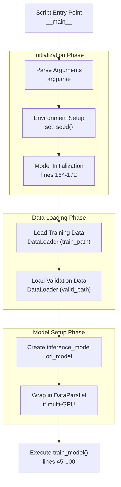

**Sources:** [FEVER/train.py:108-191]()

---

## Model Initialization

The script supports both BERT and RoBERTa base models through a conditional initialization pattern. The model architecture consists of a pre-trained sequence encoder wrapped by the custom `inference_model` class, which implements the FEVER-specific reasoning graph.

### Model Type Selection and Initialization

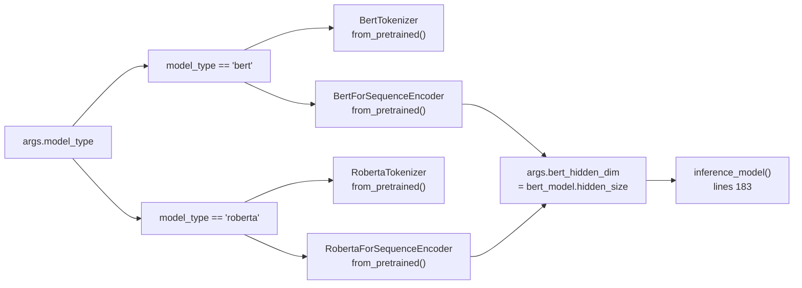

### Initialization Code Flow

| Step | Code Location | Operation |
|------|---------------|-----------|
| 1. Parse model type | [FEVER/train.py:164]() | Check `args.model_type` ('bert' or 'roberta') |
| 2. Load tokenizer | [FEVER/train.py:165,168]() | `BertTokenizer.from_pretrained()` or `RobertaTokenizer.from_pretrained()` |
| 3. Load encoder | [FEVER/train.py:166,169]() | `BertForSequenceEncoder.from_pretrained()` or `RobertaForSequenceEncoder.from_pretrained()` |
| 4. Extract hidden dim | [FEVER/train.py:172]() | `args.bert_hidden_dim = bert_model.hidden_size` |
| 5. Create FEVER model | [FEVER/train.py:183]() | `inference_model(bert_model, args)` |
| 6. Enable multi-GPU | [FEVER/train.py:184-187]() | `nn.DataParallel(ori_model)` if available |

**Sources:** [FEVER/train.py:164-189]()

---

## Data Loading Pipeline

The training script uses a custom `DataLoader` class that handles tokenization, evidence selection, and batch preparation. The data loader is instantiated separately for training and validation sets with different batch sizes.

### DataLoader Initialization Pattern

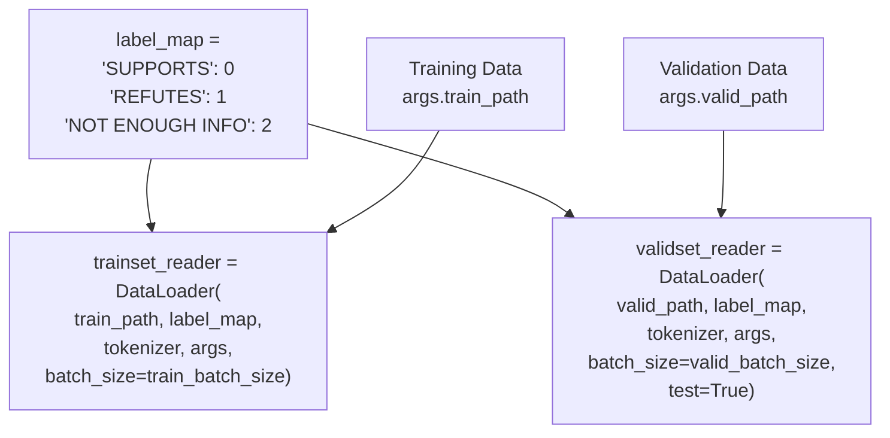

The `DataLoader` class (imported from `data_loader` module) is instantiated with:
- File path to JSON data
- Label mapping dictionary for FEVER classes
- Tokenizer (BERT or RoBERTa)
- Configuration arguments containing `max_len`, `evi_num`, etc.
- `test=True` flag for validation set (disables shuffling)

**Sources:** [FEVER/train.py:12,163,174-179]()

---

## Training Loop Implementation

The `train_model()` function implements the core training loop with gradient accumulation, periodic evaluation, and checkpoint management. The function orchestrates optimizer steps, learning rate scheduling, and model persistence.

### Training Loop Structure

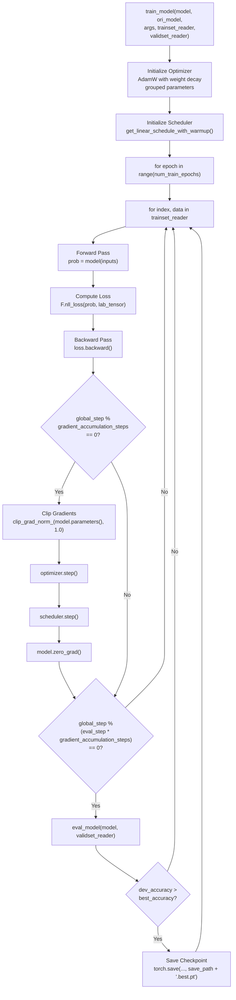

### Training Loop Components

| Component | Function/Operation | Code Location |
|-----------|-------------------|---------------|
| Forward pass | `prob = model(inputs)` | [FEVER/train.py:71]() |
| Loss computation | `F.nll_loss(prob, lab_tensor)` | [FEVER/train.py:72]() |
| Gradient scaling | `loss = loss / args.gradient_accumulation_steps` | [FEVER/train.py:73-74]() |
| Backward pass | `loss.backward()` | [FEVER/train.py:75]() |
| Gradient clipping | `torch.nn.utils.clip_grad_norm_(model.parameters(), 1.0)` | [FEVER/train.py:81]() |
| Optimizer step | `optimizer.step()` | [FEVER/train.py:82]() |
| Scheduler step | `scheduler.step()` | [FEVER/train.py:83]() |
| Zero gradients | `model.zero_grad()` | [FEVER/train.py:84]() |

**Sources:** [FEVER/train.py:45-100]()

---

## Evaluation Mechanics

The evaluation system computes accuracy on the validation set without updating model parameters. The `eval_model()` function iterates through the validation data and accumulates correct predictions.

### Evaluation Function Flow

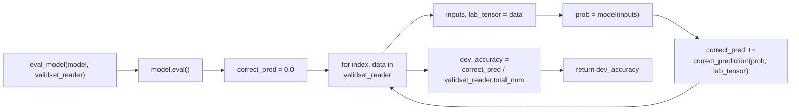

### Accuracy Helper Functions

The script provides two related utility functions for computing accuracy:

**`correct_prediction(output, labels)`** [FEVER/train.py:26-30]():
- Computes `preds = output.max(1)[1].type_as(labels)` to get predicted class
- Counts correct predictions: `preds.eq(labels).double().sum()`
- Returns raw count of correct predictions

**`accuracy(output, labels)`** [FEVER/train.py:20-24]():
- Similar to `correct_prediction()` but normalizes by batch size
- Returns: `correct / len(labels)`
- Note: This function is defined but not used in the training script

**Sources:** [FEVER/train.py:20-41]()

---

## Optimization and Scheduling

The training script uses the AdamW optimizer with linear warmup scheduling and weight decay regularization. The optimizer configuration follows BERT fine-tuning best practices by excluding bias and LayerNorm parameters from weight decay.

### Optimizer Configuration

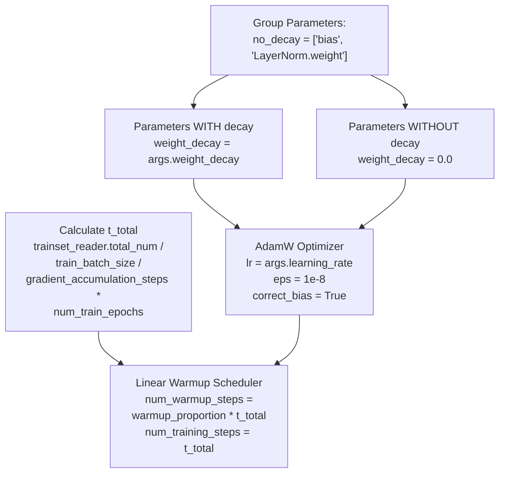

### Optimization Parameters

| Parameter | Source | Default Value | Description |
|-----------|--------|---------------|-------------|
| Learning rate | `args.learning_rate` | 2e-5 | Initial learning rate for AdamW |
| Weight decay | `args.weight_decay` | 0 | L2 regularization coefficient |
| Warmup proportion | `args.warmup_proportion` | 0.1 | Fraction of training for linear warmup |
| Epsilon | Hard-coded | 1e-8 | AdamW epsilon for numerical stability |
| Gradient clip | Hard-coded | 1.0 | Max gradient norm for clipping |

**Sources:** [FEVER/train.py:49-58,81,135-140]()

---

## Gradient Accumulation

The training script implements gradient accumulation to simulate larger batch sizes when GPU memory is limited. Gradients are accumulated across multiple forward-backward passes before performing an optimizer step.

### Gradient Accumulation Logic

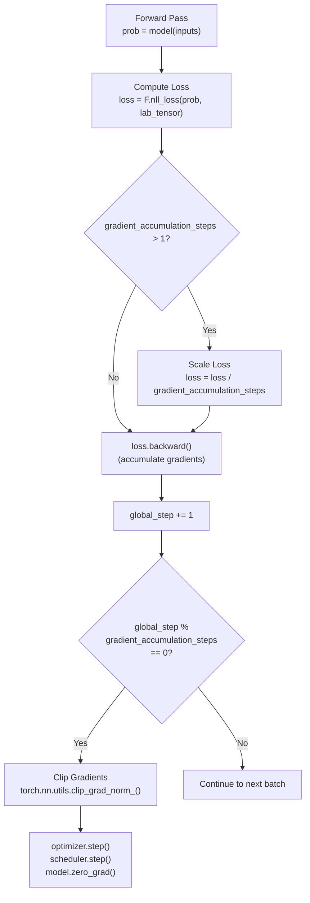

**Key Implementation Details:**
- Loss is scaled by `1/gradient_accumulation_steps` to maintain gradient magnitude [FEVER/train.py:73-74]()
- Optimizer step only occurs when `global_step % gradient_accumulation_steps == 0` [FEVER/train.py:80-84]()
- Effective batch size = `train_batch_size * gradient_accumulation_steps`
- Total training steps = `t_total` calculation accounts for accumulation [FEVER/train.py:49-50]()

**Sources:** [FEVER/train.py:49-50,73-84,141-144]()

---

## Checkpoint Management

The script implements best-model checkpointing based on validation accuracy. Checkpoints are saved only when the current model achieves better validation performance than previous runs.

### Checkpoint Saving Logic

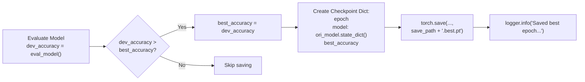

### Checkpoint Contents

The checkpoint dictionary contains:
- `epoch`: Current training epoch number
- `model`: State dictionary from `ori_model` (unwrapped from DataParallel)
- `best_accuracy`: Best validation accuracy achieved

**Important Note:** The checkpoint saves `ori_model.state_dict()` rather than `model.state_dict()` to avoid saving DataParallel wrapper keys [FEVER/train.py:98](). This ensures the checkpoint can be loaded without DataParallel dependencies.

**Sources:** [FEVER/train.py:46,94-100]()

---

## Configuration Parameters

The training script accepts extensive command-line arguments for controlling model architecture, training hyperparameters, and data processing. Below is a comprehensive reference of all configuration options.

### Core Training Parameters

| Argument | Type | Default | Description |
|----------|------|---------|-------------|
| `--model_type` | str | Required | Model type: 'bert' or 'roberta' |
| `--bert_pretrain` | str | Required | Path to pre-trained BERT/RoBERTa model |
| `--train_path` | str | Required | Path to training data JSON |
| `--valid_path` | str | Required | Path to validation data JSON |
| `--outdir` | str | Required | Output directory for checkpoints and logs |

### Optimization Parameters

| Argument | Type | Default | Description |
|----------|------|---------|-------------|
| `--learning_rate` | float | 2e-5 | Initial learning rate for AdamW |
| `--weight_decay` | float | 0 | L2 regularization weight |
| `--warmup_proportion` | float | 0.1 | Proportion of training for warmup |
| `--num_train_epochs` | float | 3.0 | Total training epochs |
| `--gradient_accumulation_steps` | int | 1 | Gradient accumulation steps |

### Batch and Sequence Parameters

| Argument | Type | Default | Description |
|----------|------|---------|-------------|
| `--train_batch_size` | int | 32 | Training batch size |
| `--valid_batch_size` | int | 32 | Validation batch size |
| `--max_len` | int | 130 | Maximum sequence length after tokenization |
| `--eval_step` | int | 1000 | Steps between evaluations |

### Model Architecture Parameters

| Argument | Type | Default | Description |
|----------|------|---------|-------------|
| `--num_labels` | int | 3 | Number of output classes (SUPPORTS/REFUTES/NEI) |
| `--evi_num` | int | 5 | Number of evidence sentences to consider |
| `--pool` | str | 'att' | Aggregation method: top, max, mean, concat, att, sum |
| `--layer` | int | 1 | Number of graph layers |
| `--kernel` | int | 21 | Kernel size parameter |
| `--threshold` | float | 0.0 | Threshold parameter |
| `--dropout` | float | 0.6 | Dropout probability |

### System Parameters

| Argument | Type | Default | Description |
|----------|------|---------|-------------|
| `--no-cuda` | flag | False | Disable CUDA training |
| `--seed` | int | 42 | Random seed for reproducibility |
| `--patience` | int | 20 | Patience for early stopping (not used) |
| `--postpretrain` | str | None | Path to post-pretrained weights |
| `--no_clip` | flag | False | Disable gradient clipping (not used) |

**Sources:** [FEVER/train.py:109-150]()

---

## Multi-GPU Support

The training script provides automatic multi-GPU parallelization using PyTorch's `nn.DataParallel`. The implementation wraps the model only when multiple GPUs are detected, ensuring compatibility with single-GPU setups.

### DataParallel Initialization

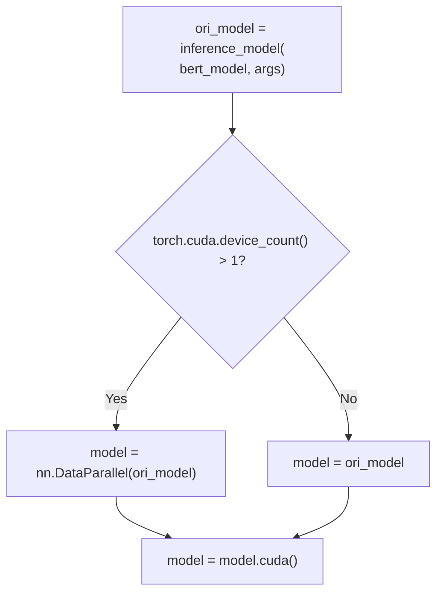

### Implementation Details

The script maintains two model references:
- **`ori_model`**: Original unwrapped model (used for checkpointing)
- **`model`**: Potentially wrapped model (used for training)

This pattern ensures:
1. Training can leverage multiple GPUs when available [FEVER/train.py:184-187]()
2. Checkpoints save clean state dictionaries without DataParallel wrapper keys [FEVER/train.py:98]()
3. Single-GPU and multi-GPU setups use the same code path

**Note:** The script does not use `torch.distributed` for distributed data parallel (DDP). It uses the simpler `nn.DataParallel` which replicates the model across GPUs on a single node.

**Sources:** [FEVER/train.py:183-189]()

---

## Logging and Reproducibility

The training script implements comprehensive logging and random seed management for reproducible experiments.

### Logging Configuration

The script creates dual logging outputs:
- File handler: `{outdir}/train_log.txt`
- Stream handler: Console output (stdout)

Both handlers use the format: `[%(asctime)s] %(levelname)s: %(message)s`

**Logged Events:**
- Arguments and configuration [FEVER/train.py:159]()
- Training start notification [FEVER/train.py:161]()
- Periodic loss every 10 accumulation steps [FEVER/train.py:86-87]()
- Evaluation start notifications [FEVER/train.py:90]()
- Validation accuracy results [FEVER/train.py:93]()
- Best model checkpoint saves [FEVER/train.py:100]()

### Reproducibility

The `set_seed()` function ensures reproducible training:

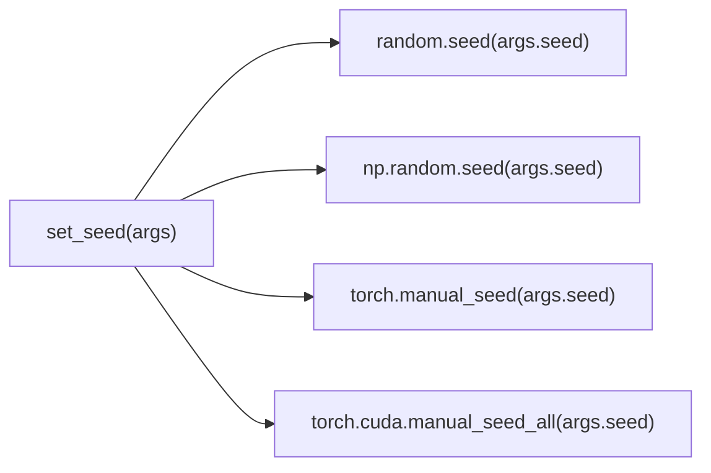

The function seeds all random number generators used in the training pipeline:
- Python's `random` module
- NumPy's random state
- PyTorch's CPU random state
- PyTorch's CUDA random states (all GPUs)

**Sources:** [FEVER/train.py:102-106,156-161]()

---

## Integration with External Components

The training script integrates with several external modules and packages that implement FEVER-specific functionality.

### Component Dependencies

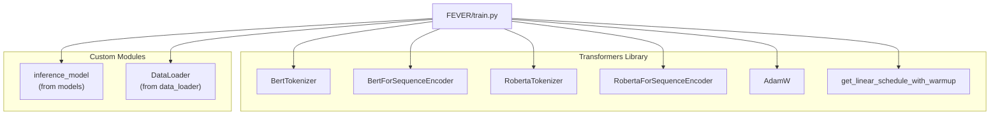

### Import Mapping

| Module/Class | Import Source | Purpose |
|-------------|---------------|---------|
| `BertTokenizer` | `transformers` | BERT tokenization |
| `BertForSequenceEncoder` | `transformers` | BERT sequence encoder (custom extension) |
| `RobertaTokenizer` | `transformers` | RoBERTa tokenization |
| `RobertaForSequenceEncoder` | `transformers` | RoBERTa sequence encoder (custom extension) |
| `AdamW` | `transformers` | Adam optimizer with weight decay |
| `get_linear_schedule_with_warmup` | `transformers` | Linear warmup scheduler |
| `inference_model` | `models` | FEVER-specific reasoning model (likely KGAT-based) |
| `DataLoader` | `data_loader` | FEVER data loading and preprocessing |

**Note:** The `BertForSequenceEncoder` and `RobertaForSequenceEncoder` classes are custom extensions defined in the CorefBERT transformers package (see [Model Extensions](#4.2)), not part of standard Hugging Face transformers.

**Sources:** [FEVER/train.py:10-15]()

---

