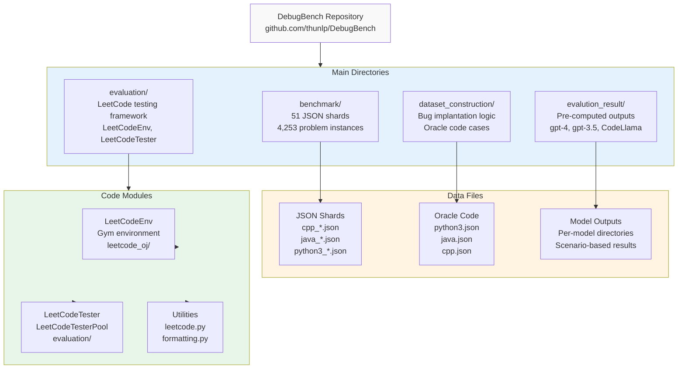
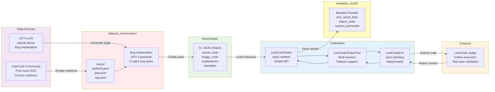
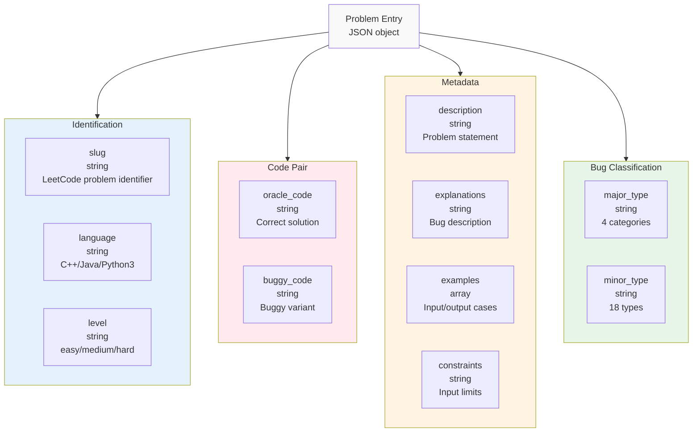
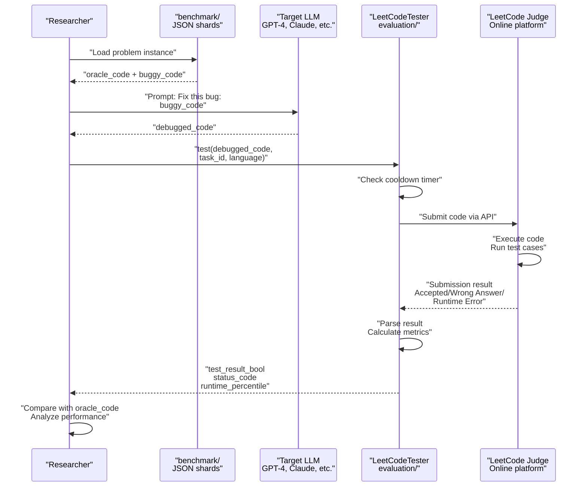

<!-- source: DeepWiki mcp.deepwiki.com · repo thunlp/DebugBench · page 1 Overview · fetched 2026-11-02 -->

# Overview

<details>
<summary>Relevant source files</summary>

The following files were used as context for generating this wiki page:

- [README.md](README.md)
- [figs/icon.png](figs/icon.png)
- [figs/pipeline.png](figs/pipeline.png)

</details>


## Purpose and Scope

This document provides an overview of **DebugBench**, a benchmark for evaluating the debugging capabilities of Large Language Models (LLMs). It introduces the system's purpose, architecture, key features, and how its components work together to enable systematic evaluation of LLM debugging performance.

For detailed information about specific components:
- Dataset construction process: see [Dataset Construction](#2)
- Benchmark dataset structure and access: see [Benchmark Dataset](#3)
- Evaluation framework usage: see [Evaluation System](#4)
- Installation and configuration: see [Development Guide](#6)

**Sources:** [README.md:1-57]()

---

## What is DebugBench?

DebugBench is a Large Language Model debugging benchmark introduced in the paper "DebugBench: Evaluating Debugging Capability of Large Language Models". It provides a systematic framework for assessing how well LLMs can identify and fix bugs in code.

The benchmark is constructed by:
1. Collecting correct solution code from the LeetCode community (post-June 2022)
2. Using GPT-4 to systematically implant bugs into these solutions
3. Creating oracle-buggy code pairs with comprehensive metadata
4. Providing an evaluation framework integrated with LeetCode's online judge

The complete dataset is publicly available on [Hugging Face](https://huggingface.co/datasets/Rtian/DebugBench) and can be used to evaluate any LLM's debugging capabilities.

**Sources:** [README.md:5-23]()

---

## Key Statistics

| Metric | Value |
|--------|-------|
| **Total Instances** | 4,253 |
| **Programming Languages** | C++, Java, Python3 |
| **Bug Categories (Major)** | 4 |
| **Bug Types (Minor)** | 18 |
| **Difficulty Levels** | Easy, Medium, Hard |
| **JSON Shards** | 51 |
| **Data Source** | LeetCode community (post-June 2022) |
| **Bug Implantation** | GPT-4 powered |

The benchmark is organized into 51 JSON shards, each representing a unique combination of programming language and bug type. This multi-dimensional organization enables fine-grained analysis of LLM debugging performance across different languages, difficulty levels, and bug categories.

**Sources:** [README.md:15-22]()

---

## Repository Structure

The DebugBench repository is organized into four main directories, each serving a distinct purpose in the benchmark ecosystem:



**Directory Mapping:**

| Directory | Purpose | Key Contents |
|-----------|---------|--------------|
| `benchmark/` | Benchmark dataset storage | 51 JSON shards organized by language and bug type |
| `dataset_construction/` | Bug implantation implementation | Oracle code cases, GPT-4 bug generation logic |
| `evaluation/` | Evaluation framework | `LeetCodeEnv`, `LeetCodeTester`, `LeetCodeTesterPool` classes |
| `evalution_result/` | Pre-computed baselines | Results for gpt-4-0613, gpt-3.5-turbo-0613, CodeLlama-34b-instruct |

**Sources:** [README.md:26-35]()

---

## System Components and Data Flow

The DebugBench system consists of interconnected components that form a complete pipeline from dataset construction to evaluation and result analysis:



### Component Descriptions

**1. Data Sources**
- LeetCode community solutions serve as the foundation for oracle code
- GPT-4 API generates realistic bugs through carefully crafted prompts
- Solutions are filtered to post-June 2022 to avoid training data contamination

**2. Dataset Construction (`dataset_construction/`)**
- Contains oracle code organized by language in the `cases/` subdirectory
- Implements bug implantation logic using GPT-4
- Validates that bugs produce different program outputs
- For details: see [Dataset Construction](#2)

**3. Benchmark Dataset (`benchmark/`)**
- 51 JSON shards representing all combinations of language × bug type
- Each entry contains `oracle_code`, `buggy_code`, `explanations`, `examples`, `constraints`
- Multi-dimensional indexing by language, difficulty, and bug category
- For details: see [Benchmark Dataset](#3)

**4. Evaluation Framework (`evaluation/`)**
- `LeetCodeTester`: High-level API for single-session testing
- `LeetCodeTesterPool`: Manages multiple LeetCode accounts for rate limiting
- `LeetCodeEnv`: Gym-compatible environment for integration with the LeetCode judge
- For details: see [Evaluation System](#4)

**5. Pre-computed Results (`evalution_result/`)**
- Baseline outputs from gpt-4-0613, gpt-3.5-turbo-0613, and CodeLlama-34b-instruct
- Structured results including `test_result_bool`, `status_code`, and performance metrics
- For details: see [Results and Analysis](#5)

**Sources:** [README.md:26-35]()

---

## Core Data Schema

Each problem instance in the benchmark follows a consistent schema that pairs correct and buggy code with comprehensive metadata:



**Key Fields:**

| Field | Type | Purpose |
|-------|------|---------|
| `slug` | string | LeetCode problem identifier (e.g., "two-sum") |
| `oracle_code` | string | Correct, verified solution code |
| `buggy_code` | string | Code with intentionally implanted bug |
| `explanations` | string | Human-readable description of the bug |
| `examples` | array | Test case examples showing expected behavior |
| `constraints` | string | Problem constraints and input specifications |
| `level` | string | Difficulty level: easy, medium, or hard |
| `major_type` | string | One of 4 major bug categories |
| `minor_type` | string | One of 18 specific bug types |

This schema enables researchers to:
- Load buggy code and prompt LLMs to debug it
- Compare LLM outputs against verified oracle code
- Analyze debugging performance by bug type, difficulty, and language
- Understand the specific nature of each bug through explanations

For the complete schema specification: see [Data Schema and Format](#3.2)

**Sources:** [README.md:15-22]()

---

## Bug Category Taxonomy

DebugBench organizes bugs into a hierarchical taxonomy with 4 major categories and 18 minor types:

| Major Category | Minor Types | Example |
|----------------|-------------|---------|
| **Condition Errors** | Loop bounds, comparison operators, boolean logic | `i <= n` should be `i < n` |
| **Faulty Indexing** | Array bounds, off-by-one errors, iterator misuse | `arr[i+1]` should be `arr[i]` |
| **Operation Errors** | Arithmetic operators, assignment errors, logical operators | `sum + value` should be `sum * value` |
| **Other Errors** | Syntax errors, undefined methods, type errors | Missing import, wrong function name |

Each bug type is carefully chosen to represent common errors that developers encounter in real-world programming. The bugs are validated to ensure they produce incorrect outputs while remaining syntactically valid (in most cases) and semantically plausible.

For detailed examples and the complete taxonomy: see [Bug Categories and Types](#2.3)

**Sources:** [README.md:17-19]()

---

## Evaluation Workflow

The evaluation process tests whether an LLM can successfully debug code by submitting fixes to the LeetCode online judge:



**Workflow Steps:**

1. **Load Benchmark Instance**: Retrieve `oracle_code` and `buggy_code` from the appropriate JSON shard
2. **Prompt LLM**: Send buggy code to the LLM with debugging instructions
3. **Submit to Judge**: Use `LeetCodeTester.test()` to submit the LLM's fix to LeetCode
4. **Receive Verdict**: Parse the response to determine if the fix is correct
5. **Store Results**: Save test outcomes with detailed metrics

The evaluation framework handles:
- Rate limiting via cooldown mechanisms
- Multi-session support through `LeetCodeTesterPool`
- Automatic retry and failover
- Detailed result logging

For detailed evaluation setup and usage: see [Evaluation System](#4)

**Sources:** [README.md:33-34]()

---

## Pre-computed Baseline Results

DebugBench includes pre-computed evaluation results for three baseline models in the `evalution_result/` directory:

| Model | Version | Scenarios |
|-------|---------|-----------|
| **GPT-4** | gpt-4-0613 | Multiple prompt variations |
| **GPT-3.5 Turbo** | gpt-3.5-turbo-0613 | Multiple prompt variations |
| **CodeLlama** | CodeLlama-34b-instruct | Multiple prompt variations |

Each result file contains:
- `completed_code`: The LLM's debugging attempt
- `test_result_bool`: Whether the fix passed all test cases
- `test_result_dict`: Detailed test case outcomes
- `status_code`: Submission verdict (Accepted, Wrong Answer, etc.)
- `total_correct`/`total_testcases`: Test case coverage
- `runtime_percentile`: Performance ranking
- `memory_percentile`: Memory usage ranking

These baselines enable researchers to:
- Compare new models against established benchmarks
- Analyze performance trends across bug types and difficulty levels
- Understand model strengths and weaknesses in debugging

For detailed result schema and analysis: see [Results and Analysis](#5)

**Sources:** [README.md:34]()

---

## Technology Stack

DebugBench is built on a carefully selected stack of Python libraries and external services:

| Component | Technology | Purpose |
|-----------|------------|---------|
| **Bug Implantation** | OpenAI GPT-4 API | Generate realistic bugs |
| **Evaluation Environment** | Gym | Provide RL-compatible interface |
| **Data Validation** | Pydantic | Ensure schema correctness |
| **LeetCode Integration** | Custom API client | Submit and test code |
| **Progress Tracking** | tqdm | Monitor evaluation progress |
| **Dataset Hosting** | Hugging Face | Public dataset distribution |
| **Configuration** | python-dotenv | Manage credentials securely |

**External Dependencies:**
- LeetCode platform for online code execution and test case validation
- OpenAI API for bug implantation during dataset construction
- Hugging Face for public dataset distribution and access

For detailed dependency information: see [Dependencies](#6.2)

**Sources:** [README.md:26-35]()

---

## Getting Started

To begin using DebugBench:

1. **Access the Dataset**: Visit [Hugging Face](https://huggingface.co/datasets/Rtian/DebugBench) to download the benchmark data
2. **Install Dependencies**: Set up the Python environment with required libraries
3. **Configure LeetCode Access**: Obtain LeetCode credentials for evaluation
4. **Run Evaluation**: Use the `LeetCodeTester` API to test LLM debugging capabilities

**Quick Example:**
```python
from evaluation import LeetCodeTester

# Initialize tester
tester = LeetCodeTester()

# Test a debugged code submission
result = tester.test(
    code=debugged_code,
    task_id="two-sum",
    language="Python3"
)

# Check if the fix was successful
if result['test_result_bool']:
    print("✓ Bug fixed successfully!")
else:
    print(f"✗ Fix failed: {result['status_code']}")
```

For detailed setup instructions: see [Quick Start Guide](#1.2)

For comprehensive installation and configuration: see [Development Guide](#6)

**Sources:** [README.md:12-35]()

---

## Citation and License

DebugBench is released under the **Apache 2.0 License** and is free for academic and commercial use.

If you use DebugBench in your research, please cite:

```latex
@misc{tian2024debugbench,
      title={DebugBench: Evaluating Debugging Capability of Large Language Models}, 
      author={Runchu Tian and Yining Ye and Yujia Qin and Xin Cong and Yankai Lin and Zhiyuan Liu and Maosong Sun},
      year={2024},
      eprint={2401.04621},
      archivePrefix={arXiv},
      primaryClass={cs.SE}
}
```

For questions or issues, contact trc20@mails.tsinghua.edu.cn or open an issue on the GitHub repository.

For complete license information: see [License and Citation](#9)

**Sources:** [README.md:40-55]()

---

