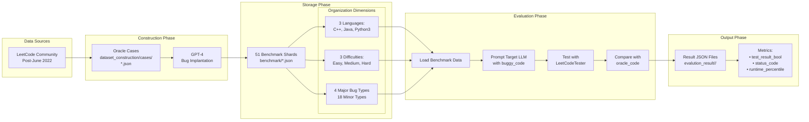
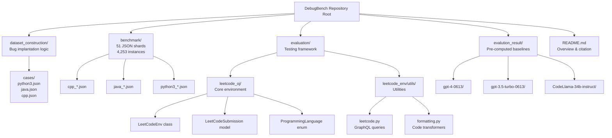
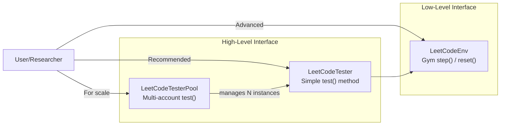

<!-- source: DeepWiki mcp.deepwiki.com · repo thunlp/DebugBench · page 1.1 System Architecture · fetched 2026-11-02 -->

# System Architecture

<details>
<summary>Relevant source files</summary>

The following files were used as context for generating this wiki page:

- [README.md](README.md)
- [figs/icon.png](figs/icon.png)
- [figs/pipeline.png](figs/pipeline.png)

</details>


## Purpose and Scope

This document describes the high-level architecture of the DebugBench system, explaining how its major components interact to create and evaluate a benchmark for testing Large Language Model (LLM) debugging capabilities. It covers the directory structure, component relationships, data flow, and key abstractions that enable the benchmark's construction and use.

For detailed information about specific subsystems, see:
- Dataset construction process: [Dataset Construction](#2)
- Benchmark data schema and organization: [Benchmark Dataset](#3)
- Evaluation framework details: [Evaluation System](#4)
- Installation and configuration: [Installation and Setup](#6.1)

---

## System Overview

DebugBench is organized into four primary subsystems that work together to create, store, and evaluate a debugging benchmark:

| Subsystem | Directory | Purpose |
|-----------|-----------|---------|
| **Dataset Construction** | `dataset_construction/` | Collects oracle code and implants bugs using GPT-4 |
| **Benchmark Storage** | `benchmark/` | Stores 4,253 bug-implanted instances across 51 JSON shards |
| **Evaluation Framework** | `evaluation/` | Tests LLM-generated fixes against LeetCode online judge |
| **Results Repository** | `evalution_result/` | Stores pre-computed baseline model outputs |

The system follows a pipeline architecture where data flows from left to right: correct solutions are collected, bugs are introduced, the resulting benchmark is published, and LLMs are evaluated against it.

Sources: [README.md:26-36]()

---

## Component Architecture

The following diagram shows the major components and their relationships using actual directory and class names from the codebase:

```mermaid
graph TB
    subgraph DatasetConstruction["dataset_construction/"]
        OracleCases["cases/<br/>python3.json<br/>java.json<br/>cpp.json"]
        BugImplant["Bug Implantation<br/>(GPT-4 powered)"]
    end
    
    subgraph Benchmark["benchmark/"]
        Shards["51 JSON Shards<br/>4,253 instances<br/>Language × Difficulty × Bug Type"]
    end
    
    subgraph Evaluation["evaluation/"]
        direction TB
        LeetCodeTester["LeetCodeTester<br/>High-level API"]
        TesterPool["LeetCodeTesterPool<br/>Multi-session manager"]
        
        subgraph LeetCodeOJ["leetcode_oj/"]
            LeetCodeEnv["LeetCodeEnv<br/>Gym environment"]
            LeetCodeSubmission["LeetCodeSubmission<br/>Data model"]
            ProgrammingLanguage["ProgrammingLanguage<br/>Enum"]
        end
        
        subgraph Utils["leetcode_env/utils/"]
            LeetCodeAPI["leetcode.py<br/>GraphQL queries"]
            Formatter["formatting.py<br/>Code transformers"]
        end
    end
    
    subgraph Results["evalution_result/"]
        GPT4Results["gpt-4-0613/"]
        GPT35Results["gpt-3.5-turbo-0613/"]
        LlamaResults["CodeLlama-34b-instruct/"]
    end
    
    subgraph External["External Services"]
        LeetCodePlatform["LeetCode Platform<br/>Online Judge"]
        GPT4API["GPT-4 API"]
        HuggingFace["Hugging Face<br/>Rtian/DebugBench"]
    end
    
    OracleCases --> BugImplant
    GPT4API -.."bug generation"..-> BugImplant
    BugImplant --> Shards
    
    Shards --> HuggingFace
    Shards --> LeetCodeTester
    
    LeetCodeTester --> LeetCodeEnv
    TesterPool --> LeetCodeTester
    
    LeetCodeEnv --> LeetCodeSubmission
    LeetCodeEnv --> ProgrammingLanguage
    LeetCodeEnv --> LeetCodeAPI
    LeetCodeEnv --> Formatter
    
    LeetCodeEnv -.."submits to"..-> LeetCodePlatform
    
    LeetCodeEnv --> Results
    
    TesterPool -.."manages multiple"..-> LeetCodeTester
```

**Component Responsibilities:**

| Component | File/Directory | Key Functionality |
|-----------|----------------|-------------------|
| `LeetCodeEnv` | `evaluation/leetcode_oj/` | Gym-compatible environment for submitting and testing code |
| `LeetCodeTester` | `evaluation/` | Simple API wrapper for code testing |
| `LeetCodeTesterPool` | `evaluation/` | Manages multiple tester sessions for rate limiting |
| `LeetCodeSubmission` | `evaluation/leetcode_oj/` | Data model representing a code submission |
| `ProgrammingLanguage` | `evaluation/leetcode_oj/` | Enum for supported languages (Python3, Java, C++, etc.) |
| `formatting.py` | `evaluation/leetcode_env/utils/` | Code format transformers for different languages |
| `leetcode.py` | `evaluation/leetcode_env/utils/` | GraphQL queries for LeetCode API |

Sources: [README.md:26-36](), Diagram 1 from provided context, Diagram 3 from provided context

---

## Data Flow Architecture

The following diagram illustrates how data flows through the system from construction to evaluation:



**Data Transformations:**

| Stage | Input Format | Output Format | Location |
|-------|--------------|---------------|----------|
| **Collection** | LeetCode HTML/API | JSON oracle solutions | `dataset_construction/cases/*.json` |
| **Bug Implantation** | Oracle JSON | Oracle-Buggy pairs | `benchmark/*.json` (51 shards) |
| **Evaluation** | Buggy code | LLM-fixed code | In-memory |
| **Testing** | LLM-fixed code | Submission results | `LeetCodeEnv` response |
| **Storage** | Submission results | Result JSON | `evalution_result/<model>/` |

Sources: [README.md:11-22](), Diagram 2 and Diagram 5 from provided context

---

## Directory Structure

The repository follows a clear separation of concerns with distinct directories for each major function:



**Key Directories:**

- **`dataset_construction/`**: Contains oracle code collection and bug implantation logic
  - **`cases/`**: Stores correct solutions by language (python3.json, java.json, cpp.json)
  
- **`benchmark/`**: Stores the complete benchmark dataset
  - 51 JSON shard files organized by language and bug type
  - Each file contains multiple problem instances with oracle and buggy code pairs
  
- **`evaluation/`**: Implements the testing framework
  - **`leetcode_oj/`**: Core Gym environment and data models
  - **`leetcode_env/utils/`**: GraphQL queries and code formatters
  
- **`evalution_result/`**: Stores pre-computed baseline results
  - Subdirectories for each evaluated model (gpt-4-0613, gpt-3.5-turbo-0613, etc.)

Sources: [README.md:26-36]()

---

## Key System Interfaces

### Public API Surface

The evaluation system exposes two primary interfaces for testing code solutions:



**Interface Comparison:**

| Interface | Use Case | Rate Limiting | Session Management |
|-----------|----------|---------------|-------------------|
| `LeetCodeEnv` | Low-level control, Gym compatibility | Manual cooldown | Single session |
| `LeetCodeTester` | Simple testing, single account | Automatic cooldown | Single session |
| `LeetCodeTesterPool` | High-throughput testing | Automatic with rotation | Multi-session pool |

Sources: Diagram 3 from provided context

### Data Model Abstractions

The system uses strongly-typed data models throughout:

| Model | Location | Purpose |
|-------|----------|---------|
| `LeetCodeSubmission` | `evaluation/leetcode_oj/` | Represents a code submission with language, code, task_id |
| `ProgrammingLanguage` | `evaluation/leetcode_oj/` | Enum for C++, Java, Python3, and other supported languages |
| Problem Entry Schema | `benchmark/*.json` | Contains slug, description, oracle_code, buggy_code, explanations, examples, constraints, level |

These models ensure type safety and consistent data handling across the pipeline.

Sources: Diagram 1 and Diagram 3 from provided context

---

## External Dependencies

DebugBench integrates with several external services:

```mermaid
graph TB
    subgraph DebugBench["DebugBench System"]
        Construction["Dataset Construction"]
        Evaluation["Evaluation Framework"]
        Distribution["Distribution"]
    end
    
    subgraph External["External Services"]
        LeetCode["LeetCode Platform<br/>Online Judge & GraphQL API"]
        OpenAI["OpenAI API<br/>GPT-4 for bug implantation"]
        HF["Hugging Face<br/>Dataset hosting:<br/>Rtian/DebugBench"]
    end
    
    subgraph Auth["Authentication"]
        ENV["Environment Variables<br/>LEETCODE_SESSION<br/>CSRF_TOKEN<br/>OPENAI_API_KEY"]
    end
    
    Construction -.."generates bugs"..-> OpenAI
    Evaluation -.."submits code"..-> LeetCode
    Distribution -.."publishes to"..-> HF
    
    OpenAI -.."requires"..-> ENV
    LeetCode -.."requires"..-> ENV
```

**External Service Roles:**

- **LeetCode Platform**: Provides the online judge for testing code submissions and GraphQL API for metadata retrieval
- **GPT-4 API**: Used during dataset construction to generate realistic bugs in oracle code
- **Hugging Face**: Hosts the published dataset at `Rtian/DebugBench` for public access

All external services require authentication via environment variables (see [Configuration](#6.3)).

Sources: [README.md:13-15](), Diagram 1 and Diagram 6 from provided context

---

## System Flow Summary

The complete DebugBench workflow can be summarized as:

1. **Construction**: Oracle code from LeetCode → GPT-4 bug implantation → Benchmark shards
2. **Distribution**: Benchmark shards → Hugging Face dataset repository
3. **Evaluation**: Load benchmark → Prompt LLM → Test with LeetCodeEnv → Store results
4. **Analysis**: Compare results against oracle code and baseline models

Each phase is self-contained and can be executed independently, allowing researchers to:
- Use the pre-built benchmark without running construction
- Evaluate new models without re-running baselines
- Extend the dataset construction for new bug types or languages

Sources: [README.md:1-57](), all provided diagrams

---

