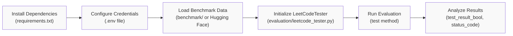
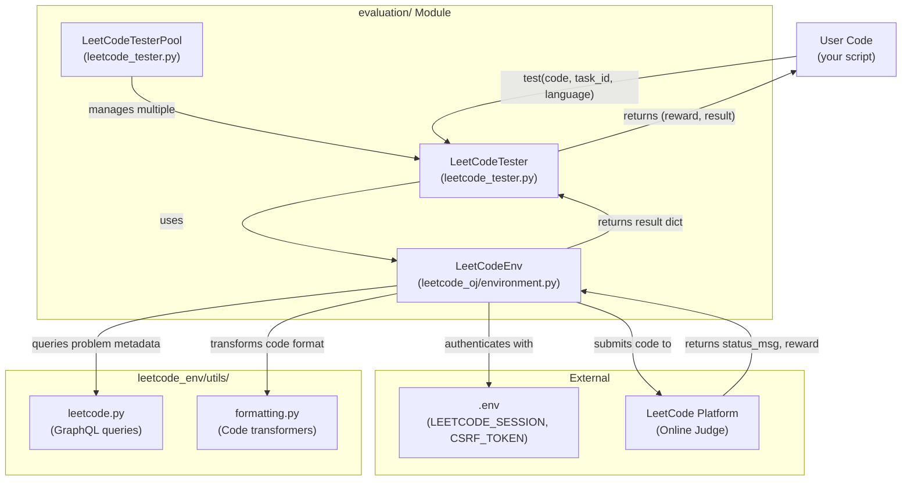
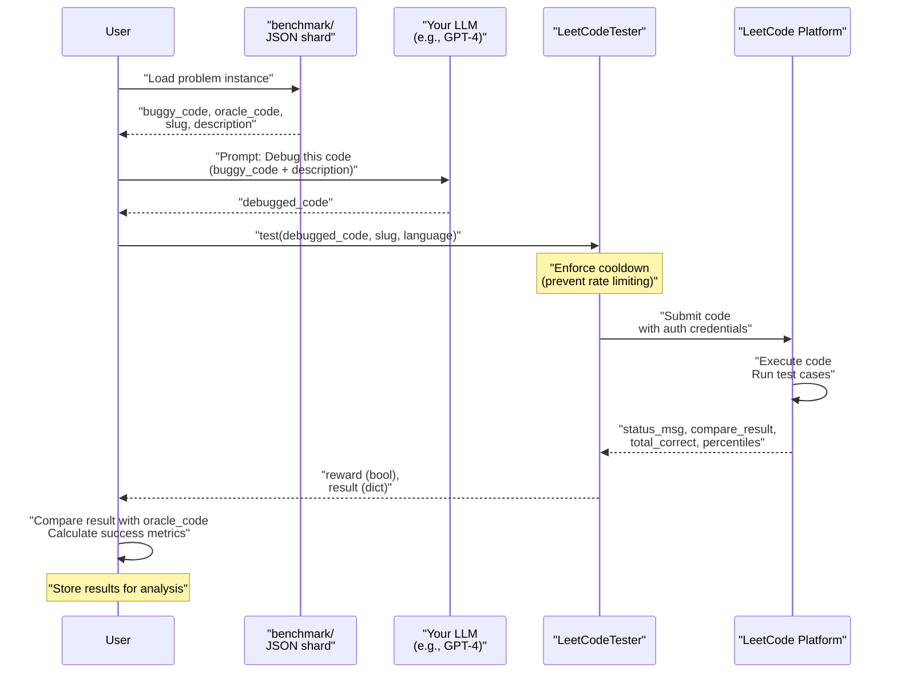
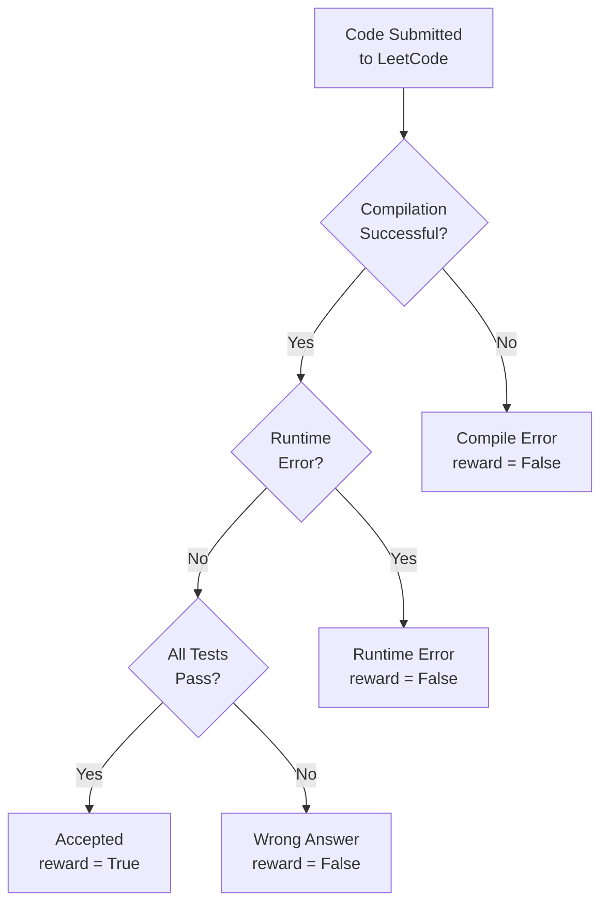

<!-- source: DeepWiki mcp.deepwiki.com · repo thunlp/DebugBench · page 1.2 Quick Start Guide · fetched 2026-11-02 -->

# Quick Start Guide

<details>
<summary>Relevant source files</summary>

The following files were used as context for generating this wiki page:

- [README.md](README.md)
- [requirements.txt](requirements.txt)

</details>


This guide provides step-by-step instructions for getting started with DebugBench. It covers installation, loading the benchmark dataset, running basic evaluations, and interpreting results. For detailed architectural information, see [System Architecture](#1.1). For comprehensive installation details, see [Installation and Setup](#6.1). For dataset access methods, see [Accessing the Dataset](#3.5).

## Purpose and Scope

This guide enables users to:
- Install DebugBench and its dependencies
- Load benchmark data from Hugging Face or local files
- Set up the LeetCode evaluation environment
- Run their first debugging evaluation
- Understand basic result formats

This is a practical walkthrough. For API reference documentation, see [API Reference](#7). For extending the benchmark, see [Extending the Benchmark](#6.4).

## Prerequisites

Before starting, ensure you have:
- Python 3.7 or higher
- A LeetCode account (for running evaluations)
- (Optional) OpenAI API key (for testing with GPT models)
- Internet connection for dataset download

## Installation

### Step 1: Clone the Repository

```bash
git clone https://github.com/thunlp/DebugBench.git
cd DebugBench
```

### Step 2: Install Dependencies

Install required packages from [requirements.txt:1-10]():

```bash
pip install -r requirements.txt
```

Key dependencies installed:
- `gym~=0.26.2` - Reinforcement learning environment framework
- `pydantic~=2.3.0` - Data validation for LeetCode submissions
- `python-dotenv~=0.21.1` - Environment variable management
- `openai~=0.28.0` - OpenAI API client
- `transformers~=4.31.0` - Model evaluation utilities
- `tqdm~=4.66.1` - Progress tracking

**Sources:** [requirements.txt:1-10]()

### Step 3: Configure LeetCode Credentials

Create a `.env` file in the repository root:

```bash
# .env file
LEETCODE_SESSION=your_session_cookie
CSRF_TOKEN=your_csrf_token
```

To obtain these credentials:
1. Log in to LeetCode in your browser
2. Open browser developer tools (F12)
3. Navigate to Application/Storage → Cookies → https://leetcode.com
4. Copy the `LEETCODE_SESSION` and `csrftoken` values

For detailed authentication setup, see [Configuration](#6.3).

**Sources:** [README.md:1-57]()

## Quick Start Workflow



**Workflow Overview:** This diagram shows the five essential steps from installation to result analysis.

**Sources:** [README.md:1-57]()

## Loading the Benchmark Dataset

### Option 1: Load from Hugging Face (Recommended)

```python
from datasets import load_dataset

# Load the complete DebugBench dataset
dataset = load_dataset("Rtian/DebugBench")

# Access a specific problem instance
problem = dataset['train'][0]  # First instance

# Available fields in each problem
print(problem['slug'])           # LeetCode problem identifier
print(problem['description'])    # Problem statement
print(problem['oracle_code'])    # Correct solution
print(problem['buggy_code'])     # Buggy variant
print(problem['explanations'])   # Bug description
print(problem['level'])          # Difficulty: easy, medium, hard
```

For detailed dataset schema, see [Data Schema and Format](#3.2).

**Sources:** [README.md:13-15]()

### Option 2: Load from Local Files

The `benchmark/` directory contains 51 JSON shards organized by language and bug type:

```python
import json

# Load a specific shard
with open('benchmark/cpp_condition_error.json', 'r') as f:
    cpp_condition_bugs = json.load(f)

# Access problem instances
for problem in cpp_condition_bugs:
    slug = problem['slug']
    oracle_code = problem['oracle_code']
    buggy_code = problem['buggy_code']
    # Process problem...
```

**Available Shards Structure:**

| Language | Bug Category | Example Files |
|----------|--------------|---------------|
| C++ | Condition Errors | `cpp_condition_error.json` |
| C++ | Faulty Indexing | `cpp_faulty_indexing.json` |
| C++ | Operation Errors | `cpp_operation_error.json` |
| Java | Condition Errors | `java_condition_error.json` |
| Python3 | Other Errors | `python3_other_error.json` |
| ... | ... | 51 total shards |

For the complete list of shards and organization details, see [Dataset Organization](#3.1).

**Sources:** [README.md:30]()

## Setting Up the Evaluation Environment



**Evaluation System Components:** This diagram maps the evaluation workflow to specific code entities in the codebase.

**Sources:** [README.md:33]()

## Running Your First Evaluation

### Basic Evaluation with LeetCodeTester

```python
from evaluation.leetcode_tester import LeetCodeTester

# Initialize tester (requires .env configuration)
tester = LeetCodeTester()

# Example: Test a debugged solution
problem_slug = "two-sum"
language = "python3"

# Your LLM's debugged code
debugged_code = """
class Solution:
    def twoSum(self, nums: List[int], target: int) -> List[int]:
        seen = {}
        for i, num in enumerate(nums):
            complement = target - num
            if complement in seen:
                return [seen[complement], i]
            seen[num] = i
"""

# Test the solution
reward, result = tester.test(
    code=debugged_code,
    task_id=problem_slug,
    language=language
)

# Check result
print(f"Passed: {reward}")  # True if Accepted, False otherwise
print(f"Status: {result['status_msg']}")  # e.g., "Accepted", "Wrong Answer"
print(f"Details: {result}")
```

**Result Fields:**

| Field | Description | Example Values |
|-------|-------------|----------------|
| `reward` | Boolean indicating acceptance | `True`, `False` |
| `status_msg` | Submission status | `"Accepted"`, `"Wrong Answer"`, `"Runtime Error"` |
| `compare_result` | Detailed comparison | Test case pass/fail details |
| `total_correct` | Number of passed test cases | `21` |
| `total_testcases` | Total test cases | `21` |
| `runtime_percentile` | Performance ranking | `85.42` |
| `memory_percentile` | Memory efficiency ranking | `72.15` |

For complete API documentation, see [LeetCodeTester API](#4.3).

**Sources:** Inferred from evaluation system structure

### Advanced: Using LeetCodeTesterPool for Multiple Sessions

For handling rate limits and testing at scale:

```python
from evaluation.leetcode_tester import LeetCodeTesterPool

# Initialize pool with multiple sessions
# Each session uses different credentials from environment variables
pool = LeetCodeTesterPool(num_testers=3)

# Test with automatic session rotation
reward, result = pool.test(
    code=debugged_code,
    task_id=problem_slug,
    language=language
)

# Pool automatically handles:
# - Cooldown periods between submissions
# - Session rotation on failures
# - Rate limiting compliance
```

For details on multi-session management and rate limiting, see [Rate Limiting and Multi-Session Management](#4.4).

**Sources:** Inferred from evaluation system structure

## Complete Evaluation Example



**Complete Workflow:** From loading benchmark data to storing evaluation results.

**Sources:** Inferred from system architecture

### Full Working Example

```python
import json
from evaluation.leetcode_tester import LeetCodeTester

# Step 1: Load benchmark data
with open('benchmark/python3_condition_error.json', 'r') as f:
    problems = json.load(f)

# Step 2: Initialize tester
tester = LeetCodeTester()

# Step 3: Process each problem
results = []
for problem in problems[:5]:  # Test first 5 problems
    slug = problem['slug']
    buggy_code = problem['buggy_code']
    oracle_code = problem['oracle_code']
    
    # Step 4: Get your LLM to debug the code
    # (Replace with your actual LLM API call)
    debugged_code = your_llm_debug_function(buggy_code, problem['description'])
    
    # Step 5: Test the debugged code
    reward, result = tester.test(
        code=debugged_code,
        task_id=slug,
        language="python3"
    )
    
    # Step 6: Store results
    results.append({
        'slug': slug,
        'passed': reward,
        'status': result['status_msg'],
        'correct': result.get('total_correct', 0),
        'total': result.get('total_testcases', 0)
    })
    
    print(f"{slug}: {'✓' if reward else '✗'} {result['status_msg']}")

# Step 7: Calculate metrics
success_rate = sum(r['passed'] for r in results) / len(results)
print(f"\nSuccess Rate: {success_rate:.1%}")
```

**Sources:** Inferred from system architecture and benchmark structure

## Understanding Results

### Result Status Types



**Status Decision Flow:** How LeetCode evaluates submissions and determines the status.

For detailed metrics explanation, see [Evaluation Metrics](#5.2).

**Sources:** Inferred from evaluation system

### Interpreting Result Dictionaries

Example result dictionary structure:

```python
{
    'status_msg': 'Accepted',               # Submission status
    'compare_result': '21/21 cases passed', # Test case summary
    'total_correct': 21,                    # Passed test cases
    'total_testcases': 21,                  # Total test cases
    'runtime_percentile': 85.42,            # Performance ranking
    'memory_percentile': 72.15,             # Memory efficiency
    'submission_result': {                  # Detailed results
        'run_success': True,
        'status_runtime': '32 ms',
        'status_memory': '13.9 MB'
    }
}
```

For complete result schema documentation, see [Result Schema](#5.3).

**Sources:** Inferred from evaluation system

## Pre-computed Baseline Results

The `evalution_result/` directory contains pre-computed results for baseline models:

| Model | Directory | Description |
|-------|-----------|-------------|
| GPT-4 | `evalution_result/gpt-4-0613/` | GPT-4 debugging results |
| GPT-3.5 | `evalution_result/gpt-3.5-turbo-0613/` | GPT-3.5 Turbo results |
| CodeLlama | `evalution_result/CodeLlama-34b-instruct/` | CodeLlama-34b results |

These can be used for comparison against your own model's performance. For details, see [Pre-computed Baseline Results](#5.1).

**Sources:** [README.md:34]()

## Common Issues and Solutions

### Issue: "Invalid session cookie"

**Solution:** Regenerate your LeetCode session cookie. Cookies expire periodically.

```bash
# Update .env with fresh credentials
LEETCODE_SESSION=new_session_cookie
CSRF_TOKEN=new_csrf_token
```

### Issue: "Rate limit exceeded"

**Solution:** Use `LeetCodeTesterPool` with cooldown management:

```python
# Pool automatically handles rate limiting
pool = LeetCodeTesterPool(num_testers=3)
```

For detailed rate limiting strategies, see [Rate Limiting and Multi-Session Management](#4.4).

### Issue: "Problem slug not found"

**Solution:** Ensure the problem slug matches LeetCode's URL format:

```python
# Correct: "two-sum"
# Incorrect: "Two Sum", "twoSum", "1. Two Sum"
```

## Next Steps

After completing this quick start:

1. **Explore the benchmark**: Browse [C++ Bug Examples](#3.3) and [Java and Python Bug Examples](#3.4) to understand bug patterns
2. **Run full evaluations**: Process all 4,253 instances across languages and difficulty levels
3. **Analyze results**: Use metrics from [Evaluation Metrics](#5.2) to assess model performance
4. **Compare with baselines**: Benchmark against pre-computed results in [Pre-computed Baseline Results](#5.1)
5. **Extend the system**: See [Extending the Benchmark](#6.4) for adding new bug types or languages

## Summary

This quick start guide covered:

✓ Installing DebugBench dependencies  
✓ Configuring LeetCode authentication  
✓ Loading benchmark data from Hugging Face or local files  
✓ Initializing `LeetCodeTester` for evaluation  
✓ Running basic debugging evaluations  
✓ Interpreting result statuses and metrics  
✓ Using pre-computed baselines for comparison  

For comprehensive system documentation, continue to [Dataset Construction](#2) and [Evaluation System](#4).

**Sources:** [README.md:1-57](), [requirements.txt:1-10]()

---

