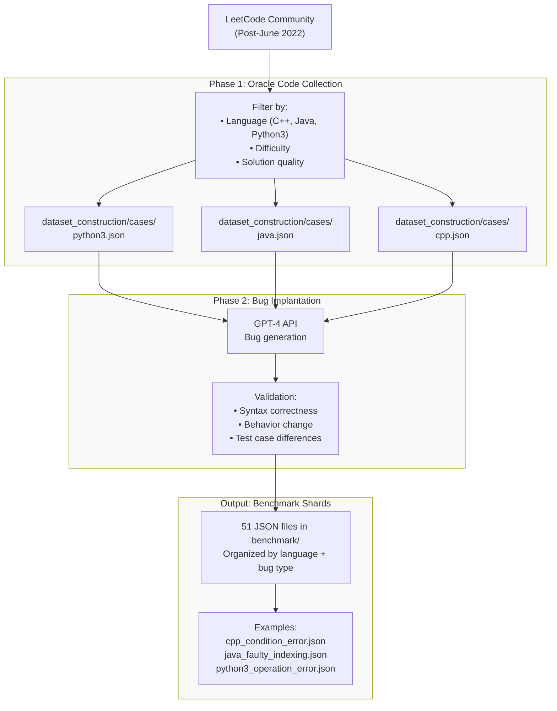
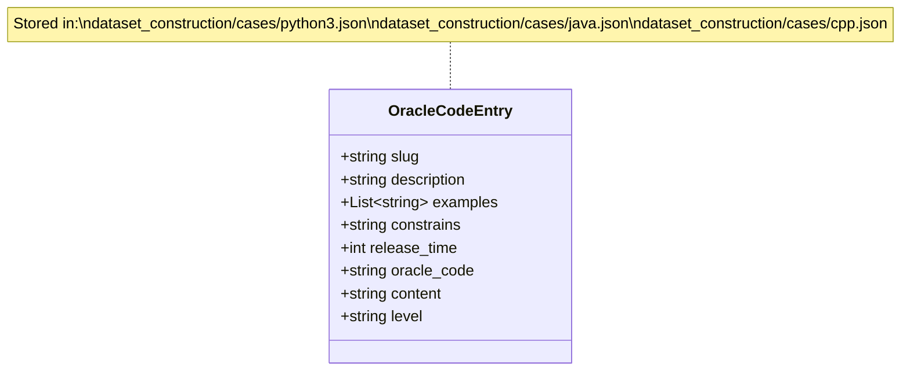
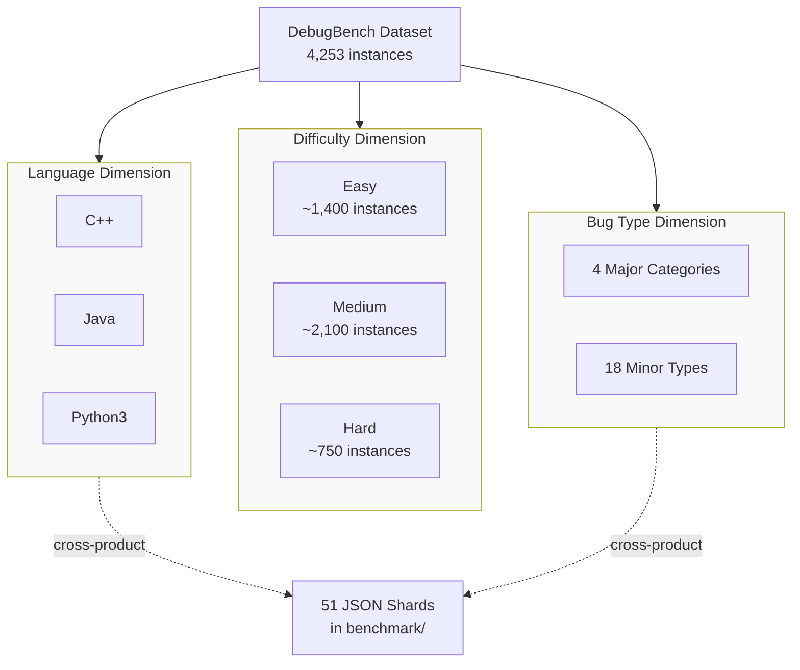
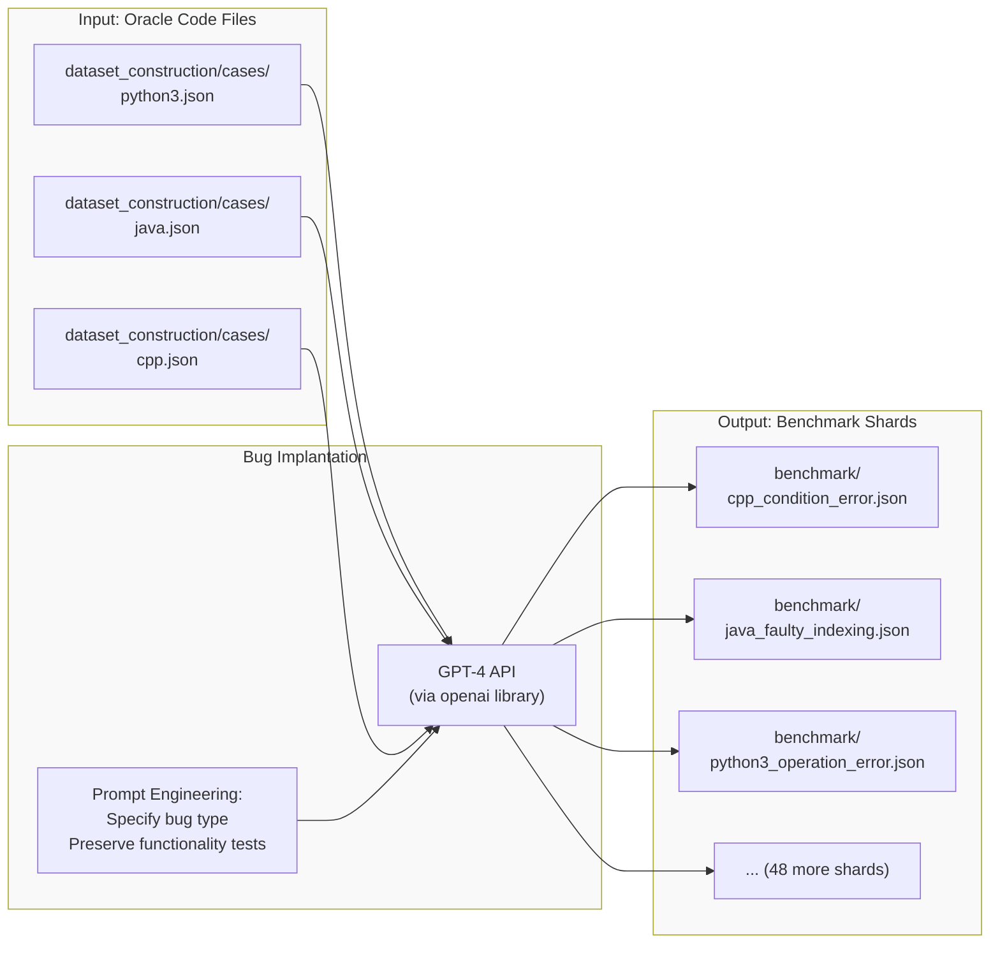

<!-- source: DeepWiki mcp.deepwiki.com · repo thunlp/DebugBench · page 2 Dataset Construction · fetched 2026-11-02 -->

# Dataset Construction

<details>
<summary>Relevant source files</summary>

The following files were used as context for generating this wiki page:

- [README.md](README.md)
- [dataset_construction/cases/cpp.json](dataset_construction/cases/cpp.json)
- [dataset_construction/cases/java.json](dataset_construction/cases/java.json)
- [dataset_construction/cases/python3.json](dataset_construction/cases/python3.json)
- [figs/icon.png](figs/icon.png)
- [figs/pipeline.png](figs/pipeline.png)

</details>


**Purpose and Scope**: This document provides an overview of how the DebugBench dataset is constructed, from collecting correct solution code to producing bug-implanted instances. It describes the overall pipeline and data flow but does not detail the bug implantation methodology (see [Bug Implantation Process](#2.2)) or bug taxonomy (see [Bug Categories and Types](#2.3)).

## Overview

DebugBench's dataset construction transforms correct programming solutions into debugging benchmarks through a two-phase process:

1. **Oracle Code Collection**: Gathering verified correct solutions from LeetCode community posts (see [Oracle Code Collection](#2.1))
2. **Bug Implantation**: Using GPT-4 to systematically introduce bugs into oracle code (see [Bug Implantation Process](#2.2))

The process produces **4,253 bug-implanted instances** across three programming languages (C++, Java, Python3), categorized into 4 major bug types and 18 minor types, spanning three difficulty levels (easy, medium, hard).

**Sources**: [README.md:1-56]()

## Construction Pipeline

The following diagram shows the end-to-end data flow from LeetCode to the final benchmark dataset:



**Sources**: [README.md:11-23](), [dataset_construction/cases/python3.json:1-14](), [dataset_construction/cases/java.json:1-14](), [dataset_construction/cases/cpp.json:1-15]()

## Oracle Code Data Structure

Each oracle code entry in the JSON files follows a consistent schema capturing problem metadata and correct solutions:



### Schema Fields

| Field | Type | Description |
|-------|------|-------------|
| `slug` | string | LeetCode problem identifier (e.g., "binary-search") |
| `description` | string | Full problem statement |
| `examples` | array[string] | Input/output examples |
| `constrains` | string | Problem constraints |
| `release_time` | integer | Unix timestamp of problem release |
| `oracle_code` | string | Verified correct solution code |
| `content` | string | Community post content (markdown) |
| `level` | string | Difficulty: "easy", "medium", or "hard" |

**Example** (from [dataset_construction/cases/python3.json:17-28]()):
```json
{
    "slug": "binary-search",
    "description": "Given an array of integers nums which is sorted...",
    "examples": ["Input: nums = [-1,0,3,5,9,12], target = 9\nOutput: 4"],
    "constrains": "1 <= nums.length <= 104...",
    "release_time": 1680309400,
    "oracle_code": "class Solution:\n    def search(self, nums: List[int]...",
    "level": "easy"
}
```

**Sources**: [dataset_construction/cases/python3.json:1-28](), [dataset_construction/cases/java.json:1-27](), [dataset_construction/cases/cpp.json:1-28]()

## Output Organization

The bug implantation process produces the final benchmark organized into **51 JSON shards** stored in the `benchmark/` directory. Each shard represents a specific combination of programming language and bug category.

### Shard Naming Convention

Shards follow the pattern: `{language}_{bug_category}.json`

**Language Options**:
- `cpp` - C++ instances
- `java` - Java instances  
- `python3` - Python instances

**Bug Category Examples**:
- `condition_error` - Errors in conditional logic
- `faulty_indexing` - Array/list index errors
- `operation_error` - Arithmetic/logical operation errors
- `other_error` - Syntax errors, undefined methods, etc.

### Multi-Dimensional Organization

The benchmark provides three orthogonal dimensions for analysis:



### Benchmark Entry Schema

Each entry in the benchmark shards extends the oracle code schema with bug-specific fields:

| Field | Type | Description |
|-------|------|-------------|
| `slug` | string | Problem identifier (inherited) |
| `description` | string | Problem statement (inherited) |
| `oracle_code` | string | Original correct solution |
| `buggy_code` | string | **Bug-implanted version** |
| `explanations` | string | **Description of the bug** |
| `examples` | array[string] | Test cases (inherited) |
| `constrains` | string | Problem constraints (inherited) |
| `level` | string | Difficulty level (inherited) |

The key additions are `buggy_code` and `explanations`, which provide the debugging challenge and ground truth for evaluation.

**Sources**: [README.md:11-23](), [README.md:30-31]()

## Data Flow Summary

The following diagram maps the concrete file paths and data structures involved in the construction pipeline:



**Key Statistics**:
- **Input**: 3 oracle code JSON files (one per language)
- **Process**: GPT-4 powered bug implantation with validation
- **Output**: 51 categorized JSON shards with 4,253 total instances
- **Coverage**: 4 major × multiple minor bug categories × 3 languages × 3 difficulty levels

**Sources**: [README.md:11-36](), [dataset_construction/cases/python3.json:1-10](), [dataset_construction/cases/java.json:1-10](), [dataset_construction/cases/cpp.json:1-10]()

## Next Steps

For detailed information about specific phases of the construction process:

- **[Oracle Code Collection](#2.1)**: How correct solutions are collected and validated from LeetCode
- **[Bug Implantation Process](#2.2)**: GPT-4 prompt engineering and validation methodology  
- **[Bug Categories and Types](#2.3)**: Complete taxonomy of the 4 major and 18 minor bug types

---

