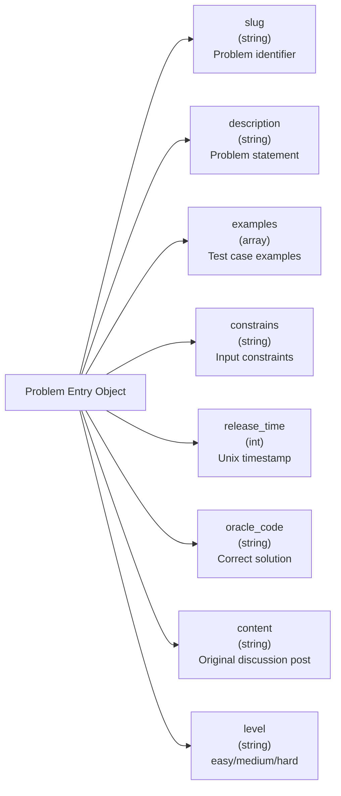
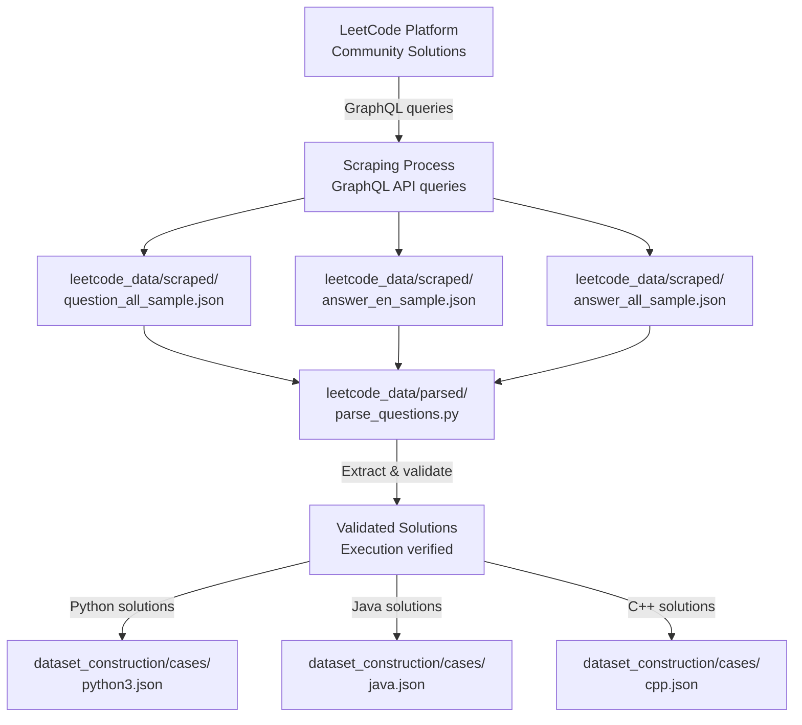
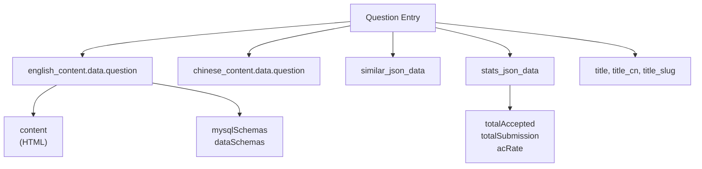
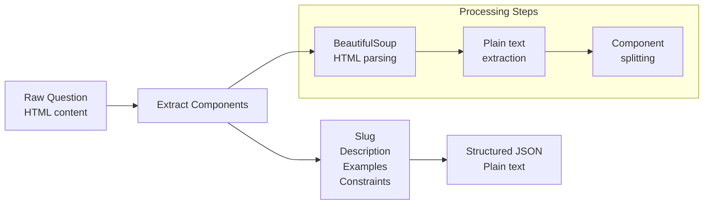
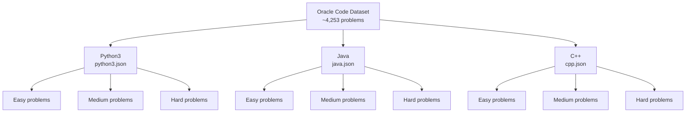
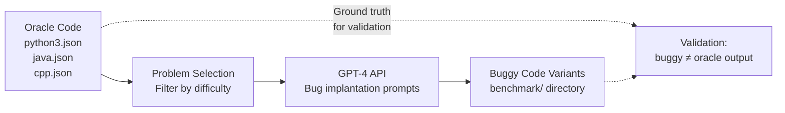

<!-- source: DeepWiki mcp.deepwiki.com · repo thunlp/DebugBench · page 2.1 Oracle Code Collection · fetched 2026-11-02 -->

# Oracle Code Collection

<details>
<summary>Relevant source files</summary>

The following files were used as context for generating this wiki page:

- [dataset_construction/cases/cpp.json](dataset_construction/cases/cpp.json)
- [dataset_construction/cases/java.json](dataset_construction/cases/java.json)
- [dataset_construction/cases/python3.json](dataset_construction/cases/python3.json)
- [leetcode_data/parsed/parse_questions.py](leetcode_data/parsed/parse_questions.py)
- [leetcode_data/scraped/answer_all_sample.json](leetcode_data/scraped/answer_all_sample.json)
- [leetcode_data/scraped/answer_en_sample.json](leetcode_data/scraped/answer_en_sample.json)
- [leetcode_data/scraped/question_all_sample.json](leetcode_data/scraped/question_all_sample.json)

</details>


This document describes how correct solution code (oracle code) is collected from the LeetCode platform and organized into language-specific datasets. Oracle code serves as ground truth for the bug implantation process (see [Bug Implantation Process](#2.2)) and provides the baseline correct implementations against which buggy code variants are tested.

Related pages: For information about how this oracle code is used to create buggy variants, see [Bug Implantation Process](#2.2). For details on the final benchmark organization, see [Dataset Organization](#3.1).

---

## Overview of Oracle Code

Oracle code represents verified correct solutions to LeetCode programming problems. Each oracle solution must:
- Pass all LeetCode test cases
- Belong to problems released after June 2022 (to avoid overlap with model training data)
- Be sourced from the LeetCode community discussion/solution sections
- Be parseable and executable in one of three supported languages: Python3, Java, or C++

**Sources:** [dataset_construction/cases/python3.json:1-15](), [dataset_construction/cases/java.json:1-15](), [dataset_construction/cases/cpp.json:1-15]()

---

## Storage Organization

### File Structure

Oracle code is stored in three JSON files under the `dataset_construction/cases/` directory:

| File | Language | Purpose |
|------|----------|---------|
| `python3.json` | Python 3 | Python solutions from LeetCode community |
| `java.json` | Java | Java solutions from LeetCode community |
| `cpp.json` | C++ | C++ solutions from LeetCode community |

Each file contains an array of problem objects with identical schema but language-specific code.

**Sources:** [dataset_construction/cases/python3.json:1](), [dataset_construction/cases/java.json:1](), [dataset_construction/cases/cpp.json:1]()

---

## Data Schema

### Problem Entry Structure



**Sources:** [dataset_construction/cases/python3.json:2-15](), [dataset_construction/cases/java.json:2-14](), [dataset_construction/cases/cpp.json:2-14]()

### Field Descriptions

| Field | Type | Description | Example |
|-------|------|-------------|---------|
| `slug` | string | LeetCode problem URL identifier | `"binary-search"` |
| `description` | string | Full problem statement text | `"Given an array of integers nums..."` |
| `examples` | array[string] | Example inputs and outputs | `["Input: nums = [-1,0,3,5,9,12]..."]` |
| `constrains` | string | Problem constraints and limits | `"1 <= nums.length <= 104"` |
| `release_time` | integer | Unix timestamp of problem release | `1680309400` |
| `oracle_code` | string | Verified correct solution code | `"class Solution:\n    def search..."` |
| `content` | string | Original LeetCode discussion post markdown | `"# Code\n```\nclass Solution:..."` |
| `level` | string | Difficulty level | `"easy"`, `"medium"`, or `"hard"` |

**Sources:** [dataset_construction/cases/python3.json:17-27](), [dataset_construction/cases/java.json:42-52](), [dataset_construction/cases/cpp.json:17-28]()

---

## Collection Pipeline

### High-Level Data Flow



**Sources:** [leetcode_data/scraped/question_all_sample.json:1-130](), [leetcode_data/scraped/answer_en_sample.json:1-161](), [leetcode_data/parsed/parse_questions.py:1-83]()

---

## Scraping Process

### Raw Data Structure

The scraping process collects data from LeetCode's GraphQL API into three main raw data files:

#### question_all_sample.json Structure

Contains question metadata with both English and Chinese content:



**Sources:** [leetcode_data/scraped/question_all_sample.json:2-55]()

#### answer_en_sample.json Structure

Contains English community solutions:

```json
{
  "answer_id": 3641608,
  "answer_json": {
    "data": {
      "topic": {
        "title": "BFS",
        "post": {
          "content": "# Intuition and Approach...",
          "author": {...}
        }
      }
    }
  },
  "title_slug": "cheapest-flights-within-k-stops"
}
```

**Sources:** [leetcode_data/scraped/answer_en_sample.json:2-53]()

---

## Parsing and Validation

### Parse Script: parse_questions.py

The parsing script transforms raw scraped HTML content into structured text format.

#### Key Function: parse_a_question



**Sources:** [leetcode_data/parsed/parse_questions.py:10-62]()

#### Parsing Logic

The `parse_a_question()` function performs these steps:

1. **Extract slug** from `title_slug` field [leetcode_data/parsed/parse_questions.py:12]()
2. **Convert HTML to plain text** using BeautifulSoup [leetcode_data/parsed/parse_questions.py:15-17]()
3. **Remove "Follow up" sections** if present [leetcode_data/parsed/parse_questions.py:20-21]()
4. **Extract description** (text before "Example 1") [leetcode_data/parsed/parse_questions.py:24]()
5. **Count examples** by searching for "Example N:" patterns [leetcode_data/parsed/parse_questions.py:27-29]()
6. **Extract constraints** if present [leetcode_data/parsed/parse_questions.py:32-36]()
7. **Parse individual examples** by splitting on example markers [leetcode_data/parsed/parse_questions.py:39-53]()

**Sources:** [leetcode_data/parsed/parse_questions.py:10-62]()

---

## Example Oracle Code Entries

### Python3 Example: Binary Search

```json
{
  "slug": "binary-search",
  "description": "Given an array of integers nums which is sorted in ascending order, and an integer target, write a function to search target in nums. If target exists, then return its index. Otherwise, return -1.\nYou must write an algorithm with O(log n) runtime complexity.",
  "examples": [
    "Input: nums = [-1,0,3,5,9,12], target = 9\nOutput: 4\nExplanation: 9 exists in nums and its index is 4"
  ],
  "constrains": "1 <= nums.length <= 104\n-104 < nums[i], target < 104\nAll the integers in nums are unique.\nnums is sorted in ascending order.",
  "release_time": 1680309400,
  "oracle_code": "class Solution:\n    def search(self, nums: List[int], target: int) -> int:\n        if target not in nums:\n            return -1\n        \n        left, right = 0, len(nums)\n        \n        while left < right:\n            mid = (left + right) // 2\n            if nums[mid] < target:\n                left = mid + 1\n            else:\n                right = mid\n        \n        return left",
  "level": "easy"
}
```

**Sources:** [dataset_construction/cases/python3.json:17-27]()

### Java Example: Three Consecutive Odds

```json
{
  "slug": "three-consecutive-odds",
  "oracle_code": "class Solution {\n    public boolean threeConsecutiveOdds(int[] arr) {\n        for (int i = 0; i < arr.length - 2; i++) {\n            boolean isOdd1 = arr[i] % 2 == 1;\n            boolean isOdd2 = arr[i + 1] % 2 == 1;\n            boolean isOdd3 = arr[i + 2] % 2 == 1;\n            if (isOdd1 && isOdd2 && isOdd3) return true;\n        }\n        return false;\n    }\n}",
  "level": "easy"
}
```

**Sources:** [dataset_construction/cases/java.json:42-52]()

### C++ Example: Greatest Common Divisor of Strings

```json
{
  "slug": "greatest-common-divisor-of-strings",
  "oracle_code": "class Solution {\npublic:\n    string gcdOfStrings(string str1, string str2) {\n\n        if(str1+str2==str2+str1)\n        {\n            return str1.substr(0,gcd(str1.length(),str2.length()));\n        }\n        else{\n            return \"\";\n        }\n        \n    }\n};",
  "level": "easy"
}
```

**Sources:** [dataset_construction/cases/cpp.json:17-28]()

---

## Dataset Statistics

### Distribution by Language



Each language file contains solutions spanning all three difficulty levels, with the same problem potentially having oracle solutions in multiple languages.

**Sources:** [dataset_construction/cases/python3.json:1](), [dataset_construction/cases/java.json:1](), [dataset_construction/cases/cpp.json:1]()

### Difficulty Level Distribution

Based on the `level` field in each entry:

| Difficulty | Approximate Count | Description |
|------------|------------------|-------------|
| `easy` | ~1,400 instances | Basic algorithmic problems |
| `medium` | ~2,100 instances | Intermediate complexity problems |
| `hard` | ~750 instances | Advanced algorithmic challenges |

**Sources:** [dataset_construction/cases/python3.json:27](), [dataset_construction/cases/python3.json:40](), [dataset_construction/cases/python3.json:53]()

---

## Quality Assurance

### Oracle Code Requirements

All oracle code entries must meet these criteria:

1. **Correctness**: Solution passes all LeetCode test cases
2. **Completeness**: Includes full class/function definitions
3. **Language-specific**: Uses proper syntax and conventions for the target language
4. **Recent**: Problem released after June 2022 to avoid training data contamination
5. **Community-sourced**: Obtained from LeetCode discussion sections with upvotes/verification

### Validation Mechanisms

Oracle code undergoes validation through:

- **LeetCode platform testing**: Code must have been accepted by LeetCode's judge
- **Release date filtering**: Only problems after June 2022 cutoff
- **Syntax verification**: Code must parse correctly in target language
- **Metadata completeness**: All required fields (slug, description, examples, constraints, code, level) must be present

**Sources:** [dataset_construction/cases/python3.json:11-14](), [dataset_construction/cases/java.json:10-13](), [dataset_construction/cases/cpp.json:10-14]()

---

## Usage in Bug Implantation

The oracle code serves as input to the bug implantation process:



The oracle code provides:
- **Input**: Correct implementation to modify
- **Reference**: Ground truth for test case validation
- **Context**: Problem description and constraints for bug generation

For details on how bugs are introduced, see [Bug Implantation Process](#2.2).

**Sources:** [dataset_construction/cases/python3.json:1-15](), [dataset_construction/cases/java.json:1-15](), [dataset_construction/cases/cpp.json:1-15]()

---

