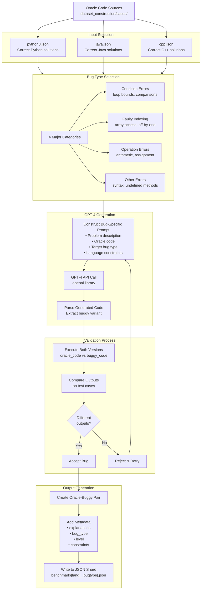
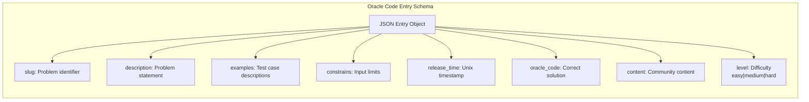
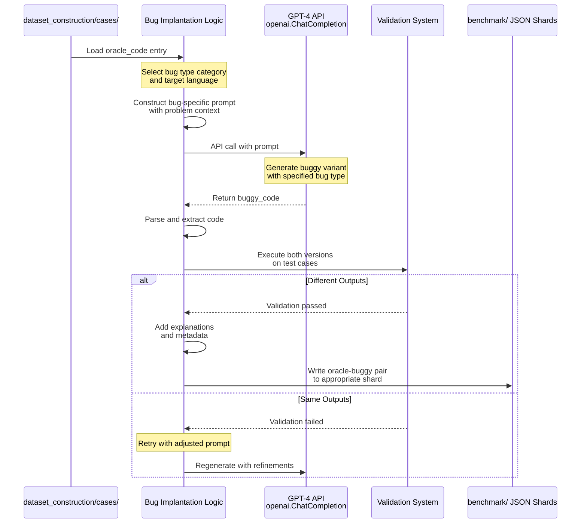
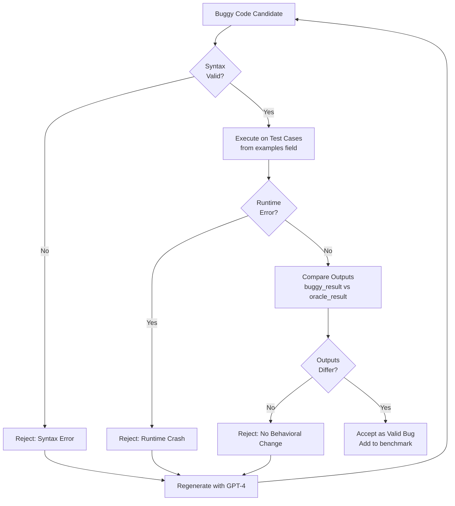
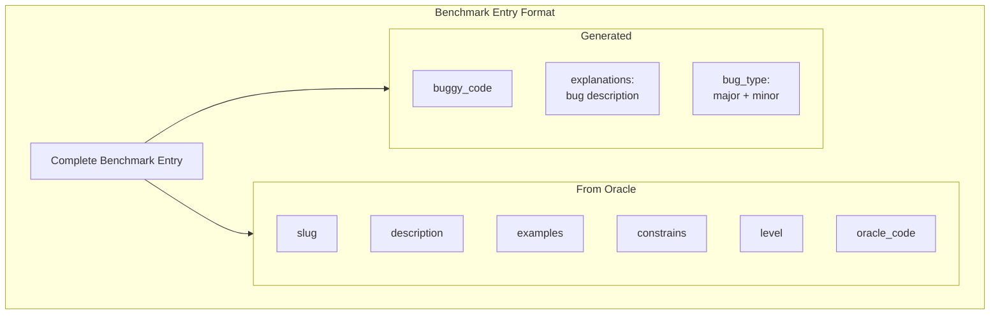

<!-- source: DeepWiki mcp.deepwiki.com · repo thunlp/DebugBench · page 2.2 Bug Implantation Process · fetched 2026-11-02 -->

# Bug Implantation Process

<details>
<summary>Relevant source files</summary>

The following files were used as context for generating this wiki page:

- [README.md](README.md)
- [dataset_construction/cases/cpp.json](dataset_construction/cases/cpp.json)
- [dataset_construction/cases/java.json](dataset_construction/cases/java.json)
- [dataset_construction/cases/python3.json](dataset_construction/cases/python3.json)

</details>


## Purpose and Scope

This document describes the systematic process of implanting bugs into oracle (correct) code solutions to create the DebugBench dataset. It covers the GPT-4-powered bug generation methodology, the taxonomy of bug types, prompt engineering strategies, and validation procedures that ensure buggy code produces different outputs from oracle code.

For information about the oracle code collection from LeetCode, see [Oracle Code Collection](#2.1). For the complete bug taxonomy and examples, see [Bug Categories and Types](#2.3). For the final benchmark organization, see [Dataset Organization](#3.1).

---

## Bug Implantation Overview

The bug implantation process transforms correct LeetCode solutions (oracle code) into buggy variants using GPT-4. This process is deterministic and controlled to produce specific bug categories across three programming languages (C++, Java, Python3) and three difficulty levels (easy, medium, hard).

### Key Characteristics

| Aspect | Details |
|--------|---------|
| **Input Source** | Oracle code from `dataset_construction/cases/` |
| **Generation Method** | GPT-4 API with category-specific prompts |
| **Languages Supported** | C++, Java, Python3 |
| **Bug Categories** | 4 major types, 18 minor subtypes |
| **Validation** | Execution-based output comparison |
| **Output** | Oracle-buggy code pairs with explanations |

Sources: [README.md:1-57](), [dataset_construction/cases/python3.json:1-40](), [dataset_construction/cases/java.json:1-40](), [dataset_construction/cases/cpp.json:1-40]()

---

## Bug Implantation Pipeline



**Bug Implantation Workflow**: This diagram shows the complete pipeline from oracle code input through GPT-4 generation to validated buggy code output.

Sources: [README.md:15-22](), Diagram 2 from system architecture

---

## Bug Type Taxonomy Structure

The bug implantation process uses a hierarchical taxonomy with 4 major categories that expand into 18 minor types:

```mermaid
graph TB
    ROOT["Bug Type Taxonomy<br/>18 Minor Types Total"]
    
    subgraph COND_CAT["Condition Errors"]
        COND_ROOT["Condition Errors"]
        LOOP_BOUND["Loop Bound Errors"]
        COMPARISON["Comparison Errors"]
        IF_COND["If Condition Errors"]
        LOGIC_OP["Logical Operator Errors"]
    end
    
    subgraph INDEX_CAT["Indexing Errors"]
        INDEX_ROOT["Faulty Indexing"]
        OFF_BY_ONE["Off-by-One Errors"]
        ARRAY_ACCESS["Array Access Errors"]
        ITERATOR["Iterator Errors"]
        RANGE["Range Errors"]
    end
    
    subgraph OP_CAT["Operation Errors"]
        OP_ROOT["Operation Errors"]
        ARITHMETIC["Arithmetic Errors"]
        ASSIGNMENT["Assignment Errors"]
        TYPE_CAST["Type Casting Errors"]
        OPERATOR["Operator Errors"]
    end
    
    subgraph OTHER_CAT["Other Errors"]
        OTHER_ROOT["Other Errors"]
        SYNTAX["Syntax Errors"]
        UNDEFINED["Undefined Methods"]
        NULL_PTR["Null Pointer Errors"]
        LOGIC["Logic Errors"]
        MISC["Miscellaneous"]
    end
    
    ROOT --> COND_ROOT
    ROOT --> INDEX_ROOT
    ROOT --> OP_ROOT
    ROOT --> OTHER_ROOT
    
    COND_ROOT --> LOOP_BOUND
    COND_ROOT --> COMPARISON
    COND_ROOT --> IF_COND
    COND_ROOT --> LOGIC_OP
    
    INDEX_ROOT --> OFF_BY_ONE
    INDEX_ROOT --> ARRAY_ACCESS
    INDEX_ROOT --> ITERATOR
    INDEX_ROOT --> RANGE
    
    OP_ROOT --> ARITHMETIC
    OP_ROOT --> ASSIGNMENT
    OP_ROOT --> TYPE_CAST
    OP_ROOT --> OPERATOR
    
    OTHER_ROOT --> SYNTAX
    OTHER_ROOT --> UNDEFINED
    OTHER_ROOT --> NULL_PTR
    OTHER_ROOT --> LOGIC
    OTHER_ROOT --> MISC
```



**Bug Type Hierarchy**: The taxonomy organizes bugs into 4 major categories, each containing 4-5 minor subtypes for a total of 18 distinct bug patterns.

Sources: [README.md:18](), Diagram 2 and Diagram 4 from system architecture

---

## GPT-4 Prompt Engineering

### Prompt Construction Strategy

The bug implantation process uses category-specific prompts that guide GPT-4 to introduce targeted bug types. Each prompt contains:

| Component | Purpose | Example Content |
|-----------|---------|-----------------|
| **Problem Context** | Provide problem understanding | `description`, `examples`, `constrains` fields |
| **Oracle Code** | Show correct implementation | `oracle_code` field from cases JSON |
| **Bug Type Directive** | Specify target bug category | "Introduce an off-by-one error in the loop" |
| **Language Constraints** | Maintain language syntax | "Keep valid Python3 syntax" |
| **Subtlety Requirement** | Ensure non-obvious bugs | "The bug should not be immediately visible" |

### Example Prompt Structure

For a **Condition Error** in Python:

```
Given the following correct solution to a LeetCode problem:

Problem: [description from python3.json]
Constraints: [constrains field]

Correct Solution:
[oracle_code field]

Task: Introduce a subtle condition error (such as incorrect loop bounds or 
comparison operators) that will cause the solution to fail on some test cases.
The buggy code should:
1. Remain syntactically valid Python3
2. Execute without runtime errors on most inputs
3. Produce incorrect outputs due to the condition error
4. Not be immediately obvious to readers

Return only the modified code.
```

Sources: [dataset_construction/cases/python3.json:1-108](), [dataset_construction/cases/java.json:1-52](), [dataset_construction/cases/cpp.json:1-40]()

---

## Oracle Code Input Format

The bug implantation process reads oracle code from JSON files in `dataset_construction/cases/` with the following schema:



**Oracle Entry Structure**: Each oracle code entry contains the problem metadata and correct solution used as input for bug generation.

### Example Oracle Entry

From [dataset_construction/cases/python3.json:17-28]():

```json
{
    "slug": "binary-search",
    "description": "Given an array of integers nums...",
    "oracle_code": "class Solution:\n    def search(self, nums: List[int], target: int) -> int:\n        if target not in nums:\n            return -1\n        ...",
    "level": "easy"
}
```

Sources: [dataset_construction/cases/python3.json:1-40](), [dataset_construction/cases/java.json:1-40](), [dataset_construction/cases/cpp.json:1-40]()

---

## Bug Generation Process

### GPT-4 API Integration

The bug generation leverages the OpenAI API to systematically create buggy variants:



**Bug Generation Sequence**: The process iterates through oracle code entries, generates buggy variants via GPT-4, validates them, and writes successful pairs to benchmark shards.

Sources: [README.md:15](), Diagram 2 from system architecture

---

## Bug Validation Mechanism

### Validation Requirements

For a buggy variant to be accepted into the benchmark, it must satisfy:

| Criterion | Requirement | Rationale |
|-----------|-------------|-----------|
| **Syntactic Validity** | Code must compile/parse | Prevents trivial syntax errors |
| **Execution Success** | No runtime crashes on valid inputs | Focuses on logic bugs, not crashes |
| **Output Difference** | Different from oracle on some test cases | Ensures bug actually affects behavior |
| **Non-Trivial** | Not immediately obvious | Creates realistic debugging scenarios |

### Validation Process



**Validation Decision Flow**: Buggy code must pass syntax, execution, and output difference checks to be accepted.

Sources: Diagram 2 from system architecture

---

## Output Format and Storage

### Benchmark Entry Schema

The bug implantation process produces entries that combine oracle code, buggy code, and metadata:



**Benchmark Entry Composition**: Each entry combines original problem metadata with generated buggy code and explanations.

### Storage Organization

The bug implantation process writes output to 51 JSON shards organized by language and bug type:

| Language | Bug Categories | Example Shard Names |
|----------|----------------|---------------------|
| C++ | 4 major types | `cpp_condition_error.json`<br/>`cpp_faulty_indexing.json` |
| Java | 4 major types | `java_operation_error.json`<br/>`java_other_error.json` |
| Python3 | 4 major types | `python3_condition_error.json`<br/>`python3_faulty_indexing.json` |

Each shard contains an array of oracle-buggy pairs for its specific language and bug category combination.

Sources: [README.md:30](), Diagram 4 from system architecture

---

## Summary Statistics

The bug implantation process produces:

| Metric | Count |
|--------|-------|
| **Total Instances** | 4,253 |
| **Major Bug Categories** | 4 |
| **Minor Bug Types** | 18 |
| **Languages** | 3 (C++, Java, Python3) |
| **Difficulty Levels** | 3 (easy, medium, hard) |
| **Output Shards** | 51 JSON files |
| **Problems Post-June 2022** | 100% |

The systematic GPT-4-powered implantation ensures comprehensive coverage across bug types, languages, and difficulty levels, creating a diverse and challenging benchmark for evaluating LLM debugging capabilities.

Sources: [README.md:15-22]()

---

