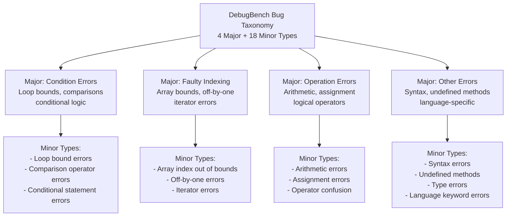
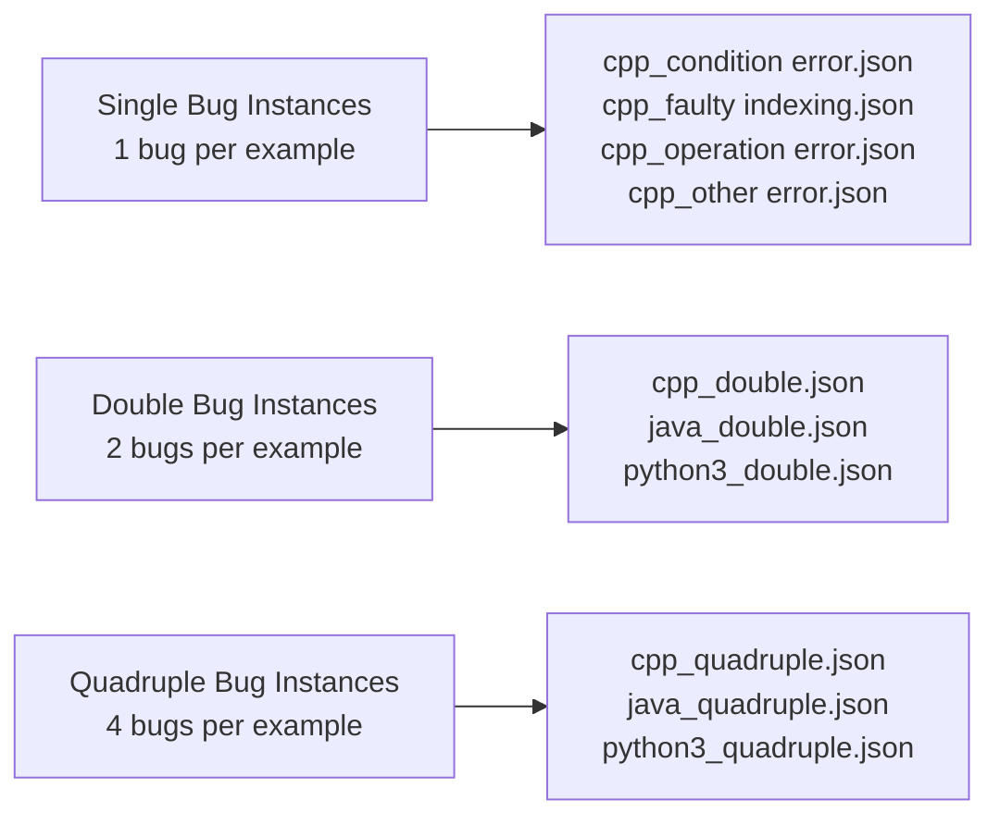
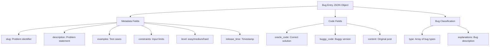
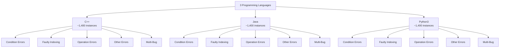

<!-- source: DeepWiki mcp.deepwiki.com · repo thunlp/DebugBench · page 2.3 Bug Categories and Types · fetched 2026-11-02 -->

# Bug Categories and Types

<details>
<summary>Relevant source files</summary>

The following files were used as context for generating this wiki page:

- [benchmark/cpp_condition error.json](benchmark/cpp_condition error.json)
- [benchmark/cpp_double.json](benchmark/cpp_double.json)
- [benchmark/cpp_faulty indexing.json](benchmark/cpp_faulty indexing.json)
- [benchmark/cpp_operation error.json](benchmark/cpp_operation error.json)
- [benchmark/cpp_other error.json](benchmark/cpp_other error.json)
- [benchmark/cpp_quadruple.json](benchmark/cpp_quadruple.json)

</details>


This document provides a comprehensive taxonomy of the bug categories and types used in DebugBench. It defines the classification system used to organize the 4,253 buggy code instances across C++, Java, and Python3. For information about how these bugs are implanted into oracle code, see [Bug Implantation Process](#2.2). For examples of specific bugs in each language, see [C++ Bug Examples](#3.3) and [Java and Python Bug Examples](#3.4).

## Overview of Bug Taxonomy

DebugBench organizes bugs into a two-level hierarchical taxonomy consisting of 4 major categories and 18 minor types. This classification enables fine-grained analysis of LLM debugging capabilities across different error patterns.



Sources: [benchmark/cpp_condition error.json:1-200](), [benchmark/cpp_faulty indexing.json:1-200](), [benchmark/cpp_operation error.json:1-200](), [benchmark/cpp_other error.json:1-200]()

## Major Bug Categories

### 1. Condition Errors

Condition errors involve incorrect conditional logic, loop bounds, and comparison operations. These bugs affect program control flow and are among the most common logical errors.

**Key Characteristics:**
- Incorrect loop termination conditions (`i < n` vs `i <= n`)
- Wrong comparison operators (`==` vs `!=`, `>` vs `>=`)
- Incorrect conditional branching logic
- Missing or extra conditions in if-statements

**File Organization:**
- C++: [benchmark/cpp_condition error.json]()
- Java: [benchmark/java_condition error.json]()
- Python3: [benchmark/python3_condition error.json]()

Sources: [benchmark/cpp_condition error.json:1-200]()

### 2. Faulty Indexing

Faulty indexing errors involve accessing arrays, vectors, or other data structures with incorrect indices, leading to out-of-bounds access or off-by-one errors.

**Key Characteristics:**
- Array index out of bounds (`arr[n]` instead of `arr[n-1]`)
- Off-by-one errors in loops
- Incorrect pointer arithmetic
- Invalid iterator usage
- String index errors

**File Organization:**
- C++: [benchmark/cpp_faulty indexing.json]()
- Java: [benchmark/java_faulty indexing.json]()
- Python3: [benchmark/python3_faulty indexing.json]()

Sources: [benchmark/cpp_faulty indexing.json:1-200]()

### 3. Operation Errors

Operation errors involve incorrect arithmetic operations, assignment statements, or logical operators that produce wrong computational results.

**Key Characteristics:**
- Wrong arithmetic operators (`+` vs `-`, `*` vs `/`)
- Incorrect operator precedence
- Assignment vs equality confusion (`=` vs `==`)
- Wrong increment/decrement operations (`i++` vs `i--`)
- Bitwise operation errors

**File Organization:**
- C++: [benchmark/cpp_operation error.json]()
- Java: [benchmark/java_operation error.json]()
- Python3: [benchmark/python3_operation error.json]()

Sources: [benchmark/cpp_operation error.json:1-200]()

### 4. Other Errors

Other errors encompass syntax errors, undefined methods, language-specific issues, and miscellaneous bugs that don't fit into the previous categories.

**Key Characteristics:**
- Syntax errors (missing semicolons, parentheses mismatch)
- Undefined methods or functions
- Incorrect language keywords
- Type errors
- Null/undefined object references
- String formatting errors

**File Organization:**
- C++: [benchmark/cpp_other error.json]()
- Java: [benchmark/java_other error.json]()
- Python3: [benchmark/python3_other error.json]()

Sources: [benchmark/cpp_other error.json:1-200]()

## Minor Bug Types

The 18 minor bug types provide fine-grained classification within the major categories:

| Minor Type | Major Category | Description | Example |
|------------|---------------|-------------|---------|
| Loop bound errors | Condition Errors | Incorrect loop iteration limits | `for(int i=0; i<=n; i++)` instead of `i<n` |
| Comparison operator errors | Condition Errors | Wrong comparison operators | `if(x > y)` instead of `if(x >= y)` |
| Conditional statement errors | Condition Errors | Flawed conditional logic | Missing or incorrect if-else branches |
| Array index out of bounds | Faulty Indexing | Accessing beyond array limits | `arr[arr.size()]` instead of `arr[arr.size()-1]` |
| Off-by-one errors | Faulty Indexing | Index shifted by one position | Loop ending at wrong position |
| Iterator errors | Faulty Indexing | Incorrect iterator usage | Advancing iterator past end |
| Arithmetic errors | Operation Errors | Wrong arithmetic operations | `result = a + b` instead of `a - b` |
| Assignment vs equality | Operation Errors | Confusion between `=` and `==` | `if(x = 5)` instead of `if(x == 5)` |
| Operator confusion | Operation Errors | Using wrong operator | `max` instead of `min` |
| Syntax errors | Other Errors | Missing punctuation, braces | Missing semicolon, unmatched parentheses |
| Undefined methods | Other Errors | Calling non-existent methods | Method name typo or wrong class |
| Wrong comment mark | Other Errors | Incorrect comment syntax | `/**/` vs `//` confusion |
| Unclosed string | Other Errors | Missing string terminator | Missing closing quote |
| Parentheses mismatch | Other Errors | Unbalanced parentheses | Extra or missing `(` or `)` |
| Colon missing | Other Errors | Missing required colon | Python/Java syntax |
| Undefined keywords | Other Errors | Language-specific keyword errors | Using keywords from different language |
| Variable value errors | Other Errors | Wrong variable initialization | `nullptr` vs `new Node()` |
| Type errors | Other Errors | Type mismatch issues | String vs integer confusion |

Sources: [benchmark/cpp_double.json:1-100](), [benchmark/cpp_quadruple.json:1-100]()

## Multi-Bug Instances

Some benchmark entries contain multiple bugs simultaneously, representing more complex debugging scenarios:



### Double Bug Instances

Double bug instances contain exactly two distinct bugs in a single code example. Common combinations include:

- **Indexing + Operation errors**: [benchmark/cpp_double.json:19-36]()
- **Indexing + Conditional errors**: [benchmark/cpp_double.json:55-70]()
- **Syntax + Logic errors**: [benchmark/cpp_double.json:1-18]()

Example from [benchmark/cpp_double.json:20-36]():
```
Type: ["indexing error", "operation error"]
Explanation: Loop bound i<=n causes indexing error, 
and freq[s[i]-'z'] is operation error
```

Sources: [benchmark/cpp_double.json:1-100]()

### Quadruple Bug Instances

Quadruple bug instances contain four distinct bugs, representing the most challenging debugging scenarios:

- **Multiple syntax + logic errors**: [benchmark/cpp_quadruple.json:1-40]()
- **Mixed category errors**: [benchmark/cpp_quadruple.json:41-80]()

Example from [benchmark/cpp_quadruple.json:1-20]():
```
Type: ["wrong comment mark", "unclosed string", 
      "conditional statement error", "parentheses mismatch"]
```

Sources: [benchmark/cpp_quadruple.json:1-100]()

## Bug Entry Data Schema

Each bug entry in the benchmark follows a consistent JSON schema:



**Required Fields:**
- `slug`: String identifying the LeetCode problem
- `description`: Problem statement text
- `examples`: Array of input/output examples
- `constraints`: Problem constraints string
- `oracle_code`: Correct reference implementation
- `buggy_code`: Code with implanted bugs
- `explanations`: Human-readable bug description
- `level`: Difficulty level (easy/medium/hard)

**Optional Fields:**
- `type`: Array of strings for multi-bug instances
- `release_time`: Unix timestamp of problem release
- `content`: Original community solution post

Sources: [benchmark/cpp_condition error.json:1-50]()

## Cross-Language Bug Distribution



Each language has approximately equal distribution across bug categories, enabling fair cross-language comparison of LLM debugging capabilities.

Sources: [benchmark/cpp_condition error.json](), [benchmark/cpp_faulty indexing.json](), [benchmark/cpp_operation error.json](), [benchmark/cpp_other error.json]()

## Bug Severity and Difficulty

Bugs are organized by problem difficulty level, which correlates with debugging complexity:

| Difficulty | Approximate Count | Characteristics |
|-----------|------------------|-----------------|
| Easy | ~1,400 instances | Simple logic errors, straightforward fixes |
| Medium | ~2,100 instances | Multiple steps to identify and fix, requires deeper understanding |
| Hard | ~750 instances | Complex interactions, multiple related bugs, algorithmic understanding required |

The difficulty level is derived from the original LeetCode problem difficulty, not specifically from the bug complexity. However, harder problems generally involve more complex code where bugs are more subtle.

Sources: [benchmark/cpp_condition error.json:14](), [benchmark/cpp_condition error.json:29](), [benchmark/cpp_condition error.json:44]()

## Accessing Bug Categories in Code

To filter bugs by category when loading the benchmark programmatically:

**By File Name Pattern:**
```python
# Load specific category
condition_errors = load_dataset("Rtian/DebugBench", 
                                 data_files="benchmark/cpp_condition error.json")
```

**By Type Field:**
```python
# Filter multi-bug instances by specific type combination
for entry in dataset:
    if "type" in entry:
        if "indexing error" in entry["type"] and "operation error" in entry["type"]:
            # Process double bug with indexing + operation errors
            pass
```

**By File Naming Convention:**
- Single category: `{language}_{category}.json`
- Multi-bug: `{language}_double.json`, `{language}_quadruple.json`

Sources: [benchmark/cpp_condition error.json](), [benchmark/cpp_double.json](), [benchmark/cpp_quadruple.json]()

---

