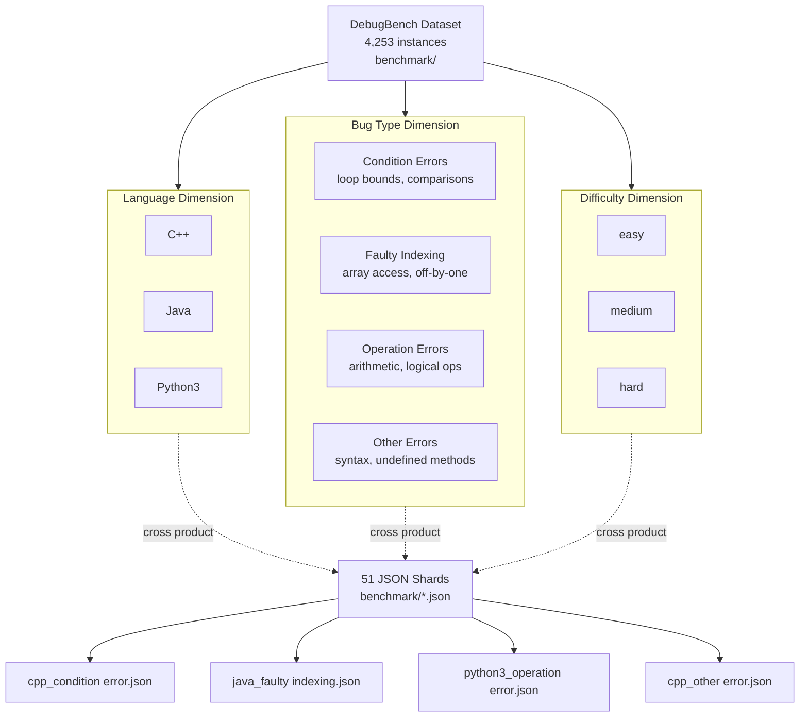
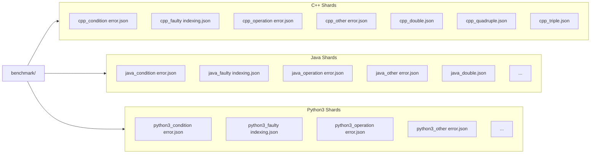
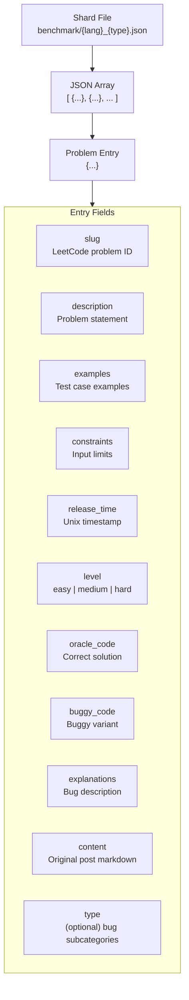
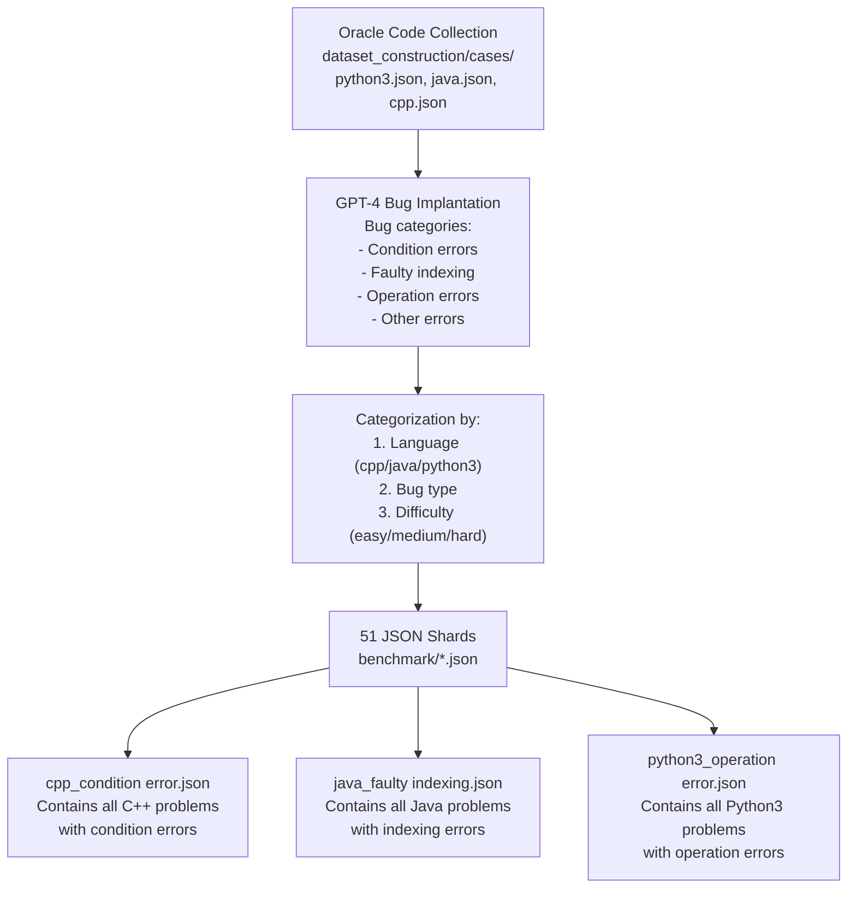

<!-- source: DeepWiki mcp.deepwiki.com · repo thunlp/DebugBench · page 3.1 Dataset Organization · fetched 2026-11-02 -->

# Dataset Organization

<details>
<summary>Relevant source files</summary>

The following files were used as context for generating this wiki page:

- [README.md](README.md)
- [benchmark/cpp_condition error.json](benchmark/cpp_condition error.json)
- [benchmark/cpp_double.json](benchmark/cpp_double.json)
- [benchmark/cpp_faulty indexing.json](benchmark/cpp_faulty indexing.json)
- [benchmark/cpp_operation error.json](benchmark/cpp_operation error.json)
- [benchmark/cpp_other error.json](benchmark/cpp_other error.json)
- [benchmark/cpp_quadruple.json](benchmark/cpp_quadruple.json)

</details>


This document describes how the DebugBench benchmark dataset is organized into 51 JSON shards across multiple dimensions. The organization enables fine-grained analysis of LLM debugging capabilities by language, difficulty level, and bug type. For information about the data schema within each shard, see [Data Schema and Format](#3.2). For accessing the dataset programmatically, see [Accessing the Dataset](#3.5).

**Sources:** [README.md:30]()

---

## Multi-Dimensional Organization Structure

The DebugBench dataset contains **4,253 bug instances** organized along three independent dimensions, resulting in 51 distinct JSON shard files stored in the `benchmark/` directory.

### Three Organizational Axes

The dataset is partitioned across:

1. **Programming Language** (3 options): C++, Java, Python3
2. **Bug Type** (4 major categories): 
   - Condition errors
   - Faulty indexing
   - Operation errors  
   - Other errors
3. **Difficulty Level** (3 levels): easy, medium, hard

**Diagram: Multi-Dimensional Shard Organization**



**Sources:** [README.md:17-21](), [benchmark/cpp_condition error.json:1](), [benchmark/cpp_faulty indexing.json:1]()

---

## File Naming Convention

Each shard file follows a consistent naming pattern that encodes the language and bug type:

**Pattern:** `{language}_{bug_type}.json`

Where:
- `{language}` is one of: `cpp`, `java`, `python3`
- `{bug_type}` is one of: `condition error`, `faulty indexing`, `operation error`, `other error`, `double`, `quadruple`, `triple`

**Diagram: File Naming Structure**



**Sources:** [benchmark/cpp_condition error.json:1](), [benchmark/cpp_faulty indexing.json:1](), [benchmark/cpp_operation error.json:1](), [benchmark/cpp_other error.json:1](), [benchmark/cpp_double.json:1](), [benchmark/cpp_quadruple.json:1]()

### Example Shard Files

| Language | Bug Type | File Name |
|----------|----------|-----------|
| C++ | Condition Errors | `cpp_condition error.json` |
| C++ | Faulty Indexing | `cpp_faulty indexing.json` |
| C++ | Operation Errors | `cpp_operation error.json` |
| C++ | Other Errors | `cpp_other error.json` |
| C++ | Multiple (2 bugs) | `cpp_double.json` |
| C++ | Multiple (3 bugs) | `cpp_triple.json` |
| C++ | Multiple (4 bugs) | `cpp_quadruple.json` |
| Java | Condition Errors | `java_condition error.json` |
| Python3 | Condition Errors | `python3_condition error.json` |

**Sources:** [benchmark/cpp_condition error.json:1](), [benchmark/cpp_faulty indexing.json:1](), [benchmark/cpp_operation error.json:1](), [benchmark/cpp_other error.json:1](), [benchmark/cpp_double.json:1](), [benchmark/cpp_quadruple.json:1]()

---

## Shard Contents and Structure

Each JSON shard file contains an array of problem instances. Each instance represents a LeetCode problem with an implanted bug.

**Diagram: JSON Entry Structure**



**Sources:** [benchmark/cpp_condition error.json:3-16](), [benchmark/cpp_faulty indexing.json:3-16]()

### Field Descriptions

| Field | Type | Description | Example |
|-------|------|-------------|---------|
| `slug` | string | LeetCode problem identifier | `"knight-dialer"` |
| `description` | string | Full problem description | `"The chess knight has..."` |
| `examples` | array | List of example inputs/outputs | `["Input: n = 1\nOutput: 10"]` |
| `constraints` | string | Input constraints and limits | `"1 <= n <= 5000"` |
| `release_time` | integer | Unix timestamp of problem release | `1680161413` |
| `level` | string | Difficulty level | `"easy"`, `"medium"`, `"hard"` |
| `oracle_code` | string | Correct, bug-free solution code | `"class Solution {...}"` |
| `buggy_code` | string | Solution with implanted bug(s) | `"class Solution {...}"` |
| `explanations` | string | Description of the bug(s) | `"The logic error is..."` |
| `content` | string | Original LeetCode community post (markdown) | `"# Approach\n..."` |
| `type` | array | (Optional) Sub-categories of bugs | `["indexing error", "operation error"]` |

**Sources:** [benchmark/cpp_condition error.json:3-16](), [benchmark/cpp_faulty indexing.json:3-16](), [benchmark/cpp_double.json:13-17]()

---

## Bug Type Categories

The dataset organizes bugs into **4 major categories** with additional sub-types for finer granularity.

### Major Bug Categories

1. **Condition Errors**: Incorrect loop bounds, comparison operators, conditional logic
2. **Faulty Indexing**: Array access errors, off-by-one errors, iterator issues  
3. **Operation Errors**: Arithmetic mistakes, incorrect operators, assignment errors
4. **Other Errors**: Syntax errors, undefined methods, missing semicolons, type mismatches

**Sources:** [benchmark/cpp_condition error.json:1](), [benchmark/cpp_faulty indexing.json:1](), [benchmark/cpp_operation error.json:1](), [benchmark/cpp_other error.json:1]()

### Sub-Type Annotations

Some entries include a `type` field with sub-category arrays for more specific classification:

```json
"type": [
    "indexing error",
    "operation error"
]
```

**Example from cpp_double.json:**
```json
{
    "slug": "buddy-strings",
    "level": "easy",
    "type": [
        "indexing error",
        "operation error"
    ],
    ...
}
```

**Sources:** [benchmark/cpp_double.json:31-35]()

---

## Multiple-Bug Instances

In addition to single-bug categories, the dataset includes instances with multiple concurrent bugs:

| Shard Type | Number of Bugs | Example File |
|------------|----------------|--------------|
| Single bug | 1 | `cpp_condition error.json` |
| Double | 2 | `cpp_double.json` |
| Triple | 3 | `cpp_triple.json` |
| Quadruple | 4 | `cpp_quadruple.json` |

These files contain entries where multiple bugs from different categories are present simultaneously, testing LLM ability to identify and fix compound issues.

**Example from cpp_quadruple.json:**

```json
{
    "slug": "shortest-path-with-alternating-colors",
    "type": [
        "wrong comment mark",
        "unclosed string",
        "conditional statement error",
        "parentheses mismatch"
    ],
    ...
}
```

**Sources:** [benchmark/cpp_double.json:1](), [benchmark/cpp_quadruple.json:1](), [benchmark/cpp_quadruple.json:13-18]()

---

## Difficulty Distribution

Each problem entry includes a `level` field indicating its difficulty:

- `"easy"` - Basic problems suitable for beginners
- `"medium"` - Intermediate complexity problems  
- `"hard"` - Advanced algorithmic challenges

The difficulty level comes from the original LeetCode problem classification and is preserved in the dataset.

**Example entries:**

```json
// Easy problem
{
    "slug": "find-the-difference-of-two-arrays",
    "level": "easy",
    ...
}

// Medium problem  
{
    "slug": "knight-dialer",
    "level": "medium",
    ...
}

// Hard problem
{
    "slug": "power-of-heroes",
    "level": "hard",
    ...
}
```

**Sources:** [benchmark/cpp_condition error.json:29](), [benchmark/cpp_condition error.json:14](), [benchmark/cpp_faulty indexing.json:44]()

---

## Cross-Product Organization

The 51 shards represent combinations across the three dimensions. While not all theoretical combinations exist (3 languages × ~7 bug types × 3 difficulties would yield more combinations), the actual dataset reflects the availability of suitable source problems and successful bug implantation.

**Diagram: Shard Generation Process**



**Sources:** [README.md:30-31](), [benchmark/cpp_condition error.json:1](), [benchmark/cpp_faulty indexing.json:1]()

---

## Complete Shard Inventory

The `benchmark/` directory contains 51 JSON shard files organized by language and bug type:

### C++ Shards (17 files)
- `cpp_condition error.json`
- `cpp_faulty indexing.json`
- `cpp_operation error.json`
- `cpp_other error.json`
- `cpp_double.json`
- `cpp_triple.json`
- `cpp_quadruple.json`
- Additional specialized C++ shards

### Java Shards (17 files)
- `java_condition error.json`
- `java_faulty indexing.json`
- `java_operation error.json`
- `java_other error.json`
- `java_double.json`
- Additional specialized Java shards

### Python3 Shards (17 files)
- `python3_condition error.json`
- `python3_faulty indexing.json`
- `python3_operation error.json`
- `python3_other error.json`
- `python3_double.json`
- Additional specialized Python3 shards

**Sources:** [README.md:30](), [benchmark/cpp_condition error.json:1](), [benchmark/cpp_faulty indexing.json:1](), [benchmark/cpp_operation error.json:1](), [benchmark/cpp_other error.json:1](), [benchmark/cpp_double.json:1](), [benchmark/cpp_quadruple.json:1]()

---

## Usage Patterns

### Loading a Specific Shard

To work with problems of a specific language and bug type:

```python
import json

# Load C++ condition error problems
with open('benchmark/cpp_condition error.json', 'r') as f:
    cpp_condition_errors = json.load(f)

# Each entry contains oracle_code, buggy_code, and explanations
for problem in cpp_condition_errors:
    slug = problem['slug']
    oracle = problem['oracle_code']
    buggy = problem['buggy_code']
    explanation = problem['explanations']
    difficulty = problem['level']
```

### Filtering by Difficulty

Problems can be filtered by the `level` field within each shard:

```python
# Get only medium difficulty problems from a shard
medium_problems = [p for p in cpp_condition_errors if p['level'] == 'medium']
```

### Cross-Shard Analysis

To analyze patterns across multiple languages:

```python
# Compare the same bug type across languages
cpp_bugs = json.load(open('benchmark/cpp_faulty indexing.json'))
java_bugs = json.load(open('benchmark/java_faulty indexing.json'))
py_bugs = json.load(open('benchmark/python3_faulty indexing.json'))
```

**Sources:** [benchmark/cpp_condition error.json:3-16](), [benchmark/cpp_faulty indexing.json:3-16]()

---

