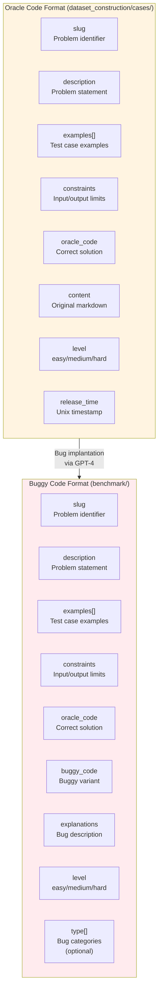
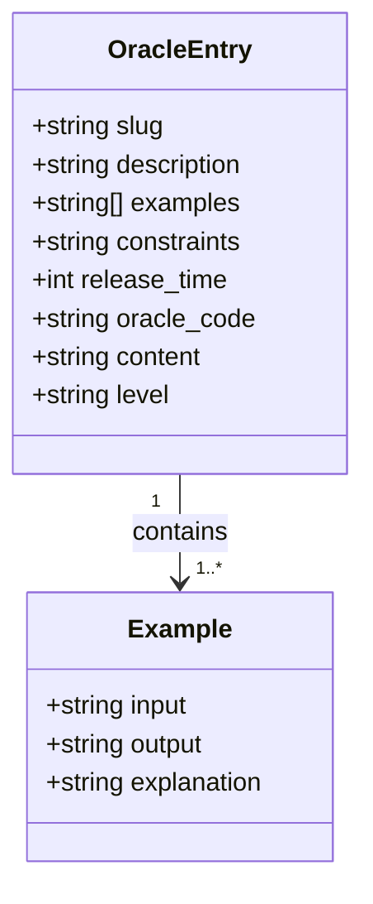
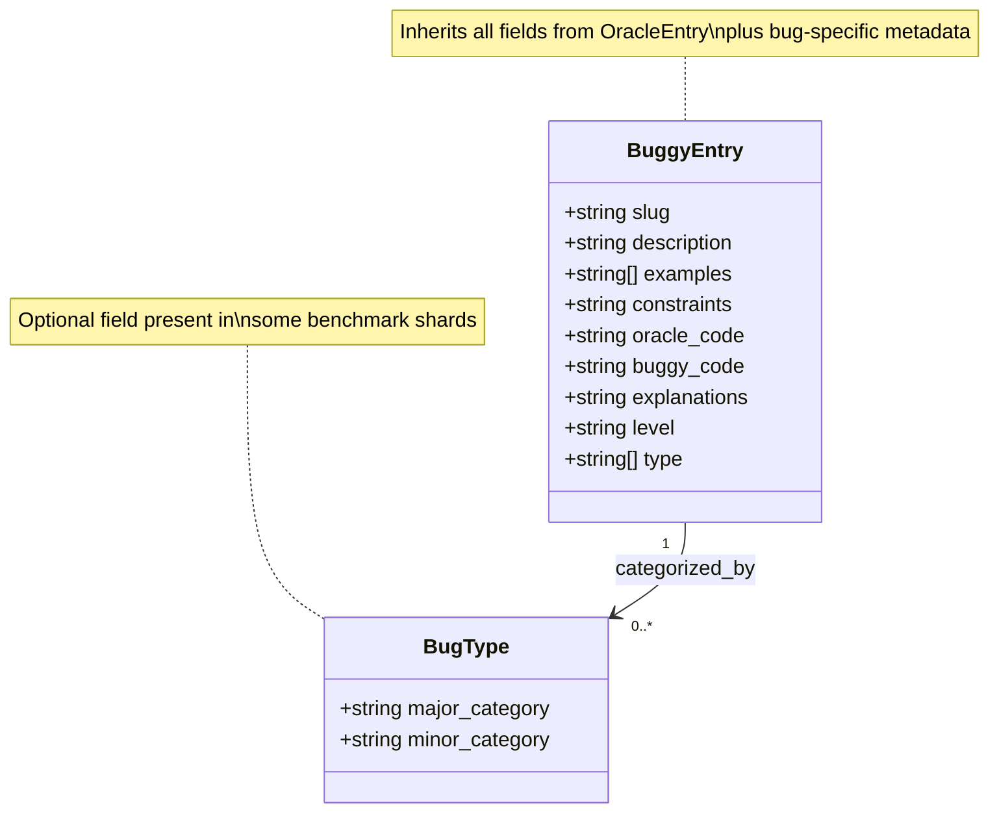
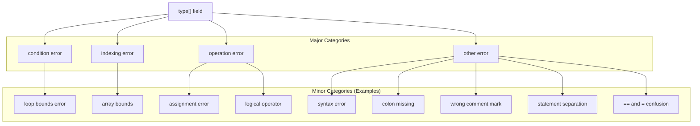
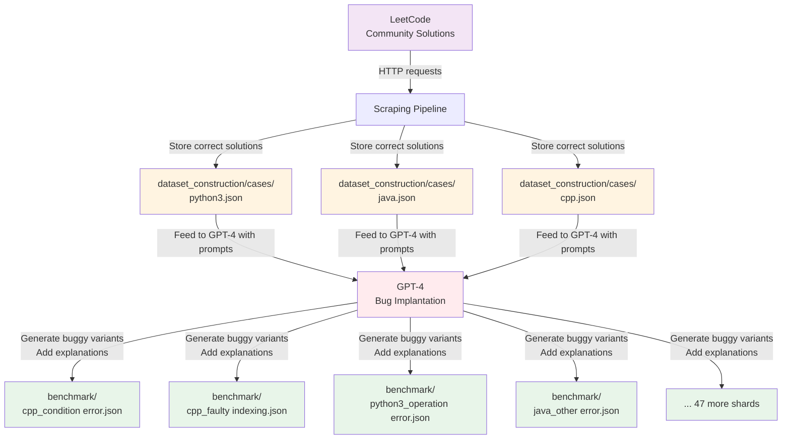

<!-- source: DeepWiki mcp.deepwiki.com · repo thunlp/DebugBench · page 3.2 Data Schema and Format · fetched 2026-11-02 -->

# Data Schema and Format

<details>
<summary>Relevant source files</summary>

The following files were used as context for generating this wiki page:

- [benchmark/cpp_condition error.json](benchmark/cpp_condition error.json)
- [benchmark/cpp_double.json](benchmark/cpp_double.json)
- [benchmark/cpp_faulty indexing.json](benchmark/cpp_faulty indexing.json)
- [dataset_construction/cases/cpp.json](dataset_construction/cases/cpp.json)
- [dataset_construction/cases/java.json](dataset_construction/cases/java.json)
- [dataset_construction/cases/python3.json](dataset_construction/cases/python3.json)

</details>


This page documents the JSON data schema used throughout DebugBench for both oracle (correct) code entries and buggy code entries. Understanding this schema is essential for working with the benchmark dataset programmatically or extending it with new problems.

For information about how the dataset is organized into shards, see [Dataset Organization](#3.1). For concrete examples of bug instances in each language, see [C++ Bug Examples](#3.3) and [Java and Python Bug Examples](#3.4).

## Schema Overview

DebugBench uses two primary data formats: the **Oracle Code Schema** for storing correct solutions, and the **Buggy Code Schema** for storing bug-implanted variants with metadata.



**Sources:** [dataset_construction/cases/python3.json:1-28](), [benchmark/cpp_condition error.json:1-17](), [benchmark/cpp_double.json:1-18]()

## Oracle Code Entry Schema

Oracle code entries represent correct, verified solutions to LeetCode problems. These are stored in `dataset_construction/cases/` and serve as the ground truth for bug implantation.

### Schema Structure



**Sources:** [dataset_construction/cases/python3.json:2-28](), [dataset_construction/cases/java.json:2-27](), [dataset_construction/cases/cpp.json:2-28]()

### Field Descriptions

| Field | Type | Description | Required | Example |
|-------|------|-------------|----------|---------|
| `slug` | string | Unique problem identifier from LeetCode | Yes | `"binary-search"` |
| `description` | string | Complete problem statement with formatting | Yes | `"Given an array of integers..."` |
| `examples` | string[] | Array of example test cases as formatted strings | Yes | `["Input: nums = [1,2,3]\\nOutput: 2"]` |
| `constraints` | string | Problem constraints and input limits | Yes | `"1 <= nums.length <= 104"` |
| `release_time` | integer | Unix timestamp of solution collection | Yes | `1680309400` |
| `oracle_code` | string | Complete, correct solution code | Yes | `"class Solution:\\n    def search..."` |
| `content` | string | Original markdown content from LeetCode | Yes | `"# Complexity\\n- Time complexity..."` |
| `level` | string | Problem difficulty level | Yes | `"easy"`, `"medium"`, or `"hard"` |

**Sources:** [dataset_construction/cases/python3.json:17-27](), [dataset_construction/cases/cpp.json:17-28]()

### Example Oracle Entry

```json
{
    "slug": "binary-search",
    "description": "Given an array of integers nums which is sorted in ascending order, and an integer target, write a function to search target in nums. If target exists, then return its index. Otherwise, return -1.\nYou must write an algorithm with O(log n) runtime complexity.",
    "examples": [
        "Input: nums = [-1,0,3,5,9,12], target = 9\nOutput: 4\nExplanation: 9 exists in nums and its index is 4",
        "Input: nums = [-1,0,3,5,9,12], target = 2\nOutput: -1\nExplanation: 2 does not exist in nums so return -1"
    ],
    "constraints": "1 <= nums.length <= 104\n-104 < nums[i], target < 104\nAll the integers in nums are unique.\nnums is sorted in ascending order.",
    "release_time": 1680309400,
    "oracle_code": "class Solution:\n    def search(self, nums: List[int], target: int) -> int:\n        if target not in nums:\n            return -1\n        \n        left, right = 0, len(nums)\n        \n        while left < right:\n            mid = (left + right) // 2\n            if nums[mid] < target:\n                left = mid + 1\n            else:\n                right = mid\n        \n        return left",
    "content": "\\n\\n# Code\\n```\\nclass Solution:\\n    def search(self, nums: List[int], target: int) -> int:\\n        if target not in nums:\\n            return -1\\n        \\n        left, right = 0, len(nums)\\n        \\n        while left < right:\\n            mid = (left + right) // 2\\n            if nums[mid] < target:\\n                left = mid + 1\\n            else:\\n                right = mid\\n        \\n        return left\\n        \\n```\\nOne-liner in python:\\n```\\nclass Solution:\\n    def search(self, nums: List[int], target: int) -> int:\\n        return bisect_left(nums, target) if target in nums else -1\\n```",
    "level": "easy"
}
```

**Sources:** [dataset_construction/cases/python3.json:17-27]()

## Buggy Code Entry Schema

Buggy code entries extend the oracle schema with bug-specific fields. These are stored in `benchmark/` directory, organized by language and bug type.

### Schema Structure



**Sources:** [benchmark/cpp_condition error.json:2-17](), [benchmark/cpp_double.json:2-18](), [benchmark/cpp_faulty indexing.json:2-17]()

### Field Descriptions

| Field | Type | Description | Required | Example |
|-------|------|-------------|----------|---------|
| `slug` | string | Inherited from oracle entry | Yes | `"knight-dialer"` |
| `description` | string | Inherited from oracle entry | Yes | Same as oracle |
| `examples` | string[] | Inherited from oracle entry | Yes | Same as oracle |
| `constraints` | string | Inherited from oracle entry | Yes | Same as oracle |
| `oracle_code` | string | The correct solution (ground truth) | Yes | Same as oracle |
| `buggy_code` | string | Bug-implanted variant of oracle_code | Yes | Code with introduced bug |
| `explanations` | string | Natural language explanation of the bug | Yes | `"The loop counter i should run from 1 to n-1, not 1 to n."` |
| `level` | string | Problem difficulty | Yes | `"easy"`, `"medium"`, or `"hard"` |
| `type` | string[] | Bug type classification (optional) | No | `["other error", "indexing error"]` |

**Sources:** [benchmark/cpp_condition error.json:14-16](), [benchmark/cpp_double.json:13-17]()

### Example Buggy Entry

```json
{
    "slug": "ugly-number-ii",
    "description": "An ugly number is a positive integer whose prime factors are limited to 2, 3, and 5.\nGiven an integer n, return the nth ugly number.",
    "examples": [
        "Input: n = 10\nOutput: 12\nExplanation: [1, 2, 3, 4, 5, 6, 8, 9, 10, 12] is the sequence of the first 10 ugly numbers.",
        "Input: n = 1\nOutput: 1\nExplanation: 1 has no prime factors, therefore all of its prime factors are limited to 2, 3, and 5."
    ],
    "constraints": "1 <= n <= 1690",
    "release_time": 1690716711,
    "oracle_code": "class Solution {\npublic:\n    int nthUglyNumber(int n) \n    {\n        vector<int>dp(n);\n        dp[0]=1;\n        int p1=0;\n        int p2=0;\n        int p3=0;\n        for(int i=1;i<n;i++)\n        {\n            int two=dp[p1]*2;\n            int three=dp[p2]*3;\n            int five=dp[p3]*5;\n            dp[i]=min(two,min(three,five));\n            if(dp[i]==two)\n            p1++;\n            if(dp[i]==three)\n            p2++;\n            if(dp[i]==five)\n            p3++;\n        }\n        return dp[n-1];\n        \n    }\n};",
    "level": "medium",
    "buggy_code": "\nclass Solution {\npublic:\n    int nthUglyNumber(int n) \n    {\n        vector<int>dp(n);\n        dp[0]=1;\n        int p1=0;\n        int p2=0;\n        int p3=0;\n        for(int i=1;i<=n;i++)\n        {\n            int two=dp[p1]*2;\n            int three=dp[p2]*3;\n            int five=dp[p3]*5;\n            dp[i]=min(two,min(three,five));\n            if(dp[i]==two)\n            p1++;\n            if(dp[i]==three)\n            p2++;\n            if(dp[i]==five)\n            p3++;\n        }\n        return dp[n-1];\n        \n    }\n};\n",
    "explanations": "\nThe loop counter i should run from 1 to n-1, not 1 to n.\n"
}
```

**Sources:** [benchmark/cpp_condition error.json:95-107]()

## Field Format Specifications

### String Formatting

```mermaid
graph LR
    subgraph "Multi-line String Encoding"
        NL["Newline: \\n"]
        TAB["Tab: \\t"]
        QUOTE["Quote: \\\""]
        BACKSLASH["Backslash: \\\\"]
    end
    
    subgraph "Code Fields"
        ORACLE["oracle_code"]
        BUGGY["buggy_code"]
    end
    
    subgraph "Text Fields"
        DESC["description"]
        EXPLAIN["explanations"]
        CONTENT["content"]
    end
    
    NL --> ORACLE
    NL --> BUGGY
    NL --> DESC
    TAB --> ORACLE
    TAB --> BUGGY
    QUOTE --> CONTENT
    BACKSLASH --> ORACLE
```

**Sources:** [dataset_construction/cases/python3.json:12-13](), [benchmark/cpp_condition error.json:13]()

All multi-line strings in the JSON use escaped newline characters (`\n`). Code fields may also contain escaped tabs (`\t`), quotes (`\"`), and backslashes (`\\`).

### Examples Array Format

Each element in the `examples` array is a single string containing:
- **Input specification:** Starts with `"Input: "`
- **Output specification:** Follows with `"\nOutput: "`
- **Optional explanation:** May include `"\nExplanation: "`

Example:
```
"Input: nums = [1,2,3,4], k = 5\nOutput: 2\nExplanation: Starting with nums = [1,2,3,4]:\n- Remove numbers 1 and 4, then nums = [2,3]\n- Remove numbers 2 and 3, then nums = []\nThere are no more pairs that sum up to 5, hence a total of 2 operations."
```

**Sources:** [dataset_construction/cases/cpp.json:34-35]()

### Constraints Format

The `constraints` field is a single string with newline-separated constraint statements. Common patterns include:

```
"1 <= nums.length <= 105\n1 <= nums[i] <= 109\n1 <= k <= 109"
```

Note: Some entries use the field name `"constrains"` (typo) instead of `"constraints"`. Both are present in the dataset.

**Sources:** [dataset_construction/cases/python3.json:10](), [benchmark/cpp_condition error.json:10]()

## Bug Type Taxonomy

Some benchmark shards include a `type` field that categorizes bugs into multiple dimensions. This field is an array of strings representing bug categories.

### Type Field Structure



**Sources:** [benchmark/cpp_double.json:13-17](), [benchmark/cpp_faulty indexing.json:60-62]()

### Example Type Classifications

From the benchmark files:

| Bug Pattern | Type Classification | File Example |
|-------------|---------------------|--------------|
| Loop bounds `i <= n` instead of `i < n` | `["other error", "indexing error"]` | [cpp_double.json:13-17]() |
| Array access `arr[n]` out of bounds | `["indexing error"]` | [cpp_faulty indexing.json:15-16]() |
| Missing semicolon or colon | `["other error", "colon missing"]` | [cpp_double.json:85-86]() |
| Using `=` instead of `==` | `["== and = confusion", "colon missing"]` | [cpp_double.json:85-86]() |
| Wrong operator in condition | `["conditional statement error"]` | [cpp_double.json:65-68]() |

**Sources:** [benchmark/cpp_double.json:13-17](), [benchmark/cpp_double.json:65-68](), [benchmark/cpp_double.json:85-86](), [benchmark/cpp_faulty indexing.json:15-16]()

### Type Field Presence

The `type` field is **optional** and not present in all benchmark shards:

- **Present in:** `cpp_double.json`, language-specific operation error files
- **Absent in:** Most `cpp_condition error.json`, `cpp_faulty indexing.json`, and simpler bug category files

**Sources:** [benchmark/cpp_condition error.json:14-16](), [benchmark/cpp_double.json:13-17]()

## Data Flow and Transformation



**Sources:** [dataset_construction/cases/python3.json:1](), [benchmark/cpp_condition error.json:1](), [benchmark/cpp_faulty indexing.json:1]()

The transformation from oracle to buggy format involves:

1. **Preservation:** All oracle fields are retained in buggy entries
2. **Addition:** New fields `buggy_code` and `explanations` are added
3. **Optional Enhancement:** Some shards add the `type` array for categorization
4. **Removal:** The `release_time` and `content` fields may be omitted in buggy entries to reduce file size

## Schema Validation Rules

### Required Field Validation

```mermaid
graph TD
    ENTRY["JSON Entry"]
    
    CHECK_SLUG{"`slug` present?"}
    CHECK_DESC{"`description` present?"}
    CHECK_ORACLE{"`oracle_code` present?"}
    CHECK_LEVEL{"`level` in<br/>['easy', 'medium', 'hard']?"}
    CHECK_EXAMPLES{"`examples[]` non-empty?"}
    
    IS_BUGGY{"`buggy_code` present?"}
    CHECK_BUGGY{"`buggy_code` different<br/>from `oracle_code`?"}
    CHECK_EXPLAIN{"`explanations` present?"}
    
    VALID_ORACLE["Valid Oracle Entry"]
    VALID_BUGGY["Valid Buggy Entry"]
    INVALID["Invalid Entry"]
    
    ENTRY --> CHECK_SLUG
    CHECK_SLUG -->|No| INVALID
    CHECK_SLUG -->|Yes| CHECK_DESC
    CHECK_DESC -->|No| INVALID
    CHECK_DESC -->|Yes| CHECK_ORACLE
    CHECK_ORACLE -->|No| INVALID
    CHECK_ORACLE -->|Yes| CHECK_LEVEL
    CHECK_LEVEL -->|No| INVALID
    CHECK_LEVEL -->|Yes| CHECK_EXAMPLES
    CHECK_EXAMPLES -->|No| INVALID
    CHECK_EXAMPLES -->|Yes| IS_BUGGY
    
    IS_BUGGY -->|No| VALID_ORACLE
    IS_BUGGY -->|Yes| CHECK_BUGGY
    CHECK_BUGGY -->|No| INVALID
    CHECK_BUGGY -->|Yes| CHECK_EXPLAIN
    CHECK_EXPLAIN -->|No| INVALID
    CHECK_EXPLAIN -->|Yes| VALID_BUGGY
```

**Sources:** [dataset_construction/cases/python3.json:2-28](), [benchmark/cpp_condition error.json:2-17]()

### Field Constraints

| Field | Constraint | Validation Rule |
|-------|-----------|-----------------|
| `slug` | Non-empty string | Must match pattern `[a-z0-9-]+` |
| `level` | Enumeration | Must be one of: `"easy"`, `"medium"`, `"hard"` |
| `examples` | Non-empty array | Must contain at least 1 element |
| `oracle_code` | Non-empty string | Must be valid code in the target language |
| `buggy_code` | Non-empty string | Must differ from `oracle_code` |
| `explanations` | Non-empty string | Should explain the introduced bug |
| `type` | Array of strings | Each element should be a valid bug category |

**Sources:** [dataset_construction/cases/python3.json:27](), [benchmark/cpp_condition error.json:14-16]()

## Common Schema Patterns

### Slug Naming Convention

Slugs follow LeetCode's URL-friendly naming pattern:
- All lowercase
- Words separated by hyphens
- No special characters except hyphens

Examples: `"binary-search"`, `"two-sum"`, `"reverse-odd-levels-of-binary-tree"`

**Sources:** [dataset_construction/cases/python3.json:3](), [benchmark/cpp_condition error.json:3]()

### Code Formatting in JSON

Code is stored as single-line strings with escaped newlines:

```json
{
    "oracle_code": "class Solution {\npublic:\n    int nthUglyNumber(int n) \n    {\n        vector<int>dp(n);\n        dp[0]=1;\n        for(int i=1;i<n;i++)\n        {\n            // code continues...\n        }\n        return dp[n-1];\n    }\n};"
}
```

**Sources:** [benchmark/cpp_condition error.json:12]()

### Explanation Format

The `explanations` field typically:
- Starts with a newline character
- Uses concise, technical language
- Points directly to the bug location or behavior
- Avoids verbose natural language

Example: `"\nThe loop counter i should run from 1 to n-1, not 1 to n.\n"`

**Sources:** [benchmark/cpp_condition error.json:16]()

## Programmatic Access Patterns

### Loading Oracle Entries

```python
import json

# Load oracle code entries
with open('dataset_construction/cases/python3.json', 'r') as f:
    oracle_entries = json.load(f)

for entry in oracle_entries:
    slug = entry['slug']
    oracle_code = entry['oracle_code']
    level = entry['level']
    # Process entry...
```

### Loading Buggy Entries

```python
import json

# Load buggy code entries
with open('benchmark/cpp_condition error.json', 'r') as f:
    buggy_entries = json.load(f)

for entry in buggy_entries:
    slug = entry['slug']
    oracle_code = entry['oracle_code']
    buggy_code = entry['buggy_code']
    explanations = entry['explanations']
    bug_types = entry.get('type', [])  # Optional field
    # Process entry...
```

**Sources:** [dataset_construction/cases/python3.json:1](), [benchmark/cpp_condition error.json:1]()

### Validating Schema Compliance

Key checks when processing entries:

1. Verify all required fields are present
2. Ensure `buggy_code` differs from `oracle_code`
3. Check `level` is one of the three valid values
4. Validate code can be parsed by language-specific parsers
5. Ensure `examples` array is non-empty

**Sources:** [dataset_construction/cases/python3.json:2-28](), [benchmark/cpp_condition error.json:2-17]()

---

