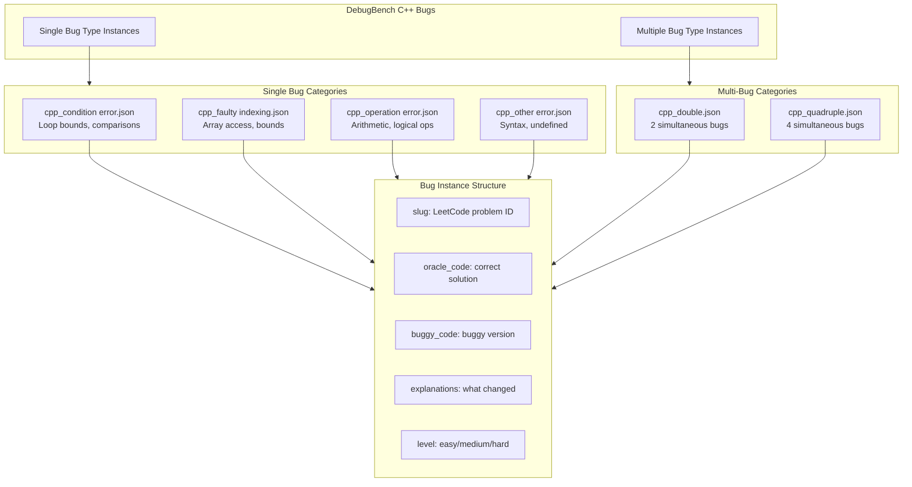
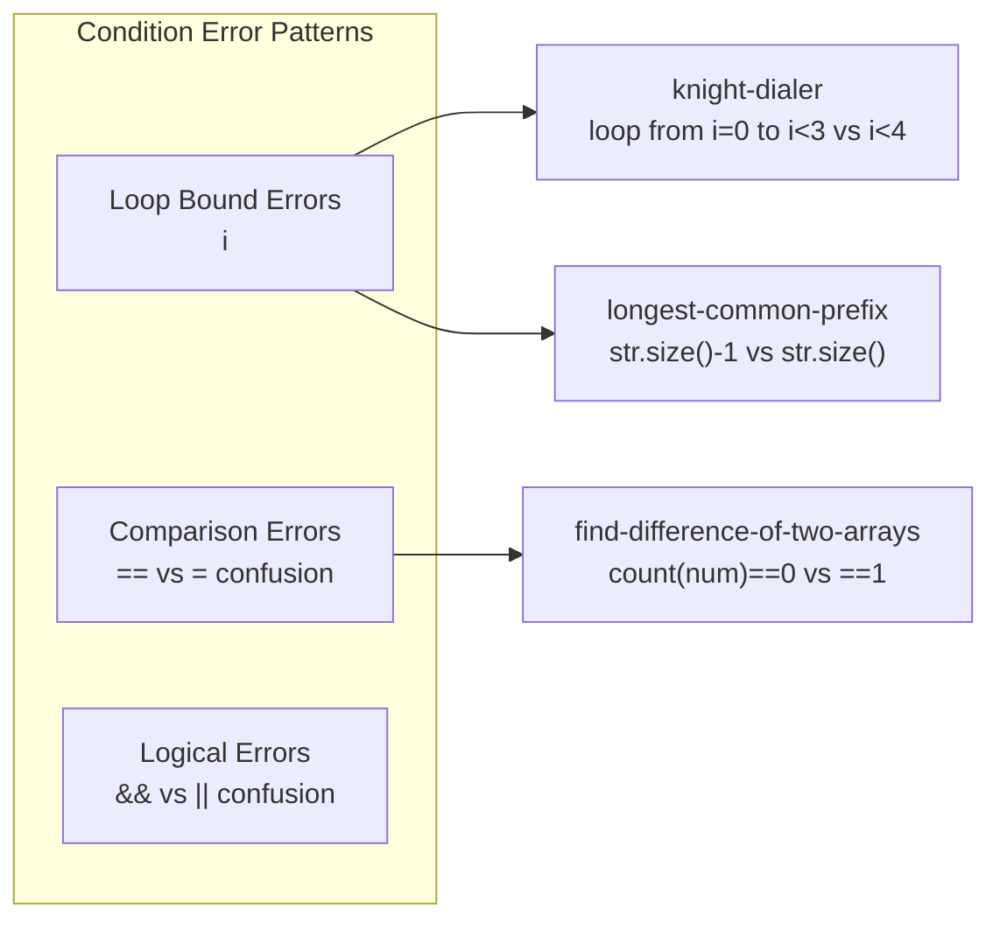
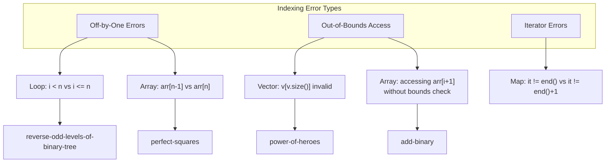
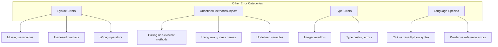
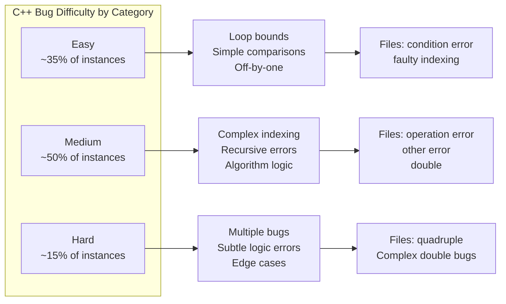

<!-- source: DeepWiki mcp.deepwiki.com · repo thunlp/DebugBench · page 3.3 C++ Bug Examples · fetched 2026-11-02 -->

# C++ Bug Examples

<details>
<summary>Relevant source files</summary>

The following files were used as context for generating this wiki page:

- [benchmark/cpp_condition error.json](benchmark/cpp_condition error.json)
- [benchmark/cpp_double.json](benchmark/cpp_double.json)
- [benchmark/cpp_faulty indexing.json](benchmark/cpp_faulty indexing.json)
- [benchmark/cpp_operation error.json](benchmark/cpp_operation error.json)
- [benchmark/cpp_other error.json](benchmark/cpp_other error.json)
- [benchmark/cpp_quadruple.json](benchmark/cpp_quadruple.json)

</details>


This page provides detailed examples of C++ bugs from the DebugBench dataset, organized by error type. These examples demonstrate common programming mistakes that LLMs must identify and correct when debugging code. For information about the overall dataset structure, see [Dataset Organization](#3.1). For the JSON schema details, see [Data Schema and Format](#3.2). For bug examples in other languages, see [Java and Python Bug Examples](#3.4).

## Overview

The DebugBench dataset contains C++ bug examples across six main JSON files, each focusing on different error categories:

| File | Error Category | Instance Count | Primary Bug Types |
|------|----------------|----------------|-------------------|
| `cpp_condition error.json` | Condition Errors | ~140 | Loop bounds, comparison operators |
| `cpp_faulty indexing.json` | Indexing Errors | ~120 | Array bounds, off-by-one errors |
| `cpp_operation error.json` | Operation Errors | ~130 | Arithmetic, logical operations |
| `cpp_other error.json` | Other Errors | ~110 | Syntax, undefined methods |
| `cpp_double.json` | Multiple Types (2) | ~90 | Combinations of 2 error types |
| `cpp_quadruple.json` | Multiple Types (4) | ~60 | Combinations of 4 error types |

Each bug instance pairs correct `oracle_code` with intentionally buggy `buggy_code`, along with explanations of what was changed.

Sources: [benchmark/cpp_condition error.json](), [benchmark/cpp_faulty indexing.json](), [benchmark/cpp_operation error.json](), [benchmark/cpp_other error.json](), [benchmark/cpp_double.json](), [benchmark/cpp_quadruple.json]()

## Bug Category Architecture



Sources: [benchmark/cpp_condition error.json:1-17](), [benchmark/cpp_faulty indexing.json:1-17](), [benchmark/cpp_operation error.json:1-17](), [benchmark/cpp_other error.json:1-17](), [benchmark/cpp_double.json:1-18](), [benchmark/cpp_quadruple.json:1-20]()

## Condition Errors

Condition errors involve incorrect loop bounds, comparison operators, or conditional expressions. These are subtle bugs that often pass compilation but produce incorrect results.

### Common Patterns



Sources: [benchmark/cpp_condition error.json:2-47]()

### Example 1: Loop Bound Error (knight-dialer)

**Problem**: Knight Dialer - Count phone numbers from knight moves on a keypad

**Oracle Code**: [benchmark/cpp_condition error.json:12]()
```cpp
for(int i=0;i<4;i++){
    for(int j=0;j<3;j++){
        if(nums[i][j]!=-1){
            ans=(ans+f(nums,i,j,n-1))%mod;
        }
    }
}
```

**Buggy Code**: [benchmark/cpp_condition error.json:15]()
```cpp
for(int i=0;i<3;i++){  // Should be i<4
    for(int j=0;j<3;j++){
        if(nums[i][j]!=-1){
            ans=(ans+f(nums,i,j,n-1))%mod;
        }
    }
}
```

**Explanation**: The outer loop should iterate 4 times (for a 4x3 grid), but the buggy code only iterates 3 times, missing the last row of the phone pad.

**Bug Category**: Loop bounds error - incorrect loop termination condition

Sources: [benchmark/cpp_condition error.json:2-17]()

### Example 2: Comparison Operator Error (find-difference-of-two-arrays)

**Problem**: Find distinct integers in nums1 not in nums2 and vice versa

**Oracle Code Snippet**:
```cpp
for (int num : set2) {
    if (set1.count(num) == 0) {  // Check if NOT present
        distinct_nums2.push_back(num);
    }
}
```

**Buggy Code Snippet**:
```cpp
for (int num : set2) {
    if (set1.count(num) == 1) {  // Incorrectly checks if present
        distinct_nums2.push_back(num);
    }
}
```

**Explanation**: The logic is inverted - checking for presence (`== 1`) instead of absence (`== 0`), which returns elements present in both sets rather than distinct to nums2.

Sources: [benchmark/cpp_condition error.json:18-32]()

### Example 3: Array Bounds Error (longest-common-prefix)

**Oracle Code**: `str[str.size()-1]` - accesses last element
**Buggy Code**: `str[str.size()]` - accesses beyond bounds

**Explanation**: Accessing `str[str.size()]` is undefined behavior as valid indices are 0 to `size()-1`.

Sources: [benchmark/cpp_condition error.json:33-47]()

## Faulty Indexing Errors

Indexing errors involve incorrect array access, iterator usage, or off-by-one mistakes. These frequently cause runtime errors or undefined behavior.

### Indexing Error Patterns



Sources: [benchmark/cpp_faulty indexing.json:1-138]()

### Example 4: Vector Out-of-Bounds (reverse-odd-levels-of-binary-tree)

**Problem**: Reverse node values at odd levels in a binary tree

**Oracle Code**: [benchmark/cpp_faulty indexing.json:12-13]()
```cpp
for(i = 0; i < n/2; i++){
    z = tmp[i]->val;
    tmp[i]->val = tmp[n-1-i]->val;
    tmp[n-1-i]->val = z;
}
```

**Buggy Code**: [benchmark/cpp_faulty indexing.json:15]()
```cpp
for(i = 0; i <= n/2; i++){  // Should be i < n/2
    z = tmp[i]->val;
    tmp[i]->val = tmp[n-1-i]->val;
    tmp[n-1-i]->val = z;
}
```

**Explanation**: Using `i <= n/2` causes the loop to access one element beyond the valid swap range, potentially accessing `tmp[n]` when `i = n/2` in certain cases, leading to undefined behavior.

Sources: [benchmark/cpp_faulty indexing.json:1-17]()

### Example 5: Array Bounds Checking (perfect-squares)

**Oracle Code**: `if(i >= n || sum < 0)` - proper bounds check
**Buggy Code**: `if(i > n || sum < 0)` - allows `i == n`

**Explanation**: When `i == n`, accessing `arr[i]` is out of bounds since valid indices are 0 to n-1. This causes undefined behavior or crashes.

Sources: [benchmark/cpp_faulty indexing.json:18-32]()

### Example 6: Iterator Bounds (perfect-rectangle)

**Oracle Code**:
```cpp
for(auto it=m.begin();it!=m.end();it++){
    // Process map elements
}
```

**Buggy Code**:
```cpp
for(auto it=m.begin();it!=m.end()+1;it++){  // Goes past end()
    // Process map elements
}
```

**Explanation**: Comparing with `m.end()+1` causes the iterator to go beyond the valid range, as `end()` already points past the last element.

Sources: [benchmark/cpp_faulty indexing.json:95-110]()

## Operation Errors

Operation errors involve incorrect arithmetic operations, logical operators, or assignment mistakes. These bugs often produce subtly wrong results.

### Operation Error Categories

| Error Type | Pattern | Example |
|------------|---------|---------|
| Arithmetic | `+` vs `-`, `*` vs `/` | Fibonacci: `n-1` vs `n+1` |
| Comparison | `<` vs `<=`, `>` vs `>=` | Min/max calculations |
| Assignment | `=` vs `==` | Condition vs assignment |
| Logical | `&&` vs `\|\|`, `!` placement | Boolean logic errors |

Sources: [benchmark/cpp_operation error.json:1-143]()

### Example 7: Recursive Call Error (fibonacci-number)

**Problem**: Calculate nth Fibonacci number

**Oracle Code**: [benchmark/cpp_operation error.json:12]()
```cpp
return ans = fibon(n-1) + fibon(n-2);  // Correct recurrence
```

**Buggy Code**: [benchmark/cpp_operation error.json:15]()
```cpp
return ans = fibon(n-1) + fibon(n+2);  // Wrong: n+2 instead of n-2
```

**Explanation**: The Fibonacci recurrence relation is `F(n) = F(n-1) + F(n-2)`, but the buggy code uses `n+2`, which breaks the definition and causes infinite recursion or incorrect results.

Sources: [benchmark/cpp_operation error.json:1-17]()

### Example 8: Subtraction vs Addition (minimum-operations-to-halve-array-sum)

**Oracle Code**:
```cpp
sum-=max;  // Subtract half of max element
```

**Buggy Code**:
```cpp
sum+=max;  // Incorrectly adds instead of subtracts
```

**Explanation**: The algorithm should reduce the sum by repeatedly halving and subtracting the maximum element, but adding instead makes the sum grow, breaking the termination condition.

Sources: [benchmark/cpp_operation error.json:32-46]()

### Example 9: Multiplication Error (largest-rectangle-in-histogram)

**Oracle Code**: `return area;` - returns correct area
**Buggy Code**: `return area*2;` - multiplies by 2 incorrectly

**Explanation**: The calculated area is correct, but multiplying by 2 before returning doubles all results, producing incorrect output.

Sources: [benchmark/cpp_operation error.json:64-79]()

## Other Errors

This category includes syntax errors, undefined methods, type errors, and language-specific mistakes that don't fit other categories.

### Other Error Taxonomy



Sources: [benchmark/cpp_other error.json:1-138]()

### Example 10: Recursive Call Direction Error (prime-arrangements)

**Oracle Code**:
```cpp
return (n*fact(n-1)%1000000007)%1000000007;  // Decrement
```

**Buggy Code**:
```cpp
return (n*fact(n+1)%1000000007)%1000000007;  // Increment (infinite!)
```

**Explanation**: Factorial should recursively call with `n-1` to reach the base case, but calling with `n+1` causes infinite recursion.

Sources: [benchmark/cpp_other error.json:10-16]()

### Example 11: Tree Merging Logic Error (merge-two-binary-trees)

**Oracle Code**:
```cpp
root->left = mergeTrees(t1->left, t2->left);
root->right = mergeTrees(t1->right, t2->right);
```

**Buggy Code**:
```cpp
root->left = mergeTrees(t1->left, t2->right);   // Swapped!
root->right = mergeTrees(t1->right, t2->left);  // Swapped!
```

**Explanation**: The left child should merge with left, and right with right. Swapping them produces an incorrect tree structure.

Sources: [benchmark/cpp_other error.json:17-31]()

### Example 12: Variable Assignment Error (loud-and-rich)

**Oracle Code**: `miniNode = miniIndex;` - assigns the node index
**Buggy Code**: `miniNode = miniVal;` - assigns the value instead

**Explanation**: The function should return a node index, not a value. Assigning the quietness value instead of the node index breaks the algorithm's logic.

Sources: [benchmark/cpp_other error.json:79-92]()

## Multiple Bug Type Instances

Some benchmark instances contain multiple bugs simultaneously, testing whether LLMs can identify and fix several issues at once.

### Double Bug Examples (cpp_double.json)

These instances contain exactly 2 bugs from different categories.

**Example 13: Indexing + Operation Error (buddy-strings)**

**Bugs Present**:
1. **Indexing Error**: `for(int i=0;i<=n;i++)` - goes beyond array bounds
2. **Operation Error**: `freq[s[i]-'z']++` - wrong ASCII subtraction base

**Correct Fixes**:
1. Change `i<=n` to `i<n`
2. Change `s[i]-'z'` to `s[i]-'a'`

Sources: [benchmark/cpp_double.json:19-36]()

### Quadruple Bug Examples (cpp_quadruple.json)

These instances contain 4 bugs, requiring comprehensive debugging.

**Example 14: Multiple Syntax Errors (shortest-path-to-get-all-keys)**

**Bugs Present**:
1. **Statement Separation**: Missing braces in nested for loops
2. **== vs = Confusion**: Assignment in condition `if(grid[i][j] = '@')`
3. **Unclosed String**: String literal with mismatched quotes
4. **Colon Missing**: Missing operators in expressions

This requires identifying and fixing multiple unrelated syntax issues.

Sources: [benchmark/cpp_quadruple.json:21-40]()

## Bug Difficulty Distribution



Sources: [benchmark/cpp_condition error.json](), [benchmark/cpp_faulty indexing.json](), [benchmark/cpp_operation error.json](), [benchmark/cpp_other error.json](), [benchmark/cpp_double.json](), [benchmark/cpp_quadruple.json]()

## Common Bug Patterns Summary

| Pattern | Frequency | Detection Difficulty | Example Issue |
|---------|-----------|---------------------|---------------|
| Loop bound off-by-one | Very High | Low-Medium | `i<n` vs `i<=n` |
| Array index out of bounds | High | Low | `arr[size]` instead of `arr[size-1]` |
| Comparison operator reversal | High | Medium | `count==0` vs `count==1` |
| Arithmetic operator swap | Medium | Medium-High | `+` vs `-`, `*` vs `/` |
| Recursive call direction | Low | High | `f(n-1)` vs `f(n+1)` |
| Assignment vs comparison | Medium | Low | `=` vs `==` |
| Multiple simultaneous bugs | Low | Very High | Requires fixing 2-4 bugs |

## Accessing C++ Bug Examples

To access specific bug examples programmatically:

1. **Load the appropriate JSON file** based on bug category:
   - [benchmark/cpp_condition error.json]()
   - [benchmark/cpp_faulty indexing.json]()
   - [benchmark/cpp_operation error.json]()
   - [benchmark/cpp_other error.json]()
   - [benchmark/cpp_double.json]()
   - [benchmark/cpp_quadruple.json]()

2. **Each entry contains**:
   - `slug`: LeetCode problem identifier
   - `description`: Problem statement
   - `examples`: Test cases
   - `constraints`: Input constraints
   - `oracle_code`: Correct C++ solution
   - `buggy_code`: Buggy version with intentional errors
   - `explanations`: Description of what was changed
   - `level`: Difficulty (easy/medium/hard)

3. **Filter by difficulty or bug type** to create targeted debugging challenges for LLM evaluation.

For details on the JSON schema structure, see [Data Schema and Format](#3.2). For information on evaluating LLM debugging performance, see [Evaluation System](#4).

Sources: [benchmark/cpp_condition error.json:2-17](), [benchmark/cpp_faulty indexing.json:2-17](), [benchmark/cpp_operation error.json:2-17](), [benchmark/cpp_other error.json:2-17]()

---

