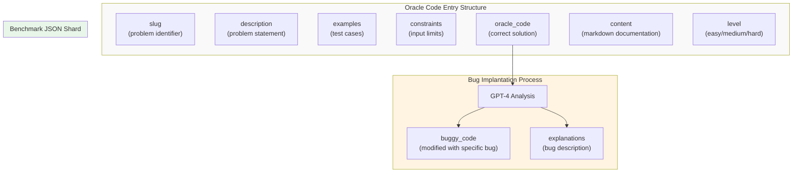
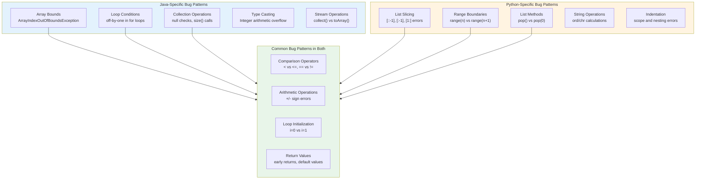
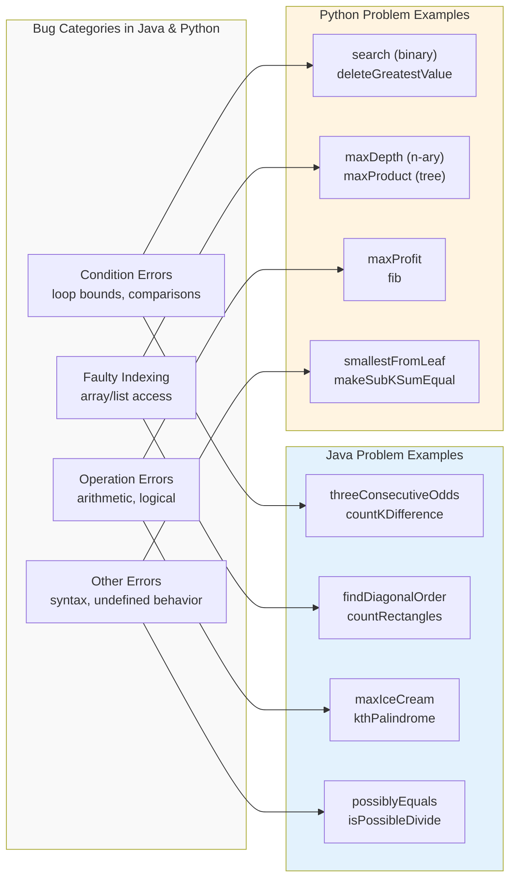

<!-- source: DeepWiki mcp.deepwiki.com · repo thunlp/DebugBench · page 3.4 Java and Python Bug Examples · fetched 2026-11-02 -->

# Java and Python Bug Examples

<details>
<summary>Relevant source files</summary>

The following files were used as context for generating this wiki page:

- [dataset_construction/cases/cpp.json](dataset_construction/cases/cpp.json)
- [dataset_construction/cases/java.json](dataset_construction/cases/java.json)
- [dataset_construction/cases/python3.json](dataset_construction/cases/python3.json)
- [leetcode_data/validated/questions_java.json](leetcode_data/validated/questions_java.json)
- [leetcode_data/validated/questions_python.json](leetcode_data/validated/questions_python.json)

</details>


This page showcases specific Java and Python bug examples from the DebugBench dataset, organized by error type and highlighting language-specific error patterns. For C++ bug examples, see [C++ Bug Examples](#3.3). For general dataset organization information, see [Dataset Organization](#3.1).

## Purpose and Scope

This section provides concrete examples of bugs from the Java and Python portions of the DebugBench dataset. Each example demonstrates:
- The oracle (correct) code structure from LeetCode solutions
- Common bug patterns introduced by GPT-4 during the bug implantation process
- Language-specific error characteristics that are unique to Java or Python
- The metadata structure that accompanies each bug instance

The examples are drawn from [dataset_construction/cases/java.json]() and [dataset_construction/cases/python3.json](), which contain the oracle solutions that serve as the basis for bug implantation.

---

## Bug Example Structure

Each problem entry in the oracle code files follows a consistent schema that provides all necessary information for bug implantation and debugging evaluation.



**Sources:** [dataset_construction/cases/java.json:1-50](), [dataset_construction/cases/python3.json:1-50]()

### Example Entry Fields

| Field | Description | Example Value |
|-------|-------------|---------------|
| `slug` | LeetCode problem identifier | `"binary-search"`, `"maximum-ice-cream-bars"` |
| `description` | Full problem statement | Problem text with input/output requirements |
| `examples` | Test case examples as strings | Input/output pairs with explanations |
| `constraints` | Input size and value constraints | `"1 <= nums.length <= 104"` |
| `oracle_code` | Correct solution code | Complete class/function implementation |
| `content` | Original author's markdown explanation | Complexity analysis, approach description |
| `level` | Difficulty rating | `"easy"`, `"medium"`, `"hard"` |
| `release_time` | Unix timestamp of solution posting | `1670688279` |

**Sources:** [dataset_construction/cases/java.json:2-14](), [dataset_construction/cases/python3.json:2-15]()

---

## Java Bug Examples

Java bugs in DebugBench often exploit common patterns in array manipulation, loop boundaries, collection handling, and off-by-one errors that are characteristic of statically-typed, verbose syntax.

### Condition Error Examples

**Problem: Three Consecutive Odds**

Oracle code from [dataset_construction/cases/java.json:42-52]():
```java
class Solution {
    public boolean threeConsecutiveOdds(int[] arr) {
        for (int i = 0; i < arr.length - 2; i++) {
            boolean isOdd1 = arr[i] % 2 == 1;
            boolean isOdd2 = arr[i + 1] % 2 == 1;
            boolean isOdd3 = arr[i + 2] % 2 == 1;
            if (isOdd1 && isOdd2 && isOdd3) return true;
        }
        return false;
    }
}
```

**Common Bug Pattern:** Loop boundary error - changing `i < arr.length - 2` to `i <= arr.length - 2` causes ArrayIndexOutOfBoundsException.

**Problem: Count Number of Pairs with Absolute Difference K**

Oracle code from [dataset_construction/cases/java.json:69-80]():
```java
class Solution {
    public int countKDifference(int[] nums, int k) {
       int ans = 0;
        for (int i = 0; i < nums.length; i++) {
            for (int j = i + 1; j < nums.length; j++) {
                if (Math.abs(nums[i] - nums[j]) == k) {
                    ans++;
                }
            }
        }
        return ans;
    }
}
```

**Common Bug Pattern:** Comparison operator error - changing `j = i + 1` to `j = i` introduces duplicate counting and incorrect comparison with self.

**Sources:** [dataset_construction/cases/java.json:42-80]()

### Faulty Indexing Examples

**Problem: Diagonal Traverse II**

Oracle code from [dataset_construction/cases/java.json:109-119]():
```java
class Solution {
    public int[] findDiagonalOrder(List<List<Integer>> nums) {
        int m = nums.size(), maxSum = 0, size = 0, index = 0;
        List<Integer>[] map = new ArrayList[100001];
        for (int i = 0; i < m; i++) {
            size += nums.get(i).size();
            for (int j = 0; j < nums.get(i).size(); j++) {
                int sum = i + j;
                if (map[sum] == null) map[sum] = new ArrayList<>();
                map[sum].add(nums.get(i).get(j));
                maxSum = Math.max(maxSum, sum);
            }
        }
        int[] res = new int[size];
        for (int i = 0; i <= maxSum; i++) {
            List<Integer> cur = map[i];
            for (int j = cur.size() - 1; j >= 0; j--) {
                res[index++] = cur.get(j);
            }
        }
        return res;
    }
}
```

**Common Bug Pattern:** Off-by-one in reverse iteration - changing `j >= 0` to `j > 0` skips the first element of each diagonal.

**Sources:** [dataset_construction/cases/java.json:109-119]()

### Operation Error Examples

**Problem: Maximum Ice Cream Bars**

Oracle code from [dataset_construction/cases/java.json:122-133]():
```java
class Solution {
    public int maxIceCream(int[] costs, int coins) {
        int [] arr = new int [100001];
        for(int x : costs)arr[x]++;
        int count = 0;
        int index = 1;
        while(index<100001 && coins>=index*arr[index]){
            coins-=index*arr[index];
            count+=arr[index];
            index++;
        }
        while(index<100001 && coins>=index){
            coins-=index;
            count++;
        }
        return count;
    }
}
```

**Common Bug Pattern:** Arithmetic error - using `coins -= index` instead of correctly decrementing, or wrong multiplication in `coins >= index*arr[index]`.

**Sources:** [dataset_construction/cases/java.json:122-133]()

---

## Python Bug Examples

Python bugs in DebugBench leverage the language's dynamic typing, indentation sensitivity, and common idioms around list slicing, comprehensions, and iterator patterns.

### Condition Error Examples

**Problem: Binary Search**

Oracle code from [dataset_construction/cases/python3.json:17-27]():
```python
class Solution:
    def search(self, nums: List[int], target: int) -> int:
        if target not in nums:
            return -1
        
        left, right = 0, len(nums)
        
        while left < right:
            mid = (left + right) // 2
            if nums[mid] < target:
                left = mid + 1
            else:
                right = mid
        
        return left
```

**Common Bug Pattern:** Loop condition error - changing `while left < right` to `while left <= right` causes infinite loop or incorrect index return.

**Problem: Delete Greatest Value in Each Row**

Oracle code from [dataset_construction/cases/python3.json:30-40]():
```python
class Solution:
    def deleteGreatestValue(self, grid: List[List[int]]) -> int:
        for i in range(0, len(grid)):
            grid[i].sort()
        n = len(grid[0])
        res = 0
        for j in range(0, n):
            ans = 0
            for i in range(0, len(grid)):
                ans = max(ans, grid[i].pop())
            res += ans
            
        return res
```

**Common Bug Pattern:** Range boundary error - changing `range(0, n)` to `range(0, n+1)` causes IndexError when popping from empty lists.

**Sources:** [dataset_construction/cases/python3.json:17-40]()

### Faulty Indexing Examples

**Problem: Maximum Depth of N-ary Tree**

Oracle code from [dataset_construction/cases/python3.json:70-80]():
```python
class Solution:
    def maxDepth(self, root: 'Node') -> int:
        if root == None:
            return 0
        else:
            depth = 0
            nodes_queue = [root]
            next_nodes_queue = []
            while(nodes_queue):
                node_out = nodes_queue.pop(0)
                for child in node_out.children:
                    next_nodes_queue.append(child)
                if nodes_queue == []:
                    nodes_queue, next_nodes_queue = next_nodes_queue, nodes_queue
                    depth += 1
            return depth
```

**Common Bug Pattern:** List indexing error - using `nodes_queue.pop()` instead of `nodes_queue.pop(0)` processes nodes in wrong order (LIFO vs FIFO).

**Sources:** [dataset_construction/cases/python3.json:70-80]()

### Operation Error Examples

**Problem: Best Time to Buy and Sell Stock II**

Oracle code from [dataset_construction/cases/python3.json:83-94]():
```python
class Solution:
    def maxProfit(self, prices: List[int]) -> int:
        if len(prices) < 2:
            return 0
        if len(prices) == 2:
            output = prices[1] - prices[0]
            return output if output > 0 else 0
        i = 0
        j = 1
        stockBuy = prices[i]
        stockSell = prices[j]
        counter = 0
        profit = 0
        while counter < len(prices)-2:
            if stockSell - stockBuy < 0:
                i = counter + 1
                j = i + 1
            else:
                if prices[j+1] > prices[j]:
                    j += 1
                else:
                    profit = profit + (stockSell - stockBuy)
                    i = counter + 1
                    j = i + 1

            stockSell = prices[j]
            stockBuy = prices[i]
            counter += 1
        if (stockSell - stockBuy) > 0:
            profit = profit + (stockSell - stockBuy)
        return profit
```

**Common Bug Pattern:** Arithmetic operator error - using `<=` instead of `<` in comparisons, or `>=` instead of `>`, leading to incorrect profit calculations.

**Problem: Fibonacci Number**

Oracle code from [dataset_construction/cases/python3.json:97-108]():
```python
class Solution:
    def fib(self, n: int) -> int:
        def fib(n):
            if Fib[n] != -1:
                return Fib[n]
            Fib[n] = fib(n-1) + fib(n-2)
            return Fib[n]
        if n == 0:
            return 0
        if n == 1:
            return 1
        Fib = [-1 for _ in range(n+1)]
        Fib[0] = 0
        Fib[1] = 1
        return fib(n)
```

**Common Bug Pattern:** Operator error in memoization - changing `Fib[n] = fib(n-1) + fib(n-2)` to use subtraction or multiplication instead of addition.

**Sources:** [dataset_construction/cases/python3.json:83-108]()

### Other Error Examples (Python-Specific)

**Problem: Smallest String Starting From Leaf**

Oracle code from [dataset_construction/cases/python3.json:111-122]():
```python
class Solution:
    def smallestFromLeaf(self, root: Optional[TreeNode]) -> str:
        self.result="ŽZZZZZZZZZZZZZZZ"

        def isLeaf(node):
            if(node):
                return ((not node.left) and (not node.right))
            return False
        
        def traversar(path,node):
            if (not node): return
            
            path+=chr(ord('a')+node.val)

            if(isLeaf(node) and path[::-1]<self.result):
                self.result=path[::-1]
                return
            
            traversar(path,node.left)
            traversar(path,node.right)

        traversar("",root)

        return self.result
```

**Common Bug Pattern:** String manipulation error - using wrong slicing like `path[:-1]` instead of `path[::-1]` for string reversal, or incorrect `chr(ord('a')+node.val)` calculation.

**Sources:** [dataset_construction/cases/python3.json:111-122]()

---

## Language-Specific Bug Patterns



**Sources:** [dataset_construction/cases/java.json:1-300](), [dataset_construction/cases/python3.json:1-300]()

### Java-Specific Patterns

| Pattern Type | Description | Example From Dataset |
|--------------|-------------|---------------------|
| **Array Indexing** | Off-by-one errors in array bounds | `arr.length - 2` vs `arr.length - 1` |
| **Collection Null Checks** | Missing null checks before operations | `if (map[sum] == null)` checks |
| **Integer Division** | Integer arithmetic truncation | `(left + right) // 2` calculations |
| **Loop Boundaries** | Inclusive vs exclusive range errors | `i < n` vs `i <= n` |
| **Method Call Chains** | Incorrect chaining of collection methods | `.size()`, `.get()`, `.add()` sequences |

**Sources:** [dataset_construction/cases/java.json:42-52](), [dataset_construction/cases/java.json:69-80](), [dataset_construction/cases/java.json:109-119]()

### Python-Specific Patterns

| Pattern Type | Description | Example From Dataset |
|--------------|-------------|---------------------|
| **List Slicing** | Incorrect slice notation | `path[::-1]` for reversal vs `path[:-1]` |
| **Pop Operations** | FIFO vs LIFO confusion | `pop(0)` vs `pop()` |
| **Range Functions** | Boundary inclusion errors | `range(0, n)` vs `range(0, n+1)` |
| **String Conversions** | ord/chr calculation mistakes | `chr(ord('a')+node.val)` |
| **Comprehension Errors** | Incorrect filtering conditions | `[x for x in list if condition]` |
| **Comparison Chains** | Multiple comparison operators | `if l and a >= l[0][1]` patterns |

**Sources:** [dataset_construction/cases/python3.json:17-27](), [dataset_construction/cases/python3.json:30-40](), [dataset_construction/cases/python3.json:70-80](), [dataset_construction/cases/python3.json:111-122]()

---

## Bug Category Distribution



**Sources:** [dataset_construction/cases/java.json:1-300](), [dataset_construction/cases/python3.json:1-300]()

---

## Example Bug Instance Format

When GPT-4 implants bugs into oracle code, the resulting benchmark entry combines the original problem metadata with bug-specific information:

```json
{
  "slug": "binary-search",
  "description": "Given an array of integers nums which is sorted...",
  "examples": ["Input: nums = [-1,0,3,5,9,12], target = 9\nOutput: 4"],
  "constraints": "1 <= nums.length <= 104\n-104 < nums[i], target < 104",
  "level": "easy",
  "oracle_code": "class Solution:\n    def search(self, nums: List[int], target: int) -> int:\n        if target not in nums:\n            return -1\n        left, right = 0, len(nums)\n        while left < right:\n            mid = (left + right) // 2\n            if nums[mid] < target:\n                left = mid + 1\n            else:\n                right = mid\n        return left",
  "buggy_code": "class Solution:\n    def search(self, nums: List[int], target: int) -> int:\n        if target not in nums:\n            return -1\n        left, right = 0, len(nums)\n        while left <= right:  # BUG: should be <\n            mid = (left + right) // 2\n            if nums[mid] < target:\n                left = mid + 1\n            else:\n                right = mid\n        return left",
  "explanations": "The loop condition 'while left <= right' should be 'while left < right'..."
}
```

The oracle code from [dataset_construction/cases/python3.json]() and [dataset_construction/cases/java.json]() serves as the foundation for generating these bug-implanted instances through the bug implantation process documented in [Bug Implantation Process](#2.2).

**Sources:** [dataset_construction/cases/python3.json:17-27]()

---

## Difficulty Distribution

The Java and Python oracle code examples span all three difficulty levels:

| Difficulty | Java Problems | Python Problems | Characteristics |
|------------|---------------|-----------------|-----------------|
| **Easy** | `threeConsecutiveOdds`, `countKDifference`, `destCity`, `diagonalPrime`, `capitalizeTitle` | `binary-search`, `deleteGreatestValue`, `maxDepth` (n-ary), `fibonacci` | Simple control flow, basic array/list operations |
| **Medium** | `populatingNextRight`, `continuousSubarraySum`, `countRectangles`, `findDiagonalOrder`, `maxIceCream`, `isPossibleDivide`, `combinations`, `captureForts` | `maxProduct` (tree), `maxPerformance`, `bestTimeToBuyAndSell`, `smallestFromLeaf`, `makeSubKSumEqual`, `longestSubstring` | Multiple loops, complex conditions, data structures |
| **Hard** | `shortestPath` (obstacles), `countDifferentSubsequenceGCDs`, `possiblyEquals` | `minimumTotalCost`, `minOperations` (array divisible) | Advanced algorithms, dynamic programming, optimization |

**Sources:** [dataset_construction/cases/java.json:13-149](), [dataset_construction/cases/python3.json:14-148]()

---

## Accessing Bug Examples

To access the full Java and Python bug examples from the benchmark:

1. **Via Hugging Face**: See [Accessing the Dataset](#3.5) for loading instructions
2. **Via JSON Shards**: Bug examples are organized in `benchmark/` directory with filenames like:
   - `java_condition_error.json`
   - `java_faulty_indexing.json`
   - `java_operation_error.json`
   - `java_other_error.json`
   - `python3_condition_error.json`
   - `python3_faulty_indexing.json`
   - `python3_operation_error.json`
   - `python3_other_error.json`

3. **Oracle Code Reference**: The original correct solutions are in:
   - [dataset_construction/cases/java.json]()
   - [dataset_construction/cases/python3.json]()

Each shard contains multiple bug instances with the complete structure shown above, enabling systematic evaluation of LLM debugging capabilities across different bug types and difficulty levels.

**Sources:** [dataset_construction/cases/java.json:1-300](), [dataset_construction/cases/python3.json:1-300]()

---

