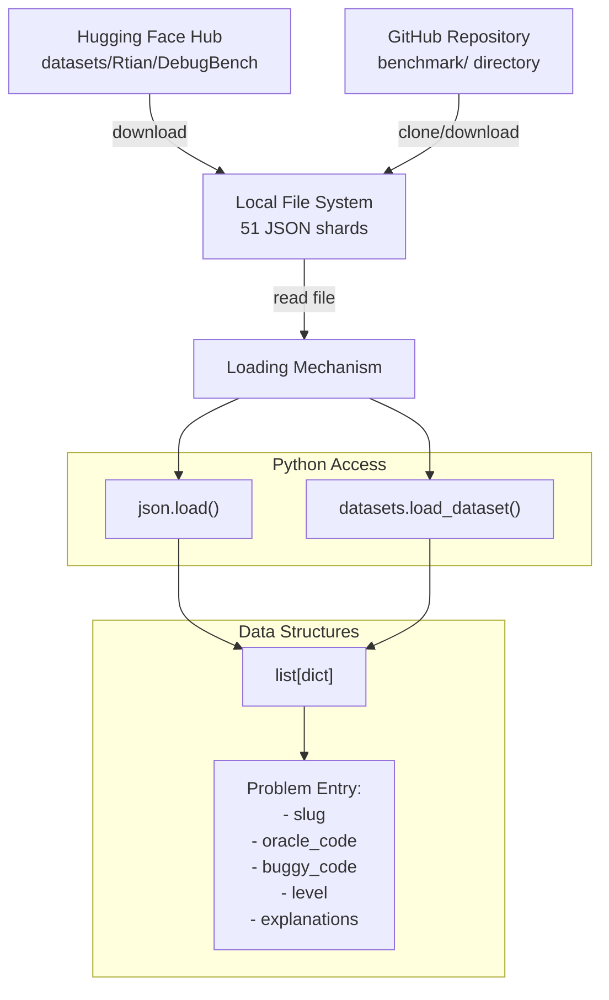
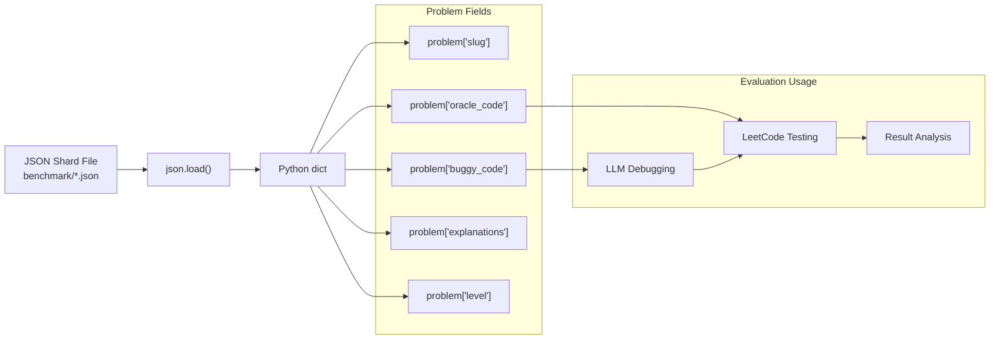

<!-- source: DeepWiki mcp.deepwiki.com · repo thunlp/DebugBench · page 3.5 Accessing the Dataset · fetched 2026-11-02 -->

# Accessing the Dataset

<details>
<summary>Relevant source files</summary>

The following files were used as context for generating this wiki page:

- [README.md](README.md)
- [benchmark/cpp_condition error.json](benchmark/cpp_condition error.json)
- [benchmark/cpp_double.json](benchmark/cpp_double.json)
- [benchmark/cpp_faulty indexing.json](benchmark/cpp_faulty indexing.json)

</details>


This document provides instructions for accessing and loading the DebugBench dataset. It covers downloading the data from Hugging Face, understanding the local file organization, and programmatically loading benchmark instances for evaluation. For information about the data schema and field definitions, see [Data Schema and Format](#3.2). For details on dataset organization by categories, see [Dataset Organization](#3.1).

---

## Dataset Sources

The DebugBench dataset is available through two primary channels:

### Hugging Face Hub

The canonical source for the DebugBench dataset is hosted on Hugging Face:

**Dataset URL**: `https://huggingface.co/datasets/Rtian/DebugBench`

The Hugging Face repository provides:
- All 4,253 benchmark instances across 51 JSON shards
- Evaluation scripts and utilities
- Dataset documentation and metadata
- Version control and dataset versioning

**Sources**: [README.md:13]()

### GitHub Repository

The dataset is also available in the GitHub repository under the `benchmark/` directory:

**Repository**: `https://github.com/thunlp/DebugBench`

The repository includes:
- Complete benchmark data in `benchmark/` directory
- Dataset construction code in `dataset_construction/`
- Evaluation framework in `evaluation/`
- Pre-computed baseline results in `evalution_result/`

**Sources**: [README.md:26-36]()

---

## File Organization

### Directory Structure

The benchmark dataset is organized in a flat directory structure with 51 JSON shard files:

```
benchmark/
├── cpp_condition error.json
├── cpp_faulty indexing.json
├── cpp_operation error.json
├── cpp_other error.json
├── cpp_double.json
├── java_condition error.json
├── java_faulty indexing.json
├── java_operation error.json
├── java_other error.json
├── java_double.json
├── python3_condition error.json
├── python3_faulty indexing.json
├── python3_operation error.json
├── python3_other error.json
├── python3_double.json
└── ... (36 more shards)
```

**Sources**: [README.md:30]()

### File Naming Convention

Files follow a consistent naming pattern:

**Format**: `{language}_{bug_type}.json`

Where:
- `language`: One of `cpp`, `java`, or `python3`
- `bug_type`: Bug category name with spaces preserved

**Primary Bug Categories**:
- `condition error` - Loop bounds, comparison operators
- `faulty indexing` - Array access, off-by-one errors
- `operation error` - Arithmetic, assignment, logical operations
- `other error` - Syntax errors, undefined methods
- `double` - Multiple bug types in one shard

**Sources**: [benchmark/cpp_condition error.json:1](), [benchmark/cpp_faulty indexing.json:1](), [benchmark/cpp_double.json:1]()

---

## Data Access Patterns



**Diagram**: Data access flow from external sources to Python data structures

**Sources**: [README.md:13](), [README.md:30]()

---

## Programmatic Access

### Loading Individual Shards

Each JSON shard contains an array of problem instances. Load individual files using standard JSON parsing:

```python
import json

# Load a specific bug category
with open('benchmark/cpp_condition error.json', 'r') as f:
    cpp_condition_errors = json.load(f)

# Access individual problems
for problem in cpp_condition_errors:
    slug = problem['slug']
    oracle_code = problem['oracle_code']
    buggy_code = problem['buggy_code']
    explanations = problem['explanations']
    level = problem['level']
```

**Sources**: [benchmark/cpp_condition error.json:1-17]()

### Loading All Benchmark Data

To load the complete dataset across all shards:

```python
import json
import os
from pathlib import Path

def load_all_benchmark_data(benchmark_dir='benchmark'):
    """Load all problem instances from all JSON shards."""
    all_problems = []
    benchmark_path = Path(benchmark_dir)
    
    for json_file in benchmark_path.glob('*.json'):
        with open(json_file, 'r') as f:
            problems = json.load(f)
            
            # Add metadata about source file
            for problem in problems:
                problem['source_file'] = json_file.name
                problem['language'] = json_file.name.split('_')[0]
                
            all_problems.extend(problems)
    
    return all_problems

# Load complete dataset
all_data = load_all_benchmark_data()
print(f"Loaded {len(all_data)} problem instances")
```

### Filtering and Querying

Filter problems by various criteria:

```python
def filter_problems(problems, language=None, level=None, bug_type=None):
    """Filter problems based on criteria."""
    filtered = problems
    
    if language:
        filtered = [p for p in filtered if p['language'] == language]
    
    if level:
        filtered = [p for p in filtered if p['level'] == level]
    
    if bug_type:
        filtered = [p for p in filtered 
                   if bug_type in p.get('source_file', '')]
    
    return filtered

# Example: Get all medium-level C++ condition errors
cpp_medium_condition = filter_problems(
    all_data,
    language='cpp',
    level='medium',
    bug_type='condition error'
)
```

**Sources**: [benchmark/cpp_condition error.json:1-17](), [benchmark/cpp_faulty indexing.json:1-17]()

---

## Data Structure Reference

Each problem instance in the JSON files follows a consistent schema:

| Field | Type | Required | Description |
|-------|------|----------|-------------|
| `slug` | string | Yes | LeetCode problem identifier |
| `description` | string | Yes | Problem statement |
| `examples` | list[string] | Yes | Test case examples |
| `constraints` | string | Yes | Input constraints |
| `oracle_code` | string | Yes | Correct solution code |
| `buggy_code` | string | Yes | Buggy version with implanted error |
| `explanations` | string | Yes | Description of the bug |
| `level` | string | Yes | Difficulty: "easy", "medium", or "hard" |
| `release_time` | integer | No | Unix timestamp of problem release |
| `content` | string | No | Original community post content |
| `type` | list[string] | No | Detailed bug type classification |

**Example Entry Structure**:

```json
{
  "slug": "knight-dialer",
  "description": "The chess knight has a unique movement...",
  "examples": ["Input: n = 1\nOutput: 10\n..."],
  "constraints": "1 <= n <= 5000",
  "oracle_code": "long long mod = 1e9+7;\nint dx[] = {...}...",
  "buggy_code": "long long mod = 1e9+7;\nint dx[] = {...}...",
  "explanations": "The logic error is in the loop bounds...",
  "level": "medium"
}
```

For complete field definitions and examples, see [Data Schema and Format](#3.2).

**Sources**: [benchmark/cpp_condition error.json:2-17](), [benchmark/cpp_double.json:2-18]()

---

## File-to-Category Mapping

```mermaid
graph TB
    subgraph "Languages"
        CPP["cpp"]
        JAVA["java"]
        PY["python3"]
    end
    
    subgraph "Bug Types"
        COND["condition error"]
        IDX["faulty indexing"]
        OP["operation error"]
        OTHER["other error"]
        DOUBLE["double<br/>(multiple types)"]
    end
    
    subgraph "JSON Files"
        CPP_COND["cpp_condition error.json"]
        CPP_IDX["cpp_faulty indexing.json"]
        CPP_OP["cpp_operation error.json"]
        CPP_OTHER["cpp_other error.json"]
        CPP_DBL["cpp_double.json"]
        
        JAVA_COND["java_condition error.json"]
        JAVA_IDX["java_faulty indexing.json"]
        
        PY_COND["python3_condition error.json"]
        PY_IDX["python3_faulty indexing.json"]
    end
    
    CPP --> CPP_COND
    CPP --> CPP_IDX
    CPP --> CPP_OP
    CPP --> CPP_OTHER
    CPP --> CPP_DBL
    
    JAVA --> JAVA_COND
    JAVA --> JAVA_IDX
    
    PY --> PY_COND
    PY --> PY_IDX
    
    COND --> CPP_COND
    COND --> JAVA_COND
    COND --> PY_COND
    
    IDX --> CPP_IDX
    IDX --> JAVA_IDX
    IDX --> PY_IDX
    
    OP --> CPP_OP
    OTHER --> CPP_OTHER
    DOUBLE --> CPP_DBL
```



**Diagram**: Mapping between languages, bug types, and JSON shard files

**Sources**: [benchmark/cpp_condition error.json:1](), [benchmark/cpp_faulty indexing.json:1](), [benchmark/cpp_double.json:1]()

---

## Using the Hugging Face Datasets Library

For seamless integration with the Hugging Face ecosystem:

```python
from datasets import load_dataset

# Load the complete dataset
dataset = load_dataset("Rtian/DebugBench")

# Access train split (if available)
train_data = dataset['train']

# Iterate through examples
for example in train_data:
    print(f"Problem: {example['slug']}")
    print(f"Level: {example['level']}")
    print(f"Bug explanation: {example['explanations']}")
```

**Note**: Check the Hugging Face dataset page for specific split configurations and any dataset-specific loading parameters.

**Sources**: [README.md:13]()

---

## Problem Instance Lifecycle



**Diagram**: Flow of problem instance data from file to evaluation

**Sources**: [benchmark/cpp_condition error.json:2-17]()

---

## Example: Complete Loading Workflow

```python
import json
from pathlib import Path
from collections import defaultdict

class DebugBenchDataset:
    """Wrapper for loading and accessing DebugBench data."""
    
    def __init__(self, benchmark_dir='benchmark'):
        self.benchmark_dir = Path(benchmark_dir)
        self.problems = []
        self.index = defaultdict(list)
        self._load_all()
        self._build_index()
    
    def _load_all(self):
        """Load all JSON shards."""
        for json_file in self.benchmark_dir.glob('*.json'):
            with open(json_file, 'r') as f:
                shard_problems = json.load(f)
                
                # Parse metadata from filename
                filename = json_file.stem  # e.g., "cpp_condition error"
                parts = filename.split('_', 1)
                language = parts[0]
                bug_type = parts[1] if len(parts) > 1 else 'unknown'
                
                # Enrich each problem with metadata
                for problem in shard_problems:
                    problem['language'] = language
                    problem['bug_category'] = bug_type
                    problem['source_file'] = json_file.name
                    
                self.problems.extend(shard_problems)
    
    def _build_index(self):
        """Build indices for efficient querying."""
        for problem in self.problems:
            self.index['language'][problem['language']].append(problem)
            self.index['level'][problem['level']].append(problem)
            self.index['category'][problem['bug_category']].append(problem)
            self.index['slug'][problem['slug']] = problem
    
    def get_by_slug(self, slug):
        """Get a specific problem by slug."""
        return self.index['slug'].get(slug)
    
    def filter(self, language=None, level=None, category=None):
        """Filter problems by criteria."""
        results = self.problems
        
        if language:
            results = [p for p in results if p['language'] == language]
        if level:
            results = [p for p in results if p['level'] == level]
        if category:
            results = [p for p in results if category in p['bug_category']]
        
        return results
    
    def stats(self):
        """Get dataset statistics."""
        return {
            'total_problems': len(self.problems),
            'by_language': {
                lang: len(probs) 
                for lang, probs in self.index['language'].items()
            },
            'by_level': {
                level: len(probs)
                for level, probs in self.index['level'].items()
            }
        }

# Usage example
dataset = DebugBenchDataset('benchmark')
print(dataset.stats())

# Get all medium C++ problems with condition errors
cpp_medium_cond = dataset.filter(
    language='cpp',
    level='medium',
    category='condition'
)

print(f"Found {len(cpp_medium_cond)} problems")
```

**Sources**: [benchmark/cpp_condition error.json:1-17](), [benchmark/cpp_faulty indexing.json:1-17]()

---

## Dataset Statistics and Distribution

When loading the complete dataset, you can compute various statistics:

```python
def analyze_dataset(problems):
    """Compute dataset statistics."""
    stats = {
        'total': len(problems),
        'by_language': {},
        'by_level': {},
        'by_category': {}
    }
    
    for problem in problems:
        lang = problem.get('language', 'unknown')
        level = problem.get('level', 'unknown')
        category = problem.get('bug_category', 'unknown')
        
        stats['by_language'][lang] = stats['by_language'].get(lang, 0) + 1
        stats['by_level'][level] = stats['by_level'].get(level, 0) + 1
        stats['by_category'][category] = stats['by_category'].get(category, 0) + 1
    
    return stats

# Expected distribution:
# - Total: 4,253 instances
# - Languages: C++, Java, Python3
# - Levels: easy (~1,400), medium (~2,100), hard (~750)
# - Categories: 4 major types, 18 minor types across 51 shards
```

**Sources**: [README.md:17-22]()

---

## Best Practices

1. **Cache Loaded Data**: Loading all 51 shards can be I/O intensive. Cache the loaded data in memory for repeated access.

2. **Index by Slug**: Build an index mapping `slug` to problem for O(1) lookup by problem identifier.

3. **Validate Data**: Check that required fields (`oracle_code`, `buggy_code`, `explanations`) are present before processing.

4. **Handle Missing Fields**: Some optional fields like `release_time` or `content` may not be present in all instances.

5. **Preserve Metadata**: When filtering or transforming data, preserve the source file and category information for traceability.

**Sources**: [benchmark/cpp_condition error.json:2-17](), [benchmark/cpp_double.json:2-18]()

---

