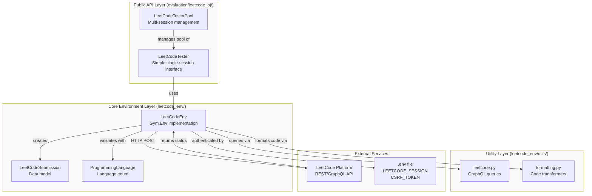
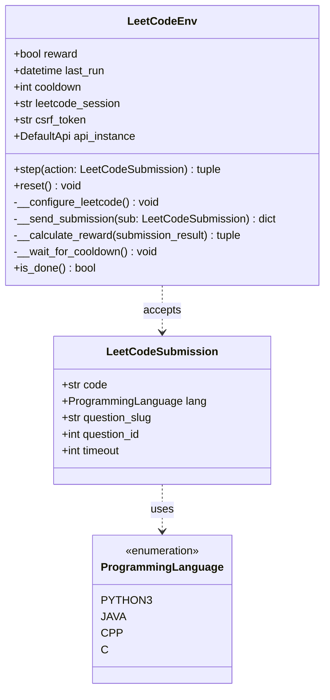
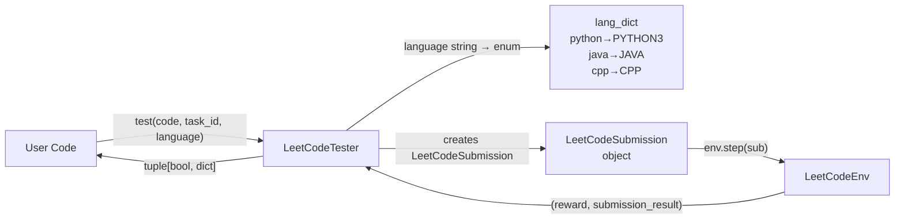
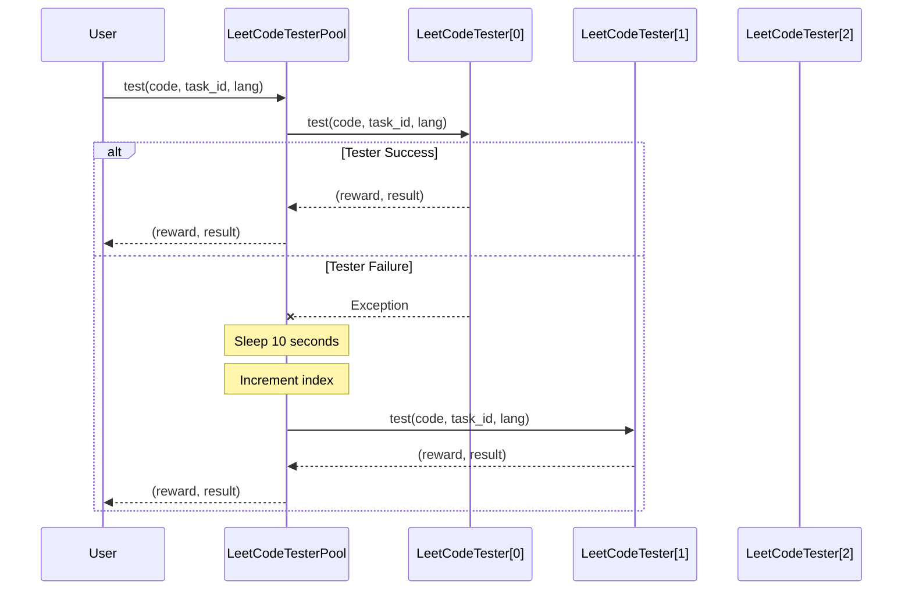
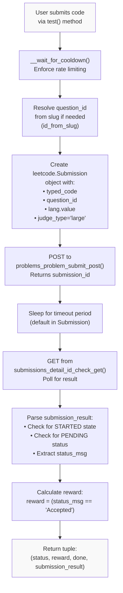
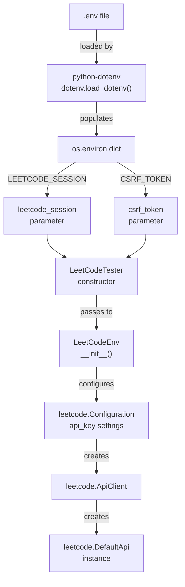
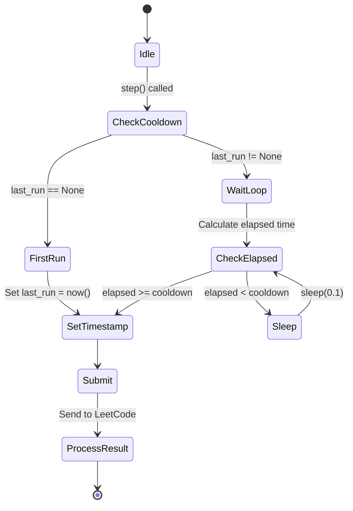
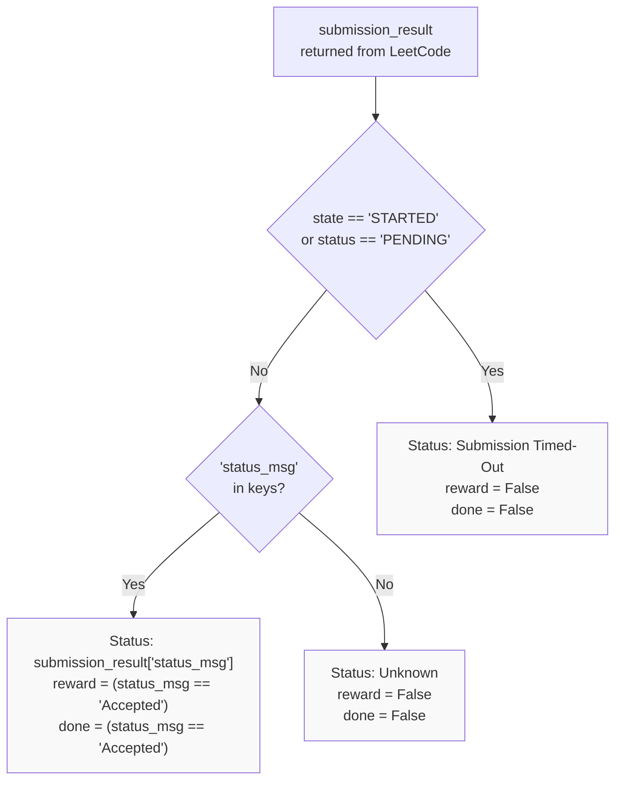
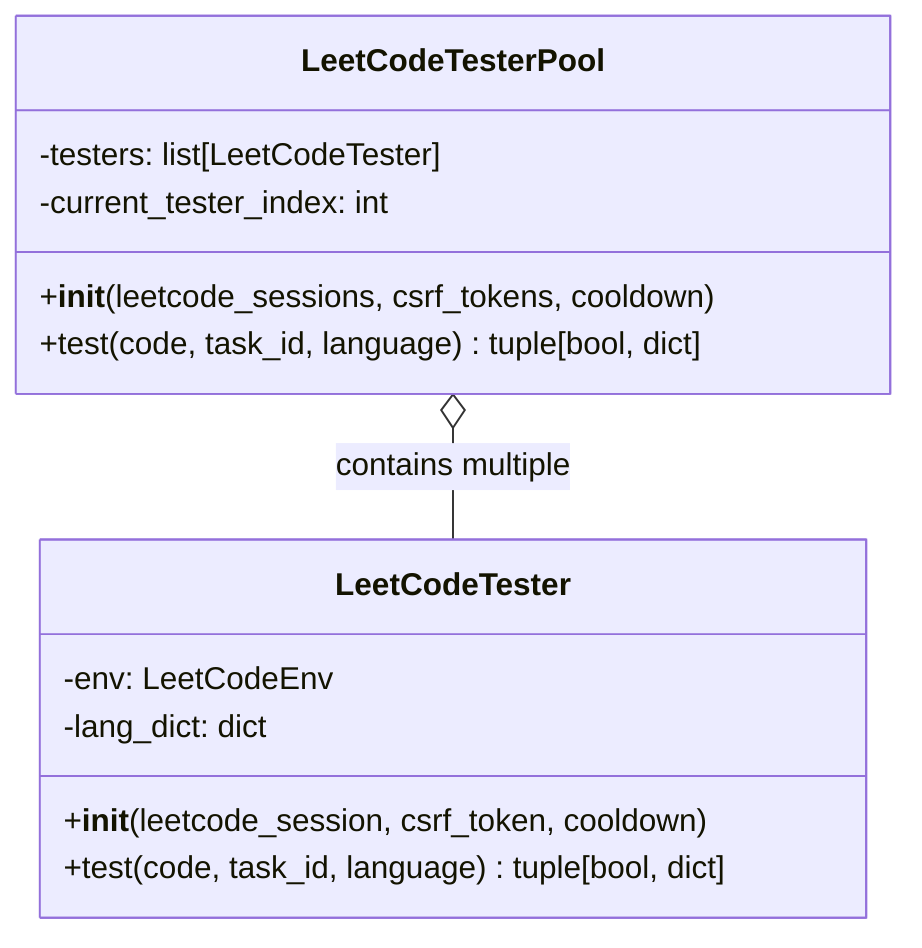

<!-- source: DeepWiki mcp.deepwiki.com · repo thunlp/DebugBench · page 4 Evaluation System · fetched 2026-11-02 -->

# Evaluation System

<details>
<summary>Relevant source files</summary>

The following files were used as context for generating this wiki page:

- [README.md](README.md)
- [evaluation/leetcode_oj/__init__.py](evaluation/leetcode_oj/__init__.py)
- [evaluation/leetcode_oj/leetcode_env/environment.py](evaluation/leetcode_oj/leetcode_env/environment.py)
- [evaluation/leetcode_oj/leetcode_env/utils/__pycache__/leetcode.cpython-310.pyc](evaluation/leetcode_oj/leetcode_env/utils/__pycache__/leetcode.cpython-310.pyc)
- [evaluation/leetcode_oj/leetcode_tester.py](evaluation/leetcode_oj/leetcode_tester.py)
- [evaluation/leetcode_oj/leetcode_tester_pool.py](evaluation/leetcode_oj/leetcode_tester_pool.py)

</details>


## Purpose and Scope

The Evaluation System provides automated infrastructure for testing code submissions against LeetCode's online judge platform. This system enables researchers and developers to programmatically evaluate LLM-generated debugging solutions from the DebugBench dataset against real test cases.

This document covers the core evaluation framework components, submission workflow, and authentication mechanisms. For detailed information about specific components:
- LeetCode Environment details: see [LeetCode Environment](#4.1)
- Submission testing mechanics: see [Submission Testing](#4.2)
- High-level API interfaces: see [LeetCodeTester API](#4.3)
- Rate limiting strategies: see [Rate Limiting and Multi-Session Management](#4.4)
- Code format transformations: see [Code Format Transformations](#4.5)

**Sources:** [README.md:33-34](), [evaluation/leetcode_oj/__init__.py:1-3]()

---

## System Architecture

The evaluation system is organized into three abstraction layers that progressively simplify interaction with the LeetCode platform:



**Sources:** [evaluation/leetcode_oj/__init__.py:1-3](), [evaluation/leetcode_oj/leetcode_env/environment.py:14-128](), [evaluation/leetcode_oj/leetcode_tester.py:22-41]()

---

## Core Components

### LeetCodeEnv

`LeetCodeEnv` is a Gym-compatible environment that implements the core submission and result retrieval logic. It extends `gym.Env` and provides the standard `step()` and `reset()` interface.



**Key Responsibilities:**

| Method | Purpose | Returns |
|--------|---------|---------|
| `step(action)` | Submit code to LeetCode and retrieve result | `(status, reward, done, submission_result)` |
| `reset()` | Reset environment state | `void` |
| `__send_submission()` | Handle HTTP submission via LeetCode API | `dict` with submission result |
| `__calculate_reward()` | Parse result and determine acceptance | `(bool, str)` - reward and status message |
| `__wait_for_cooldown()` | Enforce rate limiting delay | `void` |

The `step()` method returns a 4-tuple matching the Gym interface pattern:
- `status` (str): Status message like "Accepted", "Wrong Answer", "Runtime Error"
- `reward` (bool): `True` if status is "Accepted", `False` otherwise
- `done` (bool): Whether the submission was accepted (terminates episode)
- `submission_result` (dict): Full LeetCode API response with detailed test results

**Sources:** [evaluation/leetcode_oj/leetcode_env/environment.py:14-128]()

---

### LeetCodeTester

`LeetCodeTester` provides a simplified interface that wraps `LeetCodeEnv` for ease of use. It handles language string conversion and provides a single `test()` method.



**Implementation Details:**

The constructor [evaluation/leetcode_oj/leetcode_tester.py:24-33]() accepts:
- `leetcode_session` (str): LeetCode session cookie value
- `csrf_token` (str): CSRF token for authentication
- `cooldown` (int): Seconds to wait between submissions (default: 10)

The `test()` method [evaluation/leetcode_oj/leetcode_tester.py:35-40]() signature:
```python
def test(self, code: str, task_id: str, language: str) -> tuple[bool, dict]
```

Parameters:
- `code`: The source code to test
- `task_id`: LeetCode problem slug (e.g., "two-sum")
- `language`: Language string ("python", "python3", "java", "cpp", "c")

Returns:
- `bool`: Whether code was accepted
- `dict`: Full submission result with test details

**Sources:** [evaluation/leetcode_oj/leetcode_tester.py:22-53]()

---

### LeetCodeTesterPool

`LeetCodeTesterPool` manages multiple `LeetCodeTester` instances for session rotation and failover, enabling more robust and higher-throughput testing.



**Failover Logic:**

The pool implements automatic failover [evaluation/leetcode_oj/leetcode_tester_pool.py:11-19]():
1. Attempt submission with current tester
2. If exception occurs, log error and sleep 10 seconds
3. Rotate to next tester in round-robin fashion
4. Recursively retry with new tester

This design handles:
- **Rate limit errors**: By distributing load across sessions
- **Authentication failures**: By switching to a different authenticated session
- **Network transients**: By retrying with exponential backoff

**Sources:** [evaluation/leetcode_oj/leetcode_tester_pool.py:6-20]()

---

## Submission Workflow

The complete flow from code submission to result processing involves multiple stages with error handling and timeout management:



**Status Determination Logic:**

The `__calculate_reward()` method [evaluation/leetcode_oj/leetcode_env/environment.py:98-116]() implements the following decision tree:

| Condition | status_msg |
|-----------|------------|
| `result == {"state": "STARTED"}` | "Submission Timed-Out" |
| `result["status"] == "PENDING"` | "Submission Timed-Out" |
| `"status_msg" in result.keys()` | Extract `result["status_msg"]` |
| Otherwise | "Unknown" |

Common `status_msg` values from LeetCode:
- `"Accepted"`: All test cases passed
- `"Wrong Answer"`: Failed one or more test cases
- `"Runtime Error"`: Code threw exception during execution
- `"Time Limit Exceeded"`: Execution exceeded time constraint
- `"Memory Limit Exceeded"`: Used too much memory
- `"Compilation Error"`: Syntax errors (rare if code was pre-validated)

**Sources:** [evaluation/leetcode_oj/leetcode_env/environment.py:45-96](), [evaluation/leetcode_oj/leetcode_env/environment.py:98-116]()

---

## Authentication and Configuration

The system requires LeetCode authentication credentials to interact with the platform API. These are obtained from browser session cookies.

### Configuration Mechanism



### Credential Setup

The configuration process [evaluation/leetcode_oj/leetcode_env/environment.py:32-43]() sets multiple authentication headers:

```python
configuration.api_key["x-csrftoken"] = csrf_token
configuration.api_key["csrftoken"] = csrf_token
configuration.api_key["LEETCODE_SESSION"] = leetcode_session
configuration.api_key["Referer"] = "https://leetcode.com"
```

**Obtaining Credentials:**

1. Log in to leetcode.com in a web browser
2. Open browser developer tools (F12)
3. Navigate to Application/Storage → Cookies
4. Copy values:
   - `LEETCODE_SESSION` cookie value
   - `csrftoken` cookie value
5. Store in `.env` file or pass directly to constructor

**Environment Variables:**

```bash
LEETCODE_SESSION=your_session_value_here
CSRF_TOKEN=your_csrf_token_here
```

The system loads these via `dotenv.load_dotenv()` [evaluation/leetcode_oj/leetcode_env/environment.py:22]().

**Sources:** [evaluation/leetcode_oj/leetcode_env/environment.py:21-43](), [evaluation/leetcode_oj/leetcode_tester.py:19-20]()

---

## Rate Limiting and Cooldown Management

LeetCode enforces rate limits on submissions to prevent abuse. The evaluation system implements cooldown mechanisms to avoid triggering these limits.

### Cooldown Implementation



**Cooldown Logic:**

The `__wait_for_cooldown()` method [evaluation/leetcode_oj/leetcode_env/environment.py:118-124]() ensures minimum time between submissions:

1. If `last_run` is `None` (first submission), set timestamp and proceed
2. Otherwise, calculate `elapsed = (now - last_run).total_seconds()`
3. While `elapsed < cooldown`, sleep 0.1 seconds and recalculate
4. Once cooldown expires, update `last_run` and proceed

**Default Values:**

- `LeetCodeTester` default cooldown: 10 seconds [evaluation/leetcode_oj/leetcode_tester.py:24]()
- `LeetCodeTesterPool` default cooldown: 10 seconds [evaluation/leetcode_oj/leetcode_tester_pool.py:7]()
- Customizable via constructor parameter

**Multi-Session Benefits:**

Using `LeetCodeTesterPool` with multiple sessions provides:
- **Higher throughput**: Each session has independent rate limits
- **Fault tolerance**: Failed sessions don't block progress
- **Load distribution**: Submissions spread across accounts

For example, with 3 sessions and 10-second cooldown:
- Single tester: 6 submissions/minute maximum
- Pool of 3: Up to 18 submissions/minute (3× throughput)

**Sources:** [evaluation/leetcode_oj/leetcode_env/environment.py:26](), [evaluation/leetcode_oj/leetcode_env/environment.py:118-124](), [evaluation/leetcode_oj/leetcode_tester_pool.py:7-19]()

---

## Result Processing

The evaluation system returns comprehensive result information including test case details, performance metrics, and error messages.

### Result Dictionary Structure

The `submission_result` dictionary returned by `step()` and `test()` contains:

| Field | Type | Description |
|-------|------|-------------|
| `status_msg` | str | Overall verdict (e.g., "Accepted", "Wrong Answer") |
| `status_code` | int | Numeric status code |
| `compare_result` | str | Detailed comparison of outputs vs expected |
| `total_correct` | int | Number of test cases passed |
| `total_testcases` | int | Total number of test cases |
| `runtime_percentile` | float | Performance percentile (if accepted) |
| `memory_percentile` | float | Memory usage percentile (if accepted) |
| `code_output` | str | Actual program output |
| `expected_output` | str | Expected correct output |
| `std_output` | str | Standard output from program |
| `last_testcase` | str | Input for failed test case |

### Status Interpretation



### Example Result Analysis

For a successful submission:
```python
{
    "status_msg": "Accepted",
    "status_code": 10,
    "total_correct": 52,
    "total_testcases": 52,
    "runtime_percentile": 85.42,
    "memory_percentile": 72.15,
    ...
}
```

For a failed submission:
```python
{
    "status_msg": "Wrong Answer",
    "status_code": 11,
    "total_correct": 48,
    "total_testcases": 52,
    "code_output": "[1, 2, 3]",
    "expected_output": "[1, 2, 3, 4]",
    "last_testcase": "nums = [1,2,3,4], target = 10",
    ...
}
```

**Sources:** [evaluation/leetcode_oj/leetcode_env/environment.py:98-116](), [evaluation/leetcode_oj/leetcode_tester.py:35-40]()

---

## Public Interface Summary

The evaluation system exports two primary classes for external use:



### Usage Examples

**Single Tester:**
```python
from evaluation.leetcode_oj import LeetCodeTester

tester = LeetCodeTester(
    leetcode_session="your_session",
    csrf_token="your_token",
    cooldown=10
)

accepted, result = tester.test(
    code="class Solution:\n    def twoSum(self, nums, target):\n        ...",
    task_id="two-sum",
    language="python"
)
```

**Tester Pool:**
```python
from evaluation.leetcode_oj import LeetCodeTesterPool

pool = LeetCodeTesterPool(
    leetcode_sessions=["session1", "session2", "session3"],
    csrf_tokens=["token1", "token2", "token3"],
    cooldown=10
)

accepted, result = pool.test(code, task_id, language)
# Automatically uses next available session if one fails
```

These interfaces are exported via [evaluation/leetcode_oj/__init__.py:1-3]() for convenient importing.

**Sources:** [evaluation/leetcode_oj/__init__.py:1-3](), [evaluation/leetcode_oj/leetcode_tester.py:22-53](), [evaluation/leetcode_oj/leetcode_tester_pool.py:6-20]()

---

