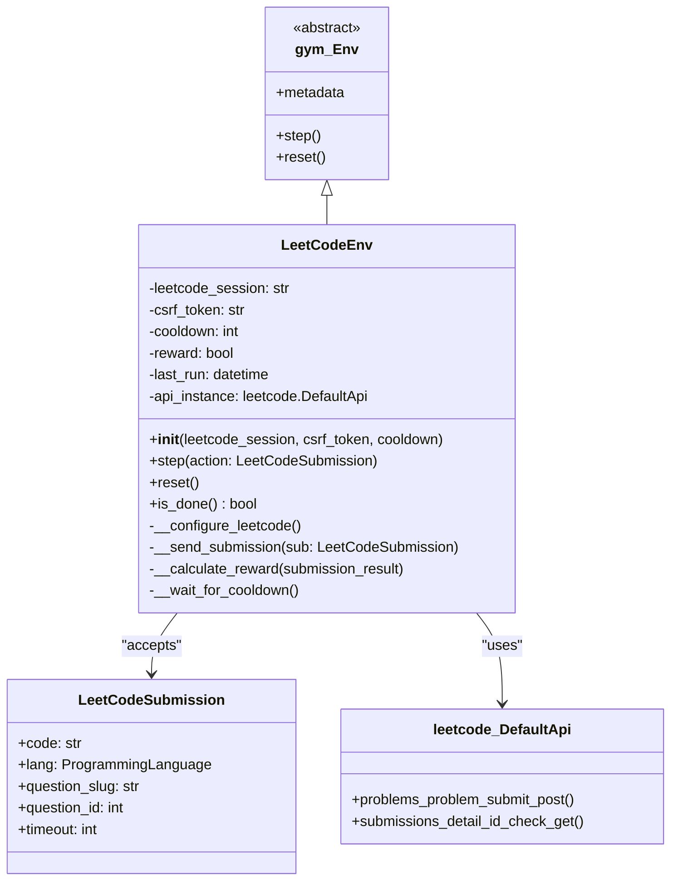
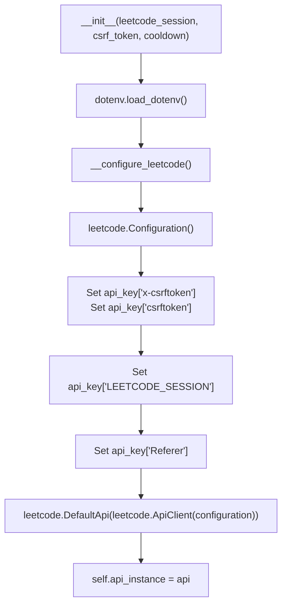
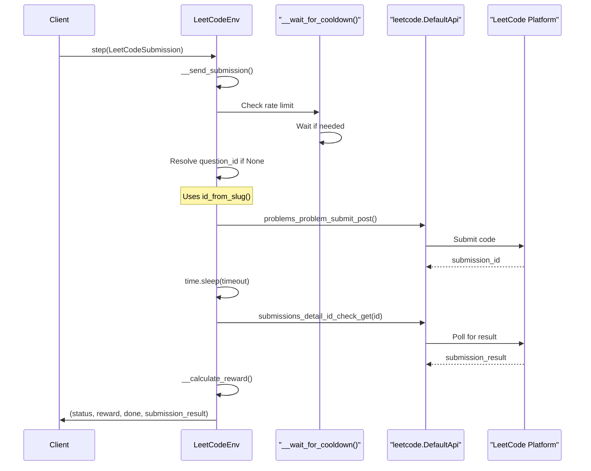
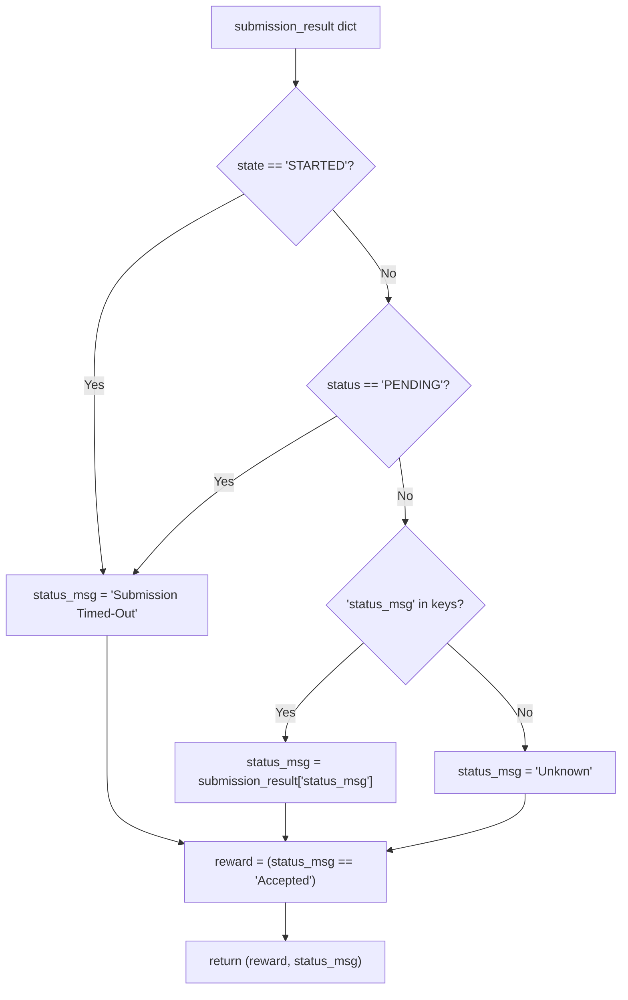
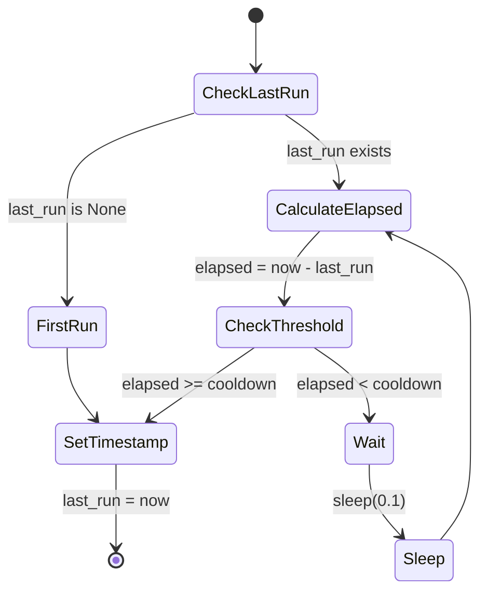
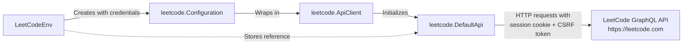

<!-- source: DeepWiki mcp.deepwiki.com · repo thunlp/DebugBench · page 4.1 LeetCode Environment · fetched 2026-11-02 -->

# LeetCode Environment

<details>
<summary>Relevant source files</summary>

The following files were used as context for generating this wiki page:

- [evaluation/leetcode_oj/__init__.py](evaluation/leetcode_oj/__init__.py)
- [evaluation/leetcode_oj/leetcode_env/environment.py](evaluation/leetcode_oj/leetcode_env/environment.py)
- [evaluation/leetcode_oj/leetcode_env/utils/__pycache__/leetcode.cpython-310.pyc](evaluation/leetcode_oj/leetcode_env/utils/__pycache__/leetcode.cpython-310.pyc)
- [evaluation/leetcode_oj/leetcode_tester.py](evaluation/leetcode_oj/leetcode_tester.py)
- [evaluation/leetcode_oj/leetcode_tester_pool.py](evaluation/leetcode_oj/leetcode_tester_pool.py)
- [leetcode_data/validated/leetcode_oj/leetcode_env/environment.py](leetcode_data/validated/leetcode_oj/leetcode_env/environment.py)

</details>


## Purpose and Scope

This document covers the `LeetCodeEnv` class, a Gym-compatible environment that provides the core interface for submitting code to the LeetCode platform and retrieving execution results. The environment handles authentication, submission lifecycle, cooldown management, and result parsing.

For information about the high-level testing API that wraps this environment, see [LeetCodeTester API](#4.3). For details on rate limiting and multi-session management, see [Rate Limiting and Multi-Session Management](#4.4). For submission format transformations, see [Code Format Transformations](#4.5).

## Overview

The `LeetCodeEnv` class implements the OpenAI Gym environment interface to interact with LeetCode's online judge system. It provides a standardized `step()` and `reset()` interface for submitting code solutions and receiving test results, making it suitable for reinforcement learning workflows or automated testing pipelines.

**Sources:** [evaluation/leetcode_oj/leetcode_env/environment.py:14-128]()

## Class Structure

The environment consists of a main class with public and private methods organized by responsibility:



**Sources:** [evaluation/leetcode_oj/leetcode_env/environment.py:14-128](), [evaluation/leetcode_oj/leetcode_env/types.py]()

## Initialization and Configuration

### Constructor Parameters

The `LeetCodeEnv` constructor accepts the following parameters:

| Parameter | Type | Default | Description |
|-----------|------|---------|-------------|
| `leetcode_session` | str | None | LeetCode session cookie for authentication |
| `csrf_token` | str | None | CSRF token for API requests |
| `cooldown` | int | 0 | Minimum seconds between submissions to avoid rate limiting |

**Sources:** [evaluation/leetcode_oj/leetcode_env/environment.py:21-29]()

### Authentication Configuration

The environment configures the LeetCode API client through the `__configure_leetcode()` method:



The configuration sets up four authentication parameters:
- `x-csrftoken`: CSRF token for request validation
- `csrftoken`: Alternative CSRF token header
- `LEETCODE_SESSION`: Session cookie identifying the authenticated user
- `Referer`: Set to `https://leetcode.com` for request origin validation

**Sources:** [evaluation/leetcode_oj/leetcode_env/environment.py:32-43]()

## Step Interface

### Method Signature

The `step()` method follows the Gym environment interface pattern:

```python
def step(action: LeetCodeSubmission) -> tuple[str, bool, bool, dict]:
    """
    Returns:
        status (str): 'Accepted' | 'Runtime Error'| 'Wrong Answer' | 'Submission Timed-Out' | 'Unknown'
        reward (bool): True if status is 'Accepted', False otherwise
        done (bool): True if status is 'Accepted', False otherwise
        submission_result (dict): LeetCode API response
    """
```

**Sources:** [evaluation/leetcode_oj/leetcode_env/environment.py:45-66]()

### Execution Flow



**Sources:** [evaluation/leetcode_oj/leetcode_env/environment.py:45-96]()

### Submission Process

The `__send_submission()` method executes the following steps:

1. **Cooldown enforcement**: Calls `__wait_for_cooldown()` to respect rate limits [evaluation/leetcode_oj/leetcode_env/environment.py:72]()

2. **Question ID resolution**: If `question_id` is not provided, resolves it from `question_slug` using `id_from_slug()` utility [evaluation/leetcode_oj/leetcode_env/environment.py:74-75]()

3. **Submission object creation**: Constructs a `leetcode.Submission` with:
   - `judge_type="large"`: Uses full test suite (not sample tests)
   - `typed_code`: The code to submit
   - `question_id`: Problem identifier
   - `test_mode=False`: Production submission (counts toward statistics)
   - `lang`: Programming language from `ProgrammingLanguage` enum

4. **Submission POST**: Submits code via `problems_problem_submit_post()` [evaluation/leetcode_oj/leetcode_env/environment.py:86-88]()

5. **Wait for execution**: Sleeps for the timeout duration to allow LeetCode to execute tests [evaluation/leetcode_oj/leetcode_env/environment.py:90]()

6. **Result retrieval**: Polls `submissions_detail_id_check_get()` to fetch execution results [evaluation/leetcode_oj/leetcode_env/environment.py:92-94]()

**Sources:** [evaluation/leetcode_oj/leetcode_env/environment.py:71-96]()

## Reward Calculation

The `__calculate_reward()` method maps LeetCode's submission results to boolean rewards:



### Status Categories

| Condition | status_msg | reward |
|-----------|------------|--------|
| `submission_result == {"state": "STARTED"}` | "Submission Timed-Out" | False |
| `submission_result["status"] == "PENDING"` | "Submission Timed-Out" | False |
| `"status_msg" in submission_result` | Value from `submission_result["status_msg"]` | True if "Accepted" |
| None of the above | "Unknown" | False |

Common `status_msg` values from LeetCode include:
- `"Accepted"`: All test cases passed (reward = True)
- `"Wrong Answer"`: Incorrect output for some test cases
- `"Runtime Error"`: Code crashed during execution
- `"Time Limit Exceeded"`: Code took too long to execute
- `"Memory Limit Exceeded"`: Code used too much memory
- `"Compilation Error"`: Code failed to compile
- `"Output Limit Exceeded"`: Output was too large

**Sources:** [evaluation/leetcode_oj/leetcode_env/environment.py:98-116]()

## Cooldown Management

The `__wait_for_cooldown()` method implements rate limiting to prevent LeetCode from blocking the account:



The algorithm:
1. If `last_run` is `None`, set it to current time and proceed immediately
2. Otherwise, calculate elapsed time since last submission
3. If elapsed time is less than `cooldown`, sleep for 0.1 seconds and repeat check
4. Once cooldown period has passed, update `last_run` and allow submission

This ensures at least `cooldown` seconds pass between consecutive submissions.

**Sources:** [evaluation/leetcode_oj/leetcode_env/environment.py:118-124]()

## Reset Interface

The `reset()` method resets the environment state to prepare for a new episode:

```python
def reset(self):
    self.reward = False
```

This simple implementation only resets the `reward` flag. The `last_run` timestamp is intentionally not reset, ensuring cooldown enforcement continues across episodes.

The `is_done()` method returns the current reward status, which can be used to determine if the episode is complete:

```python
def is_done(self):
    return self.reward
```

**Sources:** [evaluation/leetcode_oj/leetcode_env/environment.py:68-69](), [evaluation/leetcode_oj/leetcode_env/environment.py:126-127]()

## Integration with LeetCode API

### API Client Configuration

The environment uses the `leetcode` Python SDK, which provides a `DefaultApi` client with the following key methods:

| Method | Purpose | Parameters | Returns |
|--------|---------|------------|---------|
| `problems_problem_submit_post()` | Submit code solution | `problem` (slug), `body` (Submission) | Submission ID |
| `submissions_detail_id_check_get()` | Retrieve submission result | `id` (submission_id) | Submission result dict |

**Sources:** [evaluation/leetcode_oj/leetcode_env/environment.py:86-94]()

### Authentication Flow



All requests to LeetCode include:
- `LEETCODE_SESSION` cookie for user authentication
- `csrftoken` and `x-csrftoken` headers for CSRF protection
- `Referer: https://leetcode.com` header for origin validation

**Sources:** [evaluation/leetcode_oj/leetcode_env/environment.py:32-43]()

## Usage Example

A typical usage pattern with the environment:

```python
# Initialize environment
env = LeetCodeEnv(
    leetcode_session="your_session_cookie",
    csrf_token="your_csrf_token",
    cooldown=10  # 10 seconds between submissions
)

# Create submission
from leetcode_env.types import LeetCodeSubmission, ProgrammingLanguage

submission = LeetCodeSubmission(
    code="class Solution:\n    def twoSum(self, nums, target):\n        ...",
    lang=ProgrammingLanguage.PYTHON3,
    question_slug="two-sum"
)

# Submit and get result
status, reward, done, result = env.step(submission)

# Check result
if reward:
    print("Solution accepted!")
    print(f"Runtime: {result.get('status_runtime')}")
else:
    print(f"Status: {status}")
    if 'compare_result' in result:
        print(f"Failed test: {result['compare_result']}")

# Reset for next problem
env.reset()
```

**Sources:** [evaluation/leetcode_oj/leetcode_tester.py:22-52]()

## Error Handling

The environment does not implement explicit error handling for API exceptions. Expected exceptions include:

- `leetcode.rest.ApiException: (403) Reason: Forbidden` - Invalid or expired credentials [evaluation/leetcode_oj/leetcode_env/environment.py:85]()
- Network errors from `api_instance` methods
- Timeout errors if LeetCode platform is slow to respond

Callers should wrap `step()` calls in try-except blocks to handle these failures. The [LeetCodeTesterPool](#4.4) class implements automatic failover to handle such errors.

**Sources:** [evaluation/leetcode_oj/leetcode_env/environment.py:85-88]()

## File Locations

The `LeetCodeEnv` class and supporting utilities are organized as follows:

```
evaluation/
└── leetcode_oj/
    └── leetcode_env/
        ├── environment.py         # LeetCodeEnv class
        ├── types.py               # LeetCodeSubmission, ProgrammingLanguage
        └── utils/
            └── leetcode.py        # id_from_slug(), metadata_from_slug()
```

**Sources:** [evaluation/leetcode_oj/leetcode_env/environment.py:1-128](), [evaluation/leetcode_oj/__init__.py:1-3]()

---

