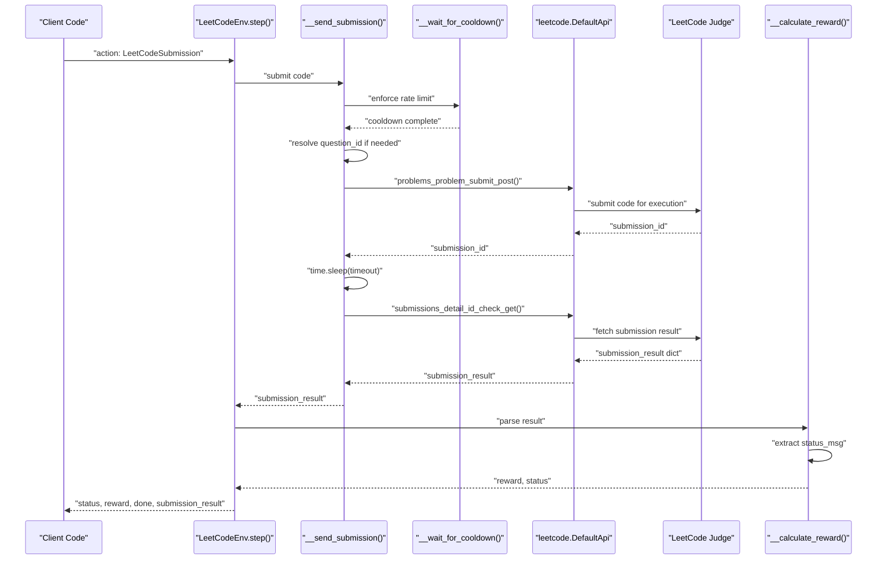
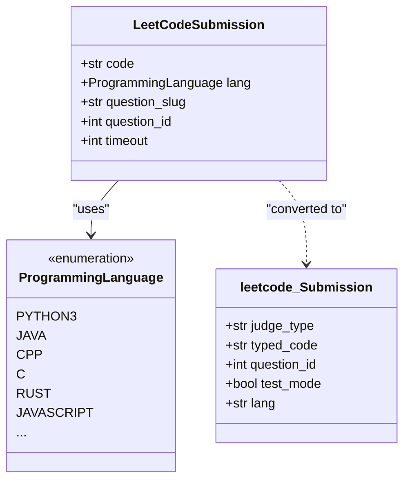
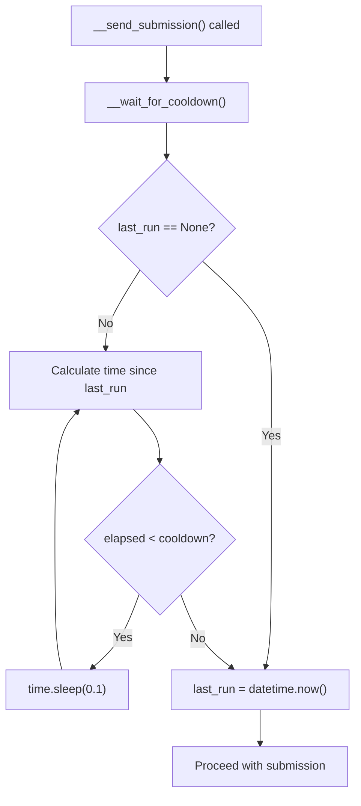
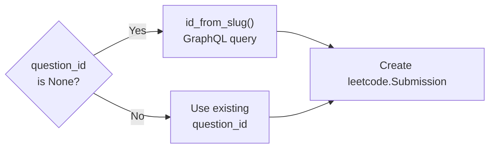
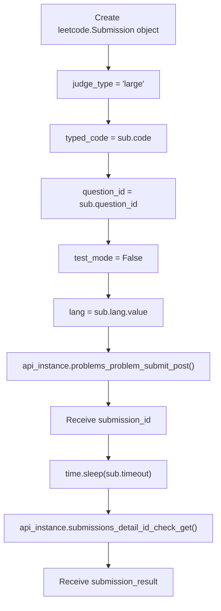
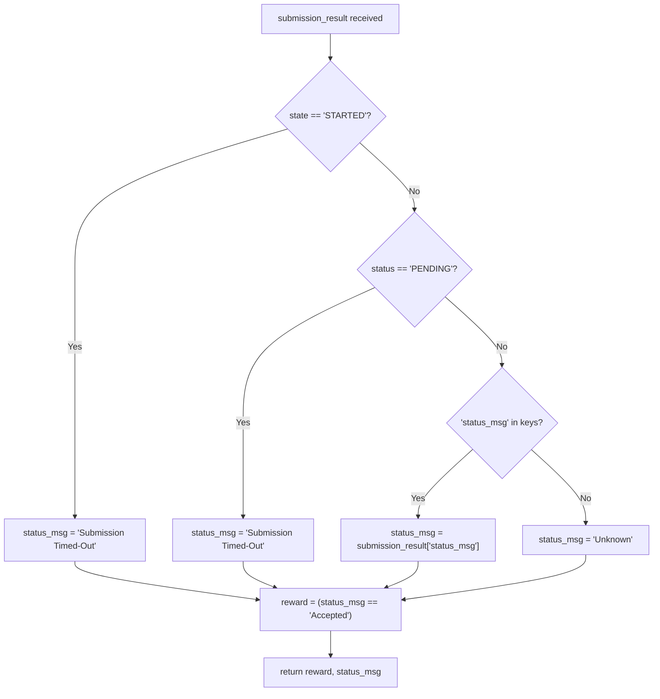
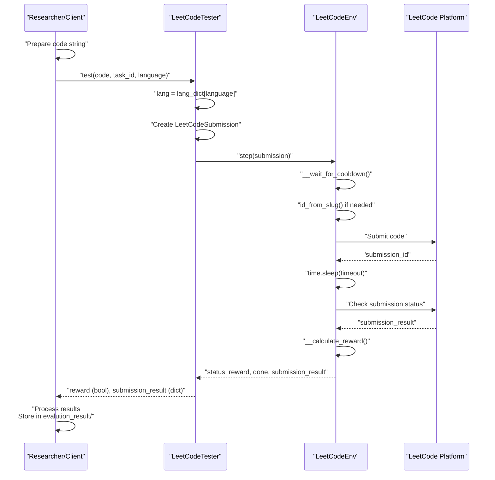
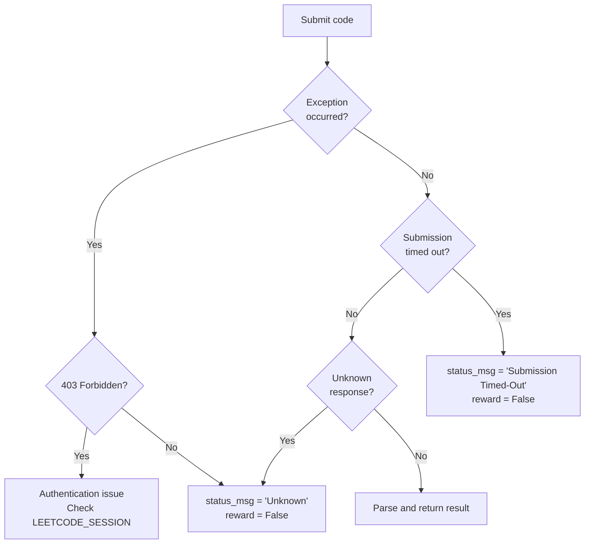
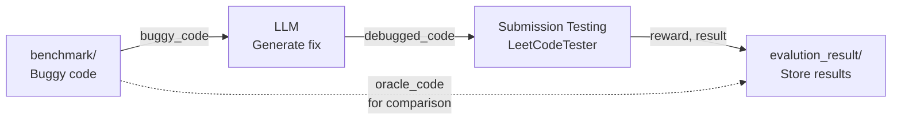

<!-- source: DeepWiki mcp.deepwiki.com · repo thunlp/DebugBench · page 4.2 Submission Testing · fetched 2026-11-02 -->

# Submission Testing

<details>
<summary>Relevant source files</summary>

The following files were used as context for generating this wiki page:

- [evaluation/leetcode_oj/__init__.py](evaluation/leetcode_oj/__init__.py)
- [evaluation/leetcode_oj/leetcode_env/environment.py](evaluation/leetcode_oj/leetcode_env/environment.py)
- [evaluation/leetcode_oj/leetcode_env/utils/__pycache__/leetcode.cpython-310.pyc](evaluation/leetcode_oj/leetcode_env/utils/__pycache__/leetcode.cpython-310.pyc)
- [evaluation/leetcode_oj/leetcode_tester.py](evaluation/leetcode_oj/leetcode_tester.py)
- [evaluation/leetcode_oj/leetcode_tester_pool.py](evaluation/leetcode_oj/leetcode_tester_pool.py)
- [leetcode_data/validated/leetcode_oj/leetcode_tester.py](leetcode_data/validated/leetcode_oj/leetcode_tester.py)

</details>


This document explains how code submissions are tested through the LeetCode platform, including the submission format, the testing workflow, result parsing, and status determination logic. It covers the mechanics of sending code to LeetCode's online judge and interpreting the responses.

For information about the Gym environment interface and initialization, see [LeetCode Environment](#4.1). For the high-level tester API, see [LeetCodeTester API](#4.3). For rate limiting and cooldown management, see [Rate Limiting and Multi-Session Management](#4.4).

## Submission Workflow Overview

The submission testing process follows a specific sequence from code submission to result interpretation:



**Sources:** [evaluation/leetcode_oj/leetcode_env/environment.py:45-96]()

## Submission Object Structure

The `LeetCodeSubmission` object encapsulates all information needed to test a code submission:



| Field | Type | Description |
|-------|------|-------------|
| `code` | str | The source code to be tested |
| `lang` | ProgrammingLanguage | Programming language enum value |
| `question_slug` | str | LeetCode problem identifier (e.g., "two-sum") |
| `question_id` | int | Numeric problem ID (optional, auto-resolved if None) |
| `timeout` | int | Seconds to wait before checking results (default varies) |

**Sources:** [evaluation/leetcode_oj/leetcode_env/types.py](), [evaluation/leetcode_oj/leetcode_env/environment.py:74-83]()

## Submission Process

### Step 1: Cooldown Enforcement

Before submitting, the system enforces a cooldown period to prevent rate limiting:



**Sources:** [evaluation/leetcode_oj/leetcode_env/environment.py:118-124]()

### Step 2: Question ID Resolution

If `question_id` is not provided, it is automatically resolved from the `question_slug`:



The `id_from_slug()` function queries LeetCode's GraphQL API:

```graphql
query getQuestionDetail($titleSlug: String!) {
  question(titleSlug: $titleSlug) {
    questionId
  }
}
```

**Sources:** [evaluation/leetcode_oj/leetcode_env/environment.py:74-75](), [evaluation/leetcode_oj/leetcode_env/utils/leetcode.py]()

### Step 3: Submission Creation and Execution

The submission is created and sent to LeetCode:



**Sources:** [evaluation/leetcode_oj/leetcode_env/environment.py:77-94]()

## Result Parsing and Status Determination

The `__calculate_reward()` method parses the submission result and determines the status:



**Sources:** [evaluation/leetcode_oj/leetcode_env/environment.py:98-116]()

### Status Messages

The system recognizes the following status messages:

| Status Message | Meaning | Reward | Description |
|----------------|---------|--------|-------------|
| `"Accepted"` | Success | `True` | Code passed all test cases |
| `"Wrong Answer"` | Failure | `False` | Code produced incorrect output on at least one test |
| `"Runtime Error"` | Failure | `False` | Code crashed during execution |
| `"Time Limit Exceeded"` | Failure | `False` | Code exceeded execution time limit |
| `"Memory Limit Exceeded"` | Failure | `False` | Code exceeded memory limit |
| `"Compile Error"` | Failure | `False` | Code failed to compile (for compiled languages) |
| `"Submission Timed-Out"` | Unknown | `False` | Submission status not available within timeout |
| `"Unknown"` | Unknown | `False` | Unexpected response format |

**Sources:** [evaluation/leetcode_oj/leetcode_env/environment.py:98-116]()

## Submission Result Structure

The `submission_result` dictionary returned by LeetCode contains detailed information:

```mermaid
graph TB
    Result["submission_result dict"]
    
    Result --> StatusMsg["status_msg<br/>String: 'Accepted', 'Wrong Answer', etc."]
    Result --> Status["status<br/>String: 'PENDING', 'SUCCESS', etc."]
    Result --> State["state<br/>String: 'STARTED', 'SUCCESS'"]
    Result --> CompareResult["compare_result<br/>String: comparison details"]
    Result --> TotalCorrect["total_correct<br/>Integer: passed test cases"]
    Result --> TotalTestcases["total_testcases<br/>Integer: total test cases"]
    Result --> RuntimePercentile["runtime_percentile<br/>Float: performance ranking"]
    Result --> MemoryPercentile["memory_percentile<br/>Float: memory usage ranking"]
    Result --> CodeOutput["code_output<br/>String: stdout/stderr"]
    Result --> StdOutput["std_output<br/>String: expected output"]
    Result --> ExpectedOutput["expected_output<br/>String: expected answer"]
    Result --> LastTestcase["last_testcase<br/>String: failing test case"]
    Result --> RuntimeError["runtime_error<br/>String: error message"]
    Result --> FullRuntimeError["full_runtime_error<br/>String: full stack trace"]
```



**Example Accepted Submission:**
```json
{
  "status_msg": "Accepted",
  "status": "SUCCESS",
  "total_correct": 150,
  "total_testcases": 150,
  "runtime_percentile": 85.42,
  "memory_percentile": 73.21,
  "compare_result": "1111...1111"
}
```

**Example Wrong Answer Submission:**
```json
{
  "status_msg": "Wrong Answer",
  "status": "SUCCESS",
  "total_correct": 42,
  "total_testcases": 150,
  "compare_result": "1111...0001",
  "code_output": "[1,2,3]",
  "expected_output": "[1,2,4]",
  "last_testcase": "[1,2]"
}
```

**Example Runtime Error Submission:**
```json
{
  "status_msg": "Runtime Error",
  "status": "SUCCESS",
  "runtime_error": "IndexError: list index out of range",
  "full_runtime_error": "Traceback (most recent call last):\n  ...",
  "last_testcase": "[1,2,3]"
}
```

**Sources:** [evaluation/leetcode_oj/leetcode_env/environment.py:92-95]()

## Testing Workflow Example

The complete workflow from client code perspective:



**Code Example:**
```python
# From evaluation/leetcode_oj/leetcode_tester.py
tester = LeetCodeTester(leetcode_session, csrf_token, cooldown=10)
code = "class Solution:\n    def twoSum(self, nums, target):\n        ..."
task_id = "two-sum"
language = "python"

# Test returns (reward, submission_result)
reward, result = tester.test(code, task_id, language)

# reward is True if status_msg == "Accepted"
if reward:
    print("Code passed all tests!")
    print(f"Runtime percentile: {result['runtime_percentile']}")
else:
    print(f"Failed with status: {result['status_msg']}")
    if 'last_testcase' in result:
        print(f"Failed on: {result['last_testcase']}")
```

**Sources:** [evaluation/leetcode_oj/leetcode_tester.py:35-40]()

## Step Method Return Values

The `LeetCodeEnv.step()` method returns a 4-tuple following the Gym environment interface:

| Position | Name | Type | Description |
|----------|------|------|-------------|
| 0 | `status` | str | Status message from LeetCode |
| 1 | `reward` | bool | `True` if Accepted, `False` otherwise |
| 2 | `done` | bool | Same as `reward` (episode ends on success) |
| 3 | `submission_result` | dict | Full result dictionary from LeetCode |

**Sources:** [evaluation/leetcode_oj/leetcode_env/environment.py:45-66]()

## Language Support

The tester supports multiple programming languages through the `ProgrammingLanguage` enum:

| Language String | ProgrammingLanguage Enum | LeetCode API Value |
|-----------------|--------------------------|-------------------|
| `"python"` | `PYTHON3` | `"python3"` |
| `"python3"` | `PYTHON3` | `"python3"` |
| `"java"` | `JAVA` | `"java"` |
| `"cpp"` | `CPP` | `"cpp"` |
| `"c"` | `C` | `"c"` |

The language mapping is defined in the `LeetCodeTester` class:

**Sources:** [evaluation/leetcode_oj/leetcode_tester.py:27-33]()

## Error Handling

Common submission errors and their handling:



**Sources:** [evaluation/leetcode_oj/leetcode_env/environment.py:85-114]()

## Integration with Evaluation Pipeline

The submission testing integrates into the broader evaluation workflow:



**Sources:** [evaluation/leetcode_oj/leetcode_tester.py](), [evaluation/leetcode_oj/leetcode_env/environment.py]()

---

