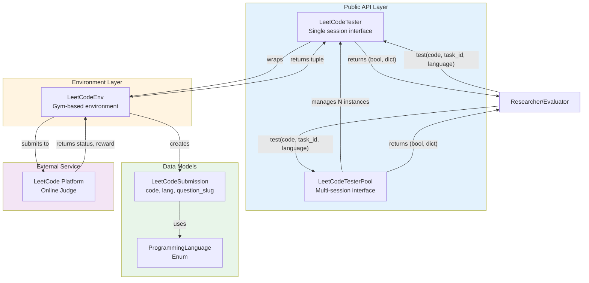
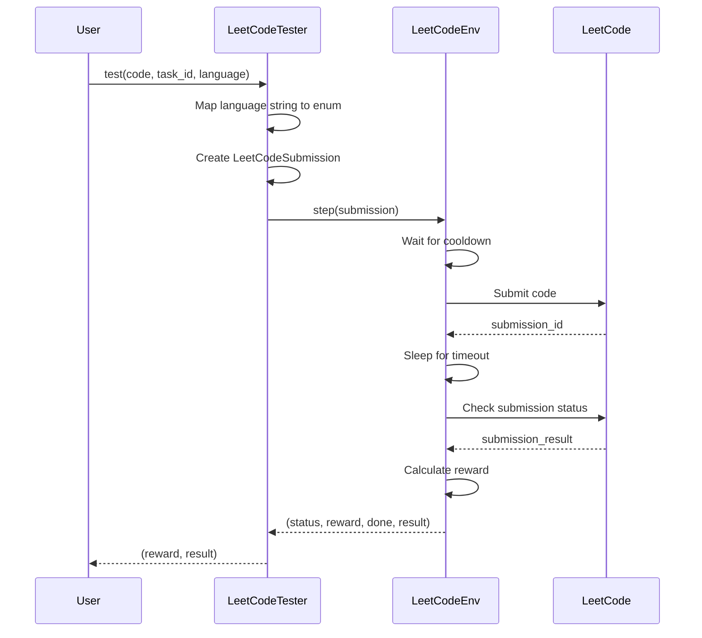
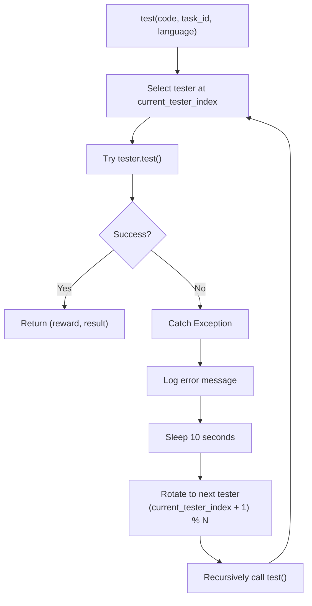
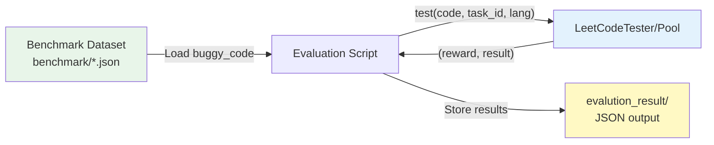

<!-- source: DeepWiki mcp.deepwiki.com · repo thunlp/DebugBench · page 4.3 LeetCodeTester API · fetched 2026-11-02 -->

# LeetCodeTester API

<details>
<summary>Relevant source files</summary>

The following files were used as context for generating this wiki page:

- [evaluation/leetcode_oj/__init__.py](evaluation/leetcode_oj/__init__.py)
- [evaluation/leetcode_oj/leetcode_env/environment.py](evaluation/leetcode_oj/leetcode_env/environment.py)
- [evaluation/leetcode_oj/leetcode_env/utils/__pycache__/leetcode.cpython-310.pyc](evaluation/leetcode_oj/leetcode_env/utils/__pycache__/leetcode.cpython-310.pyc)
- [evaluation/leetcode_oj/leetcode_tester.py](evaluation/leetcode_oj/leetcode_tester.py)
- [evaluation/leetcode_oj/leetcode_tester_pool.py](evaluation/leetcode_oj/leetcode_tester_pool.py)
- [leetcode_data/validated/leetcode_oj/__init__.py](leetcode_data/validated/leetcode_oj/__init__.py)

</details>


This document describes the high-level testing interfaces provided by the DebugBench evaluation system: `LeetCodeTester` and `LeetCodeTesterPool`. These classes provide simplified APIs for submitting code to LeetCode and retrieving execution results, abstracting away the complexities of the underlying Gym environment.

For details about the lower-level LeetCode environment implementation, see [LeetCode Environment](#4.1). For information about session management and rate limiting strategies, see [Rate Limiting and Multi-Session Management](#4.4).

**Sources:** [evaluation/leetcode_oj/leetcode_tester.py](), [evaluation/leetcode_oj/leetcode_tester_pool.py](), [evaluation/leetcode_oj/__init__.py]()

---

## Architecture Overview



**Diagram: LeetCodeTester API Architecture** - Shows how the high-level testing interfaces wrap the LeetCodeEnv and provide simplified access to LeetCode submission testing.

**Sources:** [evaluation/leetcode_oj/leetcode_tester.py:22-41](), [evaluation/leetcode_oj/leetcode_tester_pool.py:6-19](), [evaluation/leetcode_oj/leetcode_env/environment.py:14-67]()

---

## LeetCodeTester Class

### Purpose

`LeetCodeTester` provides a simplified interface for submitting code to LeetCode and retrieving execution results. It wraps the `LeetCodeEnv` Gym environment and handles language string conversion, making it easier to integrate into evaluation pipelines.

**Sources:** [evaluation/leetcode_oj/leetcode_tester.py:22-41]()

### Initialization

```python
class LeetCodeTester(object):
    def __init__(self, leetcode_session: str=None, csrf_token: str=None, cooldown: int=10)
```

#### Parameters

| Parameter | Type | Default | Description |
|-----------|------|---------|-------------|
| `leetcode_session` | `str` | `None` | LeetCode session cookie for authentication |
| `csrf_token` | `str` | `None` | CSRF token for API requests |
| `cooldown` | `int` | `10` | Minimum seconds between submissions (rate limiting) |

The constructor initializes an internal `LeetCodeEnv` instance and sets up language mappings. If `leetcode_session` or `csrf_token` are not provided, the constructor attempts to read them from environment variables.

**Sources:** [evaluation/leetcode_oj/leetcode_tester.py:24-33]()

### Language Mapping

The tester maintains a dictionary mapping language strings to `ProgrammingLanguage` enum values:

| Input String | Enum Value |
|--------------|------------|
| `"python"` | `ProgrammingLanguage.PYTHON3` |
| `"python3"` | `ProgrammingLanguage.PYTHON3` |
| `"java"` | `ProgrammingLanguage.JAVA` |
| `"c"` | `ProgrammingLanguage.C` |
| `"cpp"` | `ProgrammingLanguage.CPP` |

This mapping allows users to specify languages using simple strings rather than enum constants.

**Sources:** [evaluation/leetcode_oj/leetcode_tester.py:27-33]()

### test() Method

```python
def test(self, code: str, task_id: str, language: str) -> tuple[bool, dict]
```

The primary method for testing code submissions.

#### Parameters

| Parameter | Type | Description |
|-----------|------|-------------|
| `code` | `str` | Source code to test |
| `task_id` | `str` | LeetCode problem slug (e.g., `"two-sum"`) |
| `language` | `str` | Programming language (`"python"`, `"java"`, `"cpp"`, etc.) |

#### Returns

A tuple containing:
- `reward` (`bool`): `True` if the submission was accepted, `False` otherwise
- `submission_result` (`dict`): Complete LeetCode API response containing:
  - `status_msg`: Status string (`"Accepted"`, `"Wrong Answer"`, `"Runtime Error"`, etc.)
  - `total_correct`: Number of test cases passed
  - `total_testcases`: Total number of test cases
  - `runtime_percentile`: Runtime performance percentile
  - `memory_percentile`: Memory usage percentile
  - Additional metadata fields

#### Workflow



**Diagram: LeetCodeTester.test() Execution Flow** - Shows how a test request flows through the tester to the environment and LeetCode platform.

**Sources:** [evaluation/leetcode_oj/leetcode_tester.py:35-40](), [evaluation/leetcode_oj/leetcode_env/environment.py:45-66]()

### Usage Example

The module includes a test case demonstrating basic usage:

```python
# Initialize tester with credentials
tester = LeetCodeTester(
    leetcode_session=leetcode_session,
    csrf_token=csrf_token,
    cooldown=10
)

# Test code submissions
task_id = "make-number-of-distinct-characters-equal"
reward, result = tester.test(code, task_id, "python")

# reward: True if accepted, False otherwise
# result: dict with status_msg, total_correct, etc.
```

**Sources:** [evaluation/leetcode_oj/leetcode_tester.py:43-52]()

---

## LeetCodeTesterPool Class

### Purpose

`LeetCodeTesterPool` manages multiple `LeetCodeTester` instances to provide automatic failover and session rotation. This is essential for large-scale evaluations where rate limits or session issues may occur with a single account.

**Sources:** [evaluation/leetcode_oj/leetcode_tester_pool.py:6-19]()

### Initialization

```python
class LeetCodeTesterPool:
    def __init__(self, leetcode_sessions, csrf_tokens, cooldown=10)
```

#### Parameters

| Parameter | Type | Description |
|-----------|------|-------------|
| `leetcode_sessions` | `list[str]` | List of LeetCode session cookies |
| `csrf_tokens` | `list[str]` | List of CSRF tokens (must match sessions) |
| `cooldown` | `int` | Cooldown period for each tester (default: 10) |

The constructor creates a `LeetCodeTester` instance for each session/token pair and initializes the rotation index to 0.

**Sources:** [evaluation/leetcode_oj/leetcode_tester_pool.py:7-9]()

### Failover Mechanism



**Diagram: LeetCodeTesterPool Failover Strategy** - Automatic rotation to the next tester when a submission fails.

**Sources:** [evaluation/leetcode_oj/leetcode_tester_pool.py:11-19]()

### test() Method

```python
def test(self, code: str, task_id: str, language: str) -> tuple[bool, dict]
```

The interface is identical to `LeetCodeTester.test()`, but with automatic failover:

1. Selects the tester at `current_tester_index`
2. Attempts to execute the test
3. On success: returns the result
4. On exception:
   - Logs the error with tester index
   - Sleeps for 10 seconds
   - Rotates to next tester (circular)
   - Recursively retries with the next tester

This ensures that temporary failures (rate limits, session expirations) don't halt the evaluation process.

**Sources:** [evaluation/leetcode_oj/leetcode_tester_pool.py:11-19]()

### Usage Example

```python
import os
import dotenv

dotenv.load_dotenv()

# Load multiple sessions from environment
leetcode_sessions = [
    os.getenv('LEETCODE_SESSION1'),
    os.getenv('LEETCODE_SESSION2'),
    os.getenv('LEETCODE_SESSION3')
]
csrf_tokens = [
    os.getenv('CSRF_TOKEN1'),
    os.getenv('CSRF_TOKEN2'),
    os.getenv('CSRF_TOKEN3')
]

# Initialize pool
pool = LeetCodeTesterPool(
    leetcode_sessions=leetcode_sessions,
    csrf_tokens=csrf_tokens,
    cooldown=10
)

# Use pool exactly like a single tester
reward, result = pool.test(code, task_id, "python")
```

**Sources:** [evaluation/leetcode_oj/leetcode_tester_pool.py:37-50]()

---

## API Comparison

| Feature | LeetCodeTester | LeetCodeTesterPool |
|---------|----------------|-------------------|
| **Purpose** | Single-session testing | Multi-session with failover |
| **Sessions** | 1 | N (configurable) |
| **Failover** | No | Yes, automatic rotation |
| **Cooldown** | Per instance | Per tester in pool |
| **Error Handling** | Raises exceptions | Catches and retries |
| **Use Case** | Small-scale testing, debugging | Large-scale evaluation, production |
| **Complexity** | Simple | Moderate |

---

## Integration with Evaluation System



**Diagram: Tester API in Evaluation Pipeline** - Shows how the tester APIs fit into the broader evaluation workflow.

The tester APIs serve as the bridge between the benchmark dataset and the evaluation results:

1. Load problem instances from benchmark JSON files
2. Extract `buggy_code` or LLM-debugged code
3. Call `tester.test()` or `pool.test()` with the code
4. Store the returned `reward` and `submission_result` in result files

**Sources:** [evaluation/leetcode_oj/leetcode_tester.py](), [evaluation/leetcode_oj/leetcode_tester_pool.py]()

---

## Module Exports

Both classes are exported from the `evaluation.leetcode_oj` package:

```python
from evaluation.leetcode_oj import LeetCodeTester, LeetCodeTesterPool
```

This allows for clean imports in evaluation scripts without needing to know the internal module structure.

**Sources:** [evaluation/leetcode_oj/__init__.py:1-2]()

---

## Key Design Decisions

### Simplified Interface

The tester classes provide a simplified interface compared to the underlying `LeetCodeEnv`:
- **String-based language specification** instead of enum constants
- **Two-value return** (bool, dict) instead of four-value tuple (status, reward, done, result)
- **Automatic credential loading** from environment variables
- **No need to construct** `LeetCodeSubmission` objects manually

### Stateful vs Stateless

- `LeetCodeEnv` is stateful (tracks `reward`, `last_run`)
- `LeetCodeTester` wraps the stateful environment but presents a simpler interface
- `LeetCodeTesterPool` adds stateful session rotation on top

This layered design allows users to choose the appropriate abstraction level for their needs.

**Sources:** [evaluation/leetcode_oj/leetcode_tester.py:22-41](), [evaluation/leetcode_oj/leetcode_env/environment.py:14-127]()

---

