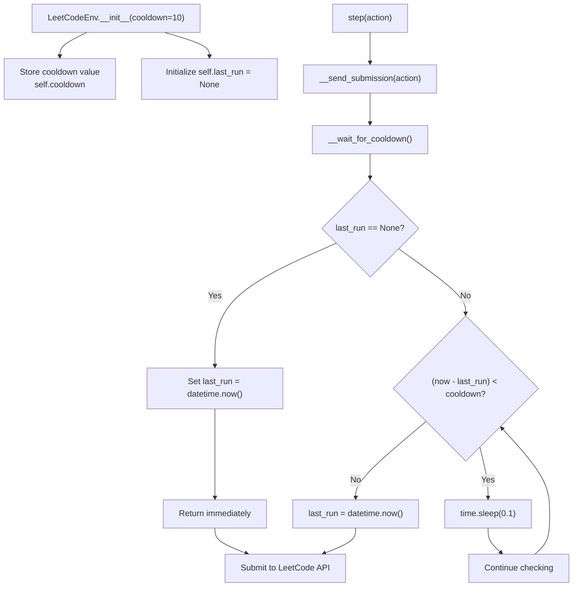
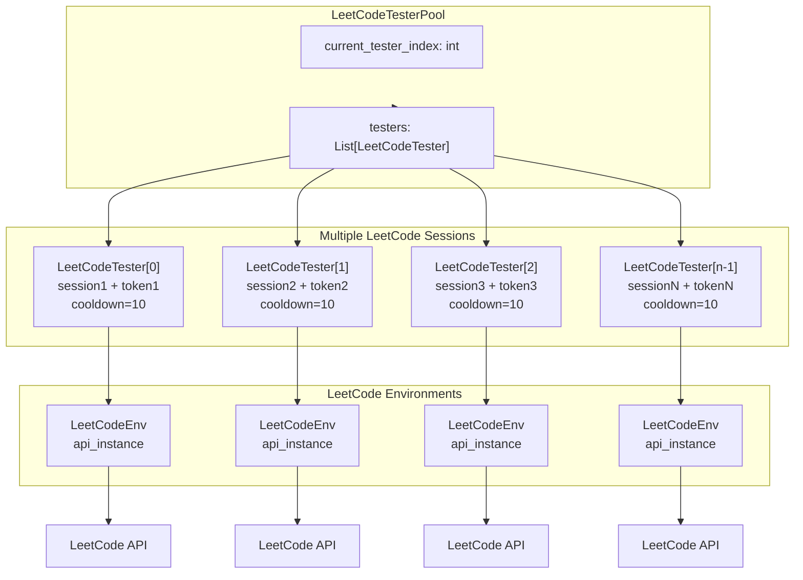
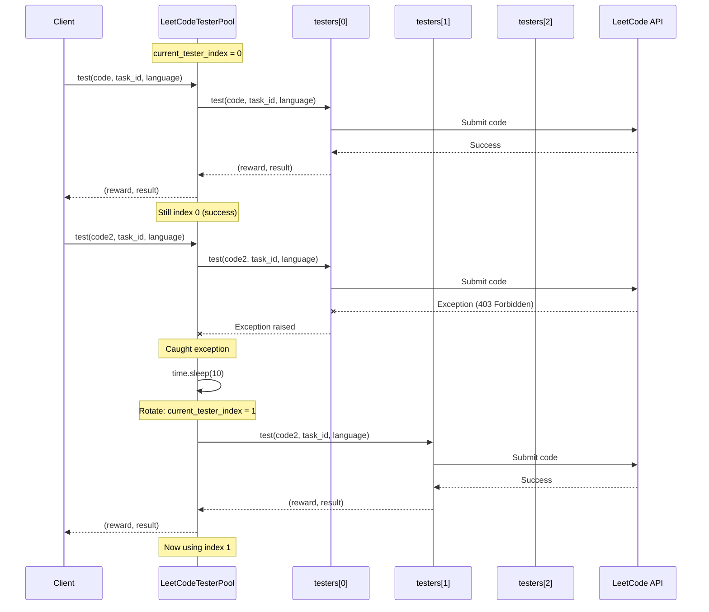
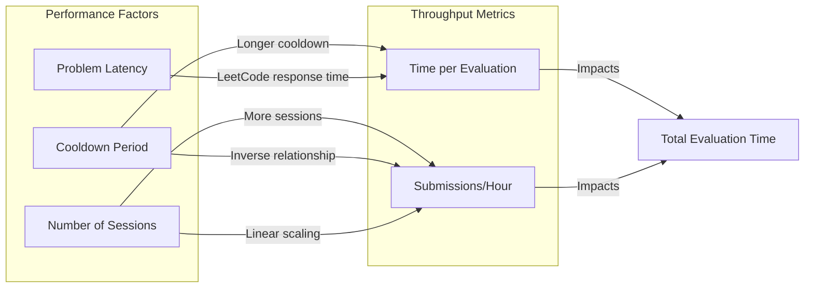

<!-- source: DeepWiki mcp.deepwiki.com · repo thunlp/DebugBench · page 4.4 Rate Limiting and Multi-Session Management · fetched 2026-11-02 -->

# Rate Limiting and Multi-Session Management

<details>
<summary>Relevant source files</summary>

The following files were used as context for generating this wiki page:

- [evaluation/leetcode_oj/__init__.py](evaluation/leetcode_oj/__init__.py)
- [evaluation/leetcode_oj/leetcode_env/environment.py](evaluation/leetcode_oj/leetcode_env/environment.py)
- [evaluation/leetcode_oj/leetcode_env/utils/__pycache__/leetcode.cpython-310.pyc](evaluation/leetcode_oj/leetcode_env/utils/__pycache__/leetcode.cpython-310.pyc)
- [evaluation/leetcode_oj/leetcode_tester.py](evaluation/leetcode_oj/leetcode_tester.py)
- [evaluation/leetcode_oj/leetcode_tester_pool.py](evaluation/leetcode_oj/leetcode_tester_pool.py)

</details>


## Purpose and Scope

This page documents the rate limiting and multi-session management mechanisms in DebugBench's evaluation system. These features prevent API throttling from LeetCode's online judge by implementing configurable cooldown periods between submissions and supporting multiple authenticated sessions with automatic failover.

For information about the overall evaluation workflow, see [Evaluation System](#4). For details about the LeetCodeTester API interface, see [LeetCodeTester API](#4.3).

---

## Overview

LeetCode's submission API enforces rate limits to prevent abuse. When evaluating multiple debugging attempts, these limits can interrupt the testing process. DebugBench addresses this through two complementary mechanisms:

1. **Cooldown Management**: Enforces minimum time intervals between submissions from a single session
2. **Session Pooling**: Distributes submissions across multiple authenticated sessions with automatic failover

---

## Cooldown Mechanism

### Implementation

The cooldown mechanism is implemented in the `LeetCodeEnv` class and tracks the time elapsed since the last submission.



**Diagram: Cooldown Enforcement Flow**

Sources: [evaluation/leetcode_oj/leetcode_env/environment.py:21-26](), [evaluation/leetcode_oj/leetcode_env/environment.py:118-124]()

### Cooldown Configuration

The cooldown period is specified in seconds during environment initialization:

| Parameter | Type | Default | Description |
|-----------|------|---------|-------------|
| `cooldown` | `int` | 0 | Minimum seconds between submissions |

**Example configurations:**

- **Development/Testing**: `cooldown=5` - Fast iteration with minimal wait
- **Production**: `cooldown=10` - Recommended for reliable operation
- **High-Volume**: `cooldown=15` - Conservative approach for large-scale evaluations

Sources: [evaluation/leetcode_oj/leetcode_env/environment.py:21](), [evaluation/leetcode_oj/leetcode_tester.py:24]()

### Cooldown Algorithm Details

The `__wait_for_cooldown()` method implements a polling-based wait strategy:

**State Tracking:**
- `self.last_run`: `datetime` object storing the timestamp of the last submission
- Initially `None` to allow the first submission to proceed immediately

**Wait Logic:**
1. On first submission (`last_run == None`): Set timestamp and proceed
2. On subsequent submissions: Calculate elapsed time
3. If `elapsed < cooldown`: Sleep in 0.1-second intervals
4. Once `elapsed >= cooldown`: Update timestamp and allow submission

**Key Implementation Details:**
- Uses 0.1-second polling interval to avoid busy-waiting
- Updates `last_run` immediately before returning to ensure accurate timing
- Handles the first submission specially to avoid unnecessary delays

Sources: [evaluation/leetcode_oj/leetcode_env/environment.py:118-124]()

---

## Multi-Session Management

### LeetCodeTesterPool Architecture

The `LeetCodeTesterPool` class manages multiple authenticated sessions, distributing load and providing automatic failover when individual sessions encounter errors.



**Diagram: Multi-Session Pool Structure**

Sources: [evaluation/leetcode_oj/leetcode_tester_pool.py:6-9]()

### Session Rotation and Failover

The pool implements a round-robin failover strategy that automatically switches to the next session when errors occur.



**Diagram: Session Failover Sequence**

Sources: [evaluation/leetcode_oj/leetcode_tester_pool.py:11-19]()

### Failover Implementation

The `test()` method implements recursive failover with the following behavior:

**Normal Operation:**
```
testers[current_tester_index].test() → Returns result
```

**On Exception:**
1. Log error message: `"Tester {index} failed with error: {e}"`
2. Sleep for 10 seconds to allow recovery
3. Rotate index: `current_tester_index = (current_tester_index + 1) % len(testers)`
4. Recursively call `test()` with the next tester

**Key Properties:**
- **Round-robin rotation**: Uses modulo arithmetic to wrap around to index 0
- **Recursive retry**: Continues trying testers until one succeeds
- **Recovery delay**: 10-second sleep prevents rapid retry loops
- **Unlimited attempts**: Will cycle through all testers multiple times if needed

Sources: [evaluation/leetcode_oj/leetcode_tester_pool.py:11-19]()

---

## Configuration Guide

### Single Session Setup

For basic usage with a single LeetCode account:

**Required Environment Variables:**
```
LEETCODE_SESSION=your_session_cookie
CSRF_TOKEN=your_csrf_token
```

**Initialization:**
```python
tester = LeetCodeTester(
    leetcode_session=os.environ['LEETCODE_SESSION'],
    csrf_token=os.environ['CSRF_TOKEN'],
    cooldown=10
)
```

Sources: [evaluation/leetcode_oj/leetcode_tester.py:19-26]()

### Multi-Session Setup

For high-volume evaluation requiring multiple sessions:

**Environment Variables Pattern:**
```
YOUR_LEETCODE_SESSION1=session_cookie_1
YOUR_CSRF_TOKEN1=csrf_token_1
YOUR_LEETCODE_SESSION2=session_cookie_2
YOUR_CSRF_TOKEN2=csrf_token_2
...
```

**Initialization:**
```python
leetcode_sessions = [
    os.getenv(f'YOUR_LEETCODE_SESSION{i}') 
    for i in range(1, N+1)
]
csrf_tokens = [
    os.getenv(f'YOUR_CSRF_TOKEN{i}') 
    for i in range(1, N+1)
]

pool = LeetCodeTesterPool(
    leetcode_sessions=leetcode_sessions,
    csrf_tokens=csrf_tokens,
    cooldown=10
)
```

Sources: [evaluation/leetcode_oj/leetcode_tester_pool.py:39-42]()

### Obtaining Session Credentials

To get LeetCode session credentials:

1. Log in to LeetCode in a web browser
2. Open browser developer tools (F12)
3. Navigate to Application/Storage → Cookies → https://leetcode.com
4. Copy values for:
   - `LEETCODE_SESSION`: Long alphanumeric session token
   - `csrftoken`: CSRF protection token

**Security Note:** These credentials provide full access to your LeetCode account. Store them securely and never commit them to version control.

---

## Rate Limiting Strategies

### Choosing Cooldown Values

| Scenario | Recommended Cooldown | Rationale |
|----------|---------------------|-----------|
| Single session, low volume | 10 seconds | Balances safety and speed |
| Single session, high volume | 15 seconds | Conservative to prevent blocks |
| Multi-session pool (2-3 sessions) | 10 seconds per session | Combined throughput is adequate |
| Multi-session pool (4+ sessions) | 5-10 seconds per session | More sessions allow shorter cooldowns |
| Development/debugging | 5 seconds | Faster iteration, acceptable risk |

### Optimal Pool Sizing

**Throughput Calculation:**

For a cooldown period `C` seconds and `N` sessions:
- Single session: `3600 / C` submissions per hour
- Pool: `N × (3600 / C)` submissions per hour

**Example:**
- 3 sessions with 10-second cooldown: `3 × (3600 / 10) = 1,080` submissions/hour

**Recommendations:**
- **Small datasets (<100 problems)**: Single session sufficient
- **Medium datasets (100-500 problems)**: 2-3 sessions
- **Large datasets (500+ problems)**: 4-5 sessions
- **Very large (1000+ problems)**: 5-10 sessions

---

## Error Handling

### Common Rate Limit Errors

The system handles various LeetCode API errors through the failover mechanism:

| Error Type | HTTP Code | Pool Behavior |
|------------|-----------|---------------|
| Rate Limit Exceeded | 429 | Sleep 10s, rotate to next session |
| Forbidden | 403 | Sleep 10s, rotate to next session |
| Session Expired | 401 | Rotate immediately, session may be invalid |
| Server Error | 500 | Sleep 10s, retry with same or next session |

### Monitoring and Debugging

When using `LeetCodeTesterPool`, monitor console output for failover events:

```
Tester 0 failed with error: (403) Reason: Forbidden
# Pool automatically rotates to tester 1
```

**Best Practices:**
1. Monitor which testers fail frequently (may indicate expired credentials)
2. If all testers fail in succession, check LeetCode service status
3. Log submission timestamps to verify cooldown effectiveness
4. Track success rates per session to identify problematic credentials

Sources: [evaluation/leetcode_oj/leetcode_tester_pool.py:15-16]()

---

## Integration Example

### Complete Evaluation Workflow with Pool

```python
# Initialize pool with multiple sessions
sessions = [os.getenv(f'SESSION{i}') for i in range(1, 4)]
tokens = [os.getenv(f'TOKEN{i}') for i in range(1, 4)]

pool = LeetCodeTesterPool(
    leetcode_sessions=sessions,
    csrf_tokens=tokens,
    cooldown=10
)

# Test multiple submissions
for problem in benchmark_problems:
    try:
        reward, result = pool.test(
            code=problem['buggy_code'],
            task_id=problem['task_id'],
            language=problem['language']
        )
        
        print(f"Problem {problem['task_id']}: {'✓' if reward else '✗'}")
        
    except Exception as e:
        print(f"All testers failed for {problem['task_id']}: {e}")
```

This example demonstrates:
- Multi-session initialization from environment variables
- Automatic load distribution across sessions
- Transparent failover on individual session failures
- Graceful handling when all sessions are exhausted

Sources: [evaluation/leetcode_oj/leetcode_tester_pool.py:11-19](), [evaluation/leetcode_oj/leetcode_tester_pool.py:43-50]()

---

## Performance Considerations

### Cooldown vs. Throughput Trade-offs



**Diagram: Performance Factor Relationships**

### Realistic Throughput Example

**Scenario:** Evaluate 1,000 problems using 4 sessions with 10-second cooldown

**Calculations:**
- Per-session rate: 6 submissions/minute
- Combined rate: 24 submissions/minute
- Total time: `1000 / 24 ≈ 42 minutes` (excluding LeetCode latency)
- With 3-second average LeetCode response: `1000 × 3 / 4 ≈ 12.5 minutes`
- **Total estimated time: ~55 minutes**

**Optimization Strategies:**
1. Increase session count to reduce total time proportionally
2. Reduce cooldown if rate limits are not being hit
3. Batch submissions to minimize setup overhead

---

## Summary

The rate limiting and multi-session management system provides:

- **Automatic cooldown enforcement** at the environment level
- **Transparent session pooling** for high-volume evaluations
- **Robust failover** with automatic session rotation
- **Configurable timing** to balance throughput and safety

This design enables reliable, large-scale evaluation of LLM debugging capabilities while respecting LeetCode's API constraints.

---

