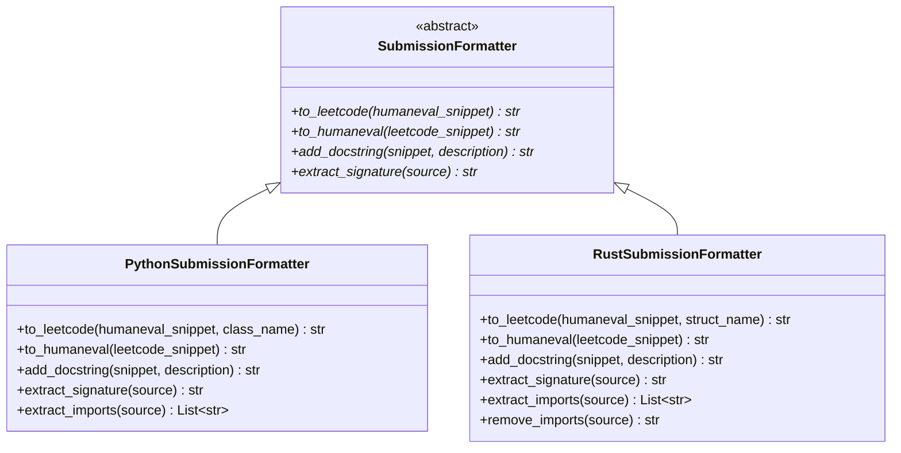
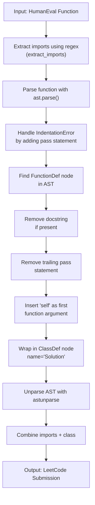
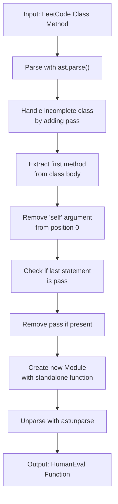
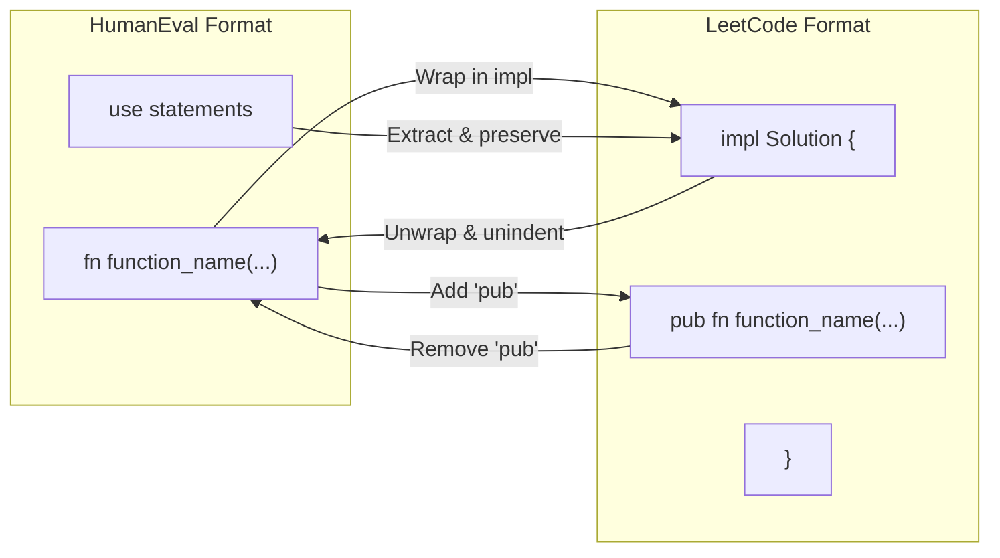
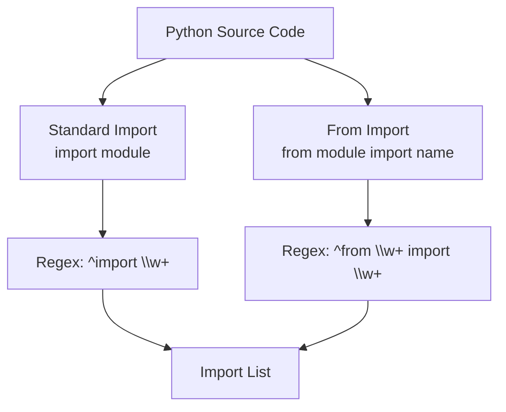
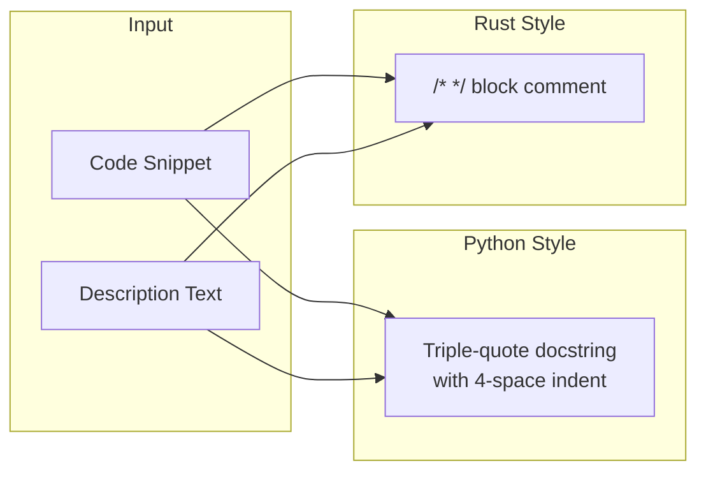
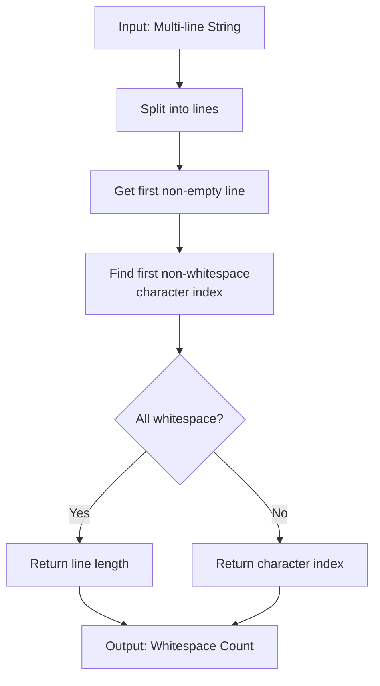
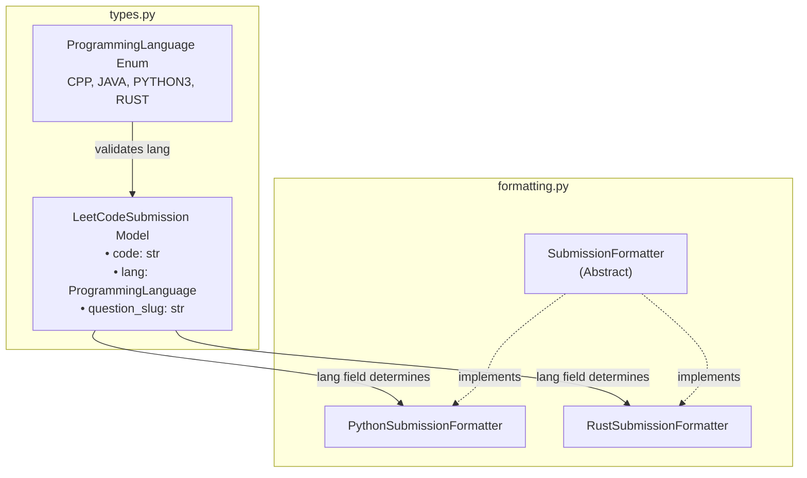

<!-- source: DeepWiki mcp.deepwiki.com · repo thunlp/DebugBench · page 4.5 Code Format Transformations · fetched 2026-11-02 -->

# Code Format Transformations

<details>
<summary>Relevant source files</summary>

The following files were used as context for generating this wiki page:

- [leetcode_data/validated/leetcode_oj/leetcode_env/types.py](leetcode_data/validated/leetcode_oj/leetcode_env/types.py)
- [leetcode_data/validated/leetcode_oj/leetcode_env/utils/formatting.py](leetcode_data/validated/leetcode_oj/leetcode_env/utils/formatting.py)
- [leetcode_data/validated/leetcode_oj/leetcode_env/utils/leetcode.py](leetcode_data/validated/leetcode_oj/leetcode_env/utils/leetcode.py)

</details>


## Purpose and Scope

This document describes the **SubmissionFormatter** system used in DebugBench's evaluation framework to convert code between different submission formats. The primary transformation handled is between **HumanEval format** (standalone functions) and **LeetCode format** (class-based methods). This system is essential for adapting code submissions to LeetCode's online judge requirements while maintaining compatibility with various code generation benchmarks.

For information about how these formatters integrate into the submission testing workflow, see [Submission Testing](#4.2). For details on the LeetCode environment that uses these formatters, see [LeetCode Environment](#4.1).

---

## Format Differences Overview

LeetCode and HumanEval use fundamentally different code structures that require bidirectional transformation:

| Aspect | HumanEval Format | LeetCode Format |
|--------|------------------|-----------------|
| **Structure** | Standalone function | Class method (instance method) |
| **First Parameter** | Problem-specific | `self` (Python) / none (Rust) |
| **Class Wrapper** | None | `Solution` class (Python) / `impl Solution` (Rust) |
| **Visibility** | Default | `pub` modifier required (Rust) |
| **Imports** | Top-level | Top-level (outside class) |
| **Docstrings** | Optional | Typically removed in submission |

**Sources:** [leetcode_data/validated/leetcode_oj/leetcode_env/utils/formatting.py:1-233]()

---

## Formatter Architecture

The formatter system uses an abstract base class pattern to support multiple programming languages:



### Core Transformation Methods

Each formatter implements four abstract methods:

| Method | Purpose | Input | Output |
|--------|---------|-------|--------|
| `to_leetcode()` | Convert HumanEval → LeetCode | Standalone function | Class-wrapped method |
| `to_humaneval()` | Convert LeetCode → HumanEval | Class method | Standalone function |
| `add_docstring()` | Inject documentation | Code + description | Code with docstring |
| `extract_signature()` | Parse function signature | Function definition | Signature string |

**Sources:** [leetcode_data/validated/leetcode_oj/leetcode_env/utils/formatting.py:9-41]()

---

## Python Format Transformations

### HumanEval to LeetCode Conversion

The `PythonSubmissionFormatter.to_leetcode()` method performs AST-based transformations:



**Key Implementation Details:**

1. **AST Parsing** [leetcode_data/validated/leetcode_oj/leetcode_env/utils/formatting.py:79-83](): Parses the function source into an Abstract Syntax Tree, handling incomplete code by appending `pass`.

2. **Import Extraction** [leetcode_data/validated/leetcode_oj/leetcode_env/utils/formatting.py:112-131](): Uses regex patterns to identify `import` and `from ... import` statements before AST processing.

3. **Self Parameter Injection** [leetcode_data/validated/leetcode_oj/leetcode_env/utils/formatting.py:98-100](): Creates an `ast.arg` node for `self` and inserts it at position 0 of the argument list.

4. **Class Wrapping** [leetcode_data/validated/leetcode_oj/leetcode_env/utils/formatting.py:101-109](): Constructs a `ClassDef` node named "Solution" containing the modified function.

**Sources:** [leetcode_data/validated/leetcode_oj/leetcode_env/utils/formatting.py:72-109]()

### LeetCode to HumanEval Conversion

The reverse transformation `to_humaneval()` unwraps class methods:



**Sources:** [leetcode_data/validated/leetcode_oj/leetcode_env/utils/formatting.py:55-69]()

---

## Rust Format Transformations

The `RustSubmissionFormatter` handles Rust-specific syntax requirements:

### Key Transformations



### HumanEval to LeetCode (Rust)

The `to_leetcode()` method [leetcode_data/validated/leetcode_oj/leetcode_env/utils/formatting.py:203-213]():

1. **Extract Imports**: Uses regex pattern `^use ([\w::]+(?:\s+as\s+\w+)?)(?:;\s*)?$`
2. **Remove Comments**: Strips `//` line comments and `/* */` block comments
3. **Add Visibility**: Replaces `fn ` with `pub fn ` for the root function
4. **Wrap Implementation**: Encloses function in `impl Solution { ... }`

### LeetCode to HumanEval (Rust)

The `to_humaneval()` method [leetcode_data/validated/leetcode_oj/leetcode_env/utils/formatting.py:177-200]():

1. **Remove Comments**: Strips both line and block comments
2. **Unwrap Implementation**: Removes `impl Solution {` wrapper using regex substitution
3. **Remove Visibility**: Strips `pub ` modifier from function
4. **Unindent**: Calculates and removes leading whitespace to restore top-level formatting

**Sources:** [leetcode_data/validated/leetcode_oj/leetcode_env/utils/formatting.py:138-218]()

---

## Import Handling

Both formatters provide specialized import extraction to preserve dependencies when transforming code:

### Python Import Patterns



The `extract_imports()` method [leetcode_data/validated/leetcode_oj/leetcode_env/utils/formatting.py:112-131]() uses two regex patterns:
- **Standard import**: `^import (\w+(?:, \w+)*)`
- **From import**: `^from (\w+) import (\w+(?:, \w+)*)`

### Rust Import Patterns

The Rust formatter provides both extraction and removal [leetcode_data/validated/leetcode_oj/leetcode_env/utils/formatting.py:149-174]():

| Method | Pattern | Purpose |
|--------|---------|---------|
| `extract_imports()` | `^use ([\w::]+(?:\s+as\s+\w+)?)(?:;\s*)?$` | Captures `use` statements including aliased imports |
| `remove_imports()` | Same pattern | Filters out `use` lines from source |

**Sources:** [leetcode_data/validated/leetcode_oj/leetcode_env/utils/formatting.py:112-174]()

---

## Signature Extraction

Each formatter implements signature extraction for parsing function declarations:

### Implementation Comparison

| Language | Method | Approach |
|----------|--------|----------|
| **Python** | `extract_signature()` | Simple string manipulation: removes `def ` prefix and trailing `:` |
| **Rust** | `extract_signature()` | Removes `fn ` prefix, strips `{`, `}`, whitespace, and newlines |

**Python Implementation** [leetcode_data/validated/leetcode_oj/leetcode_env/utils/formatting.py:133-135]():
```python
def extract_signature(source: str) -> str:
    return source.replace('def ', '', 1)[:-1]
```

**Rust Implementation** [leetcode_data/validated/leetcode_oj/leetcode_env/utils/formatting.py:216-217]():
```python
def extract_signature(source: str) -> str:
    return source.strip('fn ').replace('{', '').replace('}', '').strip().strip('\n')
```

**Sources:** [leetcode_data/validated/leetcode_oj/leetcode_env/utils/formatting.py:133-217]()

---

## Docstring Addition

Both formatters support adding documentation to code snippets:

### Format-Specific Docstrings



**Python** [leetcode_data/validated/leetcode_oj/leetcode_env/utils/formatting.py:45-53](): Adds triple-quoted docstrings with 4-space indentation for each line.

**Rust** [leetcode_data/validated/leetcode_oj/leetcode_env/utils/formatting.py:140-146](): Wraps description in `/* */` block comment syntax.

**Sources:** [leetcode_data/validated/leetcode_oj/leetcode_env/utils/formatting.py:45-146]()

---

## Utility Function: Leading Whitespace Detection

The `leading_whitespace_count()` function [leetcode_data/validated/leetcode_oj/leetcode_env/utils/formatting.py:220-233]() calculates indentation levels for proper code unindenting:



This utility is critical for Rust's `to_humaneval()` transformation to properly unindent functions extracted from `impl` blocks.

**Sources:** [leetcode_data/validated/leetcode_oj/leetcode_env/utils/formatting.py:220-233]()

---

## Integration with LeetCodeSubmission

The formatters work in conjunction with the `LeetCodeSubmission` model and `ProgrammingLanguage` enum:



The `ProgrammingLanguage` enum [leetcode_data/validated/leetcode_oj/leetcode_env/types.py:6-33]() defines supported languages (Python3, Rust, C++, Java, etc.), while `LeetCodeSubmission` [leetcode_data/validated/leetcode_oj/leetcode_env/types.py:35-46]() encapsulates submission data including the code and target language.

**Sources:** [leetcode_data/validated/leetcode_oj/leetcode_env/types.py:1-46](), [leetcode_data/validated/leetcode_oj/leetcode_env/utils/formatting.py:1-233]()

---

