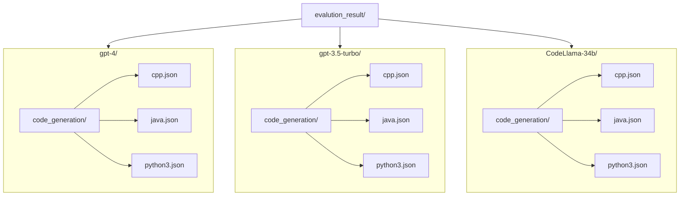
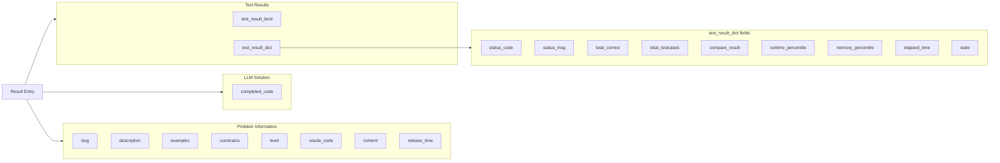
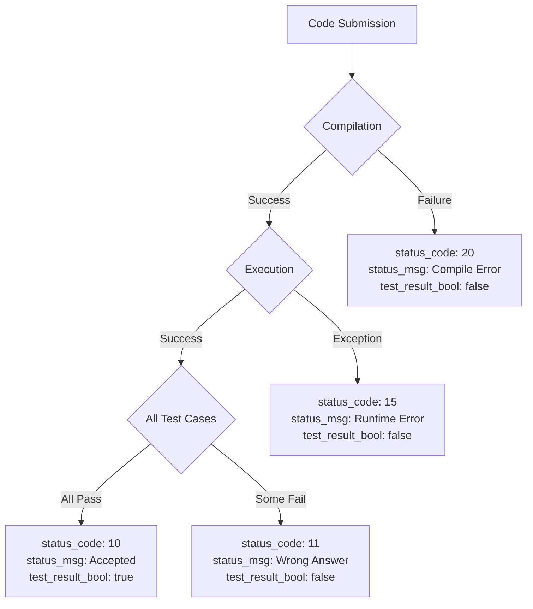
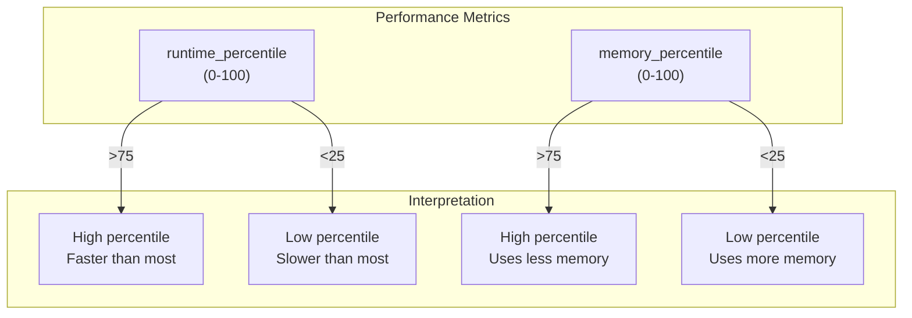
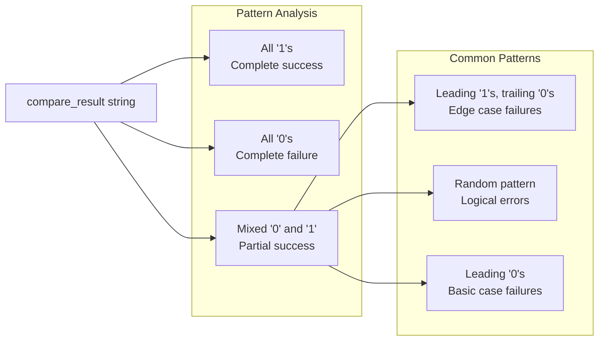

<!-- source: DeepWiki mcp.deepwiki.com · repo thunlp/DebugBench · page 5 Results and Analysis · fetched 2026-11-02 -->

# Results and Analysis

<details>
<summary>Relevant source files</summary>

The following files were used as context for generating this wiki page:

- [README.md](README.md)
- [evalution_result/gpt-4/code_generation/cpp.json](evalution_result/gpt-4/code_generation/cpp.json)
- [evalution_result/gpt-4/code_generation/java.json](evalution_result/gpt-4/code_generation/java.json)
- [evalution_result/gpt-4/code_generation/python3.json](evalution_result/gpt-4/code_generation/python3.json)

</details>


This document describes the structure and organization of evaluation results in DebugBench, including the result schema, metrics, and how to interpret LLM debugging performance. For details about the evaluation system that produces these results, see [Evaluation System](#4). For information about specific baseline model results, see [Pre-computed Baseline Results](#5.1). For metric definitions, see [Evaluation Metrics](#5.2).

## Overview

The DebugBench repository includes pre-computed evaluation results for three baseline models tested across all benchmark instances. These results demonstrate the debugging capabilities of different LLMs when attempting to fix buggy code from the benchmark dataset. Each result contains the LLM's completed code along with detailed test execution metrics from the LeetCode online judge.

Sources: [README.md:34]()

## Result File Organization

Evaluation results are stored in the `evalution_result/` directory with the following structure:



**Organization Pattern:**
- **Model Directory**: `{model_name}/` (e.g., `gpt-4/`, `gpt-3.5-turbo/`, `CodeLlama-34b/`)
- **Scenario Directory**: `code_generation/` (currently the primary evaluation scenario)
- **Language Files**: `{language}.json` containing all results for that language

Each JSON file contains an array of result objects, one per benchmark problem instance tested.

Sources: [README.md:34](), [evalution_result/gpt-4/code_generation/cpp.json:1](), [evalution_result/gpt-4/code_generation/java.json:1](), [evalution_result/gpt-4/code_generation/python3.json:1]()

## Result Entry Schema

Each result entry follows a comprehensive schema that includes both the problem specification and detailed test execution results:



### Key Fields

| Field | Type | Description |
|-------|------|-------------|
| `slug` | string | LeetCode problem identifier |
| `description` | string | Full problem statement |
| `examples` | array[string] | Example test cases |
| `constrains` | string | Input constraints |
| `level` | string | Difficulty: "easy", "medium", or "hard" |
| `oracle_code` | string | Correct reference solution |
| `completed_code` | string | LLM's debugged code submission |
| `test_result_bool` | boolean | Overall pass/fail status |
| `test_result_dict` | object | Detailed execution results |

### test_result_dict Structure

| Field | Type | Description |
|-------|------|-------------|
| `status_code` | integer | Numeric status (10=Accepted, 11=Wrong Answer, 20=Compile Error) |
| `status_msg` | string | Human-readable status ("Accepted", "Wrong Answer", etc.) |
| `total_correct` | integer | Number of test cases passed |
| `total_testcases` | integer | Total number of test cases |
| `compare_result` | string | Binary string: '1' for pass, '0' for fail per test case |
| `runtime_percentile` | float/null | Runtime performance percentile (null if failed) |
| `memory_percentile` | float/null | Memory performance percentile (null if failed) |
| `status_runtime` | string | Execution time (e.g., "207 ms") or "N/A" |
| `memory` | integer | Memory used in bytes |
| `elapsed_time` | integer | Total test execution time in milliseconds |
| `lang` | string | Programming language ("cpp", "java", "python3") |
| `state` | string | Execution state ("SUCCESS", "STARTED") |

Sources: [evalution_result/gpt-4/code_generation/cpp.json:2-44](), [evalution_result/gpt-4/code_generation/java.json:2-42](), [evalution_result/gpt-4/code_generation/python3.json:2-44]()

## Status Code Interpretation

The `status_code` field indicates the final verdict of the submission:



**Common Status Codes:**

| Code | Status Message | Meaning |
|------|----------------|---------|
| 10 | Accepted | All test cases passed |
| 11 | Wrong Answer | Some test cases failed with incorrect output |
| 15 | Runtime Error | Code threw an exception during execution |
| 20 | Compile Error | Code failed to compile |

Sources: [evalution_result/gpt-4/code_generation/cpp.json:16-44](), [evalution_result/gpt-4/code_generation/java.json:100-121]()

## Example Results Analysis

### Successful Debugging Example

```json
{
    "slug": "binary-search",
    "level": "easy",
    "completed_code": "...",
    "test_result_bool": true,
    "test_result_dict": {
        "status_code": 10,
        "status_msg": "Accepted",
        "total_correct": 47,
        "total_testcases": 47,
        "compare_result": "11111111111111111111111111111111111111111111111",
        "runtime_percentile": 87.3208,
        "memory_percentile": 5.912
    }
}
```

**Interpretation:**
- ✅ All 47 test cases passed (`compare_result` is all '1's)
- ✅ Solution accepted by LeetCode judge
- ✅ Performance: 87th percentile runtime (faster than 87% of submissions)
- Memory usage in 6th percentile (uses more memory than 94% of submissions)

Sources: [evalution_result/gpt-4/code_generation/python3.json:46-85]()

### Failed Debugging Example (Wrong Answer)

```json
{
    "slug": "check-if-there-is-a-valid-path-in-a-grid",
    "level": "medium",
    "completed_code": "...",
    "test_result_bool": false,
    "test_result_dict": {
        "status_code": 11,
        "status_msg": "Wrong Answer",
        "total_correct": 27,
        "total_testcases": 80,
        "compare_result": "01010010010100001010010010001110011001110001000000001100010000000011000010011100",
        "last_testcase": "[[2,4,3],[6,5,2]]",
        "expected_output": "true",
        "code_output": "false"
    }
}
```

**Interpretation:**
- ❌ Only 27 out of 80 test cases passed (33.75% pass rate)
- ❌ Binary `compare_result` shows alternating passes/fails
- ❌ Failed on a simple test case
- The LLM's fix did not fully resolve the bug

Sources: [evalution_result/gpt-4/code_generation/cpp.json:1-44]()

### Failed Debugging Example (Compile Error)

```json
{
    "slug": "populating-next-right-pointers-in-each-node",
    "level": "medium",
    "completed_code": "...",
    "test_result_bool": false,
    "test_result_dict": {
        "status_code": 20,
        "status_msg": "Compile Error",
        "compile_error": "Line 31: error: duplicate class: Node",
        "total_correct": null,
        "total_testcases": null
    }
}
```

**Interpretation:**
- ❌ Code failed to compile
- ❌ LLM introduced a duplicate class definition
- ❌ No test cases could be executed
- Common issue: LLM included class definitions that already exist in the test harness

Sources: [evalution_result/gpt-4/code_generation/java.json:87-121]()

## Performance Metrics Distribution

The evaluation results include performance percentiles for accepted solutions:



**Note:** Percentiles are only available for accepted solutions (`status_code: 10`). Failed solutions have `null` percentiles.

Sources: [evalution_result/gpt-4/code_generation/cpp.json:79-82](), [evalution_result/gpt-4/code_generation/java.json:35-37]()

## Result State Tracking

The `state` field in `test_result_dict` indicates the execution status:

| State | Meaning |
|-------|---------|
| `"SUCCESS"` | Test execution completed (may be pass or fail) |
| `"STARTED"` | Test execution initiated but not yet completed |

Incomplete results (`"STARTED"` state) typically indicate:
- Long-running test cases that exceeded time limits
- System timeouts during evaluation
- Queue processing delays

Sources: [evalution_result/gpt-4/code_generation/cpp.json:186-187](), [evalution_result/gpt-4/code_generation/java.json:266-267]()

## Analyzing Debugging Success Rates

To compute aggregate metrics across results:

### Overall Success Rate

```
Success Rate = (Count of test_result_bool == true) / (Total entries)
```

### Per-Difficulty Success Rate

```
Easy Success Rate = (Easy problems with test_result_bool == true) / (Total easy problems)
Medium Success Rate = (Medium problems with test_result_bool == true) / (Total medium problems)
Hard Success Rate = (Hard problems with test_result_bool == true) / (Total hard problems)
```

### Partial Correctness Metric

For problems that fail overall but pass some test cases:

```
Partial Correctness = total_correct / total_testcases
```

This metric helps identify cases where the LLM partially fixed the bug but not completely.

Sources: [evalution_result/gpt-4/code_generation/cpp.json:33-34](), [evalution_result/gpt-4/code_generation/java.json:33-34]()

## Test Case Coverage Analysis

The `compare_result` field provides fine-grained test case results:



**Example Patterns:**

- `"111111111111111111111111111"` - All test cases passed
- `"000000000000000000000000000"` - All test cases failed
- `"11111111111111111111100000"` - Passed simple cases, failed edge cases
- `"01010101010101010101010101"` - Alternating failures suggest systematic logic error

Sources: [evalution_result/gpt-4/code_generation/cpp.json:25](), [evalution_result/gpt-4/code_generation/java.json:419-421]()

## Comparing Model Performance

Results across models can be compared using:

### Success Rate by Language

| Model | C++ Success Rate | Java Success Rate | Python3 Success Rate |
|-------|------------------|-------------------|---------------------|
| gpt-4-0613 | Calculate from cpp.json | Calculate from java.json | Calculate from python3.json |
| gpt-3.5-turbo-0613 | Calculate from cpp.json | Calculate from java.json | Calculate from python3.json |
| CodeLlama-34b | Calculate from cpp.json | Calculate from java.json | Calculate from python3.json |

### Average Runtime Percentile

For accepted solutions only:
```
Avg Runtime Percentile = Mean(runtime_percentile where status_code == 10)
```

This indicates whether the model produces efficient solutions or just correct ones.

Sources: [README.md:34]()

## Common Failure Modes

Based on the result data, common LLM debugging failure modes include:

1. **Incomplete Fixes** - `status_code: 11` with partial test passes
   - LLM addressed some but not all aspects of the bug
   - Example: [evalution_result/gpt-4/code_generation/cpp.json:1-44]()

2. **Over-correction** - Introduced new bugs while fixing original bug
   - Example: Compile errors in previously compilable code
   - Example: [evalution_result/gpt-4/code_generation/java.json:87-121]()

3. **Misunderstood Problem Constraints** - Solution doesn't respect problem requirements
   - Example: [evalution_result/gpt-4/code_generation/java.json:282-311]()

4. **Edge Case Failures** - Basic cases pass, edge cases fail
   - Identified by `compare_result` patterns
   - Example: [evalution_result/gpt-4/code_generation/cpp.json:25-28]()

5. **Algorithm Changes** - LLM replaced buggy algorithm with different approach
   - May work but differs from oracle solution pattern
   - Performance percentiles may vary significantly

Sources: [evalution_result/gpt-4/code_generation/cpp.json:1-438](), [evalution_result/gpt-4/code_generation/java.json:1-457]()

## Programmatic Access to Results

To load and analyze results programmatically:

```python
import json

# Load results for a specific model and language
with open('evalution_result/gpt-4/code_generation/python3.json', 'r') as f:
    results = json.load(f)

# Calculate success rate
total = len(results)
successful = sum(1 for r in results if r['test_result_bool'])
success_rate = successful / total

# Filter by difficulty
easy_results = [r for r in results if r['level'] == 'easy']
medium_results = [r for r in results if r['level'] == 'medium']
hard_results = [r for r in results if r['level'] == 'hard']

# Analyze partial correctness
partial_correct = [
    (r['slug'], r['test_result_dict']['total_correct'], 
     r['test_result_dict']['total_testcases'])
    for r in results 
    if not r['test_result_bool'] 
    and r['test_result_dict'].get('total_correct', 0) > 0
]
```

Sources: [evalution_result/gpt-4/code_generation/python3.json:1-605]()

---

