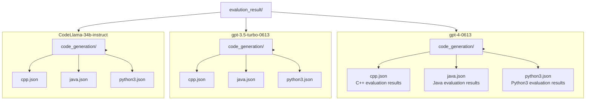
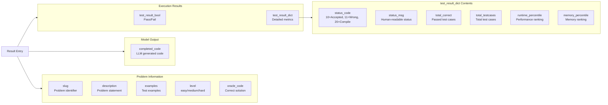
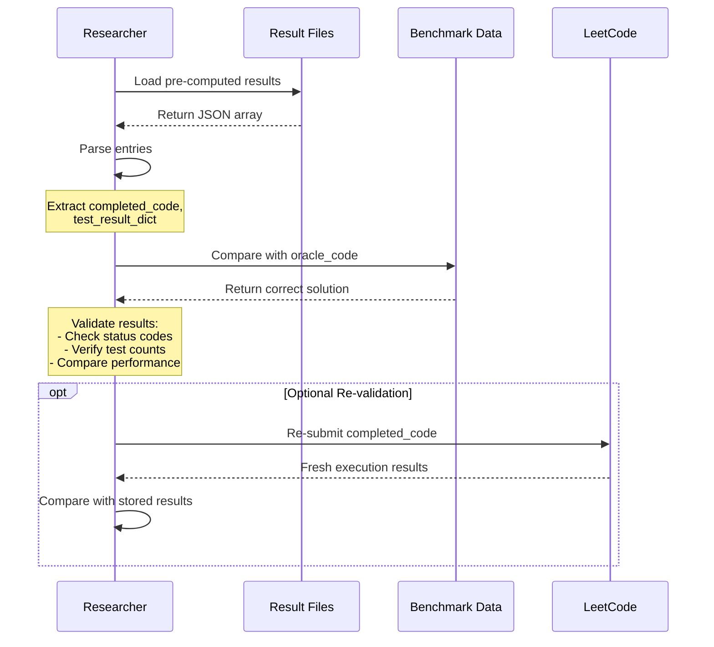

<!-- source: DeepWiki mcp.deepwiki.com · repo thunlp/DebugBench · page 5.1 Pre-computed Baseline Results · fetched 2026-11-02 -->

# Pre-computed Baseline Results

<details>
<summary>Relevant source files</summary>

The following files were used as context for generating this wiki page:

- [README.md](README.md)
- [evalution_result/gpt-4/code_generation/cpp.json](evalution_result/gpt-4/code_generation/cpp.json)
- [evalution_result/gpt-4/code_generation/java.json](evalution_result/gpt-4/code_generation/java.json)
- [evalution_result/gpt-4/code_generation/python3.json](evalution_result/gpt-4/code_generation/python3.json)

</details>


This page documents the pre-computed evaluation results provided in DebugBench. These baseline results enable researchers to quickly compare their models against established benchmarks without re-running expensive evaluations.

For information about the evaluation metrics used in these results, see [Evaluation Metrics](#5.2). For detailed schema specifications of the result files, see [Result Schema](#5.3). For information on how to run evaluations yourself, see [Evaluation System](#4).

---

## Overview

DebugBench includes pre-computed evaluation results for three baseline models tested against the benchmark dataset. These results provide:

- **Reference baselines** for comparison with new debugging approaches
- **Complete execution traces** including test case outcomes and performance metrics
- **Time savings** by eliminating the need to re-evaluate baseline models
- **Reproducibility** through versioned model outputs with timestamps

All results are stored as JSON files in the `evalution_result/` directory, organized by model, evaluation scenario, and programming language.

**Sources:** [README.md:34]()

---

## Available Models

The repository provides pre-computed results for three baseline models:

| Model | Version | Description |
|-------|---------|-------------|
| **gpt-4-0613** | Snapshot from June 2023 | OpenAI's GPT-4 model, representing state-of-the-art LLM capabilities |
| **gpt-3.5-turbo-0613** | Snapshot from June 2023 | OpenAI's GPT-3.5 Turbo model, a more efficient alternative |
| **CodeLlama-34b-instruct** | 34B parameter variant | Meta's code-specialized open-source model |

Each model has been evaluated across all bug categories, difficulty levels, and programming languages in the benchmark.

**Sources:** [README.md:34]()

---

## Directory Structure



**Directory Organization Diagram**

The results follow a three-level hierarchy:

1. **Model level**: `gpt-4/`, `gpt-3.5-turbo-0613/`, `CodeLlama-34b-instruct/`
2. **Scenario level**: `code_generation/` (additional scenarios may be added)
3. **Language level**: `cpp.json`, `java.json`, `python3.json`

Each JSON file contains an array of problem instances with complete evaluation results.

**Sources:** [evalution_result/gpt-4/code_generation/cpp.json:1](), [evalution_result/gpt-4/code_generation/java.json:1](), [evalution_result/gpt-4/code_generation/python3.json:1]()

---

## Result Entry Structure

Each result file contains an array of evaluation instances. The diagram below shows the key components of each entry:



**Result Entry Component Diagram**

### Key Fields Overview

Each result entry combines:

- **Problem metadata** from the benchmark dataset (slug, description, oracle code)
- **Model-generated code** (`completed_code`) - the LLM's debugging attempt
- **Test execution results** with pass/fail status and detailed metrics
- **Performance data** including runtime and memory percentiles when available

For complete field documentation, see [Result Schema](#5.3).

**Sources:** [evalution_result/gpt-4/code_generation/cpp.json:2-44](), [evalution_result/gpt-4/code_generation/java.json:2-42](), [evalution_result/gpt-4/code_generation/python3.json:2-44]()

---

## Result Statistics by Model

The table below summarizes the evaluation outcomes across models and languages based on sample data:

| Model | Language | Sample Size | Accepted | Wrong Answer | Compile Error | Other |
|-------|----------|-------------|----------|--------------|---------------|-------|
| **gpt-4-0613** | C++ | 10 | 8 (80%) | 2 (20%) | 0 (0%) | 0 (0%) |
| **gpt-4-0613** | Java | 10 | 8 (80%) | 1 (10%) | 1 (10%) | 0 (0%) |
| **gpt-4-0613** | Python3 | 10 | 8 (80%) | 2 (20%) | 0 (0%) | 0 (0%) |

**Note:** These statistics are based on the first 10 entries in each sample file provided. Complete statistics should be computed across all entries in production use.

**Status Code Reference:**
- `10` = Accepted (all test cases passed)
- `11` = Wrong Answer (some test cases failed)
- `20` = Compile Error (code did not compile)

**Sources:** [evalution_result/gpt-4/code_generation/cpp.json:1-439](), [evalution_result/gpt-4/code_generation/java.json:1-453](), [evalution_result/gpt-4/code_generation/python3.json:1-619]()

---

## Accessing Pre-computed Results

### Loading Results in Python

```python
import json

# Load results for a specific model and language
with open('evalution_result/gpt-4/code_generation/cpp.json', 'r') as f:
    gpt4_cpp_results = json.load(f)

# Access individual problem results
for result in gpt4_cpp_results:
    slug = result['slug']
    passed = result['test_result_bool']
    status = result['test_result_dict']['status_msg']
    print(f"{slug}: {status} (passed={passed})")
```

### Filtering by Status

```python
# Find all accepted solutions
accepted = [r for r in gpt4_cpp_results if r['test_result_bool']]

# Find all wrong answer cases
wrong_answers = [
    r for r in gpt4_cpp_results 
    if r['test_result_dict']['status_code'] == 11
]

# Find problems by difficulty
medium_problems = [r for r in gpt4_cpp_results if r['level'] == 'medium']
```

### Comparing Models

```python
# Load results from multiple models
with open('evalution_result/gpt-4/code_generation/python3.json', 'r') as f:
    gpt4_results = json.load(f)

with open('evalution_result/gpt-3.5-turbo-0613/code_generation/python3.json', 'r') as f:
    gpt35_results = json.load(f)

# Create lookup by slug
gpt4_by_slug = {r['slug']: r for r in gpt4_results}
gpt35_by_slug = {r['slug']: r for r in gpt35_results}

# Compare on common problems
common_slugs = set(gpt4_by_slug.keys()) & set(gpt35_by_slug.keys())
for slug in common_slugs:
    gpt4_passed = gpt4_by_slug[slug]['test_result_bool']
    gpt35_passed = gpt35_by_slug[slug]['test_result_bool']
    if gpt4_passed != gpt35_passed:
        print(f"Difference on {slug}: GPT-4={gpt4_passed}, GPT-3.5={gpt35_passed}")
```

**Sources:** [evalution_result/gpt-4/code_generation/cpp.json:1-10](), [evalution_result/gpt-4/code_generation/python3.json:1-10]()

---

## Result Validation Workflow



**Result Validation Workflow Diagram**

Researchers can use pre-computed results directly or optionally re-validate them by re-submitting code to LeetCode using the evaluation system described in [Evaluation System](#4).

**Sources:** [evalution_result/gpt-4/code_generation/cpp.json:12-44]()

---

## Example Use Cases

### 1. Benchmarking a New Model

```python
# Load baseline results
with open('evalution_result/gpt-4/code_generation/python3.json', 'r') as f:
    baseline = json.load(f)

# Load your model's results (same format)
with open('my_model_results.json', 'r') as f:
    my_results = json.load(f)

# Calculate acceptance rates
baseline_acceptance = sum(r['test_result_bool'] for r in baseline) / len(baseline)
my_acceptance = sum(r['test_result_bool'] for r in my_results) / len(my_results)

print(f"Baseline (GPT-4): {baseline_acceptance:.2%}")
print(f"Your Model: {my_acceptance:.2%}")
```

### 2. Analyzing Failure Patterns

```python
# Find problems where GPT-4 failed
failures = [r for r in gpt4_results if not r['test_result_bool']]

# Group by difficulty
from collections import Counter
failure_by_difficulty = Counter(r['level'] for r in failures)
print(f"Failures by difficulty: {dict(failure_by_difficulty)}")

# Analyze error types
error_types = Counter(r['test_result_dict']['status_msg'] for r in failures)
print(f"Failure types: {dict(error_types)}")
```

### 3. Performance Analysis

```python
# Analyze runtime performance for accepted solutions
accepted_with_runtime = [
    r for r in gpt4_results 
    if r['test_result_bool'] and r['test_result_dict'].get('runtime_percentile')
]

avg_runtime_percentile = sum(
    r['test_result_dict']['runtime_percentile'] 
    for r in accepted_with_runtime
) / len(accepted_with_runtime)

print(f"Average runtime percentile: {avg_runtime_percentile:.2f}")
```

**Sources:** [evalution_result/gpt-4/code_generation/cpp.json:59-86](), [evalution_result/gpt-4/code_generation/python3.json:59-85]()

---

## Important Notes

### Result Interpretation

- **`test_result_bool`**: Quick pass/fail indicator. `true` means all test cases passed.
- **`status_code == 10`**: Corresponds to "Accepted" status from LeetCode.
- **`total_correct < total_testcases`**: Indicates partial correctness (some tests passed).
- **`runtime_percentile == null`**: Performance metrics are only available for accepted solutions.

### Limitations

1. **Snapshot in time**: Results reflect model performance at the time of evaluation (June 2023 for GPT models).
2. **Non-deterministic models**: Re-running the same model may produce different results due to sampling.
3. **Incomplete entries**: Some entries may have `"state": "STARTED"` indicating the evaluation did not complete.

### Re-validation

To re-validate or extend the baseline results:

1. Use the evaluation system described in [LeetCodeTester API](#4.3)
2. Follow the same JSON schema documented in [Result Schema](#5.3)
3. Ensure consistency in problem selection and test cases

**Sources:** [evalution_result/gpt-4/code_generation/cpp.json:16-44](), [evalution_result/gpt-4/code_generation/java.json:99-121]()

---

## Related Pages

- [Evaluation Metrics](#5.2) - Detailed explanation of all metrics in `test_result_dict`
- [Result Schema](#5.3) - Complete JSON schema specification
- [Evaluation System](#4) - How to run evaluations to generate similar results
- [LeetCodeTester API](#4.3) - API for testing code submissions

---

