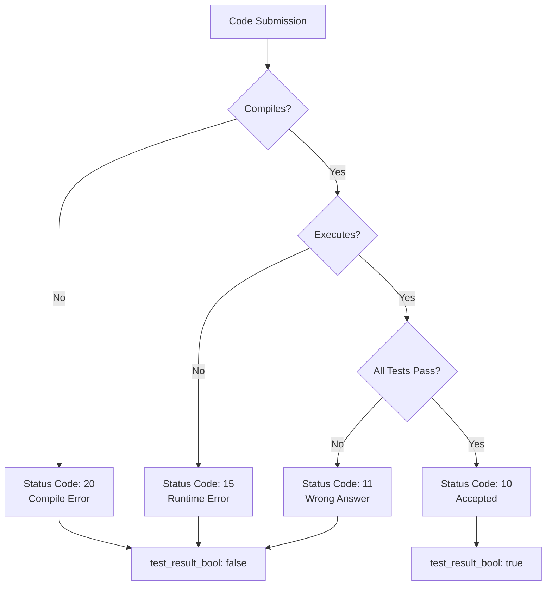
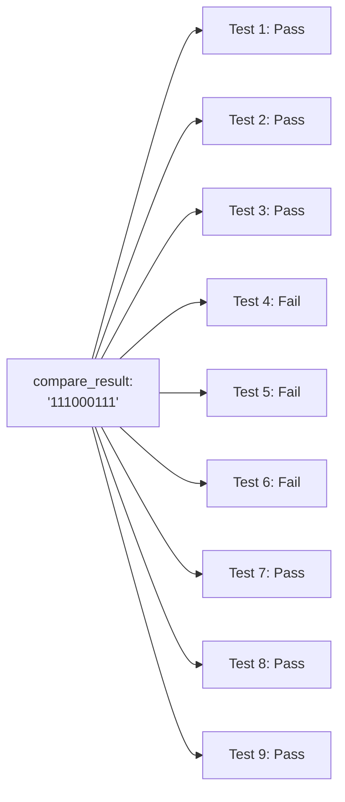
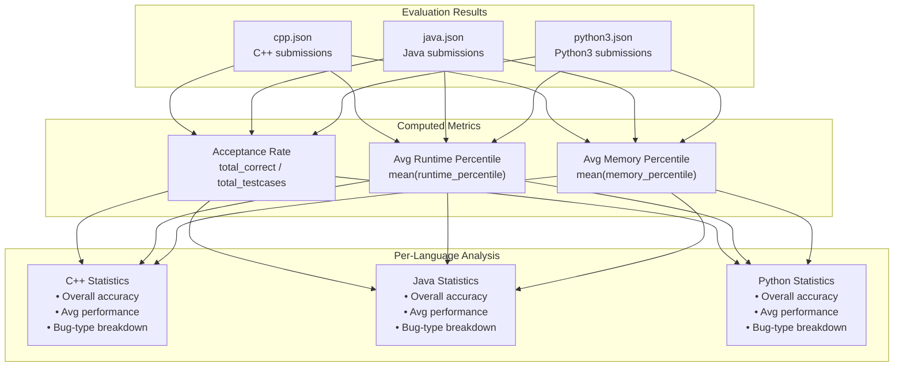
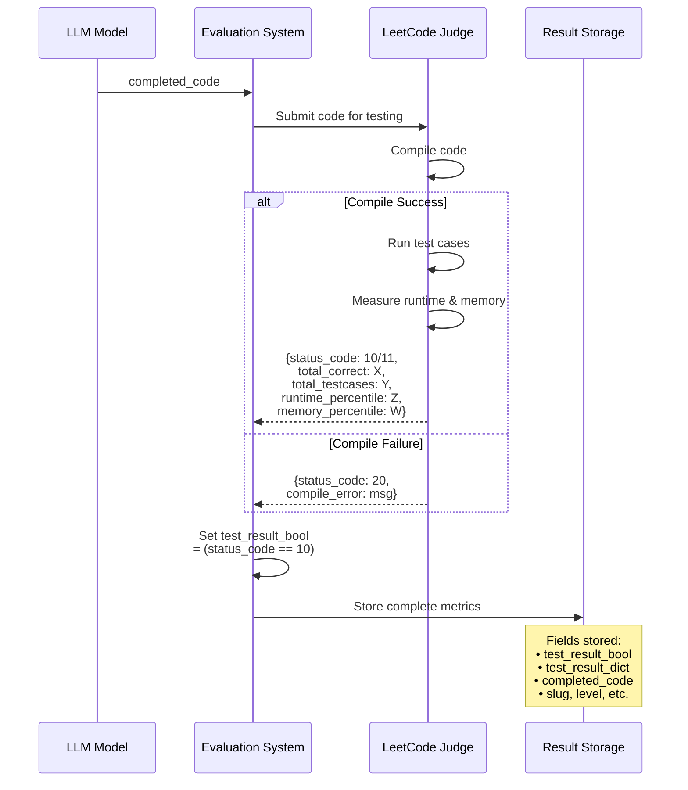

<!-- source: DeepWiki mcp.deepwiki.com · repo thunlp/DebugBench · page 5.2 Evaluation Metrics · fetched 2026-11-02 -->

# Evaluation Metrics

<details>
<summary>Relevant source files</summary>

The following files were used as context for generating this wiki page:

- [evalution_result/gpt-4/code_generation/cpp.json](evalution_result/gpt-4/code_generation/cpp.json)
- [evalution_result/gpt-4/code_generation/java.json](evalution_result/gpt-4/code_generation/java.json)
- [evalution_result/gpt-4/code_generation/python3.json](evalution_result/gpt-4/code_generation/python3.json)

</details>


This document describes the evaluation metrics used to measure Large Language Model (LLM) debugging performance in DebugBench. The metrics capture both correctness (whether the debugged code passes test cases) and performance characteristics (runtime and memory efficiency).

For information about the pre-computed baseline results that use these metrics, see [Pre-computed Baseline Results](#5.1). For the complete schema of result files, see [Result Schema](#5.3).

---

## Overview

DebugBench evaluates LLM-generated code fixes by submitting them to the LeetCode online judge platform and collecting comprehensive metrics. Each submission generates both binary correctness indicators and detailed performance measurements that enable fine-grained analysis of debugging capabilities across different bug types, difficulty levels, and programming languages.

**Sources:** [evalution_result/gpt-4/code_generation/cpp.json:1-100](), [evalution_result/gpt-4/code_generation/java.json:1-100](), [evalution_result/gpt-4/code_generation/python3.json:1-100]()

---

## Core Evaluation Metrics

### Binary Success Indicators

The most fundamental metric for evaluating debugging success is the binary pass/fail indicator stored in the `test_result_bool` field:

| Field | Type | Description | Values |
|-------|------|-------------|--------|
| `test_result_bool` | boolean | Overall test result | `true` (all tests passed), `false` (at least one test failed) |

This field provides a simple yes/no answer to whether the LLM successfully debugged the code.

**Example:** A successful debugging attempt:
```json
{
  "slug": "binary-search",
  "test_result_bool": true,
  "test_result_dict": {
    "status_msg": "Accepted",
    "total_correct": 47,
    "total_testcases": 47
  }
}
```

**Sources:** [evalution_result/gpt-4/code_generation/python3.json:46-86](), [evalution_result/gpt-4/code_generation/cpp.json:46-87]()

---

### Status Codes and Messages

Each submission receives a status code indicating the outcome category:

| Status Code | Status Message | Meaning |
|-------------|---------------|----------|
| `10` | "Accepted" | All test cases passed |
| `11` | "Wrong Answer" | Code executed but produced incorrect output |
| `20` | "Compile Error" | Code failed to compile |
| Other | "Runtime Error", "Time Limit Exceeded", etc. | Various execution failures |



**Sources:** [evalution_result/gpt-4/code_generation/cpp.json:15-44](), [evalution_result/gpt-4/code_generation/java.json:99-121]()

---

## Test Case Coverage Metrics

### Acceptance Rate Calculation

The most important metric for analyzing partial correctness is the acceptance rate, calculated from two fields:

| Field | Type | Description |
|-------|------|-------------|
| `total_correct` | integer | Number of test cases passed |
| `total_testcases` | integer | Total number of test cases |

**Acceptance Rate Formula:**
```
acceptance_rate = total_correct / total_testcases
```

**Example of Partial Success:**
```json
{
  "slug": "check-if-there-is-a-valid-path-in-a-grid",
  "test_result_bool": false,
  "test_result_dict": {
    "status_code": 11,
    "status_msg": "Wrong Answer",
    "total_correct": 27,
    "total_testcases": 80
  }
}
```

This shows 33.75% acceptance rate (27/80), indicating the fix partially works but fails on some edge cases.

**Sources:** [evalution_result/gpt-4/code_generation/cpp.json:1-45]()

---

### Compare Result String

The `compare_result` field provides a detailed, test-by-test breakdown:

- A string where each character represents one test case
- `'1'` indicates the test case passed
- `'0'` indicates the test case failed

**Example:**
```json
{
  "compare_result": "01010010010100001010010010001110011001110001000000001100010000000011000010011100",
  "total_correct": 27,
  "total_testcases": 80
}
```

This 80-character string shows exactly which test cases passed (1) and failed (0), enabling analysis of failure patterns.



**Sources:** [evalution_result/gpt-4/code_generation/cpp.json:25](), [evalution_result/gpt-4/code_generation/java.json:419-421]()

---

## Performance Metrics

### Runtime Performance

Runtime metrics measure the execution speed of debugged code:

| Field | Type | Description | Unit |
|-------|------|-------------|------|
| `status_runtime` | string | Actual runtime | milliseconds (e.g., "207 ms") |
| `runtime_percentile` | float | Percentile ranking among all submissions | 0-100 |
| `elapsed_time` | integer | Total evaluation time | milliseconds |

**Interpretation:**
- `runtime_percentile` of 87.32 means the code runs faster than 87.32% of accepted submissions
- Higher percentiles indicate better performance
- `"N/A"` values indicate the code did not pass all tests

**Example of High-Performance Solution:**
```json
{
  "slug": "binary-search",
  "status_runtime": "207 ms",
  "runtime_percentile": 87.3208,
  "elapsed_time": 232
}
```

**Sources:** [evalution_result/gpt-4/code_generation/python3.json:46-85]()

---

### Memory Performance

Memory metrics measure the space efficiency of debugged code:

| Field | Type | Description | Unit |
|-------|------|-------------|------|
| `memory` | integer | Memory consumed | bytes |
| `status_memory` | string | Human-readable memory | e.g., "17.9 MB" |
| `memory_percentile` | float | Percentile ranking | 0-100 |

**Example:**
```json
{
  "memory": 17940000,
  "status_memory": "17.9 MB",
  "memory_percentile": 5.912
}
```

This indicates the solution uses more memory than 94% of other solutions (100 - 5.912 = 94.088).

**Sources:** [evalution_result/gpt-4/code_generation/python3.json:63-81]()

---

## Metric Aggregation and Analysis

### Per-Language Statistics

Evaluation metrics can be aggregated by programming language to compare LLM debugging performance:



**Sources:** [evalution_result/gpt-4/code_generation/cpp.json:1-100](), [evalution_result/gpt-4/code_generation/java.json:1-100](), [evalution_result/gpt-4/code_generation/python3.json:1-100]()

---

### Bug Type Analysis

Metrics can be aggregated by bug category to identify which types of bugs are harder to debug:

| Bug Category | Success Metric | Analysis |
|--------------|----------------|----------|
| Condition Errors | Count where `test_result_bool == true` | % of condition bugs successfully fixed |
| Indexing Errors | Count where `test_result_bool == true` | % of indexing bugs successfully fixed |
| Operation Errors | Count where `test_result_bool == true` | % of operation bugs successfully fixed |
| Other Errors | Count where `test_result_bool == true` | % of other bugs successfully fixed |

The benchmark structure (organized in 51 shards by language and bug type) enables this granular analysis.

**Sources:** [evalution_result/gpt-4/code_generation/cpp.json:1-500]()

---

## Special Cases and Error States

### Failed Submissions

Some submissions never complete evaluation, indicated by:

```json
{
  "slug": "count-number-of-rectangles-containing-each-point",
  "test_result_dict": {
    "state": "STARTED"
  }
}
```

The `"state": "STARTED"` indicates the evaluation was initiated but never completed (e.g., timeout, system error).

**Sources:** [evalution_result/gpt-4/code_generation/java.json:263-267]()

---

### Compile Errors

Compile errors provide diagnostic information:

```json
{
  "status_code": 20,
  "status_msg": "Compile Error",
  "compile_error": "Line 31: error: duplicate class: Node",
  "full_compile_error": "Line 31: error: duplicate class: Node\nclass Node {\n^"
}
```

The `compile_error` and `full_compile_error` fields contain the compiler's diagnostic output, useful for understanding why code generation failed.

**Sources:** [evalution_result/gpt-4/code_generation/java.json:99-121]()

---

## Debugging Information

### Last Test Case

When a submission fails, the `last_testcase`, `expected_output`, and `code_output` fields help diagnose the issue:

```json
{
  "status_msg": "Wrong Answer",
  "last_testcase": "[2,2,2,1,3]\n[1,2,2,3,3]",
  "expected_output": "10",
  "code_output": "4",
  "input_formatted": "[2,2,2,1,3], [1,2,2,3,3]"
}
```

This shows:
- The input that caused the failure
- What the code produced (4)
- What it should have produced (10)

**Sources:** [evalution_result/gpt-4/code_generation/python3.json:15-44](), [evalution_result/gpt-4/code_generation/cpp.json:15-44]()

---

## Metric Interpretation Guidelines

### Success Thresholds

| Metric | Excellent | Good | Poor |
|--------|-----------|------|------|
| `test_result_bool` | `true` | N/A | `false` |
| Acceptance Rate | 100% | 80-99% | <80% |
| `runtime_percentile` | >90 | 50-90 | <50 |
| `memory_percentile` | >90 | 50-90 | <50 |

### Typical Evaluation Flow



**Sources:** [evalution_result/gpt-4/code_generation/cpp.json:1-100](), [evalution_result/gpt-4/code_generation/java.json:1-100]()

---

## Result Completeness

A complete evaluation result contains:

1. **Problem Metadata**: `slug`, `description`, `level`, `oracle_code`
2. **Binary Result**: `test_result_bool`
3. **Detailed Results**: `test_result_dict` with:
   - Status information (`status_code`, `status_msg`, `state`)
   - Test coverage (`total_correct`, `total_testcases`, `compare_result`)
   - Performance (`runtime_percentile`, `memory_percentile`)
   - Debugging info (`last_testcase`, `expected_output`, `code_output`)
4. **Generated Code**: `completed_code`

Missing fields (e.g., `runtime_percentile: null`) indicate the metric was not applicable (typically because the code didn't pass all tests).

**Sources:** [evalution_result/gpt-4/code_generation/cpp.json:1-87](), [evalution_result/gpt-4/code_generation/python3.json:1-86]()

---

