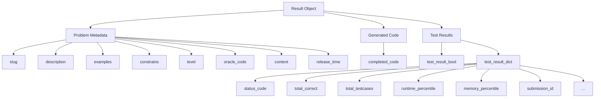
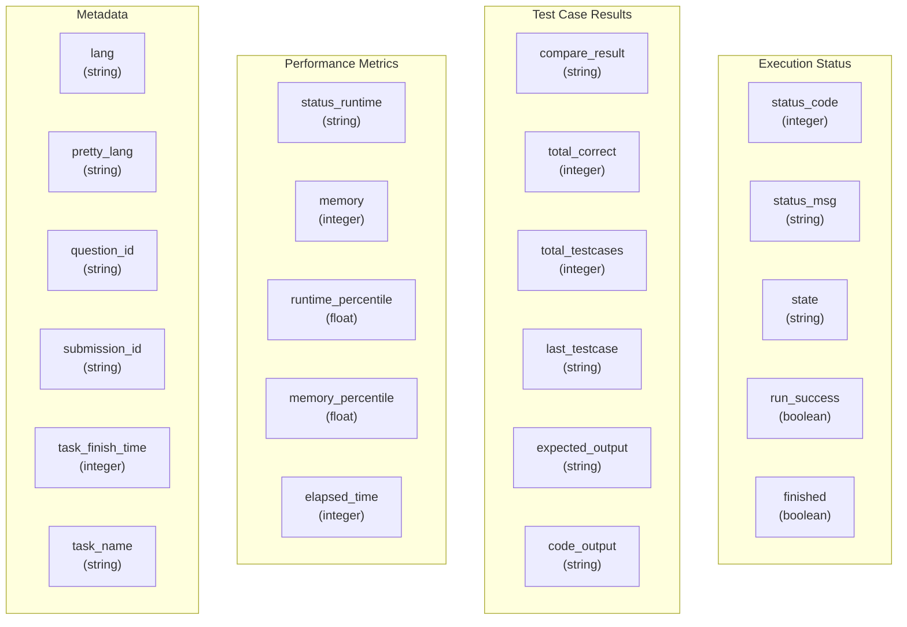
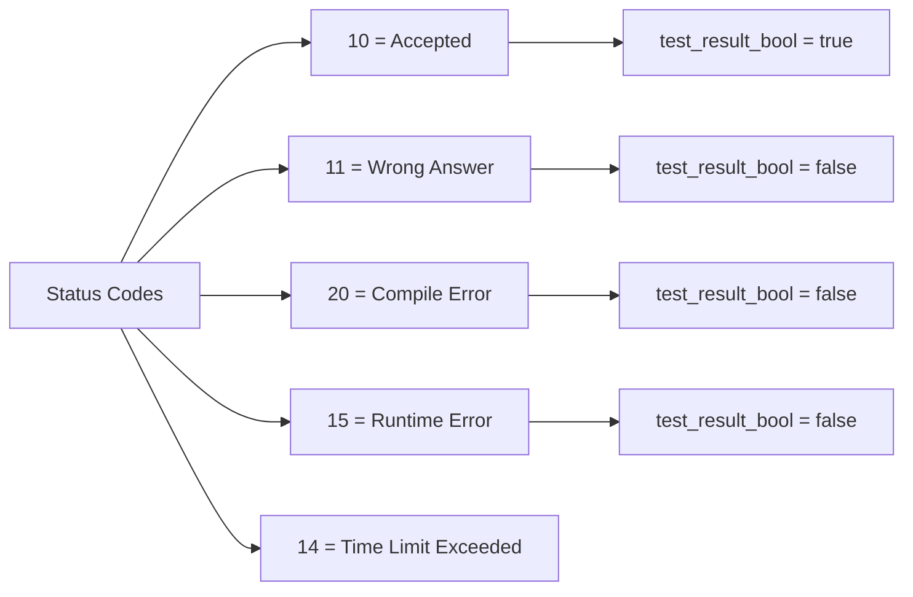
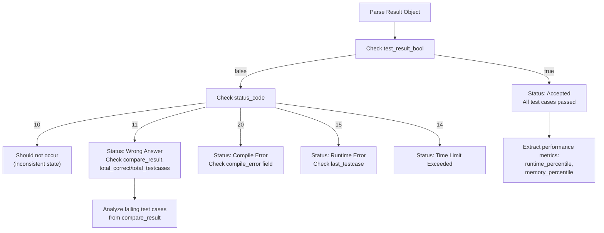

<!-- source: DeepWiki mcp.deepwiki.com · repo thunlp/DebugBench · page 5.3 Result Schema · fetched 2026-11-02 -->

# Result Schema

<details>
<summary>Relevant source files</summary>

The following files were used as context for generating this wiki page:

- [evalution_result/gpt-4/code_generation/cpp.json](evalution_result/gpt-4/code_generation/cpp.json)
- [evalution_result/gpt-4/code_generation/java.json](evalution_result/gpt-4/code_generation/java.json)
- [evalution_result/gpt-4/code_generation/python3.json](evalution_result/gpt-4/code_generation/python3.json)

</details>


This page documents the structure and format of evaluation result JSON files stored in the `evalution_result/` directory. These files capture the complete evaluation process for each LLM, including the original problem specification, the LLM's generated solution, and detailed test execution results from the LeetCode testing infrastructure.

For information about the evaluation metrics calculated from these results, see [Evaluation Metrics](#5.2). For details about pre-computed baseline results, see [Pre-computed Baseline Results](#5.1).

## Result File Organization

Result files are organized by model and scenario:

```
evalution_result/
├── gpt-4/
│   ├── code_generation/
│   │   ├── cpp.json
│   │   ├── java.json
│   │   └── python3.json
├── gpt-3.5-turbo-0613/
│   └── code_generation/
│       ├── cpp.json
│       ├── java.json
│       └── python3.json
└── CodeLlama-34b-instruct/
    └── code_generation/
        ├── cpp.json
        ├── java.json
        └── python3.json
```

Each JSON file contains an array of result objects, one per problem instance evaluated.

**Sources:** [evalution_result/gpt-4/code_generation/cpp.json:1-5](), [evalution_result/gpt-4/code_generation/java.json:1-5](), [evalution_result/gpt-4/code_generation/python3.json:1-5]()

## Result Object Structure



**Sources:** [evalution_result/gpt-4/code_generation/cpp.json:2-44]()

## Top-Level Fields

### Problem Identification and Metadata

| Field | Type | Description |
|-------|------|-------------|
| `slug` | string | LeetCode problem identifier (URL-friendly name) |
| `description` | string | Full problem statement |
| `examples` | array[string] | Example input/output pairs from problem statement |
| `constrains` | string | Problem constraints and input limits |
| `level` | string | Difficulty level: `"easy"`, `"medium"`, or `"hard"` |
| `release_time` | integer | Unix timestamp of when the problem was published |

**Sources:** [evalution_result/gpt-4/code_generation/cpp.json:3-11](), [evalution_result/gpt-4/code_generation/cpp.json:14]()

### Code Fields

| Field | Type | Description |
|-------|------|-------------|
| `oracle_code` | string | Correct reference solution from the benchmark dataset |
| `content` | string | Original LeetCode community post content (if applicable) |
| `completed_code` | string | LLM-generated solution code to be tested |

The `completed_code` field contains the complete code that was submitted to LeetCode for testing. This is the primary artifact being evaluated.

**Sources:** [evalution_result/gpt-4/code_generation/cpp.json:12-13](), [evalution_result/gpt-4/code_generation/cpp.json:15]()

### Test Result Summary

| Field | Type | Description |
|-------|------|-------------|
| `test_result_bool` | boolean | `true` if all test cases passed, `false` otherwise |
| `test_result_dict` | object | Detailed test execution results (see next section) |

**Sources:** [evalution_result/gpt-4/code_generation/cpp.json:16-17]()

## Test Result Dictionary Schema

The `test_result_dict` object contains comprehensive information about the code execution on LeetCode's online judge system.



**Sources:** [evalution_result/gpt-4/code_generation/cpp.json:17-44]()

### Execution Status Fields

| Field | Type | Description | Example Values |
|-------|------|-------------|----------------|
| `status_code` | integer | LeetCode submission status code | `10` (Accepted), `11` (Wrong Answer), `20` (Compile Error) |
| `status_msg` | string | Human-readable status message | `"Accepted"`, `"Wrong Answer"`, `"Compile Error"` |
| `state` | string | Judge task state | `"SUCCESS"`, `"STARTED"` |
| `run_success` | boolean | Whether code executed without errors | `true`, `false` |
| `finished` | boolean | Whether judging completed | `true`, `false` |

**Sources:** [evalution_result/gpt-4/code_generation/cpp.json:18-20](), [evalution_result/gpt-4/code_generation/cpp.json:31-32](), [evalution_result/gpt-4/code_generation/cpp.json:42-43]()

### Status Code Reference



**Sources:** [evalution_result/gpt-4/code_generation/cpp.json:62](), [evalution_result/gpt-4/code_generation/java.json:17](), [evalution_result/gpt-4/code_generation/java.json:101-102]()

### Test Case Result Fields

| Field | Type | Description |
|-------|------|-------------|
| `compare_result` | string | Binary string representing pass/fail for each test case (`"1"` = pass, `"0"` = fail) |
| `total_correct` | integer | Number of test cases passed |
| `total_testcases` | integer | Total number of test cases |
| `last_testcase` | string | Input for the last failing test case (if applicable) |
| `expected_output` | string | Expected output for the failing test case |
| `code_output` | string | Actual output produced by the code |
| `input_formatted` | string | Human-readable formatted input (for Wrong Answer cases) |
| `input` | string | Raw input string |

The `compare_result` string has length equal to `total_testcases`, where each character indicates whether that test case passed (`"1"`) or failed (`"0"`).

**Sources:** [evalution_result/gpt-4/code_generation/cpp.json:25-29](), [evalution_result/gpt-4/code_generation/cpp.json:33-34](), [evalution_result/gpt-4/code_generation/cpp.json:40-41]()

### Performance Metrics Fields

| Field | Type | Description |
|-------|------|-------------|
| `status_runtime` | string | Execution time (e.g., `"2 ms"`, `"N/A"` if not applicable) |
| `memory` | integer | Memory used in bytes |
| `status_memory` | string | Human-readable memory usage (e.g., `"7.6 MB"`, `"N/A"`) |
| `runtime_percentile` | float/null | Percentile ranking for runtime (0-100, `null` if N/A) |
| `memory_percentile` | float/null | Percentile ranking for memory usage (0-100, `null` if N/A) |
| `elapsed_time` | integer | Total elapsed time for judging in milliseconds |

Performance percentiles are only available for `Accepted` submissions (`status_code == 10`). For other statuses, these fields contain `null`.

**Sources:** [evalution_result/gpt-4/code_generation/cpp.json:21-24](), [evalution_result/gpt-4/code_generation/cpp.json:35-37](), [evalution_result/gpt-4/code_generation/cpp.json:79-81]()

### Metadata Fields

| Field | Type | Description |
|-------|------|-------------|
| `lang` | string | Programming language code | `"cpp"`, `"java"`, `"python3"` |
| `pretty_lang` | string | Human-readable language name | `"C++"`, `"Java"`, `"Python3"` |
| `question_id` | string | LeetCode internal question ID |
| `submission_id` | string | LeetCode submission ID for this evaluation |
| `task_finish_time` | integer | Unix timestamp (milliseconds) when task completed |
| `task_name` | string | Judge task name | `"judger.judgetask.Judge"` |
| `std_output` | string | Standard output from code execution (usually empty) |

**Sources:** [evalution_result/gpt-4/code_generation/cpp.json:19](), [evalution_result/gpt-4/code_generation/cpp.json:23](), [evalution_result/gpt-4/code_generation/cpp.json:27](), [evalution_result/gpt-4/code_generation/cpp.json:30-31](), [evalution_result/gpt-4/code_generation/cpp.json:38-39]()

## Result Interpretation Flow



**Sources:** [evalution_result/gpt-4/code_generation/cpp.json:16-44](), [evalution_result/gpt-4/code_generation/java.json:100-121]()

## Example Result Objects

### Successful Submission (Accepted)

```json
{
    "slug": "greatest-common-divisor-of-strings",
    "test_result_bool": true,
    "test_result_dict": {
        "status_code": 10,
        "status_msg": "Accepted",
        "lang": "cpp",
        "run_success": true,
        "total_correct": 123,
        "total_testcases": 123,
        "compare_result": "111111111111111111111111111111111111111111111111111111111111111111111111111111111111111111111111111111111111111111111111111",
        "runtime_percentile": 65.50750000000001,
        "status_memory": "7.6 MB",
        "memory_percentile": 54.06330000000001,
        "status_runtime": "2 ms",
        "memory": 7568000,
        "elapsed_time": 14,
        "submission_id": "1097912715",
        "state": "SUCCESS"
    }
}
```

**Sources:** [evalution_result/gpt-4/code_generation/cpp.json:60-86]()

### Failed Submission (Wrong Answer)

```json
{
    "slug": "check-if-there-is-a-valid-path-in-a-grid",
    "test_result_bool": false,
    "test_result_dict": {
        "status_code": 11,
        "status_msg": "Wrong Answer",
        "lang": "cpp",
        "run_success": true,
        "total_correct": 27,
        "total_testcases": 80,
        "compare_result": "01010010010100001010010010001110011001110001000000001100010000000011000010011100",
        "code_output": "false",
        "expected_output": "true",
        "last_testcase": "[[2,4,3],[6,5,2]]",
        "input_formatted": "[[2,4,3],[6,5,2]]",
        "runtime_percentile": null,
        "status_memory": "N/A",
        "memory_percentile": null,
        "submission_id": "1097912575",
        "state": "SUCCESS"
    }
}
```

**Sources:** [evalution_result/gpt-4/code_generation/cpp.json:2-44]()

### Compile Error

```json
{
    "slug": "populating-next-right-pointers-in-each-node",
    "test_result_bool": false,
    "test_result_dict": {
        "status_code": 20,
        "status_msg": "Compile Error",
        "lang": "java",
        "run_success": false,
        "compile_error": "Line 31: error: duplicate class: Node",
        "full_compile_error": "Line 31: error: duplicate class: Node\nclass Node {\n^",
        "total_correct": null,
        "total_testcases": null,
        "runtime_percentile": null,
        "memory_percentile": null,
        "submission_id": "1098019052",
        "state": "SUCCESS"
    }
}
```

**Sources:** [evalution_result/gpt-4/code_generation/java.json:99-121]()

### In-Progress Submission

Some submissions may have incomplete results with `"state": "STARTED"`, indicating the evaluation was not completed:

```json
{
    "test_result_bool": false,
    "test_result_dict": {
        "state": "STARTED"
    }
}
```

**Sources:** [evalution_result/gpt-4/code_generation/cpp.json:184-187]()

## Field Availability by Status

| Field | Accepted (10) | Wrong Answer (11) | Compile Error (20) | Runtime Error (15) | Not Finished |
|-------|---------------|-------------------|--------------------|--------------------|--------------|
| `status_code` | ✓ | ✓ | ✓ | ✓ | ✗ |
| `total_correct` | ✓ | ✓ | null | ✓ | ✗ |
| `total_testcases` | ✓ | ✓ | null | ✓ | ✗ |
| `compare_result` | ✓ | ✓ | ✗ | ✓ | ✗ |
| `runtime_percentile` | ✓ | null | null | null | ✗ |
| `memory_percentile` | ✓ | null | null | null | ✗ |
| `last_testcase` | "" | ✓ | ✗ | ✓ | ✗ |
| `code_output` | "" | ✓ | ✗ | ✓ | ✗ |
| `expected_output` | "" | ✓ | ✗ | ✓ | ✗ |
| `compile_error` | ✗ | ✗ | ✓ | ✗ | ✗ |
| `full_compile_error` | ✗ | ✗ | ✓ | ✗ | ✗ |

**Sources:** [evalution_result/gpt-4/code_generation/cpp.json:60-86](), [evalution_result/gpt-4/code_generation/cpp.json:2-44](), [evalution_result/gpt-4/code_generation/java.json:99-121]()

## Usage Notes

1. **Always check `test_result_bool` first** for a quick pass/fail determination.

2. **For detailed analysis**, parse `test_result_dict`:
   - Check `status_code` to determine the type of failure
   - Use `compare_result` to identify which specific test cases failed
   - Examine `last_testcase`, `expected_output`, and `code_output` for debugging

3. **Performance comparison** should only use submissions with `status_code == 10`:
   - `runtime_percentile` and `memory_percentile` are only meaningful for accepted solutions
   - These percentiles compare against all other accepted submissions for that problem

4. **Memory values** are in bytes and should be divided by 1,000,000 for MB (e.g., `7568000` bytes = `7.568 MB`)

5. **Incomplete evaluations** with `"state": "STARTED"` should be excluded from analysis or re-run

**Sources:** [evalution_result/gpt-4/code_generation/cpp.json:1-461](), [evalution_result/gpt-4/code_generation/java.json:1-460](), [evalution_result/gpt-4/code_generation/python3.json:1-606]()

---

