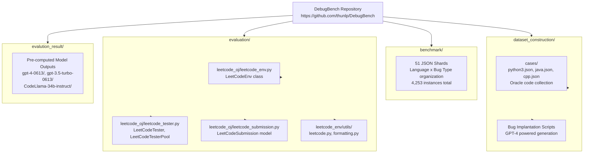
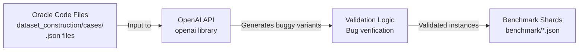
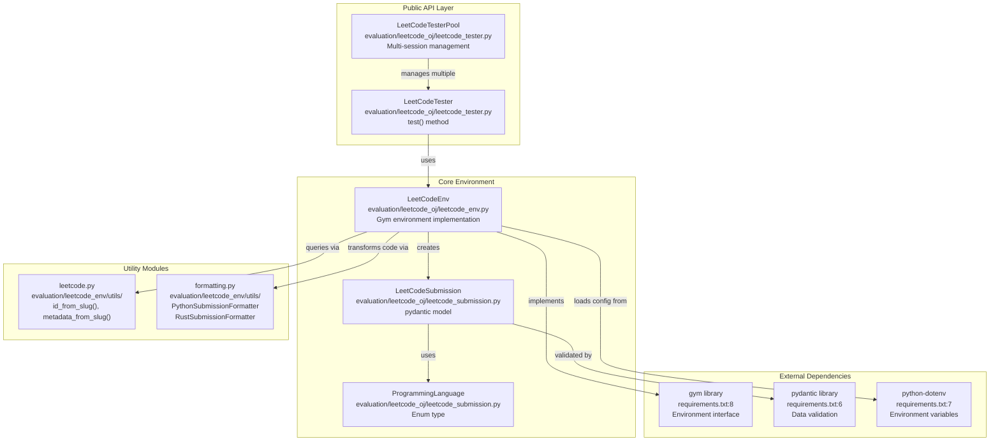
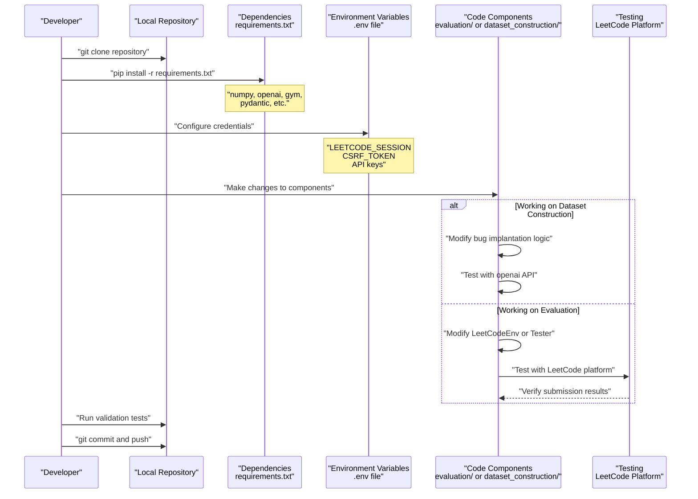
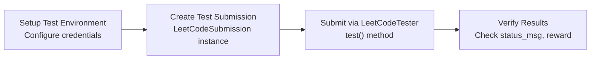

<!-- source: DeepWiki mcp.deepwiki.com · repo thunlp/DebugBench · page 6 Development Guide · fetched 2026-11-02 -->

# Development Guide

<details>
<summary>Relevant source files</summary>

The following files were used as context for generating this wiki page:

- [README.md](README.md)
- [requirements.txt](requirements.txt)

</details>


This guide is for developers who want to work on DebugBench, contribute to the project, or extend its capabilities. It covers the development environment setup, project structure, typical workflows, and testing procedures. For detailed installation instructions, see [Installation and Setup](#6.1). For configuration details, see [Configuration](#6.3). For guidance on extending the benchmark, see [Extending the Benchmark](#6.4).

## Purpose and Scope

This document provides an overview of DebugBench's development processes, project organization, and key components from a developer's perspective. It bridges high-level system concepts to concrete code entities, enabling you to navigate the codebase effectively and make contributions.

## Development Environment Overview

DebugBench requires Python 3.8+ and several dependencies for dataset construction, evaluation, and analysis. The system interacts with external services including OpenAI API (for bug implantation) and LeetCode platform (for code testing).

**Quick Setup Summary:**
1. Clone the repository from `https://github.com/thunlp/DebugBench`
2. Install Python dependencies from [requirements.txt:1-10]()
3. Configure environment variables for API access
4. Set up LeetCode authentication credentials

See [Installation and Setup](#6.1) for complete setup instructions.

Sources: [README.md:1-57](), [requirements.txt:1-10]()

## Project Structure

DebugBench is organized into four main directories, each serving a distinct purpose in the benchmark lifecycle:



**Directory Responsibilities:**

| Directory | Purpose | Key Files/Subdirectories |
|-----------|---------|--------------------------|
| `dataset_construction/` | Bug implantation and oracle code management | `cases/python3.json`, `cases/java.json`, `cases/cpp.json` |
| `benchmark/` | Final benchmark dataset storage | 51 JSON shard files organized by language and bug type |
| `evaluation/` | Testing infrastructure for LLM evaluation | `leetcode_oj/leetcode_env.py`, `leetcode_oj/leetcode_tester.py`, `leetcode_env/utils/` |
| `evalution_result/` | Pre-computed baseline results | Model-specific subdirectories with JSON outputs |

Sources: [README.md:26-36]()

## Core Components and Code Entities

### Dataset Construction Components



**Key Entities:**
- **Oracle code files**: Located in `dataset_construction/cases/`, contain correct LeetCode solutions by language
- **Bug implantation scripts**: Use OpenAI API (`openai` library from [requirements.txt:3]()) to generate buggy variants
- **Output format**: JSON shards following the schema documented in [Data Schema and Format](#3.2)

Sources: [requirements.txt:3]()

### Evaluation System Components

The evaluation system is the most complex component for developers to work with. It provides a Gym-based environment for testing code solutions:



**Key Classes and Methods:**

| Component | File Path | Primary Interface |
|-----------|-----------|-------------------|
| `LeetCodeEnv` | `evaluation/leetcode_oj/leetcode_env.py` | `step()`, `reset()`, Gym-compatible |
| `LeetCodeTester` | `evaluation/leetcode_oj/leetcode_tester.py` | `test(code, task_id, language)` |
| `LeetCodeTesterPool` | `evaluation/leetcode_oj/leetcode_tester.py` | Session pooling wrapper |
| `LeetCodeSubmission` | `evaluation/leetcode_oj/leetcode_submission.py` | Pydantic data model |
| `ProgrammingLanguage` | `evaluation/leetcode_oj/leetcode_submission.py` | Enum for language types |
| GraphQL utilities | `evaluation/leetcode_env/utils/leetcode.py` | `id_from_slug()`, `metadata_from_slug()` |
| Code formatters | `evaluation/leetcode_env/utils/formatting.py` | `PythonSubmissionFormatter`, etc. |

Sources: [requirements.txt:6-8]()

## Development Workflow

### Standard Development Cycle



**Development Steps:**

1. **Environment Setup** (See [Installation and Setup](#6.1))
   - Install dependencies from [requirements.txt:1-10]()
   - Configure authentication (See [Configuration](#6.3))

2. **Component Selection**
   - Dataset construction: Work in `dataset_construction/`
   - Evaluation system: Work in `evaluation/`
   - Benchmark data: Work with `benchmark/` JSON files

3. **Implementation**
   - Follow existing code patterns
   - Use `pydantic` models for data validation
   - Implement proper error handling

4. **Testing**
   - Test dataset construction with OpenAI API
   - Test evaluation with LeetCode platform submissions
   - Validate JSON schema compliance

5. **Documentation**
   - Update relevant wiki pages
   - Add docstrings to new functions/classes
   - Update README.md if needed

Sources: [requirements.txt:1-10]()

## Testing Your Changes

### Testing Dataset Construction

When modifying bug implantation logic:

1. **Test with OpenAI API**: Ensure bug generation prompts work correctly
2. **Validate output format**: Verify JSON schema matches expected structure
3. **Verify bug correctness**: Confirm bugs produce different outputs than oracle code

### Testing Evaluation System

When modifying the evaluation infrastructure:



**Testing Checklist:**

| Test Area | Verification Steps |
|-----------|-------------------|
| Authentication | Credentials load correctly from environment |
| Code submission | `LeetCodeTester.test()` executes successfully |
| Result parsing | Status messages parsed correctly |
| Rate limiting | Cooldown mechanism prevents rate limit errors |
| Session failover | Pool rotates sessions on failure |
| Code formatting | Language-specific formatters work correctly |

### Integration Testing

Test the full pipeline:
1. Load a problem from `benchmark/` directory
2. Submit buggy code to LeetCode
3. Verify it fails (returns `reward=False`)
4. Submit oracle code
5. Verify it passes (returns `reward=True`)

Sources: [requirements.txt:3-9]()

## Common Development Tasks

### Adding Support for a New Language

See [Extending the Benchmark](#6.4) for detailed instructions. Key steps:

1. Add language to `ProgrammingLanguage` enum in `evaluation/leetcode_oj/leetcode_submission.py`
2. Create formatter class in `evaluation/leetcode_env/utils/formatting.py`
3. Add oracle code collection file in `dataset_construction/cases/`
4. Update bug implantation prompts for language-specific patterns

### Adding a New Bug Type

See [Extending the Benchmark](#6.4) for detailed instructions. Key steps:

1. Define bug category in bug taxonomy
2. Create GPT-4 prompts for bug generation
3. Validate bugs produce incorrect outputs
4. Add JSON shard files to `benchmark/` directory

### Modifying Evaluation Logic

When changing how submissions are tested:

1. Modify `LeetCodeEnv` class in `evaluation/leetcode_oj/leetcode_env.py`
2. Update `step()` method for submission logic
3. Adjust reward calculation if needed
4. Test with various submission scenarios

### Working with Dependencies

**Core Dependencies:**

| Library | Version | Purpose | Configuration |
|---------|---------|---------|---------------|
| `numpy` | ~1.25.2 | Numerical operations | None required |
| `openai` | ~0.28.0 | GPT-4 API for bug implantation | API key in environment |
| `gym` | ~0.26.2 | RL environment interface | None required |
| `pydantic` | ~2.3.0 | Data validation | None required |
| `python-dotenv` | ~0.21.1 | Environment variable loading | Create `.env` file |
| `tqdm` | ~4.66.1 | Progress bars | None required |
| `transformers` | ~4.31.0 | Model evaluation | None required |
| `beautifulsoup4` | ~4.12.2 | HTML parsing | None required |

See [Dependencies](#6.2) for detailed information about each dependency.

Sources: [requirements.txt:1-10]()

## Code Quality Standards

### Type Hints and Validation

DebugBench uses `pydantic` for data validation. When creating new data models:

```python
# Example pattern from LeetCodeSubmission
from pydantic import BaseModel

class YourModel(BaseModel):
    field_name: str
    optional_field: Optional[int] = None
```

### Error Handling

Implement proper error handling for external API calls:
- OpenAI API failures in dataset construction
- LeetCode platform errors in evaluation
- Network timeouts and rate limiting

### Documentation

- Add docstrings to all public functions and classes
- Update wiki pages when changing interfaces
- Document configuration requirements

## Contributing Workflow

1. **Fork the repository**
2. **Create a feature branch**: `git checkout -b feature/your-feature`
3. **Make changes**: Follow development workflow above
4. **Test thoroughly**: Run validation tests
5. **Submit pull request**: Include description of changes

For questions, contact `trc20@mails.tsinghua.edu.cn` or open an issue on GitHub.

Sources: [README.md:44]()

## Next Steps

- **[Installation and Setup](#6.1)**: Detailed setup instructions
- **[Dependencies](#6.2)**: Complete dependency documentation
- **[Configuration](#6.3)**: All configuration options
- **[Extending the Benchmark](#6.4)**: Guide for adding features

For API documentation, see [API Reference](#7). For understanding the dataset structure, see [Benchmark Dataset](#3).

---

