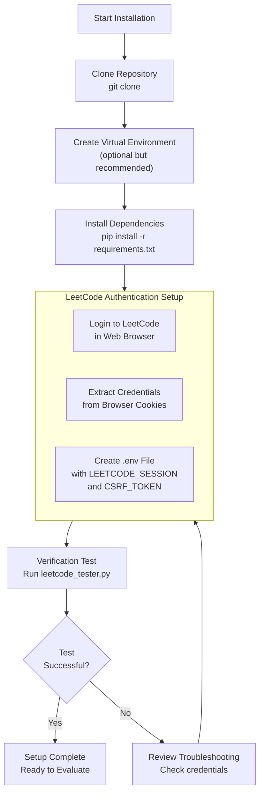
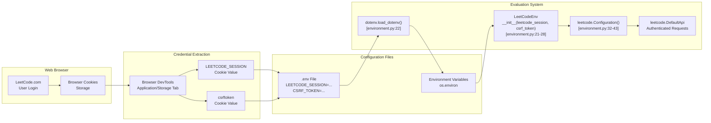
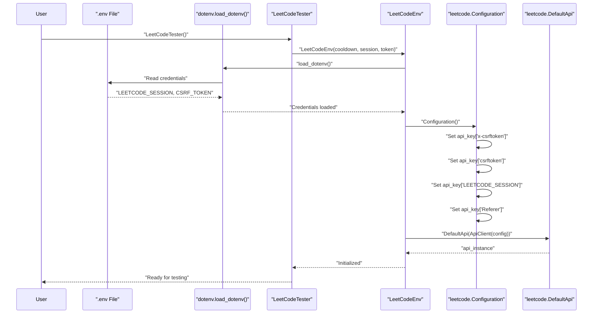
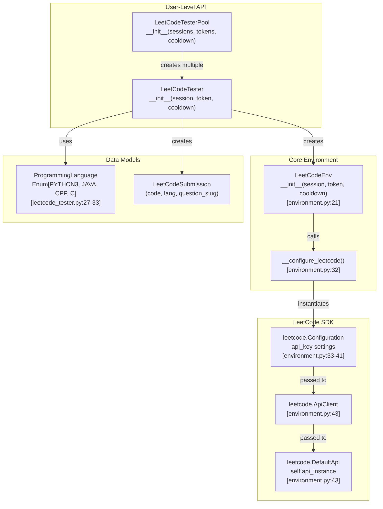

<!-- source: DeepWiki mcp.deepwiki.com · repo thunlp/DebugBench · page 6.1 Installation and Setup · fetched 2026-11-02 -->

# Installation and Setup

<details>
<summary>Relevant source files</summary>

The following files were used as context for generating this wiki page:

- [evaluation/leetcode_oj/__init__.py](evaluation/leetcode_oj/__init__.py)
- [evaluation/leetcode_oj/leetcode_env/environment.py](evaluation/leetcode_oj/leetcode_env/environment.py)
- [evaluation/leetcode_oj/leetcode_env/utils/__pycache__/leetcode.cpython-310.pyc](evaluation/leetcode_oj/leetcode_env/utils/__pycache__/leetcode.cpython-310.pyc)
- [evaluation/leetcode_oj/leetcode_tester.py](evaluation/leetcode_oj/leetcode_tester.py)
- [evaluation/leetcode_oj/leetcode_tester_pool.py](evaluation/leetcode_oj/leetcode_tester_pool.py)
- [requirements.txt](requirements.txt)

</details>


## Purpose and Scope

This page provides step-by-step instructions for installing DebugBench and configuring the evaluation environment. It covers Python dependency installation, LeetCode authentication credential setup, and verification procedures. For information about individual configuration options and parameters, see [Configuration](#6.3). For detailed dependency explanations, see [Dependencies](#6.2).

---

## Prerequisites

The DebugBench evaluation system requires:

| Requirement | Details |
|------------|---------|
| **Python Version** | Python 3.8 or higher |
| **Operating System** | Linux, macOS, or Windows with Python support |
| **LeetCode Account** | Active account for evaluation testing |
| **Network Access** | Internet connection for LeetCode API and package installation |

---

## Installation Workflow

### Installation Flow Diagram



**Sources:** [evaluation/leetcode_oj/leetcode_env/environment.py:1-43](), [evaluation/leetcode_oj/leetcode_tester.py:19-26]()

---

## Step 1: Clone Repository

```bash
git clone https://github.com/thunlp/DebugBench.git
cd DebugBench
```

---

## Step 2: Python Environment Setup

### Option A: Using Virtual Environment (Recommended)

```bash
# Create virtual environment
python3 -m venv debugbench_env

# Activate virtual environment
# On Linux/macOS:
source debugbench_env/bin/activate

# On Windows:
debugbench_env\Scripts\activate
```

### Option B: Using System Python

Skip virtual environment creation and proceed directly to dependency installation.

---

## Step 3: Install Dependencies

Install all required Python packages from `requirements.txt`:

```bash
pip install -r requirements.txt
```

### Core Dependencies Installed

| Package | Version | Purpose |
|---------|---------|---------|
| `gym` | ~0.26.2 | RL environment interface for LeetCodeEnv |
| `python-dotenv` | ~0.21.1 | Environment variable management |
| `pydantic` | ~2.3.0 | Data validation for LeetCodeSubmission |
| `tqdm` | ~4.66.1 | Progress tracking for evaluations |
| `openai` | ~0.28.0 | GPT API access (dataset construction) |
| `transformers` | ~4.31.0 | Model evaluation support |
| `beautifulsoup4` | ~4.12.2 | HTML parsing utilities |
| `numpy` | ~1.25.2 | Numerical operations |
| `matplotlib` | ~3.7.2 | Result visualization |

**Note:** The `leetcode` SDK is also required but may need separate installation. If not automatically installed, run:

```bash
pip install leetcode
```

**Sources:** [requirements.txt:1-10]()

---

## Step 4: LeetCode Authentication Configuration

### Authentication Architecture



**Sources:** [evaluation/leetcode_oj/leetcode_env/environment.py:21-43](), [evaluation/leetcode_oj/leetcode_tester.py:19-26]()

### 4.1: Obtain LeetCode Credentials

1. **Login to LeetCode:**
   - Navigate to https://leetcode.com
   - Log in with your account credentials

2. **Open Browser Developer Tools:**
   - **Chrome/Edge:** Press `F12` or `Ctrl+Shift+I` (Windows/Linux) / `Cmd+Option+I` (Mac)
   - **Firefox:** Press `F12` or `Ctrl+Shift+K` (Windows/Linux) / `Cmd+Option+K` (Mac)
   - **Safari:** Enable Developer menu in Preferences, then press `Cmd+Option+I`

3. **Navigate to Cookies:**
   - Click on **Application** tab (Chrome/Edge) or **Storage** tab (Firefox)
   - Expand **Cookies** → **https://leetcode.com**

4. **Extract Required Values:**

   | Cookie Name | Description | Example Format |
   |------------|-------------|----------------|
   | `LEETCODE_SESSION` | Session authentication token | Long alphanumeric string (150+ characters) |
   | `csrftoken` | CSRF protection token | 64-character hexadecimal string |

5. **Copy Cookie Values:**
   - Click on `LEETCODE_SESSION` and copy the **Value** field
   - Click on `csrftoken` and copy the **Value** field

### 4.2: Create Environment Configuration File

Create a `.env` file in the repository root directory:

```bash
# From DebugBench root directory
touch .env
```

Add the following content to `.env`:

```env
# LeetCode Authentication Credentials
LEETCODE_SESSION=your_leetcode_session_value_here
CSRF_TOKEN=your_csrf_token_value_here
```

**Example `.env` file:**

```env
LEETCODE_SESSION=eyJ0eXAiOiJKV1QiLCJhbGciOiJIUzI1NiJ9.eyJfYXV0aF91c2VyX2lkIjoiMTIz...
CSRF_TOKEN=a1b2c3d4e5f6g7h8i9j0k1l2m3n4o5p6q7r8s9t0u1v2w3x4y5z6a7b8c9d0e1f2
```

### 4.3: Environment Variable Loading

The system automatically loads credentials using `python-dotenv`:

```python
# From evaluation/leetcode_oj/leetcode_env/environment.py:22
dotenv.load_dotenv()
```

Credentials are then accessed via:

```python
# From evaluation/leetcode_oj/leetcode_tester.py:19-20
leetcode_session = os.environ['LEETCODE_SESSION']
csrf_token = os.environ['CSRF_TOKEN']
```

**Sources:** [evaluation/leetcode_oj/leetcode_env/environment.py:22](), [evaluation/leetcode_oj/leetcode_tester.py:19-20]()

### 4.4: Multi-Account Setup (Optional)

For high-volume evaluation or pool-based testing, configure multiple LeetCode accounts:

```env
# First Account
YOUR_LEETCODE_SESSION1=session_token_1
YOUR_CSRF_TOKEN1=csrf_token_1

# Second Account
YOUR_LEETCODE_SESSION2=session_token_2
YOUR_CSRF_TOKEN2=csrf_token_2

# Additional accounts as needed
YOUR_LEETCODE_SESSION3=session_token_3
YOUR_CSRF_TOKEN3=csrf_token_3
```

The `LeetCodeTesterPool` automatically manages session rotation:

```python
# From evaluation/leetcode_oj/leetcode_tester_pool.py:39-42
leetcode_sessions = [os.getenv(f'YOUR_LEETCODE_SESSION{i}') for i in range(1, 2)]
csrf_tokens = [os.getenv(f'YOUR_CSRF_TOKEN{i}') for i in range(1, 2)]
pools = LeetCodeTesterPool(leetcode_sessions=leetcode_sessions, csrf_tokens=csrf_tokens)
```

**Sources:** [evaluation/leetcode_oj/leetcode_tester_pool.py:7-19](), [evaluation/leetcode_oj/leetcode_tester_pool.py:39-42]()

---

## Step 5: Verification

### Initialization Flow



**Sources:** [evaluation/leetcode_oj/leetcode_env/environment.py:21-43](), [evaluation/leetcode_oj/leetcode_tester.py:24-33]()

### Run Verification Test

Navigate to the evaluation directory and run the test script:

```bash
cd evaluation/leetcode_oj
python leetcode_tester.py
```

**Expected Output:**

```
(True, {'status_msg': 'Accepted', 'status_code': 10, 'total_correct': 80, 'total_testcases': 80, ...})
(False, {'status_msg': 'Runtime Error', 'status_code': 15, ...})
```

The first tuple indicates the oracle code passed (reward=`True`), and the second indicates the buggy code failed (reward=`False`).

### Verification Success Criteria

| Component | Expected Behavior |
|-----------|------------------|
| **Environment Loading** | No errors when `dotenv.load_dotenv()` executes |
| **API Configuration** | `LeetCodeEnv.__configure_leetcode()` completes without exceptions |
| **Submission Test** | Oracle code returns `status_msg='Accepted'` |
| **Bug Detection** | Buggy code returns non-Accepted status (e.g., `'Runtime Error'`, `'Wrong Answer'`) |

**Sources:** [evaluation/leetcode_oj/leetcode_tester.py:43-52]()

---

## Troubleshooting Common Issues

### Issue 1: Missing Dependencies

**Error:**
```
ModuleNotFoundError: No module named 'dotenv'
```

**Solution:**
```bash
pip install -r requirements.txt
```

### Issue 2: Invalid Credentials

**Error:**
```
leetcode.rest.ApiException: (403) Reason: Forbidden
```

**Root Causes:**
- Expired `LEETCODE_SESSION` token
- Incorrect `CSRF_TOKEN` value
- Credentials from wrong domain (ensure using leetcode.com, not cn.leetcode.com)

**Solution:**
1. Re-login to LeetCode in browser
2. Extract fresh credentials using Developer Tools
3. Update `.env` file with new values
4. Restart Python session to reload environment variables

**Sources:** [evaluation/leetcode_oj/leetcode_env/environment.py:85-88]()

### Issue 3: .env File Not Found

**Error:**
```
KeyError: 'LEETCODE_SESSION'
```

**Solution:**
Ensure `.env` file is in the correct location:
```bash
# From DebugBench root
ls -la .env  # Should exist

# Verify working directory when running scripts
pwd  # Should be in evaluation/leetcode_oj/ or DebugBench root
```

**Alternative:** Set environment variables directly in shell:
```bash
export LEETCODE_SESSION="your_session_value"
export CSRF_TOKEN="your_csrf_token"
python evaluation/leetcode_oj/leetcode_tester.py
```

**Sources:** [evaluation/leetcode_oj/leetcode_env/environment.py:22]()

### Issue 4: Rate Limiting

**Error:**
```
Too many requests. Please try again later.
```

**Solution:**
Increase cooldown parameter when initializing `LeetCodeTester`:

```python
# From evaluation/leetcode_oj/leetcode_tester.py:24
tester = LeetCodeTester(leetcode_session=session, csrf_token=token, cooldown=20)
```

The `cooldown` parameter (default: 10 seconds) enforces minimum time between submissions. Increase to 15-20 seconds if rate limited.

**Sources:** [evaluation/leetcode_oj/leetcode_env/environment.py:26](), [evaluation/leetcode_oj/leetcode_env/environment.py:118-124]()

### Issue 5: LeetCode SDK Installation

**Error:**
```
ModuleNotFoundError: No module named 'leetcode'
```

**Solution:**
The `leetcode` SDK may require manual installation:

```bash
pip install leetcode
```

If issues persist, install from source:
```bash
git clone https://github.com/prius/python-leetcode.git
cd python-leetcode
pip install .
```

---

## Component Initialization Summary

### Class Initialization Hierarchy



**Sources:** [evaluation/leetcode_oj/leetcode_tester.py:24-33](), [evaluation/leetcode_oj/leetcode_env/environment.py:21-43](), [evaluation/leetcode_oj/leetcode_tester_pool.py:7-9]()

---

## Post-Installation Next Steps

After successful installation and verification:

1. **Access Benchmark Dataset:** See [Accessing the Dataset](#3.5) for loading benchmark problems
2. **Run Evaluations:** See [LeetCodeTester API](#4.3) for submitting code for testing
3. **Configure Advanced Options:** See [Configuration](#6.3) for cooldown tuning, multi-session setup, and other parameters
4. **Extend the System:** See [Extending the Benchmark](#6.4) for adding custom bug types or languages

---

## Security Considerations

### Credential Protection

| Practice | Implementation |
|----------|---------------|
| **Never commit `.env` files** | Add `.env` to `.gitignore` |
| **Use environment-specific credentials** | Separate credentials for development/production |
| **Rotate credentials periodically** | Update tokens every 30-60 days |
| **Restrict file permissions** | `chmod 600 .env` on Unix systems |

### Session Management

The `LeetCodeEnv` class stores credentials in memory during execution [environment.py:27-28](). Credentials are not logged or persisted beyond the session.

**Sources:** [evaluation/leetcode_oj/leetcode_env/environment.py:27-28]()

---

