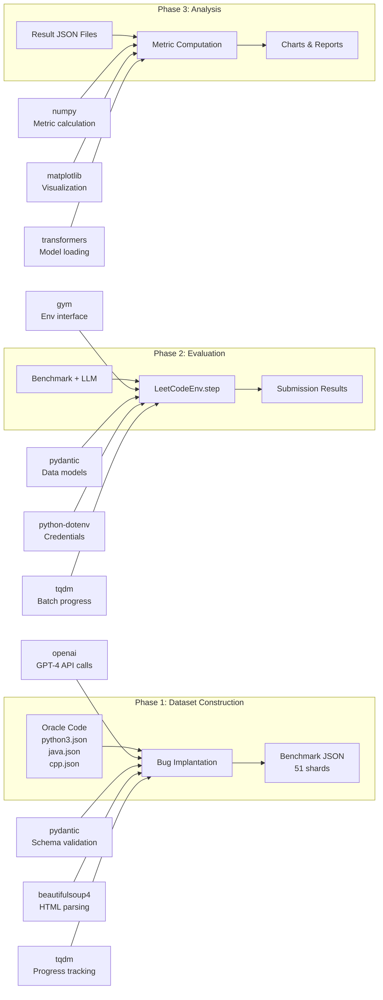

<!-- source: DeepWiki mcp.deepwiki.com · repo thunlp/DebugBench · page 6.2 Dependencies · fetched 2026-11-02 -->

# Dependencies

<details>
<summary>Relevant source files</summary>

The following files were used as context for generating this wiki page:

- [requirements.txt](requirements.txt)

</details>


This page provides a comprehensive reference for all Python dependencies required by DebugBench, explaining their specific roles in the system and how they support the three main components: dataset construction, evaluation framework, and results analysis.

For installation instructions and environment setup, see [Installation and Setup](#6.1). For configuration of API keys and credentials, see [Configuration](#6.3).

---

## Dependency Overview

DebugBench requires 10 Python dependencies, organized by their primary purpose:

| Dependency | Version | Category | Primary Purpose |
|------------|---------|----------|-----------------|
| `pydantic` | ~2.3.0 | Core | Data validation and schema definition |
| `gym` | ~0.26.2 | Core | Reinforcement learning environment interface |
| `numpy` | ~1.25.2 | Core | Numerical operations and data processing |
| `openai` | ~0.28.0 | AI/ML | GPT-4 API client for bug implantation |
| `transformers` | ~4.31.0 | AI/ML | Model evaluation and LLM integration |
| `beautifulsoup4` | ~4.12.2 | Data Processing | HTML parsing and web scraping |
| `bs4` | ~0.0.1 | Data Processing | BeautifulSoup wrapper package |
| `tqdm` | ~4.66.1 | Data Processing | Progress bar tracking for long operations |
| `python-dotenv` | ~0.21.1 | Configuration | Environment variable management |
| `matplotlib` | ~3.7.2 | Visualization | Results visualization and analysis |

Sources: [requirements.txt:1-10]()

---

## Dependency-to-Component Mapping

```mermaid
graph TB
    subgraph "Dataset Construction System"
        DC_MODULE["dataset_construction/"]
        DC_CASES["cases/<br/>python3.json, java.json, cpp.json"]
    end
    
    subgraph "Evaluation System"
        EVAL_MODULE["evaluation/"]
        LEETCODE_OJ["leetcode_oj/<br/>LeetCodeEnv"]
        LEETCODE_ENV["leetcode_env/<br/>utils/"]
    end
    
    subgraph "Results & Analysis"
        RESULTS_MODULE["evalution_result/"]
        ANALYSIS["Analysis Scripts"]
    end
    
    subgraph "Core Dependencies"
        PYDANTIC["pydantic<br/>Data validation"]
        GYM["gym<br/>Environment interface"]
        NUMPY["numpy<br/>Numerical operations"]
    end
    
    subgraph "AI/ML Dependencies"
        OPENAI["openai<br/>GPT-4 API"]
        TRANSFORMERS["transformers<br/>Model evaluation"]
    end
    
    subgraph "Data Processing Dependencies"
        BS4["beautifulsoup4/bs4<br/>HTML parsing"]
        TQDM["tqdm<br/>Progress tracking"]
    end
    
    subgraph "Configuration Dependencies"
        DOTENV["python-dotenv<br/>Env vars"]
    end
    
    subgraph "Visualization Dependencies"
        MATPLOTLIB["matplotlib<br/>Plotting"]
    end
    
    DC_MODULE --> OPENAI
    DC_MODULE --> PYDANTIC
    DC_MODULE --> BS4
    DC_MODULE --> TQDM
    
    EVAL_MODULE --> GYM
    EVAL_MODULE --> PYDANTIC
    EVAL_MODULE --> TQDM
    EVAL_MODULE --> DOTENV
    
    LEETCODE_OJ --> GYM
    LEETCODE_OJ --> PYDANTIC
    LEETCODE_ENV --> BS4
    
    RESULTS_MODULE --> NUMPY
    ANALYSIS --> NUMPY
    ANALYSIS --> MATPLOTLIB
    ANALYSIS --> TRANSFORMERS
    
    DC_MODULE -.configures with.-> DOTENV
    EVAL_MODULE -.configures with.-> DOTENV
    ANALYSIS -.configures with.-> DOTENV
```



This diagram illustrates how each dependency is used across the three major system components: dataset construction, evaluation framework, and results analysis.

Sources: [requirements.txt:1-10]()

---

## Core Python Libraries

### pydantic (v2.3.0)

**Role:** Data validation, serialization, and schema definition throughout the system.

**Usage in DebugBench:**
- **Data Models:** Defines and validates data structures used in the evaluation system, particularly in `leetcode_oj/` where it validates submission data, problem metadata, and execution results
- **Type Safety:** Ensures type correctness for complex nested structures like problem entries, test cases, and submission results
- **JSON Schema:** Automatically generates and validates JSON schemas for benchmark data entries

**Key Applications:**
- `LeetCodeSubmission` data model validation
- Problem entry schema enforcement in benchmark JSON files
- API request/response validation for LeetCode interactions

### gym (v0.26.2)

**Role:** Provides the reinforcement learning environment interface for LeetCode testing.

**Usage in DebugBench:**
- **Environment Base:** The `LeetCodeEnv` class extends `gym.Env` to create a standardized interface for code submission and testing
- **Standard API:** Implements the `step()` and `reset()` methods following the Gym API convention
- **Reward Structure:** Defines reward signals based on submission results (Accepted = positive reward, Wrong Answer = negative reward)

**Key Applications:**
- `LeetCodeEnv` class in `leetcode_oj/` implements the Gym environment interface
- Standardized interaction pattern for automated testing workflows
- Enables integration with RL-based debugging approaches

### numpy (v1.25.2)

**Role:** Numerical computation and data manipulation for analysis.

**Usage in DebugBench:**
- **Results Analysis:** Processing evaluation metrics across multiple test cases and models
- **Statistical Computation:** Calculating aggregate metrics like success rates, percentiles, and averages
- **Data Transformation:** Converting and reshaping result data for visualization

**Key Applications:**
- Computing acceptance rates across bug categories
- Statistical analysis of runtime and memory percentiles
- Processing batch evaluation results

Sources: [requirements.txt:1-10]()

---

## AI/ML Dependencies

### openai (v0.28.0)

**Role:** GPT-4 API client for automated bug implantation during dataset construction.

**Usage in DebugBench:**
- **Bug Generation:** Sends oracle code to GPT-4 with carefully crafted prompts to generate buggy variants
- **Prompt Engineering:** Supports systematic prompting strategies for different bug types (condition errors, indexing errors, operation errors, etc.)
- **Validation:** Retrieves GPT-4 responses containing buggy code and explanations

**Key Applications:**
- Dataset construction pipeline in `dataset_construction/`
- Generating bugs across 18 minor bug types
- Creating bug explanations and descriptions

**Configuration Requirements:**
- Requires `OPENAI_API_KEY` environment variable
- Uses GPT-4 model (specifically referenced in system architecture)
- Rate limiting considerations for large-scale bug generation

### transformers (v4.31.0)

**Role:** Hugging Face Transformers library for model evaluation and LLM integration.

**Usage in DebugBench:**
- **Model Evaluation:** Testing open-source models like CodeLlama-34b-instruct
- **Tokenization:** Processing code inputs for model-specific formats
- **Inference Pipeline:** Running local LLM inference for debugging tasks

**Key Applications:**
- Evaluating CodeLlama and other open-source models
- Baseline results generation in `evalution_result/`
- Model comparison and benchmarking

**Configuration Requirements:**
- May require `HF_TOKEN` for accessing gated models
- GPU support for efficient inference
- Model-specific configuration parameters

Sources: [requirements.txt:1-10]()

---

## Data Processing Dependencies

### beautifulsoup4 (v4.12.2) and bs4 (v0.0.1)

**Role:** HTML parsing and web scraping for LeetCode data extraction.

**Usage in DebugBench:**
- **Problem Scraping:** Parsing LeetCode problem pages to extract descriptions, constraints, and examples
- **Metadata Extraction:** Extracting problem difficulty, tags, and submission statistics
- **HTML Cleaning:** Converting HTML-formatted problem descriptions to plain text

**Key Applications:**
- Data scraping pipeline in `leetcode_env/utils/`
- Parsing LeetCode GraphQL responses containing HTML content
- Extracting test case examples from problem descriptions

**Note:** `bs4` is a wrapper package that simply imports `beautifulsoup4`. Both are included for compatibility reasons.

### tqdm (v4.66.1)

**Role:** Progress bar visualization for long-running operations.

**Usage in DebugBench:**
- **Dataset Construction:** Tracking progress during bug implantation across 4,253 instances
- **Batch Evaluation:** Displaying progress when testing multiple problems
- **Data Processing:** Monitoring scraping and validation operations

**Key Applications:**
- Iterating through problem instances during evaluation
- Batch processing of LLM debugging attempts
- Large-scale data collection operations

Sources: [requirements.txt:1-10]()

---

## Configuration Management

### python-dotenv (v0.21.1)

**Role:** Environment variable management for credentials and configuration.

**Usage in DebugBench:**
- **Credential Loading:** Reads `.env` file to load LeetCode session tokens and CSRF tokens
- **API Keys:** Manages OpenAI API keys and Hugging Face tokens
- **Environment Isolation:** Separates development/production configurations

**Key Applications:**
- Loading `LEETCODE_SESSION` and `CSRF_TOKEN` for authentication
- Managing `OPENAI_API_KEY` for dataset construction
- Configuring cooldown periods and rate limits

**Required Environment Variables:**
| Variable | Purpose | Required By |
|----------|---------|-------------|
| `LEETCODE_SESSION` | LeetCode authentication cookie | Evaluation system |
| `CSRF_TOKEN` | LeetCode CSRF token | Evaluation system |
| `OPENAI_API_KEY` | OpenAI API authentication | Dataset construction |
| `HF_TOKEN` | Hugging Face access token | Model evaluation (optional) |

For detailed configuration instructions, see [Configuration](#6.3).

Sources: [requirements.txt:7]()

---

## Visualization

### matplotlib (v3.7.2)

**Role:** Data visualization and plotting for results analysis.

**Usage in DebugBench:**
- **Performance Charts:** Visualizing acceptance rates across different bug types
- **Comparative Analysis:** Plotting model performance comparisons (GPT-4 vs GPT-3.5 vs CodeLlama)
- **Distribution Plots:** Showing success rates by difficulty level and programming language

**Key Applications:**
- Generating figures for research papers and reports
- Interactive exploration of evaluation results
- Statistical visualization of debugging performance

**Typical Visualizations:**
- Bar charts of success rates by bug category
- Line plots of model performance trends
- Scatter plots correlating problem difficulty with success rate

Sources: [requirements.txt:2]()

---

## Dependency Usage by System Phase



This diagram shows how dependencies are utilized in each of the three main phases of the DebugBench workflow: dataset construction, evaluation, and analysis.

Sources: [requirements.txt:1-10]()

---

## Version Compatibility Notes

### Semantic Versioning Strategy

All dependencies use the tilde (`~`) version specifier, which allows patch-level updates but locks minor and major versions:
- `~=1.25.2` allows `1.25.x` but not `1.26.0`
- Ensures stability while receiving security patches

### Critical Version Constraints

**openai v0.28.0:**
- This is the legacy OpenAI API version (pre-v1.0 refactor)
- Code assumes the older API structure with `openai.ChatCompletion.create()`
- Upgrading to v1.0+ requires significant code changes

**pydantic v2.3.0:**
- Uses Pydantic v2.x API (significantly different from v1.x)
- Models use `model_validate()` instead of `parse_obj()`
- Field validators use the new decorator syntax

**gym v0.26.2:**
- Modern Gym API (post-v0.26 refactor)
- Uses the new `step()` return signature: `(observation, reward, terminated, truncated, info)`
- Not compatible with older Gym v0.21 and below

### Dependency Conflicts

**beautifulsoup4 and bs4:**
- Both packages are included because `bs4` is a wrapper that imports `beautifulsoup4`
- `bs4` v0.0.1 is a compatibility shim; actual functionality comes from `beautifulsoup4`
- Some legacy code may import from `bs4` directly

Sources: [requirements.txt:1-10]()

---

## Installation Verification

After installing dependencies, verify the installation with these checks:

```python
# Core libraries
import pydantic
import gym
import numpy as np

# AI/ML libraries
import openai
import transformers

# Data processing
import bs4
from beautifulsoup4 import BeautifulSoup
import tqdm

# Configuration
from dotenv import load_dotenv

# Visualization
import matplotlib

print("All dependencies imported successfully!")
```

**Common Installation Issues:**

| Issue | Dependency | Solution |
|-------|------------|----------|
| Gym rendering error | `gym` | Install optional dependencies: `pip install gym[classic_control]` |
| NumPy MKL conflicts | `numpy` | Use conda for installation: `conda install numpy` |
| Transformers CUDA mismatch | `transformers` | Ensure PyTorch CUDA version matches system CUDA |
| BeautifulSoup parser warning | `beautifulsoup4` | Install `lxml`: `pip install lxml` |

For complete installation instructions, see [Installation and Setup](#6.1).

Sources: [requirements.txt:1-10]()

---

