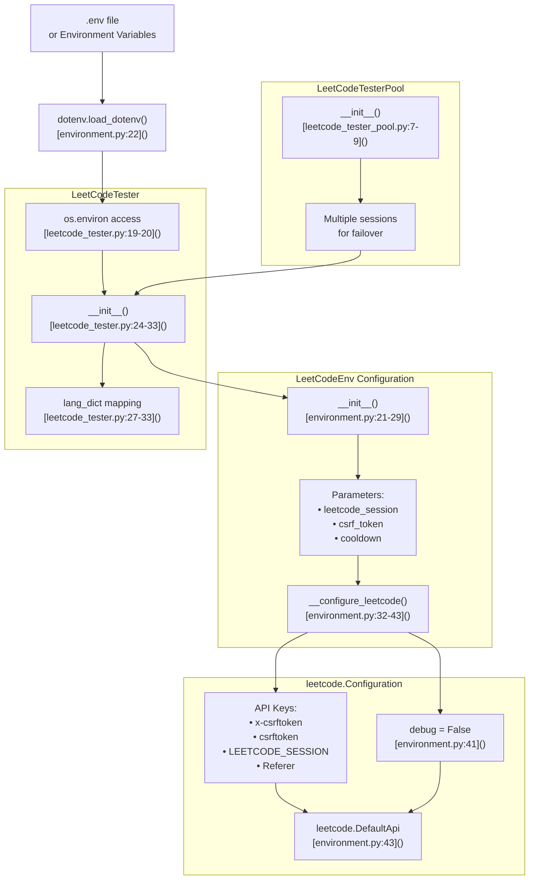
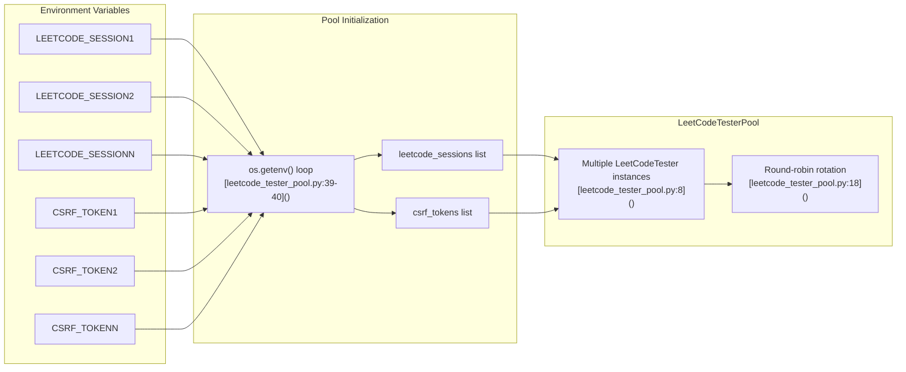
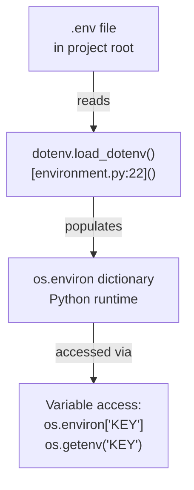
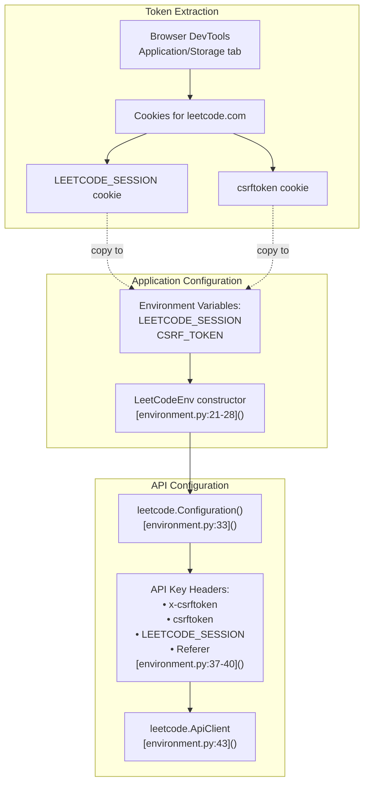
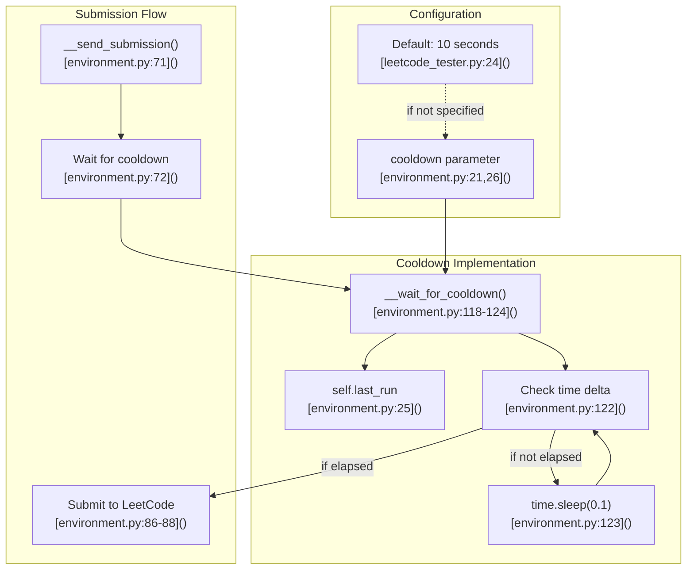
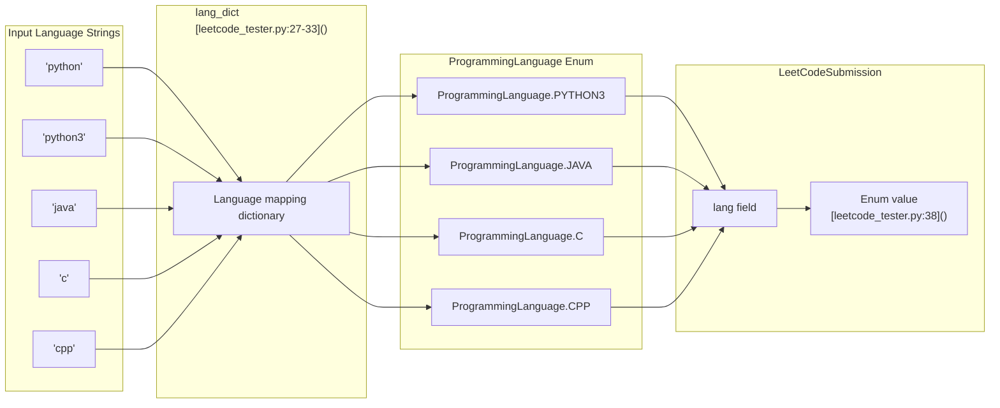
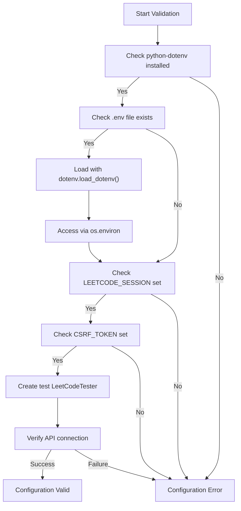

<!-- source: DeepWiki mcp.deepwiki.com · repo thunlp/DebugBench · page 6.3 Configuration · fetched 2026-11-02 -->

# Configuration

<details>
<summary>Relevant source files</summary>

The following files were used as context for generating this wiki page:

- [evaluation/leetcode_oj/__init__.py](evaluation/leetcode_oj/__init__.py)
- [evaluation/leetcode_oj/leetcode_env/environment.py](evaluation/leetcode_oj/leetcode_env/environment.py)
- [evaluation/leetcode_oj/leetcode_env/utils/__pycache__/leetcode.cpython-310.pyc](evaluation/leetcode_oj/leetcode_env/utils/__pycache__/leetcode.cpython-310.pyc)
- [evaluation/leetcode_oj/leetcode_tester.py](evaluation/leetcode_oj/leetcode_tester.py)
- [evaluation/leetcode_oj/leetcode_tester_pool.py](evaluation/leetcode_oj/leetcode_tester_pool.py)
- [requirements.txt](requirements.txt)

</details>


This page documents all configuration options for DebugBench, including environment variables, LeetCode authentication credentials, API settings, and rate limiting parameters. Proper configuration is essential for running the evaluation system successfully.

For installation instructions, see [Installation and Setup](#6.1). For information about Python dependencies, see [Dependencies](#6.2).

---

## Configuration Architecture

The DebugBench evaluation system requires configuration at multiple levels: environment variables for credentials, runtime parameters for rate limiting, and API settings for LeetCode integration.

### Configuration Flow Diagram



**Sources**: [evaluation/leetcode_oj/leetcode_env/environment.py:1-128](), [evaluation/leetcode_oj/leetcode_tester.py:1-53](), [evaluation/leetcode_oj/leetcode_tester_pool.py:1-51]()

---

## Environment Variables

### Required Variables

The following environment variables must be set for the evaluation system to function:

| Variable Name | Description | Location | Required |
|--------------|-------------|----------|----------|
| `LEETCODE_SESSION` | LeetCode session token for authentication | [leetcode_tester.py:19]() | Yes |
| `CSRF_TOKEN` | Cross-Site Request Forgery token for LeetCode API | [leetcode_tester.py:20]() | Yes |

**Sources**: [evaluation/leetcode_oj/leetcode_tester.py:19-20]()

### Optional Variables

| Variable Name | Description | Default | Location |
|--------------|-------------|---------|----------|
| OpenAI API credentials | For bug implantation in dataset construction | None | Used in dataset construction |
| Hugging Face tokens | For dataset uploading/downloading | None | Dataset publishing |

**Sources**: General system knowledge from overview diagrams

### Multi-Account Configuration

For the `LeetCodeTesterPool`, multiple accounts can be configured to enable failover and distributed rate limiting:



Example pattern:
- `YOUR_LEETCODE_SESSION1`, `YOUR_CSRF_TOKEN1`
- `YOUR_LEETCODE_SESSION2`, `YOUR_CSRF_TOKEN2`
- etc.

**Sources**: [evaluation/leetcode_oj/leetcode_tester_pool.py:39-40]()

---

## .env File Setup

### Using python-dotenv

The system uses `python-dotenv` to load configuration from `.env` files:



**Sources**: [evaluation/leetcode_oj/leetcode_env/environment.py:22](), [requirements.txt:7]()

### .env File Format

Create a `.env` file in the project root:

```
# LeetCode Authentication (Required)
LEETCODE_SESSION=your_session_token_here
CSRF_TOKEN=your_csrf_token_here

# Optional: Multiple accounts for pool
LEETCODE_SESSION1=first_session_token
CSRF_TOKEN1=first_csrf_token
LEETCODE_SESSION2=second_session_token
CSRF_TOKEN2=second_csrf_token

# Optional: OpenAI API (for dataset construction)
OPENAI_API_KEY=your_openai_key_here

# Optional: Hugging Face (for dataset publishing)
HF_TOKEN=your_huggingface_token_here
```

**Sources**: [evaluation/leetcode_oj/leetcode_tester.py:19-20](), [evaluation/leetcode_oj/leetcode_tester_pool.py:39-40]()

---

## LeetCode Authentication

### Session Token Configuration

The LeetCode session token authenticates requests to the LeetCode platform:



**Sources**: [evaluation/leetcode_oj/leetcode_env/environment.py:32-43]()

### Authentication Configuration Details

The `__configure_leetcode()` method sets up authentication:

| Configuration Key | Value Source | Purpose |
|------------------|--------------|---------|
| `x-csrftoken` | `csrf_token` parameter | CSRF protection header |
| `csrftoken` | `csrf_token` parameter | CSRF protection cookie |
| `LEETCODE_SESSION` | `leetcode_session` parameter | Session authentication |
| `Referer` | `"https://leetcode.com"` | Request origin validation |
| `debug` | `False` | Disable debug logging |

**Sources**: [evaluation/leetcode_oj/leetcode_env/environment.py:37-41]()

---

## Cooldown Configuration

### Rate Limiting Parameters

The cooldown mechanism prevents rate limiting by LeetCode:



**Sources**: [evaluation/leetcode_oj/leetcode_env/environment.py:21-26,118-124]()

### Cooldown Configuration Options

| Parameter | Type | Default | Description | Location |
|-----------|------|---------|-------------|----------|
| `cooldown` | `int` | `10` | Seconds between submissions | [environment.py:21]() |
| `last_run` | `datetime` | `None` | Timestamp of last submission | [environment.py:25]() |

The cooldown is enforced in the `__wait_for_cooldown()` method before each submission:

1. Check if `last_run` is `None` (first run)
2. If not first run, calculate elapsed time: `(datetime.now() - self.last_run).total_seconds()`
3. If elapsed time < `cooldown`, sleep for 0.1 seconds and repeat
4. Update `last_run` to current time

**Sources**: [evaluation/leetcode_oj/leetcode_env/environment.py:118-124]()

---

## Language Configuration

### Programming Language Mapping

The `LeetCodeTester` maintains a dictionary mapping language strings to `ProgrammingLanguage` enum values:



**Language Mapping Table**:

| Input String | Enum Value | LeetCode API Value |
|-------------|------------|-------------------|
| `"python"` | `ProgrammingLanguage.PYTHON3` | Determined by enum |
| `"python3"` | `ProgrammingLanguage.PYTHON3` | Determined by enum |
| `"java"` | `ProgrammingLanguage.JAVA` | Determined by enum |
| `"c"` | `ProgrammingLanguage.C` | Determined by enum |
| `"cpp"` | `ProgrammingLanguage.CPP` | Determined by enum |

**Sources**: [evaluation/leetcode_oj/leetcode_tester.py:27-33]()

---

## Configuration Classes and Parameters

### LeetCodeEnv Parameters

Constructor signature at [environment.py:21]():

```
LeetCodeEnv(
    leetcode_session=None,  # str: LeetCode session token
    csrf_token=None,        # str: CSRF token
    cooldown=0             # int: seconds between submissions
)
```

| Parameter | Type | Default | Required | Description |
|-----------|------|---------|----------|-------------|
| `leetcode_session` | `str` | `None` | Optional* | Session authentication token |
| `csrf_token` | `str` | `None` | Optional* | CSRF protection token |
| `cooldown` | `int` | `0` | No | Minimum seconds between submissions |

*Required if not set in environment variables

**Sources**: [evaluation/leetcode_oj/leetcode_env/environment.py:21-28]()

### LeetCodeTester Parameters

Constructor signature at [leetcode_tester.py:24]():

```
LeetCodeTester(
    leetcode_session: str=None,  # LeetCode session token
    csrf_token: str=None,        # CSRF token
    cooldown: int=10            # seconds between submissions
)
```

If `leetcode_session` and `csrf_token` are not provided, they are read from environment variables at [leetcode_tester.py:19-20]().

**Sources**: [evaluation/leetcode_oj/leetcode_tester.py:19-26]()

### LeetCodeTesterPool Parameters

Constructor signature at [leetcode_tester_pool.py:7]():

```
LeetCodeTesterPool(
    leetcode_sessions,  # list[str]: multiple session tokens
    csrf_tokens,        # list[str]: corresponding CSRF tokens
    cooldown=10        # int: seconds between submissions
)
```

The pool creates one `LeetCodeTester` instance for each session/token pair:

**Sources**: [evaluation/leetcode_oj/leetcode_tester_pool.py:7-9]()

---

## Configuration Examples

### Single Account Configuration

```python
# Using environment variables
import os
from leetcode_tester import LeetCodeTester

# Credentials loaded from .env via dotenv.load_dotenv()
leetcode_session = os.environ['LEETCODE_SESSION']
csrf_token = os.environ['CSRF_TOKEN']

# Create tester with 10-second cooldown
tester = LeetCodeTester(
    leetcode_session=leetcode_session,
    csrf_token=csrf_token,
    cooldown=10
)
```

**Sources**: [evaluation/leetcode_oj/leetcode_tester.py:19-26,43-46]()

### Multi-Account Pool Configuration

```python
import os
import dotenv
from leetcode_tester_pool import LeetCodeTesterPool

# Load environment variables
dotenv.load_dotenv()

# Load multiple accounts
leetcode_sessions = [
    os.getenv(f'LEETCODE_SESSION{i}') 
    for i in range(1, 4)  # 3 accounts
]
csrf_tokens = [
    os.getenv(f'CSRF_TOKEN{i}') 
    for i in range(1, 4)
]

# Create pool with failover
pool = LeetCodeTesterPool(
    leetcode_sessions=leetcode_sessions,
    csrf_tokens=csrf_tokens,
    cooldown=10
)
```

**Sources**: [evaluation/leetcode_oj/leetcode_tester_pool.py:37-42]()

### Direct LeetCodeEnv Configuration

```python
from leetcode_env.environment import LeetCodeEnv
from leetcode_env.types import LeetCodeSubmission, ProgrammingLanguage

# Create environment with explicit credentials
env = LeetCodeEnv(
    leetcode_session="your_session_token",
    csrf_token="your_csrf_token",
    cooldown=15  # 15-second cooldown
)

# Create submission
sub = LeetCodeSubmission(
    code="class Solution:\n    def twoSum(self, nums, target):\n        ...",
    lang=ProgrammingLanguage.PYTHON3,
    question_slug="two-sum"
)

# Submit and get results
status, reward, done, result = env.step(sub)
```

**Sources**: [evaluation/leetcode_oj/leetcode_env/environment.py:21-66]()

---

## Configuration Best Practices

### Security Considerations

1. **Never commit credentials**: Keep `.env` files out of version control
2. **Use environment variables**: Load credentials from environment, not hardcode
3. **Rotate tokens periodically**: LeetCode session tokens can expire
4. **Limit token scope**: Use separate accounts for testing if possible

### Performance Optimization

1. **Cooldown settings**: Balance between throughput and rate limiting
   - Too low: Risk of rate limiting (403 errors)
   - Too high: Slower evaluation
   - Recommended: 10-15 seconds per account

2. **Multi-account strategy**: Use `LeetCodeTesterPool` for:
   - Higher throughput (parallel testing)
   - Automatic failover on errors
   - Distributed rate limiting

3. **Debug mode**: Keep `configuration.debug = False` in production for performance

**Sources**: [evaluation/leetcode_oj/leetcode_env/environment.py:26,41](), [evaluation/leetcode_oj/leetcode_tester_pool.py:7-19]()

---

## Configuration Validation

### Required Configuration Checks

Before running evaluations, verify:



**Sources**: [evaluation/leetcode_oj/leetcode_env/environment.py:22](), [evaluation/leetcode_oj/leetcode_tester.py:19-20]()

### Common Configuration Errors

| Error | Symptom | Solution |
|-------|---------|----------|
| Missing `LEETCODE_SESSION` | `KeyError: 'LEETCODE_SESSION'` | Set in `.env` or environment |
| Missing `CSRF_TOKEN` | `KeyError: 'CSRF_TOKEN'` | Set in `.env` or environment |
| Invalid credentials | `403 Forbidden` error | Update tokens from browser |
| Rate limiting | Frequent `403` errors | Increase cooldown or add accounts |
| Expired session | Authentication failures | Refresh tokens from LeetCode |

**Sources**: [evaluation/leetcode_oj/leetcode_env/environment.py:85](), [evaluation/leetcode_oj/leetcode_tester_pool.py:15-19]()

---

## Summary

Configuration in DebugBench centers around three main areas:

1. **Authentication**: LeetCode session and CSRF tokens from environment variables
2. **Rate Limiting**: Cooldown parameters to prevent API throttling
3. **Multi-Account**: Pool configuration for scalability and failover

All configuration is loaded via `python-dotenv` from `.env` files and accessed through standard Python environment variable mechanisms. The system supports both single-account and multi-account deployments with automatic failover capabilities.

**Sources**: [evaluation/leetcode_oj/leetcode_env/environment.py:1-128](), [evaluation/leetcode_oj/leetcode_tester.py:1-53](), [evaluation/leetcode_oj/leetcode_tester_pool.py:1-51](), [requirements.txt:7]()

---

