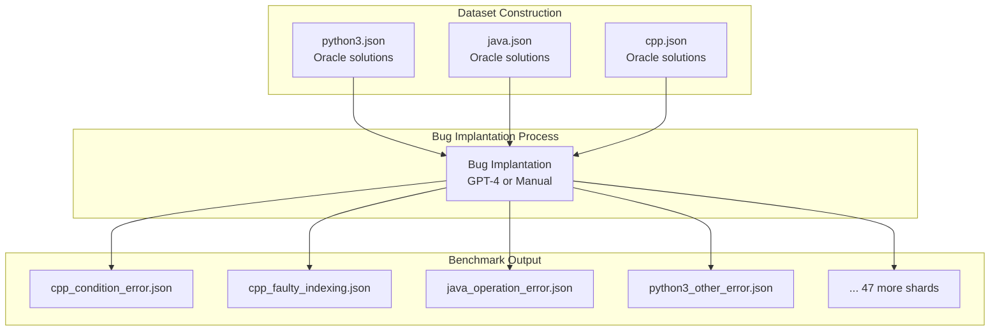
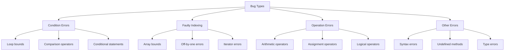
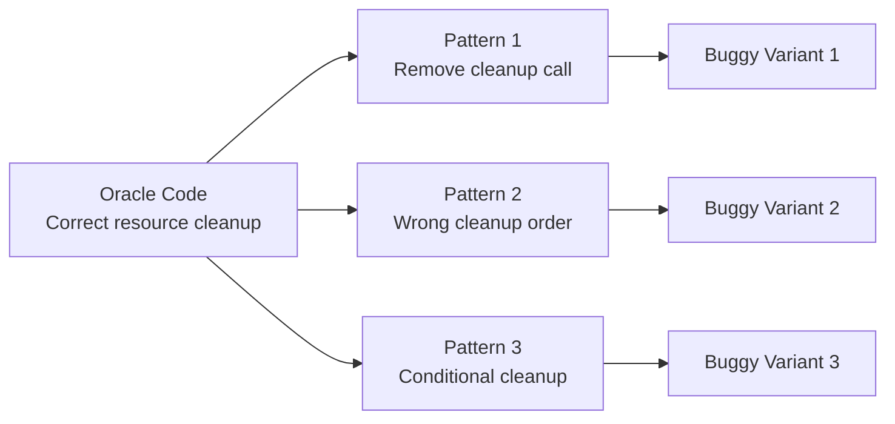
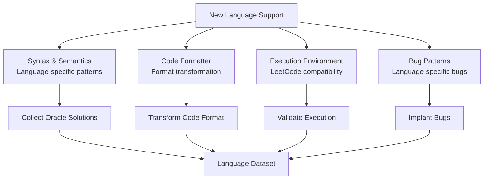
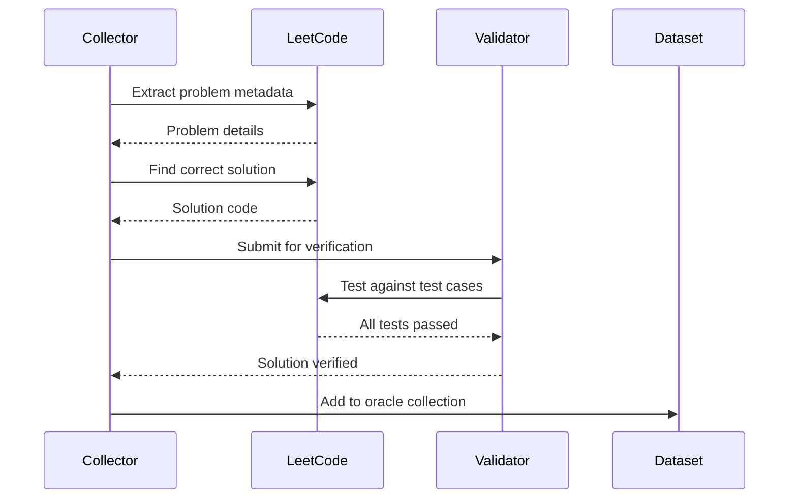
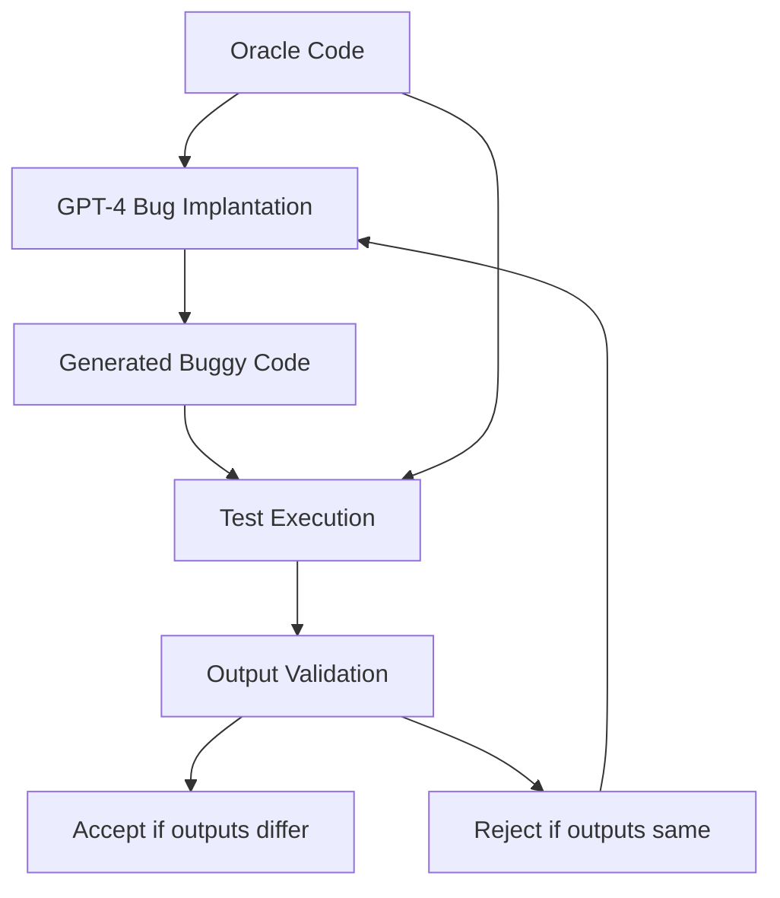

<!-- source: DeepWiki mcp.deepwiki.com · repo thunlp/DebugBench · page 6.4 Extending the Benchmark · fetched 2026-11-02 -->

# Extending the Benchmark

<details>
<summary>Relevant source files</summary>

The following files were used as context for generating this wiki page:

- [benchmark/cpp_condition error.json](benchmark/cpp_condition error.json)
- [benchmark/cpp_double.json](benchmark/cpp_double.json)
- [benchmark/cpp_faulty indexing.json](benchmark/cpp_faulty indexing.json)
- [dataset_construction/cases/cpp.json](dataset_construction/cases/cpp.json)
- [dataset_construction/cases/java.json](dataset_construction/cases/java.json)
- [dataset_construction/cases/python3.json](dataset_construction/cases/python3.json)

</details>


This document provides guidance for developers who want to extend DebugBench by adding new bug types, supporting additional programming languages, or expanding the dataset with more problems. For information about using the existing benchmark, see [Quick Start Guide](#1.2). For details on the evaluation system, see [Evaluation System](#4).

## Overview of Extension Points

DebugBench can be extended in three primary ways:

1. **Bug Type Expansion**: Add new categories or subcategories of bugs to test different debugging scenarios
2. **Language Support**: Introduce support for additional programming languages beyond C++, Java, and Python3
3. **Dataset Growth**: Expand the problem set with new LeetCode problems or alternative programming challenges

Each extension point requires understanding the existing data schema, bug implantation workflow, and validation procedures.

## Understanding the Current Data Structure

### Dataset Organization

The benchmark is organized across two main directory structures:

**Dataset Construction Phase** (`dataset_construction/cases/`):
- Contains oracle (correct) code organized by language
- Files: `python3.json`, `java.json`, `cpp.json`
- Each entry includes problem metadata and verified correct solutions

**Benchmark Phase** (`benchmark/`):
- Contains 51 JSON shards with buggy code variants
- Naming convention: `{language}_{bug_category}.json`
- Each entry pairs oracle code with buggy variants and explanations



**Sources**: [dataset_construction/cases/python3.json:1-200](), [benchmark/cpp_condition error.json:1-50]()

### Data Schema

#### Oracle Code Entry Schema

Each entry in the oracle code files follows this structure:

| Field | Type | Description |
|-------|------|-------------|
| `slug` | string | Unique identifier (LeetCode problem slug) |
| `description` | string | Problem statement |
| `examples` | array[string] | Input/output examples |
| `constrains` | string | Input constraints and requirements |
| `release_time` | integer | Unix timestamp of problem release |
| `oracle_code` | string | Verified correct solution code |
| `content` | string | Original LeetCode post content (with formatting) |
| `level` | string | Difficulty level: "easy", "medium", "hard" |

#### Benchmark Entry Schema

Benchmark entries extend the oracle schema with bug-specific fields:

| Field | Type | Description |
|-------|------|-------------|
| *All oracle fields* | * | Inherited from oracle entry |
| `buggy_code` | string | Code with implanted bug |
| `explanations` | string | Description of the bug and its impact |
| `type` | array[string] | Optional: bug classification tags |

**Sources**: [dataset_construction/cases/python3.json:1-15](), [benchmark/cpp_condition error.json:13-17]()

## Bug Type Taxonomy

The current taxonomy consists of 4 major categories with 18 minor types:



**Sources**: Based on [benchmark/cpp_condition error.json](), [benchmark/cpp_faulty indexing.json]()

## Adding New Bug Types

### Step 1: Define the Bug Category

When adding a new bug type, first determine:
1. Whether it's a new **major category** or a **minor type** within an existing category
2. The typical characteristics of bugs in this category
3. How to systematically introduce these bugs into correct code

For example, if adding "Resource Management Errors":
- Major category: Resource Management Errors
- Minor types: Memory leaks, File handle leaks, Connection leaks
- Characteristics: Failure to release resources, missing cleanup code

### Step 2: Create Bug Implantation Patterns

Document systematic patterns for introducing bugs. Each pattern should:
- Be reversible (debuggable)
- Produce observable incorrect behavior
- Not be trivially detectable

**Example Pattern Template:**



### Step 3: Prepare Benchmark Files

Create new JSON files in the `benchmark/` directory following the naming convention:

```
benchmark/{language}_{bug_category}.json
```

For example:
- `benchmark/cpp_resource_management.json`
- `benchmark/java_resource_management.json`
- `benchmark/python3_resource_management.json`

### Step 4: Populate Bug Instances

For each bug instance, follow this workflow:

1. **Select Oracle Code**: Choose a problem from the oracle files
2. **Implant Bug**: Modify the oracle code according to your bug pattern
3. **Write Explanation**: Document what was changed and why it causes failure
4. **Validate**: Ensure the buggy code produces different output than oracle code

**Manual Bug Implantation Example:**

```json
{
    "slug": "example-problem",
    "description": "...",
    "oracle_code": "// Original correct code",
    "buggy_code": "// Modified code with bug",
    "explanations": "The bug removes the resource cleanup call on line X, causing a memory leak",
    "type": ["resource_management", "memory_leak"],
    "level": "medium"
}
```

### Step 5: Validation Requirements

Each buggy code entry must satisfy:

1. **Correctness Check**: Oracle code passes all test cases
2. **Bug Verification**: Buggy code produces different output or fails test cases
3. **Explanation Accuracy**: The explanation correctly identifies the bug location and impact
4. **Consistency**: Bug type classification matches the actual bug characteristics

**Sources**: [benchmark/cpp_condition error.json:13-17](), [benchmark/cpp_faulty indexing.json:15-17]()

## Supporting New Languages

### Language Support Requirements

To add support for a new programming language:

1. **Code Formatting**: Implement language-specific code formatters
2. **Test Environment**: Ensure LeetCode supports the language
3. **Oracle Collection**: Gather correct solutions in the new language
4. **Bug Patterns**: Adapt bug patterns to language-specific idioms

### Language-Specific Considerations



### Implementation Steps

#### 1. Add Language Support to Code Formatters

The evaluation system uses language-specific formatters located in `leetcode_env/utils/formatting.py`. To add a new language:

1. Define language enum in `ProgrammingLanguage` class
2. Implement a `{Language}SubmissionFormatter` class
3. Add format transformation logic for the new language

**Sources**: Based on system architecture, see [Evaluation System](#4.5)

#### 2. Create Oracle Collection Files

Create a new file in `dataset_construction/cases/`:

```
dataset_construction/cases/{language}.json
```

Follow the oracle code entry schema with language-specific code in the `oracle_code` field.

#### 3. Define Language-Specific Bug Patterns

Some bugs are language-specific:
- **Python**: Indentation errors, missing `self` parameter
- **Java**: Missing semicolons, unclosed brackets
- **C++**: Memory management, pointer errors
- **Rust**: Ownership errors, lifetime issues

Document these patterns for the bug implantation process.

#### 4. Generate Benchmark Files

Create benchmark files for each bug category:

```
benchmark/{new_language}_condition_error.json
benchmark/{new_language}_faulty_indexing.json
benchmark/{new_language}_operation_error.json
benchmark/{new_language}_other_error.json
```

**Sources**: [benchmark/cpp_condition error.json](), [benchmark/cpp_faulty indexing.json]()

## Expanding the Dataset

### Adding New Problems

To expand the dataset with new LeetCode problems or similar challenges:

#### Step 1: Problem Selection Criteria

Select problems that:
- Have clear input/output specifications
- Cover diverse algorithmic concepts
- Are from LeetCode (post-June 2022) or compatible platforms
- Have verified correct solutions available
- Span multiple difficulty levels

#### Step 2: Oracle Code Collection

For each new problem:

1. **Gather Metadata**: Extract problem slug, description, examples, constraints
2. **Collect Solution**: Find or write a verified correct solution
3. **Verify Correctness**: Test solution against all problem test cases
4. **Document Source**: Record the source and timestamp

**Example Collection Workflow:**



#### Step 3: Add to Oracle Files

Add the new entry to the appropriate language file:

```json
{
    "slug": "new-problem-slug",
    "description": "Problem statement...",
    "examples": [
        "Input: ... Output: ...",
        "Input: ... Output: ..."
    ],
    "constrains": "Constraints...",
    "release_time": 1234567890,
    "oracle_code": "// Verified correct solution",
    "content": "// Original post content",
    "level": "medium"
}
```

**Sources**: [dataset_construction/cases/python3.json:16-28]()

#### Step 4: Bug Implantation

For each new problem, generate buggy variants:

1. **Select Bug Types**: Choose 2-4 bug types to implant
2. **Apply Patterns**: Use systematic bug patterns from each category
3. **Generate Explanations**: Document each bug clearly
4. **Distribute**: Add to appropriate benchmark shard files

### Quality Assurance Checklist

Before adding new entries to the dataset:

- [ ] Oracle code passes all test cases on LeetCode
- [ ] Buggy code produces different output or fails test cases
- [ ] Bug explanations accurately describe the error
- [ ] Problem difficulty is correctly classified
- [ ] All required schema fields are populated
- [ ] JSON syntax is valid
- [ ] No duplicate problem slugs exist

**Sources**: [dataset_construction/cases/python3.json:1-30](), [benchmark/cpp_condition error.json:1-50]()

## Automated Bug Implantation

### Using GPT-4 for Bug Generation

The original dataset construction used GPT-4 for systematic bug implantation. To replicate this process:

#### Prompt Engineering Template

```
System: You are a code debugging expert. Your task is to introduce a subtle 
bug into the provided code that represents a {bug_category}.

User: Here is a correct solution to a LeetCode problem:

Problem: {problem_description}
Code:
{oracle_code}

Please introduce a {bug_type} bug that:
1. Makes the code produce incorrect output
2. Is non-trivial to detect
3. Represents a common programming error

Provide:
- The buggy code
- A clear explanation of what was changed and why it causes failure
```

#### Validation Workflow



### Manual Review Requirements

Even with automated generation:
1. **Review bug quality**: Ensure bugs are meaningful and debuggable
2. **Verify explanations**: Check that explanations accurately describe the bug
3. **Test on LeetCode**: Confirm both oracle and buggy versions execute correctly
4. **Check consistency**: Ensure bug type matches the actual modification

**Sources**: Based on [Dataset Construction](#2) and system architecture

## Distribution and Versioning

### File Organization

Maintain consistent file organization:

```
debugbench/
├── dataset_construction/
│   └── cases/
│       ├── python3.json          # Oracle solutions
│       ├── java.json
│       ├── cpp.json
│       └── {new_language}.json   # Add new languages here
├── benchmark/
│   ├── cpp_condition_error.json  # Buggy variants by category
│   ├── cpp_faulty_indexing.json
│   ├── {language}_{category}.json
│   └── ...
└── evalution_result/             # Pre-computed results
    ├── gpt-4-0613/
    └── ...
```

### Version Control Best Practices

When extending the benchmark:
1. **Incremental additions**: Add problems in batches, not all at once
2. **Backward compatibility**: Maintain schema consistency
3. **Documentation**: Update dataset statistics and documentation
4. **Testing**: Validate all entries before committing
5. **Review**: Have changes reviewed by another contributor

**Sources**: Repository structure from system overview

## Publishing Extensions

### Hugging Face Dataset Updates

DebugBench is published on Hugging Face at `Rtian/DebugBench`. To publish extensions:

1. **Prepare metadata**: Update dataset card with new statistics
2. **Validate schema**: Ensure all entries follow the schema
3. **Upload files**: Update the relevant JSON files
4. **Update documentation**: Revise README and dataset card
5. **Tag version**: Create a new version tag (e.g., v1.1)

### Documentation Requirements

When publishing extensions, update:
- Total problem count
- Bug type distribution
- Language coverage
- Difficulty level distribution
- Contributor acknowledgments

**Sources**: Based on [Accessing the Dataset](#3.5) and system architecture

## Testing Extended Benchmarks

### Validation Scripts

Create validation scripts to ensure data quality:

```python
# Pseudo-code for validation
def validate_oracle_entry(entry):
    required_fields = ['slug', 'description', 'oracle_code', 'level']
    for field in required_fields:
        assert field in entry
    assert entry['level'] in ['easy', 'medium', 'hard']
    # Add more validations

def validate_benchmark_entry(entry):
    validate_oracle_entry(entry)
    assert 'buggy_code' in entry
    assert 'explanations' in entry
    assert entry['buggy_code'] != entry['oracle_code']
    # Add more validations
```

### LeetCode Integration Testing

Before finalizing additions:
1. Submit oracle code to LeetCode and verify acceptance
2. Submit buggy code and verify it produces different results
3. Document the test results for each problem
4. Update the evaluation results if baseline models are re-tested

**Sources**: Based on [Evaluation System](#4) and [Results and Analysis](#5)

## Community Contributions

### Contribution Guidelines

When contributing extensions:
1. **Open an issue**: Discuss the extension before implementing
2. **Follow schema**: Adhere to existing data structures
3. **Provide documentation**: Include clear explanations
4. **Quality over quantity**: Focus on high-quality bug instances
5. **Cite sources**: Credit original problem sources

### Review Process

Extensions should undergo:
1. **Schema validation**: Automated checks for data structure
2. **Code review**: Manual inspection of bug quality
3. **Testing**: Verification against LeetCode or equivalent platform
4. **Documentation review**: Clarity and completeness of explanations

**Sources**: Based on development guide principles and [License and Citation](#9)

---

By following these guidelines, you can systematically extend DebugBench to cover new bug types, programming languages, and problem domains while maintaining data quality and consistency with the existing benchmark structure.

---

