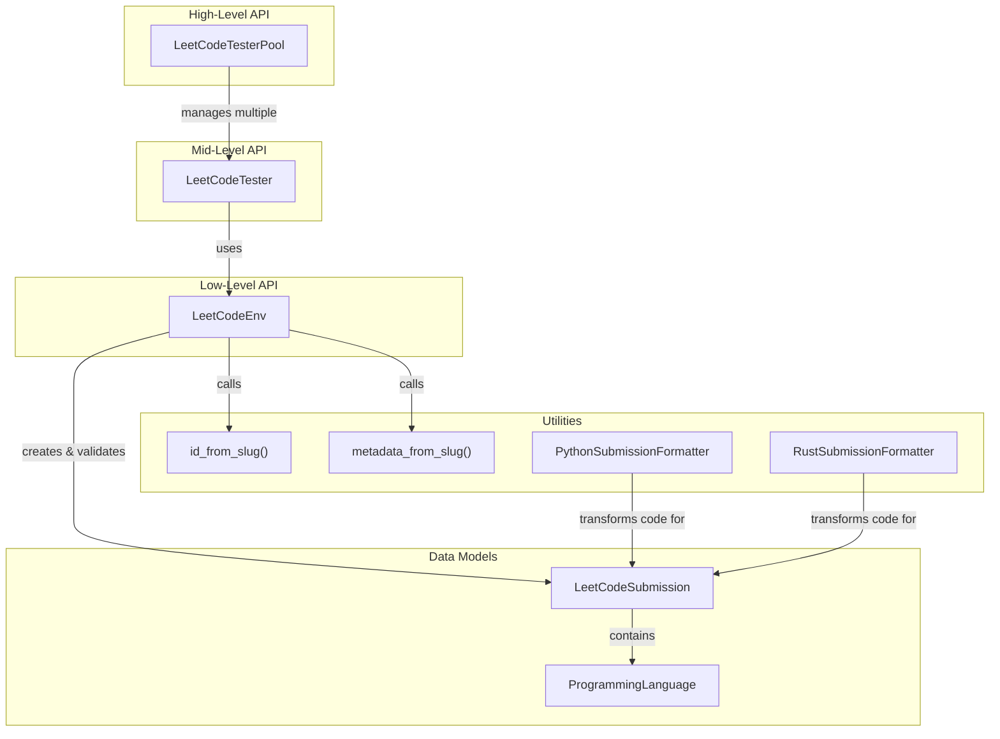
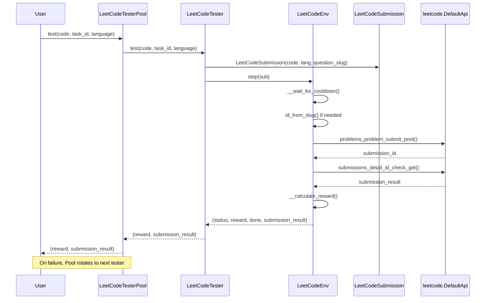
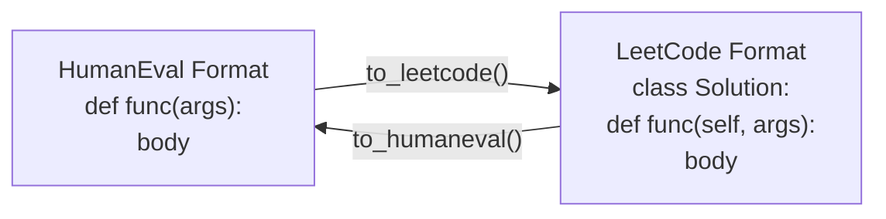
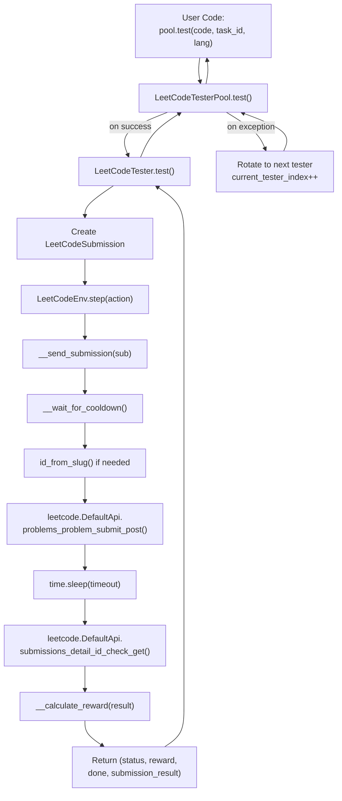

<!-- source: DeepWiki mcp.deepwiki.com · repo thunlp/DebugBench · page 7 API Reference · fetched 2026-11-02 -->

# API Reference

<details>
<summary>Relevant source files</summary>

The following files were used as context for generating this wiki page:

- [evaluation/leetcode_oj/__init__.py](evaluation/leetcode_oj/__init__.py)
- [evaluation/leetcode_oj/leetcode_env/environment.py](evaluation/leetcode_oj/leetcode_env/environment.py)
- [evaluation/leetcode_oj/leetcode_env/utils/__pycache__/leetcode.cpython-310.pyc](evaluation/leetcode_oj/leetcode_env/utils/__pycache__/leetcode.cpython-310.pyc)
- [evaluation/leetcode_oj/leetcode_tester.py](evaluation/leetcode_oj/leetcode_tester.py)
- [evaluation/leetcode_oj/leetcode_tester_pool.py](evaluation/leetcode_oj/leetcode_tester_pool.py)
- [leetcode_data/validated/leetcode_oj/leetcode_env/types.py](leetcode_data/validated/leetcode_oj/leetcode_env/types.py)
- [leetcode_data/validated/leetcode_oj/leetcode_env/utils/formatting.py](leetcode_data/validated/leetcode_oj/leetcode_env/utils/formatting.py)
- [leetcode_data/validated/leetcode_oj/leetcode_env/utils/leetcode.py](leetcode_data/validated/leetcode_oj/leetcode_env/utils/leetcode.py)

</details>


This page provides complete API documentation for all public classes, methods, and functions in the DebugBench evaluation system. The evaluation system provides three abstraction levels: low-level Gym environment (`LeetCodeEnv`), mid-level tester (`LeetCodeTester`), and high-level pool manager (`LeetCodeTesterPool`). 

For instructions on setting up and using the evaluation system, see [Quick Start Guide](#1.2). For conceptual understanding of the evaluation workflow, see [Evaluation System](#4).

---

## API Structure Overview

The evaluation API is organized into three layers, each providing progressively higher-level abstractions:



**Sources:** [evaluation/leetcode_oj/__init__.py:1-2](), [evaluation/leetcode_oj/leetcode_env/environment.py:14-128](), [evaluation/leetcode_oj/leetcode_tester.py:22-40](), [evaluation/leetcode_oj/leetcode_tester_pool.py:6-19]()

---

## Class Hierarchy and Data Flow

This diagram shows how API classes interact during a typical submission test:



**Sources:** [evaluation/leetcode_oj/leetcode_tester_pool.py:11-19](), [evaluation/leetcode_oj/leetcode_tester.py:35-40](), [evaluation/leetcode_oj/leetcode_env/environment.py:45-96]()

---

## Data Models

### LeetCodeSubmission

Pydantic model representing a code submission to LeetCode.

**Location:** [leetcode_data/validated/leetcode_oj/leetcode_env/types.py:35-46]()

**Fields:**

| Field | Type | Required | Default | Description |
|-------|------|----------|---------|-------------|
| `code` | `str` | Yes | - | The source code to submit |
| `lang` | `ProgrammingLanguage` | Yes | - | Programming language enum value |
| `question_slug` | `str` | Yes | - | LeetCode problem slug (e.g., "two-sum") |
| `question_id` | `Optional[str]` | No | `None` | Numeric question ID (auto-resolved if None) |
| `timeout` | `int` | No | `5` | Seconds to wait for submission result |

**Example Usage:**

```python
from leetcode_env.types import LeetCodeSubmission, ProgrammingLanguage

sub = LeetCodeSubmission(
    code="class Solution:\n    def twoSum(self, nums, target):\n        ...",
    lang=ProgrammingLanguage.PYTHON3,
    question_slug="two-sum",
    timeout=5
)
```

**Sources:** [leetcode_data/validated/leetcode_oj/leetcode_env/types.py:35-46]()

---

### ProgrammingLanguage

Enum defining all supported programming languages on LeetCode.

**Location:** [leetcode_data/validated/leetcode_oj/leetcode_env/types.py:6-33]()

**Supported Languages:**

| Enum Value | String Value | Description |
|------------|--------------|-------------|
| `ProgrammingLanguage.CPP` | `"cpp"` | C++ |
| `ProgrammingLanguage.JAVA` | `"java"` | Java |
| `ProgrammingLanguage.PYTHON` | `"python"` | Python 2 |
| `ProgrammingLanguage.PYTHON3` | `"python3"` | Python 3 |
| `ProgrammingLanguage.C` | `"c"` | C |
| `ProgrammingLanguage.C_SHARP` | `"c#"` | C# |
| `ProgrammingLanguage.JAVASCRIPT` | `"javascript"` | JavaScript |
| `ProgrammingLanguage.RUBY` | `"ruby"` | Ruby |
| `ProgrammingLanguage.SWIFT` | `"swift"` | Swift |
| `ProgrammingLanguage.GO` | `"go"` | Go |
| `ProgrammingLanguage.SCALA` | `"scala"` | Scala |
| `ProgrammingLanguage.KOTLIN` | `"kotlin"` | Kotlin |
| `ProgrammingLanguage.RUST` | `"rust"` | Rust |
| `ProgrammingLanguage.PHP` | `"php"` | PHP |
| `ProgrammingLanguage.TYPESCRIPT` | `"typescript"` | TypeScript |
| `ProgrammingLanguage.RACKET` | `"racket"` | Racket |
| `ProgrammingLanguage.ERLANG` | `"erlang"` | Erlang |
| `ProgrammingLanguage.ELIXIR` | `"elixir"` | Elixir |
| `ProgrammingLanguage.DART` | `"dart"` | Dart |
| `ProgrammingLanguage.MYSQL` | `"mysql"` | MySQL |
| `ProgrammingLanguage.MS_SQL_SERVER` | `"ms sql server"` | MS SQL Server |
| `ProgrammingLanguage.ORACLE` | `"oracle"` | Oracle SQL |

**Example Usage:**

```python
from leetcode_env.types import ProgrammingLanguage

lang = ProgrammingLanguage.PYTHON3
print(lang.value)  # Output: "python3"
```

**Sources:** [leetcode_data/validated/leetcode_oj/leetcode_env/types.py:6-33]()

---

## Environment Classes

### LeetCodeEnv

Low-level Gym environment for submitting code to LeetCode and receiving results.

**Location:** [evaluation/leetcode_oj/leetcode_env/environment.py:14-128]()

**Class Definition:**

```python
class LeetCodeEnv(gym.Env):
    """Gym environment for LeetCode submissions"""
```

#### Constructor

**Signature:**
```python
def __init__(self, leetcode_session=None, csrf_token=None, cooldown=0)
```

**Parameters:**

| Parameter | Type | Default | Description |
|-----------|------|---------|-------------|
| `leetcode_session` | `str` | `None` | LeetCode session cookie (reads from `LEETCODE_SESSION` env var if None) |
| `csrf_token` | `str` | `None` | CSRF token (reads from `CSRF_TOKEN` env var if None) |
| `cooldown` | `int` | `0` | Minimum seconds between submissions (rate limit protection) |

**Sources:** [evaluation/leetcode_oj/leetcode_env/environment.py:21-29]()

---

#### step()

Submits code to LeetCode and returns the execution result.

**Signature:**
```python
def step(self, action: LeetCodeSubmission) -> tuple[str, bool, bool, dict]
```

**Parameters:**

| Parameter | Type | Description |
|-----------|------|-------------|
| `action` | `LeetCodeSubmission` | Submission object containing code, language, and problem identifier |

**Returns:**

Tuple of `(status, reward, done, submission_result)`:

| Position | Type | Description |
|----------|------|-------------|
| 0 | `str` | Status message: `"Accepted"`, `"Runtime Error"`, `"Wrong Answer"`, `"Submission Timed-Out"`, or `"Unknown"` |
| 1 | `bool` | Reward: `True` if status is `"Accepted"`, `False` otherwise |
| 2 | `bool` | Done flag: `True` if status is `"Accepted"`, `False` otherwise |
| 3 | `dict` | Full submission result from LeetCode API containing detailed execution information |

**Submission Result Dictionary Fields:**

| Key | Type | Description |
|-----|------|-------------|
| `status_msg` | `str` | Human-readable status message |
| `status_code` | `int` | Numeric status code |
| `total_correct` | `int` | Number of test cases passed |
| `total_testcases` | `int` | Total number of test cases |
| `compare_result` | `str` | Detailed comparison of expected vs actual outputs |
| `runtime_percentile` | `float` | Runtime percentile (if accepted) |
| `memory_percentile` | `float` | Memory usage percentile (if accepted) |

**Example:**

```python
env = LeetCodeEnv(cooldown=10)
sub = LeetCodeSubmission(
    code="class Solution:\n    def twoSum(self, nums, target):\n        ...",
    lang=ProgrammingLanguage.PYTHON3,
    question_slug="two-sum"
)
status, reward, done, result = env.step(sub)
print(f"Status: {status}, Passed: {reward}")
print(f"Test cases: {result['total_correct']}/{result['total_testcases']}")
```

**Sources:** [evaluation/leetcode_oj/leetcode_env/environment.py:45-66]()

---

#### reset()

Resets the environment state.

**Signature:**
```python
def reset(self)
```

**Description:**
Resets the internal reward flag to `False`. This method is part of the Gym interface but has minimal functionality in the LeetCode environment since each submission is independent.

**Sources:** [evaluation/leetcode_oj/leetcode_env/environment.py:68-69]()

---

#### is_done()

Checks if the current problem is solved.

**Signature:**
```python
def is_done(self) -> bool
```

**Returns:**
`True` if the last submission was accepted, `False` otherwise.

**Sources:** [evaluation/leetcode_oj/leetcode_env/environment.py:126-127]()

---

### LeetCodeTester

Mid-level interface that simplifies testing code submissions.

**Location:** [evaluation/leetcode_oj/leetcode_tester.py:22-40]()

**Class Definition:**

```python
class LeetCodeTester(object):
    """Simplified interface for testing LeetCode submissions"""
```

#### Constructor

**Signature:**
```python
def __init__(self, leetcode_session: str = None, csrf_token: str = None, cooldown: int = 10)
```

**Parameters:**

| Parameter | Type | Default | Description |
|-----------|------|---------|-------------|
| `leetcode_session` | `str` | `None` | LeetCode session cookie |
| `csrf_token` | `str` | `None` | CSRF token |
| `cooldown` | `int` | `10` | Minimum seconds between submissions |

**Attributes:**

| Attribute | Type | Description |
|-----------|------|-------------|
| `env` | `LeetCodeEnv` | Internal Gym environment instance |
| `lang_dict` | `dict` | Mapping from language strings to `ProgrammingLanguage` enum values |

**Sources:** [evaluation/leetcode_oj/leetcode_tester.py:24-33]()

---

#### test()

Tests code against a LeetCode problem.

**Signature:**
```python
def test(self, code: str, task_id: str, language: str) -> tuple[bool, dict]
```

**Parameters:**

| Parameter | Type | Description |
|-----------|------|-------------|
| `code` | `str` | Complete source code to test |
| `task_id` | `str` | LeetCode problem slug (e.g., `"two-sum"`) |
| `language` | `str` | Language name: `"python"`, `"python3"`, `"java"`, `"c"`, or `"cpp"` |

**Returns:**

Tuple of `(reward, submission_result)`:

| Position | Type | Description |
|----------|------|-------------|
| 0 | `bool` | `True` if code passed all test cases, `False` otherwise |
| 1 | `dict` | Full submission result dictionary (see `LeetCodeEnv.step()` for fields) |

**Example:**

```python
tester = LeetCodeTester(cooldown=10)
code = """
class Solution:
    def twoSum(self, nums, target):
        seen = {}
        for i, num in enumerate(nums):
            if target - num in seen:
                return [seen[target - num], i]
            seen[num] = i
"""
passed, result = tester.test(code, "two-sum", "python3")
if passed:
    print("Solution accepted!")
else:
    print(f"Failed: {result['status_msg']}")
```

**Sources:** [evaluation/leetcode_oj/leetcode_tester.py:35-40]()

---

### LeetCodeTesterPool

High-level pool manager for multi-account testing with automatic failover.

**Location:** [evaluation/leetcode_oj/leetcode_tester_pool.py:6-19]()

**Class Definition:**

```python
class LeetCodeTesterPool:
    """Pool of LeetCodeTester instances with automatic failover"""
```

#### Constructor

**Signature:**
```python
def __init__(self, leetcode_sessions, csrf_tokens, cooldown=10)
```

**Parameters:**

| Parameter | Type | Description |
|-----------|------|-------------|
| `leetcode_sessions` | `list[str]` | List of LeetCode session cookies |
| `csrf_tokens` | `list[str]` | List of CSRF tokens (must match length of sessions) |
| `cooldown` | `int` | Minimum seconds between submissions for each tester |

**Attributes:**

| Attribute | Type | Description |
|-----------|------|-------------|
| `testers` | `list[LeetCodeTester]` | List of tester instances |
| `current_tester_index` | `int` | Index of currently active tester |

**Sources:** [evaluation/leetcode_oj/leetcode_tester_pool.py:7-9]()

---

#### test()

Tests code using the pool with automatic failover on errors.

**Signature:**
```python
def test(self, code: str, task_id: str, language: str) -> tuple[bool, dict]
```

**Parameters:**

Same as `LeetCodeTester.test()`.

**Returns:**

Same as `LeetCodeTester.test()`.

**Behavior:**

1. Attempts submission using current tester
2. On exception, prints error message
3. Waits 10 seconds
4. Rotates to next tester in pool
5. Recursively retries with new tester

**Example:**

```python
sessions = [os.getenv('LEETCODE_SESSION1'), os.getenv('LEETCODE_SESSION2')]
csrf_tokens = [os.getenv('CSRF_TOKEN1'), os.getenv('CSRF_TOKEN2')]

pool = LeetCodeTesterPool(sessions, csrf_tokens, cooldown=10)

# Automatically handles failures by rotating accounts
passed, result = pool.test(code, "two-sum", "python3")
```

**Sources:** [evaluation/leetcode_oj/leetcode_tester_pool.py:11-19]()

---

## Utility Functions

### id_from_slug()

Retrieves the numeric question ID from a LeetCode problem slug.

**Location:** [leetcode_data/validated/leetcode_oj/leetcode_env/utils/leetcode.py:4-21]()

**Signature:**
```python
def id_from_slug(slug: str, api_instance) -> str
```

**Parameters:**

| Parameter | Type | Description |
|-----------|------|-------------|
| `slug` | `str` | Problem slug (e.g., `"two-sum"`) |
| `api_instance` | `leetcode.DefaultApi` | LeetCode API client instance |

**Returns:**
String containing the numeric question ID.

**Implementation:**
Executes a GraphQL query using the `getQuestionDetail` operation to retrieve the `questionId` field from LeetCode's API.

**Example:**

```python
from leetcode_env.utils.leetcode import id_from_slug
import leetcode

api_instance = leetcode.DefaultApi(leetcode.ApiClient(configuration))
question_id = id_from_slug("two-sum", api_instance)
print(question_id)  # Output: "1"
```

**Sources:** [leetcode_data/validated/leetcode_oj/leetcode_env/utils/leetcode.py:4-21]()

---

### metadata_from_slug()

Retrieves problem metadata from a LeetCode problem slug.

**Location:** [leetcode_data/validated/leetcode_oj/leetcode_env/utils/leetcode.py:23-40]()

**Signature:**
```python
def metadata_from_slug(slug: str, api_instance) -> str
```

**Parameters:**

| Parameter | Type | Description |
|-----------|------|-------------|
| `slug` | `str` | Problem slug |
| `api_instance` | `leetcode.DefaultApi` | LeetCode API client instance |

**Returns:**
Dictionary containing problem metadata including test case formats, parameter names, and return types.

**Implementation:**
Executes a GraphQL query to retrieve the `metaData` field, which contains JSON-encoded information about the problem's interface specification.

**Sources:** [leetcode_data/validated/leetcode_oj/leetcode_env/utils/leetcode.py:23-40]()

---

## Code Formatters

The formatting utilities convert between HumanEval-style standalone functions and LeetCode-style class methods.



**Sources:** [leetcode_data/validated/leetcode_oj/leetcode_env/utils/formatting.py:9-233]()

---

### PythonSubmissionFormatter

Static methods for transforming Python code between formats.

**Location:** [leetcode_data/validated/leetcode_oj/leetcode_env/utils/formatting.py:44-136]()

#### Methods

| Method | Description |
|--------|-------------|
| `to_leetcode(humaneval_snippet, class_name="Solution")` | Wraps function in class, adds `self` parameter |
| `to_humaneval(leetcode_snippet)` | Extracts function from class, removes `self` parameter |
| `add_docstring(snippet, description)` | Adds formatted docstring to code |
| `extract_imports(source)` | Returns list of import statements |
| `extract_signature(source)` | Extracts function signature |

**Example:**

```python
from leetcode_env.utils.formatting import PythonSubmissionFormatter

# HumanEval style
humaneval_code = """
def two_sum(nums, target):
    seen = {}
    for i, num in enumerate(nums):
        if target - num in seen:
            return [seen[target - num], i]
        seen[num] = i
"""

# Convert to LeetCode style
leetcode_code = PythonSubmissionFormatter.to_leetcode(humaneval_code)
# Output:
# class Solution:
#     def two_sum(self, nums, target):
#         seen = {}
#         for i, num in enumerate(nums):
#             if target - num in seen:
#                 return [seen[target - num], i]
#             seen[num] = i
```

**Sources:** [leetcode_data/validated/leetcode_oj/leetcode_env/utils/formatting.py:44-136]()

---

### RustSubmissionFormatter

Static methods for transforming Rust code between formats.

**Location:** [leetcode_data/validated/leetcode_oj/leetcode_env/utils/formatting.py:138-218]()

#### Methods

| Method | Description |
|--------|-------------|
| `to_leetcode(humaneval_snippet, struct_name="Solution")` | Wraps function in `impl Solution`, adds `pub` modifier |
| `to_humaneval(leetcode_snippet)` | Extracts function from impl block, removes `pub` |
| `add_docstring(snippet, description)` | Adds C-style comment block |
| `extract_imports(source)` | Returns list of `use` statements |
| `remove_imports(source)` | Removes all `use` statements |
| `extract_signature(source)` | Extracts function signature |

**Sources:** [leetcode_data/validated/leetcode_oj/leetcode_env/utils/formatting.py:138-218]()

---

## Complete API Call Flow

This diagram maps the complete execution flow from user code to LeetCode API, showing all internal method calls:



**Sources:** [evaluation/leetcode_oj/leetcode_tester_pool.py:11-19](), [evaluation/leetcode_oj/leetcode_tester.py:35-40](), [evaluation/leetcode_oj/leetcode_env/environment.py:45-96](), [evaluation/leetcode_oj/leetcode_env/environment.py:71-96](), [evaluation/leetcode_oj/leetcode_env/environment.py:98-116](), [evaluation/leetcode_oj/leetcode_env/environment.py:118-124]()

---

## Authentication Configuration

All environment classes require LeetCode authentication credentials:

| Environment Variable | Purpose | How to Obtain |
|---------------------|---------|---------------|
| `LEETCODE_SESSION` | Session cookie | Browser DevTools → Application → Cookies → `LEETCODE_SESSION` |
| `CSRF_TOKEN` | CSRF protection token | Browser DevTools → Application → Cookies → `csrftoken` |

**Configuration Methods:**

1. **Environment variables** (recommended): Set `LEETCODE_SESSION` and `CSRF_TOKEN` in `.env` file
2. **Constructor parameters**: Pass directly to `LeetCodeEnv`, `LeetCodeTester`, or `LeetCodeTesterPool`

For detailed setup instructions, see [Configuration](#6.3).

**Sources:** [evaluation/leetcode_oj/leetcode_env/environment.py:21-29](), [evaluation/leetcode_oj/leetcode_env/environment.py:32-43]()

---

