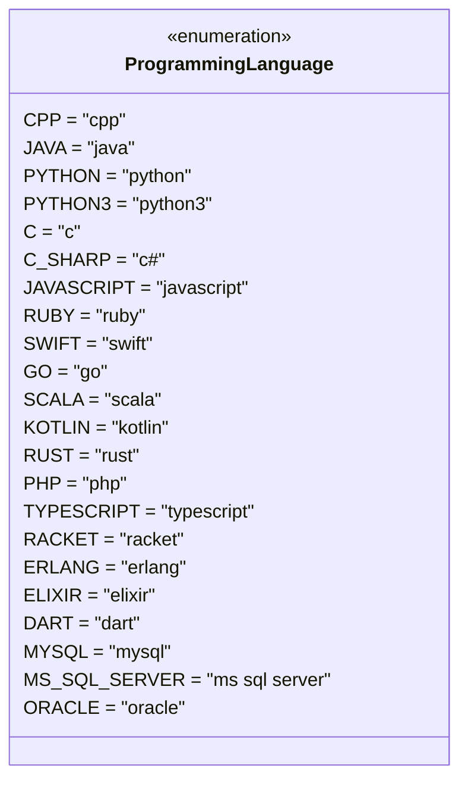
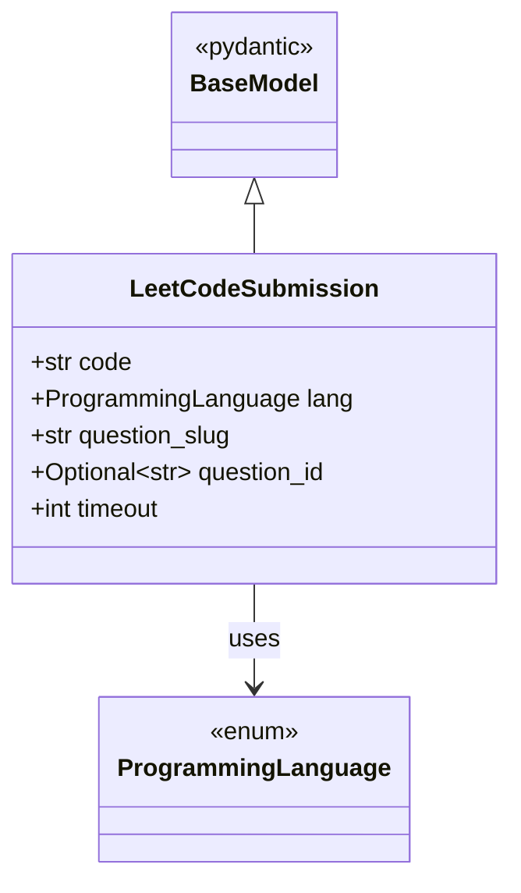
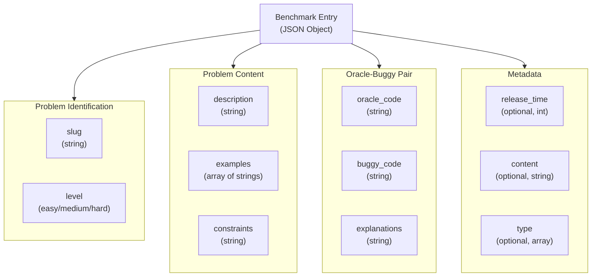
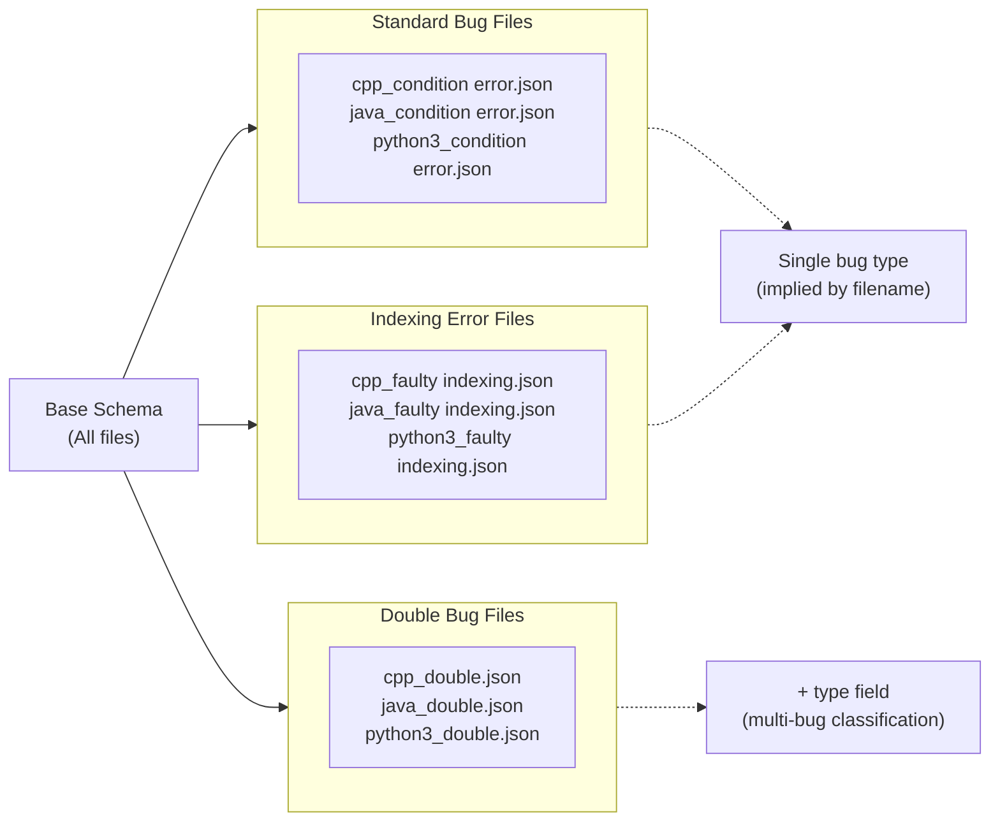
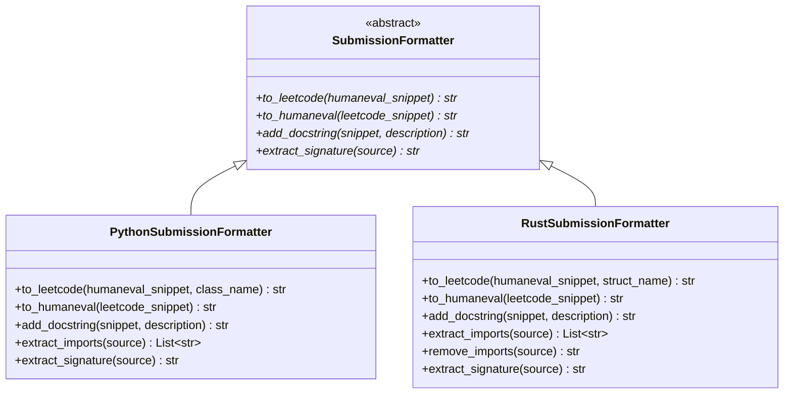
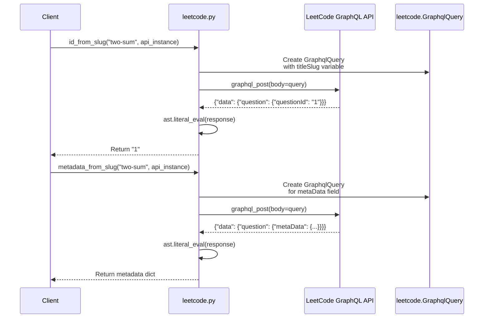

<!-- source: DeepWiki mcp.deepwiki.com · repo thunlp/DebugBench · page 7.1 Data Models · fetched 2026-11-02 -->

# Data Models

<details>
<summary>Relevant source files</summary>

The following files were used as context for generating this wiki page:

- [benchmark/cpp_condition error.json](benchmark/cpp_condition error.json)
- [benchmark/cpp_double.json](benchmark/cpp_double.json)
- [benchmark/cpp_faulty indexing.json](benchmark/cpp_faulty indexing.json)
- [leetcode_data/validated/leetcode_oj/leetcode_env/types.py](leetcode_data/validated/leetcode_oj/leetcode_env/types.py)
- [leetcode_data/validated/leetcode_oj/leetcode_env/utils/formatting.py](leetcode_data/validated/leetcode_oj/leetcode_env/utils/formatting.py)
- [leetcode_data/validated/leetcode_oj/leetcode_env/utils/leetcode.py](leetcode_data/validated/leetcode_oj/leetcode_env/utils/leetcode.py)

</details>


This document describes the core data structures and models used throughout DebugBench for representing code submissions, programming languages, benchmark problems, and evaluation results. These models form the foundation for the dataset construction pipeline, evaluation framework, and result storage systems.

For information about how these models are used in the evaluation system, see [Environment Classes](#7.2). For details on the benchmark dataset organization, see [Dataset Organization](#3.1).

---

## Overview

DebugBench defines data models at three key levels:

1. **Type System Models** - Core Pydantic models for submissions and language enums
2. **Benchmark Schema** - JSON structures for storing problem instances with bugs
3. **Result Models** - Structures for storing evaluation outcomes

These models ensure type safety, consistent serialization, and clear contracts between system components.

---

## Type System Models

### ProgrammingLanguage Enum

The `ProgrammingLanguage` enum defines all supported programming languages in the LeetCode evaluation environment.



**Supported Languages Table:**

| Language | Enum Value | Primary Use in DebugBench |
|----------|-----------|---------------------------|
| C++ | `cpp` | ✓ Core benchmark language |
| Java | `java` | ✓ Core benchmark language |
| Python3 | `python3` | ✓ Core benchmark language |
| Python | `python` | Legacy support |
| C | `c` | Extended support |
| JavaScript | `javascript` | Extended support |
| Rust | `rust` | Extended support |
| Others | Various | LeetCode platform support |

**Sources:** [leetcode_data/validated/leetcode_oj/leetcode_env/types.py:6-33]()

---

### LeetCodeSubmission Model

The `LeetCodeSubmission` class is a Pydantic BaseModel representing a code submission to the LeetCode online judge.



**Field Specifications:**

| Field | Type | Required | Default | Description |
|-------|------|----------|---------|-------------|
| `code` | `str` | Yes | - | The source code to submit |
| `lang` | `ProgrammingLanguage` | Yes | - | Programming language of the code |
| `question_slug` | `str` | Yes | - | LeetCode problem identifier (e.g., "two-sum") |
| `question_id` | `Optional[str]` | No | `None` | Numeric problem ID (auto-resolved if not provided) |
| `timeout` | `int` | No | `5` | Submission timeout in seconds |

**Usage Example:**

```python
submission = LeetCodeSubmission(
    code="class Solution:\n    def twoSum(self, nums, target):\n        ...",
    lang=ProgrammingLanguage.PYTHON3,
    question_slug="two-sum",
    timeout=10
)
```

**Sources:** [leetcode_data/validated/leetcode_oj/leetcode_env/types.py:35-46]()

---

## Benchmark Entry Schema

Each problem instance in the DebugBench dataset follows a consistent JSON schema. The schema varies slightly between different bug type categories but maintains a core set of fields.

### Core Benchmark Entry Structure



### Field Definitions

| Field Name | Type | Required | Description | Example |
|------------|------|----------|-------------|---------|
| `slug` | `string` | Yes | LeetCode problem identifier | `"two-sum"` |
| `description` | `string` | Yes | Problem statement text | `"Given an array of integers..."` |
| `examples` | `array[string]` | Yes | Input/output examples | `["Input: nums = [2,7,11,15]..."]` |
| `constraints` | `string` | Yes | Input constraints and limits | `"2 <= nums.length <= 10^4"` |
| `oracle_code` | `string` | Yes | Correct solution code | Full working implementation |
| `buggy_code` | `string` | Yes | Buggy version with implanted error | Implementation with deliberate bug |
| `explanations` | `string` | Yes | Bug description and location | `"Loop condition should be i<n not i<=n"` |
| `level` | `string` | Yes | Difficulty level | `"easy"`, `"medium"`, or `"hard"` |
| `release_time` | `int` | No | Unix timestamp | `1680161413` |
| `content` | `string` | No | Original solution post content | Markdown/formatted text |
| `type` | `array[string]` | No | Bug classification tags | `["condition error", "indexing error"]` |

### Schema Variations by Bug Category

Different JSON shard files include slightly different metadata fields:



**Type Field Usage (in double bug files):**

The `type` field in files like `cpp_double.json` allows classification of entries with multiple simultaneous bugs:

```json
{
  "slug": "count-the-number-of-beautiful-subarrays",
  "type": ["other error", "indexing error"],
  ...
}
```

**Sources:** 
- [benchmark/cpp_condition error.json:1-247]()
- [benchmark/cpp_double.json:1-248]()
- [benchmark/cpp_faulty indexing.json:1-210]()

---

## Benchmark Entry Examples

### Example 1: Condition Error Entry

```json
{
  "slug": "knight-dialer",
  "description": "The chess knight has a unique movement...",
  "examples": [
    "Input: n = 1\nOutput: 10\nExplanation: We need to dial..."
  ],
  "constraints": "1 <= n <= 5000",
  "oracle_code": "long long mod = 1e9+7;\nint dx[] = {2,2,1,1,-2,-2,-1,-1};\n...",
  "buggy_code": "\nlong long mod = 1e9+7;\nint dx[] = {2,2,1,1,-2,-2,-1,-1};\n...",
  "explanations": "\nThe logic error is in the loop bounds in function knightDialer...",
  "level": "medium",
  "release_time": 1680161413
}
```

**Sources:** [benchmark/cpp_condition error.json:2-17]()

### Example 2: Double Bug Entry with Type Classification

```json
{
  "slug": "buddy-strings",
  "description": "Given two strings s and goal, return true if...",
  "level": "easy",
  "type": ["indexing error", "operation error"],
  "buggy_code": "\nclass Solution {\npublic:\n    bool buddyStrings(string s, string p) {\n        ...\n        for(int i=0;i<=n;i++){\n            ...\n            freq[s[i]-'z']++;\n        }\n        ...\n    }\n};\n"
}
```

This entry demonstrates multiple bugs:
- **Indexing error**: Loop condition `i<=n` causes out-of-bounds access
- **Operation error**: Character offset calculation `s[i]-'z'` is incorrect (should be `'a'`)

**Sources:** [benchmark/cpp_double.json:20-36]()

---

## Data Model Relationships

The following diagram shows how the core data models interact within the DebugBench system:

```mermaid
graph TB
    subgraph BenchmarkStorage["Benchmark Storage (JSON)"]
        Entry1["benchmark/cpp_*.json"]
        Entry2["benchmark/java_*.json"]
        Entry3["benchmark/python3_*.json"]
    end
    
    subgraph TypeSystem["Type System Models<br/>(types.py)"]
        ProgLang["ProgrammingLanguage<br/>Enum"]
        Submission["LeetCodeSubmission<br/>BaseModel"]
    end
    
    subgraph Evaluation["Evaluation Layer"]
        Env["LeetCodeEnv"]
        Tester["LeetCodeTester"]
    end
    
    subgraph Formatting["Code Transformation"]
        PyFormatter["PythonSubmissionFormatter"]
        RustFormatter["RustSubmissionFormatter"]
        BaseFormatter["SubmissionFormatter<br/>(ABC)"]
    end
    
    Entry1 --> |"read buggy_code"| Submission
    Entry2 --> |"read buggy_code"| Submission
    Entry3 --> |"read buggy_code"| Submission
    
    Submission --> |"uses"| ProgLang
    Submission --> |"submitted to"| Env
    
    Env --> Tester
    
    BaseFormatter <|-- PyFormatter
    BaseFormatter <|-- RustFormatter
    
    Submission --> |"transformed by"| PyFormatter
    Submission --> |"transformed by"| RustFormatter
    
    Entry1 -.-> |"stores results"| ResultJSON["evalution_result/<br/>model_results.json"]
```

**Data Flow:**

1. **Loading**: Benchmark entries (JSON) are loaded from disk
2. **Extraction**: `buggy_code` and `oracle_code` strings are extracted
3. **Modeling**: Code is wrapped in `LeetCodeSubmission` with appropriate `ProgrammingLanguage`
4. **Transformation**: Formatters convert code between HumanEval and LeetCode formats if needed
5. **Evaluation**: Submissions are sent to `LeetCodeEnv` for testing
6. **Storage**: Results are stored back to JSON with evaluation metrics

**Sources:** 
- [leetcode_data/validated/leetcode_oj/leetcode_env/types.py:1-46]()
- [leetcode_data/validated/leetcode_oj/leetcode_env/utils/formatting.py:9-41]()

---

## Submission Formatter Models

The `SubmissionFormatter` abstract base class defines the interface for converting code between different formats.



### Formatter Methods

| Method | Purpose | Input Format | Output Format |
|--------|---------|--------------|---------------|
| `to_leetcode()` | Convert standalone function to LeetCode class format | HumanEval-style function | LeetCode class with method |
| `to_humaneval()` | Extract function from LeetCode class | LeetCode class with method | Standalone function |
| `add_docstring()` | Add documentation to code | Code + description text | Code with docstring |
| `extract_signature()` | Get function signature | Full function code | Signature string only |
| `extract_imports()` | Parse import statements | Source code | List of import lines |

### Python Formatter Example

**Input (HumanEval format):**
```python
def twoSum(nums, target):
    result = []
    for i in range(len(nums)):
        ...
    return result
```

**Output (LeetCode format via `to_leetcode()`):**
```python
class Solution:
    def twoSum(self, nums, target):
        result = []
        for i in range(len(nums)):
            ...
        return result
```

**Sources:** 
- [leetcode_data/validated/leetcode_oj/leetcode_env/utils/formatting.py:9-41]()
- [leetcode_data/validated/leetcode_oj/leetcode_env/utils/formatting.py:44-136]()
- [leetcode_data/validated/leetcode_oj/leetcode_env/utils/formatting.py:138-218]()

---

## GraphQL Query Models

The utility functions in `leetcode.py` perform GraphQL queries to retrieve problem metadata from LeetCode.



### GraphQL Query Structure

The queries use the following structure:

```graphql
query getQuestionDetail($titleSlug: String!) {
  question(titleSlug: $titleSlug) {
    questionId
    metaData
  }
}
```

**Functions:**

- `id_from_slug(slug: str, api_instance) -> str`: Converts problem slug to numeric ID
- `metadata_from_slug(slug: str, api_instance) -> str`: Retrieves full problem metadata

**Sources:** [leetcode_data/validated/leetcode_oj/leetcode_env/utils/leetcode.py:1-41]()

---

## Result Data Models

While not explicitly defined as Pydantic models in the provided files, evaluation results follow a consistent structure stored in JSON format.

### Evaluation Result Schema

Based on the system architecture diagrams and evaluation flow:

| Field | Type | Description |
|-------|------|-------------|
| `completed_code` | `string` | The debugged/submitted code |
| `test_result_bool` | `boolean` | Whether all tests passed |
| `test_result_dict` | `object` | Detailed test results per case |
| `status_code` | `string` | Submission status (e.g., "Accepted", "Wrong Answer") |
| `total_correct` | `integer` | Number of test cases passed |
| `total_testcases` | `integer` | Total number of test cases |
| `runtime_percentile` | `float` | Runtime performance percentile |
| `memory_percentile` | `float` | Memory usage percentile |
| `status_msg` | `string` | Human-readable status message |

### Status Code Values

Common `status_code` values returned from LeetCode:

- `"Accepted"` - All test cases passed
- `"Wrong Answer"` - Failed one or more test cases
- `"Runtime Error"` - Code crashed during execution
- `"Time Limit Exceeded"` - Execution timeout
- `"Compile Error"` - Code failed to compile
- `"Memory Limit Exceeded"` - Exceeded memory constraints

**Sources:** Derived from system architecture in provided diagrams and common LeetCode evaluation patterns

---

## Data Validation and Type Safety

DebugBench leverages Pydantic for runtime validation and type checking.

### Benefits of Pydantic Models

1. **Automatic Validation**: Invalid data raises `ValidationError` at runtime
2. **Type Coercion**: Automatic conversion between compatible types
3. **IDE Support**: Full autocomplete and type hints
4. **Serialization**: Easy conversion to/from JSON
5. **Documentation**: Self-documenting through type annotations

### Example Validation

```python
from leetcode_env.types import LeetCodeSubmission, ProgrammingLanguage

# Valid submission
valid = LeetCodeSubmission(
    code="class Solution:\n    pass",
    lang=ProgrammingLanguage.PYTHON3,
    question_slug="two-sum"
)  # ✓ Success

# Invalid submission - missing required field
try:
    invalid = LeetCodeSubmission(
        code="class Solution:\n    pass",
        lang=ProgrammingLanguage.PYTHON3
        # Missing question_slug!
    )
except ValidationError as e:
    print(e)  # Pydantic validation error
```

**Sources:** [leetcode_data/validated/leetcode_oj/leetcode_env/types.py:35-46]()

---

## Summary

The DebugBench data models provide a robust foundation for the entire system:

- **Type System Models** (`types.py`) ensure type safety for submissions and language identifiers
- **Benchmark Entry Schema** defines the structure for storing 4,253 bug-implanted problem instances across 51 JSON shards
- **Formatter Models** enable seamless conversion between HumanEval and LeetCode code formats
- **GraphQL Query Models** facilitate metadata retrieval from the LeetCode platform
- **Result Models** provide consistent evaluation outcome storage

These models work together to support the complete pipeline from dataset construction through evaluation to result analysis.

**Related Pages:**
- [Environment Classes](#7.2) - How these models are used in the evaluation system
- [Data Schema and Format](#3.2) - Complete benchmark JSON schema reference
- [Result Schema](#5.3) - Detailed evaluation result structure

---

