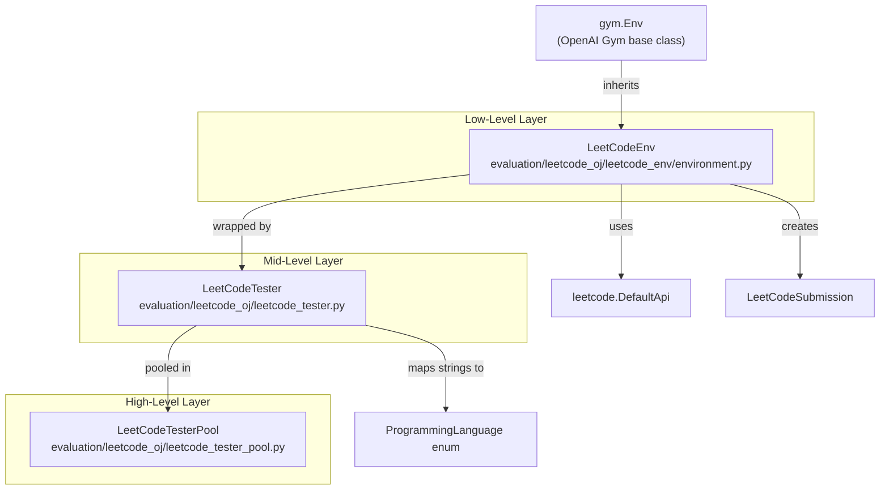
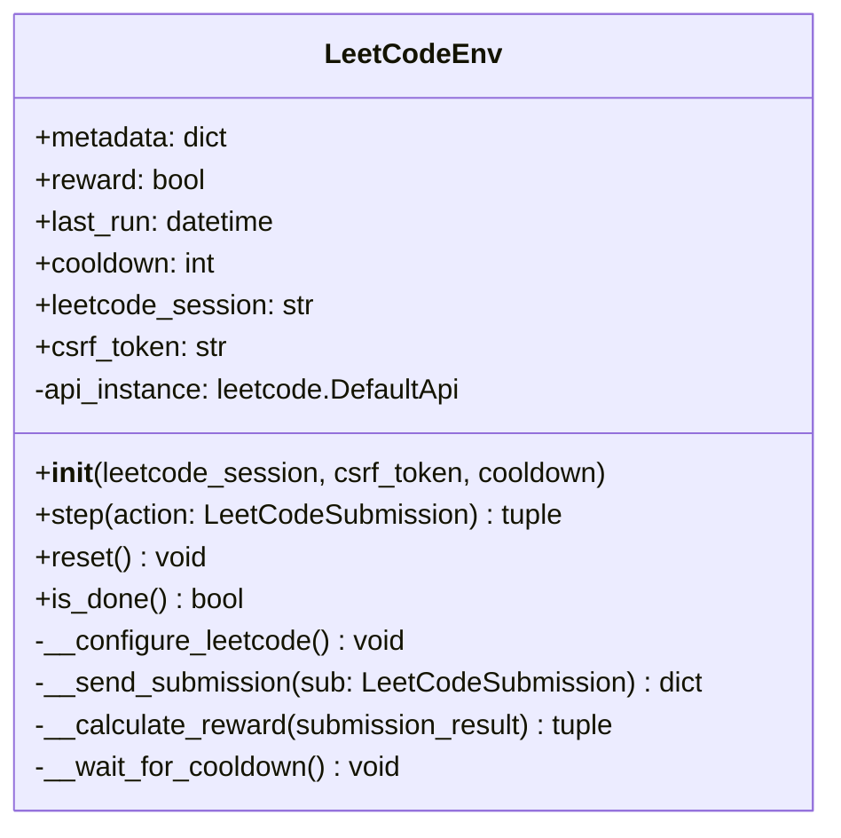
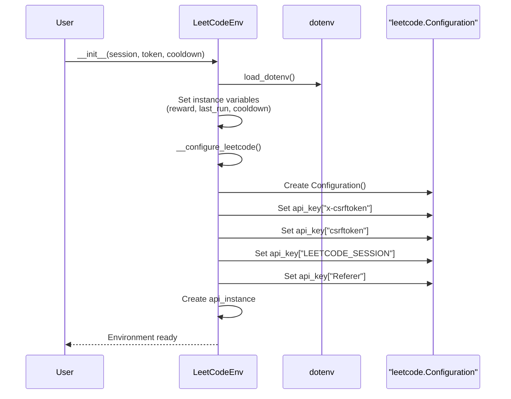
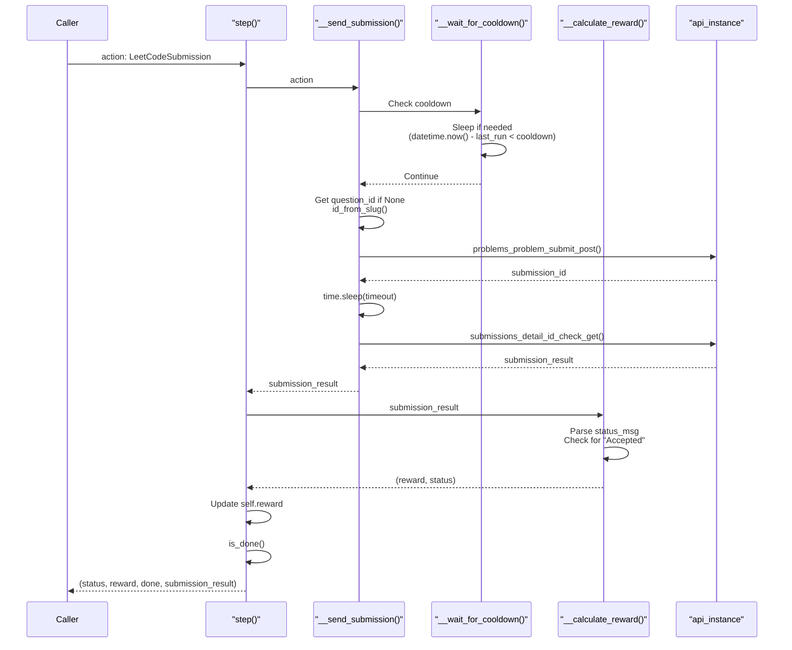
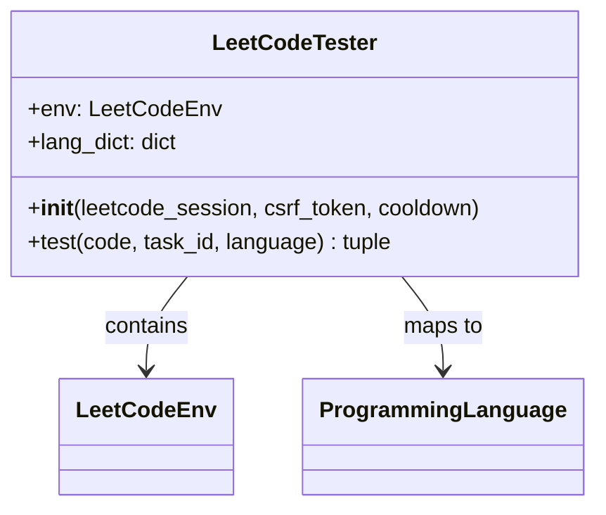
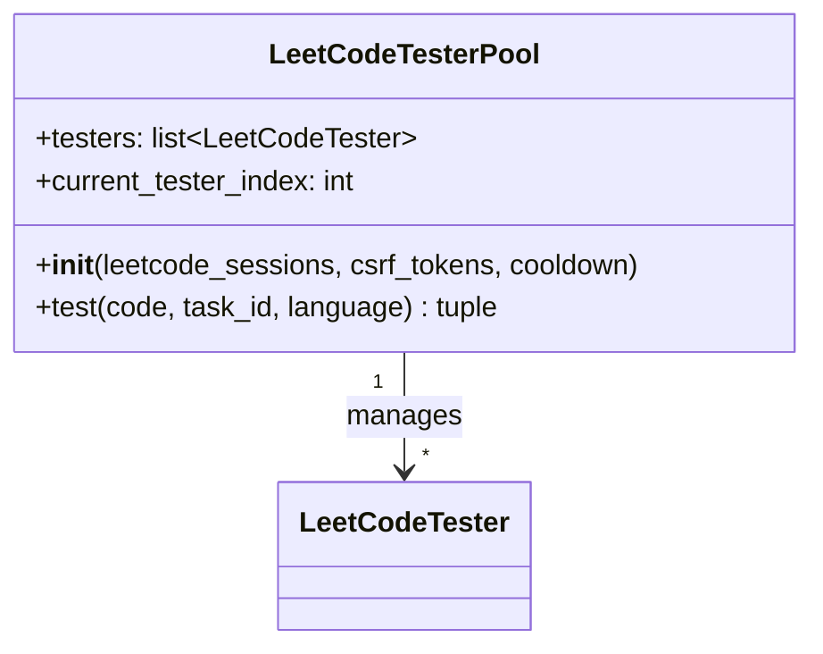
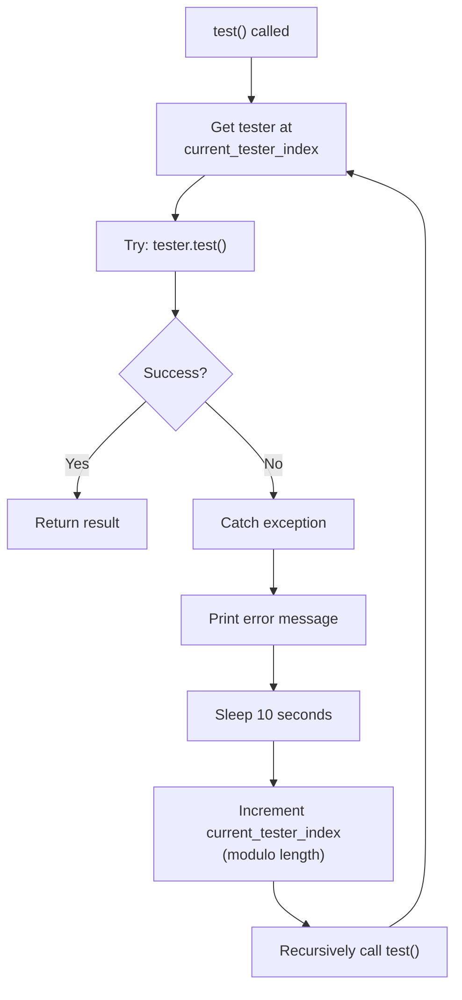
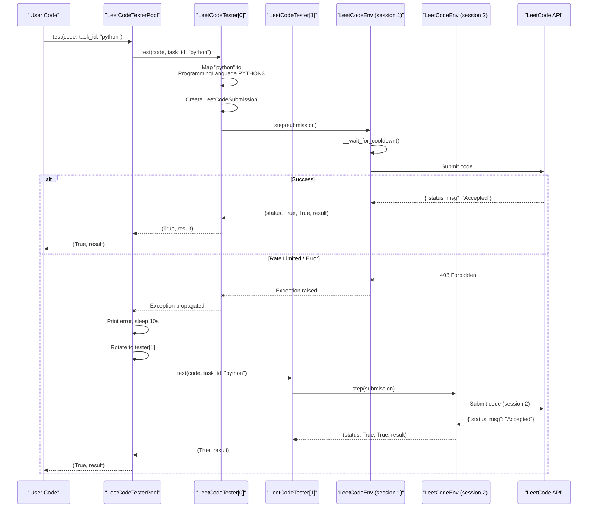

<!-- source: DeepWiki mcp.deepwiki.com · repo thunlp/DebugBench · page 7.2 Environment Classes · fetched 2026-11-02 -->

# Environment Classes

<details>
<summary>Relevant source files</summary>

The following files were used as context for generating this wiki page:

- [evaluation/leetcode_oj/__init__.py](evaluation/leetcode_oj/__init__.py)
- [evaluation/leetcode_oj/leetcode_env/environment.py](evaluation/leetcode_oj/leetcode_env/environment.py)
- [evaluation/leetcode_oj/leetcode_env/utils/__pycache__/leetcode.cpython-310.pyc](evaluation/leetcode_oj/leetcode_env/utils/__pycache__/leetcode.cpython-310.pyc)
- [evaluation/leetcode_oj/leetcode_tester.py](evaluation/leetcode_oj/leetcode_tester.py)
- [evaluation/leetcode_oj/leetcode_tester_pool.py](evaluation/leetcode_oj/leetcode_tester_pool.py)

</details>


This page provides API reference documentation for the three core environment classes used to test code submissions against LeetCode: `LeetCodeEnv`, `LeetCodeTester`, and `LeetCodeTesterPool`. These classes are located in the `evaluation/leetcode_oj/` directory and provide the programmatic interface for executing and evaluating code.

For a conceptual overview of the evaluation system, see [Evaluation System](#4). For specific topics like rate limiting strategies and configuration, see [Rate Limiting and Multi-Session Management](#4.4) and [Configuration](#6.3).

---

## Class Hierarchy and Relationships

The three environment classes form a layered abstraction where each level adds functionality:



**Sources:** [evaluation/leetcode_oj/leetcode_env/environment.py:14-128](), [evaluation/leetcode_oj/leetcode_tester.py:22-41](), [evaluation/leetcode_oj/leetcode_tester_pool.py:6-19]()

---

## LeetCodeEnv

The `LeetCodeEnv` class is the lowest-level interface that implements the OpenAI Gym environment pattern for LeetCode submissions. It handles authentication, rate limiting, submission execution, and result parsing.

### Class Definition



**Sources:** [evaluation/leetcode_oj/leetcode_env/environment.py:14-128]()

### Constructor

```python
def __init__(self, leetcode_session=None, csrf_token=None, cooldown=0)
```

Initializes a new LeetCode Gym environment with authentication credentials and rate limiting configuration.

| Parameter | Type | Default | Description |
|-----------|------|---------|-------------|
| `leetcode_session` | `str` | `None` | LeetCode session token for authentication. If `None`, loaded from environment variable. |
| `csrf_token` | `str` | `None` | CSRF token for authentication. If `None`, loaded from environment variable. |
| `cooldown` | `int` | `0` | Minimum seconds to wait between submissions to avoid rate limiting. |

**Initialization Sequence:**



**Sources:** [evaluation/leetcode_oj/leetcode_env/environment.py:21-43]()

### step() Method

```python
def step(self, action: LeetCodeSubmission) -> tuple[str, bool, bool, dict]
```

Submits code to LeetCode and returns the evaluation result. This is the primary method for testing code.

**Parameters:**
- `action` (`LeetCodeSubmission`): Submission object containing code, language, and problem identifier.

**Returns:**
A 4-tuple containing:
1. `status` (`str`): Status message - one of `"Accepted"`, `"Runtime Error"`, `"Wrong Answer"`, `"Submission Timed-Out"`, or `"Unknown"`
2. `reward` (`bool`): `True` if status is `"Accepted"`, `False` otherwise
3. `done` (`bool`): `True` if status is `"Accepted"`, `False` otherwise
4. `submission_result` (`dict`): Full LeetCode API response with detailed results

**Step Execution Flow:**



**Status Determination Logic:**

The method uses the following logic to determine status [evaluation/leetcode_oj/leetcode_env/environment.py:98-116]():

1. If `submission_result == {"state": "STARTED"}` → `"Submission Timed-Out"`
2. If `submission_result["status"] == "PENDING"` → `"Submission Timed-Out"`
3. If `"status_msg"` key exists → Use `submission_result["status_msg"]` (typically `"Accepted"`, `"Runtime Error"`, or `"Wrong Answer"`)
4. Otherwise → `"Unknown"`

**Sources:** [evaluation/leetcode_oj/leetcode_env/environment.py:45-66](), [evaluation/leetcode_oj/leetcode_env/environment.py:71-96](), [evaluation/leetcode_oj/leetcode_env/environment.py:98-116]()

### reset() Method

```python
def reset(self) -> None
```

Resets the environment state by setting `self.reward` to `False`. This method follows the Gym environment pattern but has minimal effect in LeetCode testing context.

**Sources:** [evaluation/leetcode_oj/leetcode_env/environment.py:68-69]()

### is_done() Method

```python
def is_done(self) -> bool
```

Returns `True` if the last submission was accepted (i.e., `self.reward == True`), `False` otherwise.

**Sources:** [evaluation/leetcode_oj/leetcode_env/environment.py:126-127]()

### Internal Methods

The class contains several private methods that handle implementation details:

| Method | Purpose | Line Reference |
|--------|---------|----------------|
| `__configure_leetcode()` | Sets up LeetCode API client with authentication credentials | [32-43]() |
| `__send_submission(sub)` | Handles cooldown, constructs submission, posts to LeetCode, and retrieves results | [71-96]() |
| `__calculate_reward(submission_result)` | Parses submission result and determines reward/status | [98-116]() |
| `__wait_for_cooldown()` | Enforces minimum time between submissions | [118-124]() |

**Sources:** [evaluation/leetcode_oj/leetcode_env/environment.py:32-124]()

---

## LeetCodeTester

The `LeetCodeTester` class provides a simplified, user-friendly wrapper around `LeetCodeEnv`. It abstracts away the `LeetCodeSubmission` object creation and provides direct string-based language specification.

### Class Definition



**Sources:** [evaluation/leetcode_oj/leetcode_tester.py:22-41]()

### Constructor

```python
def __init__(self, leetcode_session: str=None, csrf_token: str=None, cooldown: int=10)
```

Creates a new tester instance with specified authentication and rate limiting settings.

| Parameter | Type | Default | Description |
|-----------|------|---------|-------------|
| `leetcode_session` | `str` | `None` | LeetCode session token |
| `csrf_token` | `str` | `None` | CSRF token |
| `cooldown` | `int` | `10` | Seconds between submissions (default 10 to be safe) |

**Language Mapping:**

The constructor initializes a dictionary mapping common language strings to `ProgrammingLanguage` enum values [evaluation/leetcode_oj/leetcode_tester.py:27-33]():

```python
self.lang_dict = {
    "python": ProgrammingLanguage.PYTHON3,
    "python3": ProgrammingLanguage.PYTHON3,
    "java": ProgrammingLanguage.JAVA,
    "c": ProgrammingLanguage.C,
    "cpp": ProgrammingLanguage.CPP,
}
```

**Sources:** [evaluation/leetcode_oj/leetcode_tester.py:24-33]()

### test() Method

```python
def test(self, code: str, task_id: str, language: str) -> tuple[bool, dict]
```

Tests a code submission against LeetCode. This is the primary public API for single-tester usage.

| Parameter | Type | Description |
|-----------|------|-------------|
| `code` | `str` | Source code to test |
| `task_id` | `str` | LeetCode problem slug (e.g., `"two-sum"`) |
| `language` | `str` | Programming language (`"python"`, `"python3"`, `"java"`, `"c"`, or `"cpp"`) |

**Returns:**
- `reward` (`bool`): `True` if submission was accepted, `False` otherwise
- `submission_result` (`dict`): Full submission result from LeetCode API

**Usage Example:**

```python
tester = LeetCodeTester(leetcode_session="...", csrf_token="...", cooldown=10)
reward, result = tester.test(
    code="class Solution:\n    def twoSum(self, nums, target):\n        ...",
    task_id="two-sum",
    language="python"
)
print(f"Accepted: {reward}")
print(f"Details: {result}")
```

**Sources:** [evaluation/leetcode_oj/leetcode_tester.py:35-40]()

---

## LeetCodeTesterPool

The `LeetCodeTesterPool` class manages multiple `LeetCodeTester` instances with different authentication credentials. It provides automatic failover and session rotation when individual testers encounter errors or rate limits.

### Class Definition



**Sources:** [evaluation/leetcode_oj/leetcode_tester_pool.py:6-19]()

### Constructor

```python
def __init__(self, leetcode_sessions: list, csrf_tokens: list, cooldown: int=10)
```

Creates a pool of testers from multiple sets of credentials.

| Parameter | Type | Default | Description |
|-----------|------|---------|-------------|
| `leetcode_sessions` | `list[str]` | - | List of LeetCode session tokens |
| `csrf_tokens` | `list[str]` | - | List of CSRF tokens (must match length of `leetcode_sessions`) |
| `cooldown` | `int` | `10` | Cooldown applied to each tester in the pool |

**Initialization:**

The constructor creates one `LeetCodeTester` for each session/token pair [evaluation/leetcode_oj/leetcode_tester_pool.py:8]():

```python
self.testers = [
    LeetCodeTester(leetcode_session, csrf_token, cooldown=cooldown) 
    for leetcode_session, csrf_token in zip(leetcode_sessions, csrf_tokens)
]
```

**Sources:** [evaluation/leetcode_oj/leetcode_tester_pool.py:7-9]()

### test() Method with Failover

```python
def test(self, code: str, task_id: str, language: str) -> tuple[bool, dict]
```

Tests code using the current tester, with automatic failover to the next tester on error.

**Parameters:** Same as `LeetCodeTester.test()`

**Returns:** Same as `LeetCodeTester.test()`

**Failover Strategy:**



**Implementation Details [evaluation/leetcode_oj/leetcode_tester_pool.py:11-19]():**

```python
def test(self, code: str, task_id: str, language: str) -> tuple[bool, dict]:
    tester = self.testers[self.current_tester_index]
    try:
        return tester.test(code, task_id, language)
    except Exception as e:
        print(f"Tester {self.current_tester_index} failed with error: {e}")
        time.sleep(10)
        self.current_tester_index = (self.current_tester_index + 1) % len(self.testers)
        return self.test(code, task_id, language)  # Recursive retry
```

Key behaviors:
1. Attempts submission with current tester
2. On any exception, prints error and waits 10 seconds
3. Rotates to next tester using modulo arithmetic
4. Recursively retries with new tester
5. Continues until success or all testers exhausted

**Sources:** [evaluation/leetcode_oj/leetcode_tester_pool.py:11-19]()

---

## Complete Testing Workflow

The following diagram shows how all three classes interact in a typical evaluation scenario:



**Sources:** [evaluation/leetcode_oj/leetcode_env/environment.py:45-66](), [evaluation/leetcode_oj/leetcode_tester.py:35-40](), [evaluation/leetcode_oj/leetcode_tester_pool.py:11-19]()

---

## Module Exports

The main classes are exported from the `leetcode_oj` package for convenient importing [evaluation/leetcode_oj/__init__.py:1-2]():

```python
from .leetcode_tester import LeetCodeTester
from .leetcode_tester_pool import LeetCodeTesterPool
```

This allows users to import as:
```python
from leetcode_oj import LeetCodeTester, LeetCodeTesterPool
```

Note that `LeetCodeEnv` is not exported at the package level as it is intended to be used only through the higher-level wrappers.

**Sources:** [evaluation/leetcode_oj/__init__.py:1-2]()

---

## Related Pages

- [Data Models](#7.1) - Documentation of `LeetCodeSubmission`, `ProgrammingLanguage`, and other data structures
- [Utility Functions](#7.3) - Helper functions used by these classes (e.g., `id_from_slug`)
- [LeetCode Environment](#4.1) - Conceptual overview of the Gym environment design
- [Submission Testing](#4.2) - Details on how submissions are validated and results parsed
- [Rate Limiting and Multi-Session Management](#4.4) - Strategies for avoiding rate limits
- [Configuration](#6.3) - Environment variables and credential setup

---

