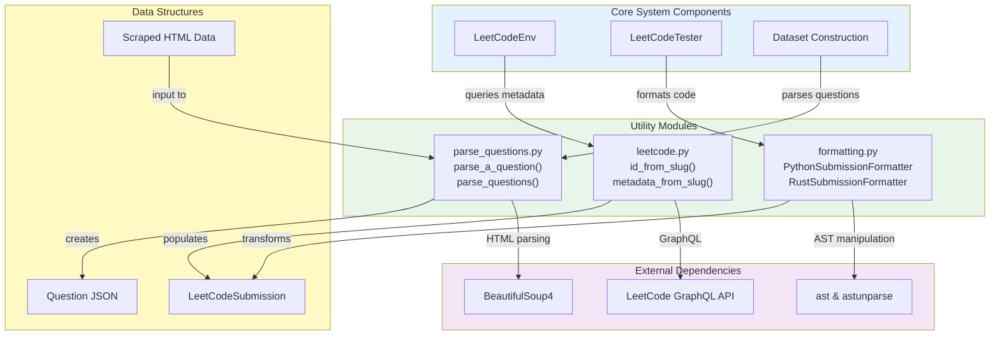
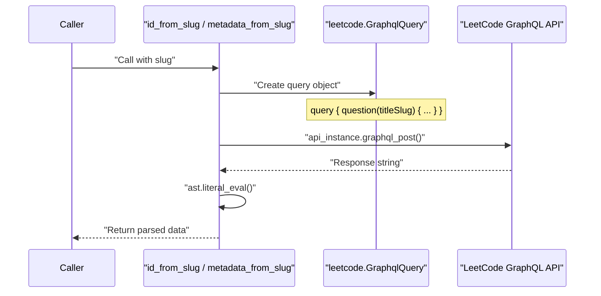
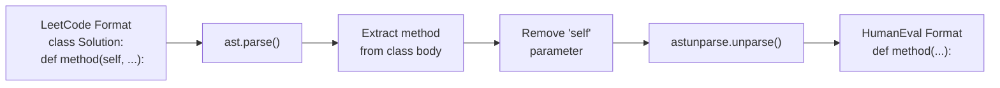
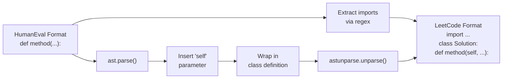
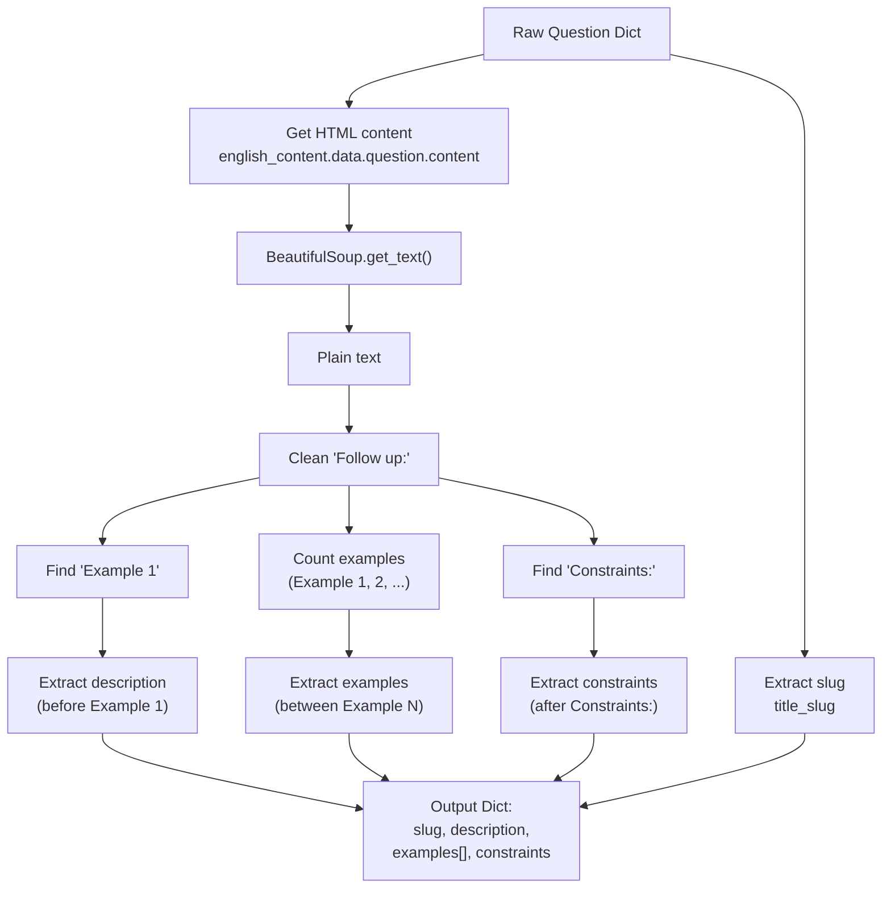

<!-- source: DeepWiki mcp.deepwiki.com · repo thunlp/DebugBench · page 7.3 Utility Functions · fetched 2026-11-02 -->

# Utility Functions

<details>
<summary>Relevant source files</summary>

The following files were used as context for generating this wiki page:

- [leetcode_data/parsed/parse_questions.py](leetcode_data/parsed/parse_questions.py)
- [leetcode_data/scraped/answer_all_sample.json](leetcode_data/scraped/answer_all_sample.json)
- [leetcode_data/scraped/answer_en_sample.json](leetcode_data/scraped/answer_en_sample.json)
- [leetcode_data/validated/leetcode_oj/leetcode_env/types.py](leetcode_data/validated/leetcode_oj/leetcode_env/types.py)
- [leetcode_data/validated/leetcode_oj/leetcode_env/utils/formatting.py](leetcode_data/validated/leetcode_oj/leetcode_env/utils/formatting.py)
- [leetcode_data/validated/leetcode_oj/leetcode_env/utils/leetcode.py](leetcode_data/validated/leetcode_oj/leetcode_env/utils/leetcode.py)

</details>


This page documents the utility functions and helper modules used throughout the DebugBench evaluation system. These utilities support core functionality by providing GraphQL query interfaces, code format transformations, and data parsing capabilities.

For information about the data models these utilities operate on, see [Data Models](#7.1). For information about the main environment classes that consume these utilities, see [Environment Classes](#7.2).

---

## Overview

The utility functions in DebugBench are organized into three primary categories:

| Category | Location | Purpose |
|----------|----------|---------|
| **LeetCode API Utilities** | [leetcode_data/validated/leetcode_oj/leetcode_env/utils/leetcode.py]() | GraphQL queries for retrieving problem metadata from LeetCode |
| **Code Formatting Utilities** | [leetcode_data/validated/leetcode_oj/leetcode_env/utils/formatting.py]() | Convert code between HumanEval and LeetCode submission formats |
| **Data Parsing Utilities** | [leetcode_data/parsed/parse_questions.py]() | Parse and extract structured data from scraped LeetCode HTML content |

**Sources:** [leetcode_data/validated/leetcode_oj/leetcode_env/utils/leetcode.py](), [leetcode_data/validated/leetcode_oj/leetcode_env/utils/formatting.py](), [leetcode_data/parsed/parse_questions.py]()

---

## System Integration Overview



**Sources:** [leetcode_data/validated/leetcode_oj/leetcode_env/utils/leetcode.py](), [leetcode_data/validated/leetcode_oj/leetcode_env/utils/formatting.py](), [leetcode_data/parsed/parse_questions.py]()

---

## LeetCode API Utilities

The `leetcode.py` module provides functions for querying the LeetCode platform using GraphQL. These utilities enable the evaluation system to retrieve problem identifiers and metadata dynamically.

### Function: `id_from_slug`

Retrieves the question ID (frontend ID) from a LeetCode problem slug.

**Signature:** [leetcode_data/validated/leetcode_oj/leetcode_env/utils/leetcode.py:4-21]()

```python
def id_from_slug(slug: str, api_instance) -> str
```

**Parameters:**
- `slug`: The URL-friendly problem identifier (e.g., `"two-sum"`)
- `api_instance`: Authenticated LeetCode API instance

**Returns:** The numeric question ID as a string

**Implementation Details:**
- Constructs a `leetcode.GraphqlQuery` object with the `getQuestionDetail` operation
- Queries for the `questionId` field
- Uses `ast.literal_eval()` to parse the response string into a dictionary
- Returns `response['data']['question']['question_id']`

### Function: `metadata_from_slug`

Retrieves comprehensive metadata for a LeetCode problem using its slug.

**Signature:** [leetcode_data/validated/leetcode_oj/leetcode_env/utils/leetcode.py:23-40]()

```python
def metadata_from_slug(slug: str, api_instance) -> str
```

**Parameters:**
- `slug`: The URL-friendly problem identifier
- `api_instance`: Authenticated LeetCode API instance

**Returns:** Dictionary containing the problem's metadata

**Implementation Details:**
- Queries the `metaData` field which contains serialized problem configuration
- Returns `response['data']['question']` containing metadata structure

### GraphQL Query Pattern

Both functions follow the same pattern:



**Sources:** [leetcode_data/validated/leetcode_oj/leetcode_env/utils/leetcode.py:1-41]()

---

## Code Formatting System

The `formatting.py` module provides formatters that convert code between HumanEval format (standalone functions) and LeetCode format (class methods). This is essential for testing LLM-generated code against LeetCode's online judge.

### Abstract Base Class: `SubmissionFormatter`

Defines the interface for all submission formatters.

**Location:** [leetcode_data/validated/leetcode_oj/leetcode_env/utils/formatting.py:9-41]()

**Abstract Methods:**

| Method | Purpose |
|--------|---------|
| `to_leetcode(humaneval_snippet: str)` | Convert standalone function to LeetCode class method |
| `to_humaneval(leetcode_snippet: str)` | Extract function from LeetCode class wrapper |
| `add_docstring(snippet: str, description: str)` | Add formatted documentation |
| `extract_signature(source: str)` | Extract function signature string |

### Python Formatter: `PythonSubmissionFormatter`

Implements format conversions for Python code using AST manipulation.

**Location:** [leetcode_data/validated/leetcode_oj/leetcode_env/utils/formatting.py:44-136]()

#### Key Methods

**`to_humaneval(leetcode_snippet: str) -> str`**

Converts LeetCode class method to standalone function:



**Implementation:** [leetcode_data/validated/leetcode_oj/leetcode_env/utils/formatting.py:55-69]()

**`to_leetcode(humaneval_snippet: str, class_name: str = "Solution") -> str`**

Converts standalone function to LeetCode class method:



**Implementation:** [leetcode_data/validated/leetcode_oj/leetcode_env/utils/formatting.py:71-109]()

#### Additional Utilities

**`extract_imports(source: str) -> List[str]`**

Extracts top-level import statements using regex patterns:
- Standard imports: `^import (\w+(?:, \w+)*)`
- From imports: `^from (\w+) import (\w+(?:, \w+)*)`

**Implementation:** [leetcode_data/validated/leetcode_oj/leetcode_env/utils/formatting.py:111-131]()

**`extract_signature(source: str) -> str`**

Extracts the function signature for display purposes.

**Implementation:** [leetcode_data/validated/leetcode_oj/leetcode_env/utils/formatting.py:133-135]()

**Sources:** [leetcode_data/validated/leetcode_oj/leetcode_env/utils/formatting.py:44-136]()

### Rust Formatter: `RustSubmissionFormatter`

Implements format conversions for Rust code using regex-based transformations.

**Location:** [leetcode_data/validated/leetcode_oj/leetcode_env/utils/formatting.py:138-218]()

#### Key Methods

**`to_humaneval(leetcode_snippet: str) -> str`**

Transformation steps:
1. Remove single-line comments (`//.*`)
2. Remove multi-line comments (`/\*.*?\*/`)
3. Remove `impl Solution {` wrapper
4. Remove `pub` visibility modifier
5. Unindent function body

**Implementation:** [leetcode_data/validated/leetcode_oj/leetcode_env/utils/formatting.py:176-200]()

**`to_leetcode(humaneval_snippet: str, struct_name: str = "Solution") -> str`**

Transformation steps:
1. Extract imports via `extract_imports()`
2. Remove comments
3. Add `pub` to function declaration
4. Wrap in `impl {struct_name} { ... }`

**Implementation:** [leetcode_data/validated/leetcode_oj/leetcode_env/utils/formatting.py:202-213]()

**`extract_imports(source: str) -> List[str]`**

Extracts Rust use statements: `^use ([\w::]+(?:\s+as\s+\w+)?)(?:;\s*)?$`

**Implementation:** [leetcode_data/validated/leetcode_oj/leetcode_env/utils/formatting.py:148-160]()

### Format Transformation Comparison

| Operation | Python (AST) | Rust (Regex) |
|-----------|--------------|--------------|
| Parse code | `ast.parse()` | Regex patterns |
| Extract function | Navigate AST nodes | Pattern matching |
| Modify parameters | AST node manipulation | String replacement |
| Wrap/unwrap class | Create ClassDef node | Add/remove `impl` block |
| Preserve imports | Regex extraction | Regex extraction |

**Sources:** [leetcode_data/validated/leetcode_oj/leetcode_env/utils/formatting.py:138-218]()

---

## Data Parsing Utilities

The `parse_questions.py` module extracts structured problem data from scraped LeetCode HTML content.

### Function: `parse_a_question`

Parses a single question from raw scraped data.

**Signature:** [leetcode_data/parsed/parse_questions.py:10-62]()

```python
def parse_a_question(raw_question: dict) -> dict
```

**Input Structure:** [leetcode_data/scraped/answer_en_sample.json]()

The input follows the structure scraped from LeetCode:
- `title_slug`: Problem URL identifier
- `english_content['data']['question']['content']`: HTML content

**Parsing Pipeline:**



**Implementation Details:**

1. **Extract slug:** [leetcode_data/parsed/parse_questions.py:12]()
2. **Parse HTML to text:** [leetcode_data/parsed/parse_questions.py:15-17]()
3. **Remove "Follow up" section:** [leetcode_data/parsed/parse_questions.py:20-21]()
4. **Extract description:** [leetcode_data/parsed/parse_questions.py:24]()
   - Everything before `"Example 1"`
5. **Count examples:** [leetcode_data/parsed/parse_questions.py:27-29]()
   - Searches for `"Example {n}:"` patterns
6. **Extract constraints:** [leetcode_data/parsed/parse_questions.py:32-36]()
   - Everything after `"Constraints:"`
7. **Extract each example:** [leetcode_data/parsed/parse_questions.py:39-53]()
   - Text between consecutive example markers

**Output Schema:**

```python
{
    "slug": str,           # Problem identifier
    "description": str,    # Problem statement
    "examples": [str],     # List of example inputs/outputs
    "constraints": str     # Input constraints and limits
}
```

### Function: `parse_questions`

Batch processing wrapper for parsing multiple questions.

**Signature:** [leetcode_data/parsed/parse_questions.py:65-69]()

```python
def parse_questions(raw_questions: list[dict]) -> list[dict]
```

**Implementation:** Maps `parse_a_question()` over the input list.

### HTML Content Structure

Example of scraped data structure from [leetcode_data/scraped/answer_en_sample.json]():

```json
{
    "title_slug": "two-sum",
    "english_content": {
        "data": {
            "question": {
                "content": "<p>Given array...</p>..."
            }
        }
    }
}
```

The HTML content includes:
- Problem description (formatted paragraphs)
- Example test cases (Input/Output/Explanation)
- Constraint specifications
- Optional follow-up questions

### BeautifulSoup Processing

The parser uses BeautifulSoup to convert HTML to plain text:

| HTML Element | Extraction Method | Result |
|--------------|------------------|---------|
| `<p>` tags | `soup.get_text()` | Concatenated paragraphs |
| `<code>` tags | Included in text | Inline code examples |
| `<ul>/<li>` lists | Preserved as text | Bullet point content |
| `<strong>` emphasis | Removed, text kept | Clean text output |

**Implementation:** [leetcode_data/parsed/parse_questions.py:15-17]()

**Sources:** [leetcode_data/parsed/parse_questions.py:1-83](), [leetcode_data/scraped/answer_en_sample.json:1-161]()

---

## Usage Examples

### Example 1: Querying Problem Metadata

```python
from leetcode_env.utils.leetcode import id_from_slug, metadata_from_slug
import leetcode

# Setup API instance (authenticated)
api_instance = leetcode.DefaultApi()

# Get problem ID
problem_id = id_from_slug("two-sum", api_instance)
# Returns: "1"

# Get problem metadata
metadata = metadata_from_slug("two-sum", api_instance)
# Returns: {"metaData": "...", ...}
```

### Example 2: Converting Python Code

```python
from leetcode_env.utils.formatting import PythonSubmissionFormatter

# HumanEval format (standalone function)
humaneval_code = """
def two_sum(nums, target):
    seen = {}
    for i, num in enumerate(nums):
        if target - num in seen:
            return [seen[target - num], i]
        seen[num] = i
"""

# Convert to LeetCode format
leetcode_code = PythonSubmissionFormatter.to_leetcode(humaneval_code)
# Result:
# class Solution:
#     def two_sum(self, nums, target):
#         ...

# Convert back to HumanEval
back_to_humaneval = PythonSubmissionFormatter.to_humaneval(leetcode_code)
```

### Example 3: Parsing Questions

```python
from parse_questions import parse_a_question

raw_question = {
    "title_slug": "two-sum",
    "english_content": {
        "data": {
            "question": {
                "content": "<p>Given array...</p><p>Example 1:</p>..."
            }
        }
    }
}

parsed = parse_a_question(raw_question)
# Returns:
# {
#     "slug": "two-sum",
#     "description": "Given array...",
#     "examples": ["Input: ...\nOutput: ..."],
#     "constraints": "2 <= nums.length <= 10^4..."
# }
```

**Sources:** [leetcode_data/validated/leetcode_oj/leetcode_env/utils/leetcode.py](), [leetcode_data/validated/leetcode_oj/leetcode_env/utils/formatting.py](), [leetcode_data/parsed/parse_questions.py]()

---

## Helper Functions

### `leading_whitespace_count`

Utility function for determining indentation levels in Rust code.

**Location:** [leetcode_data/validated/leetcode_oj/leetcode_env/utils/formatting.py:220-233]()

**Signature:**
```python
def leading_whitespace_count(s: str) -> int
```

**Purpose:** Counts leading whitespace characters on the first non-empty line of a string. Used by `RustSubmissionFormatter.to_humaneval()` to correctly unindent extracted functions.

**Algorithm:**
1. Split string into lines
2. Find first non-empty line
3. Count whitespace characters before first non-whitespace character
4. Return count (or line length if entirely whitespace)

**Sources:** [leetcode_data/validated/leetcode_oj/leetcode_env/utils/formatting.py:220-233]()

---

## Error Handling

The utility functions implement various error handling strategies:

### AST Parsing Errors

**Python Formatter:**
- Catches `IndentationError` when parsing code
- Adds `pass` statement to create valid AST
- Continues with modified tree

**Location:** [leetcode_data/validated/leetcode_oj/leetcode_env/utils/formatting.py:59-61](), [leetcode_data/validated/leetcode_oj/leetcode_env/utils/formatting.py:81-83]()

### GraphQL Response Parsing

**LeetCode API Utilities:**
- Use `ast.literal_eval()` for safe string-to-dict conversion
- Access nested dictionary keys with explicit paths
- Rely on LeetCode API consistency for response structure

**Location:** [leetcode_data/validated/leetcode_oj/leetcode_env/utils/leetcode.py:19-21](), [leetcode_data/validated/leetcode_oj/leetcode_env/utils/leetcode.py:38-40]()

### HTML Parsing Robustness

**Question Parser:**
- Checks for presence of optional sections (e.g., "Follow up:", "Constraints:")
- Iteratively searches for example markers
- Returns empty string if sections not found
- Gracefully handles missing content

**Location:** [leetcode_data/parsed/parse_questions.py:20-21](), [leetcode_data/parsed/parse_questions.py:32-36]()

**Sources:** [leetcode_data/validated/leetcode_oj/leetcode_env/utils/formatting.py](), [leetcode_data/validated/leetcode_oj/leetcode_env/utils/leetcode.py](), [leetcode_data/parsed/parse_questions.py]()

---

## Dependencies

### Required Python Packages

| Package | Used By | Purpose |
|---------|---------|---------|
| `ast` | PythonSubmissionFormatter | AST parsing and manipulation |
| `astunparse` | PythonSubmissionFormatter | Converting AST back to source code |
| `re` | All formatters, parser | Pattern matching and text extraction |
| `leetcode` | LeetCode API utilities | GraphQL query interface |
| `beautifulsoup4` | Question parser | HTML parsing |

### Standard Library Modules

- `ast`: Python abstract syntax tree manipulation
- `re`: Regular expression operations
- `json`: JSON serialization/deserialization (in parser main function)
- `os`: File path operations (in parser main function)
- `typing`: Type hints (`List`, `Optional`)

**Sources:** [leetcode_data/validated/leetcode_oj/leetcode_env/utils/formatting.py:1-7](), [leetcode_data/validated/leetcode_oj/leetcode_env/utils/leetcode.py:1-3](), [leetcode_data/parsed/parse_questions.py:1-3]()

---

