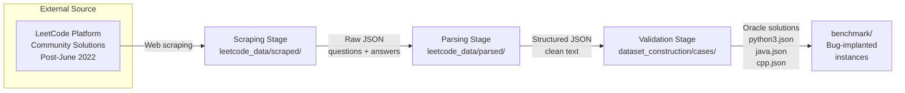
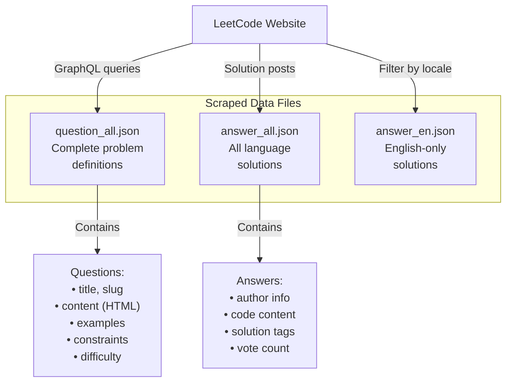
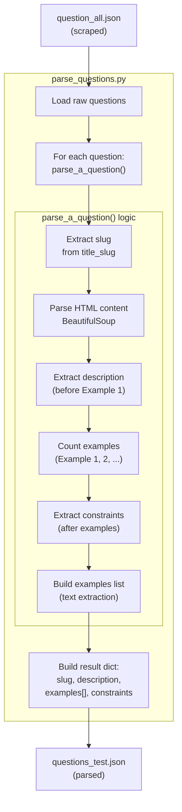
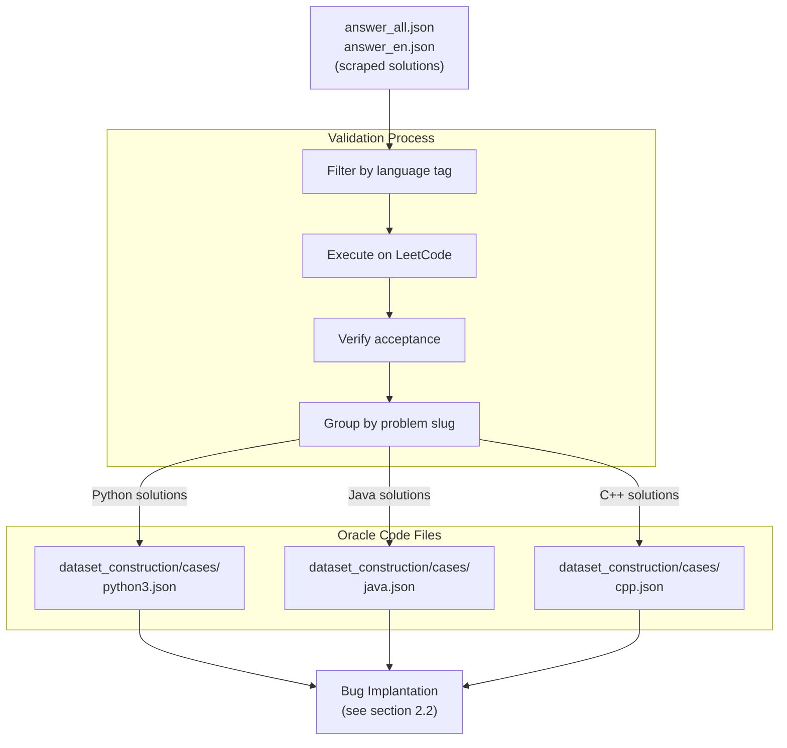
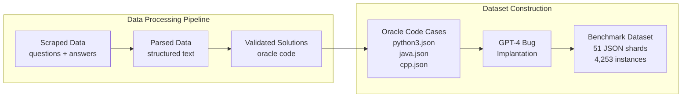

<!-- source: DeepWiki mcp.deepwiki.com · repo thunlp/DebugBench · page 8 Data Processing Pipeline · fetched 2026-11-02 -->

# Data Processing Pipeline

<details>
<summary>Relevant source files</summary>

The following files were used as context for generating this wiki page:

- [leetcode_data/parsed/parse_questions.py](leetcode_data/parsed/parse_questions.py)
- [leetcode_data/scraped/answer_all_sample.json](leetcode_data/scraped/answer_all_sample.json)
- [leetcode_data/scraped/answer_en_sample.json](leetcode_data/scraped/answer_en_sample.json)
- [leetcode_data/scraped/question_all_sample.json](leetcode_data/scraped/question_all_sample.json)

</details>


This document describes the data processing pipeline that transforms raw LeetCode problem data into the structured format used by DebugBench. The pipeline consists of three stages: scraping, parsing, and validation. For information about how this data is used in bug implantation, see [Bug Implantation Process](#2.2). For details on the validated solution files used as oracle code, see [Validated Solutions](#8.2).

## Pipeline Overview

The data processing pipeline converts raw LeetCode content into clean, structured problem definitions suitable for bug implantation. The pipeline extracts problem statements, examples, constraints, and community solutions across three programming languages.



**Sources:** [leetcode_data/scraped/answer_en_sample.json](), [leetcode_data/parsed/parse_questions.py]()

## Pipeline Stages

### Stage 1: Data Scraping

Raw data is collected from LeetCode and stored in the `leetcode_data/scraped/` directory. The scraping process captures both problem definitions and community-submitted solutions.



**Sources:** [leetcode_data/scraped/question_all_sample.json](), [leetcode_data/scraped/answer_all_sample.json](), [leetcode_data/scraped/answer_en_sample.json]()

### Stage 2: Question Parsing

The parsing stage extracts clean, structured text from raw HTML content. The primary parser is `parse_questions.py`, which converts scraped questions into a normalized format.



**Sources:** [leetcode_data/parsed/parse_questions.py:1-83]()

#### Parsing Logic Details

The `parse_a_question()` function performs several transformations:

| Step | Input | Processing | Output |
|------|-------|------------|--------|
| 1. Slug extraction | `raw_question["title_slug"]` | Direct field access | `slug` string |
| 2. HTML parsing | `raw_question['english_content']['data']['question']['content']` | BeautifulSoup HTML → plain text | Clean text string |
| 3. Follow-up removal | Plain text with "Follow up:" | Split at "Follow up:", keep first part | Text without follow-up |
| 4. Description extraction | Text from start to "Example 1" | String slicing | `description` string |
| 5. Example counting | Full text | Search for "Example N:" patterns | Count of examples |
| 6. Example extraction | Text between example markers | String slicing per example | `examples[]` list |
| 7. Constraints extraction | Text after "Constraints:" marker | String slicing and trimming | `constraints` string |

**Sources:** [leetcode_data/parsed/parse_questions.py:10-62]()

#### Key Functions

**`parse_a_question(raw_question: dict) -> dict`**

Transforms a single raw question into structured format. Located at [leetcode_data/parsed/parse_questions.py:10-62]().

Core extraction logic:
- **Lines 14-15**: Uses BeautifulSoup to convert HTML to plain text
- **Lines 20-21**: Removes "Follow up:" sections if present
- **Lines 24**: Extracts description (text before first example)
- **Lines 27-29**: Counts examples by searching for "Example N:" patterns
- **Lines 32-36**: Conditionally extracts constraints section
- **Lines 38-53**: Builds examples list by finding boundaries between examples

**`parse_questions(raw_questions: list[dict]) -> list[dict]`**

Batch processes multiple questions. Located at [leetcode_data/parsed/parse_questions.py:65-69]().

**`main()`**

Entry point that orchestrates the parsing pipeline. Located at [leetcode_data/parsed/parse_questions.py:72-82]().
- Loads from `leetcode_data/scraped/question_all.json`
- Saves to `leetcode_data/parsed/questions_test.json`

**Sources:** [leetcode_data/parsed/parse_questions.py:10-82]()

### Stage 3: Solution Validation

The final stage validates and organizes solutions by programming language. This produces the oracle code files used in bug implantation. For details on the validated solution files, see [Validated Solutions](#8.2).



**Sources:** [leetcode_data/scraped/answer_en_sample.json:1-161](), [leetcode_data/scraped/answer_all_sample.json:1-244]()

## Data Schema Reference

### Scraped Question Format

Each entry in `question_all.json` contains nested JSON structures with problem metadata.

**Key Fields:**

```
{
  "title": string,                     // English title
  "title_cn": string,                  // Chinese title
  "title_slug": string,                // URL slug (unique identifier)
  "english_content": {
    "data": {
      "question": {
        "content": string,             // HTML problem description
        "editorType": "CKEDITOR",
        "mysqlSchemas": [],            // For database problems
        "dataSchemas": []              // For pandas problems
      }
    }
  },
  "chinese_content": {...},            // Parallel Chinese structure
  "similar_json_data": {
    "data": {
      "question": {
        "similarQuestions": string     // JSON array of related problems
      }
    }
  },
  "stats_json_data": {
    "data": {
      "question": {
        "stats": string                // JSON with acceptance rates
      }
    }
  }
}
```

**Example:** [leetcode_data/scraped/question_all_sample.json:2-54]() shows the structure for "Average Time of Process per Machine"

**Sources:** [leetcode_data/scraped/question_all_sample.json:1-130]()

### Scraped Answer Format

Answer files contain community-submitted solutions with metadata about authors, votes, and solution approaches.

**English Answers (`answer_en.json`):**

```
{
  "answer_id": int,
  "answer_title": string,
  "title": string,                     // Problem title
  "title_slug": string,                // Links to question
  "answer_json": {
    "data": {
      "topic": {
        "id": int,
        "title": string,
        "viewCount": int,
        "solutionTags": [              // Language tags
          {"name": string, "slug": string}
        ],
        "post": {
          "content": string,           // Markdown with code blocks
          "voteCount": int,
          "author": {...}
        }
      }
    }
  }
}
```

**Example:** [leetcode_data/scraped/answer_en_sample.json:2-53]() demonstrates a Python3 BFS solution

**All Language Answers (`answer_all.json`):**

Uses a different schema with `solutionArticle` structure:

```
{
  "answer_slug": string,
  "answer_title": string,
  "answer_uuid": string,
  "title_slug": string,
  "answer_json": {
    "data": {
      "solutionArticle": {
        "uuid": string,
        "title": string,
        "slug": string,
        "tags": [                      // Topic and language tags
          {"name": string, "slug": string, "tagType": string}
        ],
        "content": string,             // Markdown with explanation
        "topic": {
          "commentCount": int,
          "viewCount": int
        }
      }
    }
  }
}
```

**Example:** [leetcode_data/scraped/answer_all_sample.json:2-76]() shows a Chinese solution with detailed explanation

**Sources:** [leetcode_data/scraped/answer_en_sample.json:1-161](), [leetcode_data/scraped/answer_all_sample.json:1-244]()

### Parsed Question Format

After parsing, questions use a simplified, flat structure optimized for downstream processing.

**Schema:**

```
{
  "slug": string,                      // Problem identifier
  "description": string,               // Plain text, no HTML
  "examples": [                        // Extracted test cases
    string,                            // "Input: ...\nOutput: ..."
    ...
  ],
  "constraints": string                // Plain text constraints
}
```

**Field Mappings:**

| Parsed Field | Source | Transformation |
|-------------|--------|----------------|
| `slug` | `raw_question["title_slug"]` | Direct copy |
| `description` | `english_content.data.question.content` | HTML → text, extract until "Example 1" |
| `examples` | Same HTML content | Extract text between "Example N:" markers |
| `constraints` | Same HTML content | Extract text after "Constraints:" marker |

**Sources:** [leetcode_data/parsed/parse_questions.py:55-62]()

## Integration with Bug Implantation

The processed data flows into the bug implantation system, forming the foundation of the DebugBench dataset.



**Data Flow:**

1. **Scraped questions** provide problem statements, examples, and constraints
2. **Parsed questions** supply clean text for prompt engineering in bug implantation
3. **Validated solutions** serve as oracle code - the correct baseline for bug variants
4. **Combined data** enables GPT-4 to generate semantically valid buggy code with full context

Each bug-implanted instance in the benchmark includes:
- `description`: From parsed questions
- `examples`: From parsed questions  
- `constraints`: From parsed questions
- `oracle_code`: From validated solutions
- `buggy_code`: Generated using GPT-4 with full context
- `explanations`: Bug description generated during implantation

**Sources:** [leetcode_data/parsed/parse_questions.py:10-83](), [leetcode_data/scraped/question_all_sample.json:1-130]()

## Processing Utilities

### HTML Parsing

The pipeline uses BeautifulSoup for HTML-to-text conversion:

```python
# leetcode_data/parsed/parse_questions.py:14-15
html_text = raw_question['english_content']['data']['question']['content']
soup = BeautifulSoup(html_text, 'html.parser')
plain_text = soup.get_text()
```

This handles:
- HTML entities (e.g., `&lt;` → `<`)
- Tag removal (preserving text content)
- Whitespace normalization

**Sources:** [leetcode_data/parsed/parse_questions.py:14-17]()

### Text Extraction Patterns

The parser uses string-based markers to identify sections:

| Marker | Purpose | Extraction Pattern |
|--------|---------|-------------------|
| `"Example 1:"` | Start of examples section | Split text, extract description before this marker |
| `"Example N:"` | Individual examples | Count sequential examples, extract text between markers |
| `"Constraints:"` | Start of constraints | Extract all text after this marker |
| `"Follow up:"` | Optional follow-up section | Remove everything after this marker |

**Sources:** [leetcode_data/parsed/parse_questions.py:20-50]()

### Directory Structure

```
leetcode_data/
├── scraped/                         # Raw JSON from LeetCode
│   ├── question_all.json           # All problem definitions
│   ├── question_all_sample.json    # Sample (3 problems)
│   ├── answer_all.json             # All language solutions
│   ├── answer_all_sample.json      # Sample (3 solutions)
│   ├── answer_en.json              # English-only solutions
│   └── answer_en_sample.json       # Sample (3 solutions)
│
└── parsed/                          # Processed JSON
    ├── parse_questions.py          # Main parsing script
    └── questions_test.json         # Output (parsed format)
```

**Sources:** [leetcode_data/scraped/question_all_sample.json](), [leetcode_data/parsed/parse_questions.py:5-7]()

---

