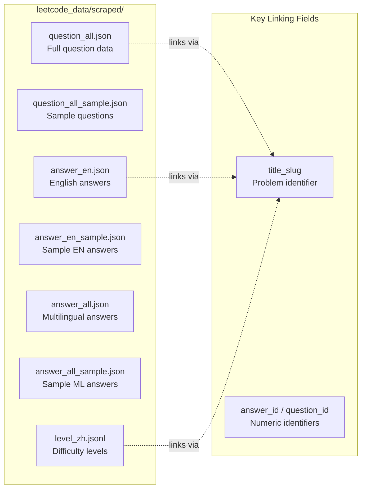
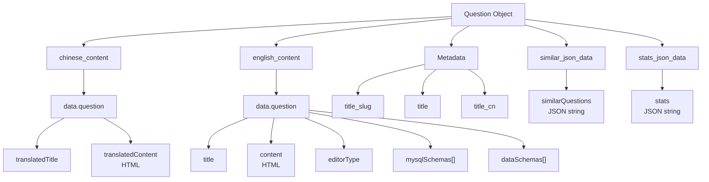
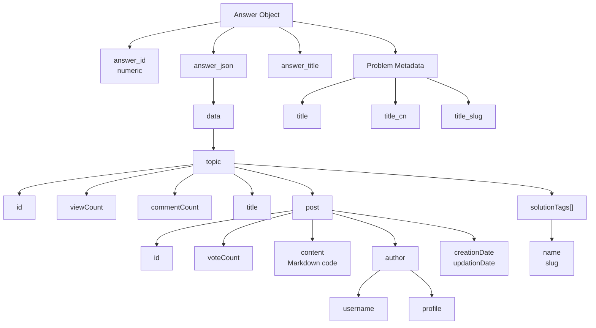
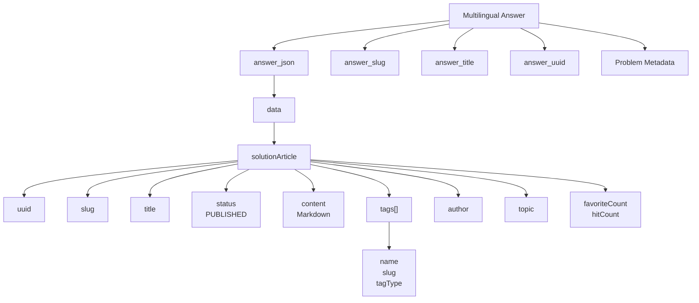
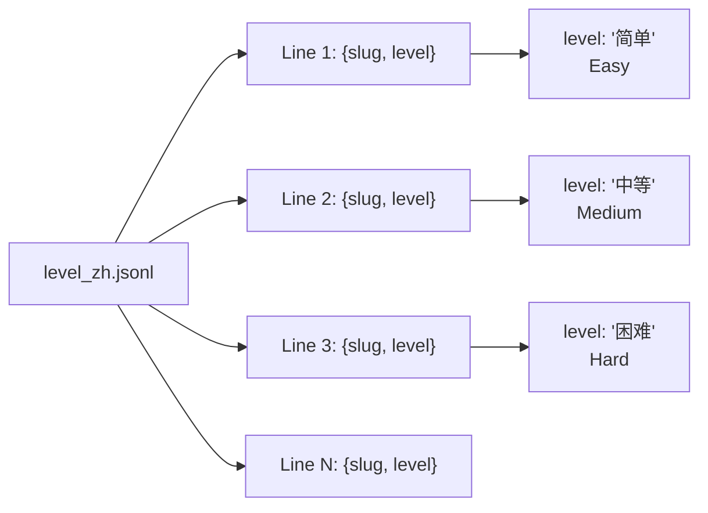
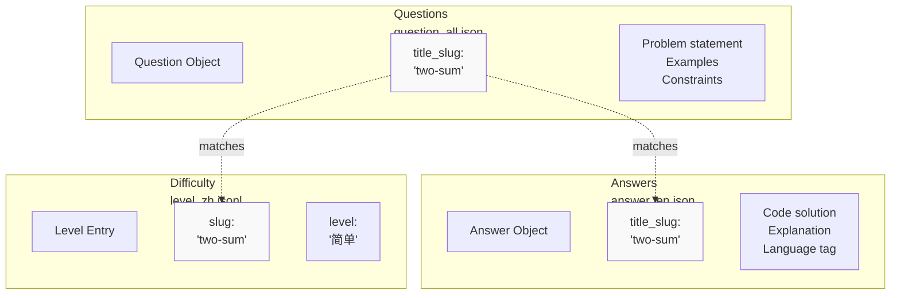
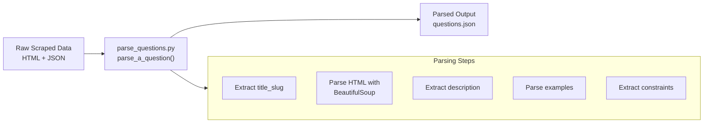
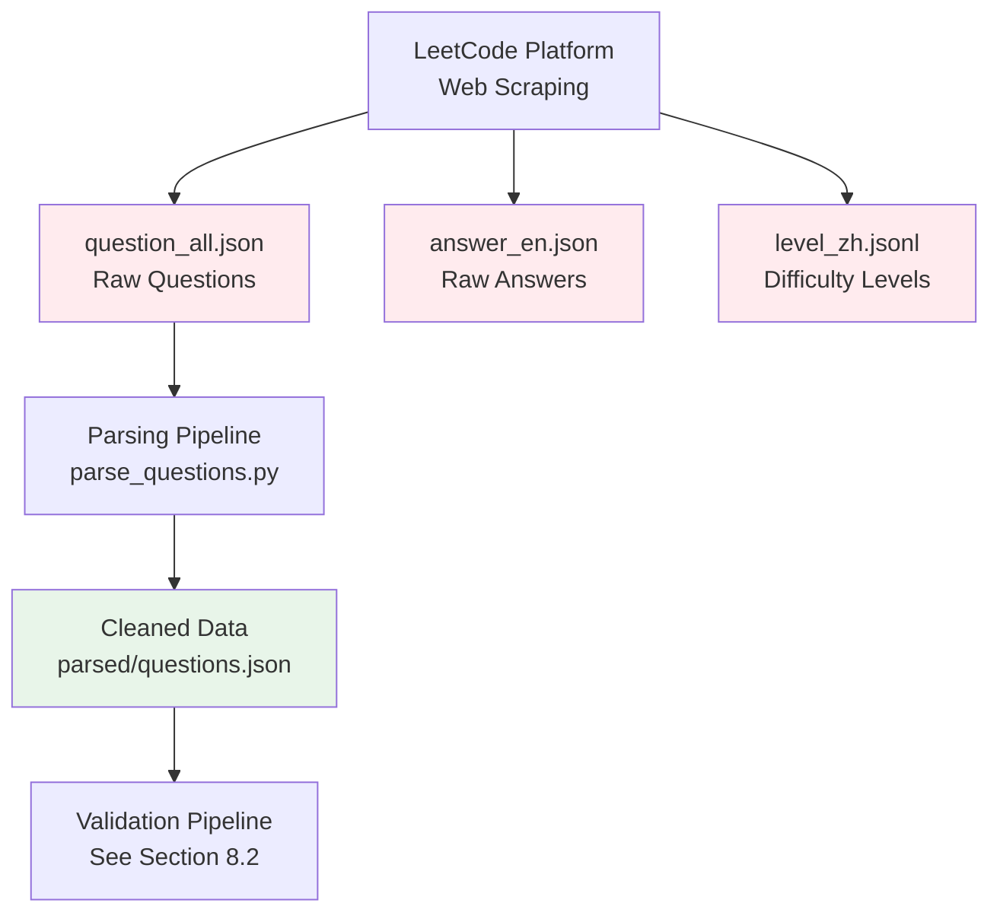

<!-- source: DeepWiki mcp.deepwiki.com · repo thunlp/DebugBench · page 8.1 Scraped Data Format · fetched 2026-11-02 -->

# Scraped Data Format

<details>
<summary>Relevant source files</summary>

The following files were used as context for generating this wiki page:

- [leetcode_data/parsed/parse_questions.py](leetcode_data/parsed/parse_questions.py)
- [leetcode_data/scraped/answer_all_sample.json](leetcode_data/scraped/answer_all_sample.json)
- [leetcode_data/scraped/answer_en_sample.json](leetcode_data/scraped/answer_en_sample.json)
- [leetcode_data/scraped/level_zh.jsonl](leetcode_data/scraped/level_zh.jsonl)
- [leetcode_data/scraped/question_all_sample.json](leetcode_data/scraped/question_all_sample.json)

</details>


This page documents the structure and schema of scraped LeetCode data stored in the `leetcode_data/scraped/` directory. This raw scraped data serves as the input to the parsing and validation pipeline documented in [Validated Solutions](#8.2).

The scraped data consists of three primary data types:
- **Question Data**: Problem statements, constraints, examples, and test schemas
- **Answer Data**: Community-submitted solutions with code and explanations
- **Difficulty Levels**: Problem difficulty classifications (Easy, Medium, Hard)

For information about how this scraped data is processed and transformed, see [Data Processing Pipeline](#8).

---

## Overview: Scraped Data Files

The scraped data is organized into separate files by data type and language:



**Sources:** [leetcode_data/scraped/question_all_sample.json:1-130](), [leetcode_data/scraped/answer_en_sample.json:1-161](), [leetcode_data/scraped/answer_all_sample.json:1-243](), [leetcode_data/scraped/level_zh.jsonl:1-20]()

---

## Question Data Schema

Questions are stored as JSON arrays where each element represents a complete LeetCode problem with bilingual content.

### Question Object Structure



### Key Fields

| Field Path | Type | Description | Example |
|------------|------|-------------|---------|
| `title_slug` | string | Unique problem identifier | `"average-time-of-process-per-machine"` |
| `title` | string | English problem title | `"Average Time of Process per Machine"` |
| `title_cn` | string | Chinese problem title | `"每台机器的进程平均运行时间"` |
| `english_content.data.question.content` | string | Problem statement (HTML) | `"<p>Table: <code>Activity</code></p>..."` |
| `chinese_content.data.question.translatedContent` | string | Translated content (HTML) | `"<p>表: <code>Activity</code></p>..."` |
| `english_content.data.question.editorType` | string | Editor type | `"CKEDITOR"` |
| `english_content.data.question.mysqlSchemas` | array | SQL setup statements | `["Create table If Not Exists..."]` |
| `english_content.data.question.dataSchemas` | array | Python/Pandas setup | `["data = [[...]]"]` |
| `similar_json_data.data.question.similarQuestions` | string | JSON array of similar problems | `"[{\"title\": \"...\", \"titleSlug\": \"...\"}]"` |
| `stats_json_data.data.question.stats` | string | Acceptance statistics | `"{\"totalAccepted\": \"15.2K\", ...}"` |

### Example Question Object

From [leetcode_data/scraped/question_all_sample.json:2-55]():

```json
{
    "title_slug": "average-time-of-process-per-machine",
    "title": "Average Time of Process per Machine",
    "title_cn": "每台机器的进程平均运行时间",
    "english_content": {
        "data": {
            "question": {
                "content": "<p>Table: <code>Activity</code></p>...",
                "editorType": "CKEDITOR",
                "mysqlSchemas": ["Create table If Not Exists Activity..."],
                "dataSchemas": ["data = [[0, 0, 'start', 0.712], ...]"]
            }
        }
    },
    "similar_json_data": {
        "data": {
            "question": {
                "similarQuestions": "[]"
            }
        }
    },
    "stats_json_data": {
        "data": {
            "question": {
                "stats": "{\"totalAccepted\": \"15.2K\", \"totalSubmission\": \"21.4K\"...}"
            }
        }
    }
}
```

**Sources:** [leetcode_data/scraped/question_all_sample.json:1-130]()

---

## Answer Data Schema

Answers represent community-submitted solutions. There are two variants: English-only (`answer_en`) and multilingual (`answer_all`).

### English Answer Format (`answer_en.json`)



### Multilingual Answer Format (`answer_all.json`)

Similar structure but uses `solutionArticle` instead of `topic`:



### Answer Data Fields

| Field Path | Type | Description | Example |
|------------|------|-------------|---------|
| `answer_id` | integer | Unique answer identifier | `3641608` |
| `title_slug` | string | Problem identifier | `"cheapest-flights-within-k-stops"` |
| `answer_title` | string | Solution title | `"BFS"` |
| `answer_json.data.topic.post.content` | string | Solution code and explanation (Markdown) | `"# Intuition and Approach\nUsing BFS..."` |
| `answer_json.data.topic.solutionTags` | array | Programming language tags | `[{"name": "Python3", "slug": "python3"}]` |
| `answer_json.data.topic.post.author.username` | string | Author username | `"dheerajnbhat"` |
| `answer_json.data.topic.post.voteCount` | integer | Upvotes | `1` |
| `answer_json.data.topic.viewCount` | integer | View count | `396` |

### Example Answer (English)

From [leetcode_data/scraped/answer_en_sample.json:1-53]():

```json
{
    "answer_id": 3641608,
    "title_slug": "cheapest-flights-within-k-stops",
    "answer_title": "BFS",
    "answer_json": {
        "data": {
            "topic": {
                "id": 3641608,
                "viewCount": 396,
                "solutionTags": [
                    {"name": "Python3", "slug": "python3"}
                ],
                "post": {
                    "id": 5575348,
                    "voteCount": 1,
                    "content": "# Intuition and Approach\nUsing BFS\n\n# Code\n```\nclass Solution:\n    def findCheapestPrice(...):\n```",
                    "author": {
                        "username": "dheerajnbhat",
                        "profile": {
                            "userAvatar": "https://...",
                            "reputation": 2
                        }
                    }
                }
            }
        }
    }
}
```

**Sources:** [leetcode_data/scraped/answer_en_sample.json:1-161](), [leetcode_data/scraped/answer_all_sample.json:1-243]()

---

## Difficulty Level Format

Problem difficulty levels are stored in JSONL (JSON Lines) format, with one JSON object per line.

### JSONL Structure



### Level Object Schema

| Field | Type | Description | Values |
|-------|------|-------------|--------|
| `slug` | string | Problem identifier | `"strange-printer-ii"` |
| `level` | string | Difficulty (Chinese) | `"困难"` (Hard), `"中等"` (Medium), `"简单"` (Easy) |

### Example Entries

From [leetcode_data/scraped/level_zh.jsonl:1-10]():

```jsonl
{"slug": "strange-printer-ii", "level": "困难"}
{"slug": "subtract-the-product-and-sum-of-digits-of-an-integer", "level": "简单"}
{"slug": "queue-reconstruction-by-height", "level": "中等"}
```

**Difficulty Mappings:**
- `"简单"` → Easy
- `"中等"` → Medium  
- `"困难"` → Hard

**Sources:** [leetcode_data/scraped/level_zh.jsonl:1-100]()

---

## Data Relationships

The scraped data files are linked via the `title_slug` field, which serves as the primary identifier across all data types.



### Relationship Details

1. **Questions to Answers**: Multiple answers can exist for a single question
   - Join key: `question.title_slug == answer.title_slug`
   
2. **Questions to Levels**: One-to-one relationship
   - Join key: `question.title_slug == level.slug`

3. **Answer Variants**: The same problem may have answers in both `answer_en.json` and `answer_all.json`
   - English answers: Community solutions in English
   - Multilingual answers: Solutions in various languages with localized explanations

**Sources:** [leetcode_data/scraped/question_all_sample.json:1-130](), [leetcode_data/scraped/answer_en_sample.json:1-161](), [leetcode_data/scraped/level_zh.jsonl:1-100]()

---

## Parsing Scraped Data

The parsing process extracts structured information from raw HTML content and nested JSON structures.

### Parsing Pipeline



### Key Parsing Functions

The `parse_questions.py` script demonstrates the parsing approach:

**Main Functions:**
- `parse_a_question(raw_question: dict) -> dict` - Parses a single question object
- `parse_questions(raw_questions: list[dict]) -> list[dict]` - Batch processes questions

**Parsing Steps** (from [leetcode_data/parsed/parse_questions.py:10-62]()):

1. **Extract Slug**: Get `title_slug` as primary identifier
2. **Parse HTML**: Use `BeautifulSoup` to convert HTML to plain text
3. **Extract Description**: Text before first "Example 1"
4. **Parse Examples**: Iterate through "Example 1:", "Example 2:", etc.
5. **Extract Constraints**: Text after "Constraints:" marker
6. **Remove Follow-ups**: Strip "Follow up:" sections if present

### Parsed Question Schema

The parsing transforms raw nested structures into a flatter format:

| Field | Type | Source | Description |
|-------|------|--------|-------------|
| `slug` | string | `title_slug` | Problem identifier |
| `description` | string | Parsed HTML | Problem statement |
| `examples` | array[string] | Parsed HTML | Example test cases |
| `constraints` | string | Parsed HTML | Input constraints |

**Sources:** [leetcode_data/parsed/parse_questions.py:1-83]()

---

## Data Flow Summary



The scraped data serves as the raw input for DebugBench's dataset construction pipeline. After parsing and validation, this data is used to:

1. Select appropriate problems across difficulty levels
2. Extract correct oracle solutions from community answers
3. Match problems with their difficulty classifications
4. Prepare problems for bug implantation (see [Bug Implantation Process](#2.2))

**Sources:** [leetcode_data/scraped/question_all_sample.json:1-130](), [leetcode_data/scraped/answer_en_sample.json:1-161](), [leetcode_data/scraped/answer_all_sample.json:1-243](), [leetcode_data/scraped/level_zh.jsonl:1-100](), [leetcode_data/parsed/parse_questions.py:1-83]()

---

