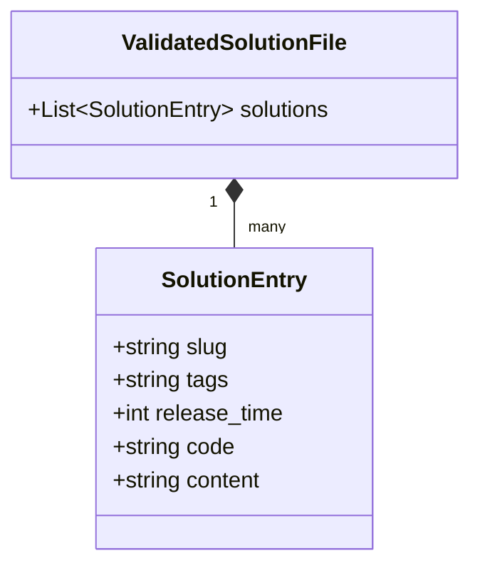
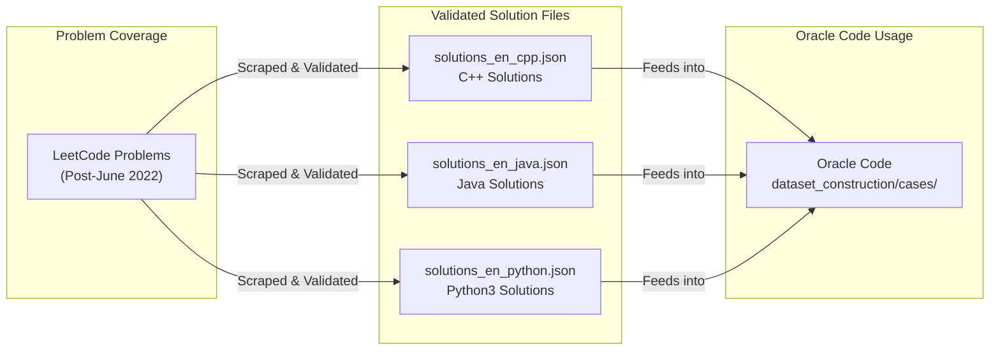
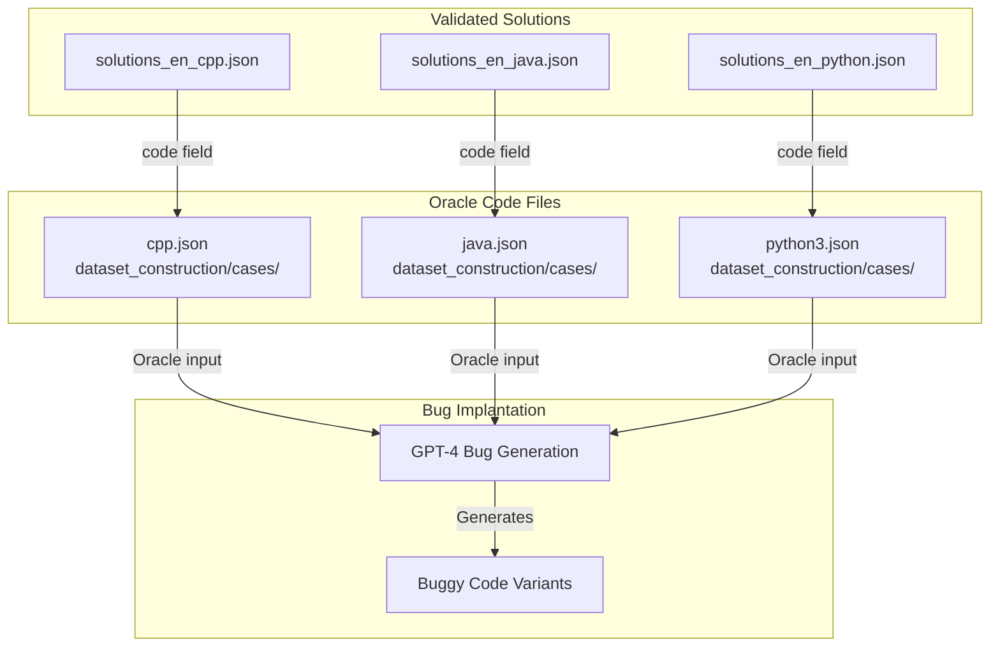
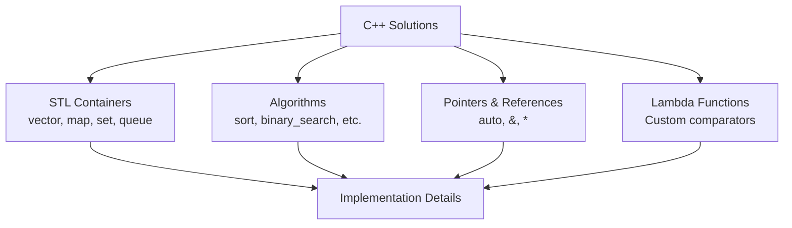
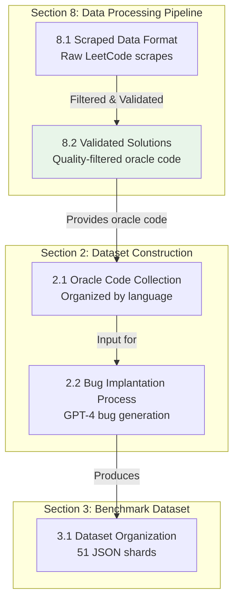

<!-- source: DeepWiki mcp.deepwiki.com · repo thunlp/DebugBench · page 8.2 Validated Solutions · fetched 2026-11-02 -->

# Validated Solutions

<details>
<summary>Relevant source files</summary>

The following files were used as context for generating this wiki page:

- [leetcode_data/validated/solutions_en_cpp.json](leetcode_data/validated/solutions_en_cpp.json)
- [leetcode_data/validated/solutions_en_java.json](leetcode_data/validated/solutions_en_java.json)
- [leetcode_data/validated/solutions_en_python.json](leetcode_data/validated/solutions_en_python.json)

</details>


This document describes the validated solution files that serve as the source of correct, oracle code for the DebugBench dataset construction process. These files contain high-quality LeetCode solutions scraped from the community that have been validated and organized by programming language.

For information about the raw scraped data format before validation, see [Scraped Data Format](#8.1). For details on how these validated solutions are used to generate buggy code variants, see [Bug Implantation Process](#2.2).

## Overview

The validated solutions are stored in three language-specific JSON files located in the `leetcode_data/validated/` directory:

| File | Language | Purpose |
|------|----------|---------|
| `solutions_en_cpp.json` | C++ | Validated C++ solutions from LeetCode community |
| `solutions_en_java.json` | Java | Validated Java solutions from LeetCode community |
| `solutions_en_python.json` | Python3 | Validated Python3 solutions from LeetCode community |

These files contain solutions that have been:
- Scraped from LeetCode community posts
- Filtered for quality and correctness
- Organized by problem slug and language
- Prepared as oracle code for bug implantation

Sources: [leetcode_data/validated/solutions_en_cpp.json:1-100](), [leetcode_data/validated/solutions_en_java.json:1-100](), [leetcode_data/validated/solutions_en_python.json:1-100]()

## Data Schema

Each validated solution file is a JSON array containing solution objects. The schema for each solution entry is:



**Schema for Validated Solution Entry**

Sources: [leetcode_data/validated/solutions_en_cpp.json:1-15](), [leetcode_data/validated/solutions_en_java.json:1-15](), [leetcode_data/validated/solutions_en_python.json:1-15]()

### Field Descriptions

| Field | Type | Description | Example |
|-------|------|-------------|---------|
| `slug` | string | LeetCode problem identifier (URL-safe name) | `"cat-and-mouse-ii"` |
| `tags` | string | Programming language tag | `"cpp"`, `"java"`, `"python3"` |
| `release_time` | integer | Unix timestamp when solution was posted | `1652504475` |
| `code` | string | Extracted solution code (clean, executable) | See code examples below |
| `content` | string | Full markdown content from original post (includes explanations, code blocks) | Raw markdown with code, explanations, complexity analysis |

Sources: [leetcode_data/validated/solutions_en_cpp.json:2-7](), [leetcode_data/validated/solutions_en_java.json:2-7](), [leetcode_data/validated/solutions_en_python.json:2-7]()

## Solution Structure by Language

### C++ Solutions (`solutions_en_cpp.json`)

C++ solutions follow standard LeetCode C++ submission format with class-based structure.

**Example Entry Structure:**

```json
{
    "slug": "largest-combination-with-bitwise-and-greater-than-zero",
    "tags": "cpp",
    "release_time": 1677319841,
    "code": "class Solution {\npublic:\n    int largestCombination(vector<int>& candidates) {...}",
    "content": "```\nclass Solution {...}\n```"
}
```

**Common C++ Patterns:**
- Class definitions with `Solution` class
- STL containers: `vector`, `unordered_map`, `set`, `priority_queue`
- Standard library inclusions implied (not always explicit in extracted code)
- Public member functions matching LeetCode function signatures

Sources: [leetcode_data/validated/solutions_en_cpp.json:9-15]()

### Java Solutions (`solutions_en_java.json`)

Java solutions follow LeetCode Java submission format with class-based structure and explicit type declarations.

**Example Entry Structure:**

```json
{
    "slug": "count-number-of-rectangles-containing-each-point",
    "tags": "java",
    "release_time": 1650772909,
    "code": "class Solution {\n    public int[] countRectangles(int[][] rectangles, int[][] points) {...}",
    "content": "...Approach details..."
}
```

**Common Java Patterns:**
- `Solution` class with public methods
- Java Collections Framework: `ArrayList`, `HashMap`, `TreeMap`, `PriorityQueue`
- Array and primitive type usage
- Public method signatures matching LeetCode specifications

Sources: [leetcode_data/validated/solutions_en_java.json:2-7]()

### Python3 Solutions (`solutions_en_python.json`)

Python solutions follow LeetCode Python3 submission format with class-based structure.

**Example Entry Structure:**

```json
{
    "slug": "number-of-subsequences-that-satisfy-the-given-sum-condition",
    "tags": "python3",
    "release_time": 1683361746,
    "code": "class Solution:\n    def numSubseq(self, nums: List[int], target: int) -> int:...",
    "content": "# Intuition\n...\n# Code\n```"
}
```

**Common Python Patterns:**
- `Solution` class with instance methods
- Type hints using `List`, `Dict`, `Set`, `Optional`
- Python built-in functions: `sorted()`, `enumerate()`, `zip()`
- Collections module usage: `defaultdict`, `Counter`, `deque`

Sources: [leetcode_data/validated/solutions_en_python.json:2-7]()

## File Organization and Statistics



**File Organization in Pipeline**

Sources: [leetcode_data/validated/solutions_en_cpp.json](), [leetcode_data/validated/solutions_en_java.json](), [leetcode_data/validated/solutions_en_python.json]()

## Code vs Content Fields

The distinction between `code` and `content` fields is critical:

### Code Field
- **Purpose**: Clean, executable solution code ready for bug implantation
- **Format**: Raw code string with newlines (`\n`)
- **Usage**: Direct input to GPT-4 bug implantation prompts
- **Characteristics**:
  - Stripped of markdown formatting
  - Executable as-is
  - Contains only the solution implementation
  - May include helper classes/functions

**Example (C++):**
```
class Solution {
public:
    int largestCombination(vector<int>& candidates) {
        vector<int> v(32,0);
        int ans = 0,x,j;
        for(auto &i: candidates){
            for(j = 0; j <= 31; j++){
                if(i&(1<<j)){
                    v[j]++;
                }
                ans = max(ans,v[j]);
            }
        }
        return ans;
    }
};
```

### Content Field
- **Purpose**: Full context including explanations, complexity analysis, and approach
- **Format**: Markdown-formatted text from original LeetCode post
- **Usage**: Reference for understanding solution logic (not used in bug implantation)
- **Characteristics**:
  - Contains markdown headers, bullet points, code blocks
  - Includes intuition, approach, complexity analysis
  - May contain multiple code variants or examples
  - Often includes LaTeX for mathematical notation

**Example structure in content:**
```
# Intuition
<!-- Describe your first thoughts on how to solve this problem. -->

# Approach
<!-- Describe your approach to solving the problem. -->

# Complexity
- Time complexity: O(n)
- Space complexity: O(1)

# Code
```
class Solution {...}
```
```

Sources: [leetcode_data/validated/solutions_en_cpp.json:6-7](), [leetcode_data/validated/solutions_en_cpp.json:13-14]()

## Solution Examples by Problem Type

### Example 1: Array/Bit Manipulation (C++)

**Problem:** `largest-combination-with-bitwise-and-greater-than-zero`

```cpp
class Solution {
public:
    int largestCombination(vector<int>& candidates) {
        vector<int> v(32,0);
        int ans = 0,x,j;
        for(auto &i: candidates){
            for(j = 0; j <= 31; j++){
                if(i&(1<<j)){
                    v[j]++;
                }
                ans = max(ans,v[j]);
            }
        }
        return ans;
    }
};
```

Sources: [leetcode_data/validated/solutions_en_cpp.json:9-15]()

### Example 2: TreeMap/Binary Search (Java)

**Problem:** `count-number-of-rectangles-containing-each-point`

```java
class Solution {
    public int[] countRectangles(int[][] rectangles, int[][] points) {
        int max = Integer.MIN_VALUE;
        TreeMap<Integer, List<Integer>> rects = new TreeMap<>();
        for(int[] rect : rectangles) {
            if (!rects.containsKey(rect[1])) {
                rects.put(rect[1], new ArrayList<Integer>());
            }
            rects.get(rect[1]).add(rect[0]);
            max = Math.max(max, rect[1]);
        }
        // ... binary search implementation
    }
}
```

Sources: [leetcode_data/validated/solutions_en_java.json:2-7]()

### Example 3: Two Pointers (Python3)

**Problem:** `number-of-subsequences-that-satisfy-the-given-sum-condition`

```python
class Solution:
    def numSubseq(self, nums: List[int], target: int) -> int:
        nums.sort()
        left, right = 0, len(nums) - 1
        count = 0
        mod = 10 ** 9 + 7
        
        while left <= right:
            if nums[left] + nums[right] > target:
                right -= 1
            else:
                count += pow(2, right - left, mod)
                left += 1
        
        return count % mod
```

Sources: [leetcode_data/validated/solutions_en_python.json:2-7]()

## Integration with Dataset Construction



**Data Flow from Validated Solutions to Benchmark**

The validated solutions serve as the foundation for the entire DebugBench dataset:

1. **Extraction**: The `code` field from validated solutions is extracted
2. **Organization**: Solutions are organized into `dataset_construction/cases/` directory by language
3. **Bug Implantation**: Oracle code is fed to GPT-4 with specific bug type instructions
4. **Validation**: Generated buggy code is validated against oracle code to ensure different behavior
5. **Benchmark Creation**: Validated bug-oracle pairs are published in the benchmark shards

Sources: [leetcode_data/validated/solutions_en_cpp.json](), [leetcode_data/validated/solutions_en_java.json](), [leetcode_data/validated/solutions_en_python.json]()

## Quality Characteristics

The validated solutions exhibit specific quality characteristics that make them suitable as oracle code:

### Correctness
- Solutions are sourced from highly-upvoted LeetCode community posts
- Code has been tested against LeetCode's test suite
- Solutions represent accepted answers to the problems

### Clarity
- Code is well-structured and readable
- Variable names are meaningful
- Logic is straightforward without unnecessary obfuscation

### Completeness
- Solutions include all necessary classes and helper functions
- Code is self-contained within the LeetCode submission format
- No external dependencies beyond standard libraries

### Diversity
- Multiple problem types: arrays, trees, graphs, dynamic programming, etc.
- Various difficulty levels: easy, medium, hard
- Different algorithmic approaches: greedy, divide-and-conquer, backtracking, etc.

Sources: [leetcode_data/validated/solutions_en_cpp.json:1-100](), [leetcode_data/validated/solutions_en_java.json:1-100](), [leetcode_data/validated/solutions_en_python.json:1-100]()

## Language-Specific Considerations

### C++ Specific Features



**C++ Language Constructs in Solutions**

Common C++ patterns found in validated solutions:
- Auto keyword usage: `for(auto &i: candidates)`
- STL algorithms: `sort()`, `max()`, `min()`
- Memory management: Stack allocation preferred
- Template usage: `vector<int>`, `unordered_map<int, int>`

Sources: [leetcode_data/validated/solutions_en_cpp.json:9-100]()

### Java Specific Features

**Java patterns in validated solutions:**
- Interface implementations: `List`, `Map`, `Set`
- Collection utilities: `Collections.sort()`, `Arrays.sort()`
- Generic types: `List<Integer>`, `Map<String, List<Integer>>`
- Stream API (less common in competitive programming)
- Explicit type declarations required

Sources: [leetcode_data/validated/solutions_en_java.json:2-100]()

### Python3 Specific Features

**Python patterns in validated solutions:**
- List comprehensions: `[x for x in nums if x > 0]`
- Built-in functions: `sorted()`, `enumerate()`, `zip()`
- Collections module: `defaultdict`, `Counter`, `deque`
- Type hints: `List[int]`, `Dict[str, int]`, `Optional[TreeNode]`
- Pythonic idioms: `a, b = b, a` for swapping

Sources: [leetcode_data/validated/solutions_en_python.json:2-100]()

## Solution Metadata

The `release_time` field provides temporal information about when solutions were posted:

| Language | Time Range | Use Case |
|----------|------------|----------|
| C++ | Unix timestamps (2022+) | Filter solutions by recency |
| Java | Unix timestamps (2022+) | Identify contemporary coding patterns |
| Python3 | Unix timestamps (2022+) | Ensure modern Python3 syntax |

The post-June 2022 constraint ensures:
- Modern language features (C++17/20, Java 11+, Python 3.8+)
- Up-to-date LeetCode problem set
- Contemporary coding practices
- Avoidance of deprecated patterns

Sources: [leetcode_data/validated/solutions_en_cpp.json:5](), [leetcode_data/validated/solutions_en_java.json:5](), [leetcode_data/validated/solutions_en_python.json:5]()

## Accessing Validated Solutions Programmatically

### Loading Solutions in Python

```python
import json

# Load C++ solutions
with open('leetcode_data/validated/solutions_en_cpp.json', 'r') as f:
    cpp_solutions = json.load(f)

# Access specific solution
for solution in cpp_solutions:
    if solution['slug'] == 'target-problem':
        code = solution['code']
        break

# Filter by timestamp
recent_solutions = [s for s in cpp_solutions 
                   if s['release_time'] > 1680000000]
```

### Key Access Patterns

| Operation | Method |
|-----------|--------|
| Find by slug | Iterate array, match `slug` field |
| Filter by date | Compare `release_time` field |
| Extract code | Access `code` field directly |
| Get explanation | Parse `content` field (markdown) |

Sources: [leetcode_data/validated/solutions_en_cpp.json:1]()

## Relationship to Other Components



**Position in DebugBench Pipeline**

The validated solutions sit at a critical juncture:
- **Upstream**: Receive filtered data from scraping process ([Scraped Data Format](#8.1))
- **Downstream**: Provide oracle code to bug implantation ([Bug Implantation Process](#2.2))
- **Purpose**: Act as high-quality, correct solutions for generating buggy variants

Sources: [leetcode_data/validated/solutions_en_cpp.json](), [leetcode_data/validated/solutions_en_java.json](), [leetcode_data/validated/solutions_en_python.json]()

## Summary

The validated solution files are essential components of DebugBench that:

1. **Store Oracle Code**: Contain correct, high-quality solutions as ground truth
2. **Support Multiple Languages**: Organized across C++, Java, and Python3
3. **Enable Bug Generation**: Provide clean code for GPT-4 bug implantation
4. **Maintain Quality**: Filter and validate solutions from LeetCode community
5. **Structure Data**: Use consistent JSON schema across all languages

These files bridge the gap between raw scraped data and the structured benchmark dataset, ensuring that all buggy code variants are generated from verified, correct implementations.

Sources: [leetcode_data/validated/solutions_en_cpp.json](), [leetcode_data/validated/solutions_en_java.json](), [leetcode_data/validated/solutions_en_python.json]()

---

